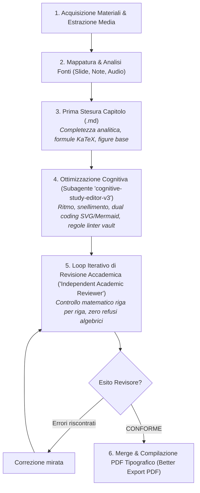

# Ottimizzazione Cognitiva e Didattica Post-Stesura Tramite Subagente Indipendente (Regola Vault)

Questa regola definisce la procedura operativa obbligatoria per l'ottimizzazione della **scorrevolezza del testo**, del **ritmo di lettura**, della **chiarezza espositiva** e della **massima memorizzazione a lungo termine** degli appunti del vault, mediante l'impiego del subagente dedicato **`cognitive-study-editor-v3`**.

---

## 1. Motivazione Didattica e Fondamenti di Scienze Cognitive

Nello studio universitario di secondo livello per l'ingegneria (discipline ad alto tasso analitico, statistico e computazionale), il rigore formale delle formule è necessario ma non sufficiente:
- **Sovraccarico della memoria di lavoro (*Extraneous Cognitive Load*)**: periodi ipotattici complessi, forme passive impersonali e frasi eccessivamente dense affaticano lo studente prima ancora che egli possa decifrare il significato matematico.
- **Assenza di framing preventivo**: presentare lunghe catene di derivazioni senza dichiarare in anticipo l'obiettivo qualitativo e fisico induce una memorizzazione meccanica e volatile dei simboli invece della comprensione concettuale profonda.
- **Mancanza di ancoraggi visivi (*Dual Coding Theory*)**: concetti astratti (curvatura della verosimiglianza, braccio di leva temporale, decadimento asintotico) si fissano nella memoria a lungo termine in modo esponenzialmente più rapido se affiancati da una rappresentazione geometrica o intuitiva chiara.

Il subagente **`cognitive-study-editor-v3`** agisce come un Senior Academic Editor e Cognitive Learning Specialist, trasformando un testo tecnicamente corretto in uno strumento di studio ad altissimo impatto pedagogico e facilità di memorizzazione.

---

## 2. Collocazione Ottimale nella Pipeline degli Appunti

L'ottimizzazione cognitiva si colloca strategicamente come **ponte tra la prima stesura e il loop di validazione scientifica finale**:



### Perché questa posizione è la migliore?
1. **L'editor cognitivo riceve il quadro d'insieme completo**: lavora su una bozza già strutturata in tutte le sue sezioni, potendo modulare il ritmo, evidenziare i collegamenti logici e arricchire i passaggi complessi con diagrammi SVG/Mermaid.
2. **Il revisore scientifico esamina il testo finale dello studente**: posizionando il Loop di Peer Review Accademico *subito dopo* l'ottimizzazione cognitiva, si garantisce che l'esame di conformità matematica e fattuale certifichi proprio il testo rifinito, escludendo che la rielaborazione sintattica abbia introdotto refusi o imprecisioni algebriche.

---

## 3. Modalità di Invocazione del Subagente

L'agente principale invoca il subagente tramite il tool nativo `invoke_subagent`:

```json
{
  "TypeName": "cognitive-study-editor-v3",
  "Role": "Cognitive Study Editor (Vault Compliant)",
  "Prompt": "Esegui l'ottimizzazione cognitiva completa del capitolo '<Percorso_Capitolo.md>'. OBIETTIVI: 1) Massima scorrevolezza, ritmo serrato, voce attiva in prima persona naturale da problem solver, paragrafi snelli (1-4 righe); 2) Massima ritenzione mnemonica per l'esame: struttura concettuale (Obiettivo -> Sviluppo analitico commentato -> Takeaway d'esame), commento esplicito del perché i termini si annullano o si trasformano; 3) Dual coding visivo: se utile, integra schemi nativi Mermaid (```mermaid) o grafici vettoriali SVG dedicati salvati in '<Materia>/immagini/' e inclusi con '![[...|center mid]]'. CONFORMITÀ TASSATIVA AL VAULT: usa solo __grassetto__, _corsivo_, ellissi '…' (U+2026), zero '---', solo H1 numerato e sottotitoli puramente descrittivi, display math $$ isolati su riga singola con righe vuote prima e dopo. REGOLA FONDAMENTALE: ZERO PERDITA DI CONTENUTI. Mantieni il 100% di formule, teoremi, dimostrazioni, esempi e riferimenti extra."
}
```

---

## 4. Mandato Operativo e Checklist di Ottimizzazione

Il subagente applica rigorosamente i seguenti principi:

### 4.1 Fluidità, Ritmo e Voce Narrativa
- [ ] **Voce in prima persona naturale da ingegnere**: alternare singolare e plurale spontanei (*"imponiamo"*, *"se calcoliamo la varianza troviamo"*, *"organizziamo i campioni in un vettore"*).
- [ ] **Eliminazione dei preamboli gonfiati**: andare dritti al punto del problema ingegneristico, eliminando formule burocratiche o accademiche passive (*"si procede ora all'esplicitazione della derivazione"* $\to$ *"deriviamo ora rispetto a $\theta$"*).
- [ ] **Divieto assoluto di formule metanarrative di transizione**: eliminare tassativamente formule quali *"nel capitolo precedente abbiamo visto"*, *"nei capitoli precedenti abbiamo trattato"*, *"in questo capitolo vedremo/esploreremo"*, *"il presente capitolo si propone di"*. I capitoli confluiscono in un PDF unico concatenato: l'apertura deve entrare immediatamente ed assertivamente nel vivo del problema fisico o matematico.
- [ ] **Paragrafi snelli**: blocchi di testo compatti (1–4 righe) intervallati da equazioni isolate e figure per garantire una lettura riposante e ritmata.

### 4.2 Struttura Mnemonicamente Orientata all'Esame
- [ ] **Chunking logico**: ogni macro-sezione o dimostrazione segue il percorso:
  1. *L'Intuizione / Obiettivo*: cosa cerchiamo e perché ci serve per l'esame.
  2. *Lo Sviluppo Analitico*: calcolo matematico con ogni passaggio algebrico esplicitato e motivato (ortogonalità, linearità del valore atteso, indipendenza del supporto).
  3. *Il Takeaway Operativo*: formula finale, significato fisico, legge di scala asintotica ($O(1/N)$, $O(1/N^3)$) e trabocchetti frequenti.
- [ ] **Callout semantici mirati**:
  - `> [!IMPORTANT]`: per teoremi, condizioni necessarie/sufficienti e risultati cardine.
  - `> [!TIP]`: per scorciatoie d'esame, trucchi operativi e verifiche veloci.
  - `> [!WARNING]`: per trabocchetti concettuali d'esame (es. supporto dipendente dal parametro, diagonale dell'inversa vs inverso della diagonale).
  - `> [!EXAMPLE]`: per problemi svolti ed esempi numerici/analitici dettagliati.

### 4.3 Generazione Immagini e Schemi Grafici (Pienamente Autorizzata)
- [ ] **Sviluppo Orizzontale dei Grafici (Ottimizzazione Spazi di Stampa)**:
  - Diagrammi cartesiani, pipeline e architetture a blocchi devono svilupparsi **prioritariamente in orizzontale** (layout panoramico / landscape, aspect ratio $16:9$, $2:1$, $5:2$ o $3:1$), mantenendo altezze compatte (es. 180–320 px).
  - Nei diagrammi a più stadi o confronti tra metodi, organizzare i contenuti in **pannelli o card affiancate orizzontalmente** (colonne da sinistra a destra), evitando sequenze verticali che consumano l'intera pagina A4 e forzano salti pagina.
  - Per diagrammi di flusso nativi, usare di default **Mermaid `flowchart LR`** (da sinistra a destra), limitando `flowchart TD` ai soli casi di gerarchie discendenti strette. È vietato l'uso di diagrammi in testo ASCII.
- [ ] **Tema Chiaro Tipografico (Requisito Tassativo Print-Ready per PDF e Stampa)**:
  - Divieto assoluto di temi scuri (`#0f172a`, `#1e293b`, `#1e1e2e`, Catppuccin Mocha, ecc.) per evitare sprechi massivi di inchiostro e cattivo contrasto su carta.
  - **Sfondo**: sempre bianco puro (`#ffffff`) o neutro chiarissimo (`#f8fafc`).
  - **Testi, assi ed etichette**: scuri ad altissimo contrasto (`#0f172a`, `#1e293b`, `#334155`).
  - **Griglie e bordi**: grigio neutro tenue e sottile (`#cbd5e1`, `#e2e8f0`).
  - **Dati, curve e card**: curve nitide e brillanti (`#2563eb`, `#059669`, `#dc2626`, `#d97706`, `#7c3aed`), card e aree di riempimento a tinte pastello delicate (`#eff6ff`, `#ecfdf5`, `#fef3c7`, `#fef2f2`).
- [ ] **Grafici cartesiani e schemi generati (Precedenza Assoluta ad SVG rispetto a PNG)**:
  - Possono essere generati sia in formato vettoriale `.svg` sia in raster `.png` (ad alta risoluzione a 300 DPI), ma **bisogna dare sempre la precedenza al formato vettoriale SVG** come prima scelta prioritaria (risoluzione infinita, peso file irrisorio, resa vettoriale nativa nei PDF senza sgranare). Il formato `.png` a 300 DPI è ammesso come alternativa o fallback per contenuti raster complessi.
  - I file vanno salvati nella cartella **`immagini/`** della materia corrente e inclusi nel Markdown **esclusivamente** tramite la sintassi nativa degli allegati Obsidian:
    `![[nome_file.svg|center mid]]` oppure `![[nome_file.png|center mid]]` (oppure `small` o `big` in base al livello di dettaglio testuale).
  - Divieto assoluto di codice SVG inline o tag HTML `<p align="center">` all'interno del Markdown.
  - Se due immagini `small` si susseguono, inserirle sulla stessa riga di testo separate da un solo spazio (`![[img1.svg|center small]] ![[img2.svg|center small]]`).
  - **Rendering Matematico nei Grafici**: Per evitare stringhe LaTeX non compilate nei diagrammi (es. `w_t^{(i)} = ...`), impostare sempre `matplotlib.rcParams['svg.fonttype'] = 'path'` e `matplotlib.rcParams['mathtext.fontset'] = 'dejavusans'`, racchiudendo le formule tra `r"$...$"`. Questo converte simboli, indici e formule in tracciati vettoriali integrati.
- [ ] **Divieto di Testo Eccessivo nelle Immagini (Principio "Less Text, More Structure")**:
  - Le immagini didattiche e i diagrammi non devono replicare interi paragrafi o muri di testo già ampiamente descritti nel corpo Markdown della lezione.
  - I grafici devono configurarsi come mappe visive e strutturali: formule chiave in risalto, etichette sintetiche, elenchi schematici a punti e visualizzazione immediata delle relazioni logico-geometriche.
- [ ] **Verifica Geometrica Preventiva Anti-Sovrapposizione e Anti-Overflow (Tassativa Prima del Rilascio)**:
  - Prima di dare per corretta qualsiasi immagine generata sinteticamente, è obbligatorio verificare visivamente e geometricamente che:
    1. **Nessun testo fuoriesca dai riquadri/card o dal canvas**: i testi non devono mai toccare né oltrepassare i bordi delle card o dei contenitori (garantire margini interni di respiro minimi su tutti e 4 i lati, e almeno il 15–20% di spazio libero alla base delle card verticali).
    2. **Nessun testo si sovrapponga**: eliminare categoricamente collisioni o intersezioni tra etichette, testi descrittivi, formule e tracciati grafici (pairwise overlap = 0).
    3. Le frasi lunghe devono essere opportunamente mandate a capo (multi-line) o condensate per non superare la larghezza utile dell'elemento grafico.

### 4.4 Conformità Tassativa alle Linee Guida del Vault (`STRUTTURA_E_GUIDA_APPUNTI.md`)
- [ ] **Convenzioni Linter**:
  - `__grassetto__` obbligatorio (doppio underscore, mai asterischi `**`).
  - `_corsivo_` obbligatorio (singolo underscore, mai asterisco `*`).
  - Ellissi tipografica obbligatoria: `…` (Unicode U+2026, mai tre punti consecutivi `...`).
- [ ] **Zero righe orizzontali**: nessuna presenza di divisori `---` nel testo.
- [ ] **Gerarchia titoli**: solo H1 è numerato (`# N. Titolo`), corrispondente al nome del file. Tutti i titoli da H2 in giù sono puramente descrittivi, privi di numeri o prefissi di step.
- [ ] **Integrità elenchi**: nessun elenco puntato o numerato interrotto da callout o immagini; completare l'elenco prima di inserire elementi blocco.
- [ ] **Zero perdite di contenuti**: è categoricamente vietato omettere formule, dimostrazioni o passaggi matematici.
- [ ] **Divieto di meta-commenti**: esporre direttamente la teoria corretta e pulita, senza menzionare revisioni, refusi delle slide o passaggi corretti dalle note dello studente.

### 4.5 Gestione Obbligatoria dello Pseudocodice (Plugin `obsidian-pseudocode`)
- [ ] **Blocchi `pseudo` esclusivi per algoritmi formali**:
  - Quando viene descritto un algoritmo formale, un ciclo di stima stocastica o una procedura computazionale con formule matematiche, è **tassativamente vietato l'uso di blocchi di testo generico (`text`)**.
  - Lo pseudocodice deve essere inserito all'interno di un blocco ```` ```pseudo ```` gestito dal plugin `obsidian-pseudocode`.
- [ ] **Sintassi LaTeX Algorithmic rigorosa**:
  - Racchiudere l'algoritmo in `\begin{algorithm} ... \end{algorithm}` con `\caption{...}` e `\begin{algorithmic} ... \end{algorithmic}`.
  - Dichiarare input e output con `\REQUIRE` ed `\ENSURE`.
  - Utilizzare le istruzioni standard: `\STATE` per singola istruzione/assegnazione, `\FOR{...}` ... `\ENDFOR`, `\IF{...}` ... `\ELSE` ... `\ENDIF`, `\WHILE{...}` ... `\ENDWHILE`, `\RETURN`.
  - Inserire i commenti con `\COMMENT{...}`.
- [ ] **Piena renderizzazione KaTeX delle formule**:
  - Tutte le variabili, vettori, matrici, sommatorie e simboli devono essere racchiusi tra `$ ... $` per garantire la renderizzazione tipografica corretta all'interno del blocco.
