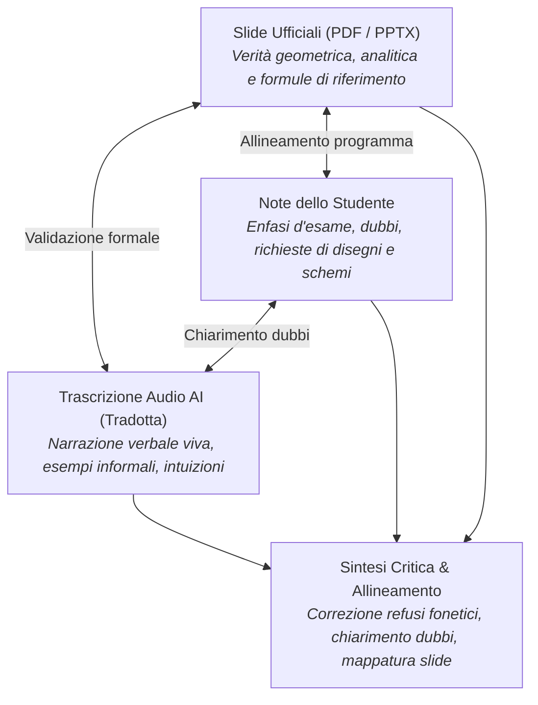
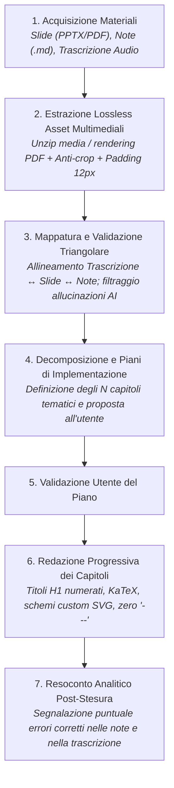

# Pipeline di Redazione con Trascrizione Audio, Note e Decomposizione in Macro-Argomenti

Questa regola definisce la procedura operativa da seguire quando la redazione degli appunti di una lezione si avvale contemporaneamente di:
1. **Slide ufficiali del corso** (presentazioni PowerPoint `.pptx` o documenti `.pdf`).
2. **Note grezze dello studente** (annotazioni, dubbi, richieste di approfondimenti o schemi alla lavagna).
3. **Trascrizione audio (con eventuale traduzione automatica)** della spiegazione orale del docente, prodotta tramite modelli di intelligenza artificiale (Whisper, Gemini, ecc.).

La regola stabilisce inoltre le linee guida per la **decomposizione modulare di lezioni molto ampie ed estese in $N$ capitoli tematici ben definiti**, attraverso la formulazione preventiva di piani di implementazione.

---

## 1. Principi Guida e Criticità della Trascrizione Audio AI

L'integrazione di una trascrizione audio arricchisce notevolmente la fedeltà didattica del testo, catturando il ragionamento verbale informale, le motivazioni ingegneristiche e gli esempi alla lavagna non presenti nei lucidi.

Tuttavia, le trascrizioni generate da modelli AI sono intrinsecamente soggette ad alterazioni e rumore che devono essere rigorosamente filtrati:
- **Refusi fonetici su termini tecnici inglesi**: trascrizione scorretta di acronimi e algoritmi di computer vision / deep learning (es. _"soft max"_ trascritto come _"soft marks"_, _"ReLU"_ come _"rail you"_, _"weight decay"_ come _"weight the k"_, _"backpropagation"_ come _"back propagation"_, _"Leaky-ReLU"_ come _"liqui relu"_, _"SGD"_ come _"SJD"_).
- **Allucinazioni nei silenzi o audio disturbato**: inserimento di frasi plausibili ma completamente inventate dal modello durante pause del docente, rumori d'ambiente o cambi di diapositiva.
- **Travisamento di simboli e formule matematiche**: confusione sistematica su indici, sommatorie, lettere greche ($\lambda, \alpha, \beta, \gamma, \sigma, \mu, \epsilon$) o direzioni di propagazione dei gradienti (es. confondere layer precedente $l-1$ con layer successivo $l+1$).
- **Omissioni o salti logici**: troncamento di premesse o di passaggi intermedi a causa della frammentazione dell'audio.

---

## 2. Metodologia di Validazione Triangolare (Note vs Trascrizione vs Slide)

Durante la fase di analisi preliminare, l'assistente deve condurre una **validazione incrociata a tre vie**:

### Ruoli Operativi delle Tre Fonti
1. **Slide del Docente (Verità Matematica e Strutturale)**:
   - Costituiscono il riferimento primario per formule analitiche, grafici, notazione simbolica, architetture e perimetro del programma d'esame.
2. **Note dello Studente (Baricentro dell'Attenzione e Segnalibro Didattico)**:
   - Indicano con precisione quali passaggi sono stati enfatizzati dal docente a lezione, dove sono sorti dubbi di comprensione, e quali schemi/disegni alla lavagna sono stati richiesti (es. marcati con `/// inserire immagine...`).
3. **Trascrizione Audio Tradotta (Fonte di Profondità Euristica e Linguistica)**:
   - Fornisce il collante narrativo, le analogie e le spiegazioni "a parole povere" usate dal docente per rendere digeribili concetti astratti.

### Mappatura Spaziale e Temporale
- A ogni blocco di testo della trascrizione audio deve essere associato con precisione l'**intervallo di slide di riferimento** (es. _Slide 1–14: Dal Feature Matching al Representation Learning_, _Slide 15–20: Il Descrittore HOG e le sue limitazioni_, ecc.).
- Se la trascrizione contiene affermazioni che contraddicono palesemente le slide o la letteratura consolidata, la contraddizione viene identificata, spiegata e corretta nel testo finale.
- Se le note dello studente presentano un dubbio (es. _"non ho capito questo passaggio"_), l'assistente sfrutta la spiegazione verbale della trascrizione congiunta all'analisi della slide per sciogliere il nodo in modo chiaro e didatticamente ineccepibile.

---

## 3. Decomposizione Modulare in Macro-Argomenti ($N$ Piani di Implementazione)

Quando una lezione copre un volume sostanziale di contenuti (es. oltre 60–100 slide, decine di pagine di note e registrazioni estese), condensare tutto in un unico file `.md` risulterebbe dispersivo, poco manutenibile e faticoso per lo studio. D'altra parte, frammentare ogni singolo argomento in micro-file genererebbe una dispersione eccessiva.

### Criteri di Raggruppamento
- Individuare i **confini concettuali naturali** della lezione, accorpando argomenti affini che condividono gli stessi fondamenti teorici e metodologici.
- Ogni macro-argomento deve dare origine a un capitolo **autosufficiente, coerente e completo**, dotato di:
  - Una progressione logica fluida dall'intuizione alla formalizzazione.
  - Il proprio set di figure ed equazioni di supporto.
  - Collegamenti ipertestuali espliciti (wikilink) con i capitoli precedenti e successivi.

### Formulazione Preventiva degli $N$ Piani di Implementazione
Prima di redigere il testo, l'assistente deve stilare e presentare all'utente un piano dettagliato per ciascun macro-argomento identificato:
1. **Denominazione e Numerazione**: Indicazione del numero progressivo e del titolo esteso del capitolo (es. `6. Rappresentazione delle Feature e Descrittore HOG.md`, `7. Reti Neurali Feedforward e Funzioni di Attivazione.md`, ecc.).
2. **Perimetro Tematico**: Elenco degli argomenti trattati, delle slide coperte e delle corrispondenti sezioni di note/trascrizione.
3. **Asset Grafici Assegnati**: Elenco delle figure estratte dalle slide (`slide_...png`) assegnate al capitolo.
4. **Schemi Custom e Disegni Richiesti**: Individuazione degli schemi grafici, diagrammi a blocchi o figure concettuali esplicitamente annotati nelle note dello studente (es. i commenti `/// inserire immagine...`), definendo se realizzarli come SVG, diagrammi Mermaid o illustrazioni dedicate.

L'utente visiona e approva la suddivisione prima che inizi la stesura effettiva dei capitoli.

---

## 4. Pipeline Operativa Estesa in 7 Fasi

La sequenza operativa complessiva per la stesura degli appunti con note, trascrizione audio e slide è articolata come segue:

### Dettaglio delle Fasi
1. **Fase 1 - Acquisizione e Ricezione Materiali**:
   - Acquisizione dei file sorgente nella cartella designata (`Scaricati/` o cartelle del vault).
2. **Fase 2 - Estrazione Grafica e Multimediale Preventiva**:
   - Estrazione diretta e lossless delle immagini native da `ppt/media/` o rendering PDF anti-crop con padding 12px uniforme bianco `[255, 255, 255]`.
   - Archiviazione in `<Materia>/immagini/` con prefisso tracciabile `slide_<lezione>_<argomento>.png`.
3. **Fase 3 - Mappatura Temporale e Validazione Triangolare**:
   - Riconciliazione di ogni sezione della trascrizione audio con le corrispondenti slide e note.
   - Individuazione preliminare degli errori concettuali delle note e degli errori di trascrizione/fonetica dell'AI.
4. **Fase 4 - Proposta degli $N$ Piani di Implementazione**:
   - Presentazione all'utente dell'architettura della lezione suddivisa in $N$ capitoli coerenti, con perimetro di slide, immagini e schemi custom previsti per ciascuno.
5. **Fase 5 - Allineamento con l'Utente**:
   - Ricezione del feedback e via libera operativo sulla suddivisione proposta.
6. **Fase 6 - Stesura Tipografica Rigorosa**:
   - Redazione capitolo per capitolo nel pieno rispetto delle convenzioni tipografiche (`STRUTTURA_E_GUIDA_APPUNTI.md`):
     - Solo H1 numerato, sottotitoli descrittivi (nessun numero da H2 in giù).
     - Grassetto `__testo__`, corsivo `_testo_`, ellissi `…` (U+2026).
     - Formule matematiche KaTeX bilanciate, display math su righe isolate.
     - Immagini con `center` e scala (`small`, `mid`, `big`), con affiancamento a coppie per le immagini `small` consecutive.
     - Generazione di schemi vettoriali SVG puliti o diagrammi Mermaid per i disegni e gli schemi concettuali richiesti dalle note.
7. **Fase 7 - Resoconto Analitico Finale di Revisione**:
   - Presentazione finale all'utente che dettaglia:
     - Tutte le correzioni apportate ai dubbi e alle sviste delle note dello studente.
     - Tutti gli errori, allucinazioni e fraintendimenti corretti della trascrizione audio AI.
     - Indice riepilogativo dei capitoli generati e delle relative coperture concettuali.
