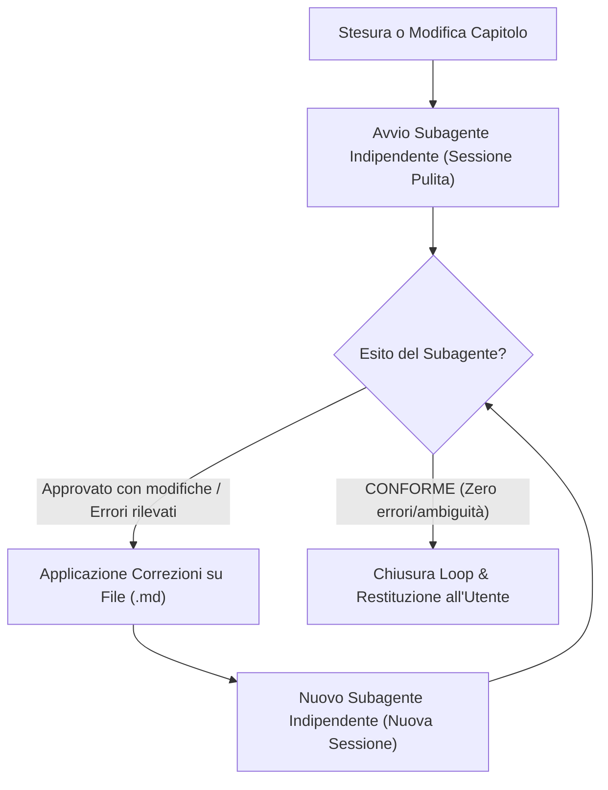

# Revisione Automatica Post-Stesura Tramite Subagente Indipendente (Regola Vault)

Questa regola definisce la procedura operativa obbligatoria per la validazione e il controllo qualità degli appunti del vault tramite un **loop iterativo di revisione-modifica-revisione con subagenti indipendenti (Iterative Peer Review Loop)**, applicabile a **qualsiasi materia** del corso di Laurea Magistrale in Ingegneria Informatica e Robotica.

---

## 1. Motivazione e Principio di Indipendenza Cognitiva

Quando un agente AI redige o modifica un capitolo, il suo contesto di generazione è saturo delle scelte stilistiche, sintattiche e deduttive appena compiute. Questo introduce un fenomeno di *confirmation bias* (cecità agli errori propri), rendendo difficile l'individuazione di:
- Sviste di calcolo, errori di segno, indici scambiati o dimensioni errate di vettori/matrici/tensori.
- Ipotesi implicite non dichiarate o condizioni di validità omesse (es. invertibilità di matrici di covarianza, stazionarietà, condizioni di campionamento, regolarità di funzioni).
- Ambiguità concettuali o disallineamenti rispetto alle slide ufficiali, alle dispense del docente o ai paper scientifici.
- Nuovi errori o incongruenze introdotti accidentalmente durante l'applicazione di correzioni precedenti.

Per garantire il massimo standard qualitativo accademico e tipografico, **la revisione non è un'azione una tantum, ma un loop a convergenza**: ogni volta che un capitolo viene redatto o modificato, deve essere valutato da un subagente esterno e indipendente finché non emergono più errori.

---

## 2. Modalità di Invocazione del Subagente

L'agente principale esegue la chiamata al tool `invoke_subagent` configurando ciascun revisore con il profilo della materia specifica:

```json
{
  "TypeName": "research",
  "Role": "Independent Academic Reviewer",
  "Prompt": "Sei un revisore accademico indipendente ed esperto nella materia <Nome_Materia> (Corso di Laurea Magistrale in Ingegneria Informatica e Robotica). Il tuo compito è revisionare criticamente lo stato attuale del capitolo in '<Percorso_Capitolo.md>' ed eventuali file extra in '<Percorso_Extra.md>'. Hai accesso al capitolo, ai materiali sorgente ufficiali (slide, dispense, note del docente in '<Percorso_Sorgenti>'), agli eventuali paper scientifici o testi di riferimento pertinenti e alla ricerca web (`search_web`). Esegui un'analisi rigorosa riga per riga focalizzandoti su: 1) Individuazione di errori concettuali o matematici, formule errate, refusi algebrici/notazionali o discrepanze fattuali con le sorgenti ufficiali; 2) Verifica tassativa dell'ASSENZA TOTALE di meta-commenti, callout o precisazioni in cui si dice di aver corretto formule, errori o refusi delle note o delle slide (il testo deve esporre direttamente ed esclusivamente la teoria corretta e definitiva, senza alcun riferimento al processo correttivo o a bozze intermedie). IMPORTANTE: Non analizzare né giudicare lo stile del testo, il tono espositivo, la prosa né la conformità stilistica o formale del vault (titoli, linter, KaTeX, modificatori immagini); concentrati unicamente sulla correttezza scientifica e sull'assenza di meta-commenti. Per ogni problema rilevato, spiega la natura dell'incongruenza e fornisci la correzione esatta (drop-in replacement). Se il testo è matematicamente corretto, privo di errori e privo di meta-commenti, dichiara l'esito CONFORME."
}
```

---

## 3. Dotazione e Risorse a Disposizione del Subagente

Ciascun subagente di revisione deve avere pieno accesso a:
1. **File del Capitolo Nello Stato Attuale**: lettura completa del sorgente Markdown aggiornato.
2. **Materiali Didattici Ufficiali (Slide, Dispense, Note)**: verifica della fedeltà al programma, alla terminologia, ai modelli matematici e alla notazione adottata dal docente del corso.
3. **Paper Scientifici e Testi di Riferimento della Materia**: confronto con la letteratura e i manuali autorevoli di settore per verificare la rigorosità di definizioni formali, teoremi, architetture e dimostrazioni.
4. **Ricerca Web (`search_web`)**: consultazione in tempo reale della letteratura scientifica, documentazione di librerie/framework e standard accademici per chiarire qualsiasi ambiguità teorica o notazionale.

---

## 4. Checklist di Revisione del Subagente

Il subagente esamina il testo **esclusivamente sotto due dimensioni oggettive di contenuto**:

### 4.1 Rigore Matematico, Fisico e Informatico
- [ ] **Formule e passaggi analitici**: segni algebrici corretti, differenziali con d diritta (`\mathrm{d}t`), estremi di integrazione e sommatorie coerenti.
- [ ] **Coerenza dimensionale e tensoriale**: netta distinzione tra scalari, vettori (grassetto corsivo/minuscolo $\mathbf{x}$) e matrici/tensori (grassetto maiuscolo $\mathbf{A}$). Dimensioni compatibili nelle moltiplicazioni matriciali e convenzioni esplicite sui canali (es. $[C, H, W]$ vs $[H, W, C]$).
- [ ] **Condizioni di validità e vincoli**: dichiarazione esplicita delle condizioni di stabilità, invertibilità, definita positività delle covarianze, regolarità statistica, o vincoli fisici (es. cinematica non olonoma, conservazione dell'energia).
- [ ] **Costo computazionale e convenzioni**: ordini di grandezza asintotici $O(\cdot)$ corretti, numero di operazioni coerente e acronimi ingegneristici standard.

### 4.2 Fedeltà alle Sorgenti e Assenza di Allucinazioni
- [ ] **Aderenza al perimetro didattico**: concetti, convenzioni di simboli ed esempi fedeli alle slide e dispense della materia corrente.
- [ ] **Integrazione critica da note e paper**: chiarimento rigoroso di passaggi sintetici o schemi alla lavagna segnalati nelle note degli studenti o nei paper.
- [ ] **Correzione di refusi della sorgente**: segnalazione di eventuali errori o incongruenze riscontrate direttamente nelle slide o note del docente (evitando di replicare sviste nel vault).

### 4.3 Assoluta Assenza di Meta-Commenti e Precisazioni su Correzioni o Refusi
> [!IMPORTANT] Regola Tassativa: Nessuna Menzione del Processo Correttivo nel Testo
> Il testo degli appunti deve configurarsi come una pubblicazione accademica e scientifica autorevole, pulita e definitiva. Il subagente deve verificare e sanzionare come **NON CONFORME**:
> - [ ] **Presenza di callout o note di avviso su refusi**: divieto assoluto di box come `>[!WARNING] Correzione Refusi delle Note` o simili.
> - [ ] **Frasi che menzionano bozze o note dello studente**: divieto assoluto di formule del tipo *«Nelle note dello studente la formula era errata…»*, *«Nelle note si incontra un'ambiguità»*, *«Abbiamo corretto il termine…»*, *«Come segnalato nelle note grezze…»*.
> - [ ] **Esposizione diretta della teoria corretta**: se una formula o un concetto era errato nelle note, il capitolo deve esporre **esclusivamente la formulazione corretta e rigorosa**, senza alcuna giustificazione metatestuale o accenno a versioni precedenti.

### 4.4 Esclusione Totale di Stile, Prosa e Formattazione del Vault
> [!IMPORTANT] Vincolo Assoluto di Non-Interferenza su Stile e Vault
> Il subagente **non deve assolutamente analizzare, commentare né giudicare**:
> - **Stile, tono o prosa**: niente osservazioni su scelte lessicali, perifrasi, fluidità o ritmo dei periodi.
> - **Convenzioni grafiche e stilistiche del vault**: niente verifiche su intestazioni H2/H3, modificatori CSS delle immagini (`|center small`), spaziatura dei blocchi KaTeX, doppi underscore del linter o layout Obsidian. Questi aspetti sono di competenza esclusiva dell'agente autore.
>
> **Il mandato del reviewer è circoscritto al 100% all'individuazione di**:
> 1. Errori concettuali, matematici, fisici o algebrici.
> 2. Refusi ed errori di calcolo (segni errati, indici scambiati, dimensioni incompatibili, domini errati).
> 3. Discrepanze fattuali rispetto alle slide e ai paper di riferimento.
> 4. Presenza indebita di meta-commenti o precisazioni sulle correzioni di refusi/note nel testo.

---

## 5. Il Loop Iterativo di Revisione (Revisione $\to$ Modifica $\to$ Nuova Revisione)

Il processo di controllo qualità adotta una **struttura a loop iterativo a convergenza**:



### Protocollo Operativo Dettagliato

1. **Prima Revisione**:
   - Subito dopo la prima stesura del capitolo, l'agente principale invoca il subagente reviewer (Iterazione 1).
2. **Valutazione dell'Esito**:
   - Se il subagente individua errori concettuali, sviste algebriche, omissioni di passaggi delle slide o refusi matematici/notazionali, restituisce il report con le correzioni mirate.
3. **Applicazione e Riavvio Obbligatorio del Loop**:
   - L'agente principale applica tempestivamente le correzioni verificate sul file tramite `edit_file`.
   - **Regola Tassativa**: È **severamente vietato considerare concluso il capitolo subito dopo aver applicato le modifiche**. L'agente principale **deve obbligatoriamente creare un NUOVO subagente indipendente** (Iterazione $k+1$, estraneo alle sessioni precedenti).
   - Il nuovo revisore esamina il capitolo aggiornato a mente fresca, accertandosi che le modifiche siano corrette e cercando eventuali ulteriori errori o incoerenze latenti che la modifica potrebbe aver introdotto o che erano sfuggiti prima.
4. **Condizione di Convergenza**:
   - Il loop si ripete finché un subagente indipendente non dichiara formalmente l'esito:
     **`CONFORME (Nessun errore concettuale, matematico o refuso rilevato)`**.
5. **Presentazione Finale all'Utente**:
   - Solo a convergenza raggiunta, l'agente principale presenta il lavoro allo studente, fornendo la traccia sintetica delle iterazioni del loop, delle correzioni apportate e della certificazione finale di conformità.
