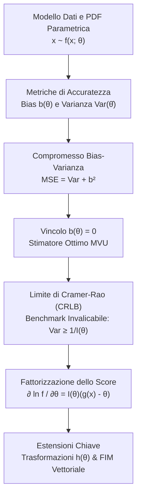
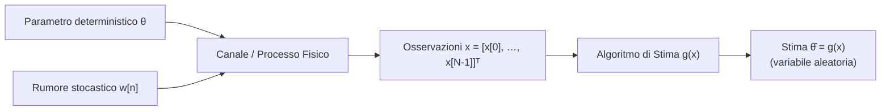
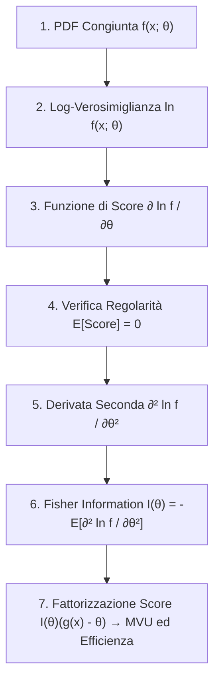

# 0. Fondamenti di Stima Classica e Limite di Cramer-Rao

Nell'elaborazione statistica dei segnali e dei sistemi di telecomunicazione, il problema fondamentale della __stima dei parametri__ consiste nel determinare il valore numerico di grandezze fisiche non direttamente accessibili partendo da un insieme finito di misure corrotte da rumore. Pensiamo alla localizzazione radar di un bersaglio, alla stima del canale trasmissivo in un collegamento 5G o alla ricostruzione tomografica: in tutti questi scenari captiamo una forma d'onda disturbata e vogliamo estrarre i parametri incogniti con la massima accuratezza e affidabilità possibile.

In questo capitolo esploriamo il paradigma della __stima classica__ (o deterministica), in cui i parametri da stimare sono costanti deterministiche ignote, prive di una distribuzione di probabilità a priori. Definiamo le metriche di prestazione statistica, analizziamo il compromesso tra polarizzazione e dispersione, formalizziamo il criterio di ottimalità a minima varianza (__MVU__) e ricaviamo il limite invalicabile delle prestazioni di qualsiasi stimatore non polarizzato: il __limite inferiore di Cramer-Rao__ (__CRLB__, _Cramer-Rao Lower Bound_).

## Il Problema della Stima e Modello dei Dati

Supponiamo di acquisire una sequenza di $N$ campioni discreti nel tempo o nello spazio, che raccogliamo ordinatamente in un vettore colonna delle osservazioni $\mathbf{x} \in \mathbb{R}^{N}$:

$$
\mathbf{x} = \begin{bmatrix} x[0] \\ x[1] \\ \vdots \\ x[N-1] \end{bmatrix}
$$

I dati osservati dipendono da un parametro continuo incognito $\theta \in \mathbb{R}$ (oppure da un vettore di parametri $\boldsymbol{\theta} \in \mathbb{R}^{P}$). Descriviamo l'incertezza statistica delle misure mediante la funzione di densità di probabilità (__PDF__) congiunta parametrica $f_{\mathbf{x}}(\mathbf{x}; \theta)$.

La notazione con il punto e virgola racchiude il cardine epistemologico della stima classica: $\theta$ non è una variabile aleatoria su cui stiamo condizionando, ma un parametro deterministico fisso e ignoto che modella e governa la forma della distribuzione dei dati.

Uno __stimatore__ $\hat{\theta}$ è una funzione matematica o algoritmo deterministico che mappa il vettore delle osservazioni $\mathbf{x}$ in una stima numerica plausibile del parametro:

$$
\hat{\theta} = g(\mathbf{x}) = g(x[0], x[1], \dots, x[N-1])
$$

Poiché le misure $\mathbf{x}$ fluttuano casualmente per effetto del disturbo additivo, anche lo stimatore $\hat{\theta} = g(\mathbf{x})$ è a tutti gli effetti una __variabile aleatoria__, provvista di una propria densità di probabilità $f_{\hat{\theta}}(\hat{\theta}; \theta)$, con un proprio valore atteso e una propria dispersione attorno alla media.

> [!NOTE] Stima Classica vs Stima Bayesiana
> - Nella __stima classica__, il parametro $\theta$ è una costante deterministica ignota. Non possiamo attribuirgli alcuna distribuzione a priori: l'incertezza risiede unicamente nel rumore che corrompe le misure attraverso la PDF parametrica $f_{\mathbf{x}}(\mathbf{x}; \theta)$.
> - Nella __stima bayesiana__, il parametro $\theta$ è modellato esplicitamente come una variabile aleatoria descritta da una PDF a priori $f_{\theta}(\theta)$, che formalizza la nostra conoscenza prima ancora di acquisire i dati.

## Errore di Stima, Polarizzazione e Varianza

Definiamo l'__errore di stima__ $e$ come lo scarto algebrico tra il valore fornito dal nostro algoritmo e il valore vero del parametro:

$$
e = \hat{\theta} - \theta
$$

Essendo $\hat{\theta}$ una quantità stocastica, anche l'errore $e$ è una variabile aleatoria. Per giudicare la bontà di uno stimatore dobbiamo analizzare la distribuzione dell'errore attraverso i suoi momenti statistici fondamentali: la media e la varianza.

### Polarizzazione (Bias)

Il __bias__ (o polarizzazione) rappresenta il valore atteso dell'errore di stima e quantifica l'eventuale tendenza dell'algoritmo a deviare sistematicamente dal valore reale:

$$
b(\theta) = \mathbb{E}[\hat{\theta}] - \theta = \mathbb{E}[e] = \int_{\mathbb{R}^N} g(\mathbf{x}) f_{\mathbf{x}}(\mathbf{x}; \theta) \mathrm{d}\mathbf{x} - \theta
$$

Uno stimatore si dice __non polarizzato__ (o corretto, _unbiased_) se il suo baricentro coincide esattamente con il valore vero per qualsiasi configurazione possibile del parametro:

$$
b(\theta) = 0 \iff \mathbb{E}[\hat{\theta}] = \theta \quad \forall \theta
$$

Se esiste anche un solo valore ammissibile di $\theta$ per cui $b(\theta) \neq 0$, lo stimatore è classificato come __polarizzato__ (_biased_).

### Varianza dello Stimatore

La __varianza__ misura l'ampiezza dell'errore casuale, quantificando quanto le stime si disperdono attorno al loro valor medio $\mathbb{E}[\hat{\theta}]$ al variare delle realizzazioni del rumore:

$$
\text{Var}\{\hat{\theta}\} = \mathbb{E}\left[ (\hat{\theta} - \mathbb{E}[\hat{\theta}])^2 \right] = \int_{\mathbb{R}^N} (g(\mathbf{x}) - \mathbb{E}[\hat{\theta}])^2 f_{\mathbf{x}}(\mathbf{x}; \theta) \mathrm{d}\mathbf{x}
$$

Quando lo stimatore è non polarizzato ($\mathbb{E}[\hat{\theta}] = \theta$), la varianza coincide direttamente con il valore atteso dell'errore quadratico:

$$
\text{Var}\{\hat{\theta}\} = \mathbb{E}\left[ (\hat{\theta} - \theta)^2 \right]
$$

Uno stimatore ideale deve concentrare la propria massa di probabilità il più vicino possibile al parametro reale: deve possedere bias nullo e varianza minima.

> [!EXAMPLE] Stima del Livello DC in Rumore Bianco
> Immaginiamo di voler misurare una tensione continua costante immersa in un disturbo additivo:
>
> $$
> x[n] = \theta + w[n], \quad n = 0, 1, \dots, N-1
> $$
>
> dove $w[n]$ è rumore bianco a media nulla e varianza $\sigma^2$, incorrelato nel tempo ($\mathbb{E}[w[n]w[k]] = \sigma^2 \delta[n-k]$).
> Mettiamo a confronto tre possibili strategie di stima:
>
> 1. __Media campionaria__: $\hat{\theta}_1 = \frac{1}{N}\sum_{n=0}^{N-1} x[n] = \bar{x}$.
>    - Media: $\mathbb{E}[\hat{\theta}_1] = \frac{1}{N}\sum_{n=0}^{N-1} (\theta + \mathbb{E}[w[n]]) = \theta \implies b_1(\theta) = 0$ (non polarizzato).
>    - Varianza: $\text{Var}\{\hat{\theta}_1\} = \frac{1}{N^2}\sum_{n=0}^{N-1} \text{Var}\{w[n]\} = \frac{\sigma^2}{N}$. All'aumentare dei campioni ($N \to \infty$) la varianza collassa a zero (lo stimatore è consistente).
> 2. __Singola osservazione__: $\hat{\theta}_2 = x[0]$.
>    - Media: $\mathbb{E}[\hat{\theta}_2] = \theta \implies b_2(\theta) = 0$ (non polarizzato).
>    - Varianza: $\text{Var}\{\hat{\theta}_2\} = \sigma^2$. La dispersione resta costante e ignora completamente gli altri $N-1$ dati utili.
> 3. __Media campionaria dimezzata__: $\hat{\theta}_3 = \frac{1}{2N}\sum_{n=0}^{N-1} x[n] = \frac{1}{2}\hat{\theta}_1$.
>    - Media: $\mathbb{E}[\hat{\theta}_3] = \frac{\theta}{2} \implies b_3(\theta) = -\frac{\theta}{2} \neq 0$ (polarizzato).
>    - Varianza: $\text{Var}\{\hat{\theta}_3\} = \frac{1}{4}\text{Var}\{\hat{\theta}_1\} = \frac{\sigma^2}{4N}$. La dispersione è quattro volte inferiore a quella della media campionaria, ma al prezzo inaccettabile di sottostimare sistematicamente la grandezza del 50%.

## Compromesso tra Bias e Varianza e l'Errore Quadratico Medio (MSE)

Per quantificare l'errore globale combinando errore sistematico ed errore casuale in un'unica metrica scalare, adottiamo il __Mean Squared Error__ (__MSE__), o errore quadratico medio:

$$
\text{MSE}\{\hat{\theta}\} = \mathbb{E}\left[ (\hat{\theta} - \theta)^2 \right]
$$

Scomponiamo lo scarto sommando e sottraendo il baricentro dello stimatore $\mathbb{E}[\hat{\theta}]$ all'interno del quadrato:

$$
\hat{\theta} - \theta = (\hat{\theta} - \mathbb{E}[\hat{\theta}]) + (\mathbb{E}[\hat{\theta}] - \theta) = (\hat{\theta} - \mathbb{E}[\hat{\theta}]) + b(\theta)
$$

Elevando al quadrato e applicando l'operatore di valore atteso:

$$
\begin{aligned}
\text{MSE}\{\hat{\theta}\} &= \mathbb{E}\left[ \left( (\hat{\theta} - \mathbb{E}[\hat{\theta}]) + b(\theta) \right)^2 \right] \\
&= \mathbb{E}\left[ (\hat{\theta} - \mathbb{E}[\hat{\theta}])^2 \right] + 2 b(\theta) \mathbb{E}\left[ \hat{\theta} - \mathbb{E}[\hat{\theta}] \right] + b^2(\theta)
\end{aligned}
$$

Esaminiamo il termine misto di doppio prodotto: per linearità del valore atteso abbiamo $\mathbb{E}[\hat{\theta} - \mathbb{E}[\hat{\theta}]] = \mathbb{E}[\hat{\theta}] - \mathbb{E}[\hat{\theta}] = 0$. Il termine si annulla identicamente, portandoci alla fondamentale __decomposizione del Mean Squared Error__:

$$
\text{MSE}\{\hat{\theta}\} = \text{Var}\{\hat{\theta}\} + b^2(\theta)
$$

L'MSE è la somma algebrica esatta di due contributi tra loro ortogonali: la dispersione casuale delle misure attorno al proprio valor medio e l'offset sistematico rispetto alla verità.

![[slide_17_bias_variance_targets.png|center mid]]

La classica metafora dei tiri al bersaglio rende intuitivo il significato geometrico delle quattro combinazioni:
- __Basso bias e bassa varianza__ (in alto a sinistra): le stime sono concentrate densamente sul centro del bersaglio. È la condizione di massima accuratezza cercata in ogni progetto.
- __Basso bias ed elevata varianza__ (in basso a sinistra): il baricentro dei colpi è perfettamente centrato sul bersaglio, ma i singoli tiri sono ampiamente dispersi per via del forte rumore casuale.
- __Alto bias e bassa varianza__ (in alto a destra): i tiri sono compatti e altamente ripetibili, ma raggruppati lontano dal bersaglio a causa di un errore sistematico di taratura.
- __Alto bias ed elevata varianza__ (in basso a destra): dispersione caotica priva sia di accuratezza che di precisione.

### Il Dilemma della Minimizzazione Diretta dell'MSE

Se il nostro traguardo naturale è minimizzare l'errore quadratico totale, per quale motivo nella stima classica non cerchiamo direttamente la funzione $g(\mathbf{x})$ che minimizza l'$\text{MSE}\{\hat{\theta}\}$?

Consideriamo lo stimatore banale costante $\hat{\theta}_0 = c$ (ad esempio $\hat{\theta}_0 = 5$), che ignora del tutto i dati osservati. La sua varianza è identicamente nulla ($\text{Var}\{\hat{\theta}_0\} = 0$) e il suo bias vale $b(\theta) = 5 - \theta$. Il suo errore quadratico medio è dunque:

$$
\text{MSE}\{\hat{\theta}_0\} = (5 - \theta)^2
$$

Se per puro caso il parametro reale vale $\theta = 5$, questo stimatore registra $\text{MSE} = 0$, battendo qualsiasi algoritmo sofisticato basato sull'elaborazione dei dati. Se però il parametro reale vale $\theta = 100$, l'errore diventa catastrofico.

Se impostiamo formalmente la minimizzazione libera di $\text{MSE}\{\hat{\theta}\} = \text{Var}\{\hat{\theta}\} + b^2(\theta)$ rispetto alla regola $g(\mathbf{x})$, lo stimatore matematicamente ottimo risultante finisce per __dipendere esplicitamente dal parametro incognito $\theta$__. Uno stimatore che per essere calcolato richiede di conoscere a priori il valore vero che si intende stimare è concettualmente circolare e fisicamente irrealizzabile.

> [!IMPORTANT] Il Trabocchetto dell'MSE Diretto all'Esame
> All'orale viene spesso chiesto: _"Perché non minimizziamo direttamente l'MSE nella stima classica?"_
> La risposta chiave è duplice:
> 1. La minimizzazione non vincolata genera stimatori ottimi che dipendono dal parametro incognito $\theta$, rendendoli non calcolabili a partire dai soli dati $\mathbf{x}$.
> 2. Senza vincoli, stimatori costanti banali registrerebbero MSE pari a zero in singoli punti isolati di $\theta$, impedendo di definire una nozione coerente di ottimalità globale.

## Lo Stimatore a Minima Varianza Non Polarizzato (MVU)

Per sciogliere questo paradosso, nella teoria della stima classica si impone a priori il vincolo di __non polarizzazione__:

$$
b(\theta) = 0 \quad \forall \theta \implies \text{MSE}\{\hat{\theta}\} = \text{Var}\{\hat{\theta}\}
$$

Azzerando il bias su tutto lo spazio dei parametri ammissibili, l'MSE collassa sulla varianza. Il problema di ottimizzazione diventa matematicamente ben posto: cerchiamo uno stimatore $\hat{\theta} = g(\mathbf{x})$ che soddisfi due condizioni congiunte:
1. Sia non polarizzato su tutto il dominio: $\mathbb{E}[\hat{\theta}] = \theta, \; \forall \theta$.
2. Abbia varianza inferiore o uguale a quella di qualunque altro stimatore corretto concorrente $\tilde{\theta}$, per ogni possibile valore di $\theta$:

$$
\text{Var}\{\hat{\theta}\} \le \text{Var}\{\tilde{\theta}\} \quad \forall \theta
$$

Uno stimatore che soddisfa questo duplice criterio prende il nome di __stimatore MVU__ (__Minimum Variance Unbiased Estimator__).

> [!NOTE] Superiorità Uniforme dell'MVU
> La condizione di dominanza $\text{Var}\{\hat{\theta}\} \le \text{Var}\{\tilde{\theta}\}$ deve valere per qualsiasi valore del parametro $\theta$ (__uniformemente__). Non è ammissibile che uno stimatore sia migliore per un sottoinsieme di valori e peggiore per un altro: l'MVU deve dominare l'intero dominio parametrico.

La ricerca dell'MVU si scontra però con due ostacoli operativi:
- Lo stimatore MVU potrebbe non esistere: due stimatori non polarizzati distinti potrebbero incrociare le proprie curve di varianza al variare di $\theta$, senza che nessuno domini uniformemente l'altro.
- Anche qualora esista, non disponiamo in generale di un metodo di derivazione diretta per ricavare la funzione $g(\mathbf{x})$ ottima a partire dalla sola definizione.

Per queste ragioni, prima di ricercare lo stimatore ottimo, occorre stabilire un __limite teorico invalicabile__ contro cui misurare le prestazioni di qualsiasi algoritmo candidato. Tale benchmark universale è il limite inferiore di Cramer-Rao.

## Il Limite Inferiore di Cramer-Rao (CRLB)

Il __Cramer-Rao Lower Bound__ (__CRLB__) stabilisce il limite inferiore assoluto per la varianza di qualsiasi stimatore non polarizzato. Se individuiamo uno stimatore corretto la cui varianza eguaglia il CRLB, abbiamo la certezza matematica immediata che si tratta dell'MVU, senza dover esaminare alcun altro algoritmo concorrente.

### Condizione di Regolarità

Il CRLB è valido sotto l'ipotesi che la funzione di densità di probabilità parametrica $f_{\mathbf{x}}(\mathbf{x}; \theta)$ soddisfi la __condizione di regolarità__:

$$
\mathbb{E}\left[ \frac{\partial \ln f_{\mathbf{x}}(\mathbf{x}; \theta)}{\partial \theta} \right] = 0 \quad \forall \theta
$$

La derivata logaritmica della verosimiglianza rispetto al parametro prende il nome di __funzione di score__ $S(\mathbf{x}; \theta)$:

$$
S(\mathbf{x}; \theta) = \frac{\partial \ln f_{\mathbf{x}}(\mathbf{x}; \theta)}{\partial \theta}
$$

La condizione di regolarità esprime semplicemente che il valor medio della funzione di score deve essere identicamente nullo per ogni configurazione di $\theta$.

> [!NOTE] Quando Vale la Condizione di Regolarità?
> Esplicitiamo il valore atteso della derivata logaritmica ricordando che $\frac{\partial \ln f}{\partial \theta} = \frac{1}{f} \frac{\partial f}{\partial \theta}$:
>
> $$
> \mathbb{E}\left[ \frac{\partial \ln f_{\mathbf{x}}(\mathbf{x}; \theta)}{\partial \theta} \right] = \int_{\mathcal{X}} \frac{1}{f_{\mathbf{x}}(\mathbf{x}; \theta)} \frac{\partial f_{\mathbf{x}}(\mathbf{x}; \theta)}{\partial \theta} f_{\mathbf{x}}(\mathbf{x}; \theta) \mathrm{d}\mathbf{x} = \int_{\mathcal{X}} \frac{\partial f_{\mathbf{x}}(\mathbf{x}; \theta)}{\partial \theta} \mathrm{d}\mathbf{x}
> $$
>
> Se è lecito invertire l'ordine tra integrazione e derivazione (regola di Leibniz per la derivazione sotto il segno di integrale), troviamo:
>
> $$
> \int_{\mathcal{X}} \frac{\partial f_{\mathbf{x}}(\mathbf{x}; \theta)}{\partial \theta} \mathrm{d}\mathbf{x} = \frac{\partial}{\partial \theta} \int_{\mathcal{X}} f_{\mathbf{x}}(\mathbf{x}; \theta) \mathrm{d}\mathbf{x} = \frac{\partial}{\partial \theta} (1) = 0
> $$
>
> L'inversione è valida a patto che il supporto $\mathcal{X} = \{\mathbf{x} : f_{\mathbf{x}}(\mathbf{x}; \theta) > 0\}$ __non dipenda dal parametro incognito $\theta$__.
> - In una distribuzione uniforme $x[n] \sim \mathcal{U}[0, \theta]$, il supporto $[0, \theta]$ varia con $\theta$: la regolarità cade e il CRLB classico non è applicabile (in questi casi la varianza può decadere come $1/N^2$).
> - Nei modelli a rumore gaussiano con media o varianza incognita, il supporto coincide con tutto $\mathbb{R}^N$: la regolarità è pienamente soddisfatta.

### Informazione di Fisher

L'__Informazione di Fisher__ $I(\theta)$ quantifica la quantità di informazione statistica che le osservazioni $\mathbf{x}$ trasportano sul parametro incognito $\theta$. È definita come la varianza (o secondo momento) della funzione di score:

$$
I(\theta) = \mathbb{E}\left[ \left( \frac{\partial \ln f_{\mathbf{x}}(\mathbf{x}; \theta)}{\partial \theta} \right)^2 \right] = \int_{\mathcal{X}} \left( \frac{\partial \ln f_{\mathbf{x}}(\mathbf{x}; \theta)}{\partial \theta} \right)^2 f_{\mathbf{x}}(\mathbf{x}; \theta) \mathrm{d}\mathbf{x}
$$

Sotto la condizione di regolarità, vale una forma alternativa operativa di gran lunga più semplice da calcolare:

$$
I(\theta) = -\mathbb{E}\left[ \frac{\partial^2 \ln f_{\mathbf{x}}(\mathbf{x}; \theta)}{\partial \theta^2} \right]
$$

La dimostrazione analitica dell'equivalenza tra il valore atteso del quadrato della derivata prima e l'opposto del valore atteso della derivata seconda è consultabile in [[zz. Argomenti extra#Identità tra la Prima e la Seconda Derivata dell'Informazione di Fisher|zz. Argomenti extra: Identità tra la Prima e la Seconda Derivata dell'Informazione di Fisher]].

Geometricamente, l'Informazione di Fisher esprime la __curvatura media__ della funzione di log-verosimiglianza $\ln f_{\mathbf{x}}(\mathbf{x}; \theta)$ nell'intorno del punto di massimo.

![[fisher_information_curvature.svg|center mid]]

La figura evidenzia la stretta connessione tra la forma della log-verosimiglianza e la precisione ottenibile:
- __Picco aguzzo (alta informazione)__: la curva scende ripidamente non appena ci si allontana dal punto di massimo (forte curvatura negativa, derivata seconda grande in valore assoluto). I dati discriminano con nettezza valori di $\theta$ contigui: $I(\theta)$ è elevata e l'errore di stima è minimo.
- __Profilo piatto (bassa informazione)__: la log-verosimiglianza varia molto lentamente attorno al vertice (curvatura debole, derivata seconda quasi nulla). Valori distinti di $\theta$ producono verosimiglianze quasi identiche: l'informazione $I(\theta)$ è modesta e la stima è affetta da grande incertezza.

> [!TIP] Scorciatoia di Calcolo all'Esame: Derivata Prima vs Derivata Seconda
> Negli esercizi d'esame conviene quasi sempre calcolare $I(\theta)$ tramite la derivata seconda $-\mathbb{E}\left[\frac{\partial^2 \ln f}{\partial \theta^2}\right]$.
> Calcolare il quadrato della derivata prima $\mathbb{E}\left[(\frac{\partial \ln f}{\partial \theta})^2\right]$ richiede di espandere quadrati di sommatorie e calcolare momenti del quarto ordine. La derivata seconda, al contrario, riduce il grado dei polinomi e molto spesso produce direttamente una costante deterministica, rendendo superfluo il calcolo di integrali o valori attesi complessi.

### Teorema del Limite di Cramer-Rao (Caso Scalare)

Sia $\mathbf{x}$ un vettore di dati con PDF parametrica $f_{\mathbf{x}}(\mathbf{x}; \theta)$ che soddisfa la condizione di regolarità. Allora la varianza di qualsiasi stimatore non polarizzato $\hat{\theta}$ è vincolata inferiormente dal reciproco dell'Informazione di Fisher:

$$
\text{Var}\{\hat{\theta}\} \ge \frac{1}{I(\theta)} = \frac{1}{-\mathbb{E}\left[ \frac{\partial^2 \ln f_{\mathbf{x}}(\mathbf{x}; \theta)}{\partial \theta^2} \right]}
$$

La dimostrazione formale si basa sull'applicazione della disuguaglianza di Cauchy-Schwarz alla covarianza statistica tra l'errore dello stimatore $(\hat{\theta} - \theta)$ e la funzione di score $\frac{\partial \ln f}{\partial \theta}$, ed è consultabile passo dopo passo in [[zz. Argomenti extra#Dimostrazione del Limite Inferiore di Cramer-Rao (CRLB)|zz. Argomenti extra: Dimostrazione del Limite Inferiore di Cramer-Rao (CRLB)]].

### Efficienza e Condizione di Raggiungibilità del CRLB

Uno stimatore non polarizzato $\hat{\theta}$ la cui varianza eguaglia esattamente il limite inferiore su tutto il dominio parametrico:

$$
\text{Var}\{\hat{\theta}\} = \frac{1}{I(\theta)} \quad \forall \theta
$$

è definito __stimatore efficiente__.

> [!IMPORTANT] Efficienza come Garanzia di MVU
> Uno stimatore efficiente è __automaticamente l'unico stimatore MVU__, poiché nessun altro algoritmo non polarizzato può oltrepassare la barriera di $\frac{1}{I(\theta)}$. Dimostrare l'efficienza rappresenta quindi il percorso più rapido e definitivo per certificare l'ottimalità assoluta di uno stimatore.

Il teorema di Cramer-Rao fornisce inoltre una condizione operativa costruttiva per determinare se esiste uno stimatore capace di raggiungere il bound:

> [!NOTE] Condizione Necessaria e Sufficiente di Efficienza (Fattorizzazione dello Score)
> Esiste uno stimatore non polarizzato $\hat{\theta}$ che raggiunge il CRLB se e solo se la funzione di score può essere fattorizzata nella forma separabile:
>
> $$
> \frac{\partial \ln f_{\mathbf{x}}(\mathbf{x}; \theta)}{\partial \theta} = I(\theta) \left( g(\mathbf{x}) - \theta \right)
> $$
>
> dove la funzione $g(\mathbf{x})$ dipende esclusivamente dai dati osservati $\mathbf{x}$ e non contiene il parametro $\theta$, mentre $I(\theta)$ dipende unicamente da $\theta$ (o è una costante).
> Quando questa scomposizione è possibile:
> - Lo stimatore MVU efficiente è identificato direttamente da: $\hat{\theta} = g(\mathbf{x})$.
> - La sua varianza minima vale esattamente: $\text{Var}\{\hat{\theta}\} = \frac{1}{I(\theta)}$.

Questa identità è la tecnica più potente per gli esercizi d'esame: calcolata la derivata prima della log-verosimiglianza, se riusciamo a isolare il termine $(g(\mathbf{x}) - \theta)$, abbiamo ricavato simultaneamente l'Informazione di Fisher, estratto la formula dello stimatore ottimo ed esplicitato la sua varianza minima, senza dover svolgere derivate seconde né verificare laboriosi integrali.

## Esempio Completo: Livello DC in Rumore Gaussiano Bianco (AWGN)

Applichiamo la metodologia completa alla stima di un livello costante DC immerso in rumore additivo gaussiano bianco (AWGN):

$$
x[n] = \theta + w[n], \quad n = 0, 1, \dots, N-1, \quad w[n] \sim \mathcal{N}(0, \sigma^2) \text{ i.i.d.}
$$

Seguiamo passo dopo passo la procedura analitica standard in sette stadi.

### Determinazione della Funzione di Verosimiglianza

I campioni di disturbo $w[n]$ sono gaussiani e indipendenti, per cui le singole misure $x[n] \sim \mathcal{N}(\theta, \sigma^2)$ sono mutuamente indipendenti. La densità congiunta è data dal prodotto delle marginali:

$$
f_{\mathbf{x}}(\mathbf{x}; \theta) = \prod_{n=0}^{N-1} \frac{1}{\sqrt{2\pi\sigma^2}} \exp\left( -\frac{1}{2\sigma^2} (x[n] - \theta)^2 \right) = \frac{1}{(2\pi\sigma^2)^{N/2}} \exp\left( -\frac{1}{2\sigma^2} \sum_{n=0}^{N-1} (x[n] - \theta)^2 \right)
$$

### Calcolo della Log-Verosimiglianza

Applichiamo il logaritmo naturale per semplificare i calcoli, convertendo la produttoria in una sommatoria:

$$
\ln f_{\mathbf{x}}(\mathbf{x}; \theta) = -\frac{N}{2} \ln(2\pi\sigma^2) - \frac{1}{2\sigma^2} \sum_{n=0}^{N-1} (x[n] - \theta)^2
$$

### Derivata Prima e Funzione di Score

Deriviamo la log-verosimiglianza rispetto al parametro incognito $\theta$:

$$
\frac{\partial \ln f_{\mathbf{x}}(\mathbf{x}; \theta)}{\partial \theta} = -\frac{1}{2\sigma^2} \sum_{n=0}^{N-1} 2(x[n] - \theta)(-1) = \frac{1}{\sigma^2} \sum_{n=0}^{N-1} (x[n] - \theta)
$$

Espandiamo la sommatoria separando i dati dal parametro deterministico:

$$
\frac{\partial \ln f_{\mathbf{x}}(\mathbf{x}; \theta)}{\partial \theta} = \frac{1}{\sigma^2} \left( \sum_{n=0}^{N-1} x[n] - N\theta \right) = \frac{N}{\sigma^2} \left( \frac{1}{N}\sum_{n=0}^{N-1} x[n] - \theta \right)
$$

### Verifica della Condizione di Regolarità

Valutiamo il valore atteso della derivata prima sfruttando la linearità dell'operatore $\mathbb{E}[\cdot]$ e ricordando che $\mathbb{E}[x[n]] = \theta$:

$$
\mathbb{E}\left[ \frac{\partial \ln f_{\mathbf{x}}(\mathbf{x}; \theta)}{\partial \theta} \right] = \frac{1}{\sigma^2} \sum_{n=0}^{N-1} (\mathbb{E}[x[n]] - \theta) = \frac{1}{\sigma^2} \sum_{n=0}^{N-1} (\theta - \theta) = 0
$$

La condizione di regolarità è pienamente verificata su tutto il dominio reale $\theta \in \mathbb{R}$.

### Calcolo della Derivata Seconda

Deriviamo nuovamente la funzione di score rispetto a $\theta$:

$$
\frac{\partial^2 \ln f_{\mathbf{x}}(\mathbf{x}; \theta)}{\partial \theta^2} = \frac{\partial}{\partial \theta} \left[ \frac{1}{\sigma^2} \sum_{n=0}^{N-1} x[n] - \frac{N\theta}{\sigma^2} \right] = -\frac{N}{\sigma^2}
$$

### Calcolo dell'Informazione di Fisher

Poiché la derivata seconda risulta una costante deterministica indipendente dai dati $\mathbf{x}$, il suo valore atteso coincide con la costante stessa:

$$
I(\theta) = -\mathbb{E}\left[ \frac{\partial^2 \ln f_{\mathbf{x}}(\mathbf{x}; \theta)}{\partial \theta^2} \right] = -\left( -\frac{N}{\sigma^2} \right) = \frac{N}{\sigma^2}
$$

L'informazione cresce linearmente con il numero di campioni $N$ e diminuisce all'aumentare della potenza del rumore $\sigma^2$.

### Verifica dell'Efficienza ed Estrazione dell'MVU

Confrontiamo la derivata prima ottenuta in precedenza con l'equazione di fattorizzazione $I(\theta)(g(\mathbf{x}) - \theta)$:

$$
\frac{\partial \ln f_{\mathbf{x}}(\mathbf{x}; \theta)}{\partial \theta} = \underbrace{\frac{N}{\sigma^2}}_{I(\theta)} \left( \underbrace{\frac{1}{N}\sum_{n=0}^{N-1} x[n]}_{g(\mathbf{x})} - \theta \right)
$$

La corrispondenza algebrica è perfetta:
- Lo stimatore $\hat{\theta} = \frac{1}{N}\sum_{n=0}^{N-1} x[n] = \bar{x}$ (la media campionaria) è __strettamente efficiente__.
- La sua varianza raggiunge esattamente il CRLB:

$$
\text{Var}\{\hat{\theta}\} = \frac{1}{I(\theta)} = \frac{\sigma^2}{N}
$$

Abbiamo così dimostrato con rigore matematico assoluto che la media campionaria è l'unico stimatore MVU per il livello continuo in presenza di rumore gaussiano bianco.

## Trasformazione di Parametri

Nelle applicazioni pratiche capita di frequente di non voler stimare direttamente il parametro nativo $\theta$, bensì una sua funzione deterministica nota a priori:

$$
\alpha = h(\theta)
$$

Pensiamo alla misura del livello di tensione continua $\theta$ quando il reale obiettivo è stimare la potenza dissipata su una resistenza unitaria $\alpha = \theta^2$, oppure alla stima della frequenza angolare a partire dal periodo di oscillazione.

Sotto la condizione di regolarità, il limite inferiore di Cramer-Rao per la stima del parametro trasformato $\alpha = h(\theta)$ assume la forma:

$$
\text{Var}\{\hat{\alpha}\} \ge \frac{\left( \frac{\partial h(\theta)}{\partial \theta} \right)^2}{I(\theta)}
$$

dove $I(\theta)$ rappresenta l'Informazione di Fisher calcolata rispetto al parametro originale $\theta$.

### Trasformazione Lineare (o Affine)

Supponiamo che la legge di trasformazione sia una funzione affine:

$$
\alpha = k\theta + c
$$

La derivata prima è costante: $\frac{\partial h}{\partial \theta} = k$. Il CRLB trasformato diventa:

$$
\text{Var}\{\hat{\alpha}\} \ge \frac{k^2}{I(\theta)}
$$

Se per il parametro originario $\theta$ disponiamo di uno stimatore efficiente $\hat{\theta}$ con varianza $\text{Var}\{\hat{\theta}\} = \frac{1}{I(\theta)}$, allora lo stimatore naturale per sostituzione:

$$
\hat{\alpha} = k\hat{\theta} + c
$$

preserva integralmente le proprietà statistiche ideali: è __rigorosamente non polarizzato ed efficiente per $\alpha$__:

$$
\mathbb{E}[\hat{\alpha}] = k\mathbb{E}[\hat{\theta}] + c = k\theta + c = \alpha, \quad \text{Var}\{\hat{\alpha}\} = k^2 \text{Var}\{\hat{\theta}\} = \frac{k^2}{I(\theta)}
$$

### Trasformazione Non Lineare

Quando la funzione $h(\theta)$ è non lineare, il quadro statistico muta radicalmente per effetto della curvatura:
1. Anche qualora $\hat{\theta}$ sia non polarizzato per $\theta$, lo stimatore naturale plug-in $\hat{\alpha} = h(\hat{\theta})$ risulta __polarizzato a campioni finiti__ per effetto della disuguaglianza di Jensen: $\mathbb{E}[h(\hat{\theta})] \neq h(\mathbb{E}[\hat{\theta}])$.
2. A campioni finiti $N$, __non esiste in generale alcuno stimatore in grado di raggiungere il CRLB__ per una trasformazione non lineare.
3. Al divergere del numero di osservazioni ($N \to \infty$), se lo stimatore base $\hat{\theta}$ è consistente ed efficiente, lo stimatore trasformato diventa __asintoticamente non polarizzato ed asintoticamente efficiente__.

> [!EXAMPLE] Stima della Potenza del Livello DC ($\alpha = \theta^2$)
> Consideriamo il segnale $x[n] = \theta + w[n]$ in AWGN e supponiamo di voler stimare la potenza $\alpha = h(\theta) = \theta^2$.
> Adottiamo come stimatore plug-in il quadrato della media campionaria $\bar{x}$:
>
> $$
> \hat{\alpha} = \bar{x}^2 = \left( \frac{1}{N}\sum_{n=0}^{N-1} x[n] \right)^2
> $$
>
> Sviluppiamo l'analisi in tre passaggi:
>
> 1. __Analisi del Bias a Campioni Finiti__:
>    Dalla statistica della media campionaria sappiamo che $\bar{x} \sim \mathcal{N}\left(\theta, \frac{\sigma^2}{N}\right)$. Sfruttando la relazione fondamentale tra i momenti $\mathbb{E}[\bar{x}^2] = \text{Var}\{\bar{x}\} + (\mathbb{E}[\bar{x}])^2$:
>
>    $$
>    \mathbb{E}[\hat{\alpha}] = \mathbb{E}[\bar{x}^2] = \frac{\sigma^2}{N} + \theta^2 = \alpha + \frac{\sigma^2}{N}
>    $$
>
>    Il bias vale $b(\alpha) = \mathbb{E}[\hat{\alpha}] - \alpha = \frac{\sigma^2}{N} > 0$. Lo stimatore introduce una sovrastima sistematica a campioni finiti. Tuttavia, per $N \to \infty$, il bias tende a zero: $\hat{\alpha}$ è __asintoticamente non polarizzato__.
>
> 2. __Calcolo del CRLB Trasformato__:
>    Essendo $\frac{\partial h(\theta)}{\partial \theta} = 2\theta$ e $I(\theta) = \frac{N}{\sigma^2}$:
>
>    $$
>    \text{CRLB}(\alpha) = \frac{\left( \frac{\partial h}{\partial \theta} \right)^2}{I(\theta)} = \frac{(2\theta)^2}{\frac{N}{\sigma^2}} = \frac{4\theta^2\sigma^2}{N} = \frac{4\alpha\sigma^2}{N}
>    $$
>
> 3. __Calcolo della Varianza Effettiva ed Efficienza Asintotica__:
>    Rappresentiamo la media campionaria come $\bar{x} = \theta + u$, dove $u \sim \mathcal{N}\left(0, \frac{\sigma^2}{N}\right)$. Elevando al quadrato troviamo $\bar{x}^2 = \theta^2 + 2\theta u + u^2$.
>    La varianza dello stimatore coincide con:
>
>    $$
>    \text{Var}\{\hat{\alpha}\} = \mathbb{E}\left[ (\bar{x}^2 - \mathbb{E}[\bar{x}^2])^2 \right] = \mathbb{E}\left[ \left( 2\theta u + u^2 - \frac{\sigma^2}{N} \right)^2 \right]
>    $$
>
>    Espandiamo il quadrato del binomio:
>
>    $$
>    \text{Var}\{\hat{\alpha}\} = 4\theta^2 \mathbb{E}[u^2] + \mathbb{E}\left[ \left(u^2 - \frac{\sigma^2}{N}\right)^2 \right] + 4\theta \mathbb{E}\left[ u \left(u^2 - \frac{\sigma^2}{N}\right) \right]
>    $$
>
>    Sfruttando le proprietà dei momenti della variabile gaussiana a media nulla $u$:
>    - $\mathbb{E}[u] = 0$ ed $\mathbb{E}[u^3] = 0$ (tutti i momenti di ordine dispari sono nulli). Il termine incrociato $4\theta(\mathbb{E}[u^3] - \frac{\sigma^2}{N}\mathbb{E}[u])$ svanisce identicamente.
>    - $\mathbb{E}[u^2] = \frac{\sigma^2}{N}$.
>    - $\mathbb{E}[u^4] = 3\left(\frac{\sigma^2}{N}\right)^2 = \frac{3\sigma^4}{N^2}$. Il secondo momento centrale vale dunque $\mathbb{E}[(u^2 - \frac{\sigma^2}{N})^2] = \mathbb{E}[u^4] - (\mathbb{E}[u^2])^2 = \frac{3\sigma^4}{N^2} - \frac{\sigma^4}{N^2} = \frac{2\sigma^4}{N^2}$.
>
>    Sostituendo questi contributi:
>
>    $$
>    \text{Var}\{\hat{\alpha}\} = \frac{4\theta^2\sigma^2}{N} + \frac{2\sigma^4}{N^2} = \frac{4\alpha\sigma^2}{N} + \frac{2\sigma^4}{N^2}
>    $$
>
>    A campioni finiti la varianza eccede il CRLB a causa del termine aggiuntivo $\frac{2\sigma^4}{N^2}$. Tuttavia, al crescere di $N$, questo termine residuo decade con velocità quadratica $O(1/N^2)$, mentre il termine principale decade come $O(1/N)$:
>
>    $$
>    \lim_{N \to \infty} \frac{\text{Var}\{\hat{\alpha}\}}{\text{CRLB}(\alpha)} = \lim_{N \to \infty} \left( 1 + \frac{\sigma^2}{2\alpha N} \right) = 1
>    $$
>
>    La varianza converge asintoticamente alla soglia inferiore: lo stimatore $\hat{\alpha}$ è __asintoticamente efficiente__.

## Estensione Vettoriale del CRLB

Generalizziamo ora l'intera teoria al caso in cui dobbiamo stimare simultaneamente un insieme di $P$ parametri deterministici incogniti, organizzati in un vettore $\boldsymbol{\theta} \in \mathbb{R}^P$:

$$
\boldsymbol{\theta} = \begin{bmatrix} \theta_1 \\ \theta_2 \\ \vdots \\ \theta_P \end{bmatrix}
$$

### Matrice di Informazione di Fisher (FIM)

Definiamo il gradiente della funzione di log-verosimiglianza come il vettore colonna delle derivate parziali prime (vettore di score):

$$
\nabla_{\boldsymbol{\theta}} \ln f_{\mathbf{x}}(\mathbf{x}; \boldsymbol{\theta}) = \begin{bmatrix} \frac{\partial \ln f}{\partial \theta_1} \\ \frac{\partial \ln f}{\partial \theta_2} \\ \vdots \\ \frac{\partial \ln f}{\partial \theta_P} \end{bmatrix}
$$

La condizione di regolarità vettoriale impone che il valore atteso del vettore di score sia nullo: $\mathbb{E}[\nabla_{\boldsymbol{\theta}} \ln f_{\mathbf{x}}(\mathbf{x}; \boldsymbol{\theta})] = \mathbf{0}$.

L'informazione congiunta estratta dai dati è descritta dalla __Matrice di Informazione di Fisher__ (__FIM__, _Fisher Information Matrix_), indicata con $\mathbf{I}(\boldsymbol{\theta}) \in \mathbb{R}^{P \times P}$, le cui entrate valgono:

$$
[\mathbf{I}(\boldsymbol{\theta})]_{i, j} = \mathbb{E}\left[ \frac{\partial \ln f_{\mathbf{x}}(\mathbf{x}; \boldsymbol{\theta})}{\partial \theta_i} \frac{\partial \ln f_{\mathbf{x}}(\mathbf{x}; \boldsymbol{\theta})}{\partial \theta_j} \right] = -\mathbb{E}\left[ \frac{\partial^2 \ln f_{\mathbf{x}}(\mathbf{x}; \boldsymbol{\theta})}{\partial \theta_i \partial \theta_j} \right]
$$

La FIM è una matrice simmetrica e, a patto che i parametri siano reciprocamente identificabili e non ridondanti, strettamente definita positiva.

### Teorema del CRLB Vettoriale

Sia $\hat{\boldsymbol{\theta}}$ uno stimatore vettoriale non polarizzato ($\mathbb{E}[\hat{\boldsymbol{\theta}}] = \boldsymbol{\theta}$). Definiamo la matrice di covarianza dell'errore di stima $\mathbf{C}_{\hat{\boldsymbol{\theta}}} \in \mathbb{R}^{P \times P}$:

$$
\mathbf{C}_{\hat{\boldsymbol{\theta}}} = \mathbb{E}\left[ (\hat{\boldsymbol{\theta}} - \boldsymbol{\theta})(\hat{\boldsymbol{\theta}} - \boldsymbol{\theta})^T \right]
$$

Il teorema del CRLB vettoriale stabilisce che la matrice differenza tra la matrice di covarianza dello stimatore e l'inversa della FIM è __semidefinita positiva__:

$$
\mathbf{C}_{\hat{\boldsymbol{\theta}}} - \mathbf{I}^{-1}(\boldsymbol{\theta}) \ge \mathbf{0}
$$

Ciò significa che per qualunque vettore non nullo $\mathbf{u} \in \mathbb{R}^P$ vale la disuguaglianza $\mathbf{u}^T (\mathbf{C}_{\hat{\boldsymbol{\theta}}} - \mathbf{I}^{-1}(\boldsymbol{\theta})) \mathbf{u} \ge 0$.

Scegliendo il vettore canonico $\mathbf{u} = \mathbf{e}_i$, isoliamo l'$i$-esimo elemento lungo la diagonale principale: la varianza della stima del singolo parametro $\theta_i$ è vincolata dall'$i$-esimo elemento diagonale dell'__inversa__ della FIM:

$$
\text{Var}\{\hat{\theta}_i\} = [\mathbf{C}_{\hat{\boldsymbol{\theta}}}]_{i, i} \ge [\mathbf{I}^{-1}(\boldsymbol{\theta})]_{i, i}
$$

> [!WARNING] Errore Notazionale Comune: Diagonale dell'Inversa vs Inverso della Diagonale
> All'esame si commette spessissimo l'errore grave di invertire il singolo elemento scalare della matrice anziché invertire prima l'intera matrice e poi leggerne la diagonale:
>
> $$
> [\mathbf{I}^{-1}(\boldsymbol{\theta})]_{i, i} \ge \frac{1}{[\mathbf{I}(\boldsymbol{\theta})]_{i, i}}
> $$
>
> L'uguaglianza si verifica se e solo se la FIM è diagonale, ossia quando i parametri sono statisticamente disaccoppiati. In tutti gli altri casi, l'incertezza sui parametri concorrenti ($\theta_j$ con $j \neq i$) __degrada strettamente la precisione con cui possiamo stimare $\theta_i$__ rispetto allo scenario ideale in cui gli altri parametri fossero noti a priori. La dimostrazione algebrica basata sul complemento di Schur è consultabile in [[zz. Argomenti extra#Disuguaglianza tra Elementi della FIM Inversa e Complemento di Schur|zz. Argomenti extra: Dimostrazione Algebrica con Complemento di Schur]].

### Condizione di Efficienza Vettoriale

Uno stimatore vettoriale non polarizzato $\hat{\boldsymbol{\theta}}$ raggiunge il limite inferiore con matrice di covarianza $\mathbf{C}_{\hat{\boldsymbol{\theta}}} = \mathbf{I}^{-1}(\boldsymbol{\theta})$ se e solo se il gradiente della log-verosimiglianza si decompone nella forma lineare matriciale:

$$
\nabla_{\boldsymbol{\theta}} \ln f_{\mathbf{x}}(\mathbf{x}; \boldsymbol{\theta}) = \mathbf{I}(\boldsymbol{\theta}) \left( \mathbf{g}(\mathbf{x}) - \boldsymbol{\theta} \right)
$$

In presenza di tale fattorizzazione, lo stimatore MVU efficiente è unico ed è fornito dal vettore $\hat{\boldsymbol{\theta}} = \mathbf{g}(\mathbf{x})$.

## Esempio Vettoriale: Line Fitting (Regressione Lineare Semplice)

Analizziamo il problema fondamentale dell'adattamento di una retta su un insieme di misure discrete corrotte da rumore AWGN:

$$
x[n] = \theta_1 + \theta_2 n + w[n], \quad n = 0, 1, \dots, N-1, \quad w[n] \sim \mathcal{N}(0, \sigma^2) \text{ i.i.d.}
$$

dove $\theta_1$ rappresenta l'intercetta all'origine ($n = 0$) e $\theta_2$ è il coefficiente angolare (pendenza) della retta.

![[slide_36_line_fitting_example.png|center mid]]

Riscriviamo il sistema in forma matriciale compatta:

$$
\mathbf{x} = \mathbf{H}\boldsymbol{\theta} + \mathbf{w}
$$

dove $\boldsymbol{\theta} = [\theta_1, \theta_2]^T \in \mathbb{R}^2$, il vettore di rumore è $\mathbf{w} \sim \mathcal{N}(\mathbf{0}, \sigma^2 \mathbf{I}_N)$ e la __matrice di osservazione__ $\mathbf{H} \in \mathbb{R}^{N \times 2}$ è strutturata come:

$$
\mathbf{H} = \begin{bmatrix} 1 & 0 \\ 1 & 1 \\ 1 & 2 \\ \vdots & \vdots \\ 1 & N-1 \end{bmatrix}
$$

### Calcolo della Matrice di Informazione di Fisher

La log-verosimiglianza del modello vettoriale gaussiano lineare è data dalla forma quadratica:

$$
\ln f_{\mathbf{x}}(\mathbf{x}; \boldsymbol{\theta}) = -\frac{N}{2} \ln(2\pi\sigma^2) - \frac{1}{2\sigma^2} (\mathbf{x} - \mathbf{H}\boldsymbol{\theta})^T (\mathbf{x} - \mathbf{H}\boldsymbol{\theta})
$$

Calcoliamo il gradiente rispetto al vettore dei parametri $\boldsymbol{\theta}$:

$$
\nabla_{\boldsymbol{\theta}} \ln f_{\mathbf{x}}(\mathbf{x}; \boldsymbol{\theta}) = \frac{1}{\sigma^2} \mathbf{H}^T (\mathbf{x} - \mathbf{H}\boldsymbol{\theta})
$$

Raccogliamo la matrice $\frac{\mathbf{H}^T\mathbf{H}}{\sigma^2}$:

$$
\nabla_{\boldsymbol{\theta}} \ln f_{\mathbf{x}}(\mathbf{x}; \boldsymbol{\theta}) = \frac{\mathbf{H}^T\mathbf{H}}{\sigma^2} \left( (\mathbf{H}^T\mathbf{H})^{-1}\mathbf{H}^T\mathbf{x} - \boldsymbol{\theta} \right)
$$

Riconosciamo immediatamente la condizione di efficienza vettoriale $\mathbf{I}(\boldsymbol{\theta})(\mathbf{g}(\mathbf{x}) - \boldsymbol{\theta})$. La FIM coincide direttamente con:

$$
\mathbf{I}(\boldsymbol{\theta}) = \frac{\mathbf{H}^T\mathbf{H}}{\sigma^2}
$$

Calcoliamo esplicitamente le componenti interne della matrice simmetrica $\mathbf{H}^T\mathbf{H} \in \mathbb{R}^{2 \times 2}$:

$$
\mathbf{H}^T\mathbf{H} = \begin{bmatrix} \sum_{n=0}^{N-1} 1 & \sum_{n=0}^{N-1} n \\ \sum_{n=0}^{N-1} n & \sum_{n=0}^{N-1} n^2 \end{bmatrix} = \begin{bmatrix} N & \frac{N(N-1)}{2} \\ \frac{N(N-1)}{2} & \frac{N(N-1)(2N-1)}{6} \end{bmatrix}
$$

Calcoliamo il determinante di $\mathbf{H}^T\mathbf{H}$:

$$
\begin{aligned}
\det(\mathbf{H}^T\mathbf{H}) &= N \cdot \frac{N(N-1)(2N-1)}{6} - \left( \frac{N(N-1)}{2} \right)^2 \\
&= \frac{N^2(N-1)}{12} \left[ 2(2N-1) - 3(N-1) \right] \\
&= \frac{N^2(N-1)(N+1)}{12} = \frac{N^2(N^2-1)}{12}
\end{aligned}
$$

Ricordando la regola analitica per l'inversa di una matrice $2 \times 2$:

$$
\begin{bmatrix} a & b \\ c & d \end{bmatrix}^{-1} = \frac{1}{ad - bc} \begin{bmatrix} d & -b \\ -c & a \end{bmatrix}
$$

calcoliamo l'inversa $(\mathbf{H}^T\mathbf{H})^{-1}$:

$$
(\mathbf{H}^T\mathbf{H})^{-1} = \frac{12}{N^2(N^2-1)} \begin{bmatrix} \frac{N(N-1)(2N-1)}{6} & -\frac{N(N-1)}{2} \\ -\frac{N(N-1)}{2} & N \end{bmatrix} = \begin{bmatrix} \frac{2(2N-1)}{N(N+1)} & -\frac{6}{N(N+1)} \\ -\frac{6}{N(N+1)} & \frac{12}{N(N^2-1)} \end{bmatrix}
$$

La matrice inversa di Fisher $\mathbf{I}^{-1}(\boldsymbol{\theta}) = \sigma^2 (\mathbf{H}^T\mathbf{H})^{-1}$ assume la forma analitica chiusa:

$$
\mathbf{I}^{-1}(\boldsymbol{\theta}) = \sigma^2 \begin{bmatrix} \frac{2(2N-1)}{N(N+1)} & -\frac{6}{N(N+1)} \\ -\frac{6}{N(N+1)} & \frac{12}{N(N^2-1)} \end{bmatrix}
$$

I limiti minimi di varianza per l'intercetta $\theta_1$ e la pendenza $\theta_2$ sono dati dai rispettivi elementi diagonali:

$$
\begin{aligned}
\text{Var}\{\hat{\theta}_1\} &\ge [\mathbf{I}^{-1}(\boldsymbol{\theta})]_{1, 1} = \frac{2(2N-1)\sigma^2}{N(N+1)} \\
\text{Var}\{\hat{\theta}_2\} &\ge [\mathbf{I}^{-1}(\boldsymbol{\theta})]_{2, 2} = \frac{12\sigma^2}{N(N^2-1)}
\end{aligned}
$$

### Proprietà dello Stimatore Lineare Ottimo

Poiché la condizione di efficienza vettoriale è verificata, lo stimatore:

$$
\hat{\boldsymbol{\theta}} = \begin{bmatrix} \hat{\theta}_1 \\ \hat{\theta}_2 \end{bmatrix} = (\mathbf{H}^T\mathbf{H})^{-1}\mathbf{H}^T\mathbf{x}
$$

è l'__MVU estimator efficiente__.

Sviluppando il prodotto con il vettore $\mathbf{H}^T\mathbf{x} = \begin{bmatrix} \sum_{n=0}^{N-1} x[n] \\ \sum_{n=0}^{N-1} n x[n] \end{bmatrix}$, otteniamo le formule operative esplicite:

$$
\begin{aligned}
\hat{\theta}_1 &= \frac{2(2N-1)}{N(N+1)} \sum_{n=0}^{N-1} x[n] - \frac{6}{N(N+1)} \sum_{n=0}^{N-1} n x[n] \\
\hat{\theta}_2 &= -\frac{6}{N(N+1)} \sum_{n=0}^{N-1} x[n] + \frac{12}{N(N^2-1)} \sum_{n=0}^{N-1} n x[n]
\end{aligned}
$$

Esaminiamo l'andamento asintotico delle varianze per un numero elevato di campioni $N \gg 1$:
- La varianza dell'intercetta $\theta_1$ decade proporzionalmente a $O\left(\frac{1}{N}\right)$:

$$
\text{Var}\{\hat{\theta}_1\} \approx \frac{4\sigma^2}{N} \quad \text{per } N \gg 1
$$

- La varianza della pendenza $\theta_2$ decade con straordinaria rapidità come $O\left(\frac{1}{N^3}\right)$:

$$
\text{Var}\{\hat{\theta}_2\} \approx \frac{12\sigma^2}{N^3} \quad \text{per } N \gg 1
$$

![[line_fitting_lever_arm.svg|center mid]]

La convergenza cubica $\sim 1/N^3$ trova una spiegazione fisica immediata nel __braccio di leva temporale__: man mano che l'indice temporale avanza verso $n = N-1$, la distanza dall'origine funge da leva geometrica $L \approx N$. Un piccolo errore di misura $\Delta x$ produce una rotazione angolare della retta inversamente proporzionale alla leva:

$$
\Delta \theta_2 \approx \frac{\Delta x}{N} \implies \text{Var}\{\Delta \theta_2\} \propto \frac{\sigma^2}{N^2}
$$

Integrando questo effetto su tutti gli $N$ campioni, la sommatoria dei quadrati delle posizioni $\sum_{n=0}^{N-1} n^2 \sim \frac{N^3}{3}$ comprime la dispersione angolare con una potenza cubica rispetto all'orizzonte temporale di osservazione.

> [!NOTE] Riscontro Numerico del Degrado da Parametri Concorrenti
> L'esempio del line fitting offre una verifica empirica immediata del costo statistico dovuto all'accoppiamento tra parametri ignoti:
> - Supponiamo che la pendenza sia nota con certezza ($\theta_2 = 0$): dobbiamo stimare solo il livello costante $\theta_1$. L'Informazione di Fisher scalare vale $[\mathbf{I}]_{1,1} = \frac{N}{\sigma^2}$, con varianza pari a $\frac{\sigma^2}{N}$. Se invece la pendenza $\theta_2$ è ignota e stimata congiuntamente, la varianza sale a $[\mathbf{I}^{-1}]_{1,1} \approx \frac{4\sigma^2}{N}$, risultando esattamente __quattro volte superiore__.
> - Supponiamo viceversa che l'intercetta sia nota ($\theta_1 = 0$, retta vincolata all'origine). L'Informazione di Fisher scalare per la sola pendenza vale $[\mathbf{I}]_{2,2} = \frac{\sum n^2}{\sigma^2} \approx \frac{N^3}{3\sigma^2}$, con varianza pari a $\frac{3\sigma^2}{N^3}$. Con l'intercetta ignota, la varianza minima sale a $[\mathbf{I}^{-1}]_{2,2} \approx \frac{12\sigma^2}{N^3}$, anche in questo caso esattamente __quattro volte superiore__.
> Questo fattore quadruplo deriva dalla forte correlazione statistica negativa tra le stime dell'intercetta e della pendenza ($\rho = -\frac{\sqrt{3}}{2} \approx -0.866$): un aumento accidentale della pendenza stimata spinge verso il basso la stima dell'intercetta per mantenere la retta vincolata ai dati centrali.
