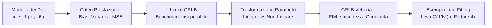
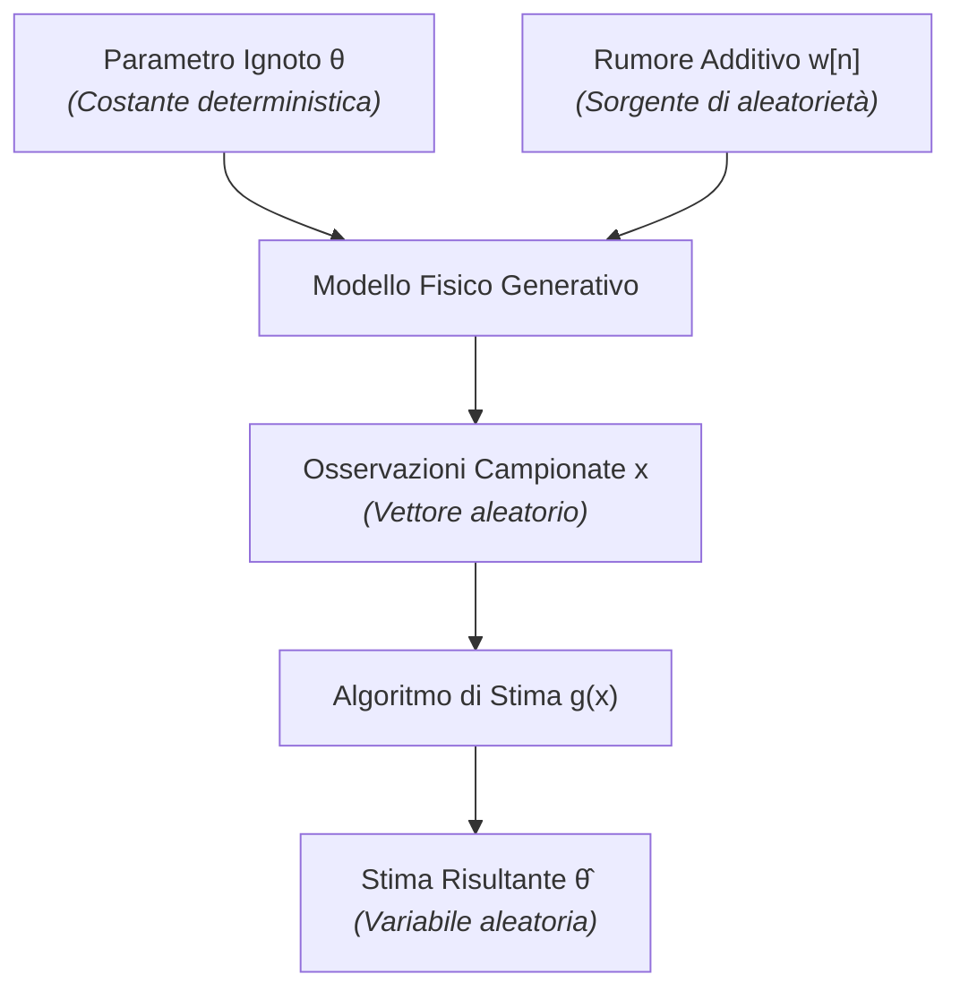

# 0. Fondamenti di Stima Classica e Limite di Cramer-Rao

Nell'elaborazione statistica dei segnali, il problema fondamentale della **stima dei parametri** consiste nell'estrarre informazioni quantitative affidabili su grandezze fisiche non direttamente accessibili, elaborando un insieme finito di osservazioni corrotte da rumore o incertezza di misura.

Questo capitolo introduce il paradigma della **stima classica** (o deterministica), in cui il parametro incognito è una quantità deterministica, fissa e costante nel tempo, priva di una distribuzione di probabilità a priori. 

I nostri obiettivi concettuali e analitici:
1. Stabilire i criteri per quantificare l'errore di stima (bias, varianza, errore quadratico medio).
2. Comprendere perché la minimizzazione libera dell'MSE fallisce e rende necessario il vincolo di **non polarizzazione** (**MVU**).
3. Ricavare e applicare il limite fondamentale delle prestazioni: il **Cramer-Rao Lower Bound** (**CRLB**).
4. Analizzare l'impatto delle trasformazioni di parametri e l'estensione a vettori di parametri incogniti.

---

## Il Problema della Stima e Modello dei Dati

> [!NOTE] Obiettivo Concettuale
> Formalizzare matematicamente il processo di misura e comprendere lo statuto statistico dello stimatore: una funzione deterministica di dati aleatori, che genera una nuova variabile aleatoria.

Supponiamo di acquisire una sequenza temporale o spaziale di $N$ campioni discreti, organizzati nel vettore colonna delle osservazioni $\mathbf{x} \in \mathbb{R}^{N}$:

$$
\mathbf{x} = \begin{bmatrix} x[0] \\ x[1] \\ \vdots \\ x[N-1] \end{bmatrix}
$$

I dati osservati dipendono da un parametro incognito scalare $\theta$ (oppure da un vettore di parametri $\boldsymbol{\theta} \in \mathbb{R}^{P}$). Descriviamo la distribuzione statistica dei dati mediante la funzione di densità di probabilità (**PDF**) congiunta parametrica:

$$
f_{\mathbf{x}}(\mathbf{x}; \theta)
$$

Il punto e virgola evidenzia che $\theta$ **non** è una variabile aleatoria condizionante, ma un parametro deterministico che indicizza la famiglia di distribuzioni di probabilità.

Uno **stimatore** $\hat{\theta}$ è una regola deterministica o algoritmo che mappa lo spazio delle osservazioni nello spazio dei parametri:

$$
\hat{\theta} = g(\mathbf{x}) = g(x[0], x[1], \dots, x[N-1])
$$

Poiché i dati $\mathbf{x}$ sono fluttuazioni aleatorie governate dal rumore, anche lo stimatore $\hat{\theta} = g(\mathbf{x})$ è a sua volta una **variabile aleatoria**. Esso possiede quindi una propria densità di probabilità $f_{\hat{\theta}}(\hat{\theta}; \theta)$, con un proprio valore atteso e una propria dispersione statistica.

> [!NOTE] Stima Classica vs Stima Bayesiana
> - **Stima Classica (questo modulo)**: Il parametro $\theta$ è una costante deterministica ignota. Non possiamo associare a $\theta$ alcuna probabilità a priori: l'unica fonte di informazione statistica è la PDF dei dati $f_{\mathbf{x}}(\mathbf{x}; \theta)$.
> - **Stima Bayesiana**: Il parametro $\theta$ è modellato esplicitamente come una variabile aleatoria con PDF a priori $f_{\theta}(\theta)$, che quantifica la nostra conoscenza prima di raccogliere le misure. L'inferenza si basa sulla distribuzione a posteriori $f_{\theta|\mathbf{x}}(\theta | \mathbf{x})$.

---

## Errore di Stima, Polarizzazione e Varianza

> [!NOTE] Obiettivo Concettuale
> Scomporre la qualità di una stima nelle sue due dimensioni fondamentali: l'accuratezza sistematica (**bias**) e la precisione stocastica (**varianza**).

Definiamo l'**errore di stima** $e$ come lo scostamento tra il valore calcolato dai dati e il valore vero del parametro:

$$
e = \hat{\theta} - \theta
$$

Essendo $\hat{\theta}$ aleatorio e $\theta$ una costante deterministica, l'errore $e$ è una variabile aleatoria. Per valutarne le prestazioni esaminiamo i suoi primi due momenti statistici: la media e la varianza.

### Polarizzazione (Bias)

Il **bias** (o polarizzazione) rappresenta il valore atteso dell'errore di stima e misura l'errore sistematico commesso dallo stimatore:

$$
b(\theta) = \mathbb{E}[\hat{\theta}] - \theta = \mathbb{E}[e] = \int_{\mathbb{R}^N} g(\mathbf{x}) f_{\mathbf{x}}(\mathbf{x}; \theta) \mathrm{d}\mathbf{x} - \theta
$$

Uno stimatore si definisce **non polarizzato** (o corretto, *unbiased*) se il suo valore atteso coincide esattamente con il valore vero del parametro per ogni possibile valore di $\theta$:

$$
b(\theta) = 0 \iff \mathbb{E}[\hat{\theta}] = \theta \quad \forall \theta \in \Theta
$$

Se $b(\theta) \neq 0$ anche per un solo valore di $\theta$, lo stimatore è detto **polarizzato** (*biased*).

### Varianza dello Stimatore

La **varianza** quantifica la dispersione delle stime attorno al loro valore atteso medio $\mathbb{E}[\hat{\theta}]$ al variare delle realizzazioni del rumore:

$$
\text{Var}\{\hat{\theta}\} = \mathbb{E}\left[ (\hat{\theta} - \mathbb{E}[\hat{\theta}])^2 \right] = \int_{\mathbb{R}^N} (g(\mathbf{x}) - \mathbb{E}[\hat{\theta}])^2 f_{\mathbf{x}}(\mathbf{x}; \theta) \mathrm{d}\mathbf{x}
$$

Se lo stimatore è non polarizzato ($\mathbb{E}[\hat{\theta}] = \theta$), la varianza coincide direttamente con il valore atteso del quadrato dell'errore:

$$
\text{Var}\{\hat{\theta}\} = \mathbb{E}\left[ (\hat{\theta} - \theta)^2 \right] \quad (\text{se } b(\theta) = 0)
$$

> [!EXAMPLE] Stima del Livello DC in Rumore Bianco
> Consideriamo un segnale continuo costante immerso in rumore additivo:
>
> $$
> x[n] = \theta + w[n], \quad n = 0, 1, \dots, N-1
> $$
>
> dove $w[n]$ è rumore bianco a media nulla e varianza $\sigma^2$, incorrelato nel tempo ($\mathbb{E}[w[n]w[k]] = \sigma^2 \delta[n-k]$).
> Valutiamo tre stimatori concorrenti per $\theta$:
>
> 1. **Media campionaria**: $\hat{\theta}_1 = \frac{1}{N}\sum_{n=0}^{N-1} x[n] = \bar{x}$.
>    - *Media*: $\mathbb{E}[\hat{\theta}_1] = \frac{1}{N}\sum_{n=0}^{N-1} (\theta + \mathbb{E}[w[n]]) = \theta \implies b_1(\theta) = 0$ (**non polarizzato**).
>    - *Varianza*: sfruttando l'incorrelazione dei campioni di rumore,
>      $$
>      \text{Var}\{\hat{\theta}_1\} = \frac{1}{N^2}\sum_{n=0}^{N-1} \text{Var}\{w[n]\} = \frac{N\sigma^2}{N^2} = \frac{\sigma^2}{N}
>      $$
>      All'aumentare delle osservazioni ($N \to \infty$) la varianza collassa a zero (proprietà di consistenza).
>
> 2. **Singola osservazione**: $\hat{\theta}_2 = x[0]$.
>    - *Media*: $\mathbb{E}[\hat{\theta}_2] = \mathbb{E}[\theta + w[0]] = \theta \implies b_2(\theta) = 0$ (**non polarizzato**).
>    - *Varianza*: $\text{Var}\{\hat{\theta}_2\} = \sigma^2$. Non si riduce al crescere di $N$, ignorando l'informazione contenuta negli altri $N-1$ campioni.
>
> 3. **Media smorzata**: $\hat{\theta}_3 = \frac{1}{2N}\sum_{n=0}^{N-1} x[n] = \frac{1}{2}\hat{\theta}_1$.
>    - *Media*: $\mathbb{E}[\hat{\theta}_3] = \frac{\theta}{2} \implies b_3(\theta) = -\frac{\theta}{2} \neq 0$ (**polarizzato**).
>    - *Varianza*: $\text{Var}\{\hat{\theta}_3\} = \frac{1}{4}\text{Var}\{\hat{\theta}_1\} = \frac{\sigma^2}{4N}$.
>
> **Takeaway d'esame**: Lo stimatore $\hat{\theta}_3$ ha una varianza che è un quarto di quella della media campionaria, ma al prezzo di un errore sistematico inaccettabile che scala proporzionalmente al segnale stesso. Come pesare congiuntamente bias e varianza?

---

## Il Compromesso tra Bias e Varianza e l'Errore Quadratico Medio (MSE)

> [!NOTE] Obiettivo Concettuale
> Unificare errore sistematico e dispersione casuale in una metrica globale di prestazione: il **Mean Squared Error** (**MSE**).

Definiamo l'errore quadratico medio come:

$$
\text{MSE}\{\hat{\theta}\} = \mathbb{E}\left[ (\hat{\theta} - \theta)^2 \right]
$$

### Sviluppo Analitico: La Decomposizione del Mean Squared Error

Per separare la componente stocastica da quella deterministica, aggiungiamo e sottraiamo il valore atteso $\mathbb{E}[\hat{\theta}]$ all'interno dell'errore:

$$
\hat{\theta} - \theta = \underbrace{(\hat{\theta} - \mathbb{E}[\hat{\theta}])}_{\text{fluttuazione casuale}} + \underbrace{(\mathbb{E}[\hat{\theta}] - \theta)}_{\text{bias } b(\theta)}
$$

Eleviamo al quadrato e applichiamo l'operatore valore atteso:

$$
\begin{aligned}
\text{MSE}\{\hat{\theta}\} &= \mathbb{E}\left[ \left( (\hat{\theta} - \mathbb{E}[\hat{\theta}]) + b(\theta) \right)^2 \right] \\
&= \mathbb{E}\left[ (\hat{\theta} - \mathbb{E}[\hat{\theta}])^2 \right] + 2 b(\theta) \underbrace{\mathbb{E}[\hat{\theta} - \mathbb{E}[\hat{\theta}]]}_{= 0} + b^2(\theta)
\end{aligned}
$$

Il termine incrociato si annulla identicamente per linearità del valore atteso: $\mathbb{E}[\hat{\theta} - \mathbb{E}[\hat{\theta}]] = \mathbb{E}[\hat{\theta}] - \mathbb{E}[\hat{\theta}] = 0$. Otteniamo la fondamentale **decomposizione dell'MSE**:

$$
\text{MSE}\{\hat{\theta}\} = \text{Var}\{\hat{\theta}\} + b^2(\theta)
$$

L'errore quadratico medio è la somma pitagorica di due quantità ortogonali: la **varianza** (precisione) e il **quadrato del bias** (accuratezza).

![[slide_17_bias_variance_targets.png|center mid]]

L'analogia del bersaglio chiarisce geometricamente le quattro combinazioni:
- **Basso bias, Bassa varianza** *(in alto a sinistra)*: Il centroide dei colpi è centrato sull'obiettivo e la dispersione è minima. È lo stimatore ideale.
- **Basso bias, Alta varianza** *(in basso a sinistra)*: La media dei tiri converge al centro, ma i singoli colpi sono ampiamente dispersi attorno al bersaglio.
- **Alto bias, Bassa varianza** *(in alto a destra)*: I tiri sono densamente concentrati tra loro, ma stabilmente lontani dal centro per via di un errore di mira sistematico.
- **Alto bias, Alta varianza** *(in basso a destra)*: Scenario peggiore; stime fortemente disperse e disallineate dal centro.

### Il Dilemma della Minimizzazione dell'MSE

Se l'obiettivo ingegneristico è minimizzare l'errore globale, perché nella stima classica non cerchiamo direttamente la funzione $g(\mathbf{x})$ che minimizza $\text{MSE}\{\hat{\theta}\}$?

Consideriamo un caso estremo: lo stimatore costante banale $\hat{\theta}_0 = c$ (ad esempio $\hat{\theta}_0 = 5$), che ignora del tutto i dati misurati.
- Varianza: $\text{Var}\{\hat{\theta}_0\} = 0$ (nessuna fluttuazione).
- Bias: $b(\theta) = 5 - \theta$.
- Errore quadratico medio: $\text{MSE}\{\hat{\theta}_0\} = (5 - \theta)^2$.

Se per pura coincidenza il valore vero è $\theta = 5$, questo stimatore registra $\text{MSE} = 0$, battendo qualsiasi algoritmo elaborato sui dati. Ma se il parametro vero vale $\theta = 100$, il suo errore esplode a $(95)^2 = 9025$.

> [!WARNING] Il Paradosso della Minimizzazione Libera dell'MSE
> Minimizzando $\text{MSE}\{\hat{\theta}\} = \text{Var}\{\hat{\theta}\} + b^2(\theta)$ senza vincoli rispetto alla funzione $g(\mathbf{x})$, lo stimatore ottimo risultante **dipende esplicitamente dal parametro incognito $\theta$**.
> Uno stimatore che richiede di conoscere in anticipo $\theta$ per poter essere calcolato è fisicamente irrealizzabile (problema mal posto).

---

## Lo Stimatore a Minima Varianza Non Polarizzato (MVU)

> [!NOTE] Obiettivo Concettuale
> Risolvere l'irrealizzabilità della minimizzazione dell'MSE imponendo a priori il vincolo di **non polarizzazione**, rendendo il problema matematicamente ben posto.

Imponendo il vincolo di assenza di errore sistematico su tutto lo spazio dei parametri:

$$
b(\theta) = 0 \quad \forall \theta \in \Theta \implies \text{MSE}\{\hat{\theta}\} = \text{Var}\{\hat{\theta}\}
$$

L'MSE coincide con la varianza. Il problema di ottimalità si riformula quindi in modo rigoroso: cercare uno stimatore che soddisfi due condizioni:
1. **Non polarizzazione**: $\mathbb{E}[\hat{\theta}] = \theta \quad \forall \theta \in \Theta$.
2. **Varianza minima uniforme**: $\text{Var}\{\hat{\theta}\} \le \text{Var}\{\tilde{\theta}\} \quad \forall \theta \in \Theta$, rispetto a qualunque altro stimatore non polarizzato $\tilde{\theta}$.

Uno stimatore che verifica queste proprietà è detto **stimatore MVU** (**Minimum Variance Unbiased Estimator**).

> [!IMPORTANT] Superiorità Uniforme dell'MVU
> La disuguaglianza $\text{Var}\{\hat{\theta}\} \le \text{Var}\{\tilde{\theta}\}$ deve valere per qualsiasi valore del parametro $\theta$ (**uniformemente**). Non è ammesso che uno stimatore sia migliore per un intervallo di valori e peggiore per un altro: l'MVU domina su tutto il dominio dei parametri.

Trovare lo stimatore MVU presenta due formidabili ostacoli:
- **Non garantita esistenza**: potrebbero esistere più stimatori corretti le cui curve di varianza si intersecano senza che nessuno sia uniformemente inferiore agli altri per ogni $\theta$.
- **Complessità analitica**: cercare direttamente la funzione $g(\mathbf{x})$ ottima nello spazio infinito di tutte le funzioni non polarizzate è generalmente intrattabile.

Per questa ragione, prima di cercare un algoritmo di stima, è indispensabile disporre di un **limite inferiore teorico** universale. Questo riferimento è il Limite di Cramer-Rao.

---

## Il Limite Inferiore di Cramer-Rao (CRLB)

> [!NOTE] Obiettivo Concettuale
> Stabilire la barriera fisica e matematica insuperabile per la precisione di qualsiasi stimatore non polarizzato, legandola alla quantità di informazione contenuta nei dati.

Il **Cramer-Rao Lower Bound** (**CRLB**) fissa il limite inferiore per la varianza di qualunque stimatore corretto.

### Condizione di Regolarità

Il CRLB richiede che la densità di probabilità congiunta $f_{\mathbf{x}}(\mathbf{x}; \theta)$ soddisfi la **condizione di regolarità**:

$$
\mathbb{E}\left[ \frac{\partial \ln f_{\mathbf{x}}(\mathbf{x}; \theta)}{\partial \theta} \right] = 0 \quad \forall \theta
$$

La grandezza differenziale $S(\mathbf{x}; \theta) = \frac{\partial \ln f_{\mathbf{x}}(\mathbf{x}; \theta)}{\partial \theta}$ è detta **funzione di score**. La condizione di regolarità impone che lo score abbia valore atteso nullo.

Sviluppiamo il valore atteso dello score sfruttando l'identità differenziale $\frac{\partial \ln f}{\partial \theta} = \frac{1}{f}\frac{\partial f}{\partial \theta}$:

$$
\mathbb{E}\left[ \frac{\partial \ln f_{\mathbf{x}}(\mathbf{x}; \theta)}{\partial \theta} \right] = \int_{\mathcal{X}} \frac{1}{f_{\mathbf{x}}(\mathbf{x}; \theta)} \frac{\partial f_{\mathbf{x}}(\mathbf{x}; \theta)}{\partial \theta} f_{\mathbf{x}}(\mathbf{x}; \theta) \mathrm{d}\mathbf{x} = \int_{\mathcal{X}} \frac{\partial f_{\mathbf{x}}(\mathbf{x}; \theta)}{\partial \theta} \mathrm{d}\mathbf{x}
$$

Se l'ordine di integrazione e derivazione può essere scambiato:

$$
\int_{\mathcal{X}} \frac{\partial f_{\mathbf{x}}(\mathbf{x}; \theta)}{\partial \theta} \mathrm{d}\mathbf{x} = \frac{\partial}{\partial \theta} \int_{\mathcal{X}} f_{\mathbf{x}}(\mathbf{x}; \theta) \mathrm{d}\mathbf{x} = \frac{\partial}{\partial \theta} (1) = 0
$$

> [!WARNING] Quando Fallisce la Condizione di Regolarità: La Dipendenza del Supporto
> L'inversione tra integrale e derivata (teorema di Leibniz) è valida se e solo se il supporto di integrazione $\mathcal{X} = \{\mathbf{x} : f_{\mathbf{x}}(\mathbf{x}; \theta) > 0\}$ **non dipende dal parametro $\theta$**.
> - **Controesempio d'esame**: Per campioni uniformi $x[n] \sim \mathcal{U}[0, \theta]$, il supporto è $[0, \theta]^N$, che dipende direttamente da $\theta$. La derivata dell'integrale produce termini di bordo, la condizione di regolarità decade e il CRLB standard non si applica (in tali casi esistono stimatori che convergono con varianza super-efficiente $O(1/N^2)$ anziché $O(1/N)$).
> - **Casi regolari**: Per distribuzioni gaussiane, poissoniane o laplaciane con supporto fisso ($\mathbb{R}^N$), la condizione di regolarità è sempre pienamente soddisfatta.

### Informazione di Fisher

L'**Informazione di Fisher** $I(\theta)$ misura la quantità di informazione statistica che il vettore delle osservazioni $\mathbf{x}$ trasporta sul parametro incognito $\theta$. È definita come la varianza (o secondo momento) della funzione di score:

$$
I(\theta) = \mathbb{E}\left[ \left( \frac{\partial \ln f_{\mathbf{x}}(\mathbf{x}; \theta)}{\partial \theta} \right)^2 \right] = \int_{\mathcal{X}} \left( \frac{\partial \ln f_{\mathbf{x}}(\mathbf{x}; \theta)}{\partial \theta} \right)^2 f_{\mathbf{x}}(\mathbf{x}; \theta) \mathrm{d}\mathbf{x}
$$

Sotto la condizione di regolarità, vale la fondamentale forma alternativa (spesso molto più immediata nel calcolo analitico):

$$
I(\theta) = -\mathbb{E}\left[ \frac{\partial^2 \ln f_{\mathbf{x}}(\mathbf{x}; \theta)}{\partial \theta^2} \right]
$$

La dimostrazione formale dell'identità tra il secondo momento della derivata prima e l'opposto del valore atteso della derivata seconda è consultabile in [[zz. Argomenti extra#Identità tra la Prima e la Seconda Derivata dell'Informazione di Fisher|zz. Argomenti extra: Identità tra la Prima e la Seconda Derivata dell'Informazione di Fisher]].

#### Dual Coding e Intuizione Geometrica della Curvatura

L'Informazione di Fisher quantifica la **curvatura media** della funzione di log-verosimiglianza $\ln f_{\mathbf{x}}(\mathbf{x}; \theta)$:

![[fisher_information_curvature.svg|center mid]]

- **Forte curvatura negativa attorno al massimo** (picco acuto): La derivata seconda ha modulo elevato. Uno spostamento infinitesimo di $\theta$ fa crollare la verosimiglianza: le osservazioni distinguono nettamente valori contigui di $\theta \implies I(\theta)$ è grande $\implies$ incertezza minima.
- **Debole curvatura attorno al massimo** (profilo piatto): La derivata seconda è vicina a zero. Valori diversi di $\theta$ producono profili di verosimiglianza quasi indistinguibili: i dati trasportano scarsa informazione $\implies I(\theta)$ è piccola $\implies$ limite di varianza elevato.

### Teorema del Limite di Cramer-Rao (Caso Scalare)

Sia $\mathbf{x}$ un vettore di dati con PDF $f_{\mathbf{x}}(\mathbf{x}; \theta)$ soddisfacente la condizione di regolarità. Allora la varianza di qualunque stimatore non polarizzato $\hat{\theta}$ è limitata inferiormente dall'inverso dell'Informazione di Fisher:

$$
\text{Var}\{\hat{\theta}\} \ge \frac{1}{I(\theta)} = \frac{1}{-\mathbb{E}\left[ \frac{\partial^2 \ln f_{\mathbf{x}}(\mathbf{x}; \theta)}{\partial \theta^2} \right]}
$$

La dimostrazione formale si basa sull'applicazione della disuguaglianza di Cauchy-Schwarz alla covarianza tra l'errore $(\hat{\theta} - \theta)$ e la funzione di score $\frac{\partial \ln f}{\partial \theta}$, ed è consultabile in [[zz. Argomenti extra#Dimostrazione del Limite Inferiore di Cramer-Rao (CRLB)|zz. Argomenti extra: Dimostrazione del Limite Inferiore di Cramer-Rao (CRLB)]].

### Efficienza e Condizione di Raggiungibilità del CRLB

Uno stimatore non polarizzato $\hat{\theta}$ la cui varianza eguaglia esattamente il limite inferiore per qualsiasi valore di $\theta$:

$$
\text{Var}\{\hat{\theta}\} = \frac{1}{I(\theta)} \quad \forall \theta \in \Theta
$$

è definito **stimatore efficiente**.

> [!IMPORTANT] Efficienza ed Esistenza dell'MVU
> Uno stimatore efficiente è **automaticamente lo stimatore MVU**, poiché nessun candidato non polarizzato può avere una varianza inferiore a $\frac{1}{I(\theta)}$. Il raggiungimento del CRLB è dunque una **condizione sufficiente** per l'ottimalità MVU.

Il teorema del CRLB fornisce inoltre una condizione necessaria e sufficiente algebrica per determinare se esiste uno stimatore efficiente senza dover calcolare esplicitamente la varianza:

> [!TIP] Condizione di Efficienza (Scorciatoia Operativa d'Esame)
> Esiste uno stimatore non polarizzato $\hat{\theta}$ che raggiunge il CRLB se e solo se la derivata prima della log-verosimiglianza si fattorizza nella forma separabile:
>
> $$
> \frac{\partial \ln f_{\mathbf{x}}(\mathbf{x}; \theta)}{\partial \theta} = I(\theta) \left( g(\mathbf{x}) - \theta \right)
> $$
>
> dove $g(\mathbf{x})$ è una funzione che dipende unicamente dai dati $\mathbf{x}$ e $I(\theta)$ non dipende da $\mathbf{x}$.
> In caso affermativo, otteniamo simultaneamente tre risultati senza fare integrali:
> 1. Lo stimatore efficiente ed MVU è unico ed è: $\hat{\theta} = g(\mathbf{x})$.
> 2. L'Informazione di Fisher $I(\theta)$ coincide con il fattore moltiplicativo.
> 3. La varianza minima vale esattamente: $\text{Var}\{\hat{\theta}\} = \frac{1}{I(\theta)}$.

---

## Esempio Completo: Livello DC in Rumore Gaussiano Bianco (AWGN)

> [!NOTE] Obiettivo Concettuale
> Applicare passo-passo l'algoritmo del CRLB al modello fondamentale del segnale costante immerso in rumore termico gaussiano.

Consideriamo il modello:

$$
x[n] = \theta + w[n], \quad n = 0, 1, \dots, N-1, \quad w[n] \sim \mathcal{N}(0, \sigma^2) \text{ i.i.d.}
$$

Seguiamo la procedura operativa in sette passi:

1. **Costruzione della PDF congiunta (Verosimiglianza)**:
   Poiché i campioni di rumore sono indipendenti e identicamente distribuiti, ciascun campione $x[n] \sim \mathcal{N}(\theta, \sigma^2)$ è statisticamente indipendente. La PDF congiunta è la produttoria delle marginali:

   $$
   f_{\mathbf{x}}(\mathbf{x}; \theta) = \prod_{n=0}^{N-1} \frac{1}{\sqrt{2\pi\sigma^2}} \exp\left( -\frac{1}{2\sigma^2} (x[n] - \theta)^2 \right) = \frac{1}{(2\pi\sigma^2)^{N/2}} \exp\left( -\frac{1}{2\sigma^2} \sum_{n=0}^{N-1} (x[n] - \theta)^2 \right)
   $$

2. **Calcolo della Log-Verosimiglianza**:
   Applichiamo il logaritmo naturale per trasformare il prodotto in sommatoria:

   $$
   \ln f_{\mathbf{x}}(\mathbf{x}; \theta) = -\frac{N}{2} \ln(2\pi\sigma^2) - \frac{1}{2\sigma^2} \sum_{n=0}^{N-1} (x[n] - \theta)^2
   $$

3. **Derivata prima (Score Function)**:
   Deriviamo rispetto a $\theta$ applicando la regola della catena:

   $$
   \frac{\partial \ln f_{\mathbf{x}}(\mathbf{x}; \theta)}{\partial \theta} = -\frac{1}{2\sigma^2} \sum_{n=0}^{N-1} 2(x[n] - \theta)(-1) = \frac{1}{\sigma^2} \sum_{n=0}^{N-1} (x[n] - \theta)
   $$

   Raccogliamo il numero di campioni $N$:

   $$
   \frac{\partial \ln f_{\mathbf{x}}(\mathbf{x}; \theta)}{\partial \theta} = \frac{1}{\sigma^2} \left( \sum_{n=0}^{N-1} x[n] - N\theta \right) = \frac{N}{\sigma^2} \left( \frac{1}{N}\sum_{n=0}^{N-1} x[n] - \theta \right)
   $$

4. **Verifica della condizione di regolarità**:
   Calcoliamo il valore atteso dello score rispetto alle osservazioni, ricordando che $\mathbb{E}[x[n]] = \theta$:

   $$
   \mathbb{E}\left[ \frac{\partial \ln f_{\mathbf{x}}(\mathbf{x}; \theta)}{\partial \theta} \right] = \frac{N}{\sigma^2} \left( \frac{1}{N}\sum_{n=0}^{N-1} \mathbb{E}[x[n]] - \theta \right) = \frac{N}{\sigma^2} (\theta - \theta) = 0
   $$

   La condizione di regolarità è verificata per qualsiasi $\theta$.

5. **Derivata seconda rispetto a $\theta$**:
   Derivando ulteriormente l'espressione dello score rispetto a $\theta$:

   $$
   \frac{\partial^2 \ln f_{\mathbf{x}}(\mathbf{x}; \theta)}{\partial \theta^2} = \frac{\partial}{\partial \theta} \left( \frac{1}{\sigma^2}\sum_{n=0}^{N-1} x[n] - \frac{N}{\sigma^2}\theta \right) = -\frac{N}{\sigma^2}
   $$

6. **Calcolo dell'Informazione di Fisher**:
   Essendo la seconda derivata una costante deterministica indipendente da $\mathbf{x}$, l'operatore valore atteso è banale:

   $$
   I(\theta) = -\mathbb{E}\left[ \frac{\partial^2 \ln f_{\mathbf{x}}(\mathbf{x}; \theta)}{\partial \theta^2} \right] = -\left( -\frac{N}{\sigma^2} \right) = \frac{N}{\sigma^2}
   $$

7. **Verifica della condizione di efficienza**:
   Confrontiamo la derivata prima ottenuta al passo 3 con la forma canonica di efficienza $I(\theta)(g(\mathbf{x}) - \theta)$:

   $$
   \frac{\partial \ln f_{\mathbf{x}}(\mathbf{x}; \theta)}{\partial \theta} = \underbrace{\frac{N}{\sigma^2}}_{I(\theta)} \left( \underbrace{\frac{1}{N}\sum_{n=0}^{N-1} x[n]}_{g(\mathbf{x})} - \theta \right)
   $$

La fattorizzazione è perfetta:
- Lo stimatore $\hat{\theta} = \frac{1}{N}\sum_{n=0}^{N-1} x[n] = \bar{x}$ (la media campionaria) è **efficiente** e coincide con l'**MVU estimator**.
- La sua varianza tocca esattamente il bound:

$$
\text{Var}\{\hat{\theta}\} = \frac{1}{I(\theta)} = \frac{\sigma^2}{N}
$$

**Takeaway d'esame**: L'Informazione di Fisher cresce linearmente con $N$ e inversamente con la potenza del rumore $\sigma^2$. Di conseguenza, la varianza scala come $O(1/N)$: per dimezzare l'incertezza (deviazione standard) della stima è necessario quadruplicare il numero di campioni acquisiti.

---

## Trasformazione di Parametri

> [!NOTE] Obiettivo Concettuale
> Determinare il limite di accuratezza quando l'obiettivo non è stimare direttamente $\theta$, ma una sua funzione nota deterministica $\alpha = h(\theta)$ (es. potenza, frequenza angolare, energia).

Sia $\alpha = h(\theta)$ una funzione differenziabile del parametro originario. Sotto condizione di regolarità, il CRLB per la stima del parametro trasformato diventa:

$$
\text{Var}\{\hat{\alpha}\} \ge \frac{\left( \frac{\partial h(\theta)}{\partial \theta} \right)^2}{I(\theta)}
$$

dove $I(\theta)$ è l'Informazione di Fisher calcolata rispetto al parametro originario $\theta$. Il numeratore $\left( \frac{\partial h}{\partial \theta} \right)^2$ agisce come fattore di scala locale della sensitività della trasformazione.

### Trasformazione Lineare (o Affine)

Se la trasformazione è lineare o affine:

$$
\alpha = k\theta + c
$$

la derivata è una costante deterministica: $\frac{\partial h}{\partial \theta} = k$. Il limite si specializza in:

$$
\text{Var}\{\hat{\alpha}\} \ge \frac{k^2}{I(\theta)}
$$

Se per il parametro $\theta$ esiste uno stimatore efficiente $\hat{\theta}$ con $\text{Var}\{\hat{\theta}\} = \frac{1}{I(\theta)}$, allora lo stimatore naturale:

$$
\hat{\alpha} = k\hat{\theta} + c
$$

è **esattamente non polarizzato ed efficiente** per ogni dimensione campionaria finita $N$:

$$
\mathbb{E}[\hat{\alpha}] = k\mathbb{E}[\hat{\theta}] + c = k\theta + c = \alpha, \qquad \text{Var}\{\hat{\alpha}\} = k^2 \text{Var}\{\hat{\theta}\} = \frac{k^2}{I(\theta)}
$$

### Trasformazione Non Lineare

Quando $h(\theta)$ è una funzione non lineare, le proprietà ottime a campioni finiti non si preservano:
1. **Bias a campioni finiti**: Anche se $\hat{\theta}$ è non polarizzato per $\theta$, lo stimatore naturale plug-in $\hat{\alpha} = h(\hat{\theta})$ è **polarizzato per campioni finiti** a causa della disuguaglianza di Jensen:
   
   $$
   \mathbb{E}[h(\hat{\theta})] \neq h(\mathbb{E}[\hat{\theta}]) = h(\theta)
   $$

2. **Inaccessibilità del bound**: Per campioni finiti $N$, **non esiste alcuno stimatore non polarizzato** capace di raggiungere il bound trasformato.
3. **Efficienza Asintotica**: Al tendere di $N \to \infty$, se $\hat{\theta}$ è consistente ed efficiente, lo stimatore plug-in diviene **asintoticamente non polarizzato ed asintoticamente efficiente**.

> [!EXAMPLE] Stima della Potenza del Livello DC ($\alpha = \theta^2$)
> Riprendiamo il modello DC in rumore AWGN ($x[n] = \theta + w[n]$) e consideriamo la stima della potenza $\alpha = h(\theta) = \theta^2$.
> Adottiamo come stimatore naturale il quadrato della media campionaria:
>
> $$
> \hat{\alpha} = (\hat{\theta})^2 = \bar{x}^2 = \left( \frac{1}{N}\sum_{n=0}^{N-1} x[n] \right)^2
> $$
>
> 1. **Analisi del Bias**:
>    Poiché $\bar{x} \sim \mathcal{N}\left(\theta, \frac{\sigma^2}{N}\right)$, sfruttiamo l'identità fondamentale del secondo momento $\mathbb{E}[\bar{x}^2] = \text{Var}\{\bar{x}\} + (\mathbb{E}[\bar{x}])^2$:
>
>    $$
>    \mathbb{E}[\hat{\alpha}] = \mathbb{E}[\bar{x}^2] = \frac{\sigma^2}{N} + \theta^2 = \alpha + \frac{\sigma^2}{N}
>    $$
>
>    Il bias dello stimatore vale $b(\alpha) = \mathbb{E}[\hat{\alpha}] - \alpha = \frac{\sigma^2}{N} > 0$. Lo stimatore **sovrastima sistematicamente** la potenza a campioni finiti, perché le fluttuazioni del rumore, una volta elevate al quadrato, forniscono un contributo medio strettamente positivo.
>    Tuttavia, per $N \to \infty$, il bias si annulla: $\hat{\alpha}$ è **asintoticamente non polarizzato**.
>
> 2. **Calcolo del CRLB Trasformato**:
>    Avendo $\frac{\partial h(\theta)}{\partial \theta} = 2\theta$ e $I(\theta) = \frac{N}{\sigma^2}$:
>
>    $$
>    \text{CRLB}(\alpha) = \frac{\left( \frac{\partial h}{\partial \theta} \right)^2}{I(\theta)} = \frac{(2\theta)^2}{\frac{N}{\sigma^2}} = \frac{4\theta^2\sigma^2}{N} = \frac{4\alpha\sigma^2}{N}
>    $$
>
> 3. **Varianza Effettiva ed Efficienza Asintotica**:
>    Esprimiamo la media campionaria come $\bar{x} = \theta + u$, con $u \sim \mathcal{N}\left(0, \frac{\sigma^2}{N}\right)$.
>    Sviluppiamo lo stimatore: $\hat{\alpha} = (\theta + u)^2 = \theta^2 + 2\theta u + u^2$.
>    La varianza è:
>
>    $$
>    \text{Var}\{\hat{\alpha}\} = \mathbb{E}\left[ (\hat{\alpha} - \mathbb{E}[\hat{\alpha}])^2 \right] = \mathbb{E}\left[ \left( 2\theta u + \left( u^2 - \frac{\sigma^2}{N} \right) \right)^2 \right]
>    $$
>
>    Espandendo il quadrato:
>    - Termine lineare in $u$: $\mathbb{E}[4\theta^2 u^2] = 4\theta^2 \frac{\sigma^2}{N} = \frac{4\alpha\sigma^2}{N}$.
>    - Termine incrociato: $4\theta \mathbb{E}\left[ u \left( u^2 - \frac{\sigma^2}{N} \right) \right] = 4\theta (\mathbb{E}[u^3] - \frac{\sigma^2}{N}\mathbb{E}[u]) = 0$, poiché i momenti dispari della gaussiana a media nulla sono nulli.
>    - Termine quadratico: $\mathbb{E}\left[ \left( u^2 - \frac{\sigma^2}{N} \right)^2 \right] = \text{Var}\{u^2\} = 2 (\text{Var}\{u\})^2 = \frac{2\sigma^4}{N^2}$ (proprietà dei momenti gaussiani, $\mathbb{E}[u^4] = 3\sigma_u^4$).
>
>    Sommando i contributi otteniamo la varianza esatta:
>
>    $$
>    \text{Var}\{\hat{\alpha}\} = \frac{4\alpha\sigma^2}{N} + \frac{2\sigma^4}{N^2}
>    $$
>
>    A campioni finiti, $\text{Var}\{\hat{\alpha}\} = \text{CRLB}(\alpha) + \frac{2\sigma^4}{N^2} > \text{CRLB}(\alpha)$. Tuttavia, esaminando il rapporto per grandi campioni:
>
>    $$
>    \lim_{N \to \infty} \frac{\text{Var}\{\hat{\alpha}\}}{\text{CRLB}(\alpha)} = \lim_{N \to \infty} \left( 1 + \frac{\sigma^2}{2\alpha N} \right) = 1
>    $$
>
>    Il termine eccedente decade con velocità quadratica $O(1/N^2)$ rispetto alla velocità lineare $O(1/N)$ del bound: lo stimatore è **asintoticamente efficiente**.

---

## Estensione Vettoriale del CRLB

> [!NOTE] Obiettivo Concettuale
> Generalizzare il limite di Cramer-Rao a problemi multidimensionali in cui stimiamo congiuntamente un insieme di $P$ parametri incogniti concorrenti.

Consideriamo un vettore di parametri deterministici da stimare simultaneamente:

$$
\boldsymbol{\theta} = \begin{bmatrix} \theta_1 \\ \theta_2 \\ \vdots \\ \theta_P \end{bmatrix} \in \mathbb{R}^{P}
$$

### Matrice di Informazione di Fisher (FIM)

Definiamo lo score vettoriale come il gradiente della log-verosimiglianza rispetto al vettore dei parametri:

$$
\nabla_{\boldsymbol{\theta}} \ln f_{\mathbf{x}}(\mathbf{x}; \boldsymbol{\theta}) = \begin{bmatrix} \frac{\partial \ln f}{\partial \theta_1} \\ \frac{\partial \ln f}{\partial \theta_2} \\ \vdots \\ \frac{\partial \ln f}{\partial \theta_P} \end{bmatrix}
$$

La condizione di regolarità vettoriale impone che il valore atteso di ciascuna derivata parziale sia nullo: $\mathbb{E}[\nabla_{\boldsymbol{\theta}} \ln f] = \mathbf{0}$.
L'informazione congiunta è descritta dalla **Matrice di Informazione di Fisher** (**FIM**), $\mathbf{I}(\boldsymbol{\theta}) \in \mathbb{R}^{P \times P}$, i cui elementi sono definiti da:

$$
[\mathbf{I}(\boldsymbol{\theta})]_{i, j} = \mathbb{E}\left[ \frac{\partial \ln f_{\mathbf{x}}(\mathbf{x}; \boldsymbol{\theta})}{\partial \theta_i} \frac{\partial \ln f_{\mathbf{x}}(\mathbf{x}; \boldsymbol{\theta})}{\partial \theta_j} \right] = -\mathbb{E}\left[ \frac{\partial^2 \ln f_{\mathbf{x}}(\mathbf{x}; \boldsymbol{\theta})}{\partial \theta_i \partial \theta_j} \right]
$$

La FIM è una matrice simmetrica e, se tutti i parametri sono localmente identificabili, **strettamente definita positiva**.

### Teorema del CRLB Vettoriale

Sia $\hat{\boldsymbol{\theta}}$ uno stimatore vettoriale non polarizzato ($\mathbb{E}[\hat{\boldsymbol{\theta}}] = \boldsymbol{\theta}$). Definiamo la matrice di covarianza dell'errore di stima $\mathbf{C}_{\hat{\boldsymbol{\theta}}} \in \mathbb{R}^{P \times P}$:

$$
\mathbf{C}_{\hat{\boldsymbol{\theta}}} = \mathbb{E}\left[ (\hat{\boldsymbol{\theta}} - \boldsymbol{\theta})(\hat{\boldsymbol{\theta}} - \boldsymbol{\theta})^T \right]
$$

Il teorema del CRLB vettoriale stabilisce che la matrice differenza tra la covarianza dello stimatore e l'inversa della FIM è **semidefinita positiva** (disuguaglianza matriciale di Loewner):

$$
\mathbf{C}_{\hat{\boldsymbol{\theta}}} - \mathbf{I}^{-1}(\boldsymbol{\theta}) \ge \mathbf{0}
$$

Esaminando i singoli elementi sulla diagonale principale, la varianza della stima dell'$i$-esimo parametro $\theta_i$ è vincolata dall'$i$-esimo elemento diagonale dell'**inversa** della FIM:

$$
\text{Var}\{\hat{\theta}_i\} = [\mathbf{C}_{\hat{\boldsymbol{\theta}}}]_{i, i} \ge [\mathbf{I}^{-1}(\boldsymbol{\theta})]_{i, i}
$$

> [!WARNING] Trabocchetto d'Esame: Diagonale dell'Inversa vs Inverso della Diagonale
> Uno dei più gravi errori concettuali consiste nel confondere l'elemento diagonale della matrice inversa con il reciproco dell'elemento diagonale:
>
> $$
> [\mathbf{I}^{-1}(\boldsymbol{\theta})]_{i, i} \ge \frac{1}{[\mathbf{I}(\boldsymbol{\theta})]_{i, i}}
> $$
>
> **L'Intuizione della "Tassa" dell'Incertezza Congiunta**:
> - Il termine $\frac{1}{[\mathbf{I}(\boldsymbol{\theta})]_{i, i}}$ rappresenta la varianza minima che si otterrebbe se **tutti gli altri $P-1$ parametri fossero perfettamente noti a priori con certezza**.
> - Il termine $[\mathbf{I}^{-1}(\boldsymbol{\theta})]_{i, i}$ rappresenta invece il limite reale quando anche gli altri parametri sono incogniti e devono essere stimati dai dati.
> - La presenza di parametri concorrenti incogniti introduce un accoppiamento stocastico che disperde informazione: dover risolvere l'ambiguità congiunta "costa" una perdita netta di precisione. L'uguaglianza si verifica se e solo se la FIM è diagonale, ossia se i parametri sono statisticamente disaccoppiati (ortogonali).
> 
> La dimostrazione algebrica basata sul complemento di Schur è consultabile in [[zz. Argomenti extra#Disuguaglianza tra Elementi della FIM Inversa e Complemento di Schur|zz. Argomenti extra: Dimostrazione Algebrica con Complemento di Schur]].

### Condizione di Efficienza Vettoriale

Uno stimatore vettoriale $\hat{\boldsymbol{\theta}}$ raggiunge il CRLB vettoriale con matrice di covarianza $\mathbf{C}_{\hat{\boldsymbol{\theta}}} = \mathbf{I}^{-1}(\boldsymbol{\theta})$ se e solo se il gradiente dello score si fattorizza come:

$$
\nabla_{\boldsymbol{\theta}} \ln f_{\mathbf{x}}(\mathbf{x}; \boldsymbol{\theta}) = \mathbf{I}(\boldsymbol{\theta}) \left( \mathbf{g}(\mathbf{x}) - \boldsymbol{\theta} \right)
$$

In tal caso, l'MVU estimator efficiente è dato dal vettore $\hat{\boldsymbol{\theta}} = \mathbf{g}(\mathbf{x})$.

---

## Esempio Vettoriale: Line Fitting (Regressione Lineare Semplice)

> [!NOTE] Obiettivo Concettuale
> Applicare il CRLB vettoriale al problema classico della retta di regressione immersa in rumore gaussiano, evidenziando il fenomeno del "braccio di leva temporale" e quantificando esattamente l'aumento di varianza dovuto alla stima congiunta.

Consideriamo il modello in cui osserviamo campioni di una retta affetta da rumore bianco gaussiano:

$$
x[n] = \theta_1 + \theta_2 n + w[n], \quad n = 0, 1, \dots, N-1, \quad w[n] \sim \mathcal{N}(0, \sigma^2) \text{ i.i.d.}
$$

dove $\theta_1$ è l'intercetta sull'asse delle ordinate al tempo zero e $\theta_2$ è la pendenza (coefficiente angolare).

![[slide_36_line_fitting_example.png|center mid]]

Esprimiamo il modello in forma matriciale lineare compatta:

$$
\mathbf{x} = \mathbf{H}\boldsymbol{\theta} + \mathbf{w}
$$

con il vettore dei parametri $\boldsymbol{\theta} = [\theta_1, \theta_2]^T \in \mathbb{R}^2$, il vettore di rumore $\mathbf{w} \sim \mathcal{N}(\mathbf{0}, \sigma^2 \mathbf{I}_N)$ e la **matrice di osservazione** $\mathbf{H} \in \mathbb{R}^{N \times 2}$:

$$
\mathbf{H} = \begin{bmatrix} 1 & 0 \\ 1 & 1 \\ 1 & 2 \\ \vdots & \vdots \\ 1 & N-1 \end{bmatrix}
$$

### Calcolo della Matrice di Informazione di Fisher

La densità di probabilità congiunta del modello lineare gaussiano è:

$$
f_{\mathbf{x}}(\mathbf{x}; \boldsymbol{\theta}) = \frac{1}{(2\pi\sigma^2)^{N/2}} \exp\left( -\frac{1}{2\sigma^2} (\mathbf{x} - \mathbf{H}\boldsymbol{\theta})^T (\mathbf{x} - \mathbf{H}\boldsymbol{\theta}) \right)
$$

da cui la log-verosimiglianza:

$$
\ln f_{\mathbf{x}}(\mathbf{x}; \boldsymbol{\theta}) = -\frac{N}{2} \ln(2\pi\sigma^2) - \frac{1}{2\sigma^2} (\mathbf{x} - \mathbf{H}\boldsymbol{\theta})^T (\mathbf{x} - \mathbf{H}\boldsymbol{\theta})
$$

Calcoliamo il gradiente rispetto a $\boldsymbol{\theta}$ sia per singole componenti che in forma vettoriale:

$$
\nabla_{\boldsymbol{\theta}} \ln f_{\mathbf{x}}(\mathbf{x}; \boldsymbol{\theta}) = \begin{bmatrix} \frac{\partial \ln f}{\partial \theta_1} \\ \frac{\partial \ln f}{\partial \theta_2} \end{bmatrix} = \begin{bmatrix} \frac{1}{\sigma^2} \sum_{n=0}^{N-1} (x[n] - \theta_1 - \theta_2 n) \\ \frac{1}{\sigma^2} \sum_{n=0}^{N-1} (x[n] - \theta_1 - \theta_2 n)n \end{bmatrix} = \frac{1}{\sigma^2} \mathbf{H}^T (\mathbf{x} - \mathbf{H}\boldsymbol{\theta})
$$

Raccogliamo a fattor comune la matrice $\frac{\mathbf{H}^T\mathbf{H}}{\sigma^2}$:

$$
\nabla_{\boldsymbol{\theta}} \ln f_{\mathbf{x}}(\mathbf{x}; \boldsymbol{\theta}) = \frac{\mathbf{H}^T\mathbf{H}}{\sigma^2} \left( (\mathbf{H}^T\mathbf{H})^{-1}\mathbf{H}^T\mathbf{x} - \boldsymbol{\theta} \right)
$$

Riconosciamo immediatamente la condizione di efficienza vettoriale $\mathbf{I}(\boldsymbol{\theta})(\mathbf{g}(\mathbf{x}) - \boldsymbol{\theta})$. La FIM è quindi:

$$
\mathbf{I}(\boldsymbol{\theta}) = \frac{\mathbf{H}^T\mathbf{H}}{\sigma^2}
$$

### Sviluppo Analitico delle Sommatorie e Inversione Matriciale

Sviluppiamo esplicitamente il prodotto matriciale $\mathbf{H}^T\mathbf{H}$:

$$
\mathbf{H}^T\mathbf{H} = \begin{bmatrix} \sum_{n=0}^{N-1} 1 & \sum_{n=0}^{N-1} n \\ \sum_{n=0}^{N-1} n & \sum_{n=0}^{N-1} n^2 \end{bmatrix} = \begin{bmatrix} N & \frac{N(N-1)}{2} \\ \frac{N(N-1)}{2} & \frac{N(N-1)(2N-1)}{6} \end{bmatrix}
$$

Ricordiamo le formule delle serie notevoli:
- Somma dei primi $N-1$ interi: $\sum_{n=0}^{N-1} n = \frac{N(N-1)}{2}$
- Somma dei primi $N-1$ quadrati: $\sum_{n=0}^{N-1} n^2 = \frac{N(N-1)(2N-1)}{6}$

Calcoliamo il determinante di $\mathbf{H}^T\mathbf{H}$ sviluppando i passaggi algebrici:

$$
\begin{aligned}
\det(\mathbf{H}^T\mathbf{H}) &= N \cdot \frac{N(N-1)(2N-1)}{6} - \left( \frac{N(N-1)}{2} \right)^2 \\
&= \frac{N^2(N-1)}{12} \left[ 2(2N-1) - 3(N-1) \right] \\
&= \frac{N^2(N-1)}{12} [4N - 2 - 3N + 3] \\
&= \frac{N^2(N-1)(N+1)}{12} = \frac{N^2(N^2-1)}{12}
\end{aligned}
$$

Invertiamo la matrice $2 \times 2$ mediante la formula dell'aggiunta, $\mathbf{A}^{-1} = \frac{1}{\det(\mathbf{A})} \begin{bmatrix} a_{22} & -a_{12} \\ -a_{21} & a_{11} \end{bmatrix}$:

$$
(\mathbf{H}^T\mathbf{H})^{-1} = \frac{12}{N^2(N^2-1)} \begin{bmatrix} \frac{N(N-1)(2N-1)}{6} & -\frac{N(N-1)}{2} \\ -\frac{N(N-1)}{2} & N \end{bmatrix}
$$

Semplificando singolarmente i quattro elementi della matrice:
- Elemento $(1,1)$: $\frac{12}{N^2(N-1)(N+1)} \cdot \frac{N(N-1)(2N-1)}{6} = \frac{2(2N-1)}{N(N+1)}$
- Elementi fuori diagonale $(1,2)$ e $(2,1)$: $-\frac{12}{N^2(N-1)(N+1)} \cdot \frac{N(N-1)}{2} = -\frac{6}{N(N+1)}$
- Elemento $(2,2)$: $\frac{12}{N^2(N^2-1)} \cdot N = \frac{12}{N(N^2-1)}$

Moltiplicando per $\sigma^2$ otteniamo la matrice di covarianza minima del CRLB:

$$
\mathbf{I}^{-1}(\boldsymbol{\theta}) = \sigma^2 (\mathbf{H}^T\mathbf{H})^{-1} = \sigma^2 \begin{bmatrix} \frac{2(2N-1)}{N(N+1)} & -\frac{6}{N(N+1)} \\ -\frac{6}{N(N+1)} & \frac{12}{N(N^2-1)} \end{bmatrix}
$$

Sulla diagonale leggiamo direttamente le varianze minime per intercetta $\theta_1$ e pendenza $\theta_2$:

$$
\begin{aligned}
\text{Var}\{\hat{\theta}_1\} &\ge [\mathbf{I}^{-1}(\boldsymbol{\theta})]_{1, 1} = \frac{2(2N-1)\sigma^2}{N(N+1)} \\
\text{Var}\{\hat{\theta}_2\} &\ge [\mathbf{I}^{-1}(\boldsymbol{\theta})]_{2, 2} = \frac{12\sigma^2}{N(N^2-1)}
\end{aligned}
$$

### Proprietà dello Stimatore Lineare Ottimo

Poiché la derivata dello score soddisfa la condizione di efficienza vettoriale $\nabla_{\boldsymbol{\theta}} \ln f = \mathbf{I}(\boldsymbol{\theta})(\hat{\boldsymbol{\theta}} - \boldsymbol{\theta})$ e la condizione di regolarità vettoriale è soddisfatta ($\mathbb{E}[\mathbf{w}] = \mathbf{0} \implies \mathbb{E}[\nabla_{\boldsymbol{\theta}} \ln f] = \mathbf{0}$), lo stimatore:

$$
\hat{\boldsymbol{\theta}} = \begin{bmatrix} \hat{\theta}_1 \\ \hat{\theta}_2 \end{bmatrix} = (\mathbf{H}^T\mathbf{H})^{-1}\mathbf{H}^T\mathbf{x}
$$

è l'**MVU estimator efficiente**.
Esplicitando il prodotto tra $(\mathbf{H}^T\mathbf{H})^{-1}$ e il vettore $\mathbf{H}^T\mathbf{x} = \begin{bmatrix} \sum_{n=0}^{N-1} x[n] \\ \sum_{n=0}^{N-1} n x[n] \end{bmatrix}$, ricaviamo le espressioni operative in forma chiusa:

$$
\begin{aligned}
\hat{\theta}_1 &= \frac{2(2N-1)}{N(N+1)} \sum_{n=0}^{N-1} x[n] - \frac{6}{N(N+1)} \sum_{n=0}^{N-1} n x[n] \\
\hat{\theta}_2 &= -\frac{6}{N(N+1)} \sum_{n=0}^{N-1} x[n] + \frac{12}{N(N^2-1)} \sum_{n=0}^{N-1} n x[n]
\end{aligned}
$$

### Comportamento Asintotico e Intuizione del "Braccio di Leva"

Analizziamo il comportamento delle varianze per una finestra di osservazione ampia ($N \gg 1$):
- **Varianza dell'intercetta $\theta_1$**: decade come $O\left(\frac{1}{N}\right)$:
  
  $$
  \text{Var}\{\hat{\theta}_1\} \approx \frac{4N \sigma^2}{N^2} = \frac{4\sigma^2}{N} \quad (N \gg 1)
  $$

- **Varianza della pendenza $\theta_2$**: decade come $O\left(\frac{1}{N^3}\right)$:
  
  $$
  \text{Var}\{\hat{\theta}_2\} \approx \frac{12\sigma^2}{N^3} \quad (N \gg 1)
  $$

![[line_fitting_lever_arm.svg|center mid]]

Perché la pendenza converge con una velocità cubica rispetto a $N$, infinitamente più rapida dell'intercetta?
L'errore angolare della retta risente della distanza temporale dei campioni rispetto all'origine: i dati acquisiti a indici $n$ elevati agiscono con un **braccio di leva temporale**. L'inclinazione della traiettoria è pesata dai quadrati delle distanze $\sum n^2 \sim \frac{N^3}{3}$, vincolando l'angolo con una rigidità che cresce con la terza potenza del numero di osservazioni.

> [!NOTE] Riscontro Numerico del Degrado da Parametri Concorrenti (Il Fattore 4x)
> L'esempio del line fitting offre una lampante verifica quantitativa della disuguaglianza $[\mathbf{I}^{-1}]_{ii} \ge \frac{1}{[\mathbf{I}]_{ii}}$:
> 
> 1. **Degrado sull'Intercetta**:
>    - Se la pendenza $\theta_2$ fosse nota a priori con certezza (ad es. $\theta_2 = 0$), il problema si ridurrebbe alla stima del solo livello DC $\theta_1$, con varianza minima pari a:
>      $$
>      \text{Var}\{\hat{\theta}_1 \mid \theta_2 \text{ noto}\} = \frac{1}{[\mathbf{I}]_{11}} = \frac{\sigma^2}{N}
>      $$
>    - Dovendo stimare contemporaneamente anche la pendenza incognita $\theta_2$, la varianza minima asintotica sale a $[\mathbf{I}^{-1}]_{11} \approx \frac{4\sigma^2}{N}$, risultando esattamente **4 volte superiore**.
>
> 2. **Degrado sulla Pendenza**:
>    - Se l'intercetta $\theta_1$ fosse nota a priori (ad es. retta vincolata a passare per l'origine, $\theta_1 = 0$), la varianza minima per la pendenza sarebbe:
>      $$
>      \text{Var}\{\hat{\theta}_2 \mid \theta_1 \text{ noto}\} = \frac{1}{[\mathbf{I}]_{22}} = \frac{\sigma^2}{\sum n^2} \approx \frac{3\sigma^2}{N^3}
>      $$
>    - Con l'intercetta incognita, la varianza minima sale a $[\mathbf{I}^{-1}]_{22} \approx \frac{12\sigma^2}{N^3}$, anch'essa esattamente **4 volte superiore**.
>
> **Origine analitica del fattore 4**: Il coefficiente di correlazione asintotico tra le due stime al denominatore vale $\rho = \frac{[\mathbf{I}]_{12}}{\sqrt{[\mathbf{I}]_{11}[\mathbf{I}]_{22}}} \approx \frac{N^2/2}{\sqrt{N \cdot (N^3/3)}} = \frac{\sqrt{3}}{2}$. L'amplificazione dell'incertezza dovuta all'accoppiamento vale esattamente $\frac{1}{1 - \rho^2} = \frac{1}{1 - 3/4} = 4$.
> L'incertezza congiunta impone una tassa del 300% di varianza aggiuntiva su entrambi i parametri.
