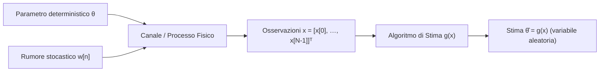

# 0. Fondamenti di Stima Classica e Limite di Cramer-Rao

Nell'elaborazione statistica dei segnali, il problema centrale della __stima dei parametri__ consiste nell'estrarre misure affidabili di grandezze fisiche non direttamente osservabili partendo da un insieme finito di dati rumorosi. Pensiamo alla localizzazione radar di un bersaglio, alla stima del canale in una comunicazione wireless o alla ricostruzione di immagini biomediche: in tutti questi scenari osserviamo un segnale utile sommerso da disturbi casuali e vogliamo estrarre i parametri incogniti con la massima precisione possibile.

In questo capitolo sviluppiamo il paradigma della __stima classica__ (o deterministica), in cui i parametri da stimare sono costanti deterministiche ignote, prive di una distribuzione di probabilità a priori. Definiamo le metriche di accuratezza statistica, analizziamo il compromesso tra polarizzazione e varianza, formalizziamo il criterio di ottimalità a minima varianza (__MVU__) e ricaviamo il limite invalicabile delle prestazioni di qualsiasi stimatore non polarizzato: il __limite inferiore di Cramer-Rao__ (__CRLB__).

## Il Problema della Stima e Modello dei Dati

Supponiamo di raccogliere una sequenza temporale o spaziale di $N$ campioni discreti, che organizziamo in un vettore colonna delle osservazioni $\mathbf{x} \in \mathbb{R}^{N}$:

$$
\mathbf{x} = \begin{bmatrix} x[0] \\ x[1] \\ \vdots \\ x[N-1] \end{bmatrix}
$$

I dati osservati dipendono da un parametro reale incognito $\theta$ (oppure da un vettore di parametri $\boldsymbol{\theta} \in \mathbb{R}^{P}$). Descriviamo la distribuzione statistica dei dati mediante la funzione di densità di probabilità (__PDF__) congiunta parametrica $f_{\mathbf{x}}(\mathbf{x}; \theta)$. Il punto e virgola evidenzia un punto fondamentale: $\theta$ non è una variabile aleatoria condizionante, ma un parametro deterministico fisso che governa la forma della distribuzione.

Uno __stimatore__ $\hat{\theta}$ è una funzione o algoritmo matematico deterministico che mappa il vettore delle osservazioni $\mathbf{x}$ in un valore numerico plausibile per il parametro incognito:

$$
\hat{\theta} = g(\mathbf{x}) = g(x[0], x[1], \dots, x[N-1])
$$

Poiché i dati misurati $\mathbf{x}$ sono variabili aleatorie a causa del rumore di fondo, anche lo stimatore $\hat{\theta} = g(\mathbf{x})$ è a tutti gli effetti una __variabile aleatoria__, provvista di una propria densità di probabilità $f_{\hat{\theta}}(\hat{\theta}; \theta)$, con un valore atteso e una dispersione statistica.

> [!NOTE] Stima Classica vs Stima Bayesiana
> - Nella __stima classica__, il parametro $\theta$ è una costante deterministica ignota. Non possiamo attribuirgli alcuna distribuzione a priori: l'incertezza risiede unicamente nel rumore che corrompe le misure attraverso la PDF $f_{\mathbf{x}}(\mathbf{x}; \theta)$.
> - Nella __stima bayesiana__, il parametro $\theta$ è modellato esplicitamente come una variabile aleatoria descritta da una PDF a priori $f_{\theta}(\theta)$, che quantifica la nostra conoscenza prima ancora di acquisire i dati.

## Errore di Stima, Polarizzazione e Varianza

Definiamo l'__errore di stima__ $e$ come la discrepanza tra la stima calcolata dai dati e il valore vero del parametro:

$$
e = \hat{\theta} - \theta
$$

Poiché $\hat{\theta}$ varia casualmente a ogni nuova acquisizione di dati, anche l'errore $e$ è una variabile aleatoria. Per stabilire quanto sia affidabile il nostro stimatore esaminiamo i suoi primi due momenti statistici: la media e la varianza.

### Polarizzazione (Bias)

Il __bias__ (o polarizzazione) rappresenta il valore atteso dell'errore di stima e quantifica l'eventuale errore sistematico commesso dall'algoritmo:

$$
b(\theta) = \mathbb{E}[\hat{\theta}] - \theta = \mathbb{E}[e] = \int_{\mathbb{R}^N} g(\mathbf{x}) f_{\mathbf{x}}(\mathbf{x}; \theta) \mathrm{d}\mathbf{x} - \theta
$$

Uno stimatore si definisce __non polarizzato__ (o corretto, _unbiased_) se il suo valore medio coincide con il valore vero per qualsiasi configurazione ammissibile di $\theta$:

$$
b(\theta) = 0 \iff \mathbb{E}[\hat{\theta}] = \theta \quad \forall \theta
$$

Se esiste anche un solo valore di $\theta$ per cui $b(\theta) \neq 0$, lo stimatore è detto __polarizzato__ (_biased_).

### Varianza dello Stimatore

La __varianza__ quantifica l'ampiezza dell'errore casuale, misurando la dispersione delle stime attorno al loro baricentro medio $\mathbb{E}[\hat{\theta}]$ al variare delle realizzazioni del rumore:

$$
\text{Var}\{\hat{\theta}\} = \mathbb{E}\left[ (\hat{\theta} - \mathbb{E}[\hat{\theta}])^2 \right] = \int_{\mathbb{R}^N} (g(\mathbf{x}) - \mathbb{E}[\hat{\theta}])^2 f_{\mathbf{x}}(\mathbf{x}; \theta) \mathrm{d}\mathbf{x}
$$

Quando lo stimatore è non polarizzato ($\mathbb{E}[\hat{\theta}] = \theta$), la varianza coincide direttamente con il valore atteso dell'errore quadratico $\mathbb{E}[(\hat{\theta} - \theta)^2]$.

> [!EXAMPLE] Stima del Livello DC in Rumore Bianco
> Consideriamo un segnale a livello continuo costante immerso in rumore additivo:
>
> $$
> x[n] = \theta + w[n], \quad n = 0, 1, \dots, N-1
> $$
>
> dove $w[n]$ è rumore bianco a media nulla e varianza $\sigma^2$, scorrelato tra campioni ($\mathbb{E}[w[n]w[k]] = \sigma^2 \delta[n-k]$).
> Valutiamo tre possibili stimatori del parametro $\theta$:
>
> 1. __Media campionaria__: $\hat{\theta}_1 = \frac{1}{N}\sum_{n=0}^{N-1} x[n] = \bar{x}$.
>    - Media: $\mathbb{E}[\hat{\theta}_1] = \frac{1}{N}\sum_{n=0}^{N-1} (\theta + \mathbb{E}[w[n]]) = \theta \implies b_1(\theta) = 0$ (non polarizzato).
>    - Varianza: $\text{Var}\{\hat{\theta}_1\} = \frac{1}{N^2}\sum_{n=0}^{N-1} \text{Var}\{w[n]\} = \frac{\sigma^2}{N}$. All'aumentare dei campioni ($N \to \infty$) la varianza collassa a zero (lo stimatore è consistente).
> 2. __Singola osservazione__: $\hat{\theta}_2 = x[0]$.
>    - Media: $\mathbb{E}[\hat{\theta}_2] = \theta \implies b_2(\theta) = 0$ (non polarizzato).
>    - Varianza: $\text{Var}\{\hat{\theta}_2\} = \sigma^2$. Non si riduce minimamente all'aumentare dei campioni raccolti, ignorando $N-1$ misure utili.
> 3. __Media campionaria smorzata__: $\hat{\theta}_3 = \frac{1}{2N}\sum_{n=0}^{N-1} x[n] = \frac{1}{2}\hat{\theta}_1$.
>    - Media: $\mathbb{E}[\hat{\theta}_3] = \frac{\theta}{2} \implies b_3(\theta) = -\frac{\theta}{2} \neq 0$ (polarizzato).
>    - Varianza: $\text{Var}\{\hat{\theta}_3\} = \frac{1}{4}\text{Var}\{\hat{\theta}_1\} = \frac{\sigma^2}{4N}$. La varianza è quattro volte inferiore a quella della media campionaria, ma al costo di un errore sistematico severo.

## Compromesso tra Bias e Varianza e l'Errore Quadratico Medio (MSE)

Per valutare la precisione complessiva di uno stimatore bilanciando errore sistematico ed errore casuale, adottiamo il __Mean Squared Error__ (__MSE__), o errore quadratico medio:

$$
\text{MSE}\{\hat{\theta}\} = \mathbb{E}\left[ (\hat{\theta} - \theta)^2 \right]
$$

Scomponiamo lo scarto sommando e sottraendo il valore atteso dello stimatore $\mathbb{E}[\hat{\theta}]$:

$$
\hat{\theta} - \theta = (\hat{\theta} - \mathbb{E}[\hat{\theta}]) + (\mathbb{E}[\hat{\theta}] - \theta) = (\hat{\theta} - \mathbb{E}[\hat{\theta}]) + b(\theta)
$$

Elevando al quadrato e applicando l'operatore di valore atteso:

$$
\begin{aligned}
\text{MSE}\{\hat{\theta}\} &= \mathbb{E}\left[ \left( (\hat{\theta} - \mathbb{E}[\hat{\theta}]) + b(\theta) \right)^2 \right] \\
&= \mathbb{E}\left[ (\hat{\theta} - \mathbb{E}[\hat{\theta}])^2 \right] + 2 b(\theta) \mathbb{E}\left[ \hat{\theta} - \mathbb{E}[\hat{\theta}] \right] + b^2(\theta)
\end{aligned}
$$

Poiché per linearità del valore atteso abbiamo $\mathbb{E}[\hat{\theta} - \mathbb{E}[\hat{\theta}]] = \mathbb{E}[\hat{\theta}] - \mathbb{E}[\hat{\theta}] = 0$, il termine di doppio prodotto svanisce identicamente. Otteniamo così la fondamentale __decomposizione del Mean Squared Error__:

$$
\text{MSE}\{\hat{\theta}\} = \text{Var}\{\hat{\theta}\} + b^2(\theta)
$$

L'errore quadratico medio è la somma di due contributi tra loro ortogonali: la varianza della stima attorno al proprio valor medio e il quadrato dell'errore sistematico.

![[slide_17_bias_variance_targets.png|center mid]]

La metafora del bersaglio illustra le quattro combinazioni geometriche possibili:
- __Basso bias e bassa varianza__ (in alto a sinistra): le stime sono concentrate densamente sul centro del bersaglio. È lo stimatore ottimale desiderato.
- __Basso bias ed elevata varianza__ (in basso a sinistra): il baricentro dei tiri è perfettamente centrato sul bersaglio, ma i singoli colpi presentano un'ampia dispersione casuale.
- __Alto bias e bassa varianza__ (in alto a destra): i tiri sono compatti e altamente ripetibili, ma centrati stabilmente lontano dal bersaglio per via di un errore sistematico.
- __Alto bias ed elevata varianza__ (in basso a destra): dispersione caotica priva sia di accuratezza che di precisione.

### Il Dilemma della Minimizzazione Diretta dell'MSE

Se il nostro traguardo naturale è minimizzare l'errore totale, perché nella stima classica non cerchiamo direttamente la funzione $g(\mathbf{x})$ che minimizza $\text{MSE}\{\hat{\theta}\}$?

Prendiamo in esame lo stimatore costante banale $\hat{\theta}_0 = c$ (ad esempio $\hat{\theta}_0 = 5$), che ignora del tutto i dati osservati. La sua varianza è identicamente nulla ($\text{Var}\{\hat{\theta}_0\} = 0$) e il suo bias vale $b(\theta) = 5 - \theta$. Il suo errore quadratico medio è dunque:

$$
\text{MSE}\{\hat{\theta}_0\} = (5 - \theta)^2
$$

Se il parametro vero vale per pura combinazione $\theta = 5$, questo stimatore registra $\text{MSE} = 0$, superando qualsiasi algoritmo sofisticato basato sui dati. Se però il parametro reale è $\theta = 100$, l'errore diventa inaccettabile.

Risolvendo formalmente la minimizzazione libera di $\text{MSE}\{\hat{\theta}\} = \text{Var}\{\hat{\theta}\} + b^2(\theta)$ rispetto alla regola $g(\mathbf{x})$, lo stimatore ottimo risultante finisce per __dipendere esplicitamente dal parametro incognito $\theta$__. Uno stimatore che richieda di conoscere il parametro vero prima di poter essere calcolato è fisicamente inutilizzabile.

## Lo Stimatore a Minima Varianza Non Polarizzato (MVU)

Per aggirare questo paradosso circolare, nella teoria della stima classica si introduce il vincolo di __non polarizzazione__:

$$
b(\theta) = 0 \quad \forall \theta \implies \text{MSE}\{\hat{\theta}\} = \text{Var}\{\hat{\theta}\}
$$

Annullando il bias su tutto lo spazio parametrico, l'MSE coincide identicamente con la varianza. Il problema di ottimizzazione assume allora una formulazione matematicamente ben posta: trovare uno stimatore che soddisfi due requisiti:
1. Sia non polarizzato per qualsiasi valore ammissibile di $\theta$: $\mathbb{E}[\hat{\theta}] = \theta, \; \forall \theta$.
2. Abbia varianza minore o uguale rispetto a qualsiasi altro stimatore non polarizzato concorrente $\tilde{\theta}$, per ogni possibile valore di $\theta$:

$$
\text{Var}\{\hat{\theta}\} \le \text{Var}\{\tilde{\theta}\} \quad \forall \theta
$$

Uno stimatore provvisto di questa proprietà è detto __stimatore MVU__ (__Minimum Variance Unbiased Estimator__).

> [!IMPORTANT] Superiorità Uniforme dell'MVU
> La condizione di dominanza $\text{Var}\{\hat{\theta}\} \le \text{Var}\{\tilde{\theta}\}$ deve valere per qualsiasi valore del parametro $\theta$ (__uniformemente__). Non è accettabile che uno stimatore abbia varianza minore per un sottoinsieme di valori e varianza peggiore per un altro: l'MVU deve dominare su tutto il dominio parametrico.

Individuare lo stimatore MVU presenta tuttavia due ostacoli non trascurabili:
- Lo stimatore MVU potrebbe non esistere: due stimatori non polarizzati distinti potrebbero alternarsi nel predominio al variare di $\theta$.
- Anche qualora esista, potrebbe risultare impossibile calcolarlo direttamente in forma chiusa con semplici derivate.

Per questo motivo, prima di avventurarci nella ricerca di uno stimatore, abbiamo bisogno di stabilire un __limite inferiore teorico insuperabile__ contro cui misurare le prestazioni di qualsiasi algoritmo candidato. Tale benchmark universale è fornito dal limite di Cramer-Rao.

## Il Limite Inferiore di Cramer-Rao (CRLB)

Il __Cramer-Rao Lower Bound__ (__CRLB__) stabilisce il limite fisico e analitico inferiore invalicabile per la varianza di qualsiasi stimatore non polarizzato. Se troviamo uno stimatore la cui varianza eguaglia il CRLB, sappiamo con certezza matematica assoluta che si tratta dell'MVU, senza dover testare alcun altro concorrente.

### Condizione di Regolarità

Il CRLB presuppone che la densità di probabilità dei dati $f_{\mathbf{x}}(\mathbf{x}; \theta)$ soddisfi la cosiddetta __condizione di regolarità__:

$$
\mathbb{E}\left[ \frac{\partial \ln f_{\mathbf{x}}(\mathbf{x}; \theta)}{\partial \theta} \right] = 0 \quad \forall \theta
$$

La derivata logaritmica della verosimiglianza rispetto al parametro prende il nome di __funzione di score__ $S(\mathbf{x}; \theta)$:

$$
S(\mathbf{x}; \theta) = \frac{\partial \ln f_{\mathbf{x}}(\mathbf{x}; \theta)}{\partial \theta}
$$

La condizione di regolarità impone che il valore atteso della funzione di score sia identicamente nullo per ogni valore di $\theta$.

> [!NOTE] Quando Vale la Condizione di Regolarità?
> Sviluppiamo la derivata logaritmica notando che $\frac{\partial \ln f}{\partial \theta} = \frac{1}{f} \frac{\partial f}{\partial \theta}$:
>
> $$
> \mathbb{E}\left[ \frac{\partial \ln f_{\mathbf{x}}(\mathbf{x}; \theta)}{\partial \theta} \right] = \int_{\mathcal{X}} \frac{1}{f_{\mathbf{x}}(\mathbf{x}; \theta)} \frac{\partial f_{\mathbf{x}}(\mathbf{x}; \theta)}{\partial \theta} f_{\mathbf{x}}(\mathbf{x}; \theta) \mathrm{d}\mathbf{x} = \int_{\mathcal{X}} \frac{\partial f_{\mathbf{x}}(\mathbf{x}; \theta)}{\partial \theta} \mathrm{d}\mathbf{x}
> $$
>
> Se possiamo scambiare l'ordine di integrazione e derivazione (regola di Leibniz per gli integrali parametrici), troviamo:
>
> $$
> \frac{\partial}{\partial \theta} \int_{\mathcal{X}} f_{\mathbf{x}}(\mathbf{x}; \theta) \mathrm{d}\mathbf{x} = \frac{\partial}{\partial \theta} (1) = 0
> $$
>
> L'inversione tra integrale e derivata è lecita a condizione che il supporto $\mathcal{X}$ (l'insieme dei campioni per cui $f_{\mathbf{x}}(\mathbf{x}; \theta) > 0$) __non dipenda dal parametro incognito $\theta$__.
> - In una distribuzione uniforme $x[n] \sim \mathcal{U}[0, \theta]$, il supporto $[0, \theta]$ dipende da $\theta$: la regolarità cade e il CRLB standard non è applicabile.
> - Nei modelli a rumore gaussiano con media o varianza incognita, il supporto coincide con tutto $\mathbb{R}^N$ (indipendente dai parametri): la regolarità è pienamente soddisfatta.

### Informazione di Fisher

L'__Informazione di Fisher__ $I(\theta)$ quantifica l'ammontare di informazione statistica che le osservazioni $\mathbf{x}$ forniscono sul parametro $\theta$. È definita come il secondo momento (o varianza) della funzione di score:

$$
I(\theta) = \mathbb{E}\left[ \left( \frac{\partial \ln f_{\mathbf{x}}(\mathbf{x}; \theta)}{\partial \theta} \right)^2 \right] = \int_{\mathcal{X}} \left( \frac{\partial \ln f_{\mathbf{x}}(\mathbf{x}; \theta)}{\partial \theta} \right)^2 f_{\mathbf{x}}(\mathbf{x}; \theta) \mathrm{d}\mathbf{x}
$$

Sotto la condizione di regolarità, vale una forma alternativa operativa di gran lunga più comoda per il calcolo analitico:

$$
I(\theta) = -\mathbb{E}\left[ \frac{\partial^2 \ln f_{\mathbf{x}}(\mathbf{x}; \theta)}{\partial \theta^2} \right]
$$

La dimostrazione formale dell'equivalenza tra il valore atteso del quadrato della derivata prima e l'opposto del valore atteso della derivata seconda è consultabile in [[zz. Argomenti extra#Identità tra la Prima e la Seconda Derivata dell'Informazione di Fisher|zz. Argomenti extra: Identità tra la Prima e la Seconda Derivata dell'Informazione di Fisher]].

Geometricamente, l'Informazione di Fisher esprime la __curvatura media__ della funzione di log-verosimiglianza $\ln f_{\mathbf{x}}(\mathbf{x}; \theta)$ in prossimità del massimo.

![[fisher_information_curvature.svg|center mid]]

La figura evidenzia la connessione diretta tra curvatura e certezza della stima:
- __Picco aguzzo (alta informazione)__: la log-verosimiglianza scende rapidamente non appena ci si allontana dal punto di massimo (forte curvatura negativa, seconda derivata grande in modulo). I dati distinguono nettamente valori di $\theta$ anche molto vicini, per cui $I(\theta)$ è elevata e la stima è precisa.
- __Profilo piatto (bassa informazione)__: la log-verosimiglianza varia molto lentamente attorno al massimo (curvatura debole, seconda derivata prossima a zero). Valori diversi di $\theta$ producono verosimiglianze quasi indistinguibili: l'informazione estratta $I(\theta)$ è modesta e l'errore di stima potenziale è elevato.

### Teorema del Limite di Cramer-Rao (Caso Scalare)

Sia $\mathbf{x}$ un vettore di osservazioni con PDF parametrica $f_{\mathbf{x}}(\mathbf{x}; \theta)$ soddisfacente la condizione di regolarità. Allora la varianza di qualsiasi stimatore non polarizzato $\hat{\theta}$ è vincolata inferiormente dal reciproco dell'Informazione di Fisher:

$$
\text{Var}\{\hat{\theta}\} \ge \frac{1}{I(\theta)} = \frac{1}{-\mathbb{E}\left[ \frac{\partial^2 \ln f_{\mathbf{x}}(\mathbf{x}; \theta)}{\partial \theta^2} \right]}
$$

La dimostrazione formale si basa sull'applicazione della disuguaglianza di Cauchy-Schwarz alla covarianza tra l'errore dello stimatore $(\hat{\theta} - \theta)$ e la funzione di score $\frac{\partial \ln f}{\partial \theta}$, ed è consultabile nei minimi passaggi in [[zz. Argomenti extra#Dimostrazione del Limite Inferiore di Cramer-Rao (CRLB)|zz. Argomenti extra: Dimostrazione del Limite Inferiore di Cramer-Rao (CRLB)]].

### Efficienza e Condizione di Raggiungibilità del CRLB

Uno stimatore non polarizzato $\hat{\theta}$ la cui varianza raggiunge esattamente il limite inferiore per qualsiasi valore ammissibile di $\theta$:

$$
\text{Var}\{\hat{\theta}\} = \frac{1}{I(\theta)} \quad \forall \theta
$$

è definito __stimatore efficiente__.

> [!IMPORTANT] Efficienza ed Esistenza dell'MVU
> Uno stimatore efficiente è __automaticamente lo stimatore MVU__, poiché nessun altro stimatore non polarizzato può possedere una varianza inferiore a $\frac{1}{I(\theta)}$. Dimostrare l'efficienza di uno stimatore rappresenta quindi una condizione sufficiente per certificarne l'ottimalità assoluta.

Il teorema di Cramer-Rao offre inoltre un test algebrico costruttivo per determinare se esiste uno stimatore in grado di raggiungere il bound:

> [!NOTE] Condizione Necessaria e Sufficiente di Efficienza
> Esiste uno stimatore non polarizzato $\hat{\theta}$ che raggiunge il CRLB se e solo se la funzione di score può essere fattorizzata nella forma separabile:
>
> $$
> \frac{\partial \ln f_{\mathbf{x}}(\mathbf{x}; \theta)}{\partial \theta} = I(\theta) \left( g(\mathbf{x}) - \theta \right)
> $$
>
> dove $g(\mathbf{x})$ dipende unicamente dai dati osservati $\mathbf{x}$ e non contiene il parametro $\theta$.
> Quando tale scomposizione è possibile:
> - Lo stimatore MVU efficiente è unico ed è dato direttamente da: $\hat{\theta} = g(\mathbf{x})$.
> - La sua varianza minima vale esattamente: $\text{Var}\{\hat{\theta}\} = \frac{1}{I(\theta)}$.

Questa proprietà fornisce una potente scorciatoia operativa per gli esami: derivando la log-verosimiglianza rispetto a $\theta$, se riusciamo a isolare il fattore lineare $(g(\mathbf{x}) - \theta)$ moltiplicato per una costante (o funzione del solo $\theta$), abbiamo simultaneamente ricavato l'Informazione di Fisher $I(\theta)$, estratto lo stimatore ottimo $\hat{\theta} = g(\mathbf{x})$ e calcolato la sua varianza minima, senza dover risolvere integrali o sistemi complessi.

## Esempio Completo: Livello DC in Rumore Gaussiano Bianco (AWGN)

Applichiamo la procedura analitica del CRLB al problema della stima di un livello costante DC in presenza di rumore additivo gaussiano bianco (AWGN):

$$
x[n] = \theta + w[n], \quad n = 0, 1, \dots, N-1, \quad w[n] \sim \mathcal{N}(0, \sigma^2) \text{ i.i.d.}
$$

Sviluppiamo il calcolo seguendo la sequenza logica in 7 passaggi:

1. __Costruzione della PDF congiunta (Funzione di Verosimiglianza)__:
   Essendo i campioni di rumore $w[n]$ gaussiani i.i.d., le osservazioni $x[n] \sim \mathcal{N}(\theta, \sigma^2)$ sono mutuamente indipendenti. La densità congiunta è il prodotto delle marginali:

   $$
   f_{\mathbf{x}}(\mathbf{x}; \theta) = \prod_{n=0}^{N-1} \frac{1}{\sqrt{2\pi\sigma^2}} \exp\left( -\frac{1}{2\sigma^2} (x[n] - \theta)^2 \right) = \frac{1}{(2\pi\sigma^2)^{N/2}} \exp\left( -\frac{1}{2\sigma^2} \sum_{n=0}^{N-1} (x[n] - \theta)^2 \right)
   $$

2. __Calcolo della Log-Verosimiglianza (LLF)__:
   Applichiamo il logaritmo naturale trasformando il prodotto di esponenziali in una sommatoria algebrica:

   $$
   \ln f_{\mathbf{x}}(\mathbf{x}; \theta) = -\frac{N}{2} \ln(2\pi\sigma^2) - \frac{1}{2\sigma^2} \sum_{n=0}^{N-1} (x[n] - \theta)^2
   $$

3. __Derivata prima (Score Function)__:
   Deriviamo rispetto al parametro scalare $\theta$:

   $$
   \frac{\partial \ln f_{\mathbf{x}}(\mathbf{x}; \theta)}{\partial \theta} = -\frac{1}{2\sigma^2} \sum_{n=0}^{N-1} 2(x[n] - \theta)(-1) = \frac{1}{\sigma^2} \sum_{n=0}^{N-1} (x[n] - \theta)
   $$

   Espandiamo la sommatoria separando i dati dal parametro:

   $$
   \frac{\partial \ln f_{\mathbf{x}}(\mathbf{x}; \theta)}{\partial \theta} = \frac{1}{\sigma^2} \left( \sum_{n=0}^{N-1} x[n] - N\theta \right) = \frac{N}{\sigma^2} \left( \frac{1}{N}\sum_{n=0}^{N-1} x[n] - \theta \right)
   $$

4. __Verifica della condizione di regolarità__:
   Calcoliamo il valore atteso della derivata prima ricordando che per linearità $\mathbb{E}[x[n]] = \theta$:

   $$
   \mathbb{E}\left[ \frac{\partial \ln f_{\mathbf{x}}(\mathbf{x}; \theta)}{\partial \theta} \right] = \frac{1}{\sigma^2} \sum_{n=0}^{N-1} (\mathbb{E}[x[n]] - \theta) = \frac{1}{\sigma^2} \sum_{n=0}^{N-1} (\theta - \theta) = 0
   $$

   La condizione di regolarità è verificata identicamente per qualsiasi valore di $\theta$.

5. __Derivata seconda rispetto a $\theta$__:
   Derivando ulteriormente la derivata prima rispetto a $\theta$:

   $$
   \frac{\partial^2 \ln f_{\mathbf{x}}(\mathbf{x}; \theta)}{\partial \theta^2} = \frac{\partial}{\partial \theta} \left[ \frac{1}{\sigma^2} \left( \sum_{n=0}^{N-1} x[n] - N\theta \right) \right] = -\frac{N}{\sigma^2}
   $$

6. __Calcolo dell'Informazione di Fisher__:
   Poiché la derivata seconda è una costante deterministica indipendente dai dati $\mathbf{x}$, il valore atteso coincide con la costante stessa:

   $$
   I(\theta) = -\mathbb{E}\left[ \frac{\partial^2 \ln f_{\mathbf{x}}(\mathbf{x}; \theta)}{\partial \theta^2} \right] = -\left( -\frac{N}{\sigma^2} \right) = \frac{N}{\sigma^2}
   $$

7. __Verifica della condizione di efficienza e individuazione di $g(\mathbf{x})$__:
   Confrontiamo la derivata prima calcolata al passaggio 3 con l'identità di fattorizzazione teorica $I(\theta)(g(\mathbf{x}) - \theta)$:

   $$
   \frac{\partial \ln f_{\mathbf{x}}(\mathbf{x}; \theta)}{\partial \theta} = \underbrace{\frac{N}{\sigma^2}}_{I(\theta)} \left( \underbrace{\frac{1}{N}\sum_{n=0}^{N-1} x[n]}_{g(\mathbf{x})} - \theta \right)
   $$

La corrispondenza algebrica è perfetta:
- Lo stimatore $\hat{\theta} = \frac{1}{N}\sum_{n=0}^{N-1} x[n] = \bar{x}$ (la media campionaria) è __efficiente__.
- La sua varianza raggiunge esattamente la soglia teorica minima:

$$
\text{Var}\{\hat{\theta}\} = \frac{1}{I(\theta)} = \frac{\sigma^2}{N}
$$

Concludiamo con certezza che la media campionaria è l'unico stimatore MVU per la stima del livello continuo in presenza di rumore gaussiano bianco.

## Trasformazione di Parametri

Nelle applicazioni ingegneristiche capita spesso di non voler stimare direttamente il parametro primitivo $\theta$, bensì una funzione nota:

$$
\alpha = h(\theta)
$$

Pensiamo ad esempio alla misura di una tensione continua $\theta$ quando l'interesse applicativo risiede nella potenza dissipata su un carico resistivo unitario $\alpha = \theta^2$, o nella stima di una frequenza a partire dal periodo.

Sotto la condizione di regolarità, il CRLB per la stima del parametro trasformato $\alpha = h(\theta)$ assume l'espressione:

$$
\text{Var}\{\hat{\alpha}\} \ge \frac{\left( \frac{\partial h(\theta)}{\partial \theta} \right)^2}{I(\theta)}
$$

dove $I(\theta)$ rappresenta l'Informazione di Fisher calcolata rispetto al parametro originario $\theta$.

### Trasformazione Lineare (o Affine)

Supponiamo che la funzione di trasformazione sia affine:

$$
\alpha = k\theta + c
$$

La derivata prima è la costante $\frac{\partial h}{\partial \theta} = k$. Il limite inferiore si specializza in:

$$
\text{Var}\{\hat{\alpha}\} \ge \frac{k^2}{I(\theta)}
$$

Se per il parametro base $\theta$ disponiamo di uno stimatore efficiente $\hat{\theta}$ con varianza $\text{Var}\{\hat{\theta}\} = \frac{1}{I(\theta)}$, allora lo stimatore lineare naturale:

$$
\hat{\alpha} = k\hat{\theta} + c
$$

preserva integralmente l'ottimalità: è __rigorosamente non polarizzato ed efficiente per $\alpha$__:

$$
\mathbb{E}[\hat{\alpha}] = k\mathbb{E}[\hat{\theta}] + c = k\theta + c = \alpha, \quad \text{Var}\{\hat{\alpha}\} = k^2 \text{Var}\{\hat{\theta}\} = \frac{k^2}{I(\theta)}
$$

### Trasformazione Non Lineare

Quando la funzione $h(\theta)$ è non lineare, le proprietà statistiche non si conservano:
1. Anche se $\hat{\theta}$ è non polarizzato per $\theta$, lo stimatore naturale per sostituzione $\hat{\alpha} = h(\hat{\theta})$ risulta __polarizzato a campioni finiti__ per effetto della disuguaglianza di Jensen: $\mathbb{E}[h(\hat{\theta})] \neq h(\mathbb{E}[\hat{\theta}])$.
2. Per un numero finito di campioni $N$, __non esiste alcuno stimatore in grado di raggiungere il CRLB__ per una generica trasformazione non lineare.
3. Al divergere dei campioni ($N \to \infty$), se lo stimatore originario $\hat{\theta}$ è consistente ed efficiente, lo stimatore trasformato diventa __asintoticamente non polarizzato ed asintoticamente efficiente__.

> [!EXAMPLE] Stima della Potenza del Livello DC ($\alpha = \theta^2$)
> Consideriamo il modello DC in AWGN ($x[n] = \theta + w[n]$) e supponiamo di voler stimare la potenza $\alpha = h(\theta) = \theta^2$.
> Adottiamo come stimatore plug-in il quadrato della media campionaria $\bar{x}$:
>
> $$
> \hat{\alpha} = \bar{x}^2 = \left( \frac{1}{N}\sum_{n=0}^{N-1} x[n] \right)^2
> $$
>
> 1. __Analisi del Bias__:
>    Dalla statistica della media campionaria sappiamo che $\bar{x} \sim \mathcal{N}\left(\theta, \frac{\sigma^2}{N}\right)$. Sfruttando la relazione fondamentale tra i momenti $\mathbb{E}[\bar{x}^2] = \text{Var}\{\bar{x}\} + (\mathbb{E}[\bar{x}])^2$:
>
>    $$
>    \mathbb{E}[\hat{\alpha}] = \mathbb{E}[\bar{x}^2] = \frac{\sigma^2}{N} + \theta^2 = \alpha + \frac{\sigma^2}{N}
>    $$
>
>    Il bias dello stimatore vale $b(\alpha) = \mathbb{E}[\hat{\alpha}] - \alpha = \frac{\sigma^2}{N} > 0$. Lo stimatore introduce una sovrastima sistematica a campioni finiti. Tuttavia, per $N \to \infty$, il bias si azzera ($b(\alpha) \to 0$): $\hat{\alpha}$ è __asintoticamente non polarizzato__.
>
> 2. __Calcolo del CRLB Trasformato__:
>    Essendo $\frac{\partial h(\theta)}{\partial \theta} = 2\theta$ e $I(\theta) = \frac{N}{\sigma^2}$:
>
>    $$
>    \text{CRLB}(\alpha) = \frac{\left( \frac{\partial h}{\partial \theta} \right)^2}{I(\theta)} = \frac{(2\theta)^2}{\frac{N}{\sigma^2}} = \frac{4\theta^2\sigma^2}{N} = \frac{4\alpha\sigma^2}{N}
>    $$
>
> 3. __Varianza Effettiva ed Efficienza Asintotica__:
>    Possiamo esprimere $\bar{x} = \theta + u$, dove $u \sim \mathcal{N}\left(0, \frac{\sigma^2}{N}\right)$. Sviluppando il quadrato: $\bar{x}^2 = \theta^2 + 2\theta u + u^2$. Calcolando i momenti del secondo e quarto ordine della variabile gaussiana a media nulla $u$ (per cui $\mathbb{E}[u^2] = \frac{\sigma^2}{N}$, $\mathbb{E}[u^3] = 0$ ed $\mathbb{E}[u^4] = 3\frac{\sigma^4}{N^2}$), la varianza esatta risulta:
>
>    $$
>    \text{Var}\{\hat{\alpha}\} = \frac{4\alpha\sigma^2}{N} + \frac{2\sigma^4}{N^2}
>    $$
>
>    A campioni finiti $N$, la varianza eccede strettamente il CRLB per via del termine additivo $\frac{2\sigma^4}{N^2}$. Tuttavia, al crescere di $N$, questo termine residuo decade con velocità quadratica $O(1/N^2)$, mentre il termine principale decade come $O(1/N)$:
>
>    $$
>    \lim_{N \to \infty} \frac{\text{Var}\{\hat{\alpha}\}}{\text{CRLB}(\alpha)} = \lim_{N \to \infty} \left( 1 + \frac{\sigma^2}{2\alpha N} \right) = 1
>    $$
>
>    La varianza converge asintoticamente al CRLB: lo stimatore $\hat{\alpha}$ è __asintoticamente efficiente__.

## Estensione Vettoriale del CRLB

Generalizziamo ora la trattazione al caso in cui dobbiamo stimare congiuntamente un vettore di $P$ parametri deterministici ignoti:

$$
\boldsymbol{\theta} = \begin{bmatrix} \theta_1 \\ \theta_2 \\ \vdots \\ \theta_P \end{bmatrix} \in \mathbb{R}^{P}
$$

### Matrice di Informazione di Fisher (FIM)

Definiamo il gradiente della funzione di log-verosimiglianza come il vettore delle derivate parziali prime:

$$
\nabla_{\boldsymbol{\theta}} \ln f_{\mathbf{x}}(\mathbf{x}; \boldsymbol{\theta}) = \begin{bmatrix} \frac{\partial \ln f}{\partial \theta_1} \\ \frac{\partial \ln f}{\partial \theta_2} \\ \vdots \\ \frac{\partial \ln f}{\partial \theta_P} \end{bmatrix}
$$

La condizione di regolarità vettoriale impone che il valore atteso di ciascuna componente sia nullo: $\mathbb{E}[\nabla_{\boldsymbol{\theta}} \ln f_{\mathbf{x}}(\mathbf{x}; \boldsymbol{\theta})] = \mathbf{0}$.
La quantità di informazione congiunta fornita dai dati è descritta dalla __Matrice di Informazione di Fisher__ (__FIM__), denotata con $\mathbf{I}(\boldsymbol{\theta}) \in \mathbb{R}^{P \times P}$, le cui entrate valgono:

$$
[\mathbf{I}(\boldsymbol{\theta})]_{i, j} = \mathbb{E}\left[ \frac{\partial \ln f_{\mathbf{x}}(\mathbf{x}; \boldsymbol{\theta})}{\partial \theta_i} \frac{\partial \ln f_{\mathbf{x}}(\mathbf{x}; \boldsymbol{\theta})}{\partial \theta_j} \right] = -\mathbb{E}\left[ \frac{\partial^2 \ln f_{\mathbf{x}}(\mathbf{x}; \boldsymbol{\theta})}{\partial \theta_i \partial \theta_j} \right]
$$

La matrice $\mathbf{I}(\boldsymbol{\theta})$ è simmetrica e, a patto che non vi siano parametri ridondanti o non identificabili, definita positiva.

### Teorema del CRLB Vettoriale

Sia $\hat{\boldsymbol{\theta}}$ uno stimatore non polarizzato del vettore dei parametri ($\mathbb{E}[\hat{\boldsymbol{\theta}}] = \boldsymbol{\theta}$). Definiamo la matrice di covarianza dell'errore di stima $\mathbf{C}_{\hat{\boldsymbol{\theta}}} \in \mathbb{R}^{P \times P}$:

$$
\mathbf{C}_{\hat{\boldsymbol{\theta}}} = \mathbb{E}\left[ (\hat{\boldsymbol{\theta}} - \boldsymbol{\theta})(\hat{\boldsymbol{\theta}} - \boldsymbol{\theta})^T \right]
$$

Il teorema del CRLB vettoriale afferma che la matrice differenza tra la covarianza dello stimatore e l'inversa della FIM è __semidefinita positiva__:

$$
\mathbf{C}_{\hat{\boldsymbol{\theta}}} - \mathbf{I}^{-1}(\boldsymbol{\theta}) \ge \mathbf{0}
$$

Focalizzandoci sui singoli elementi posti lungo la diagonale principale, la varianza della stima del generico parametro $\theta_i$ è vincolata dall'$i$-esimo elemento diagonale dell'__inversa__ della FIM:

$$
\text{Var}\{\hat{\theta}_i\} = [\mathbf{C}_{\hat{\boldsymbol{\theta}}}]_{i, i} \ge [\mathbf{I}^{-1}(\boldsymbol{\theta})]_{i, i}
$$

> [!WARNING] Errore Notazionale Comune: Diagonale dell'Inversa vs Inverso della Diagonale
> Negli esercizi d'esame si commette frequentemente l'errore di invertire il singolo elemento scalare anziché invertire prima l'intera matrice:
>
> $$
> [\mathbf{I}^{-1}(\boldsymbol{\theta})]_{i, i} \ge \frac{1}{[\mathbf{I}(\boldsymbol{\theta})]_{i, i}}
> $$
>
> La varianza minima con cui possiamo stimare $\theta_i$ in presenza di altri parametri incogniti concomitanti ($\theta_j, j \neq i$) è generalmente __strettamente superiore__ a quella ottenibile se tutti gli altri parametri fossero perfettamente noti a priori. I parametri ignoti concorrenti creano un accoppiamento statistico che degrada le prestazioni di stima. La dimostrazione formale basata sul complemento di Schur è consultabile in [[zz. Argomenti extra#Disuguaglianza tra Elementi della FIM Inversa e Complemento di Schur|zz. Argomenti extra: Dimostrazione Algebrica con Complemento di Schur]].

### Condizione di Efficienza Vettoriale

Uno stimatore vettoriale non polarizzato $\hat{\boldsymbol{\theta}}$ raggiunge il limite del CRLB con covarianza $\mathbf{C}_{\hat{\boldsymbol{\theta}}} = \mathbf{I}^{-1}(\boldsymbol{\theta})$ se e solo se il gradiente dello score si scompone nella forma matriciale lineare:

$$
\nabla_{\boldsymbol{\theta}} \ln f_{\mathbf{x}}(\mathbf{x}; \boldsymbol{\theta}) = \mathbf{I}(\boldsymbol{\theta}) \left( \mathbf{g}(\mathbf{x}) - \boldsymbol{\theta} \right)
$$

In tal caso, l'MVU estimator efficiente è dato dal vettore $\hat{\boldsymbol{\theta}} = \mathbf{g}(\mathbf{x})$.

## Esempio Vettoriale: Line Fitting (Regressione Lineare Semplice)

Analizziamo il classico problema dell'adattamento di una retta su un insieme di misure discrete corrotte da rumore AWGN:

$$
x[n] = \theta_1 + \theta_2 n + w[n], \quad n = 0, 1, \dots, N-1, \quad w[n] \sim \mathcal{N}(0, \sigma^2) \text{ i.i.d.}
$$

dove $\theta_1$ rappresenta l'intercetta all'origine ($n = 0$) e $\theta_2$ è il coefficiente angolare (pendenza) della retta.

![[slide_36_line_fitting_example.png|center mid]]

Esprimiamo il modello in forma matriciale compatta:

$$
\mathbf{x} = \mathbf{H}\boldsymbol{\theta} + \mathbf{w}
$$

con il vettore dei parametri incogniti $\boldsymbol{\theta} = [\theta_1, \theta_2]^T \in \mathbb{R}^2$, il vettore di rumore $\mathbf{w} \sim \mathcal{N}(\mathbf{0}, \sigma^2 \mathbf{I}_N)$ e la __matrice di osservazione__ $\mathbf{H} \in \mathbb{R}^{N \times 2}$:

$$
\mathbf{H} = \begin{bmatrix} 1 & 0 \\ 1 & 1 \\ 1 & 2 \\ \vdots & \vdots \\ 1 & N-1 \end{bmatrix}
$$

### Calcolo della Matrice di Informazione di Fisher

La log-verosimiglianza del modello vettoriale gaussiano lineare assume la forma quadratica:

$$
\ln f_{\mathbf{x}}(\mathbf{x}; \boldsymbol{\theta}) = -\frac{N}{2} \ln(2\pi\sigma^2) - \frac{1}{2\sigma^2} (\mathbf{x} - \mathbf{H}\boldsymbol{\theta})^T (\mathbf{x} - \mathbf{H}\boldsymbol{\theta})
$$

Calcoliamo il gradiente rispetto al vettore dei parametri $\boldsymbol{\theta}$:

$$
\nabla_{\boldsymbol{\theta}} \ln f_{\mathbf{x}}(\mathbf{x}; \boldsymbol{\theta}) = \begin{bmatrix} \frac{\partial \ln f}{\partial \theta_1} \\ \frac{\partial \ln f}{\partial \theta_2} \end{bmatrix} = \begin{bmatrix} \frac{1}{\sigma^2} \sum_{n=0}^{N-1} (x[n] - \theta_1 - \theta_2 n) \\ \frac{1}{\sigma^2} \sum_{n=0}^{N-1} (x[n] - \theta_1 - \theta_2 n)n \end{bmatrix} = \frac{1}{\sigma^2} \mathbf{H}^T (\mathbf{x} - \mathbf{H}\boldsymbol{\theta})
$$

Raccogliamo la matrice $\frac{\mathbf{H}^T\mathbf{H}}{\sigma^2}$:

$$
\nabla_{\boldsymbol{\theta}} \ln f_{\mathbf{x}}(\mathbf{x}; \boldsymbol{\theta}) = \frac{\mathbf{H}^T\mathbf{H}}{\sigma^2} \left( (\mathbf{H}^T\mathbf{H})^{-1}\mathbf{H}^T\mathbf{x} - \boldsymbol{\theta} \right)
$$

Riconosciamo immediatamente la condizione di efficienza vettoriale $\mathbf{I}(\boldsymbol{\theta})(\mathbf{g}(\mathbf{x}) - \boldsymbol{\theta})$. La FIM coincide con:

$$
\mathbf{I}(\boldsymbol{\theta}) = \frac{\mathbf{H}^T\mathbf{H}}{\sigma^2}
$$

Esplicitiamo le sommatorie interne alla matrice simmetrica $\mathbf{H}^T\mathbf{H}$:

$$
\mathbf{H}^T\mathbf{H} = \begin{bmatrix} \sum_{n=0}^{N-1} 1 & \sum_{n=0}^{N-1} n \\ \sum_{n=0}^{N-1} n & \sum_{n=0}^{N-1} n^2 \end{bmatrix} = \begin{bmatrix} N & \frac{N(N-1)}{2} \\ \frac{N(N-1)}{2} & \frac{N(N-1)(2N-1)}{6} \end{bmatrix}
$$

Calcoliamo il determinante di $\mathbf{H}^T\mathbf{H}$:

$$
\det(\mathbf{H}^T\mathbf{H}) = N \cdot \frac{N(N-1)(2N-1)}{6} - \left( \frac{N(N-1)}{2} \right)^2 = \frac{N^2(N-1)}{12} \left[ 2(2N-1) - 3(N-1) \right] = \frac{N^2(N^2-1)}{12}
$$

Invertiamo la matrice $\mathbf{I}(\boldsymbol{\theta}) = \frac{1}{\sigma^2}\mathbf{H}^T\mathbf{H}$ calcolando $\mathbf{I}^{-1}(\boldsymbol{\theta}) = \sigma^2 (\mathbf{H}^T\mathbf{H})^{-1}$:

$$
(\mathbf{H}^T\mathbf{H})^{-1} = \frac{12}{N^2(N^2-1)} \begin{bmatrix} \frac{N(N-1)(2N-1)}{6} & -\frac{N(N-1)}{2} \\ -\frac{N(N-1)}{2} & N \end{bmatrix} = \begin{bmatrix} \frac{2(2N-1)}{N(N+1)} & -\frac{6}{N(N+1)} \\ -\frac{6}{N(N+1)} & \frac{12}{N(N^2-1)} \end{bmatrix}
$$

Otteniamo così la matrice di covarianza limite del CRLB in forma analitica esatta:

$$
\mathbf{I}^{-1}(\boldsymbol{\theta}) = \sigma^2 \begin{bmatrix} \frac{2(2N-1)}{N(N+1)} & -\frac{6}{N(N+1)} \\ -\frac{6}{N(N+1)} & \frac{12}{N(N^2-1)} \end{bmatrix}
$$

I limiti inferiori di varianza per l'intercetta $\theta_1$ e la pendenza $\theta_2$ corrispondono alle entrate diagonali:

$$
\begin{aligned}
\text{Var}\{\hat{\theta}_1\} &\ge [\mathbf{I}^{-1}(\boldsymbol{\theta})]_{1, 1} = \frac{2(2N-1)\sigma^2}{N(N+1)} \\
\text{Var}\{\hat{\theta}_2\} &\ge [\mathbf{I}^{-1}(\boldsymbol{\theta})]_{2, 2} = \frac{12\sigma^2}{N(N^2-1)}
\end{aligned}
$$

### Proprietà dello Stimatore Lineare Ottimo

Poiché la derivata logaritmica soddisfa la condizione di efficienza vettoriale ed è verificata la regolarità, il CRLB è raggiunto con uguaglianza. Lo stimatore:

$$
\hat{\boldsymbol{\theta}} = \begin{bmatrix} \hat{\theta}_1 \\ \hat{\theta}_2 \end{bmatrix} = (\mathbf{H}^T\mathbf{H})^{-1}\mathbf{H}^T\mathbf{x}
$$

è l'__MVU estimator efficiente__.
Moltiplicando la matrice inversa per il vettore delle correlazioni campionarie $\mathbf{H}^T\mathbf{x} = \begin{bmatrix} \sum_{n=0}^{N-1} x[n] \\ \sum_{n=0}^{N-1} n x[n] \end{bmatrix}$, otteniamo le espressioni operative in forma chiusa per l'intercetta e la pendenza:

$$
\begin{aligned}
\hat{\theta}_1 &= \frac{2(2N-1)}{N(N+1)} \sum_{n=0}^{N-1} x[n] - \frac{6}{N(N+1)} \sum_{n=0}^{N-1} n x[n] \\
\hat{\theta}_2 &= -\frac{6}{N(N+1)} \sum_{n=0}^{N-1} x[n] + \frac{12}{N(N^2-1)} \sum_{n=0}^{N-1} n x[n]
\end{aligned}
$$

Esaminiamo l'andamento asintotico delle varianze all'aumentare del numero di campioni $N \gg 1$:
- La varianza dell'intercetta $\theta_1$ scala asintoticamente come $O\left(\frac{1}{N}\right)$:
  
  $$
  \text{Var}\{\hat{\theta}_1\} \approx \frac{4\sigma^2}{N} \quad \text{per } N \gg 1
  $$

- La varianza del coefficiente angolare $\theta_2$ scala asintoticamente come $O\left(\frac{1}{N^3}\right)$:
  
  $$
  \text{Var}\{\hat{\theta}_2\} \approx \frac{12\sigma^2}{N^3} \quad \text{per } N \gg 1
  $$

![[line_fitting_lever_arm.svg|center mid]]

La straordinaria rapidità di convergenza della pendenza ($\sim 1/N^3$) trova una chiara spiegazione fisica nel __braccio di leva temporale__: man mano che l'indice temporale cresce fino a $n = N-1$, la distanza dall'origine funge da braccio di leva $L \approx N$. Un piccolo scostamento del dato di misura $\Delta x$ produce una variazione angolare inversamente proporzionale alla leva:

$$
\Delta \theta_2 \approx \frac{\Delta x}{N} \implies \text{Var}\{\Delta \theta_2\} \propto \frac{\sigma^2}{N^2}
$$

Integrando l'effetto su tutti gli $N$ campioni, la sommatoria quadratica $\sum_{n=0}^{N-1} n^2 \sim \frac{N^3}{3}$ comprime la varianza angolare con una dipendenza cubica rispetto alla durata dell'osservazione.

> [!NOTE] Riscontro Numerico del Degrado da Parametri Concorrenti
> L'esempio del line fitting offre una verifica numerica tangibile della disuguaglianza $[\mathbf{I}^{-1}]_{ii} \ge \frac{1}{[\mathbf{I}]_{ii}}$:
> - Supponiamo che la pendenza sia nota con certezza ($\theta_2 = 0$): il problema si riduce alla stima del solo livello continuo $\theta_1$. L'Informazione di Fisher scalare vale $[\mathbf{I}]_{1,1} = \frac{N}{\sigma^2}$, con varianza pari a $\frac{\sigma^2}{N}$. Se invece la pendenza $\theta_2$ è ignota e deve essere stimata congiuntamente, la varianza minima sale a $[\mathbf{I}^{-1}]_{1,1} \approx \frac{4\sigma^2}{N}$, risultando esattamente __quattro volte superiore__.
> - Supponiamo viceversa che l'intercetta sia nota ($\theta_1 = 0$, retta vincolata all'origine). L'Informazione di Fisher scalare per la sola pendenza vale $[\mathbf{I}]_{2,2} = \frac{\sum n^2}{\sigma^2} \approx \frac{N^3}{3\sigma^2}$, con varianza pari a $\frac{3\sigma^2}{N^3}$. Con l'intercetta incognita, la varianza minima sale a $[\mathbf{I}^{-1}]_{2,2} \approx \frac{12\sigma^2}{N^3}$, anche in questo caso esattamente __quattro volte superiore__.
> Questo fattore quadruplo evidenzia in modo incontrovertibile l'inevitabile costo statistico associato all'incertezza congiunta e alla correlazione tra stime.
