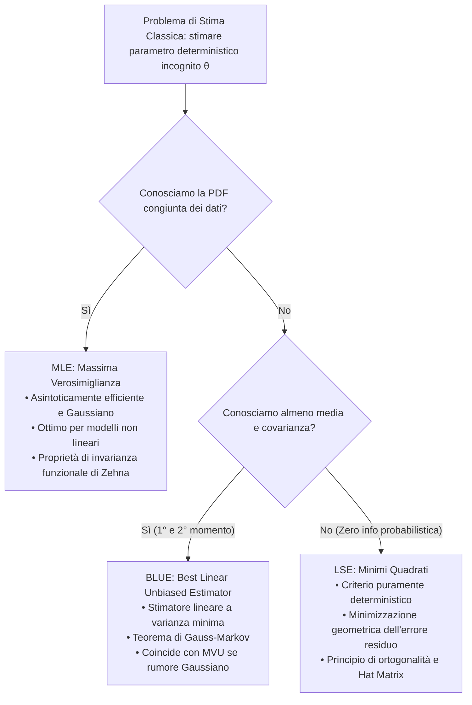
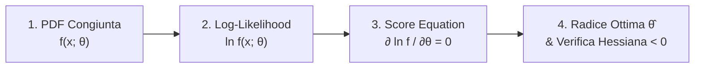

# 1. Stimatori Classici - BLUE, MLE E LSE

Nella teoria della stima classica, l'obiettivo primario consiste nell'individuare lo stimatore non polarizzato a minima varianza (__MVU__, _Minimum Variance Unbiased_). Sebbene il limite inferiore di Cramer-Rao (__CRLB__) e il Teorema di Lehmann-Scheffé tramite statistiche sufficienti complete costituiscano i criteri canonici per identificare l'MVU, nella realtà ingegneristica e sperimentale emergono frequentemente ostacoli invalicabili:
1. La funzione di densità di probabilità (__PDF__) congiunta dei dati osservati è del tutto ignota o analiticamente intrattabile, impedendo il calcolo dell'informazione di Fisher o della verosimiglianza.
2. Lo stimatore efficiente a campioni finiti non esiste, poiché la derivata logaritmica della verosimiglianza non assume la forma fattorizzata richiesta dal CRLB.
3. Il legame cinematico o fisico tra parametri e osservazioni è fortemente non lineare, oppure non disponiamo di alcuna descrizione probabilistica affidabile per il rumore di misura.

Per superare queste limitazioni strutturali introduciamo tre strategie fondamentali, ciascuna tarata sul livello di informazione a priori disponibile:

## Stimatore Lineare Non Polarizzato a Minima Varianza (BLUE)

Quando non conosciamo la forma analitica della PDF congiunta $f_{\mathbf{x}}(\mathbf{x}; \theta)$, non possiamo calcolare l'informazione di Fisher né ricercare l'MVU generale. Tuttavia, se siamo in grado di misurare o modellare i soli momenti statistici del primo e del secondo ordine dei dati (il valor medio $\mathbb{E}[\mathbf{x}]$ e la matrice di covarianza $\mathbf{C}_{\mathbf{x}\mathbf{x}}$), possiamo progettare uno stimatore ottimale restringendo a priori la ricerca alla classe degli stimatori lineari.

### Formulazione E Vincolo Di Non Polarizzazione

Definiamo lo stimatore come combinazione lineare ponderata degli $N$ campioni osservati:

$$
\hat{\theta} = \sum_{n=0}^{N-1} a_n x[n] = \mathbf{a}^T \mathbf{x}
$$

dove $\mathbf{x} = [x[0], x[1], \dots, x[N-1]]^T \in \mathbb{R}^N$ è il vettore dei dati acquisiti e $\mathbf{a} = [a_0, a_1, \dots, a_{N-1}]^T \in \mathbb{R}^N$ è il vettore dei coefficienti di peso che dobbiamo determinare.

Imponiamo che lo stimatore sia rigorosamente non polarizzato per qualsiasi valore reale assunto dal parametro incognito $\theta$:

$$
\mathbb{E}[\hat{\theta}] = \theta \iff \mathbb{E}[\mathbf{a}^T \mathbf{x}] = \mathbf{a}^T \mathbb{E}[\mathbf{x}] = \theta \quad \forall \theta
$$

Affinché la proiezione scalare $\mathbf{a}^T \mathbb{E}[\mathbf{x}]$ eguagli identicamente $\theta$ per ogni possibile $\theta$, il valor medio delle osservazioni deve dipendere linearmente dal parametro stesso:

$$
\mathbb{E}[\mathbf{x}] = \theta \mathbf{s}
$$

dove $\mathbf{s} = [s[0], s[1], \dots, s[N-1]]^T$ è un vettore deterministico noto a priori e non nullo. Il modello delle osservazioni deve pertanto assumere la struttura additiva:

$$
\mathbf{x} = \theta \mathbf{s} + \mathbf{w}
$$

in cui $\mathbf{w}$ è il vettore del disturbo aleatorio a media nulla $\mathbb{E}[\mathbf{w}] = \mathbf{0}$ e matrice di covarianza nota $\text{Cov}\{\mathbf{w}\} = \mathbf{C}_{\mathbf{w}\mathbf{w}} = \mathbf{C}_{\mathbf{x}\mathbf{x}}$.

Sostituendo il modello dei dati nella condizione di non polarizzazione:

$$
\mathbf{a}^T \mathbb{E}[\mathbf{x}] = \mathbf{a}^T (\theta \mathbf{s}) = \theta (\mathbf{a}^T \mathbf{s}) = \theta \iff \mathbf{a}^T \mathbf{s} = 1
$$

L'identità $\mathbf{a}^T \mathbf{s} = \sum_{n=0}^{N-1} a_n s[n] = 1$ rappresenta il __vincolo lineare di non polarizzazione__. Geometricamente impone che la risposta del filtro pesato $\mathbf{a}$ al segnale nominale $\mathbf{s}$ abbia guadagno unitario.

### Minimizzazione Della Varianza E Moltiplicatori Di Lagrange

La varianza di uno stimatore lineare non polarizzato coincide esattamente con il suo errore quadratico medio (__MSE__) ed è espressa dalla forma quadratica:

$$
\text{Var}\{\hat{\theta}\} = \mathbb{E}\left[ (\hat{\theta} - \theta)^2 \right] = \mathbb{E}\left[ (\mathbf{a}^T (\mathbf{x} - \mathbb{E}[\mathbf{x}]))^2 \right] = \mathbf{a}^T \mathbb{E}\left[ (\mathbf{x} - \mathbb{E}[\mathbf{x}])(\mathbf{x} - \mathbb{E}[\mathbf{x}])^T \right] \mathbf{a} = \mathbf{a}^T \mathbf{C}_{\mathbf{x}\mathbf{x}} \mathbf{a}
$$

Il nostro problema di progetto consiste nel trovare il vettore $\mathbf{a}$ che minimizza questa forma quadratica sotto il vincolo lineare:

$$
\min_{\mathbf{a} \in \mathbb{R}^N} \mathbf{a}^T \mathbf{C}_{\mathbf{x}\mathbf{x}} \mathbf{a} \quad \text{sotto il vincolo} \quad \mathbf{a}^T \mathbf{s} = 1
$$

Risolviamo il problema vincolato introducendo la funzione Lagrangiana con moltiplicatore scalare $\lambda$:

$$
J(\mathbf{a}, \lambda) = \mathbf{a}^T \mathbf{C}_{\mathbf{x}\mathbf{x}} \mathbf{a} + \lambda (\mathbf{a}^T \mathbf{s} - 1)
$$

Calcoliamo il gradiente rispetto al vettore dei pesi $\mathbf{a}$ e imponiamo l'annullamento per individuare il punto di sella stazionario:

$$
\frac{\partial J(\mathbf{a}, \lambda)}{\partial \mathbf{a}} = 2 \mathbf{C}_{\mathbf{x}\mathbf{x}} \mathbf{a} + \lambda \mathbf{s} = \mathbf{0}
$$

Poiché la matrice di covarianza $\mathbf{C}_{\mathbf{x}\mathbf{x}}$ è simmetrica e definita positiva (nessuna combinazione lineare non banale dei dati ha varianza nulla), essa ammette inversa $\mathbf{C}_{\mathbf{x}\mathbf{x}}^{-1}$. Esplicitiamo $\mathbf{a}$ in funzione di $\lambda$:

$$
\mathbf{a} = -\frac{\lambda}{2} \mathbf{C}_{\mathbf{x}\mathbf{x}}^{-1} \mathbf{s}
$$

Determiniamo il moltiplicatore $\lambda$ sostituendo l'espressione di $\mathbf{a}$ nel vincolo $\mathbf{s}^T \mathbf{a} = 1$:

$$
\mathbf{s}^T \left( -\frac{\lambda}{2} \mathbf{C}_{\mathbf{x}\mathbf{x}}^{-1} \mathbf{s} \right) = 1 \implies -\frac{\lambda}{2} (\mathbf{s}^T \mathbf{C}_{\mathbf{x}\mathbf{x}}^{-1} \mathbf{s}) = 1 \implies \lambda = -\frac{2}{\mathbf{s}^T \mathbf{C}_{\mathbf{x}\mathbf{x}}^{-1} \mathbf{s}}
$$

Sostituendo il valore ricavato di $\lambda$, notiamo che il fattore $-2$ al numeratore elide esattamente il denominatore $-2$:

$$
\mathbf{a} = \frac{\mathbf{C}_{\mathbf{x}\mathbf{x}}^{-1} \mathbf{s}}{\mathbf{s}^T \mathbf{C}_{\mathbf{x}\mathbf{x}}^{-1} \mathbf{s}}
$$

Lo stimatore BLUE scalare assume la celebre forma analitica chiusa:

$$
\hat{\theta}_{\text{BLUE}} = \mathbf{a}^T \mathbf{x} = \frac{\mathbf{s}^T \mathbf{C}_{\mathbf{x}\mathbf{x}}^{-1} \mathbf{x}}{\mathbf{s}^T \mathbf{C}_{\mathbf{x}\mathbf{x}}^{-1} \mathbf{s}}
$$

Valutiamo la varianza minima sostituendo il vettore di pesi ottimo nell'espressione quadratica della varianza:

$$
\text{Var}\{\hat{\theta}_{\text{BLUE}}\} = \mathbf{a}^T \mathbf{C}_{\mathbf{x}\mathbf{x}} \mathbf{a} = \frac{\mathbf{s}^T \mathbf{C}_{\mathbf{x}\mathbf{x}}^{-1} \mathbf{C}_{\mathbf{x}\mathbf{x}} \mathbf{C}_{\mathbf{x}\mathbf{x}}^{-1} \mathbf{s}}{\left( \mathbf{s}^T \mathbf{C}_{\mathbf{x}\mathbf{x}}^{-1} \mathbf{s} \right)^2} = \frac{\mathbf{s}^T \mathbf{C}_{\mathbf{x}\mathbf{x}}^{-1} \mathbf{s}}{\left( \mathbf{s}^T \mathbf{C}_{\mathbf{x}\mathbf{x}}^{-1} \mathbf{s} \right)^2} = \frac{1}{\mathbf{s}^T \mathbf{C}_{\mathbf{x}\mathbf{x}}^{-1} \mathbf{s}}
$$

Nel passaggio centrale il prodotto intermedio $\mathbf{C}_{\mathbf{x}\mathbf{x}}^{-1} \mathbf{C}_{\mathbf{x}\mathbf{x}}$ collassa nella matrice identità $\mathbf{I}$, semplificando la forma quadratica al numeratore con uno dei due fattori al denominatore.

### Caso Eteroschedastico: Media Ponderata E Precision Weights

Consideriamo la stima di un livello costante deterministico $\theta$ immerso in un disturbo additivo non stazionario a campioni incorrelati ma con varianza variabile nel tempo:

$$
x[n] = \theta + w[n], \quad n = 0, 1, \dots, N-1
$$

I disturbi $\{w[n]\}$ hanno media nulla e varianze disuguali $\sigma_w^2[n] = \text{Var}\{w[n]\}$. In notazione vettoriale:
- Il segnale nominale è costante: $\mathbf{s} = [1, 1, \dots, 1]^T = \mathbf{1}_N$, imponendo il vincolo sui pesi $\sum_{n=0}^{N-1} a_n = 1$.
- La matrice di covarianza è puramente diagonale: $\mathbf{C}_{\mathbf{x}\mathbf{x}} = \text{diag}(\sigma_w^2[0], \sigma_w^2[1], \dots, \sigma_w^2[N-1])$.
- L'inversa di una matrice diagonale si calcola invertendo singolarmente ciascun elemento diagonale: $\mathbf{C}_{\mathbf{x}\mathbf{x}}^{-1} = \text{diag}\left( \frac{1}{\sigma_w^2[0]}, \dots, \frac{1}{\sigma_w^2[N-1]} \right)$.

Sostituendo nelle formule generali del BLUE, i prodotti matrice-vettore si trasformano in sommatorie algebriche:

$$
\mathbf{1}_N^T \mathbf{C}_{\mathbf{x}\mathbf{x}}^{-1} \mathbf{x} = \sum_{n=0}^{N-1} \frac{x[n]}{\sigma_w^2[n]}, \quad \mathbf{1}_N^T \mathbf{C}_{\mathbf{x}\mathbf{x}}^{-1} \mathbf{1}_N = \sum_{n=0}^{N-1} \frac{1}{\sigma_w^2[n]}
$$

Otteniamo lo stimatore BLUE e la corrispondente varianza minima:

$$
\hat{\theta}_{\text{BLUE}} = \frac{\sum_{n=0}^{N-1} \frac{x[n]}{\sigma_w^2[n]}}{\sum_{n=0}^{N-1} \frac{1}{\sigma_w^2[n]}}, \quad \text{Var}\{\hat{\theta}_{\text{BLUE}}\} = \frac{1}{\sum_{n=0}^{N-1} \frac{1}{\sigma_w^2[n]}}
$$

![[blue_heteroscedastic_weights.svg|center mid]]

> [!TIP] Principio di Ponderazione Ottima (Precision Weighting)
> Il BLUE assegna a ciascun campione un peso $a_n$ proporzionale alla __precisione__ della misura, ovvero all'inverso della sua varianza ($1/\sigma_w^2[n]$).
> Un sensore con rumore molto basso ($\sigma^2 = 0.5$) ottiene un peso dominante; un sensore degradato da forte rumore ($\sigma^2 = 8.0$) viene quasi azzerato ($a_n \approx 0$).
> Se il rumore è omoschedastico ($\sigma_w^2[n] = \sigma^2 \ \forall n$), tutti i pesi diventano identici $a_n = 1/N$, e il BLUE collassa sulla media campionaria aritmetica $\bar{x}$ con varianza $\sigma^2/N$.

### BLUE Vettoriale E Teorema Di Gauss-Markov

Estendiamo il problema alla stima congiunta di un vettore di $P$ parametri incogniti $\boldsymbol{\theta} = [\theta_0, \theta_1, \dots, \theta_{P-1}]^T \in \mathbb{R}^P$ a partire da $N$ osservazioni $\mathbf{x} \in \mathbb{R}^N$, con $N \ge P$.

Ciascuna componente $\hat{\theta}_i$ è ottenuta mediante combinazione lineare dei campioni, configurando un'operazione matriciale:

$$
\hat{\boldsymbol{\theta}} = \mathbf{A}\mathbf{x}
$$

dove $\mathbf{A} \in \mathbb{R}^{P \times N}$ è la matrice dei coefficienti lineari da determinare.

Il vincolo di non polarizzazione vettoriale richiede:

$$
\mathbb{E}[\hat{\boldsymbol{\theta}}] = \mathbf{A} \mathbb{E}[\mathbf{x}] = \boldsymbol{\theta} \quad \forall \boldsymbol{\theta}
$$

Questa condizione può sussistere per qualunque vettore $\boldsymbol{\theta}$ soltanto se la media dei dati è una trasformazione lineare dei parametri:

$$
\mathbf{x} = \mathbf{H}\boldsymbol{\theta} + \mathbf{w}
$$

dove $\mathbf{H} \in \mathbb{R}^{N \times P}$ è la __matrice di osservazione__ deterministica, che deve avere rango pieno per colonne ($\text{rk}(\mathbf{H}) = P$), mentre $\mathbf{w}$ è il vettore di rumore con $\mathbb{E}[\mathbf{w}] = \mathbf{0}$ e $\text{Cov}\{\mathbf{w}\} = \mathbf{C}_{\mathbf{x}\mathbf{x}}$.

Sostituendo il modello lineare nel vincolo di non polarizzazione:

$$
\mathbf{A}\mathbb{E}[\mathbf{x}] = \mathbf{A}\mathbf{H}\boldsymbol{\theta} = \boldsymbol{\theta} \iff \mathbf{A}\mathbf{H} = \mathbf{I}_P
$$

La matrice di covarianza dell'errore di stima è:

$$
\mathbf{C}_{\hat{\boldsymbol{\theta}}} = \text{Cov}\{\hat{\boldsymbol{\theta}}\} = \mathbf{A} \mathbf{C}_{\mathbf{x}\mathbf{x}} \mathbf{A}^T
$$

Il __Teorema di Gauss-Markov__ sancisce che la matrice ottima $\mathbf{A}$ che minimizza la varianza di ogni singolo parametro $\hat{\theta}_i$ (e di qualsiasi combinazione lineare $\mathbf{c}^T \boldsymbol{\theta}$) è data da:

$$
\mathbf{A} = (\mathbf{H}^T \mathbf{C}_{\mathbf{x}\mathbf{x}}^{-1} \mathbf{H})^{-1} \mathbf{H}^T \mathbf{C}_{\mathbf{x}\mathbf{x}}^{-1}
$$

Lo stimatore BLUE vettoriale e la sua matrice di covarianza minima assumono le espressioni fondamentali:

$$
\hat{\boldsymbol{\theta}}_{\text{BLUE}} = (\mathbf{H}^T \mathbf{C}_{\mathbf{x}\mathbf{x}}^{-1} \mathbf{H})^{-1} \mathbf{H}^T \mathbf{C}_{\mathbf{x}\mathbf{x}}^{-1} \mathbf{x}
$$

$$
\mathbf{C}_{\hat{\boldsymbol{\theta}}_{\text{BLUE}}} = (\mathbf{H}^T \mathbf{C}_{\mathbf{x}\mathbf{x}}^{-1} \mathbf{H})^{-1}
$$

La dimostrazione formale del Teorema di Gauss-Markov, basata sulla decomposizione matriciale $\mathbf{A} = \mathbf{A}_{\text{BLUE}} + \mathbf{D}$ e sull'annullamento identico dei termini incrociati $\mathbf{D} \mathbf{C}_{\mathbf{x}\mathbf{x}} \mathbf{A}_{\text{BLUE}}^T = \mathbf{0}$, è consultabile in [[zz. Argomenti extra#Dimostrazione del Teorema di Gauss-Markov per il BLUE Vettoriale|zz. Argomenti extra]].

### Proprietà Fondamentali E Confronto Con l'MVU

1. __Ottimalità confinata alla sola classe lineare__: Il BLUE è il miglior stimatore non polarizzato unicamente all'interno della famiglia degli operatori lineari $\mathbf{A}\mathbf{x}$. Se l'MVU assoluto è una funzione non lineare dei dati, il BLUE presenterà una varianza strettamente maggiore rispetto al limite teorico.
2. __Coincidenza con l'MVU sotto rumore Gaussiano__: Se il disturbo $\mathbf{w}$ è congiuntamente Gaussiano, lo stimatore BLUE __coincide con l'MVU assoluto__ e raggiunge con uguaglianza il CRLB per qualsiasi dimensione campionaria $N$:

   $$
   \mathbf{I}(\boldsymbol{\theta}) = \mathbf{H}^T \mathbf{C}_{\mathbf{x}\mathbf{x}}^{-1} \mathbf{H} = \mathbf{C}_{\hat{\boldsymbol{\theta}}_{\text{BLUE}}}^{-1}
   $$

3. __Collasso sui minimi quadrati per rumore bianco__: Se il rumore è bianco con varianza omogenea $\mathbf{C}_{\mathbf{x}\mathbf{x}} = \sigma_w^2 \mathbf{I}_N$, la costante $\sigma_w^2$ si semplifica tra numeratore e denominatore:

   $$
   \hat{\boldsymbol{\theta}}_{\text{BLUE}} = (\mathbf{H}^T \mathbf{H})^{-1} \mathbf{H}^T \mathbf{x}, \quad \mathbf{C}_{\hat{\boldsymbol{\theta}}_{\text{BLUE}}} = \sigma_w^2 (\mathbf{H}^T \mathbf{H})^{-1}
   $$

   Lo stimatore statistico coincide algebricamente con la soluzione deterministica ai minimi quadrati lineari (__LSE__).

## Stimatore Di Massima Verosimiglianza (MLE)

Quando la PDF congiunta dei dati $f_{\mathbf{x}}(\mathbf{x}; \boldsymbol{\theta})$ è nota, ma il modello del segnale è non lineare nei parametri o non esiste uno stimatore efficiente a campioni finiti, il BLUE non è applicabile. In questo scenario, la tecnica d'elezione della statistica classica è lo __Stimatore di Massima Verosimiglianza__ (__MLE__, _Maximum Likelihood Estimator_).

![[slide_51_mle_principle_curve.png|center mid]]

### Principio Della Massima Verosimiglianza E Log-Likelihood

Il principio di massima verosimiglianza risponde a una domanda intuitiva: tra tutti i valori ammissibili del parametro incognito nello spazio $\Theta$, quale parametro rende __massimamente probabile__ l'osservazione del campione $\mathbf{x}$ che abbiamo effettivamente registrato?

Trattiamo la PDF congiunta non più come funzione delle osservazioni $\mathbf{x}$ con parametro fisso, bensì come funzione del parametro $\boldsymbol{\theta}$ condizionata al dato rilevato:

$$
L(\boldsymbol{\theta}; \mathbf{x}) = f_{\mathbf{x}}(\mathbf{x}; \boldsymbol{\theta})
$$

La stima MLE è definita come il punto di massimo globale della funzione di verosimiglianza:

$$
\hat{\boldsymbol{\theta}}_{\text{MLE}} = \arg \max_{\boldsymbol{\theta} \in \Theta} f_{\mathbf{x}}(\mathbf{x}; \boldsymbol{\theta})
$$

Poiché il logaritmo naturale $\ln(\cdot)$ è una funzione strettamente monotona crescente, massimizzare la verosimiglianza equivale a massimizzare la __Log-Likelihood Function__ (__LLF__):

$$
\ln L(\boldsymbol{\theta}) = \ln f_{\mathbf{x}}(\mathbf{x}; \boldsymbol{\theta}) \implies \hat{\boldsymbol{\theta}}_{\text{MLE}} = \arg \max_{\boldsymbol{\theta} \in \Theta} \ln f_{\mathbf{x}}(\mathbf{x}; \boldsymbol{\theta})
$$

L'impiego della LLF offre un vantaggio computazionale decisivo: converte i prodotti di densità di probabilità (dovuti a campioni indipendenti) in sommatorie ed elimina gli esponenziali tipici delle distribuzioni della famiglia esponenziale.

### Equazioni Di Score E Condizioni Del Secondo Ordine

Se la funzione di log-verosimiglianza è differenziabile rispetto a $\boldsymbol{\theta}$ e il punto di massimo appartiene all'interno dello spazio parametrico aperto $\Theta$, la stima MLE si ottiene annullando il vettore di derivate prime (__equazioni di score__):

$$
\left. \frac{\partial \ln f_{\mathbf{x}}(\mathbf{x}; \boldsymbol{\theta})}{\partial \boldsymbol{\theta}} \right|_{\boldsymbol{\theta} = \hat{\boldsymbol{\theta}}_{\text{MLE}}} = \mathbf{0}
$$

La procedura operativa standard si articola in quattro passaggi consequenziali:

> [!WARNING] Trabocchetti d'Esame: Massimi Locali e Supporti Dipendenti dal Parametro
> 1. __Verifica della derivata seconda__: L'annullamento del gradiente individua solo i punti stazionari. Dobbiamo sempre assicurarci che la matrice Hessiana sia definita negativa:
>
>    $$
>    \left. \frac{\partial^2 \ln f_{\mathbf{x}}(\mathbf{x}; \boldsymbol{\theta})}{\partial \boldsymbol{\theta} \partial \boldsymbol{\theta}^T} \right|_{\boldsymbol{\theta} = \hat{\boldsymbol{\theta}}_{\text{MLE}}} < \mathbf{0}
>    $$
>
> 2. __Supporti dipendenti dal parametro__: Se il supporto dei dati dipende da $\theta$ (ad esempio campioni uniformi $x[n] \sim \mathcal{U}[0, \theta]$), la verosimiglianza è discontinua. In tal caso le derivate non si annullano e il massimo cade sul bordo del supporto ammissibile ($\hat{\theta}_{\text{MLE}} = \max_n x[n]$).

### Esempio Notevole: Livello DC Pari Alla Varianza Del Rumore

Analizziamo un problema in cui un unico parametro incognito $\theta > 0$ governa simultaneamente sia il valor medio che la varianza del disturbo additivo Gaussiano:

$$
x[n] = \theta + w[n], \quad n = 0, \dots, N-1, \quad w[n] \sim \mathcal{N}(0, \theta)
$$

Applichiamo la sequenza operativa dei quattro passi:

1. __Costruzione della PDF congiunta__:
   Essendo i campioni indipendenti e identicamente distribuiti come $\mathcal{N}(\theta, \theta)$:

   $$
   f_{\mathbf{x}}(\mathbf{x}; \theta) = \prod_{n=0}^{N-1} \frac{1}{\sqrt{2\pi \theta}} \exp\left( -\frac{(x[n] - \theta)^2}{2\theta} \right) = \frac{1}{(2\pi \theta)^{N/2}} \exp\left( -\frac{1}{2\theta} \sum_{n=0}^{N-1} (x[n] - \theta)^2 \right)
   $$

2. __Calcolo della Log-Likelihood Function__:

   $$
   \ln f_{\mathbf{x}}(\mathbf{x}; \theta) = -\frac{N}{2}\ln(2\pi) - \frac{N}{2}\ln(\theta) - \frac{1}{2\theta}\sum_{n=0}^{N-1} (x[n] - \theta)^2
   $$

3. __Derivata rispetto a $\theta$ (Score)__:
   Derivando applicando la regola del prodotto per l'ultimo termine:

   $$
   \frac{\partial \ln f_{\mathbf{x}}(\mathbf{x}; \theta)}{\partial \theta} = -\frac{N}{2\theta} + \frac{1}{2\theta^2}\sum_{n=0}^{N-1} (x[n] - \theta)^2 + \frac{1}{\theta}\sum_{n=0}^{N-1} (x[n] - \theta)
   $$

   Sviluppiamo il quadrato del binomio $\sum (x[n] - \theta)^2 = \sum x^2[n] - 2\theta \sum x[n] + N\theta^2$ nel secondo termine:

   $$
   \frac{1}{2\theta^2} \sum_{n=0}^{N-1} (x[n] - \theta)^2 = \frac{1}{2\theta^2}\sum_{n=0}^{N-1} x^2[n] - \frac{1}{\theta}\sum_{n=0}^{N-1} x[n] + \frac{N}{2}
   $$

   Espandiamo anche il terzo termine: $\frac{1}{\theta}\sum x[n] - \frac{N\theta}{\theta} = \frac{1}{\theta}\sum x[n] - N$.
   Sommando tutti i contributi, i termini lineari $\mp \frac{1}{\theta}\sum x[n]$ si cancellano a vicenda:

   $$
   \frac{\partial \ln f_{\mathbf{x}}(\mathbf{x}; \theta)}{\partial \theta} = -\frac{N}{2\theta} + \left( \frac{N}{2} - N \right) + \frac{1}{2\theta^2}\sum_{n=0}^{N-1} x^2[n] = -\frac{N}{2\theta} - \frac{N}{2} + \frac{1}{2\theta^2}\sum_{n=0}^{N-1} x^2[n]
   $$

   Raccogliendo il fattore comune $\frac{1}{2\theta^2}$:

   $$
   \frac{\partial \ln f_{\mathbf{x}}(\mathbf{x}; \theta)}{\partial \theta} = \frac{1}{2\theta^2} \left[ -N\theta^2 - N\theta + \sum_{n=0}^{N-1} x^2[n] \right]
   $$

4. __Risoluzione dell'equazione di score__:
   Imponiamo l'annullamento della derivata:

   $$
   -N\theta^2 - N\theta + \sum_{n=0}^{N-1} x^2[n] = 0 \iff \theta^2 + \theta - \frac{1}{N}\sum_{n=0}^{N-1} x^2[n] = 0
   $$

   Risolviamo l'equazione algebrica di secondo grado. Poiché il discriminante è maggiore di 1 e il parametro rappresenta una varianza fisica ($\theta > 0$), scartiamo la radice negativa e conserviamo l'unica radice ammissibile:

   $$
   \hat{\theta}_{\text{MLE}} = -\frac{1}{2} + \sqrt{\frac{1}{4} + \frac{1}{N}\sum_{n=0}^{N-1} x^2[n]}
   $$

#### Informazione Di Fisher E Limite Di Cramer-Rao

Calcoliamo la derivata seconda della log-verosimiglianza:

$$
\frac{\partial^2 \ln f_{\mathbf{x}}(\mathbf{x}; \theta)}{\partial \theta^2} = \frac{N}{2\theta^2} - \frac{1}{\theta^3}\sum_{n=0}^{N-1} x^2[n]
$$

Ricordando che per ciascun campione $\mathbb{E}[x^2[n]] = \text{Var}\{x[n]\} + (\mathbb{E}[x[n]])^2 = \theta + \theta^2$:

$$
\mathbb{E}\left[ \frac{\partial^2 \ln f_{\mathbf{x}}(\mathbf{x}; \theta)}{\partial \theta^2} \right] = \frac{N}{2\theta^2} - \frac{N(\theta + \theta^2)}{\theta^3} = \frac{N}{2\theta^2} - \frac{N}{\theta^2} - \frac{N}{\theta} = -\frac{N(2\theta + 1)}{2\theta^2}
$$

L'Informazione di Fisher vale quindi:

$$
I(\theta) = -\mathbb{E}\left[ \frac{\partial^2 \ln f_{\mathbf{x}}(\mathbf{x}; \theta)}{\partial \theta^2} \right] = \frac{N(2\theta + 1)}{2\theta^2}
$$

da cui otteniamo il limite inferiore di Cramer-Rao:

$$
\text{Var}\{\hat{\theta}\} \ge \frac{1}{I(\theta)} = \frac{2\theta^2}{(2\theta + 1)N}
$$

Lo stimatore $\hat{\theta}_{\text{MLE}}$ risulta asintoticamente non polarizzato e asintoticamente efficiente, raggiungendo con uguaglianza il CRLB quando il numero di campioni $N$ tende a infinito.

### Proprietà Asintotiche: Consistenza, Efficienza E Normalità

Mentre il BLUE garantisce ottimalità a campioni finiti ma limitatamente agli stimatori lineari, il MLE fonda la sua superiorità su proprietà asintotiche universali: al crescere di $N \to \infty$, sotto condizioni di regolarità, il MLE raggiunge prestazioni ottimali.

1. __Consistenza e Asintotica Non Polarizzazione__:
   Lo stimatore converge in probabilità al vero valore incognito del parametro e il suo valor medio tende al parametro al crescere del numero di dati:

   $$
   \hat{\boldsymbol{\theta}}_{\text{MLE}} \xrightarrow{p} \boldsymbol{\theta} \quad \text{e} \quad \lim_{N \to \infty} \mathbb{E}[\hat{\boldsymbol{\theta}}_{\text{MLE}}] = \boldsymbol{\theta}
   $$

2. __Efficienza Asintotica__:
   All'aumentare dei campioni, la matrice di covarianza del MLE converge all'inversa della matrice di Informazione di Fisher (__FIM__), raggiungendo il CRLB con uguaglianza:

   $$
   \lim_{N \to \infty} \mathbf{C}_{\hat{\boldsymbol{\theta}}_{\text{MLE}}} \mathbf{I}(\boldsymbol{\theta}) = \mathbf{I}_P
   $$

   Inoltre, se a campioni finiti esiste uno stimatore efficiente che soddisfa il CRLB con uguaglianza, l'equazione di verosimiglianza individua esattamente quell'MVU.
3. __Normalità Asintotica__:
   La distribuzione dello stimatore converge in legge a una distribuzione Gaussiana centrata nel valore vero del parametro:

   $$
   \hat{\boldsymbol{\theta}}_{\text{MLE}} \xrightarrow{a} \mathcal{N}\left( \boldsymbol{\theta}, \mathbf{I}^{-1}(\boldsymbol{\theta}) \right)
   $$

   Questo risultato consente di costruire intervalli di confidenza analitici ed eseguire test di ipotesi anche quando la distribuzione esatta a campioni finiti è sconosciuta o intrattabile.

### Principio Di Invarianza Funzionale E Teorema Di Zehna

Una proprietà esclusiva del MLE è l'__invarianza per trasformazioni continue arbitrarie__.

Sia $\hat{\boldsymbol{\theta}}_{\text{MLE}}$ lo stimatore di massima verosimiglianza di $\boldsymbol{\theta} \in \Theta$. Se siamo interessati alla stima di una funzione arbitraria del parametro:

$$
\boldsymbol{\alpha} = \mathbf{g}(\boldsymbol{\theta})
$$

dove $\mathbf{g}: \Theta \to \Omega$ è una funzione continua (non necessariamente lineare né biunivoca), allora lo stimatore MLE di $\boldsymbol{\alpha}$ è semplicemente la trasformazione della stima originaria:

$$
\hat{\boldsymbol{\alpha}}_{\text{MLE}} = \mathbf{g}\left( \hat{\boldsymbol{\theta}}_{\text{MLE}} \right)
$$

> [!IMPORTANT] Il Divario Concettuale tra MLE e MVU
> Il Teorema di Zehna (1966) stabilisce una superiorità operativa del MLE rispetto all'MVU.
> L'operatore valore atteso non commuta con funzioni non lineari: $\mathbb{E}[g(\hat{\theta})] \ne g(\mathbb{E}[\hat{\theta}])$. Di conseguenza, se $\hat{\theta}_{\text{MVU}}$ è l'MVU di $\theta$, $g(\hat{\theta}_{\text{MVU}})$ __non è l'MVU__ di $g(\theta)$, richiedendo una nuova ricerca analitica complessa.
> Il MLE risolve il problema all'istante: basta applicare la funzione $g(\cdot)$ alla stima già trovata.
> La dimostrazione formale tramite la funzione di verosimiglianza indotta è riportata in [[zz. Argomenti extra#Teorema di Zehna e Invarianza del MLE per Funzioni Non Biunivoche|zz. Argomenti extra]].

### Modello Bivariato: Livello DC E Varianza Incogniti

Consideriamo $N$ campioni indipendenti e identicamente distribuiti provenienti da un processo Gaussiano in cui sia il livello medio $\theta_1$ sia la varianza del disturbo $\theta_2 = \sigma_w^2$ sono incogniti:

$$
x[n] = \theta_1 + w[n], \quad w[n] \sim \mathcal{N}(0, \theta_2), \quad n = 0, \dots, N-1
$$

Il vettore dei parametri da identificare è $\boldsymbol{\theta} = [\theta_1, \theta_2]^T$ con $\theta_2 > 0$.

La funzione di verosimiglianza è il prodotto delle $N$ gaussiane marginali:

$$
f_{\mathbf{x}}(\mathbf{x}; \boldsymbol{\theta}) = \frac{1}{(2\pi \theta_2)^{N/2}} \exp\left( -\frac{1}{2\theta_2} \sum_{n=0}^{N-1} (x[n] - \theta_1)^2 \right)
$$

La Log-Likelihood vale:

$$
\ln f_{\mathbf{x}}(\mathbf{x}; \boldsymbol{\theta}) = -\frac{N}{2} \ln(2\pi) - \frac{N}{2} \ln(\theta_2) - \frac{1}{2\theta_2} \sum_{n=0}^{N-1} (x[n] - \theta_1)^2
$$

Calcoliamo le derivate parziali del gradiente rispetto ai due parametri:

$$
\frac{\partial \ln f_{\mathbf{x}}(\mathbf{x}; \boldsymbol{\theta})}{\partial \theta_1} = \frac{1}{\theta_2} \sum_{n=0}^{N-1} (x[n] - \theta_1)
$$

$$
\frac{\partial \ln f_{\mathbf{x}}(\mathbf{x}; \boldsymbol{\theta})}{\partial \theta_2} = -\frac{N}{2\theta_2} + \frac{1}{2\theta_2^2} \sum_{n=0}^{N-1} (x[n] - \theta_1)^2
$$

Annullando simultaneamente le equazioni di score:
1. Dalla prima derivata ricaviamo la stima della media:

   $$
   \sum_{n=0}^{N-1} (x[n] - \theta_1) = 0 \implies \hat{\theta}_1 = \frac{1}{N}\sum_{n=0}^{N-1} x[n] = \bar{x}
   $$

2. Sostituendo $\hat{\theta}_1 = \bar{x}$ nella seconda derivata ricaviamo la stima della varianza:

   $$
   -\frac{N}{2\theta_2} + \frac{1}{2\theta_2^2}\sum_{n=0}^{N-1} (x[n] - \bar{x})^2 = 0 \implies \hat{\theta}_2 = \frac{1}{N}\sum_{n=0}^{N-1} (x[n] - \bar{x})^2
   $$

#### Analisi Della Polarizzazione E Della Covarianza

Analizziamo il comportamento statistico delle due stime ottenute:
- Per il livello DC: $\mathbb{E}[\hat{\theta}_1] = \frac{1}{N}\sum \mathbb{E}[x[n]] = \theta_1$. La stima della media è __esattamente non polarizzata__ per qualunque dimensione $N$.
- Per la varianza: in virtù del Teorema di Cochran per campioni gaussiani, la variabile $\frac{1}{\theta_2}\sum_{n=0}^{N-1}(x[n] - \bar{x})^2$ segue una distribuzione Chi-quadro con $N-1$ gradi di libertà ($\chi^2_{N-1}$), il cui valore atteso vale $N-1$:

  $$
  \mathbb{E}[\hat{\theta}_2] = \frac{\theta_2}{N} \mathbb{E}\left[ \chi^2_{N-1} \right] = \frac{N-1}{N} \theta_2
  $$

A campioni finiti lo stimatore MLE della varianza è __polarizzato per difetto__:

$$
b(\hat{\theta}_2) = \mathbb{E}[\hat{\theta}_2] - \theta_2 = -\frac{\theta_2}{N}
$$

Tuttavia, quando $N \to \infty$:

$$
\lim_{N \to \infty} \mathbb{E}[\hat{\theta}_2] = \lim_{N \to \infty} \frac{N-1}{N}\theta_2 = \theta_2
$$

Il bias decade come $1/N$, confermando l'asintotica non polarizzazione del MLE.

La matrice di covarianza esatta a campioni finiti è diagonale (poiché per variabili normali media campionaria e varianza campionaria sono statisticamente indipendenti):

$$
\mathbf{C}_{\hat{\boldsymbol{\theta}}} = \begin{bmatrix} \frac{\theta_2}{N} & 0 \\ 0 & \frac{2(N-1)\theta_2^2}{N^2} \end{bmatrix}
$$

Al tendere di $N \to \infty$:

$$
\mathbf{C}_{\hat{\boldsymbol{\theta}}} \xrightarrow{N \to \infty} \begin{bmatrix} \frac{\theta_2}{N} & 0 \\ 0 & \frac{2\theta_2^2}{N} \end{bmatrix} = \mathbf{I}^{-1}(\boldsymbol{\theta})
$$

dove $\mathbf{I}(\boldsymbol{\theta}) = \text{diag}\left( \frac{N}{\theta_2}, \frac{N}{2\theta_2^2} \right)$ è l'esatta matrice di informazione di Fisher, dimostrando la convergenza all'efficienza asintotica.

### MLE per Il Modello Lineare Gaussiano Ed Equivalenza Con BLUE E MVU

Consideriamo il modello lineare vettoriale in presenza di rumore Gaussiano colorato:

$$
\mathbf{x} = \mathbf{H}\boldsymbol{\theta} + \mathbf{w}, \quad \mathbf{w} \sim \mathcal{N}(\mathbf{0}, \mathbf{C}_{\mathbf{x}\mathbf{x}})
$$

con $\mathbf{H} \in \mathbb{R}^{N \times P}$ di rango pieno $P$ e $\mathbf{C}_{\mathbf{x}\mathbf{x}}$ matrice di covarianza nota e definita positiva.

La PDF congiunta è la normale multivariata:

$$
f_{\mathbf{x}}(\mathbf{x}; \boldsymbol{\theta}) = \frac{1}{(2\pi)^{N/2} \det(\mathbf{C}_{\mathbf{x}\mathbf{x}})^{1/2}} \exp\left( -\frac{1}{2} (\mathbf{x} - \mathbf{H}\boldsymbol{\theta})^T \mathbf{C}_{\mathbf{x}\mathbf{x}}^{-1} (\mathbf{x} - \mathbf{H}\boldsymbol{\theta}) \right)
$$

La Log-Likelihood vale:

$$
\ln f_{\mathbf{x}}(\mathbf{x}; \boldsymbol{\theta}) = -\frac{1}{2}\ln\left[ (2\pi)^N \det(\mathbf{C}_{\mathbf{x}\mathbf{x}}) \right] - \frac{1}{2} (\mathbf{x} - \mathbf{H}\boldsymbol{\theta})^T \mathbf{C}_{\mathbf{x}\mathbf{x}}^{-1} (\mathbf{x} - \mathbf{H}\boldsymbol{\theta})
$$

Calcoliamo il gradiente rispetto al vettore dei parametri $\boldsymbol{\theta}$:

$$
\frac{\partial \ln f_{\mathbf{x}}(\mathbf{x}; \boldsymbol{\theta})}{\partial \boldsymbol{\theta}} = \mathbf{H}^T \mathbf{C}_{\mathbf{x}\mathbf{x}}^{-1} (\mathbf{x} - \mathbf{H}\boldsymbol{\theta})
$$

Annullando il gradiente otteniamo:

$$
\mathbf{H}^T \mathbf{C}_{\mathbf{x}\mathbf{x}}^{-1} (\mathbf{x} - \mathbf{H}\hat{\boldsymbol{\theta}}) = \mathbf{0} \implies \mathbf{H}^T \mathbf{C}_{\mathbf{x}\mathbf{x}}^{-1} \mathbf{H} \hat{\boldsymbol{\theta}} = \mathbf{H}^T \mathbf{C}_{\mathbf{x}\mathbf{x}}^{-1} \mathbf{x}
$$

Essendo $\mathbf{H}^T \mathbf{C}_{\mathbf{x}\mathbf{x}}^{-1} \mathbf{H}$ non singolare, ricaviamo la stima MLE:

$$
\hat{\boldsymbol{\theta}}_{\text{MLE}} = (\mathbf{H}^T \mathbf{C}_{\mathbf{x}\mathbf{x}}^{-1} \mathbf{H})^{-1} \mathbf{H}^T \mathbf{C}_{\mathbf{x}\mathbf{x}}^{-1} \mathbf{x}
$$

con matrice di covarianza:

$$
\mathbf{C}_{\hat{\boldsymbol{\theta}}_{\text{MLE}}} = (\mathbf{H}^T \mathbf{C}_{\mathbf{x}\mathbf{x}}^{-1} \mathbf{H})^{-1} = \mathbf{I}^{-1}(\boldsymbol{\theta})
$$

> [!NOTE] Teorema di Equivalenza per Modelli Lineari Gaussiani
> Per un modello di osservazione lineare con rumore additivo Gaussiano, le tre grandi teorie della stima classica convergono sulla medesima soluzione algebrica:
>
> $$
> \hat{\boldsymbol{\theta}}_{\text{MVU}} \equiv \hat{\boldsymbol{\theta}}_{\text{BLUE}} \equiv \hat{\boldsymbol{\theta}}_{\text{MLE}} = (\mathbf{H}^T \mathbf{C}_{\mathbf{x}\mathbf{x}}^{-1} \mathbf{H})^{-1} \mathbf{H}^T \mathbf{C}_{\mathbf{x}\mathbf{x}}^{-1} \mathbf{x}
> $$
>
> Tale stimatore è rigorosamente non polarizzato a campioni finiti e raggiunge esattamente il CRLB.

## Stimatore Ai Minimi Quadrati (LSE)

Nelle applicazioni sperimentali capita di frequente di non possedere alcuna informazione statistica sulla sorgente di rumore: non conosciamo la forma funzionale della PDF (escludendo il MLE) né possediamo una matrice di covarianza attendibile (escludendo il BLUE).

Lo __stimatore ai minimi quadrati__ (__LSE__, _Least Squares Estimator_) supera questa assenza di modelli probabilistici adottando un approccio puramente deterministico e geometrico: cerca il parametro che minimizza l'energia dello scarto quadratico tra le misure reali e il segnale nominale atteso.

### Filosofia Deterministica E Funzione Di Costo Dei Residui

Scriviamo il modello dei dati separando il segnale teorico dal residuo di misura:

$$
x[n] = s[n; \boldsymbol{\theta}] + e[n], \quad n = 0, 1, \dots, N-1
$$

dove $s[n; \boldsymbol{\theta}]$ è la traiettoria deterministica nominale dipendente dal parametro incognito $\boldsymbol{\theta}$, ed $e[n]$ è l'errore residuo di approssimazione (senza alcuna attribuzione di variabile aleatoria).

L'approccio dei minimi quadrati definisce la funzione di costo come la somma delle discrepanze quadratiche:

$$
J(\boldsymbol{\theta}) = \sum_{n=0}^{N-1} e^2[n] = \sum_{n=0}^{N-1} (x[n] - s[n; \boldsymbol{\theta}])^2
$$

La stima LSE corrisponde all'argomento che minimizza globalmente $J(\boldsymbol{\theta})$.

### Esempi Notabili Scalari: Livello Costante E Forma d'Onda Scalata

#### Livello DC Costante

Se il segnale nominale è una costante scalare, $s[n; \theta] = \theta$:

$$
J(\theta) = \sum_{n=0}^{N-1} (x[n] - \theta)^2
$$

Minimizziamo derivando rispetto a $\theta$:

$$
\frac{\partial J(\theta)}{\partial \theta} = -2 \sum_{n=0}^{N-1} (x[n] - \theta) = 0 \implies \sum_{n=0}^{N-1} x[n] = N \theta \implies \hat{\theta}_{\text{LSE}} = \frac{1}{N} \sum_{n=0}^{N-1} x[n] = \bar{x}
$$

La stima ai minimi quadrati di un livello continuo coincide con la media aritmetica delle osservazioni.

#### Forma d'Onda Nota Scalata in Ampiezza

Se il segnale target è la replica scalata di una sequenza deterministica nota $h[n]$, $s[n; \theta] = \theta h[n]$:

$$
J(\theta) = \sum_{n=0}^{N-1} (x[n] - \theta h[n])^2
$$

Calcoliamo la derivata e la poniamo a zero:

$$
\frac{\partial J(\theta)}{\partial \theta} = -2 \sum_{n=0}^{N-1} (x[n] - \theta h[n]) h[n] = 0 \implies \sum_{n=0}^{N-1} x[n] h[n] = \theta \sum_{n=0}^{N-1} h^2[n]
$$

da cui ricaviamo la stima:

$$
\hat{\theta}_{\text{LSE}} = \frac{\sum_{n=0}^{N-1} x[n] h[n]}{\sum_{n=0}^{N-1} h^2[n]}
$$

La stima LSE coincide con la correlazione incrociata tra il segnale registrato e la forma d'onda nominale, normalizzata per l'energia totale della forma d'onda.

### Formulazione Vettoriale Ed Equazioni Normali

Nel caso vettoriale, consideriamo un segnale legato linearmente a $P$ parametri $\boldsymbol{\theta} \in \mathbb{R}^P$:

$$
\mathbf{s} = \mathbf{H}\boldsymbol{\theta}
$$

dove $\mathbf{H} \in \mathbb{R}^{N \times P}$ è la matrice di osservazione deterministica a rango pieno colonna $\text{rk}(\mathbf{H}) = P \le N$.

Il modello vettoriale delle osservazioni è:

$$
\mathbf{x} = \mathbf{s} + \mathbf{e} = \mathbf{H}\boldsymbol{\theta} + \mathbf{e}
$$

La funzione di costo ai minimi quadrati corrisponde alla norma euclidea al quadrato del vettore residuo $\mathbf{e} = \mathbf{x} - \mathbf{H}\boldsymbol{\theta}$:

$$
J(\boldsymbol{\theta}) = \|\mathbf{x} - \mathbf{H}\boldsymbol{\theta}\|^2 = (\mathbf{x} - \mathbf{H}\boldsymbol{\theta})^T (\mathbf{x} - \mathbf{H}\boldsymbol{\theta})
$$

Espandiamo la forma quadratica:

$$
J(\boldsymbol{\theta}) = \mathbf{x}^T \mathbf{x} - \mathbf{x}^T \mathbf{H}\boldsymbol{\theta} - \boldsymbol{\theta}^T \mathbf{H}^T \mathbf{x} + \boldsymbol{\theta}^T \mathbf{H}^T \mathbf{H} \boldsymbol{\theta} = \mathbf{x}^T \mathbf{x} - 2 \boldsymbol{\theta}^T \mathbf{H}^T \mathbf{x} + \boldsymbol{\theta}^T \mathbf{H}^T \mathbf{H} \boldsymbol{\theta}
$$

Calcoliamo il gradiente rispetto al vettore dei parametri $\boldsymbol{\theta}$:

$$
\frac{\partial J(\boldsymbol{\theta})}{\partial \boldsymbol{\theta}} = -2 \mathbf{H}^T \mathbf{x} + 2 \mathbf{H}^T \mathbf{H}\boldsymbol{\theta}
$$

Annullando il gradiente:

$$
-2 \mathbf{H}^T \mathbf{x} + 2 \mathbf{H}^T \mathbf{H}\hat{\boldsymbol{\theta}}_{\text{LSE}} = \mathbf{0} \implies \mathbf{H}^T \mathbf{H} \hat{\boldsymbol{\theta}}_{\text{LSE}} = \mathbf{H}^T \mathbf{x}
$$

Il sistema lineare $\mathbf{H}^T \mathbf{H} \hat{\boldsymbol{\theta}} = \mathbf{H}^T \mathbf{x}$ è noto come __Equazioni Normali__. Poiché le colonne di $\mathbf{H}$ sono linearmente indipendenti, la matrice simmetrica di Gram $\mathbf{H}^T \mathbf{H} \in \mathbb{R}^{P \times P}$ è strettamente definita positiva ed invertibile.

Otteniamo la stima LSE in forma chiusa:

$$
\hat{\boldsymbol{\theta}}_{\text{LSE}} = (\mathbf{H}^T \mathbf{H})^{-1} \mathbf{H}^T \mathbf{x}
$$

### Principio Di Ortogonalità E Geometria Della Proiezione (Hat Matrix)

Riscriviamo le equazioni normali mettendo in evidenza il vettore dei residui ottimali $\hat{\mathbf{e}} = \mathbf{x} - \hat{\mathbf{s}} = \mathbf{x} - \mathbf{H}\hat{\boldsymbol{\theta}}_{\text{LSE}}$:

$$
\mathbf{H}^T (\mathbf{x} - \mathbf{H}\hat{\boldsymbol{\theta}}_{\text{LSE}}) = \mathbf{0} \iff \mathbf{H}^T \hat{\mathbf{e}} = \mathbf{0}
$$

Esprimendo il prodotto matrice-vettore attraverso le $P$ colonne $\mathbf{h}_0, \mathbf{h}_1, \dots, \mathbf{h}_{P-1}$ della matrice $\mathbf{H}$:

$$
\mathbf{h}_i^T \hat{\mathbf{e}} = 0 \quad \forall i = 0, 1, \dots, P-1
$$

Questo risultato costituisce il __Principio di Ortogonalità__: il vettore residuo ottimo $\hat{\mathbf{e}}$ è perpendicolare a ciascuna colonna di $\mathbf{H}$, e risulta quindi ortogonale all'intero sottospazio delle colonne $\mathcal{R}(\mathbf{H}) \subset \mathbb{R}^N$.

![[slide_68_geometrical_interpretation_lse.png|center mid]]

La stima del segnale nominale $\hat{\mathbf{s}}$ appartiene al sottospazio $\mathcal{R}(\mathbf{H})$ ed è ottenuta mediante proiezione ortogonale:

$$
\hat{\mathbf{s}} = \mathbf{H}\hat{\boldsymbol{\theta}}_{\text{LSE}} = \mathbf{H}(\mathbf{H}^T \mathbf{H})^{-1}\mathbf{H}^T \mathbf{x} = \mathbf{P}_{\mathbf{H}} \mathbf{x}
$$

dove la matrice $\mathbf{P}_{\mathbf{H}} \in \mathbb{R}^{N \times N}$:

$$
\mathbf{P}_{\mathbf{H}} = \mathbf{H}(\mathbf{H}^T \mathbf{H})^{-1}\mathbf{H}^T
$$

è la __matrice di proiezione ortogonale__ (o _Hat Matrix_, poiché mette il cappello $\hat{\mathbf{s}}$ al dato grezzo $\mathbf{x}$).

Il vettore residuo è la proiezione sul sottospazio complemento ortogonale $\mathcal{R}(\mathbf{H})^\perp$:

$$
\hat{\mathbf{e}} = \mathbf{x} - \hat{\mathbf{s}} = (\mathbf{I}_N - \mathbf{P}_{\mathbf{H}}) \mathbf{x} = \mathbf{P}_{\mathbf{H}}^\perp \mathbf{x}
$$

> [!TIP] Proprietà Geometriche della Hat Matrix da Ricordare per l'Esame
> 1. __Simmetria__: $\mathbf{P}_{\mathbf{H}}^T = \mathbf{P}_{\mathbf{H}}$ e $(\mathbf{P}_{\mathbf{H}}^\perp)^T = \mathbf{P}_{\mathbf{H}}^\perp$.
> 2. __Idempotenza__: $\mathbf{P}_{\mathbf{H}}^2 = \mathbf{P}_{\mathbf{H}}$ (proiettare due volte su uno stesso sottospazio non altera il vettore già proiettato).
> 3. __Traccia e Rango__: $\text{tr}(\mathbf{P}_{\mathbf{H}}) = \text{rk}(\mathbf{H}) = P$ e $\text{tr}(\mathbf{P}_{\mathbf{H}}^\perp) = N - P$.
> 4. __Teorema di Pitagora Energetico__: Poiché $\hat{\mathbf{s}} \perp \hat{\mathbf{e}}$, le energie si scompongono esattamente:
>
>    $$
>    \|\mathbf{x}\|^2 = \|\hat{\mathbf{s}}\|^2 + \|\hat{\mathbf{e}}\|^2
>    $$
>
> Le dimostrazioni dettagliate delle proprietà algebriche della Hat Matrix sono riportate in [[zz. Argomenti extra#Proprietà Geometriche della Matrice di Proiezione Ortogonale nei Minimi Quadrati|zz. Argomenti extra]].

### Regressione Polinomiale, Matrice Di Vandermonde E Sovradattamento

Il modello LSE vettoriale permette di approssimare andamenti temporali continui o campionati tramite polinomi di grado $P-1$:

$$
s[n; \boldsymbol{\theta}] = \sum_{k=0}^{P-1} \theta_k n^k
$$

In questo caso la matrice di osservazione $\mathbf{H}$ assume la caratteristica struttura di una __matrice di Vandermonde__:

$$
\mathbf{H} = \begin{bmatrix} 1 & 0 & 0 & \dots & 0 \\ 1 & 1 & 1 & \dots & 1 \\ 1 & 2 & 4 & \dots & 2^{P-1} \\ \vdots & \vdots & \vdots & \ddots & \vdots \\ 1 & N-1 & (N-1)^2 & \dots & (N-1)^{P-1} \end{bmatrix}
$$

Nell'analisi dei prezzi del mercato elettrico italiano (dati ufficiali GME da gennaio 2020 a settembre 2021), possiamo confrontare modelli polinomiali di complessità crescente: lineare ($P=2$), quadratico ($P=3$) e polinomiale di quarto grado ($P=5$):

![[slide_65_linear_lse_electricity_market.png|center mid]]

> [!WARNING] Il Compromesso del Grado Polinomiale: Overfitting
> All'aumentare del grado del polinomio $P$, la dimensione del sottospazio $\mathcal{R}(\mathbf{H})$ cresce e l'energia del residuo d'errore $\|\hat{\mathbf{e}}\|^2$ diminuisce monotonicamente fino ad azzerarsi quando $P=N$.
> Tuttavia, un grado eccessivo innesca fenomeni di __sovradattamento__ (_overfitting_): il polinomio interpola il rumore puntuale e sviluppa oscillazioni incontrollate tra i campioni, degradando drasticamente la capacità predittiva su nuove misure.

### Confronto Operativo: Line Fitting Deterministico Vs Line Fitting Statistico

Nel problema cardine dell'adattamento di una retta a campioni rumorosi:

$$
x[n] = \theta_1 + \theta_2 n + e[n], \quad n = 0, \dots, N-1
$$

la matrice di osservazione $N \times 2$ e il vettore dei parametri $\boldsymbol{\theta} = [\theta_1, \theta_2]^T$ assumono la forma:

$$
\mathbf{H} = \begin{bmatrix} 1 & 0 \\ 1 & 1 \\ \vdots & \vdots \\ 1 & N-1 \end{bmatrix}
$$

![[slide_69_line_fitting_lse_data.png|center small]] ![[line_fitting_lever_arm.svg|center small]]

Possiamo inquadrare il problema secondo due paradigmi complementari:
1. __Approccio Deterministico (LSE)__: Consideriamo i residui $e[n]$ come semplici scarti geometrici verticali. La retta ottima è calcolata tramite la proiezione algebrica $\hat{\boldsymbol{\theta}}_{\text{LSE}} = (\mathbf{H}^T\mathbf{H})^{-1}\mathbf{H}^T\mathbf{x}$. Non facciamo alcuna ipotesi statistica e non possiamo assegnare un'incertezza o varianza alla stima trovata.
2. __Approccio Statistico (BLUE / MLE)__: Modelliamo il disturbo come processo stocastico $w[n]$ con matrice di covarianza nota $\mathbf{C}_{\mathbf{x}\mathbf{x}}$. La stima ottima $\hat{\boldsymbol{\theta}} = (\mathbf{H}^T\mathbf{C}_{\mathbf{x}\mathbf{x}}^{-1}\mathbf{H})^{-1}\mathbf{H}^T\mathbf{C}_{\mathbf{x}\mathbf{x}}^{-1}\mathbf{x}$ possiede una matrice di covarianza teorica esatta. Come evidenziato dal grafico del braccio di leva temporale $L \approx N$, i campioni alle estremità temporali ($n=0$ e $n=N-1$) esercitano il massimo momento torcente sulla stima della pendenza $\theta_2$, determinando una varianza che decade come $O(1/N^3)$, a fronte del decadimento $O(1/N)$ dell'intercetta $\theta_1$.

## Quadro Comparativo Degli Stimatori Classici

Sintetizziamo requisiti informativi, proprietà statistiche e complessità computazionale dei tre stimatori classici esaminati:

| Proprietà Fondamentale | BLUE (Best Linear Unbiased) | MLE (Maximum Likelihood) | LSE (Least Squares) |
| :--- | :--- | :--- | :--- |
| __Prerequisito sui Dati__ | Media $\mathbb{E}[\mathbf{x}] = \mathbf{H}\boldsymbol{\theta}$ e covarianza $\mathbf{C}_{\mathbf{x}\mathbf{x}}$ | PDF congiunta $f_{\mathbf{x}}(\mathbf{x}; \boldsymbol{\theta})$ completamente nota | Nessun modello probabilistico per $e[n]$ (solo modello deterministico) |
| __Classe dello Stimatore__ | Ristretta agli operatori lineari $\mathbf{A}\mathbf{x}$ | Illimitata (qualsiasi operatore non lineare) | Proiezione lineare sulle colonne di $\mathbf{H}$ (se segnale lineare) |
| __Ottimalità a Campioni Finiti__ | Ottimo (minima varianza) entro la classe lineare | Non garantita (spesso polarizzato per $N$ piccolo) | Minimizza l'energia geometrica dei residui $\|\mathbf{e}\|^2$ |
| __Prestazioni Asintotiche__ | Rimane il migliore stimatore lineare | Asintoticamente non polarizzato, efficiente (raggiunge il CRLB) e Gaussiano | Deterministico (nessuna nozione asintotica probabilistica) |
| __Invarianza a Trasformazioni__ | Non preservata ($\mathbf{g}(\hat{\boldsymbol{\theta}})$ non è BLUE di $\mathbf{g}(\boldsymbol{\theta})$) | Perfetta invarianza per qualsiasi trasformazione continua (Teorema di Zehna) | Non invariante |
| __Complessità di Calcolo__ | Risoluzione di un sistema lineare (inversione matriciale $P \times P$) | Massimizzazione numerica (potenzialmente non convessa e multimodale) | Inversione matriciale $\mathbf{H}^T\mathbf{H}$ (minimi quadrati lineari) |
| __Robustezza del Modello__ | Robusto a errori di forma della PDF (dipende solo dai primi 2 momenti) | Sensibile a discrepanze o assunzioni errate sulla PDF ipotizzata | Massima robustezza (non assume alcuna distribuzione) |

### Criteri Operativi per la Selezione Dello Stimatore all'Esame

1. __Adottare il BLUE quando__:
   - Il legame tra il segnale utile e i parametri è strettamente lineare ($\mathbf{s} = \mathbf{H}\boldsymbol{\theta}$).
   - Conosciamo la funzione di autocorrelazione o la covarianza del rumore, ma la PDF è ignota, non Gaussiana o complessa.
   - Esigiamo uno stimatore sicuramente non polarizzato a campioni finiti con complessità analitica fissa (inversione di una matrice $P \times P$).
2. __Adottare il MLE quando__:
   - Conosciamo la PDF congiunta dei dati osservati (modelli Gaussiani, Poissoniani, Esponenziali, ecc.).
   - Il legame tra osservazioni e parametri è non lineare, precludendo a priori l'impiego del BLUE.
   - Disponiamo di un numero di campioni $N$ sufficientemente elevato da beneficiare dell'efficienza asintotica e della normalità asintotica per il calcolo di intervalli di confidenza.
   - Dobbiamo stimare una funzione complessa o non invertibile di parametri (sfruttando l'invarianza del Teorema di Zehna).
3. __Adottare il LSE quando__:
   - Non disponiamo di alcuna descrizione probabilistica affidabile sul rumore di misura.
   - Desideriamo eseguire un fitting geometrico deterministico rapido (regressione polinomiale, filtraggio spaziale) riducendo al minimo l'energia degli scarti tra modello e misure.
