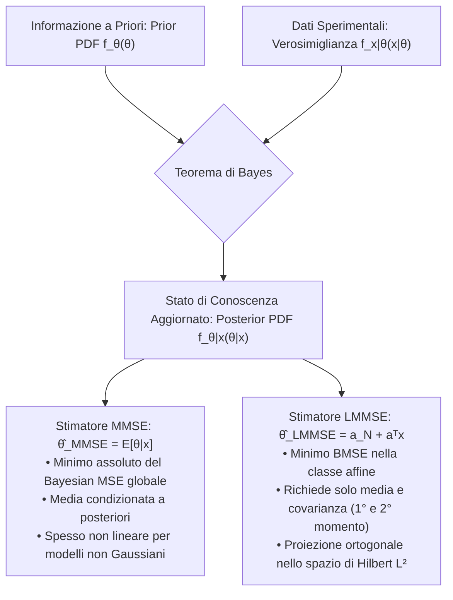
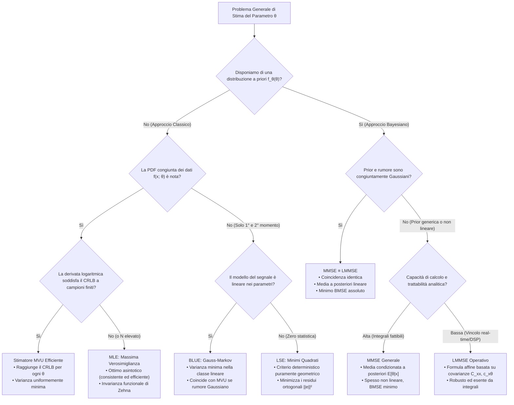

# 2. Stima Bayesiana - MMSE e LMMSE

Nei capitoli precedenti abbiamo affrontato la teoria della stima adottando il punto di vista __classico__ (o frequentista): abbiamo considerato il parametro incognito $\theta$ come una costante deterministica priva di distribuzione di probabilità. In tale contesto, l'errore quadratico medio dipende inesorabilmente dal valore vero del parametro, e individuare stimatori non polarizzati a varianza minima uniformemente ottimi (__MVU__) richiede requisiti stringenti, come il raggiungimento del CRLB a campioni finiti o l'esistenza di statistiche sufficienti complete.

Negli scenari ingegneristici reali, tuttavia, disponiamo quasi sempre di __informazione a priori__ sul fenomeno fisico prima ancora di raccogliere i campioni sperimentali:
- Limiti fisici sui range di escursione di grandezze cinematiche, termiche o robotiche.
- Conoscenza statistica consolidata da campagne di misura storiche o modelli fenomenologici.
- Incertezza strutturale quantificabile mediante una densità di probabilità nota.

La __Stima Bayesiana__ incorpora esplicitamente questa conoscenza modellando il parametro incognito non più come una costante, ma come una __variabile aleatoria__ $\theta$. Questa transizione concettuale ridefinisce la metrica di errore quadratico medio e conduce a stimatori sempre calcolabili, esenti dalle problematiche di non esistenza tipiche della stima classica.

## Fondamenti della Stima Bayesiana

### Cambio di Paradigma: Parametri Deterministici vs Variabili Aleatorie

Nel paradigma classico, l'unica sorgente di aleatorietà risiede nel rumore di misura $\mathbf{w}$ che corrompe le osservazioni: la PDF dei dati $f_{\mathbf{x}}(\mathbf{x}; \theta)$ è parametrizzata da un valore costante deterministico $\theta \in \Theta$.

Nel paradigma bayesiano, consideriamo $\theta$ come una variabile aleatoria descritta da una __funzione di densità di probabilità a priori__ (_prior PDF_) $f_\theta(\theta)$, che quantifica il nostro stato di conoscenza sul parametro prima di acquisire i campioni.
Lo spazio probabilistico congiunto modella la coppia di grandezze aleatorie $(\mathbf{x}, \theta)$ attraverso la __PDF congiunta__:

$$
f_{\mathbf{x}, \theta}(\mathbf{x}, \theta) = f_{\mathbf{x} \mid \theta}(\mathbf{x} \mid \theta) f_\theta(\theta)
$$

dove:
- $f_\theta(\theta)$ è la PDF a priori del parametro.
- $f_{\mathbf{x} \mid \theta}(\mathbf{x} \mid \theta)$ è la PDF condizionata dei dati dato il parametro (formalmente coincidente con la funzione di verosimiglianza classica).
- $f_{\mathbf{x}, \theta}(\mathbf{x}, \theta)$ governa la generazione stocastica congiunta di parametro e misure.

Dopo aver acquisito il vettore delle osservazioni campionarie $\mathbf{x} = [x[0], x[1], \dots, x[N-1]]^T$, aggiorniamo il nostro stato di conoscenza applicando il __Teorema di Bayes__, ricavando la __funzione di densità di probabilità a posteriori__ (_posterior PDF_):

$$
f_{\theta \mid \mathbf{x}}(\theta \mid \mathbf{x}) = \frac{f_{\mathbf{x}, \theta}(\mathbf{x}, \theta)}{f_{\mathbf{x}}(\mathbf{x})} = \frac{f_{\mathbf{x} \mid \theta}(\mathbf{x} \mid \theta) f_\theta(\theta)}{\int_{\Theta} f_{\mathbf{x} \mid \theta}(\mathbf{x} \mid \theta) f_\theta(\theta) \mathrm{d}\theta}
$$

Il denominatore $f_{\mathbf{x}}(\mathbf{x}) = \int_{\Theta} f_{\mathbf{x}, \theta}(\mathbf{x}, \theta) \mathrm{d}\theta$ rappresenta la densità marginale dei dati (spesso denominata _evidenza_ o fattore di normalizzazione) ed è calcolata per saturazione rispetto a tutte le configurazioni ammissibili del parametro $\theta$.
Notiamo che, in generale, parametri e osservazioni sono statisticamente dipendenti: $f_{\mathbf{x}, \theta}(\mathbf{x}, \theta) \ne f_{\mathbf{x}}(\mathbf{x}) f_\theta(\theta)$.

### Errore Quadratico Medio Bayesiano (BMSE) vs MSE Classico

La divergenza operativa tra approccio classico e bayesiano emerge nella definizione della metrica di accuratezza:

1. __MSE Classico__:
   Calcoliamo il valore atteso unicamente rispetto alla distribuzione dei dati $\mathbf{x}$, mantenendo $\theta$ congelato:
   $$
   \text{MSE}\{\hat{\theta}\} = \mathbb{E}_{\mathbf{x}}\left[ (\hat{\theta}(\mathbf{x}) - \theta)^2 \right] = \int_{\mathcal{X}} (\hat{\theta}(\mathbf{x}) - \theta)^2 f_{\mathbf{x}}(\mathbf{x}; \theta) \mathrm{d}\mathbf{x} = \text{Var}\{\hat{\theta}\} + b^2(\theta)
   $$
   L'MSE classico dipende dal valore incognito $\theta$. Minimizzarlo punto per punto per qualsiasi $\theta$ simultaneamente è impossibile, a meno di non imporre vincoli restrittivi (come la perfetta non polarizzazione $b(\theta) = 0$).

2. __Bayesian MSE (BMSE)__:
   Nella formulazione bayesiana, mediamo l'errore quadratico congiuntamente rispetto a tutte le possibili realizzazioni campionarie $\mathbf{x}$ e a tutti i valori ammissibili del parametro $\theta$:
   $$
   B_{\text{MSE}}(\hat{\theta}) = \mathbb{E}_{\mathbf{x}, \theta}\left[ (\theta - \hat{\theta}(\mathbf{x}))^2 \right] = \int_{\mathcal{X}} \int_{\Theta} (\theta - \hat{\theta}(\mathbf{x}))^2 f_{\mathbf{x}, \theta}(\mathbf{x}, \theta) \mathrm{d}\theta \mathrm{d}\mathbf{x}
   $$
   Applicando la legge delle aspettative iterate e condizionando rispetto a $\theta$:
   $$
   B_{\text{MSE}}(\hat{\theta}) = \int_{\Theta} \left[ \int_{\mathcal{X}} (\theta - \hat{\theta}(\mathbf{x}))^2 f_{\mathbf{x} \mid \theta}(\mathbf{x} \mid \theta) \mathrm{d}\mathbf{x} \right] f_\theta(\theta) \mathrm{d}\theta = \mathbb{E}_\theta\left[ \text{MSE}\{\hat{\theta}\} \right]
   $$
   Il BMSE corrisponde al valor medio dell'MSE classico pesato dalla densità a priori $f_\theta(\theta)$. Di conseguenza, il $B_{\text{MSE}}$ è uno __scalare deterministico globale__ indipendente da $\theta$. La sua minimizzazione è un problema di ottimizzazione incondizionato e ben posto su tutto lo spazio di ricerca.

Scomponendo l'MSE classico in varianza e quadrato del bias, otteniamo la decomposizione bayesiana fondamentale:

$$
B_{\text{MSE}}(\hat{\theta}) = \mathbb{E}_\theta\left[ \text{Var}\{\hat{\theta}\} \right] + \mathbb{E}_\theta\left[ b^2(\theta) \right]
$$

## Stimatore a Minimo Errore Quadratico Medio (MMSE)

Lo stimatore a minimo errore quadratico medio (__MMSE__, _Minimum Mean Square Error_) è la regola di decisione ottima che minimizza incondizionatamente il BMSE globale su qualsiasi classe di funzioni ammissibili dei dati $\hat{\theta}(\mathbf{x})$.

### Derivazione dell'Ottimalità della Media a Posteriori

Per ricavare la struttura ottima dello stimatore, fattorizziamo la PDF congiunta condizionando rispetto alle osservazioni sperimentali $\mathbf{x}$:

$$
B_{\text{MSE}}(\hat{\theta}) = \int_{\mathcal{X}} \left[ \int_{\Theta} (\theta - \hat{\theta}(\mathbf{x}))^2 f_{\theta \mid \mathbf{x}}(\theta \mid \mathbf{x}) \mathrm{d}\theta \right] f_{\mathbf{x}}(\mathbf{x}) \mathrm{d}\mathbf{x}
$$

Poiché la densità marginale dei dati è non negativa ovunque ($f_{\mathbf{x}}(\mathbf{x}) \ge 0$), minimizzare l'integrale complessivo equivale a minimizzare l'integrale interno rispetto alla stima scalare $\hat{\theta}$ per ogni singolo vettore osservato $\mathbf{x}$:

$$
\min_{\hat{\theta}} \int_{\Theta} (\theta - \hat{\theta})^2 f_{\theta \mid \mathbf{x}}(\theta \mid \mathbf{x}) \mathrm{d}\theta
$$

Differenziamo sotto il segno di integrale applicando la regola di Leibniz rispetto alla variabile di decisione $\hat{\theta}$:

$$
\frac{\partial}{\partial \hat{\theta}} \int_{\Theta} (\theta - \hat{\theta})^2 f_{\theta \mid \mathbf{x}}(\theta \mid \mathbf{x}) \mathrm{d}\theta = \int_{\Theta} \frac{\partial}{\partial \hat{\theta}} (\theta - \hat{\theta})^2 f_{\theta \mid \mathbf{x}}(\theta \mid \mathbf{x}) \mathrm{d}\theta = 0
$$

Sviluppando la derivata interna:

$$
-2 \int_{\Theta} (\theta - \hat{\theta}) f_{\theta \mid \mathbf{x}}(\theta \mid \mathbf{x}) \mathrm{d}\theta = 0
$$

Separiamo i due contributi integrali:

$$
\hat{\theta} \int_{\Theta} f_{\theta \mid \mathbf{x}}(\theta \mid \mathbf{x}) \mathrm{d}\theta = \int_{\Theta} \theta f_{\theta \mid \mathbf{x}}(\theta \mid \mathbf{x}) \mathrm{d}\theta
$$

Poiché $f_{\theta \mid \mathbf{x}}(\theta \mid \mathbf{x})$ è una densità di probabilità valida, il suo integrale sul dominio di supporto $\Theta$ vale identicamente $1$:

$$
\int_{\Theta} f_{\theta \mid \mathbf{x}}(\theta \mid \mathbf{x}) \mathrm{d}\theta = 1
$$

Il coefficiente che moltiplica $\hat{\theta}$ collassa a $1$, isolando direttamente la soluzione ottima:

$$
\hat{\theta}_{\text{MMSE}} = \int_{\Theta} \theta f_{\theta \mid \mathbf{x}}(\theta \mid \mathbf{x}) \mathrm{d}\theta = \mathbb{E}_{\theta \mid \mathbf{x}}[\theta \mid \mathbf{x}] = \mu_{\theta \mid \mathbf{x}}
$$

Lo stimatore MMSE coincide con la __media della distribuzione a posteriori__ (_conditional mean_).
Esplicitando il rapporto tra densità congiunta e marginale, otteniamo la formulazione integrale diretta:

$$
\hat{\theta}_{\text{MMSE}} = \frac{\int_{\Theta} \theta f_{\mathbf{x}, \theta}(\mathbf{x}, \theta) \mathrm{d}\theta}{f_{\mathbf{x}}(\mathbf{x})} = \frac{\int_{\Theta} \theta f_{\mathbf{x} \mid \theta}(\mathbf{x} \mid \theta) f_\theta(\theta) \mathrm{d}\theta}{\int_{\Theta} f_{\mathbf{x} \mid \theta}(\mathbf{x} \mid \theta) f_\theta(\theta) \mathrm{d}\theta}
$$

> [!tip] Esistenza e Unicità dello Stimatore MMSE
> A differenza dello stimatore MVU classico (che può non esistere se non vi sono stimatori non polarizzati a varianza minima), lo stimatore bayesiano MMSE __esiste sempre__, purché il primo momento della distribuzione congiunta sia finito ($\mathbb{E}[|\theta|] < \infty$). La dimostrazione geometrica alternativa basata sull'annullamento del doppio prodotto è approfondita in [[zz. Argomenti extra#Ottimalità della Media a Posteriori per il Criterio MMSE|zz. Argomenti extra]].

### Procedura Operativa per la Determinazione del MMSE

Nella pratica d'esame e progettuale, ricaviamo lo stimatore MMSE eseguendo in sequenza quattro passaggi metodici:

1. __Costruzione della PDF Congiunta__: Moltiplichiamo la verosimiglianza condizionata per la prior:
   $$
   f_{\mathbf{x}, \theta}(\mathbf{x}, \theta) = f_{\mathbf{x} \mid \theta}(\mathbf{x} \mid \theta) f_\theta(\theta)
   $$
2. __Calcolo della Marginale dei Dati (Saturazione)__: Integriamo la densità congiunta rispetto a $\theta$:
   $$
   f_{\mathbf{x}}(\mathbf{x}) = \int_{\Theta} f_{\mathbf{x}, \theta}(\mathbf{x}, \theta) \mathrm{d}\theta
   $$
3. __Valutazione della Posterior PDF__: Applichiamo la formula di Bayes dividendo la congiunta per la marginale:
   $$
   f_{\theta \mid \mathbf{x}}(\theta \mid \mathbf{x}) = \frac{f_{\mathbf{x}, \theta}(\mathbf{x}, \theta)}{f_{\mathbf{x}}(\mathbf{x})}
   $$
4. __Integrazione per la Media Condizionata__: Integriamo il parametro pesato dalla posterior per ottenere la stima finale:
   $$
   \hat{\theta}_{\text{MMSE}} = \int_{\Theta} \theta f_{\theta \mid \mathbf{x}}(\theta \mid \mathbf{x}) \mathrm{d}\theta
   $$

### Esempio: Livello DC con Distribuzione a Priori Gaussiana

Consideriamo il problema fondamentale di stima di un livello costante immerso in rumore bianco Gaussiano:

$$
x[n] = \theta + w[n], \quad n = 0, \dots, N-1, \quad w[n] \sim \mathcal{N}(0, \sigma^2) \quad \text{i.i.d.}
$$

Il parametro incognito $\theta$ è una variabile aleatoria Gaussiana con media $\mu_\theta$ e varianza $\sigma_\theta^2$:

$$
\theta \sim \mathcal{N}(\mu_\theta, \sigma_\theta^2)
$$

Poiché sia la verosimiglianza sia la prior appartengono alla famiglia esponenziale Gaussiana (proprietà di coniugazione), la densità a posteriori $f_{\theta \mid \mathbf{x}}(\theta \mid \mathbf{x})$ è anch'essa esattamente una Gaussiana univariata:

$$
f_{\theta \mid \mathbf{x}}(\theta \mid \mathbf{x}) = \frac{1}{\sqrt{2\pi \sigma_{\theta \mid \mathbf{x}}^2}} \exp\left( -\frac{(\theta - \mu_{\theta \mid \mathbf{x}})^2}{2\sigma_{\theta \mid \mathbf{x}}^2} \right)
$$

Completando il quadrato all'esponente (passaggio derivato nei dettagli in [[zz. Argomenti extra#Aggiornamento Gaussiano e Completamento del Quadrato per la Stima Bayesiana DC|zz. Argomenti extra]]), ricaviamo i parametri analitici della posterior:

$$
\mu_{\theta \mid \mathbf{x}} = \frac{\frac{\sigma^2}{N}}{\sigma_\theta^2 + \frac{\sigma^2}{N}} \mu_\theta + \frac{\sigma_\theta^2}{\sigma_\theta^2 + \frac{\sigma^2}{N}} \bar{x}
$$

$$
\sigma_{\theta \mid \mathbf{x}}^2 = \frac{\sigma_\theta^2 \frac{\sigma^2}{N}}{\sigma_\theta^2 + \frac{\sigma^2}{N}}
$$

dove $\bar{x} = \frac{1}{N}\sum_{n=0}^{N-1} x[n]$ è la media campionaria delle osservazioni.
Lo stimatore MMSE coincide con la media a posteriori:

$$
\hat{\theta}_{\text{MMSE}} = \mu_{\theta \mid \mathbf{x}} = \frac{\frac{\sigma^2}{N}}{\sigma_\theta^2 + \frac{\sigma^2}{N}} \mu_\theta + \frac{\sigma_\theta^2}{\sigma_\theta^2 + \frac{\sigma^2}{N}} \bar{x}
$$

![[gaussian_shrinkage_posterior.svg|center mid]]

> [!note] Interpretazione di Bilanciamento Ottimo, Precisione e Shrinkage
> Riscriviamo la varianza a posteriori in termini di __precisioni statistiche__ (l'inverso della varianza $\lambda = 1/\sigma^2$):
> $$
> \frac{1}{\sigma_{\theta \mid \mathbf{x}}^2} = \frac{1}{\sigma_\theta^2} + \frac{N}{\sigma^2} = \lambda_\theta + \lambda_{\text{data}}
> $$
> Le precisioni si sommano algebricamente: l'informazione complessiva è data dall'informazione a priori più l'informazione apportata dai dati.
> Riorganizzando la stima nella forma canonica del __filtro di Kalman scalare__:
> $$
> \hat{\theta}_{\text{MMSE}} = \mu_\theta + K (\bar{x} - \mu_\theta), \quad K = \frac{\sigma_\theta^2}{\sigma_\theta^2 + \frac{\sigma^2}{N}}
> $$
> dove $K \in [0, 1]$ rappresenta il guadagno di Kalman e $(\bar{x} - \mu_\theta)$ è l'__innovazione__ (la discrepanza tra dato misurato e aspettativa a priori):
> - Se il numero di campioni è scarso ($N \to 0$) o il rumore è fortissimo ($\sigma^2 \gg \sigma_\theta^2$), il guadagno collassa ($K \to 0$): la misura è inaffidabile e lo stimatore si affida interamente alla prior, $\hat{\theta}_{\text{MMSE}} \to \mu_\theta$.
> - Se raccogliamo molti campioni ($N \to \infty$) o il rumore è trascurabile ($\sigma^2 \to 0$), il guadagno tende all'unità ($K \to 1$): il dato sperimentale prevale sulla credenza a priori e $\hat{\theta}_{\text{MMSE}} \to \bar{x}$.
> Questa contrazione della stima campionaria verso la media a priori prende il nome di __shrinkage effect__.

### Prestazioni e Confronto con l'Approccio Classico

Valutiamo il Bayesian MSE conseguito dallo stimatore MMSE. Dimostriamo analiticamente che il BMSE equivale al valor medio della varianza a posteriori:

$$
B_{\text{MSE}}(\hat{\theta}_{\text{MMSE}}) = \mathbb{E}_{\mathbf{x}, \theta}\left[ (\theta - \hat{\theta}_{\text{MMSE}})^2 \right] = \int_{\mathcal{X}} \left[ \int_{\Theta} (\theta - \mu_{\theta \mid \mathbf{x}})^2 f_{\theta \mid \mathbf{x}}(\theta \mid \mathbf{x}) \mathrm{d}\theta \right] f_{\mathbf{x}}(\mathbf{x}) \mathrm{d}\mathbf{x}
$$

L'integrale tra parentesi quadre è per definizione la varianza della distribuzione condizionata $\text{Var}\{\theta \mid \mathbf{x}\} = \sigma_{\theta \mid \mathbf{x}}^2$:

$$
B_{\text{MSE}}(\hat{\theta}_{\text{MMSE}}) = \int_{\mathcal{X}} \sigma_{\theta \mid \mathbf{x}}^2 f_{\mathbf{x}}(\mathbf{x}) \mathrm{d}\mathbf{x}
$$

Nel modello Gaussiano, la varianza a posteriori $\sigma_{\theta \mid \mathbf{x}}^2$ dipende unicamente dai parametri strutturali $(\sigma_\theta^2, \sigma^2, N)$ ed è indipendente dai valori numerici assunti dai dati $\mathbf{x}$. Essa può essere estratta dall'integrale:

$$
B_{\text{MSE}}(\hat{\theta}_{\text{MMSE}}) = \sigma_{\theta \mid \mathbf{x}}^2 \int_{\mathcal{X}} f_{\mathbf{x}}(\mathbf{x}) \mathrm{d}\mathbf{x} = \sigma_{\theta \mid \mathbf{x}}^2 = \frac{\sigma_\theta^2 \frac{\sigma^2}{N}}{\sigma_\theta^2 + \frac{\sigma^2}{N}}
$$

Confrontiamo il BMSE ottenuto con i riferimenti della stima:

1. __Rispetto all'incertezza a priori $\sigma_\theta^2$__:
   $$
   B_{\text{MSE}}(\hat{\theta}_{\text{MMSE}}) = \sigma_\theta^2 \left( \frac{\frac{\sigma^2}{N}}{\sigma_\theta^2 + \frac{\sigma^2}{N}} \right) < \sigma_\theta^2
   $$
   Il fattore tra parentesi è strettamente minore di $1$: osservare i campioni riduce incondizionatamente l'incertezza rispetto allo stato iniziale.

2. __Rispetto allo stimatore classico MVU (media campionaria $\bar{x}$)__:
   Lo stimatore ottimo classico presenta un errore quadratico pari a $\text{MSE}\{\hat{\theta}_{\text{MVU}}\} = \text{Var}\{\bar{x}\} = \frac{\sigma^2}{N}$. Nel quadro bayesiano:
   $$
   B_{\text{MSE}}(\hat{\theta}_{\text{MMSE}}) = \frac{\sigma^2}{N} \left( \frac{\sigma_\theta^2}{\sigma_\theta^2 + \frac{\sigma^2}{N}} \right) < \frac{\sigma^2}{N} = \text{MSE}\{\hat{\theta}_{\text{MVU}}\}
   $$
   Il BMSE dello stimatore MMSE è __strettamente inferiore__ all'MSE del migliore stimatore non polarizzato classico. L'iniezione dell'informazione a priori agisce da regolarizzatore, comprimendo l'errore quadratico medio al di sotto della soglia classica.

### La Questione della Polarizzazione: Bias Bayesiano vs Bias Classico

Chiedersi se lo stimatore MMSE sia polarizzato richiede di specificare la definizione di valore atteso adottata:

1. __Non Polarizzazione Bayesiana Globale__:
   Se valutiamo la polarizzazione mediando congiuntamente rispetto a tutte le realizzazioni campionarie e ai possibili valori del parametro, lo stimatore MMSE è __rigorosamente non polarizzato__:
   $$
   \mathbb{E}_{\mathbf{x}, \theta}[\theta - \hat{\theta}_{\text{MMSE}}] = \mathbb{E}_{\mathbf{x}}\left[ \mathbb{E}_{\theta \mid \mathbf{x}}[\theta \mid \mathbf{x}] \right] - \mathbb{E}_{\mathbf{x}}[\hat{\theta}_{\text{MMSE}}(\mathbf{x})] = \mathbb{E}_{\mathbf{x}}[\mu_{\theta \mid \mathbf{x}}] - \mathbb{E}_{\mathbf{x}}[\mu_{\theta \mid \mathbf{x}}] = 0
   $$
   La proprietà discende direttamente dal teorema del valore atteso iterato (torre dei condizionamenti).

2. __Polarizzazione Classica Condizionata__:
   Se valutiamo il valor medio in senso classico, condizionando a un valore fissato deterministico $\theta$, lo stimatore MMSE risulta __intrinsecamente polarizzato__:
   $$
   \mathbb{E}_{\mathbf{x} \mid \theta}[\hat{\theta}_{\text{MMSE}}] = \frac{\frac{\sigma^2}{N}}{\sigma_\theta^2 + \frac{\sigma^2}{N}} \mu_\theta + \frac{\sigma_\theta^2}{\sigma_\theta^2 + \frac{\sigma^2}{N}} \mathbb{E}_{\mathbf{x} \mid \theta}[\bar{x}] = \frac{\frac{\sigma^2}{N}}{\sigma_\theta^2 + \frac{\sigma^2}{N}} \mu_\theta + \frac{\sigma_\theta^2}{\sigma_\theta^2 + \frac{\sigma^2}{N}} \theta \ne \theta
   $$
   Il bias condizionato classico non è nullo e vale:
   $$
   b(\theta) = \mathbb{E}_{\mathbf{x} \mid \theta}[\hat{\theta}_{\text{MMSE}}] - \theta = \frac{\frac{\sigma^2}{N}}{\sigma_\theta^2 + \frac{\sigma^2}{N}} (\mu_\theta - \theta)
   $$
   Questo bias classico non è un difetto, ma il meccanismo deliberato tramite cui il MMSE contrae la stima verso $\mu_\theta$: accettando un modesto bias deterministico, abbatte drasticamente la varianza e ottiene un BMSE globale imbattibile.

### Estensione al Caso Vettoriale e Modello Lineare Gaussiano

Consideriamo la stima di un vettore di parametri $\boldsymbol{\theta} = [\theta_0, \theta_1, \dots, \theta_{P-1}]^T \in \mathbb{R}^P$ a partire da $N$ osservazioni $\mathbf{x} \in \mathbb{R}^N$.
Lo stimatore MMSE vettoriale minimizza la traccia della matrice di BMSE ed è pari al vettore delle medie condizionate a posteriori:

$$
\hat{\boldsymbol{\theta}}_{\text{MMSE}} = \mathbb{E}[\boldsymbol{\theta} \mid \mathbf{x}] = \int_{\Theta} \boldsymbol{\theta} f_{\boldsymbol{\theta} \mid \mathbf{x}}(\boldsymbol{\theta} \mid \mathbf{x}) \mathrm{d}\boldsymbol{\theta}
$$

Per la singola componente $\theta_i$, l'errore quadratico medio bayesiano corrisponde all'integrale del relativo elemento diagonale della matrice di covarianza a posteriori:

$$
B_{\text{MSE}}(\hat{\theta}_{i, \text{MMSE}}) = \int_{\mathcal{X}} [\mathbf{C}_{\boldsymbol{\theta} \mid \mathbf{x}}]_{i, i} f_{\mathbf{x}}(\mathbf{x}) \mathrm{d}\mathbf{x}
$$

Nel __modello lineare Gaussiano generale__:

$$
\mathbf{x} = \mathbf{H}\boldsymbol{\theta} + \mathbf{w}
$$

dove:
- $\boldsymbol{\theta} \sim \mathcal{N}(\boldsymbol{\mu}_{\boldsymbol{\theta}}, \mathbf{C}_{\boldsymbol{\theta}\boldsymbol{\theta}})$ è il vettore dei parametri aleatori.
- $\mathbf{w} \sim \mathcal{N}(\mathbf{0}, \mathbf{C}_{\mathbf{w}\mathbf{w}})$ è il rumore congiuntamente Gaussiano, indipendente da $\boldsymbol{\theta}$.
- $\mathbf{H} \in \mathbb{R}^{N \times P}$ è la matrice di osservazione nota a priori.

Poiché la trasformazione è lineare e le distribuzioni congiunte sono Gaussiane, la posterior PDF $f_{\boldsymbol{\theta} \mid \mathbf{x}}(\boldsymbol{\theta} \mid \mathbf{x})$ è una Gaussiana multivariata $\mathcal{N}(\boldsymbol{\mu}_{\boldsymbol{\theta} \mid \mathbf{x}}, \mathbf{C}_{\boldsymbol{\theta} \mid \mathbf{x}})$.
La media a posteriori e la matrice di covarianza a posteriori assumono la forma esatta:

$$
\hat{\boldsymbol{\theta}}_{\text{MMSE}} = \boldsymbol{\mu}_{\boldsymbol{\theta} \mid \mathbf{x}} = \boldsymbol{\mu}_{\boldsymbol{\theta}} + \mathbf{C}_{\boldsymbol{\theta}\boldsymbol{\theta}} \mathbf{H}^T (\mathbf{H}\mathbf{C}_{\boldsymbol{\theta}\boldsymbol{\theta}}\mathbf{H}^T + \mathbf{C}_{\mathbf{w}\mathbf{w}})^{-1} (\mathbf{x} - \mathbf{H}\boldsymbol{\mu}_{\boldsymbol{\theta}})
$$

$$
\mathbf{C}_{\boldsymbol{\theta} \mid \mathbf{x}} = \mathbf{C}_{\boldsymbol{\theta}\boldsymbol{\theta}} - \mathbf{C}_{\boldsymbol{\theta}\boldsymbol{\theta}} \mathbf{H}^T (\mathbf{H}\mathbf{C}_{\boldsymbol{\theta}\boldsymbol{\theta}}\mathbf{H}^T + \mathbf{C}_{\mathbf{w}\mathbf{w}})^{-1} \mathbf{H}\mathbf{C}_{\boldsymbol{\theta}\boldsymbol{\theta}}
$$

La matrice $\mathbf{K} = \mathbf{C}_{\boldsymbol{\theta}\boldsymbol{\theta}} \mathbf{H}^T (\mathbf{H}\mathbf{C}_{\boldsymbol{\theta}\boldsymbol{\theta}}\mathbf{H}^T + \mathbf{C}_{\mathbf{w}\mathbf{w}})^{-1}$ rappresenta la matrice di guadagno di Kalman, mentre $(\mathbf{x} - \mathbf{H}\boldsymbol{\mu}_{\boldsymbol{\theta}})$ è il vettore di innovazione multivariata.
La covarianza dell'errore bayesiano è indipendente da $\mathbf{x}$, per cui $\mathbf{C}_{\boldsymbol{\epsilon}} = \mathbb{E}_{\mathbf{x}}[\mathbf{C}_{\boldsymbol{\theta} \mid \mathbf{x}}] = \mathbf{C}_{\boldsymbol{\theta} \mid \mathbf{x}}$, e per ogni parametro il BMSE coincide con $[\mathbf{C}_{\boldsymbol{\theta} \mid \mathbf{x}}]_{i, i}$.

## Stimatore Lineare a Minimo Errore Quadratico Medio (LMMSE)

Sebbene lo stimatore MMSE sia ottimale rispetto all'errore quadratico, la sua applicazione pratica incontra spesso due ostacoli invalicabili:
1. Richiede la conoscenza completa delle PDF congiunte $f_{\mathbf{x}, \theta}(\mathbf{x}, \theta)$, raramente disponibili nei sistemi complessi.
2. Richiede il calcolo di integrali multidimensionali per valutare la media condizionata, i quali raramente ammettono una soluzione analitica chiusa al di fuori dei modelli congiuntamente Gaussiani.

Lo __stimatore lineare a minimo errore quadratico medio__ (__LMMSE__, _Linear Minimum Mean Square Error_) aggira questi vincoli imponendo a priori una struttura __affine__ alle osservazioni, richiedendo unicamente la conoscenza dei momenti del primo e del secondo ordine.

### Motivazione e Vincolo Affine

Imponiamo che lo stimatore dello scalare $\theta$ sia una funzione lineare affine dei campioni osservati:

$$
\hat{\theta} = a_N + \sum_{n=0}^{N-1} a_n x[n] = a_N + \mathbf{a}^T \mathbf{x}
$$

dove $a_N \in \mathbb{R}$ è il termine costante di offset e $\mathbf{a} = [a_0, \dots, a_{N-1}]^T \in \mathbb{R}^N$ è il vettore dei pesi lineari.
Il problema di progetto consiste nell'individuare la coppia $(a_N, \mathbf{a})$ che minimizza incondizionatamente il BMSE:

$$
\min_{a_N, \mathbf{a}} B_{\text{MSE}}(\hat{\theta}) = \mathbb{E}_{\mathbf{x}, \theta}\left[ (\theta - a_N - \mathbf{a}^T \mathbf{x})^2 \right]
$$

### Derivazione Analitica tramite Ortogonalità Stocastica

Iniziamo calcolando la derivata parziale rispetto al termine costante $a_N$ e imponendo l'annullamento:

$$
\frac{\partial B_{\text{MSE}}}{\partial a_N} = \mathbb{E}_{\mathbf{x}, \theta}\left[ -2(\theta - a_N - \mathbf{a}^T \mathbf{x}) \right] = 0
$$

Portando l'operatore di valore atteso all'interno della parentesi:

$$
\mathbb{E}[\theta] - a_N - \mathbf{a}^T \mathbb{E}[\mathbf{x}] = 0 \implies a_N = \mu_\theta - \mathbf{a}^T \boldsymbol{\mu}_{\mathbf{x}}
$$

Sostituendo l'espressione di $a_N$ nella struttura dello stimatore:

$$
\hat{\theta} = (\mu_\theta - \mathbf{a}^T \boldsymbol{\mu}_{\mathbf{x}}) + \mathbf{a}^T \mathbf{x} = \mu_\theta + \mathbf{a}^T (\mathbf{x} - \boldsymbol{\mu}_{\mathbf{x}})
$$

Lo stimatore LMMSE opera naturalmente sui dati centrati rispetto ai rispettivi valori medi a priori.
Esprimiamo l'errore di stima $\epsilon = \theta - \hat{\theta}$:

$$
\epsilon = (\theta - \mu_\theta) - \mathbf{a}^T (\mathbf{x} - \boldsymbol{\mu}_{\mathbf{x}})
$$

Sviluppiamo il BMSE in funzione del vettore dei pesi $\mathbf{a}$:

$$
B_{\text{MSE}}(\mathbf{a}) = \mathbb{E}\left[ \left( (\theta - \mu_\theta) - \mathbf{a}^T (\mathbf{x} - \boldsymbol{\mu}_{\mathbf{x}}) \right)^2 \right]
$$

Espandendo il quadrato del binomio:

$$
B_{\text{MSE}}(\mathbf{a}) = \mathbb{E}[(\theta - \mu_\theta)^2] - 2 \mathbf{a}^T \mathbb{E}[(\mathbf{x} - \boldsymbol{\mu}_{\mathbf{x}})(\theta - \mu_\theta)] + \mathbf{a}^T \mathbb{E}[(\mathbf{x} - \boldsymbol{\mu}_{\mathbf{x}})(\mathbf{x} - \boldsymbol{\mu}_{\mathbf{x}})^T] \mathbf{a}
$$

$$
B_{\text{MSE}}(\mathbf{a}) = \sigma_\theta^2 - 2 \mathbf{a}^T \mathbf{c}_{\mathbf{x}\theta} + \mathbf{a}^T \mathbf{C}_{\mathbf{x}\mathbf{x}} \mathbf{a}
$$

dove identifichiamo i momenti del secondo ordine:
- $\sigma_\theta^2 = \text{Var}\{\theta\}$ è la varianza a priori del parametro.
- $\mathbf{c}_{\mathbf{x}\theta} = \text{Cov}\{\mathbf{x}, \theta\} = \mathbb{E}[(\mathbf{x} - \boldsymbol{\mu}_{\mathbf{x}})(\theta - \mu_\theta)] \in \mathbb{R}^N$ è il vettore delle covarianze incrociate tra dati e parametro.
- $\mathbf{C}_{\mathbf{x}\mathbf{x}} = \text{Cov}\{\mathbf{x}\} = \mathbb{E}[(\mathbf{x} - \boldsymbol{\mu}_{\mathbf{x}})(\mathbf{x} - \boldsymbol{\mu}_{\mathbf{x}})^T] \in \mathbb{R}^{N \times N}$ è la matrice di covarianza delle osservazioni.

Differenziamo rispetto al vettore $\mathbf{a}$ e imponiamo l'annullamento del gradiente:

$$
\frac{\partial B_{\text{MSE}}}{\partial \mathbf{a}} = -2 \mathbf{c}_{\mathbf{x}\theta} + 2 \mathbf{C}_{\mathbf{x}\mathbf{x}} \mathbf{a} = \mathbf{0} \implies \mathbf{C}_{\mathbf{x}\mathbf{x}} \mathbf{a} = \mathbf{c}_{\mathbf{x}\theta}
$$

L'identità $\mathbf{C}_{\mathbf{x}\mathbf{x}} \mathbf{a} = \mathbf{c}_{\mathbf{x}\theta}$ definisce le __equazioni normali stocastiche__. Poiché la matrice di covarianza $\mathbf{C}_{\mathbf{x}\mathbf{x}}$ è simmetrica e definita positiva:

$$
\mathbf{a} = \mathbf{C}_{\mathbf{x}\mathbf{x}}^{-1} \mathbf{c}_{\mathbf{x}\theta} \implies \mathbf{a}^T = \mathbf{c}_{\mathbf{x}\theta}^T \mathbf{C}_{\mathbf{x}\mathbf{x}}^{-1}
$$

Sostituendo il vettore ottimo nello stimatore, ricaviamo la formula canonica dell'LMMSE scalare:

$$
\hat{\theta}_{\text{LMMSE}} = \mu_\theta + \mathbf{c}_{\mathbf{x}\theta}^T \mathbf{C}_{\mathbf{x}\mathbf{x}}^{-1} (\mathbf{x} - \boldsymbol{\mu}_{\mathbf{x}})
$$

Sostituiamo il vettore $\mathbf{a}$ ottimale nell'espressione dell'errore quadratico per determinare il BMSE minimo:

$$
B_{\text{MSE}}(\hat{\theta}_{\text{LMMSE}}) = \sigma_\theta^2 - 2 (\mathbf{c}_{\mathbf{x}\theta}^T \mathbf{C}_{\mathbf{x}\mathbf{x}}^{-1}) \mathbf{c}_{\mathbf{x}\theta} + (\mathbf{c}_{\mathbf{x}\theta}^T \mathbf{C}_{\mathbf{x}\mathbf{x}}^{-1}) \mathbf{C}_{\mathbf{x}\mathbf{x}} (\mathbf{C}_{\mathbf{x}\mathbf{x}}^{-1} \mathbf{c}_{\mathbf{x}\theta})
$$

Nel terzo termine, il prodotto intermedio $\mathbf{C}_{\mathbf{x}\mathbf{x}}^{-1} \mathbf{C}_{\mathbf{x}\mathbf{x}}$ collassa nella matrice identità $\mathbf{I}$:

$$
B_{\text{MSE}}(\hat{\theta}_{\text{LMMSE}}) = \sigma_\theta^2 - 2 \mathbf{c}_{\mathbf{x}\theta}^T \mathbf{C}_{\mathbf{x}\mathbf{x}}^{-1} \mathbf{c}_{\mathbf{x}\theta} + \mathbf{c}_{\mathbf{x}\theta}^T \mathbf{C}_{\mathbf{x}\mathbf{x}}^{-1} \mathbf{c}_{\mathbf{x}\theta} = \sigma_\theta^2 - \mathbf{c}_{\mathbf{x}\theta}^T \mathbf{C}_{\mathbf{x}\mathbf{x}}^{-1} \mathbf{c}_{\mathbf{x}\theta}
$$

Poiché la forma quadratica $\mathbf{c}_{\mathbf{x}\theta}^T \mathbf{C}_{\mathbf{x}\mathbf{x}}^{-1} \mathbf{c}_{\mathbf{x}\theta} \ge 0$ è sempre non negativa, il BMSE dell'LMMSE è sempre minore o uguale alla varianza a priori $\sigma_\theta^2$.

### Principio di Ortogonalità nello Spazio di Hilbert delle Variabili Aleatorie

L'equazione di ottimalità $\mathbf{C}_{\mathbf{x}\mathbf{x}} \mathbf{a} - \mathbf{c}_{\mathbf{x}\theta} = \mathbf{0}$ ammette una profonda interpretazione geometrica:

$$
\mathbb{E}\left[ (\mathbf{x} - \boldsymbol{\mu}_{\mathbf{x}}) ((\theta - \mu_\theta) - \mathbf{a}^T (\mathbf{x} - \boldsymbol{\mu}_{\mathbf{x}})) \right] = \mathbf{0} \implies \mathbb{E}\left[ (\mathbf{x} - \boldsymbol{\mu}_{\mathbf{x}}) (\theta - \hat{\theta}_{\text{LMMSE}}) \right] = \mathbf{0}
$$

L'errore di stima $\epsilon = \theta - \hat{\theta}_{\text{LMMSE}}$ è __statisticamente ortogonale (scorrelato)__ a ciascuna delle osservazioni campionarie centrate:

$$
\langle \epsilon, x[n] - \mu_{x[n]} \rangle = \mathbb{E}[\epsilon \cdot (x[n] - \mu_{x[n]})] = 0 \quad \forall n = 0, \dots, N-1
$$

Nello spazio di Hilbert $L^2$ delle variabili aleatorie a quadrato integrabile dotato di prodotto scalare $\langle X, Y \rangle = \mathbb{E}[XY]$, lo stimatore LMMSE corrisponde alla __proiezione ortogonale__ della variabile incognita $\theta - \mu_\theta$ sul sottospazio lineare $\mathcal{S}(\mathbf{x})$ generato dai dati centrati.

![[hilbert_space_orthogonality_lmmse.svg|center mid]]

Per il Teorema di Pitagora applicato nello spazio di Hilbert:

$$
\|\theta - \mu_\theta\|^2 = \|\hat{\theta}_{\text{LMMSE}} - \mu_\theta\|^2 + \|\epsilon\|^2
$$

$$
\sigma_\theta^2 = \mathbf{c}_{\mathbf{x}\theta}^T \mathbf{C}_{\mathbf{x}\mathbf{x}}^{-1} \mathbf{c}_{\mathbf{x}\theta} + B_{\text{MSE}} \implies B_{\text{MSE}}(\hat{\theta}_{\text{LMMSE}}) = \sigma_\theta^2 - \mathbf{c}_{\mathbf{x}\theta}^T \mathbf{C}_{\mathbf{x}\mathbf{x}}^{-1} \mathbf{c}_{\mathbf{x}\theta}
$$

Qualsiasi altro stimatore lineare $\hat{\theta}'$ definirebbe un errore con ipotenusa più lunga, confermando l'unicità e l'assoluta ottimalità geometrica della proiezione ortogonale.

### Caso Vettoriale e Modello Lineare Generale

Consideriamo un vettore di parametri aleatori $\boldsymbol{\theta} = [\theta_0, \theta_1, \dots, \theta_{P-1}]^T \in \mathbb{R}^P$.
Applicando il criterio LMMSE a ogni singola componente scalare $\theta_i$:

$$
\hat{\theta}_{i, \text{LMMSE}} = \mu_{\theta_i} + \mathbf{c}_{\mathbf{x}\theta_i}^T \mathbf{C}_{\mathbf{x}\mathbf{x}}^{-1} (\mathbf{x} - \boldsymbol{\mu}_{\mathbf{x}})
$$

Impilando le equazioni su tutte le componenti, definiamo la matrice di covarianza incrociata $\mathbf{C}_{\mathbf{x}\boldsymbol{\theta}} = [\mathbf{c}_{\mathbf{x}\theta_0}, \dots, \mathbf{c}_{\mathbf{x}\theta_{P-1}}] \in \mathbb{R}^{N \times P}$ e $\mathbf{C}_{\boldsymbol{\theta}\mathbf{x}} = \mathbf{C}_{\mathbf{x}\boldsymbol{\theta}}^T = \text{Cov}\{\boldsymbol{\theta}, \mathbf{x}\} \in \mathbb{R}^{P \times N}$. Lo stimatore vettoriale LMMSE assume l'espressione compatta:

$$
\hat{\boldsymbol{\theta}}_{\text{LMMSE}} = \boldsymbol{\mu}_{\boldsymbol{\theta}} + \mathbf{C}_{\boldsymbol{\theta}\mathbf{x}} \mathbf{C}_{\mathbf{x}\mathbf{x}}^{-1} (\mathbf{x} - \boldsymbol{\mu}_{\mathbf{x}})
$$

La corrispondente matrice di errore quadratico medio bayesiano $\mathbf{C}_{\boldsymbol{\epsilon}} = \mathbb{E}[(\boldsymbol{\theta} - \hat{\boldsymbol{\theta}})(\boldsymbol{\theta} - \hat{\boldsymbol{\theta}})^T] \in \mathbb{R}^{P \times P}$ è pari a:

$$
\mathbf{C}_{\boldsymbol{\epsilon}} = \mathbf{C}_{\boldsymbol{\theta}\boldsymbol{\theta}} - \mathbf{C}_{\boldsymbol{\theta}\mathbf{x}} \mathbf{C}_{\mathbf{x}\mathbf{x}}^{-1} \mathbf{C}_{\mathbf{x}\boldsymbol{\theta}}
$$

Il BMSE del generico parametro $\theta_i$ corrisponde all'elemento diagonale $[\mathbf{C}_{\boldsymbol{\epsilon}}]_{i, i}$.

Nel caso in cui le osservazioni seguano il modello vettoriale lineare:

$$
\mathbf{x} = \mathbf{H}\boldsymbol{\theta} + \mathbf{w}
$$

con $\boldsymbol{\theta}$ e $\mathbf{w}$ incorrelati, aventi momenti $(\boldsymbol{\mu}_{\boldsymbol{\theta}}, \mathbf{C}_{\boldsymbol{\theta}\boldsymbol{\theta}})$ e $(\mathbf{0}, \mathbf{C}_{\mathbf{w}\mathbf{w}})$:
- $\boldsymbol{\mu}_{\mathbf{x}} = \mathbb{E}[\mathbf{H}\boldsymbol{\theta} + \mathbf{w}] = \mathbf{H}\boldsymbol{\mu}_{\boldsymbol{\theta}}$.
- $\mathbf{C}_{\boldsymbol{\theta}\mathbf{x}} = \mathbb{E}[(\boldsymbol{\theta} - \boldsymbol{\mu}_{\boldsymbol{\theta}})(\mathbf{H}(\boldsymbol{\theta} - \boldsymbol{\mu}_{\boldsymbol{\theta}}) + \mathbf{w})^T] = \mathbf{C}_{\boldsymbol{\theta}\boldsymbol{\theta}} \mathbf{H}^T$.
- $\mathbf{C}_{\mathbf{x}\mathbf{x}} = \mathbf{H}\mathbf{C}_{\boldsymbol{\theta}\boldsymbol{\theta}}\mathbf{H}^T + \mathbf{C}_{\mathbf{w}\mathbf{w}}$.

### Le Due Forme Equivalenti dell'LMMSE e Lemma di Woodbury

Sostituendo le covarianze del modello lineare otteniamo la __prima forma__ dello stimatore LMMSE (detta _data-space form_):

$$
\hat{\boldsymbol{\theta}}_{\text{LMMSE}} = \boldsymbol{\mu}_{\boldsymbol{\theta}} + \mathbf{C}_{\boldsymbol{\theta}\boldsymbol{\theta}}\mathbf{H}^T (\mathbf{H}\mathbf{C}_{\boldsymbol{\theta}\boldsymbol{\theta}}\mathbf{H}^T + \mathbf{C}_{\mathbf{w}\mathbf{w}})^{-1} (\mathbf{x} - \mathbf{H}\boldsymbol{\mu}_{\boldsymbol{\theta}})
$$

$$
\mathbf{C}_{\boldsymbol{\epsilon}} = \mathbf{C}_{\boldsymbol{\theta}\boldsymbol{\theta}} - \mathbf{C}_{\boldsymbol{\theta}\boldsymbol{\theta}}\mathbf{H}^T (\mathbf{H}\mathbf{C}_{\boldsymbol{\theta}\boldsymbol{\theta}}\mathbf{H}^T + \mathbf{C}_{\mathbf{w}\mathbf{w}})^{-1} \mathbf{H}\mathbf{C}_{\boldsymbol{\theta}\boldsymbol{\theta}}
$$

Questa formulazione richiede l'inversione della matrice $(\mathbf{H}\mathbf{C}_{\boldsymbol{\theta}\boldsymbol{\theta}}\mathbf{H}^T + \mathbf{C}_{\mathbf{w}\mathbf{w}})$, di dimensioni $N \times N$.

Applicando il __Lemma di Inversione Matriciale di Woodbury__ (dimostrato algebricamente in [[zz. Argomenti extra#Lemma di Inversione Matriciale di Woodbury e Forme Duali dell'LMMSE|zz. Argomenti extra]]), manipoliamo l'inversa per trasferire l'operazione nello spazio dei parametri, ricavando la __seconda forma duale__ (detta _parameter-space form_):

$$
\hat{\boldsymbol{\theta}}_{\text{LMMSE}} = \boldsymbol{\mu}_{\boldsymbol{\theta}} + (\mathbf{C}_{\boldsymbol{\theta}\boldsymbol{\theta}}^{-1} + \mathbf{H}^T \mathbf{C}_{\mathbf{w}\mathbf{w}}^{-1} \mathbf{H})^{-1} \mathbf{H}^T \mathbf{C}_{\mathbf{w}\mathbf{w}}^{-1} (\mathbf{x} - \mathbf{H}\boldsymbol{\mu}_{\boldsymbol{\theta}})
$$

$$
\mathbf{C}_{\boldsymbol{\epsilon}} = (\mathbf{C}_{\boldsymbol{\theta}\boldsymbol{\theta}}^{-1} + \mathbf{H}^T \mathbf{C}_{\mathbf{w}\mathbf{w}}^{-1} \mathbf{H})^{-1}
$$

| Proprietà di Confronto | Prima Forma (Data-Space) | Seconda Forma (Parameter-Space) |
| :--- | :--- | :--- |
| __Dimensione Matrice Inversa__ | $N \times N$ (numero di campioni) | $P \times P$ (numero di parametri) |
| __Costo Computazionale__ | $O(N^3)$ | $O(P^3) + O(N P^2)$ |
| __Regime di Convenienza__ | Ideale quando $N < P$ (poche misure, molti parametri) | Altamente efficiente quando $N \gg P$ (serie storiche lunghe) |
| __Comportamento per Prior Vaga__ | Richiede limiti singolari complessi | Tende immediatamente al BLUE classico: $\mathbf{C}_{\boldsymbol{\theta}\boldsymbol{\theta}}^{-1} \to \mathbf{0}$ |

Notiamo la connessione strutturale offerta dalla Seconda Forma: se l'informazione a priori diventa infinitamente incerta (prior vaga o diffusa, $\mathbf{C}_{\boldsymbol{\theta}\boldsymbol{\theta}}^{-1} \to \mathbf{0}$), lo stimatore LMMSE collassa esattamente nel __BLUE classico__:

$$
\lim_{\mathbf{C}_{\boldsymbol{\theta}\boldsymbol{\theta}}^{-1} \to \mathbf{0}} \hat{\boldsymbol{\theta}}_{\text{LMMSE}} = (\mathbf{H}^T \mathbf{C}_{\mathbf{w}\mathbf{w}}^{-1} \mathbf{H})^{-1} \mathbf{H}^T \mathbf{C}_{\mathbf{w}\mathbf{w}}^{-1} \mathbf{x} = \hat{\boldsymbol{\theta}}_{\text{BLUE}}
$$

### Esempio: Livello DC con Distribuzione a Priori Uniforme

Consideriamo il problema di stima di un livello costante:

$$
x[n] = \theta + w[n], \quad n = 0, \dots, N-1, \quad w[n] \sim \mathcal{N}(0, \sigma_w^2) \quad \text{i.i.d.}
$$

in cui il parametro $\theta$ è uniformemente distribuito su un intervallo limitato e centrato:

$$
\theta \sim \mathcal{U}[-A_0, A_0]
$$

I momenti statistici del parametro a priori sono:
- Valor medio nullo: $\mu_\theta = \mathbb{E}[\theta] = 0$.
- Varianza finita: $\sigma_\theta^2 = \mathbb{E}[\theta^2] = \frac{(2 A_0)^2}{12} = \frac{A_0^2}{3}$.

In notazione vettoriale: $\mathbf{x} = \theta \mathbf{1}_N + \mathbf{w}$, con $\mathbf{1}_N = [1, 1, \dots, 1]^T$.
Valutiamo i momenti necessari per applicare la formula LMMSE:
- $\boldsymbol{\mu}_{\mathbf{x}} = \mathbb{E}[\theta]\mathbf{1}_N + \mathbb{E}[\mathbf{w}] = \mathbf{0}_N$.
- $\mathbf{c}_{\mathbf{x}\theta} = \mathbb{E}[\mathbf{x}\theta] = \mathbb{E}[(\theta \mathbf{1}_N + \mathbf{w})\theta] = \mathbb{E}[\theta^2]\mathbf{1}_N + \mathbb{E}[\mathbf{w}]\mathbb{E}[\theta] = \sigma_\theta^2 \mathbf{1}_N$.
- $\mathbf{C}_{\mathbf{x}\mathbf{x}} = \mathbb{E}[\mathbf{x}\mathbf{x}^T] = \mathbb{E}[(\theta \mathbf{1}_N + \mathbf{w})(\theta \mathbf{1}_N + \mathbf{w})^T] = \sigma_\theta^2 \mathbf{1}_N \mathbf{1}_N^T + \sigma_w^2 \mathbf{I}_N = \sigma_w^2 \left( \mathbf{I}_N + \frac{\sigma_\theta^2}{\sigma_w^2} \mathbf{1}_N \mathbf{1}_N^T \right)$.

Per invertire $\mathbf{C}_{\mathbf{x}\mathbf{x}}$ senza calcolare l'inversa diretta $N \times N$, applichiamo la formula di Sherman-Morrison $(\mathbf{I}_N + \mathbf{u}\mathbf{v}^T)^{-1} = \mathbf{I}_N - \frac{\mathbf{u}\mathbf{v}^T}{1 + \mathbf{v}^T\mathbf{u}}$ ponendo $\mathbf{u} = \frac{\sigma_\theta^2}{\sigma_w^2}\mathbf{1}_N$ e $\mathbf{v} = \mathbf{1}_N$:

$$
\mathbf{C}_{\mathbf{x}\mathbf{x}}^{-1} = \sigma_w^{-2} \left[ \mathbf{I}_N - \frac{\frac{\sigma_\theta^2}{\sigma_w^2} \mathbf{1}_N \mathbf{1}_N^T}{1 + \mathbf{1}_N^T \left( \frac{\sigma_\theta^2}{\sigma_w^2} \mathbf{1}_N \right)} \right] = \sigma_w^{-2} \left[ \mathbf{I}_N - \frac{\sigma_\theta^2}{\sigma_w^2 + N\sigma_\theta^2} \mathbf{1}_N \mathbf{1}_N^T \right]
$$

Calcoliamo lo stimatore LMMSE sostituendo l'inversa:

$$
\hat{\theta}_{\text{LMMSE}} = \mathbf{c}_{\mathbf{x}\theta}^T \mathbf{C}_{\mathbf{x}\mathbf{x}}^{-1} \mathbf{x} = \sigma_\theta^2 \mathbf{1}_N^T \left( \sigma_w^{-2} \mathbf{I}_N - \frac{\sigma_w^{-2}\sigma_\theta^2}{\sigma_w^2 + N\sigma_\theta^2} \mathbf{1}_N \mathbf{1}_N^T \right) \mathbf{x}
$$

Raccogliamo il prodotto vettoriale a sinistra notando che $\mathbf{1}_N^T \mathbf{1}_N = N$:

$$
\hat{\theta}_{\text{LMMSE}} = \left( \frac{\sigma_\theta^2}{\sigma_w^2} \mathbf{1}_N^T - \frac{\sigma_w^{-2}\sigma_\theta^4 N}{\sigma_w^2 + N\sigma_\theta^2} \mathbf{1}_N^T \right) \mathbf{x} = \left( \frac{\sigma_\theta^2 (\sigma_w^2 + N\sigma_\theta^2) - N\sigma_\theta^4}{\sigma_w^2 (\sigma_w^2 + N\sigma_\theta^2)} \right) \mathbf{1}_N^T \mathbf{x}
$$

Nel numeratore il termine quadratico $N\sigma_\theta^4$ si cancella esattamente:

$$
\hat{\theta}_{\text{LMMSE}} = \frac{\sigma_\theta^2 \sigma_w^2}{\sigma_w^2 (\sigma_w^2 + N\sigma_\theta^2)} \mathbf{1}_N^T \mathbf{x} = \frac{\sigma_\theta^2}{\sigma_w^2 + N\sigma_\theta^2} \sum_{n=0}^{N-1} x[n]
$$

Dividendo numeratore e denominatore per $N$, ed esprimendo la sommatoria tramite la media campionaria $\bar{x} = \frac{1}{N}\sum x[n]$:

$$
\hat{\theta}_{\text{LMMSE}} = \frac{\sigma_\theta^2}{\sigma_\theta^2 + \frac{\sigma_w^2}{N}} \bar{x}
$$

### Il Contrasto con lo Stimatore MMSE

Nello stesso scenario a prior uniforme, determiniamo lo stimatore MMSE calcolando la media condizionata a posteriori:

$$
\hat{\theta}_{\text{MMSE}} = \mathbb{E}[\theta \mid \mathbf{x}] = \frac{\int_{-A_0}^{A_0} \theta \exp\left( -\frac{1}{2\sigma_w^2} \sum_{n=0}^{N-1} (x[n] - \theta)^2 \right) \mathrm{d}\theta}{\int_{-A_0}^{A_0} \exp\left( -\frac{1}{2\sigma_w^2} \sum_{n=0}^{N-1} (x[n] - \theta)^2 \right) \mathrm{d}\theta}
$$

Riconducendo la sommatoria all'esponente alla forma quadratica incentrata sulla media campionaria $\bar{x}$:

$$
\hat{\theta}_{\text{MMSE}} = \frac{\int_{-A_0}^{A_0} \theta \exp\left( -\frac{N}{2\sigma_w^2}(\theta - \bar{x})^2 \right) \mathrm{d}\theta}{\int_{-A_0}^{A_0} \exp\left( -\frac{N}{2\sigma_w^2}(\theta - \bar{x})^2 \right) \mathrm{d}\theta}
$$

Tale rapporto di integrali Gaussiani troncati definisce una funzione __fortemente non lineare__ della media campionaria $\bar{x}$, esprimibile solo attraverso funzioni d'errore ($\text{erf}$) o funzioni $Q$.
Questo confronto evidenzia il pregio applicativo dell'LMMSE: pur sacrificando una frazione marginale di accuratezza rispetto all'MMSE non lineare, l'LMMSE produce una stima lineare elegante, immediata da implementare ed eseguibile in tempo reale su architetture embedded e DSP senza ricorrere a costose integrazioni numeriche.

### Confronto Computazionale e Prestazionale: MMSE vs LMMSE

1. __Modelli Congiuntamente Gaussiani__:
   Quando i vettori $\boldsymbol{\theta}$ e $\mathbf{x}$ sono congiuntamente Gaussiani, la media condizionata $\mathbb{E}[\boldsymbol{\theta} \mid \mathbf{x}]$ è rigorosamente lineare nelle osservazioni. In tale circostanza fondamentale, lo stimatore MMSE e lo stimatore LMMSE __coincidono identicamente__:
   $$
   \hat{\boldsymbol{\theta}}_{\text{MMSE}} \equiv \hat{\boldsymbol{\theta}}_{\text{LMMSE}}
   $$
   ed entrambi conseguono il medesimo BMSE minimo assoluto.
2. __Modelli Non Gaussiani__:
   Se la distribuzione a priori o il rumore deviano dalla Gaussianità, lo stimatore MMSE generale è non lineare e ottiene un BMSE inferiore a qualsiasi combinazione lineare. L'LMMSE rappresenta comunque la __scelta ingegneristica d'elezione__:
   - È il miglior stimatore possibile all'interno della classe degli stimatori affini.
   - Dipende esclusivamente da media e matrice di covarianza, risultando robusto contro errori di modellazione della forma esatta della PDF.
   - Esclude integrali numerici, convergenze instabili o ottimizzazioni iterative non convesse.

## Quadro Sinottico e Tassonomia Generale della Teoria della Stima

A conclusione della Parte I (Teoria della Stima), riassumiamo l'intera gerarchia degli stimatori analizzati (classici deterministici e bayesiani) attraverso un diagramma decisionale e una matrice comparativa di sintesi:

| Criterio / Stimatore | Paradigma | Requisiti Informativi | Struttura Matematica | Criterio di Ottimalità | Prestazioni Asintotiche |
| :--- | :--- | :--- | :--- | :--- | :--- |
| __CRLB / MVU__ | Classico (frequentista) | PDF $f(\mathbf{x}; \theta)$ nota con condizioni di regolarità | Qualsiasi (lineare o non lineare) | Varianza minima tra gli stimatori non polarizzati per ogni $\theta$ | Raggiunge il limite inferiore $1/I(\theta)$ se efficiente |
| __BLUE__ | Classico (frequentista) | Solo media lineare $\mathbf{H}\boldsymbol{\theta}$ e covarianza $\mathbf{C}_{\mathbf{w}\mathbf{w}}$ | Ristretta agli operatori lineari $\mathbf{A}\mathbf{x}$ | Minima varianza nella sola classe lineare (Gauss-Markov) | Coincide con MVU sotto rumore Gaussiano |
| __MLE__ | Classico (frequentista) | PDF congiunta $f(\mathbf{x}; \boldsymbol{\theta})$ nota | Massimizzazione $\arg\max_{\boldsymbol{\theta}} \ln f$ | Massimizza la probabilità del dato osservato | Asintoticamente non polarizzato, efficiente e Gaussiano |
| __LSE__ | Deterministico (nessuna PDF) | Nessun modello statistico per l'errore | Minimi quadrati / Proiezione ortogonale $\mathbf{P}_{\mathbf{H}}\mathbf{x}$ | Minimizza l'energia dei residui geometrici $\|\mathbf{e}\|^2$ | Deterministico (nessuna interpretazione probabilistica) |
| __MMSE__ | Bayesiano (parametro aleatorio) | Prior $f(\theta)$ e verosimiglianza $f(\mathbf{x} \mid \theta)$ | Media a posteriori $\mathbb{E}[\theta \mid \mathbf{x}]$ (spesso non lineare) | Minimo assoluto del Bayesian MSE globale | Converge alla media campionaria per $N \to \infty$ |
| __LMMSE__ | Bayesiano (parametro aleatorio) | Solo primi 2 momenti $(\boldsymbol{\mu}, \mathbf{C})$ di parametri e dati | Struttura affine $\boldsymbol{\mu}_{\boldsymbol{\theta}} + \mathbf{C}_{\boldsymbol{\theta}\mathbf{x}}\mathbf{C}_{\mathbf{x}\mathbf{x}}^{-1}(\mathbf{x} - \boldsymbol{\mu}_{\mathbf{x}})$ | Minimo BMSE nella classe degli stimatori affini | Coincide con MMSE se congiuntamente Gaussiano |

### Guida alla Scelta dello Stimatore

1. __Se NON si dispone di una distribuzione a priori per il parametro $\theta$ (approccio classico)__:
   - Verificare in prima battuta se esiste uno stimatore efficiente tramite la condizione di uguaglianza nel limite di Cramer-Rao (__CRLB__).
   - Se la PDF è ignota o non Gaussiana ma il modello del segnale è lineare e si conoscono media e covarianza del disturbo $\implies$ Adottare il __BLUE__.
   - Se la PDF è completamente nota e si dispone di un elevato numero di campioni ($N \gg 1$) $\implies$ Adottare il __MLE__ (garantisce consistenza ed efficienza asintotica).
   - Se non si conosce alcuna descrizione statistica del rumore e si desidera un semplice adattamento di curva $\implies$ Adottare il __LSE__ (minimi quadrati deterministici).
2. __Se SI dispone di informazione a priori su $\theta$ (approccio bayesiano)__:
   - Se si richiede la massima accuratezza assoluta e le integrazioni a posteriori sono analiticamente trattabili (o per modelli Gaussiani) $\implies$ Adottare il __MMSE__ (media a posteriori).
   - Se le distribuzioni a priori non sono Gaussiane, la forma analitica della PDF è incerta, oppure la capacità di calcolo del processore di bordo è limitata $\implies$ Adottare l'__LMMSE__ (garantisce calcolo immediato tramite inversione matriciale ed esclude integrali numerici).
