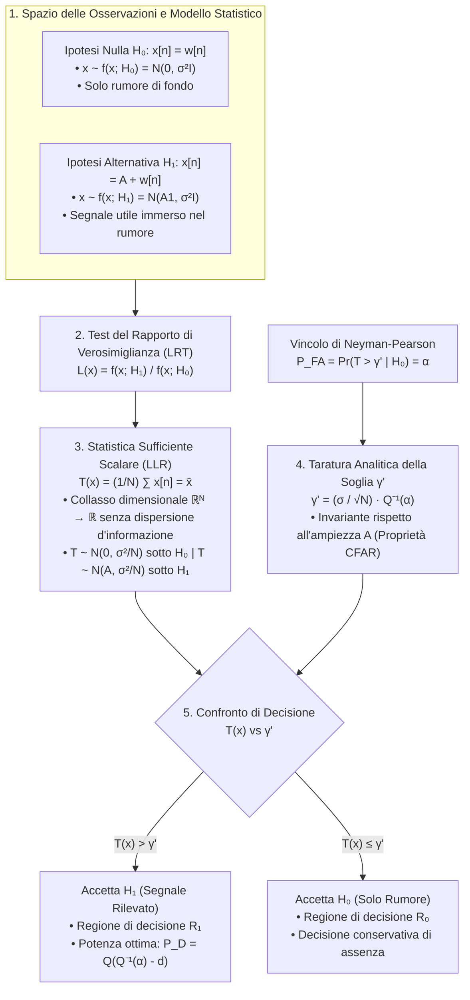

# 3. Teoria della Decisione e Criterio di Neyman-Pearson

Mentre nella teoria della stima abbiamo quantificato parametri continui incogniti appartenenti a uno spazio continuo $\Theta \subseteq \mathbb{R}^P$, la __Teoria della Rilevazione__ (o _Teoria della Decisione Statistica_) risolve il problema duale discreto: a partire da un vettore di osservazioni sperimentali corrotte da disturbo casuale, dobbiamo stabilire quale tra un numero finito o numerabile di configurazioni alternative (__ipotesi__) abbia generato i dati.

Negli scenari reali dell'ingegneria dell'informazione, la decisione è irreversibile e governa sistemi critici:
- Nei sistemi __Radar e Sonar__: decidiamo se l'eco ricevuto contenga un bersaglio riflettente immerso nel disturbo oppure sia composto unicamente da rumore termico e riflessioni del terreno (_clutter_).
- Nelle __Telecomunicazioni Digitali__: discriminiamo quale simbolo di costellazione (es. bit `0` o bit `1`, simboli QAM) sia stato trasmesso lungo un canale rumoroso e dispersivo.
- Nell'__Elaborazione Biomedica delle Immagini__: stabiliamo la presenza di microcalcificazioni tumorali o patologie cellulari rispetto al tessuto biologico sano.
- Nella __Sismologia e Monitoraggio Strutturale__: distinguiamo l'innesco di una faglia sismica o una microfrattura meccanica dal rumore antropico di fondo.

## Fondamenti della Rilevazione e Decisione Statistica

### Spazio delle Osservazioni e Regola Decisionale

Un __rilevatore__ (o _decision rule_) è un'applicazione deterministica che mappa il vettore delle $N$ osservazioni campionarie $\mathbf{x} = [x[0], x[1], \dots, x[N-1]]^T \in \mathcal{X} \subseteq \mathbb{R}^N$ in una decisione discreta $\hat{H}$ scelta all'interno dell'insieme delle ipotesi ammissibili.

Nel caso cardinale della __verifica di ipotesi binaria__ (_Binary Hypothesis Testing_), mettiamo a confronto due sole configurazioni d'interesse:
- L'__ipotesi nulla__ $H_0$: associata per convenzione all'assenza del segnale d'interesse (scenario di solo rumore).
- L'__ipotesi alternativa__ $H_1$: associata alla presenza del segnale d'interesse sovrapposto al disturbo.

Il comportamento statistico del vettore acquisito $\mathbf{x}$ sotto ciascuna ipotesi è governato da due distinte funzioni di densità di probabilità (PDF) congiunte:

$$
\mathbf{x} \sim f_{\mathbf{x}}(\mathbf{x}; H_0) \quad \text{sotto } H_0
$$

$$
\mathbf{x} \sim f_{\mathbf{x}}(\mathbf{x}; H_1) \quad \text{sotto } H_1
$$

Progettare il rilevatore equivale a partizionare lo spazio campionario multidimensionale $\mathcal{X}$ in due regioni congiuntamente esaustive e mutuamente esclusive:
- La __regione di decisione__ $\mathcal{R}_0$: se $\mathbf{x} \in \mathcal{R}_0$, decidiamo a favore dell'ipotesi nulla ($\hat{H} = H_0$).
- La __regione di decisione__ $\mathcal{R}_1$: se $\mathbf{x} \in \mathcal{R}_1$, decidiamo a favore dell'ipotesi alternativa ($\hat{H} = H_1$), con $\mathcal{R}_0 \cap \mathcal{R}_1 = \emptyset$ e $\mathcal{R}_0 \cup \mathcal{R}_1 = \mathcal{X}$.

![[slide_22_binary_hypothesis_regions.png|center mid]]

Nella pratica ingegneristica, non gestiamo direttamente partizioni geometriche complesse in $\mathbb{R}^N$: sintetizziamo l'intero vettore dei dati attraverso il calcolo di una __statistica di test scalare__ $T(\mathbf{x}): \mathbb{R}^N \to \mathbb{R}$, confrontando il valore estratto con una __soglia decisionale__ $\gamma$:

$$
T(\mathbf{x}) \underset{H_0}{\overset{H_1}{\gtrless}} \gamma
$$

Se la statistica scalare supera la soglia ($T(\mathbf{x}) > \gamma$), assegniamo l'osservazione alla regione $\mathcal{R}_1$ e dichiariamo la presenza del segnale; in caso contrario ($T(\mathbf{x}) \le \gamma$), rimaniamo nella regione $\mathcal{R}_0$ decidendo per la sua assenza.

### Tassonomia dei Problemi di Decisione Statistica

La struttura ottimale del test dipende dalle caratteristiche fisiche e statistiche del modello, categorizzate secondo quattro assi indipendenti:

1. __Molteplicità delle Ipotesi (Binarie vs Multiple)__:
   - _Binarie ($M = 2$)_: confronto tra due soli stati mutualmente esclusivi ($H_0$ contro $H_1$).
   - _Multiple ($M > 2$)_: scelta discreta tra $M$ scenari alternativi (es. simboli in una modulazione 16-QAM o classificazione di bersagli eterogenei).
2. __Forma Funzionale delle Densità (Parametriche vs Non Parametriche)__:
   - _Parametriche_: le densità $f_{\mathbf{x}}(\mathbf{x}; H_0)$ e $f_{\mathbf{x}}(\mathbf{x}; H_1)$ appartengono alla medesima famiglia analitica (es. entrambe Gaussiane) e divergono unicamente per il valore di uno o più parametri (es. media traslata da zero ad $A$).
   - _Non Parametriche_: le distribuzioni differiscono nella loro natura funzionale intrinseca (es. rumore Gaussiano sotto $H_0$ contro disturbo Laplaciano impulsivo sotto $H_1$).
3. __Completezza del Modello (Semplici vs Composte)__:
   - _Semplici_: le PDF sotto entrambe le ipotesi sono determinate univocamente in ogni loro parametro (es. ampiezza del segnale nota e potenza del rumore nota).
   - _Composte_: almeno una delle due densità dipende da parametri incogniti o di disturbo (es. ampiezza $A > 0$ sconosciuta, fase casuale o varianza del rumore non specificata).
4. __Paradigma Informativo (Deterministico vs Bayesiano)__:
   - _Deterministico (Classico)_: non disponiamo di probabilità a priori sul verificarsi di $H_0$ o $H_1$ (non ha senso fisico assegnare una probabilità a priori alla presenza di un velivolo nemico). Ottimizziamo probabilità d'errore condizionate.
   - _Bayesiano_: conosciamo a priori le probabilità di accadimento $\text{Pr}\{H_0\}$ e $\text{Pr}\{H_1\} = 1 - \text{Pr}\{H_0\}$ (es. bit equiprobabili trasmessi su canale binario simmetrico), consentendo la minimizzazione della probabilità d'errore totale o del rischio medio di Bayes.

## Verifica di Ipotesi Binaria e Metriche d'Errore

### Matrice delle Decisioni e Definizione degli Errori

Nel problema binario, l'incrocio tra la realtà fisica sottostante e la decisione espressa dal nostro algoritmo produce quattro esiti distinti, schematizzati nella matrice di confusione:

| Stato Reale del Sistema | Decisione $\hat{H}_0$ (Assenza) | Decisione $\hat{H}_1$ (Presenza) |
| :--- | :--- | :--- |
| __$H_0$ Reale (Solo Rumore)__ | Decisione Corretta di Assenza ($1 - P_{\text{FA}}$) | __Falso Allarme__ ($P_{\text{FA}}$, Errore di Tipo I) |
| __$H_1$ Reale (Presenza Segnale)__ | __Mancata Rilevazione__ ($P_{\text{M}}$, Errore di Tipo II) | __Rilevazione Corretta__ ($P_{\text{D}}$, Potenza del Test) |

![[slide_23_binary_hypothesis_testing_errors.png|center mid]]

Due combinazioni corrispondono a esiti corretti, mentre le restanti due rappresentano errori statistici con ripercussioni operative profondamente disomogenee.

### Formulazione Analitica delle Probabilità Operative

Quantifichiamo le prestazioni del rilevatore integrando le PDF congiunte sulle rispettive regioni di decisione $\mathcal{R}_0$ ed $\mathcal{R}_1$:

1. __Probabilità di Falso Allarme__ ($P_{\text{FA}}$, _Type I Error_):
   Probabilità di decidere per la presenza del segnale ($\hat{H} = H_1$) quando i campioni contengono unicamente rumore ($H_0$):

   $$
   P_{\text{FA}} = \text{Pr}\{\hat{H}_1 \mid H_0\} = \text{Pr}\{\mathbf{x} \in \mathcal{R}_1 \mid H_0\} = \int_{\mathcal{R}_1} f_{\mathbf{x}}(\mathbf{x}; H_0) \mathrm{d}\mathbf{x}
   $$

2. __Probabilità di Mancata Rilevazione__ ($P_{\text{M}}$, _Miss Detection_, _Type II Error_):
   Probabilità di dichiarare assente il segnale ($\hat{H} = H_0$) quando esso è effettivamente presente nei dati ($H_1$):

   $$
   P_{\text{M}} = \text{Pr}\{\hat{H}_0 \mid H_1\} = \text{Pr}\{\mathbf{x} \in \mathcal{R}_0 \mid H_1\} = \int_{\mathcal{R}_0} f_{\mathbf{x}}(\mathbf{x}; H_1) \mathrm{d}\mathbf{x}
   $$

3. __Probabilità di Rilevazione__ ($P_{\text{D}}$, _Probability of Detection_, _Power of the Test_):
   Probabilità di decidere correttamente a favore di $H_1$ quando il segnale è presente:

   $$
   P_{\text{D}} = \text{Pr}\{\hat{H}_1 \mid H_1\} = \int_{\mathcal{R}_1} f_{\mathbf{x}}(\mathbf{x}; H_1) \mathrm{d}\mathbf{x} = 1 - P_{\text{M}}
   $$

L'identità di conservazione $P_{\text{D}} + P_{\text{M}} = 1$ deriva dal fatto che $\mathcal{R}_0$ ed $\mathcal{R}_1$ partizionano l'intero spazio dei campioni $\mathcal{X}$: sotto l'ipotesi $H_1$, il ricevitore deve necessariamente cadere in $\mathcal{R}_1$ oppure in $\mathcal{R}_0$.

### Compromesso Geometrico della Soglia Decisionale

Per comprendere l'interazione tra le metriche di prestazione, osserviamo cosa accade regolando la soglia di decisione $\gamma$ nello spazio campionario scalare, dove la regione di allarme coincide con la semiretta destra $\mathcal{R}_1 = \{x : x > \gamma\}$.

![[slide_24_threshold_tradeoff_curves.png|center mid]]

L'escursione della soglia $\gamma$ evidenzia un trade-off intrinseco e ineludibile:
- __Innalzamento della soglia__ ($\gamma \to +\infty$): restringiamo la regione $\mathcal{R}_1$. L'area di coda della PDF del rumore $f(x; H_0)$ si contrae, abbattendo il falso allarme ($P_{\text{FA}} \to 0$). Contestualmente, però, escludiamo gran parte della PDF del segnale $f(x; H_1)$, provocando il crollo della rilevazione ($P_{\text{D}} \to 0$) e la conseguente esplosione delle mancate rilevazioni ($P_{\text{M}} \to 1$).
- __Abbassamento della soglia__ ($\gamma \to -\infty$): espandiamo la regione $\mathcal{R}_1$ fino a inglobare l'intero supporto. Catturiamo la totalità del segnale utile ($P_{\text{D}} \to 1$), ma lasciamo passare indiscriminatamente le oscillazioni spurie del rumore, rendendo il falso allarme totale ($P_{\text{FA}} \to 1$).

> [!important] Impossibilità del Compromesso Perfetto a Risorse Finite
> Poiché le distribuzioni statistiche $f_{\mathbf{x}}(\mathbf{x}; H_0)$ ed $f_{\mathbf{x}}(\mathbf{x}; H_1)$ presentano un'area di sovrapposizione finita dovuta al rumore, __non è possibile minimizzare contemporaneamente $P_{\text{FA}}$ e $P_{\text{M}}$ agendo unicamente sulla soglia decisionale $\gamma$__.
> L'unico modo per abbattere simultaneamente entrambi i tassi d'errore consiste nell'aumentare la separabilità fisica delle distribuzioni: incrementare il rapporto segnale-rumore (SNR) oppure estendere la finestra di osservazione temporale $N$.

## Il Criterio Ottimale di Neyman-Pearson

Nel paradigma classico, l'assenza di probabilità a priori impedisce di definire una probabilità totale d'errore pesata. Inoltre, nella quasi totalità dei contesti applicativi, i due errori possiedono una gravità fortemente asimmetrica:
- Un falso allarme comporta un costo di reazione o verifica (un'intercettazione radar non necessaria, una biopsia di approfondimento).
- Una mancata rilevazione comporta un fallimento catastrofico e irreparabile (un missile balistico non intercettato, una neoplasia maligna non diagnosticata).

La logica ingegneristica impone quindi una separazione operativa: fissiamo un limite massimo accettabile sul falso allarme e, all'interno di questa barriera di sicurezza, massimizziamo la probabilità di rilevare il bersaglio.

![[slide_26_neyman_pearson_pd_pfa.png|center mid]]

### Vincolo Operativo e Formulazione del Problema Ottimo

Il __criterio di Neyman-Pearson__ traduce questo principio in un problema matematico di ottimizzazione vincolata:

$$
\max_{\mathcal{R}_1 \subseteq \mathcal{X}} P_{\text{D}} \quad \text{sotto il vincolo} \quad P_{\text{FA}} = \alpha
$$

La costante $\alpha \in (0, 1)$ rappresenta la taglia del test (_size of the test_ o _false alarm constraint_), tipicamente compresa tra $10^{-2}$ e $10^{-8}$ nei sistemi radar e nelle telecomunicazioni.

### Il Teorema Fondamentale di Neyman-Pearson e il Test del Rapporto di Verosimiglianza

Il __Teorema di Neyman-Pearson__ sancisce che la regola decisionale ottima che massimizza la potenza di rilevazione per qualsiasi vincolo prefissato $P_{\text{FA}} = \alpha$ è il __Likelihood Ratio Test__ (__LRT__, _Test del Rapporto di Verosimiglianza_):

$$
L(\mathbf{x}) = \frac{f_{\mathbf{x}}(\mathbf{x}; H_1)}{f_{\mathbf{x}}(\mathbf{x}; H_0)} \underset{H_0}{\overset{H_1}{\gtrless}} \gamma
$$

dove la soglia scalare $\gamma > 0$ è determinata univocamente risolvendo l'equazione integrale del vincolo:

$$
P_{\text{FA}} = \int_{\{\mathbf{x} : L(\mathbf{x}) > \gamma\}} f_{\mathbf{x}}(\mathbf{x}; H_0) \mathrm{d}\mathbf{x} = \alpha
$$

### Derivazione Variazionale tramite Moltiplicatore di Lagrange

Dimostriamo costruttivamente l'ottimalità dell'LRT impostando la lagrangiana del problema variazionale vincolato. Introduciamo il moltiplicatore scalare $\lambda$:

$$
F(\mathcal{R}_1) = P_{\text{D}} - \lambda (P_{\text{FA}} - \alpha)
$$

Esplicitiamo le probabilità operative tramite le rispettive definizioni integrali estese alla regione incognita $\mathcal{R}_1$:

$$
F(\mathcal{R}_1) = \int_{\mathcal{R}_1} f_{\mathbf{x}}(\mathbf{x}; H_1) \mathrm{d}\mathbf{x} - \lambda \left[ \int_{\mathcal{R}_1} f_{\mathbf{x}}(\mathbf{x}; H_0) \mathrm{d}\mathbf{x} - \alpha \right]
$$

Raggruppiamo i due integrali sotto un unico operatore di integrazione esteso a $\mathcal{R}_1$:

$$
F(\mathcal{R}_1) = \int_{\mathcal{R}_1} \left[ f_{\mathbf{x}}(\mathbf{x}; H_1) - \lambda f_{\mathbf{x}}(\mathbf{x}; H_0) \right] \mathrm{d}\mathbf{x} + \lambda \alpha
$$

Osserviamo che il termine $\lambda \alpha$ è una costante deterministica indipendente dalla geometria della regione $\mathcal{R}_1$. Per massimizzare il valore complessivo del funzionale $F(\mathcal{R}_1)$, dobbiamo esaminare il contributo puntuale dell'integrando per ciascun punto dello spazio dei campioni $\mathbf{x} \in \mathcal{X}$:
- Se in un punto $\mathbf{x}$ l'integrando è strettamente positivo, includere quel punto nella regione $\mathcal{R}_1$ apporta un incremento positivo al valore dell'integrale.
- Se in un punto $\mathbf{x}$ l'integrando è negativo, includerlo in $\mathcal{R}_1$ ridurrebbe il valore complessivo dell'integrale; dobbiamo quindi escluderlo assegnandolo a $\mathcal{R}_0$.

Di conseguenza, la regione di decisione ottima deve contenere tutti e soli i vettori $\mathbf{x}$ in cui l'integrando risulta strettamente positivo:

$$
f_{\mathbf{x}}(\mathbf{x}; H_1) - \lambda f_{\mathbf{x}}(\mathbf{x}; H_0) > 0
$$

Poiché la funzione di densità $f_{\mathbf{x}}(\mathbf{x}; H_0)$ è non negativa e strettamente positiva quasi ovunque, dividiamo ambo i membri per $f_{\mathbf{x}}(\mathbf{x}; H_0)$:

$$
\frac{f_{\mathbf{x}}(\mathbf{x}; H_1)}{f_{\mathbf{x}}(\mathbf{x}; H_0)} > \lambda
$$

Identificando il moltiplicatore lagrangiano con la soglia decisionale $\gamma = \lambda$, otteniamo esattamente la struttura del Likelihood Ratio Test:

$$
\mathcal{R}_1 = \left\{ \mathbf{x} \in \mathcal{X} : L(\mathbf{x}) = \frac{f_{\mathbf{x}}(\mathbf{x}; H_1)}{f_{\mathbf{x}}(\mathbf{x}; H_0)} > \gamma \right\}
$$

La dimostrazione universale basata sul Lemma di Neyman-Pearson e su funzioni indicatrici, che certifica come nessun test alternativo concorrente possa superare la potenza dell'LRT per una data taglia $\alpha$, è sviluppata in [[zz. Argomenti extra#Dimostrazione Rigorosa del Teorema Fondamentale di Neyman-Pearson|zz. Argomenti extra]].

## Rilevazione di un Livello DC in Rumore Bianco Gaussiano (AWGN)

### Formulazione del Modello di Segnale

Applichiamo la teoria di Neyman-Pearson al benchmark fondamentale del signal processing: rilevare la presenza di un livello continuo noto $A > 0$ immerso in rumore bianco Gaussiano a campioni indipendenti e identicamente distribuiti.

Il modello di verifica d'ipotesi per gli $N$ campioni acquisiti si formula come:

$$
H_0: x[n] = w[n], \quad n = 0, 1, \dots, N-1 \iff \mathbf{x} \sim \mathcal{N}(\mathbf{0}, \sigma_w^2 \mathbf{I}_N)
$$

$$
H_1: x[n] = A + w[n], \quad n = 0, 1, \dots, N-1 \iff \mathbf{x} \sim \mathcal{N}(A\mathbf{1}_N, \sigma_w^2 \mathbf{I}_N)
$$

dove $w[n] \sim \text{i.i.d. } \mathcal{N}(0, \sigma_w^2)$, $\mathbf{0} = [0, \dots, 0]^T$ e $\mathbf{1}_N = [1, \dots, 1]^T$.

### Calcolo Analitico del Rapporto di Verosimiglianza e Cancellazione dei Termini Quadratici

Esplicitiamo le due PDF multivariate Gaussiane nello spazio $N$-dimensionale:

$$
f_{\mathbf{x}}(\mathbf{x}; H_0) = \frac{1}{(2\pi \sigma_w^2)^{N/2}} \exp\left( -\frac{1}{2\sigma_w^2} \sum_{n=0}^{N-1} x^2[n] \right)
$$

$$
f_{\mathbf{x}}(\mathbf{x}; H_1) = \frac{1}{(2\pi \sigma_w^2)^{N/2}} \exp\left( -\frac{1}{2\sigma_w^2} \sum_{n=0}^{N-1} (x[n] - A)^2 \right)
$$

Costruiamo il rapporto di verosimiglianza $L(\mathbf{x})$:

$$
L(\mathbf{x}) = \frac{f_{\mathbf{x}}(\mathbf{x}; H_1)}{f_{\mathbf{x}}(\mathbf{x}; H_0)} = \frac{\exp\left( -\frac{1}{2\sigma_w^2} \sum_{n=0}^{N-1} (x[n] - A)^2 \right)}{\exp\left( -\frac{1}{2\sigma_w^2} \sum_{n=0}^{N-1} x^2[n] \right)} = \exp\left( -\frac{1}{2\sigma_w^2} \left[ \sum_{n=0}^{N-1} (x[n] - A)^2 - \sum_{n=0}^{N-1} x^2[n] \right] \right)
$$

Sviluppiamo il quadrato del binomio nell'esponente:

$$
\sum_{n=0}^{N-1} (x[n] - A)^2 = \sum_{n=0}^{N-1} \left( x^2[n] - 2 A x[n] + A^2 \right) = \sum_{n=0}^{N-1} x^2[n] - 2 A \sum_{n=0}^{N-1} x[n] + N A^2
$$

Sottraendo la sommatoria quadratica $\sum_{n=0}^{N-1} x^2[n]$, notiamo un passaggio algebrico cruciale:

$$
\sum_{n=0}^{N-1} (x[n] - A)^2 - \sum_{n=0}^{N-1} x^2[n] = -2 A \sum_{n=0}^{N-1} x[n] + N A^2
$$

Il termine di energia campionaria $\|\mathbf{x}\|^2 = \sum_{n=0}^{N-1} x^2[n]$ si cancella in modo esatto algebricamente. Poiché la varianza del rumore è identica sotto entrambe le ipotesi, la potenza grezza delle misure non apporta alcun potere discriminante: l'unica informazione utile risiede nella proiezione lineare dei dati.

Sostituendo l'espressione semplificata all'interno dell'esponenziale:

$$
L(\mathbf{x}) = \exp\left( -\frac{1}{2\sigma_w^2} \left[ -2 A \sum_{n=0}^{N-1} x[n] + N A^2 \right] \right) = \exp\left( \frac{A}{\sigma_w^2} \sum_{n=0}^{N-1} x[n] - \frac{N A^2}{2\sigma_w^2} \right)
$$

Imponiamo la regola di decisione del test di Neyman-Pearson:

$$
\exp\left( \frac{A}{\sigma_w^2} \sum_{n=0}^{N-1} x[n] - \frac{N A^2}{2\sigma_w^2} \right) \underset{H_0}{\overset{H_1}{\gtrless}} \gamma
$$

Poiché la funzione logaritmo naturale $\ln(\cdot)$ è strettamente crescente e monotona su $(0, +\infty)$, possiamo applicarla ad ambo i membri preservando rigorosamente il verso delle disuguaglianze decisionali:

$$
\frac{A}{\sigma_w^2} \sum_{n=0}^{N-1} x[n] - \frac{N A^2}{2\sigma_w^2} \underset{H_0}{\overset{H_1}{\gtrless}} \ln \gamma
$$

Isoliamo il blocco contenente le osservazioni campionarie portando a secondo membro la costante deterministica:

$$
\frac{A}{\sigma_w^2} \sum_{n=0}^{N-1} x[n] \underset{H_0}{\overset{H_1}{\gtrless}} \ln \gamma + \frac{N A^2}{2\sigma_w^2}
$$

Moltiplichiamo ambo i membri per lo scalare positivo $\frac{\sigma_w^2}{A}$ (operazione lecita poiché abbiamo assunto $A > 0$):

$$
\sum_{n=0}^{N-1} x[n] \underset{H_0}{\overset{H_1}{\gtrless}} \frac{\sigma_w^2}{A} \ln \gamma + \frac{N A}{2}
$$

Dividendo infine per la dimensione del campione $N$:

$$
\frac{1}{N} \sum_{n=0}^{N-1} x[n] \underset{H_0}{\overset{H_1}{\gtrless}} \frac{\sigma_w^2}{N A} \ln \gamma + \frac{A}{2}
$$

### La Media Campionaria come Statistica Sufficiente

La manipolazione algebrica ha ridotto il test vettoriale $N$-dimensionale a un confronto elementare su una statistica scalare. Definiamo la __statistica di test__ $T(\mathbf{x})$ e la __soglia modificata__ $\gamma'$:

$$
T(\mathbf{x}) = \frac{1}{N} \sum_{n=0}^{N-1} x[n] = \bar{x}
$$

$$
\gamma' = \frac{\sigma_w^2}{N A} \ln \gamma + \frac{A}{2}
$$

La regola decisionale operativa assume la forma snella:

$$
T(\mathbf{x}) = \bar{x} \underset{H_0}{\overset{H_1}{\gtrless}} \gamma'
$$

> [!tip] Riduzione dei Dati e Statistica Sufficiente
> Il Likelihood Ratio Test collassa sull'integrazione coerente dei campioni: la __media campionaria__ $\bar{x}$ funge da __statistica sufficiente__ per la decisione binaria.
> Tutta l'informazione statistica utile contenuta nel vettore $\mathbf{x} \in \mathbb{R}^N$ è condensata nello scalare $\bar{x} \in \mathbb{R}$ senza alcuna dispersione di potenza discriminante.

### Distribuzioni Statistiche Esatte sotto le Due Ipotesi

Poiché i campioni $x[n]$ sono variabili aleatorie congiuntamente Gaussiane e statisticamente indipendenti, qualsiasi loro combinazione lineare è ancora rigorosamente Gaussiana.

Calcoliamo media e varianza della statistica di test sotto le due ipotesi:
- Sotto $H_0$: $\mathbb{E}[x[n]] = 0$, dunque $\mathbb{E}[T \mid H_0] = 0$.
- Sotto $H_1$: $\mathbb{E}[x[n]] = A$, dunque $\mathbb{E}[T \mid H_1] = A$.
- La varianza è identica sotto entrambe le configurazioni:

  $$
  \text{Var}\{T\} = \text{Var}\left\{ \frac{1}{N} \sum_{n=0}^{N-1} x[n] \right\} = \frac{1}{N^2} \sum_{n=0}^{N-1} \text{Var}\{x[n]\} = \frac{N \sigma_w^2}{N^2} = \frac{\sigma_w^2}{N}
  $$

Le densità di probabilità univariate della statistica di test risultano quindi:

$$
T \sim \mathcal{N}\left( 0, \frac{\sigma_w^2}{N} \right) \quad \text{sotto } H_0
$$

$$
T \sim \mathcal{N}\left( A, \frac{\sigma_w^2}{N} \right) \quad \text{sotto } H_1
$$

Definendo la deviazione standard della media campionaria come $\sigma_T = \sqrt{\frac{\sigma_w^2}{N}} = \frac{\sigma_w}{\sqrt{N}}$, possiamo visualizzare l'interazione geometrica tra le densità, la soglia decisionale $\gamma'$ e le aree d'errore.

![[neyman_pearson_test_distributions.svg|center mid]]

La figura evidenzia come la regione $\mathcal{R}_1 = \{T > \gamma'\}$ tagli contemporaneamente la coda destra di $f(T; H_0)$ (originando il falso allarme $P_{\text{FA}}$) e la massa principale di $f(T; H_1)$ (definendo la potenza di rilevazione $P_{\text{D}}$).

### Inversione Analitica della Soglia e Calcolo di Falso Allarme e Rilevazione

Per quantificare le probabilità d'errore, standardizziamo le distribuzioni Gaussiane riconducendoci alla __funzione Q__ (la cui derivazione analitica e proprietà sono approfondite in [[zz. Argomenti extra#Derivazione Analitica della Funzione Q e Proprietà per il Calcolo delle Probabilità d'Errore|zz. Argomenti extra]]):

$$
Q(z) = \frac{1}{\sqrt{2\pi}} \int_z^{+\infty} \exp\left( -\frac{u^2}{2} \right) \mathrm{d}u
$$

Calcoliamo innanzitutto la probabilità di falso allarme condizionata all'ipotesi nulla $H_0$:

$$
P_{\text{FA}} = \text{Pr}\{T > \gamma' \mid H_0\} = \text{Pr}\left\{ \frac{T - 0}{\sigma_T} > \frac{\gamma' - 0}{\sigma_T} \;\middle|\; H_0 \right\} = Q\left( \frac{\gamma'}{\sqrt{\sigma_w^2 / N}} \right)
$$

Poiché nel criterio di Neyman-Pearson imponiamo il vincolo $P_{\text{FA}} = \alpha$, invertiamo analiticamente la relazione sfruttando la funzione inversa $Q^{-1}$:

$$
Q^{-1}(P_{\text{FA}}) = \frac{\gamma'}{\sqrt{\sigma_w^2 / N}}
$$

Isolando la soglia decisionale modificata:

$$
\gamma' = \sqrt{\frac{\sigma_w^2}{N}} Q^{-1}(P_{\text{FA}})
$$

> [!important] Proprietà CFAR (Constant False Alarm Rate)
> Notiamo che la soglia $\gamma'$ dipende __esclusivamente__ dalla varianza del disturbo $\sigma_w^2$, dal numero di campioni $N$ e dal tasso di falso allarme imposto $P_{\text{FA}}$, mentre è __completamente indipendente dall'ampiezza del segnale utile $A$__.
> Possiamo pertanto tarare il ricevitore per garantire la taglia d'allarme prefissata anche qualora l'ampiezza del bersaglio non sia nota a priori.

Calcoliamo ora la probabilità di rilevazione corretta $P_{\text{D}}$ sotto l'ipotesi alternativa $H_1$, dove la variabile $T$ possiede valore atteso $A$:

$$
P_{\text{D}} = \text{Pr}\{T > \gamma' \mid H_1\} = \text{Pr}\left\{ \frac{T - A}{\sigma_T} > \frac{\gamma' - A}{\sigma_T} \;\middle|\; H_1 \right\} = Q\left( \frac{\gamma' - A}{\sqrt{\sigma_w^2 / N}} \right)
$$

Sostituiamo nella formula l'espressione analitica di $\gamma'$ appena ottenuta dal vincolo di falso allarme:

$$
P_{\text{D}} = Q\left( \frac{\sqrt{\frac{\sigma_w^2}{N}} Q^{-1}(P_{\text{FA}}) - A}{\sqrt{\frac{\sigma_w^2}{N}}} \right) = Q\left( Q^{-1}(P_{\text{FA}}) - \frac{A}{\sqrt{\sigma_w^2 / N}} \right)
$$

Portando il fattore $N$ all'interno del radicando al numeratore:

$$
P_{\text{D}} = Q\left( Q^{-1}(P_{\text{FA}}) - \sqrt{\frac{N A^2}{\sigma_w^2}} \right)
$$

## Prestazioni del Ricevitore e Guadagno di Integrazione Coerente

### Il Coefficiente di Deflessione come SNR di Rilevazione

L'argomento della funzione $Q$ nella formula di $P_{\text{D}}$ contiene una quantità adimensionale fondamentale, denominata __coefficiente di deflessione__ (_deflection coefficient_) $d^2$:

$$
d^2 = \frac{(\mathbb{E}[T \mid H_1] - \mathbb{E}[T \mid H_0])^2}{\text{Var}\{T \mid H_0\}} = \frac{(A - 0)^2}{\sigma_w^2 / N} = \frac{N A^2}{\sigma_w^2}
$$

Estraendo la radice quadrata, definiamo la deflessione normalizzata $d$:

$$
d = \sqrt{d^2} = \frac{A}{\sigma_w / \sqrt{N}} = \sqrt{N} \frac{A}{\sigma_w}
$$

Geometricamente, $d$ misura la distanza euclidea tra i valori medi delle due distribuzioni standardizzata rispetto alla dispersione del rumore. La probabilità di rilevazione ottima si esprime in funzione di $d$:

$$
P_{\text{D}} = Q\left( Q^{-1}(P_{\text{FA}}) - d \right)
$$

Poiché $d > 0$, l'argomento $Q^{-1}(P_{\text{FA}}) - d$ è strettamente inferiore a $Q^{-1}(P_{\text{FA}})$. Ricordando che la funzione $Q(z)$ è strettamente decrescente rispetto al suo argomento, ne consegue matematicamente che:

$$
P_{\text{D}} = Q(Q^{-1}(P_{\text{FA}}) - d) > Q(Q^{-1}(P_{\text{FA}})) = P_{\text{FA}}
$$

Il rilevatore opera quindi sempre in condizioni di superiorità rispetto al lancio di una moneta casuale.

### Analisi delle Curve di Prestazione e Comportamento Asintotico

Esprimendo il coefficiente di deflessione in termini di Rapporto Segnale-Rumore (SNR) su scala logaritmica decibel, $\text{SNR}_{\text{dB}} = 10 \log_{10} \left( \frac{N A^2}{\sigma_w^2} \right)$, tracciamo le curve di $P_{\text{D}}$ in funzione dell'SNR al variare del parametro $P_{\text{FA}}$.

![[slide_32_pd_vs_snr_curves.png|center mid]]

Dall'analisi delle curve emergono tre cardini operativi:

1. __Comportamento Asintotico ad Alto SNR__:
   Quando la potenza del segnale o la dimensione campionaria crescono ($N A^2 / \sigma_w^2 \to +\infty$), la deflessione diverge ($d \to +\infty$). L'argomento della funzione $Q$ tende a $-\infty$, per cui:

   $$
   \lim_{d \to +\infty} P_{\text{D}} = Q(-\infty) = 1 \quad \forall P_{\text{FA}} > 0
   $$

   La rilevazione converge all'affidabilità assoluta per qualsiasi vincolo di falso allarme imposto.

2. __Penalizzazione per Vincoli Stringenti di Falso Allarme__:
   Se imponiamo un vincolo di falso allarme molto restrittivo (es. passando da $P_{\text{FA}} = 10^{-1}$ a $P_{\text{FA}} = 10^{-7}$), la soglia $Q^{-1}(P_{\text{FA}})$ si innalza sensibilmente. Di conseguenza, la curva di prestazione slitta rigidamente verso destra: per preservare la medesima probabilità di rilevazione (ad esempio $P_{\text{D}} = 0.9$), il sistema richiede un surplus di potenza di circa $10\text{–}12\text{ dB}$.

3. __Guadagno di Integrazione Coerente__:
   La deflessione $d^2$ è linearmente proporzionale al numero di campioni $N$:

   $$
   d^2 = N \cdot \text{SNR}_{\text{singolo campione}} = N \cdot \frac{A^2}{\sigma_w^2}
   $$

   Ogni raddoppio della finestra di osservazione temporale ($N \to 2N$) raddoppia l'energia statistica accumulata, conferendo un __guadagno di processamento coerente di $+3\text{ dB}$__. Raccogliere campioni nel tempo equivale a potenziare proporzionalmente la potenza del trasmettitore.

### Quadro Sinottico Operativo e Trabocchetti d'Esame

Sintetizziamo i risultati analitici fondamentali ricavati nel capitolo:

| Grandezza Operativa | Simbolo | Espressione Analitica per Livello DC in AWGN |
| :--- | :--- | :--- |
| __Statistica di Test__ | $T(\mathbf{x})$ | $\bar{x} = \frac{1}{N} \sum_{n=0}^{N-1} x[n]$ (Media Campionaria) |
| __Distribuzione sotto $H_0$__ | $f(T; H_0)$ | $\mathcal{N}\left(0, \frac{\sigma_w^2}{N}\right)$ |
| __Distribuzione sotto $H_1$__ | $f(T; H_1)$ | $\mathcal{N}\left(A, \frac{\sigma_w^2}{N}\right)$ |
| __Soglia Decisionale Ottima__ | $\gamma'$ | $\sqrt{\frac{\sigma_w^2}{N}} Q^{-1}(P_{\text{FA}})$ |
| __Probabilità di Falso Allarme__ | $P_{\text{FA}}$ | $Q\left( \frac{\gamma'}{\sqrt{\sigma_w^2 / N}} \right)$ |
| __Probabilità di Rilevazione__ | $P_{\text{D}}$ | $Q\left( Q^{-1}(P_{\text{FA}}) - \sqrt{\frac{N A^2}{\sigma_w^2}} \right) = Q(Q^{-1}(P_{\text{FA}}) - d)$ |
| __Coefficiente di Deflessione__ | $d^2$ | $\frac{N A^2}{\sigma_w^2} = N \cdot \text{SNR}_{\text{singolo}}$ |

> [!warning] Trabocchetti Concettuali Tipici in Sede d'Esame
> 1. __Confusione tra le Soglie $\gamma$ e $\gamma'$__: La soglia astratta $\gamma$ si applica al rapporto di verosimiglianza $L(\mathbf{x}) \gtrless \gamma$, mentre la soglia operativa $\gamma'$ si applica alla statistica scalare $\bar{x} \gtrless \gamma'$. Confondere le due espressioni compromette il calcolo numerico delle probabilità d'errore.
> 2. __Segno dell'Argomento della Funzione Q__: Nella formula $P_{\text{D}} = Q(Q^{-1}(P_{\text{FA}}) - d)$, il segno meno davanti a $d$ è obbligatorio. Poiché $Q(z)$ è decrescente, sottrarre $d > 0$ fa salire il valore della funzione garantendo $P_{\text{D}} > P_{\text{FA}}$.
> 3. __Fattore $\sqrt{N}$ nella Deflessione__: All'esame è comune dimenticare che la media campionaria abbatte la varianza a $\sigma^2 / N$: la deviazione standard a denominatore è $\sigma / \sqrt{N}$, il che fa risalire $\sqrt{N}$ al numeratore moltiplicando $A$.
> 4. __Indipendenza di $\gamma'$ da $A$__: Ricorda che per determinare la soglia del test di Neyman-Pearson non serve conoscere l'ampiezza del segnale $A$: la soglia dipende unicamente da $\sigma_w$, $N$ e $P_{\text{FA}}$.
