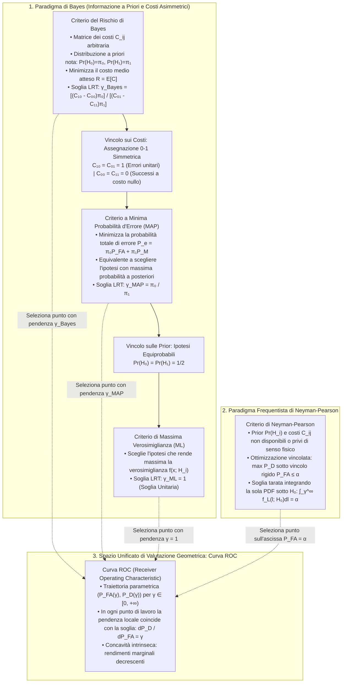

# 4. Prestazioni Del Ricevitore E Rilevatori Bayesiani

Il test del rapporto di verosimiglianza con vincolo frequenziale di Neyman-Pearson a falso allarme costante $P_{\text{FA}} = \alpha$ fissa una singola soglia operativa contingente. Negli scenari reali dell'ingegneria dei sistemi di rilevazione, tuttavia, emerge l'esigenza di mappare le prestazioni globali del ricevitore al variare continuo del punto di lavoro lungo l'intero intervallo di soglie ammissibili.

Quando inoltre conosciamo la probabilità con cui la natura estrae le ipotesi o possiamo quantificare le penalità economiche e operative associate a ciascun tipo di errore, l'approccio frequentista cede il passo al paradigma bayesiano. In questa cornice formuliamo i criteri a __minima probabilità d'errore__ e del __rischio di Bayes__.

## Curva ROC (Receiver Operating Characteristic)

La curva ROC è la traiettoria bidimensionale parametrica che traccia la probabilità di corretta rilevazione $P_{\text{D}}$ sull'asse delle ordinate in funzione della probabilità di falso allarme $P_{\text{FA}}$ sull'asse delle ascisse, al variare della soglia decisionale $\gamma \in [0, +\infty)$:

$$
\text{ROC} = \left\{ \big(P_{\text{FA}}(\gamma),\, P_{\text{D}}(\gamma)\big) \in [0, 1]^2 \;\Big|\; \gamma \in [0, +\infty) \right\}
$$

Questa curva isola l'efficacia discriminante intrinseca del test statistico dalle scelte operative di soglia. Nel quadrato unitario $[0, 1] \times [0, 1]$ osserviamo tre regimi fondamentali:
- Quando la soglia tende a infinito ($\gamma \to +\infty$), la regione di decisione favorevole ad $H_1$ si contrae all'insieme vuoto ($R_1 = \emptyset$). Il rilevatore non dichiara mai la presenza del segnale, ottenendo $P_{\text{D}} = 0$ e $P_{\text{FA}} = 0$, corrispondente all'origine $(0, 0)$. In questo punto la retta tangente alla curva è verticale.
- Quando la soglia degenera verso zero ($\gamma \to 0$), la regione $R_1$ si estende all'intero spazio campionario ($R_1 = \mathbb{R}^N$). Il sistema decide sempre $H_1$, ottenendo $P_{\text{D}} = 1$ e $P_{\text{FA}} = 1$, corrispondente all'estremo superiore destro $(1, 1)$. In questo punto la retta tangente alla curva è orizzontale.
- Per valori intermedi $\gamma \in (0, +\infty)$, la curva unisce con continuità e regolarità l'origine $(0, 0)$ con il vertice $(1, 1)$.

![[slide_35_roc_properties_curve.png|center mid]]

L'analisi geometrica e analitica della curva ROC rivela le proprietà strutturali che governano qualsiasi ricevitore ottimale basato sul rapporto di verosimiglianza.

![[roc_geometry_tangent_curvature.svg|center mid]]

## Proprietà Analitiche E Geometriche Fondamentali

Le curve operative del ricevitore originate da un test del rapporto di verosimiglianza (LRT) soddisfano precise proprietà matematiche.

### Monotonia Non Decrescente

La probabilità di rilevazione $P_{\text{D}}$ è una funzione debolmente crescente di $P_{\text{FA}}$.

Se abbassiamo la soglia da $\gamma_1$ a un valore più permissivo $\gamma_2 < \gamma_1$, la regione critica si amplia per inclusione insiemistica:

$$
R_1(\gamma_1) = \{\mathbf{x} : L(\mathbf{x}) > \gamma_1\} \subset \{\mathbf{x} : L(\mathbf{x}) > \gamma_2\} = R_1(\gamma_2)
$$

Integrando le densità non negative $f(\mathbf{x}; H_1)$ e $f(\mathbf{x}; H_0)$ su un dominio più esteso, entrambe le grandezze aumentano simultaneamente: all'aumentare di $P_{\text{FA}}$ corrisponde sempre un aumento di $P_{\text{D}}$.

### Diagonale Di Casualità E Sub-Casualità

La retta bisettrice $P_{\text{D}} = P_{\text{FA}}$ descrive le prestazioni del rilevatore puramente casuale ("test della moneta truccata").

Un sistema che ignora completamente i dati osservati $\mathbf{x}$ e decide $H_1$ estraendo una variabile di Bernoulli con probabilità costante $p \in [0, 1]$ ottiene:

$$
P_{\text{D}} = \text{Pr}\{\text{decidere } H_1 \mid H_1\} = p, \qquad P_{\text{FA}} = \text{Pr}\{\text{decidere } H_1 \mid H_0\} = p \implies P_{\text{D}} = P_{\text{FA}}
$$

Se un rilevatore reale si posiziona al di sotto della diagonale ($P_{\text{D}} < P_{\text{FA}}$), le sue prestazioni sono peggiori del caso. Invertendo sistematicamente la regola decisionale ($\hat{H}' = 1 - \hat{H}$), il punto di lavoro viene riflesso rispetto al baricentro $(1/2, 1/2)$:

$$
P_{\text{D}}' = \text{Pr}\{\hat{H}' = 1 \mid H_1\} = \text{Pr}\{\hat{H} = 0 \mid H_1\} = 1 - P_{\text{D}}
$$

$$
P_{\text{FA}}' = \text{Pr}\{\hat{H}' = 1 \mid H_0\} = \text{Pr}\{\hat{H} = 0 \mid H_0\} = 1 - P_{\text{FA}}
$$

Poiché per ipotesi $P_{\text{D}} < P_{\text{FA}}$, moltiplicando per $-1$ e sommando $1$ ad ambo i membri si ottiene:

$$
P_{\text{D}}' = 1 - P_{\text{D}} > 1 - P_{\text{FA}} = P_{\text{FA}}'
$$

Il nuovo punto di lavoro $(P_{\text{FA}}', P_{\text{D}}') = (1 - P_{\text{FA}}, 1 - P_{\text{D}})$ rappresenta la riflessione centrale del punto originario rispetto al baricentro $(1/2, 1/2)$ e si colloca rigorosamente al di sopra della diagonale di casualità.

### Frontiera Di Pareto E Ottimalità Di Neyman-Pearson

In virtù del Lemma di Neyman-Pearson, fissato un qualsiasi livello di falso allarme $P_{\text{FA}} = \alpha$, il test LRT garantisce la massima probabilità di rilevazione $P_{\text{D}}$ rispetto a qualunque altro test ammissibile.

La curva ROC dell'LRT costituisce la frontiera di Pareto superiore dell'intero spazio delle decisioni: nessun dispositivo fisico o algoritmo statistico può operare in un punto al di sopra di tale curva.

### Pendenza Locale Pari Alla Soglia Decisionale

In ogni punto regolare della curva ROC generata da un test LRT, la pendenza della retta tangente locale è esattamente uguale alla soglia decisionale $\gamma$:

$$
\frac{\mathrm{d}P_{\text{D}}}{\mathrm{d}P_{\text{FA}}} = \gamma
$$

Per dimostrare questa identità, esprimiamo le probabilità operative integrando le funzioni di densità di probabilità della statistica scalare $L(\mathbf{x})$, denotate con $f_L(l; H_1)$ e $f_L(l; H_0)$, sull'intervallo seminfinito $[\gamma, +\infty)$:

$$
P_{\text{D}}(\gamma) = \int_\gamma^{+\infty} f_L(l; H_1) \, \mathrm{d}l, \qquad P_{\text{FA}}(\gamma) = \int_\gamma^{+\infty} f_L(l; H_0) \, \mathrm{d}l
$$

Differenziamo i due integrali rispetto all'estremo inferiore variabile $\gamma$ applicando il teorema fondamentale del calcolo integrale:

$$
\frac{\mathrm{d}P_{\text{D}}}{\mathrm{d}\gamma} = -f_L(\gamma; H_1), \qquad \frac{\mathrm{d}P_{\text{FA}}}{\mathrm{d}\gamma} = -f_L(\gamma; H_0)
$$

Il segno negativo deriva dal fatto che incrementare la soglia restringe il dominio di integrazione verso destra.

Stabiliamo ora il legame analitico tra le due densità di probabilità. Per definizione, il rapporto di verosimiglianza assegna a ciascun vettore $\mathbf{x}$ il valore scalare $l = f(\mathbf{x}; H_1) / f(\mathbf{x}; H_0)$. Sulla varietà di livello $\mathcal{M}_l = \{\mathbf{x} : L(\mathbf{x}) = l\}$, la densità sotto $H_1$ è proporzionale a quella sotto $H_0$ mediante la costante $l$:

$$
f(\mathbf{x}; H_1) = l \, f(\mathbf{x}; H_0) \quad \forall \mathbf{x} \in \mathcal{M}_l
$$

Integrando questa relazione su tutto il sottoinsieme $\mathcal{M}_l$, otteniamo l'identità fondamentale tra le densità unidimensionali della statistica di test:

$$
f_L(l; H_1) = l \, f_L(l; H_0)
$$

Sostituendo questa identità nella derivata di $P_{\text{D}}$ calcolata in $\gamma$:

$$
\frac{\mathrm{d}P_{\text{D}}}{\mathrm{d}\gamma} = -\gamma \, f_L(\gamma; H_0)
$$

Calcoliamo ora la pendenza della curva ROC applicando la regola della catena differenziale:

$$
\frac{\mathrm{d}P_{\text{D}}}{\mathrm{d}P_{\text{FA}}} = \frac{\frac{\mathrm{d}P_{\text{D}}}{\mathrm{d}\gamma}}{\frac{\mathrm{d}P_{\text{FA}}}{\mathrm{d}\gamma}} = \frac{-\gamma \, f_L(\gamma; H_0)}{-f_L(\gamma; H_0)} = \gamma
$$

Il termine negativo della densità di rumore $-f_L(\gamma; H_0)$ si cancella identicamente tra numeratore e denominatore. Rimane unicamente il valore assunto dalla soglia $\gamma$.

L'equazione cartesiana della retta tangente alla curva ROC nel generico punto di lavoro $(P_{\text{FA}}(\gamma), P_{\text{D}}(\gamma))$ è:

$$
P_{\text{D}} - P_{\text{D}}(\gamma) = \gamma \left( P_{\text{FA}} - P_{\text{FA}}(\gamma) \right)
$$

Questo risultato giustifica il comportamento agli estremi: all'origine $(\gamma \to +\infty)$ la pendenza diverge determinando una tangente verticale, mentre al punto $(1, 1)$ $(\gamma \to 0)$ la pendenza si azzera producendo una tangente orizzontale.

La trattazione dettagliata con passaggi integrali estesi è consultabile in [[zz. Argomenti extra#Dimostrazione Analitica della Pendenza e Concavità della Curva ROC|Dimostrazione Analitica della Pendenza e Concavità della Curva ROC]].

### Concavità Verso Il Basso E Rendimenti Marginali Decrescenti

La curva ROC di qualsiasi test del rapporto di verosimiglianza è concava verso il basso:

$$
\frac{\mathrm{d}^2 P_{\text{D}}}{\mathrm{d}P_{\text{FA}}^2} \le 0
$$

Per verificare la concavità, calcoliamo la derivata seconda differenziando la pendenza prima $\frac{\mathrm{d}P_{\text{D}}}{\mathrm{d}P_{\text{FA}}} = \gamma$ rispetto a $P_{\text{FA}}$ mediante la regola della derivata della funzione inversa:

$$
\frac{\mathrm{d}^2 P_{\text{D}}}{\mathrm{d}P_{\text{FA}}^2} = \frac{\mathrm{d}}{\mathrm{d}P_{\text{FA}}}\left( \frac{\mathrm{d}P_{\text{D}}}{\mathrm{d}P_{\text{FA}}} \right) = \frac{\mathrm{d}\gamma}{\mathrm{d}P_{\text{FA}}} = \frac{1}{\frac{\mathrm{d}P_{\text{FA}}}{\mathrm{d}\gamma}} = \frac{1}{-f_L(\gamma; H_0)} = -\frac{1}{f_L(\gamma; H_0)}
$$

Poiché $f_L(\gamma; H_0)$ è una densità di probabilità, essa assume valori strettamente non negativi ($f_L \ge 0$). Il suo reciproco preceduto dal segno meno impone una derivata seconda non positiva in ogni punto.

Dal punto di vista concettuale, la concavità esprime la legge dei __rendimenti marginali decrescenti__. Quando operiamo a basso falso allarme (regione sinistra della ROC, $\gamma \gg 1$), la pendenza elevata ci consente di ottenere cospicui incrementi di rilevazione $\mathrm{d}P_{\text{D}}$ pagando frazioni modeste di falso allarme $\mathrm{d}P_{\text{FA}}$.

Man mano che ci spostiamo verso destra riducendo la soglia $\gamma$, la pendenza si appiattisce: per guadagnare quote minime aggiuntive di $P_{\text{D}}$ siamo costretti a tollerare incrementi esponenzialmente più ampi di $P_{\text{FA}}$.

### Area Sotto la Curva (AUC)

L'integrale dell'area sottesa alla curva ROC (__AUC__, _Area Under the Curve_) sintetizza la capacità discriminante del ricevitore in un unico indice scalare:

$$
\text{AUC} = \int_0^1 P_{\text{D}}(P_{\text{FA}}) \, \mathrm{d}P_{\text{FA}} \in [0.5, \, 1.0]
$$

L'AUC ammette una diretta interpretazione probabilistica: corrisponde alla probabilità che la statistica di test calcolata su un'osservazione estratta casualmente sotto $H_1$ superi la statistica calcolata su un'osservazione indipendente estratta sotto $H_0$:

$$
\text{AUC} = \text{Pr}\left\{ L(\mathbf{x}_1) > L(\mathbf{x}_0) \right\}, \qquad \mathbf{x}_1 \sim f(\mathbf{x}; H_1), \quad \mathbf{x}_0 \sim f(\mathbf{x}; H_0)
$$

Per il test puramente casuale abbiamo $\text{AUC} = 0.5$ (area del triangolo inferiore), mentre per il rilevatore ideale senza sovrapposizione di rumore otteniamo $\text{AUC} = 1.0$.

## Curva ROC per Segnale DC in Rumore Bianco Gaussiano (AWGN)

Consideriamo il problema fondamentale di rilevazione di un livello costante $A > 0$ su $N$ campioni immersi in disturbo bianco gaussiano $w[n] \sim \mathcal{N}(0, \sigma_w^2)$:

$$
H_0: x[n] = w[n], \qquad H_1: x[n] = A + w[n], \qquad n = 0, \dots, N-1
$$

Come stabilito dall'analisi del test LRT, la statistica sufficiente scalare è la media campionaria:

$$
T(\mathbf{x}) = \bar{x} = \frac{1}{N} \sum_{n=0}^{N-1} x[n] \underset{H_0}{\overset{H_1}{\gtrless}} \gamma'
$$

La media campionaria possiede varianza ridotta $\sigma_w^2 / N$ e medie condizionate pari a $0$ sotto $H_0$ e ad $A$ sotto $H_1$. Le probabilità di falso allarme e di rilevazione assumono la forma:

$$
P_{\text{FA}} = Q\left( \frac{\gamma'}{\sigma_w / \sqrt{N}} \right), \qquad P_{\text{D}} = Q\left( \frac{\gamma' - A}{\sigma_w / \sqrt{N}} \right)
$$

Per ricavare la relazione cartesiana esplicita $P_{\text{D}} = g(P_{\text{FA}})$, invertiamo l'equazione di falso allarme isolando la soglia normalizzata tramite la funzione quantile inversa $Q^{-1}$:

$$
\frac{\gamma'}{\sigma_w / \sqrt{N}} = Q^{-1}(P_{\text{FA}}) \implies \gamma' = \frac{\sigma_w}{\sqrt{N}} Q^{-1}(P_{\text{FA}})
$$

Sostituendo questa espressione nella formula della probabilità di rilevazione:

$$
P_{\text{D}} = Q\left( \frac{\frac{\sigma_w}{\sqrt{N}} Q^{-1}(P_{\text{FA}}) - A}{\sigma_w / \sqrt{N}} \right) = Q\left( Q^{-1}(P_{\text{FA}}) - \frac{A \sqrt{N}}{\sigma_w} \right)
$$

Definiamo il __coefficiente di deflessione__ (_deflection coefficient_) $d$, che quantifica il rapporto segnale-rumore effettivo a valle dell'accumulazione coerente degli $N$ campioni:

$$
d = \frac{\mathbb{E}[T; H_1] - \mathbb{E}[T; H_0]}{\sqrt{\text{Var}(T; H_0)}} = \frac{A - 0}{\sigma_w / \sqrt{N}} = \frac{A \sqrt{N}}{\sigma_w} = \sqrt{\frac{N A^2}{\sigma_w^2}} = \sqrt{\text{SNR}}
$$

L'equazione analitica chiusa della curva ROC per segnali gaussiani traslati in media assume la forma canonica:

$$
P_{\text{D}} = Q\left( Q^{-1}(P_{\text{FA}}) - d \right)
$$

![[slide_36_roc_curves_deflection_d.png|center mid]]

Questa equazione evidenzia il ruolo discriminante del coefficiente di deflessione $d$:
- Per $d = 0$ (ampiezza nulla $A = 0$ o assenza di campioni $N = 0$), l'equazione collassa su $P_{\text{D}} = Q(Q^{-1}(P_{\text{FA}})) = P_{\text{FA}}$: la curva coincide con la diagonale di casualità.
- All'aumentare dell'energia del segnale o del numero di osservazioni $N$, $d$ cresce proporzionalmente a $\sqrt{N}$. La curva ROC viene inflessa verso l'angolo superiore sinistro $(0, 1)$, offrendo elevata potenza di rilevazione $P_{\text{D}} \approx 1$ con falsi allarmi trascurabili.
- Per $d \to +\infty$, l'argomento della funzione $Q$ tende a $-\infty$, per cui $P_{\text{D}} \to 1$ per qualunque $P_{\text{FA}} > 0$: il sistema tende al ricevitore perfetto.

## Criterio a Minima Probabilità d'Errore

Nel criterio di Neyman-Pearson consideriamo le ipotesi come stati deterministici del mondo fisico privi di descrizione probabilistica a priori.

Nel __paradigma bayesiano__ modelliamo invece l'accadimento delle ipotesi come eventi aleatori governati da una distribuzione di probabilità a priori nota:

$$
\text{Pr}\{H_0\} = \pi_0, \qquad \text{Pr}\{H_1\} = \pi_1 = 1 - \pi_0
$$

con $\pi_0, \pi_1 > 0$. Il nostro obiettivo consiste nel progettare il ricevitore che rende minima la probabilità complessiva di commettere un errore di classificazione.

Un errore si verifica in due situazioni disgiunte:
1. Dichiarare $H_1$ quando è vera $H_0$ (falso allarme, probabilità condizionata $P_{\text{FA}}$).
2. Dichiarare $H_0$ quando è vera $H_1$ (mancata rilevazione, probabilità condizionata $P_{\text{M}} = 1 - P_{\text{D}}$).

Applicando il teorema della probabilità totale, la __probabilità totale di errore__ $P_e$ è data dalla somma pesata:

$$
P_e = \pi_0 P_{\text{FA}} + \pi_1 P_{\text{M}} = \pi_0 P_{\text{FA}} + \pi_1 (1 - P_{\text{D}})
$$

Espandendo i prodotti raccogliamo i termini:

$$
P_e = \pi_1 + \pi_0 P_{\text{FA}} - \pi_1 P_{\text{D}}
$$

### Derivazione Della Regola MAP

La scelta del rilevatore si traduce nella partizione dello spazio campionario $\mathbb{R}^N$ nella regione di decisione critica $R_1$ (in cui decidiamo per $H_1$) e nella regione complementare $R_0 = \mathbb{R}^N \setminus R_1$.

Esprimiamo $P_{\text{FA}}$ e $P_{\text{D}}$ sotto forma di integrali definiti sulla regione $R_1$:

$$
P_{\text{FA}} = \int_{R_1} f(\mathbf{x}; H_0) \, \mathrm{d}\mathbf{x}, \qquad P_{\text{D}} = \int_{R_1} f(\mathbf{x}; H_1) \, \mathrm{d}\mathbf{x}
$$

Sostituendo queste rappresentazioni nell'espressione dell'errore totale:

$$
P_e = \pi_1 + \int_{R_1} \left[ \pi_0 f(\mathbf{x}; H_0) - \pi_1 f(\mathbf{x}; H_1) \right] \mathrm{d}\mathbf{x}
$$

La probabilità a priori $\pi_1$ rappresenta una quantità costante non negoziabile, determinata a priori dalla natura e non manipolabile dal nostro ricevitore.

Minimizzare $P_e$ equivale dunque a rendere il termine integrale il più negativo possibile. Per ottenere il valore minimo assoluto, dobbiamo includere nella regione di integrazione $R_1$ tutti e soli i vettori $\mathbf{x} \in \mathbb{R}^N$ per cui la funzione integranda assume valore strettamente negativo:

$$
\pi_0 f(\mathbf{x}; H_0) - \pi_1 f(\mathbf{x}; H_1) < 0
$$

Portando il secondo termine a destra della disuguaglianza:

$$
\pi_1 f(\mathbf{x}; H_1) > \pi_0 f(\mathbf{x}; H_0)
$$

Poiché per ipotesi $\pi_1 > 0$ e la densità $f(\mathbf{x}; H_0) > 0$, dividiamo ambo i membri isolando il rapporto di verosimiglianza:

$$
\frac{f(\mathbf{x}; H_1)}{f(\mathbf{x}; H_0)} > \frac{\pi_0}{\pi_1}
$$

La regola ottima che minimizza la probabilità totale di errore è un test LRT in cui la soglia decisionale $\gamma$ è fissata dal rapporto tra le probabilità a priori:

$$
L(\mathbf{x}) = \frac{f(\mathbf{x}; H_1)}{f(\mathbf{x}; H_0)} \underset{H_0}{\overset{H_1}{\gtrless}} \gamma_{\text{MAP}}, \qquad \gamma_{\text{MAP}} = \frac{\pi_0}{\pi_1}
$$

### Equivalenza Con Il Massimo a Posteriori

Questa regola coincide esattamente con il criterio decisionale del __Massimo a Posteriori__ (MAP).

In base al teorema di Bayes, la probabilità a posteriori dell'ipotesi $H_i$ condizionata all'osservazione del vettore $\mathbf{x}$ è:

$$
\text{Pr}\{H_i \mid \mathbf{x}\} = \frac{f(\mathbf{x}; H_i) \, \pi_i}{f(\mathbf{x})}
$$

dove la densità marginale comune dei dati è definita da:

$$
f(\mathbf{x}) = \pi_0 f(\mathbf{x}; H_0) + \pi_1 f(\mathbf{x}; H_1)
$$

Il criterio MAP stabilisce di scegliere l'ipotesi che possiede la massima probabilità a posteriori, ossia di decidere $H_1$ quando $\text{Pr}\{H_1 \mid \mathbf{x}\} > \text{Pr}\{H_0 \mid \mathbf{x}\}$. Valutando il rapporto a posteriori:

$$
\frac{\text{Pr}\{H_1 \mid \mathbf{x}\}}{\text{Pr}\{H_0 \mid \mathbf{x}\}} = \frac{\frac{f(\mathbf{x}; H_1) \, \pi_1}{f(\mathbf{x})}}{\frac{f(\mathbf{x}; H_0) \, \pi_0}{f(\mathbf{x})}} = \frac{f(\mathbf{x}; H_1) \, \pi_1}{f(\mathbf{x}; H_0) \, \pi_0}
$$

La densità marginale comune $f(\mathbf{x})$ si cancella esattamente tra numeratore e denominatore perché identica per entrambe le ipotesi e strettamente positiva. Confrontando con la soglia unitaria:

$$
\frac{f(\mathbf{x}; H_1) \, \pi_1}{f(\mathbf{x}; H_0) \, \pi_0} > 1 \iff \frac{f(\mathbf{x}; H_1)}{f(\mathbf{x}; H_0)} > \frac{\pi_0}{\pi_1}
$$

Il rilevatore a minima probabilità d'errore sceglie sempre l'ipotesi più probabile dopo aver processato l'informazione portata dai dati osservati.

### Collasso Sul Rilevatore Di Massima Verosimiglianza

Nel caso notevole in cui le due ipotesi alternative siano equiprobabili a priori:

$$
\pi_0 = \pi_1 = \frac{1}{2} \implies \gamma_{\text{MAP}} = \frac{1/2}{1/2} = 1
$$

La soglia del test di verosimiglianza diventa unitaria e il rilevatore MAP collassa sul criterio di __Massima Verosimiglianza__ (ML, _Maximum Likelihood_):

$$
L(\mathbf{x}) \underset{H_0}{\overset{H_1}{\gtrless}} 1 \iff f(\mathbf{x}; H_1) \underset{H_0}{\overset{H_1}{\gtrless}} f(\mathbf{x}; H_0)
$$

Quando non abbiamo asimmetrie a priori, la decisione dipende puramente da quale modello statistico assegna densità di probabilità più elevata ai campioni acquisiti.

## Rilevazione Di Livello DC in AWGN Con Ipotesi Equiprobabili

Applichiamo il criterio di minima probabilità d'errore al segnale costante $A > 0$ immerso in disturbo bianco gaussiano con ipotesi equiprobabili $\pi_0 = \pi_1 = 1/2$:

$$
H_0: x[n] = w[n], \qquad H_1: x[n] = A + w[n], \qquad w[n] \sim \mathcal{N}(0, \sigma_w^2)
$$

Per il segnale costante in rumore bianco gaussiano, il rapporto di verosimiglianza si riduce al confronto tra la media campionaria e la soglia scalare $\gamma'$:

$$
T(\mathbf{x}) = \bar{x} = \frac{1}{N} \sum_{n=0}^{N-1} x[n] \underset{H_0}{\overset{H_1}{\gtrless}} \gamma'
$$

con la relazione di conversione analitica:

$$
\gamma' = \frac{\sigma_w^2}{N A} \ln \gamma + \frac{A}{2}
$$

Poiché nel caso a minima probabilità d'errore con prior bilanciate la soglia di verosimiglianza è unitaria ($\gamma = 1$), il termine logaritmico si annulla identicamente:

$$
\ln(\gamma) = \ln(1) = 0 \implies \gamma' = \frac{\sigma_w^2}{N A} \cdot 0 + \frac{A}{2} = \frac{A}{2}
$$

La soglia ottimale $\gamma' = A/2$ cade esattamente a metà strada tra le medie delle distribuzioni sotto le due ipotesi: $\mathbb{E}[\bar{x}; H_0] = 0$ ed $\mathbb{E}[\bar{x}; H_1] = A$.

Valutiamo ora le due probabilità condizionate d'errore generate da questa scelta simmetrica:

$$
P_{\text{FA}} = Q\left( \frac{\gamma' - 0}{\sigma_w / \sqrt{N}} \right) = Q\left( \frac{A/2}{\sigma_w / \sqrt{N}} \right) = Q\left( \frac{A \sqrt{N}}{2 \sigma_w} \right) = Q\left( \frac{d}{2} \right)
$$

$$
P_{\text{M}} = 1 - P_{\text{D}} = 1 - Q\left( \frac{\gamma' - A}{\sigma_w / \sqrt{N}} \right) = 1 - Q\left( \frac{A/2 - A}{\sigma_w / \sqrt{N}} \right) = 1 - Q\left( -\frac{A \sqrt{N}}{2 \sigma_w} \right)
$$

Sfruttando la proprietà di simmetria della funzione gaussiana complementare $Q(-z) = 1 - Q(z)$:

$$
P_{\text{M}} = 1 - \left[ 1 - Q\left( \frac{d}{2} \right) \right] = Q\left( \frac{d}{2} \right)
$$

Le due aree d'errore sono identiche ($P_{\text{FA}} = P_{\text{M}}$). La probabilità totale di errore coincide con il valore di ciascuna coda:

$$
P_e = \frac{1}{2} P_{\text{FA}} + \frac{1}{2} P_{\text{M}} = \frac{1}{2} Q\left( \frac{d}{2} \right) + \frac{1}{2} Q\left( \frac{d}{2} \right) = Q\left( \frac{d}{2} \right)
$$

![[slide_43_minimum_pe_threshold_comparison.png|center mid]]

La figura evidenzia la natura variazionale della soglia:
- Con $\gamma' = A/2$, le due aree di coda rossa e arancione si bilanciano simmetricamente, garantendo il minimo assoluto globale di $P_e$.
- Se spostiamo arbitrariamente la soglia (ad esempio aumentando a $\gamma' = 3A/2$, come illustrato nel grafico a destra), il falso allarme si riduce a $P_{\text{FA}} = Q(3d/2)$, ma la mancata rilevazione cresce drasticamente a $P_{\text{M}} = 1 - Q(d/2)$. Poiché le code gaussiane decadono esponenzialmente con la distanza dalla media ($Q(z) \sim \frac{1}{z\sqrt{2\pi}} e^{-z^2/2}$), l'aumento di $P_{\text{M}}$ supera ampiamente la riduzione di $P_{\text{FA}}$, determinando un incremento netto dell'errore totale $P_e > Q(d/2)$.

## Criterio Del Rischio Di Bayes

Nei sistemi applicativi critici, i due tipi di errore raramente provocano conseguenze paragonabili.

Nella diagnostica oncologica, non rilevare una lesione maligna ($H_1$) presente nel paziente ($H_1$) compromette la vita della persona, mentre un falso allarme su un paziente sano ($H_0$) comporta soltanto l'esecuzione di un esame istologico di verifica. Nei sistemi radar di difesa missilistica, una mancata rilevazione è disastrosa, mentre un falso allarme consuma una modesta quota di energia del trasmettitore.

Il __criterio del rischio di Bayes__ formalizza questo sbilanciamento associando una matrice dei costi quantitativa alle quattro combinazioni decisionali possibili.

Definiamo $C_{ij}$ come la perdita economica o operativa subita dal sistema quando viene decisa l'ipotesi $H_i$ essendo in realtà veritiera l'ipotesi $H_j$, per $i, j \in \{0, 1\}$:
- $C_{00}$: costo subito quando decidiamo $H_0$ ed è vera $H_0$ (corretto scarto).
- $C_{11}$: costo subito quando decidiamo $H_1$ ed è vera $H_1$ (corretta rilevazione).
- $C_{10}$: costo subito quando decidiamo $H_1$ ed è vera $H_0$ (falso allarme, errore di Tipo I).
- $C_{01}$: costo subito quando decidiamo $H_0$ ed è vera $H_1$ (mancata rilevazione, errore di Tipo II).

Imponiamo le condizioni di consistenza razionale:

$$
C_{10} > C_{00}, \qquad C_{01} > C_{11}
$$

ovvero decidere in modo errato comporta sempre una penalità strettamente maggiore rispetto a decidere correttamente. Nelle formulazioni a costo relativo si assume spesso $C_{00} = C_{11} = 0$.

Il __Rischio di Bayes__ $R$ è il costo medio statistico atteso sostenuto dal decisore:

$$
R = \mathbb{E}[C] = \sum_{i=0}^1 \sum_{j=0}^1 C_{ij} \, \text{Pr}\{\hat{H} = H_i, H_j\} = \sum_{i=0}^1 \sum_{j=0}^1 C_{ij} \, \text{Pr}\{\hat{H} = H_i \mid H_j\} \, \pi_j
$$

Esplicitiamo i quattro addendi utilizzando le definizioni di probabilità del ricevitore:
- $\text{Pr}\{\hat{H} = H_0 \mid H_0\} = 1 - P_{\text{FA}}$
- $\text{Pr}\{\hat{H} = H_1 \mid H_0\} = P_{\text{FA}}$
- $\text{Pr}\{\hat{H} = H_0 \mid H_1\} = P_{\text{M}} = 1 - P_{\text{D}}$
- $\text{Pr}\{\hat{H} = H_1 \mid H_1\} = P_{\text{D}}$

Il rischio complessivo assume la forma:

$$
R = C_{00}(1 - P_{\text{FA}})\pi_0 + C_{10} P_{\text{FA}} \pi_0 + C_{01}(1 - P_{\text{D}})\pi_1 + C_{11} P_{\text{D}} \pi_1
$$

### Isolamento Della Costante Incondizionata E Soglia Ottima

Espandiamo i termini raccogliendo le componenti incondizionate indipendenti dalla soglia:

$$
R = \big( C_{00}\pi_0 + C_{01}\pi_1 \big) + (C_{10} - C_{00})\pi_0 P_{\text{FA}} - (C_{01} - C_{11})\pi_1 P_{\text{D}}
$$

Isoliamo la costante incondizionata:

$$
K = C_{00}\pi_0 + C_{01}\pi_1
$$

Esprimendo nuovamente $P_{\text{FA}}$ e $P_{\text{D}}$ mediante integrali sulla regione critica $R_1$:

$$
R = K + \int_{R_1} \left[ (C_{10} - C_{00})\pi_0 f(\mathbf{x}; H_0) - (C_{01} - C_{11})\pi_1 f(\mathbf{x}; H_1) \right] \mathrm{d}\mathbf{x}
$$

Poiché $K$ rappresenta una costante fissa, minimizzare il rischio di Bayes $R$ equivale a includere nella regione $R_1$ tutti e soli i punti dello spazio $\mathbf{x} \in \mathbb{R}^N$ che rendono l'integrando strettamente negativo:

$$
(C_{10} - C_{00})\pi_0 f(\mathbf{x}; H_0) - (C_{01} - C_{11})\pi_1 f(\mathbf{x}; H_1) < 0
$$

Riorganizzando i termini:

$$
(C_{01} - C_{11})\pi_1 f(\mathbf{x}; H_1) > (C_{10} - C_{00})\pi_0 f(\mathbf{x}; H_0)
$$

Poiché per l'ipotesi di penalità razionale $C_{01} - C_{11} > 0$ e la prior $\pi_1 > 0$, dividiamo ambo i membri:

$$
\frac{f(\mathbf{x}; H_1)}{f(\mathbf{x}; H_0)} > \frac{(C_{10} - C_{00})\pi_0}{(C_{01} - C_{11})\pi_1}
$$

La regola ottima che minimizza il rischio di Bayes è ancora una volta un Likelihood Ratio Test, con soglia modificata dai costi e dalle priorità a priori:

$$
L(\mathbf{x}) = \frac{f(\mathbf{x}; H_1)}{f(\mathbf{x}; H_0)} \underset{H_0}{\overset{H_1}{\gtrless}} \gamma_{\text{Bayes}}
$$

con:

$$
\gamma_{\text{Bayes}} = \frac{(C_{10} - C_{00})\pi_0}{(C_{01} - C_{11})\pi_1}
$$

I dettagli completi sulla derivazione e il confronto con matrici di costo non simmetriche sono disponibili in [[zz. Argomenti extra#Derivazione Completa del Rischio di Bayes e Struttura a Costo Minimo|Derivazione Completa del Rischio di Bayes e Struttura a Costo Minimo]].

### Formulazione Tramite Posterior Odds

Possiamo esprimere il test di Bayes mettendo a confronto diretto le probabilità a posteriori mediante il rapporto denominato _posterior odds_:

$$
\frac{\text{Pr}\{H_1 \mid \mathbf{x}\}}{\text{Pr}\{H_0 \mid \mathbf{x}\}} \underset{H_0}{\overset{H_1}{\gtrless}} \frac{C_{10} - C_{00}}{C_{01} - C_{11}}
$$

Il rilevatore confronta il rapporto tra le probabilità a posteriori con il rapporto tra i costi incrementali netti dei due errori:
- Se la mancata rilevazione è enormemente più costosa del falso allarme ($C_{01} - C_{11} \gg C_{10} - C_{00}$), la soglia crolla verso lo zero, inducendo il sistema a dichiarare $H_1$ anche a fronte di un'evidenza statistica a posteriori contenuta.
- Se al contrario il falso allarme è intollerabile ($C_{10} - C_{00} \gg C_{01} - C_{11}$), la soglia cresce vertiginosamente, richiedendo una quasi certezza empirica per decidere $H_1$.

Dalla struttura generale del rischio di Bayes deriviamo immediatamente i criteri precedenti:
- Assegnando costi nulli ai successi ($C_{00} = C_{11} = 0$) e costi unitari identici agli errori ($C_{10} = C_{01} = 1$), la soglia si specializza nella regola MAP:

$$
\gamma_{\text{Bayes}} = \frac{(1 - 0)\pi_0}{(1 - 0)\pi_1} = \frac{\pi_0}{\pi_1} = \gamma_{\text{MAP}}
$$

- Aggiungendo l'equiprobabilità delle ipotesi ($\pi_0 = \pi_1 = 1/2$), ricadiamo nel rilevatore di Massima Verosimiglianza:

$$
\gamma_{\text{Bayes}} = \frac{1/2}{1/2} = 1 = \gamma_{\text{ML}}
$$

## Quadro Sinottico Comparativo Dei Rilevatori

La tabella riassume i quattro criteri di decisione binaria, mettendone a fuoco i vincoli informativi, gli obiettivi analitici e le formule di soglia nel test del rapporto di verosimiglianza.

| Criterio di Decisione | Informazioni Richieste | Obiettivo di Ottimizzazione | Soglia Ottima $\gamma$ nel Test LRT | Ambito Applicativo Tipico |
| :--- | :--- | :--- | :--- | :--- |
| __Neyman-Pearson__ | Nessuna informazione su $\pi_i$ né costi $C_{ij}$; note solo le PDF | Massimizzare $P_{\text{D}}$ sotto il vincolo rigido $P_{\text{FA}} \le \alpha$ | Risolve $\int_{\gamma}^{+\infty} f_L(l; H_0) \, \mathrm{d}l = \alpha$ | Radar, sonar, telecomunicazioni ad accesso multiplo |
| __Rischio di Bayes__ | Note prior $\pi_0, \pi_1$ e matrice completa dei costi $C_{ij}$ | Minimizzare il costo medio atteso $R = \mathbb{E}[C]$ | $\gamma = \frac{(C_{10} - C_{00})\pi_0}{(C_{01} - C_{11})\pi_1}$ | Diagnostica medica, finanza, sistemi d'allarme critici |
| __Minima Probabilità d'Errore (MAP)__ | Note prior $\pi_0, \pi_1$; costi simmetrici 0-1 ($C_{10}=C_{01}=1, C_{00}=C_{11}=0$) | Minimizzare la probabilità totale d'errore $P_e$ | $\gamma = \frac{\pi_0}{\pi_1}$ | Riconoscimento di pattern, classificazione statistica |
| __Massima Verosimiglianza (ML)__ | Ipotesi equiprobabili $\pi_0 = \pi_1 = 1/2$; costi simmetrici 0-1 | Minimizzare $P_e$ sotto perfetta simmetria a priori | $\gamma = 1$ | Demodulazione e decodifica digitale su canali simmetrici |

## Takeaway d'Esame E Trabocchetti Operativi

>[!tip] Pendenza della Curva ROC ed Errori Assiali
>Un trabocchetto frequente consiste nello scambiare la pendenza della retta tangente alla ROC: la derivata corretta è $\frac{\mathrm{d}P_{\text{D}}}{\mathrm{d}P_{\text{FA}}} = \gamma$ (e non $1/\gamma$).
>Il motivo risiede nella convenzione standard degli assi cartesiani: $P_{\text{D}}$ sulle ordinate e $P_{\text{FA}}$ sulle ascisse. Poiché $\frac{\mathrm{d}P_{\text{D}}}{\mathrm{d}\gamma} = -\gamma f_L(\gamma; H_0)$ e $\frac{\mathrm{d}P_{\text{FA}}}{\mathrm{d}\gamma} = -f_L(\gamma; H_0)$, il rapporto differenziale isola direttamente $\gamma$.

>[!warning] Il Ruolo del Logaritmo nella Soglia Scalare per Ipotesi Non Equiprobabili
>Nella rilevazione di livello DC in AWGN con rumore a varianza $\sigma_w^2$, la soglia scalare applicata alla media campionaria è $\gamma' = \frac{\sigma_w^2}{N A} \ln \gamma + \frac{A}{2}$.
>Solo quando le ipotesi sono equiprobabili ($\gamma = 1$) abbiamo $\ln(1) = 0$ e la soglia si colloca a metà strada ($\gamma' = A/2$).
>Se $\pi_1 > \pi_0$ (l'ipotesi con segnale è più probabile a priori), il rapporto $\gamma = \pi_0 / \pi_1 < 1$ produce un termine logaritmico negativo: la soglia $\gamma'$ si sposta verso sinistra al di sotto di $A/2$, agevolando la decisione a favore di $H_1$.

>[!danger] Invarianza della Soglia di Bayes per Trasformazioni Affini dei Costi
>La soglia ottima di Bayes dipende esclusivamente dal rapporto dei costi incrementali netti:
>
>$$
>\frac{C_{10} - C_{00}}{C_{01} - C_{11}}
>$$
>
>Se trasliamo tutti i costi aggiungendo una costante scalare ($C_{ij}' = C_{ij} + k$) o li moltiplichiamo per un fattore positivo ($C_{ij}' = c \, C_{ij}$ con $c > 0$), la differenza a numeratore e a denominatore preserva inalterato il rapporto, lasciando invariata la soglia decisionale del ricevitore.

>[!note] Differenza Concettuale tra Neyman-Pearson e Criteri Bayesiani
>Mentre Neyman-Pearson impone un vincolo deterministico rigido sul peggior caso di falso allarme garantito ($P_{\text{FA}} = \alpha$) indipendentemente da quante volte il segnale si manifesti, i metodi bayesiani (MAP e Rischio di Bayes) ottimizzano una media ponderata. Se la probabilità a priori del segnale è infinitesima ($\pi_1 \to 0$), il ricevitore MAP posiziona la soglia a infinito decidendo sempre per l'assenza del segnale pur di azzerare il tasso di errore totale, un comportamento che risulterebbe inaccettabile in un radar di allarme precoce.
