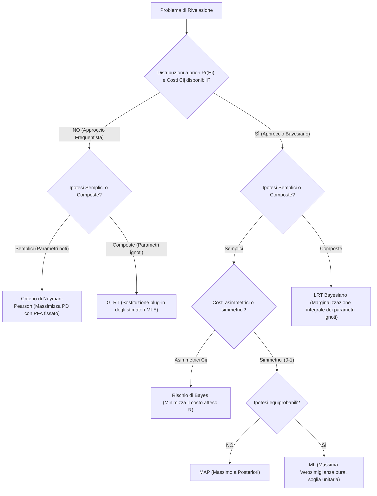

# 5. Rilevazione Multipla e Test di Ipotesi Composte (GLRT)

I fondamenti sviluppati nei capitoli precedenti hanno affrontato scenari decisionali binari ad ipotesi semplici, in cui la natura genera uno tra due possibili stati fisici e le funzioni di densità di probabilità dei dati sono perfettamente specificate a priori. Nella realtà dei sistemi di telecomunicazione digitale, nei radar di sorveglianza e nell'elaborazione del segnale biomedico, tuttavia, l'ingegnere si confronta quasi sempre con due complicazioni fondamentali:
1. La selezione non avviene tra due soli stati, ma tra una pluralità finita $M > 2$ di ipotesi alternative (trasmissione di costellazioni digitali $M$-arie, classificazione multi-classe).
2. I modelli statistici dei dati contengono parametri fisici ignoti o di disturbo (_nuisance parameters_), quali ampiezze, frequenze, fasi casuali o varianze del rumore, trasformando il problema in un test di __ipotesi composte__.

Questo capitolo affronta e risolve entrambe le estensioni, formalizzando la decisione multi-ipotesi secondo la teoria bayesiana e introducendo il __Generalized Likelihood Ratio Test__ (GLRT) e l'approccio bayesiano a marginalizzazione, completando l'intero quadro teorico della _Detection Theory_.

## Rilevazione per Ipotesi Multiple (M > 2)

Quando il numero di stati possibili del sistema supera due ($M > 2$), lo spazio campionario $\mathbb{R}^N$ delle osservazioni $\mathbf{x} = [x[0], x[1], \dots, x[N-1]]^T$ deve essere partizionato in $M$ regioni decisionali disgiunte $R_0, R_1, \dots, R_{M-1}$:

$$
R_i \cap R_j = \emptyset \quad \forall i \neq j, \qquad \bigcup_{i=0}^{M-1} R_i = \mathbb{R}^N
$$

La regola operativa consiste nel dichiarare l'ipotesi $\hat{H} = H_i$ se e solo se il vettore campionario cade all'interno della regione $R_i$ ($\mathbf{x} \in R_i$).

La natura seleziona l'ipotesi $H_j$ secondo una distribuzione di probabilità a priori nota:

$$
\text{Pr}\{H_j\} = \pi_j > 0, \qquad \sum_{j=0}^{M-1} \pi_j = 1
$$

Per quantificare la severità economica o operativa delle diverse conseguenze decisionali, si associa a ogni coppia $(H_i, H_j)$ un elemento della matrice dei costi $C_{ij}$, che rappresenta il costo sostenuto decidendo $H_i$ quando l'ipotesi vera è $H_j$. In conformità con la razionalità fisica, si impone:

$$
C_{ij} > C_{jj} \quad \forall i \neq j
$$

Il __Rischio di Bayes__ $R$ rappresenta il valore atteso complessivo delle perdite:

$$
R = \mathbb{E}[C] = \sum_{i=0}^{M-1} \sum_{j=0}^{M-1} C_{ij} \, \text{Pr}\{\hat{H} = H_i \mid H_j\} \, \text{Pr}\{H_j\} = \sum_{i=0}^{M-1} \int_{R_i} \left[ \sum_{j=0}^{M-1} C_{ij} \, \pi_j \, f(\mathbf{x} \mid H_j) \right] \mathrm{d}\mathbf{x}
$$

### Criterio a Minima Probabilità d'Errore (MAP e ML Multi-Ipotesi)

Nel caso standard in cui le decisioni corrette abbiano costo nullo e tutti gli errori di classificazione siano equiparati a penalità unitaria uniforme:

$$
C_{jj} = 0, \qquad C_{ij} = 1 \quad \forall i \neq j
$$

il rischio di Bayes collassa esattamente sulla __probabilità totale di errore__ $P_e$:

$$
P_e = R = \sum_{j=0}^{M-1} \text{Pr}\{\hat{H} \neq H_j \mid H_j\} \, \text{Pr}\{H_j\} = 1 - \sum_{i=0}^{M-1} \int_{R_i} \text{Pr}\{H_i\} \, f(\mathbf{x} \mid H_i) \, \mathrm{d}\mathbf{x}
$$

La minimizzazione di $P_e$ equivale alla massimizzazione della probabilità di decisione corretta:

$$
P_c = 1 - P_e = \sum_{i=0}^{M-1} \int_{R_i} \text{Pr}\{H_i\} \, f(\mathbf{x} \mid H_i) \, \mathrm{d}\mathbf{x}
$$

Essendo le regioni $\{R_i\}$ mutuamente esclusive e formanti una copertura completa di $\mathbb{R}^N$, l'integrale complessivo viene massimizzato se per ogni singolo punto $\mathbf{x} \in \mathbb{R}^N$ si assegna l'osservazione all'indice $k$ che rende massima la densità congiunta locale:

$$
\mathbf{x} \in R_k \iff \text{Pr}\{H_k\} \, f(\mathbf{x} \mid H_k) > \text{Pr}\{H_i\} \, f(\mathbf{x} \mid H_i) \quad \forall i \neq k
$$

Poiché $\text{Pr}\{H_i \mid \mathbf{x}\} = \frac{\text{Pr}\{H_i\} f(\mathbf{x} \mid H_i)}{f(\mathbf{x})}$, la regola ottima coincide rigorosamente con il criterio del __Massimo a Posteriori__ (MAP):

$$
\text{decidi } \hat{H} = H_k \iff \text{Pr}\{H_k \mid \mathbf{x}\} > \text{Pr}\{H_i \mid \mathbf{x}\} \quad \forall i \neq k
$$

La dimostrazione formale della partizione ottima a costo minimo è riportata in [[zz. Argomenti extra#Ottimalità del Criterio MAP per Ipotesi Multiple e Partizione dello Spazio|Ottimalità del Criterio MAP per Ipotesi Multiple]].

Nel caso particolare in cui le $M$ ipotesi siano __equiprobabili__:

$$
\text{Pr}\{H_i\} = \frac{1}{M} \quad \forall i \in \{0, \dots, M-1\}
$$

le probabilità a priori non influenzano il confronto, e il rilevatore MAP si riduce al rilevatore di __Massima Verosimiglianza__ (ML, _Maximum Likelihood_):

$$
\text{decidi } \hat{H} = H_k \iff f(\mathbf{x} \mid H_k) > f(\mathbf{x} \mid H_i) \quad \forall i \neq k
$$

## Esempio Fondamentale: Livelli DC Multipli in Rumore Gaussiano (AWGN)

Si consideri un sistema di comunicazione digitale ternario ($M = 3$, modulazione 3-PAM) in cui un segnale discreto assume tre possibili livelli costanti immersi in rumore bianco gaussiano a media nulla e varianza $\sigma_w^2$:

$$
H_0: x[n] = -A + w[n] \quad \implies \boldsymbol{\mu}_0 = -A \mathbf{1}_N
$$

$$
H_1: x[n] = w[n] \quad \implies \boldsymbol{\mu}_1 = \mathbf{0}_N
$$

$$
H_2: x[n] = A + w[n] \quad \implies \boldsymbol{\mu}_2 = A \mathbf{1}_N
$$

con ampiezza nota $A > 0$ e campioni indipendenti per $n = 0, \dots, N-1$. Si assumano le tre ipotesi equiprobabili ($\text{Pr}\{H_i\} = 1/3$).

Essendo le ipotesi equiprobabili, il ricevitore ottimo applica il criterio ML, massimizzando la verosimiglianza condizionata $f(\mathbf{x} \mid H_i)$:

$$
\max_{i \in \{0, 1, 2\}} f(\mathbf{x} \mid H_i) = \max_{i \in \{0, 1, 2\}} \frac{1}{(2\pi\sigma_w^2)^{N/2}} \exp\left( -\frac{1}{2\sigma_w^2} \sum_{n=0}^{N-1} (x[n] - A_i)^2 \right)
$$

dove $A_0 = -A$, $A_1 = 0$, $A_2 = A$. Poiché l'esponenziale è strettamente crescente e il segno è negativo, massimizzare la verosimiglianza equivale a minimizzare la sommatoria degli scarti quadratici:

$$
\min_{i \in \{0, 1, 2\}} \sum_{n=0}^{N-1} (x[n] - A_i)^2 = \min_{i \in \{0, 1, 2\}} \left[ \sum_{n=0}^{N-1} x^2[n] - 2 A_i \sum_{n=0}^{N-1} x[n] + N A_i^2 \right]
$$

Eliminando il termine costante $\sum x^2[n]$ comune a tutte le ipotesi e dividendo per $N$:

$$
\min_{i \in \{0, 1, 2\}} \left[ -2 A_i \left( \frac{1}{N} \sum_{n=0}^{N-1} x[n] \right) + A_i^2 \right]
$$

Aggiungendo il quadrato della media campionaria $\bar{x}^2 = \left( \frac{1}{N}\sum x[n] \right)^2$ (costante rispetto all'indice di ipotesi $i$), l'espressione si ricompone nel quadrato perfetto della distanza euclidea unidimensionale:

$$
\min_{i \in \{0, 1, 2\}} \left[ \bar{x}^2 - 2 A_i \bar{x} + A_i^2 \right] = \min_{i \in \{0, 1, 2\}} (\bar{x} - A_i)^2 = \min_{i \in \{0, 1, 2\}} |\bar{x} - A_i|
$$

La statistica sufficiente è la media campionaria:

$$
T(\mathbf{x}) = \bar{x} = \frac{1}{N} \sum_{n=0}^{N-1} x[n]
$$

Il rilevatore ottimo implementa la __regola del vicino più prossimo__: decide per l'ipotesi $H_i$ il cui valore nominale $A_i$ presenta la minima distanza euclidea dalla media campionaria $\bar{x}$.

### Struttura delle Regioni di Decisione

I punti di indifferenza (soglie ottime) tra le ipotesi adiacenti si collocano esattamente a metà strada tra i livelli nominali:
- Soglia tra $H_0$ (livello $-A$) e $H_1$ (livello $0$): $\gamma_1' = \frac{-A + 0}{2} = -\frac{A}{2}$.
- Soglia tra $H_1$ (livello $0$) e $H_2$ (livello $A$): $\gamma_2' = \frac{0 + A}{2} = \frac{A}{2}$.

Le tre regioni decisionali nello spazio della statistica di test sono:

$$
R_0 = \left\{ \mathbf{x} \in \mathbb{R}^N : \bar{x} < -\frac{A}{2} \right\}
$$

$$
R_1 = \left\{ \mathbf{x} \in \mathbb{R}^N : -\frac{A}{2} < \bar{x} < \frac{A}{2} \right\}
$$

$$
R_2 = \left\{ \mathbf{x} \in \mathbb{R}^N : \bar{x} > \frac{A}{2} \right\}
$$

![[slide_58_ternary_detection_regions.png|center mid]]

### Calcolo Analitico della Probabilità d'Errore

Sotto l'ipotesi generica $H_j$, la media campionaria è una variabile aleatoria gaussiana a varianza ridotta:

$$
T(\mathbf{x}) = \bar{x} \sim \mathcal{N}\left( A_j, \, \frac{\sigma_w^2}{N} \right)
$$

Definendo il coefficiente di deflessione normalizzato tra livelli contigui:

$$
d = \frac{A}{\sigma_w / \sqrt{N}} = \frac{A \sqrt{N}}{\sigma_w}
$$

Si analizzano le probabilità di errore condizionate per ciascuna delle tre ipotesi:

1. __Ipotesi $H_0$ (simbolo esterno sinistro, livello $-A$)__:
   L'errore si verifica se $\bar{x} > -A/2$. Poiché $H_0$ è una classe di bordo, l'errore è unilaterale:

$$
\text{Pr}\{\hat{H} \neq H_0 \mid H_0\} = \text{Pr}\left\{ \bar{x} > -\frac{A}{2} \;\middle|\; H_0 \right\} = Q\left( \frac{-\frac{A}{2} - (-A)}{\sigma_w / \sqrt{N}} \right) = Q\left( \frac{A \sqrt{N}}{2 \sigma_w} \right) = Q\left( \frac{d}{2} \right)
$$

2. __Ipotesi $H_1$ (simbolo interno centrale, livello $0$)__:
   L'errore si verifica se la media campionaria devia oltre una qualunque delle due soglie ($\bar{x} < -A/2$ oppure $\bar{x} > A/2$). L'errore è bilaterale:

$$
\text{Pr}\{\hat{H} \neq H_1 \mid H_1\} = \text{Pr}\left\{ \bar{x} < -\frac{A}{2} \;\middle|\; H_1 \right\} + \text{Pr}\left\{ \bar{x} > \frac{A}{2} \;\middle|\; H_1 \right\} = 2 Q\left( \frac{A/2}{\sigma_w / \sqrt{N}} \right) = 2 Q\left( \frac{d}{2} \right)
$$

3. __Ipotesi $H_2$ (simbolo esterno destro, livello $A$)__:
   Simmetricamente a $H_0$, l'errore è unilaterale e si verifica se $\bar{x} < A/2$:

$$
\text{Pr}\{\hat{H} \neq H_2 \mid H_2\} = \text{Pr}\left\{ \bar{x} < \frac{A}{2} \;\middle|\; H_2 \right\} = Q\left( \frac{A - \frac{A}{2}}{\sigma_w / \sqrt{N}} \right) = Q\left( \frac{d}{2} \right)
$$

Applicando il teorema della probabilità totale con pesi a priori uniformi $\text{Pr}\{H_i\} = 1/3$:

$$
P_e = \frac{1}{3} \left[ \text{Pr}\{\hat{H} \neq H_0 \mid H_0\} + \text{Pr}\{\hat{H} \neq H_1 \mid H_1\} + \text{Pr}\{\hat{H} \neq H_2 \mid H_2\} \right]
$$

Sostituendo i singoli contributi:

$$
P_e = \frac{1}{3} \left[ Q\left( \frac{d}{2} \right) + 2 Q\left( \frac{d}{2} \right) + Q\left( \frac{d}{2} \right) \right] = \frac{4}{3} Q\left( \frac{d}{2} \right) = \frac{4}{3} Q\left( \frac{A \sqrt{N}}{2 \sigma_w} \right)
$$

Il coefficiente $4/3$ riflette l'asimmetria geometrica della costellazione: i due simboli periferici subiscono errore solo su una semiretta, mentre il simbolo centrale è esposto a decisioni errate su entrambi i lati.

## Test di Ipotesi Composte e Rilevatore GLRT

Nel problema di test di ipotesi binario convenzionale (ipotesi semplici), le densità $f(\mathbf{x}; H_0)$ e $f(\mathbf{x}; H_1)$ sono interamente determinate. Nella maggioranza degli scenari operativi ingegneristici, tuttavia, le densità dipendono da parametri fisici incogniti:

$$
H_0: \mathbf{x} \sim f(\mathbf{x}; \boldsymbol{\theta}_0, H_0), \qquad H_1: \mathbf{x} \sim f(\mathbf{x}; \boldsymbol{\theta}_1, H_1)
$$

dove $\boldsymbol{\theta}_0 \in \boldsymbol{\Theta}_0$ e $\boldsymbol{\theta}_1 \in \boldsymbol{\Theta}_1$ sono vettori di parametri incogniti. Tale scenario prende il nome di __test di ipotesi composte__ (_composite hypothesis testing_).

A seconda della natura delle informazioni disponibili, si aprono tre possibili strade:
1. __Test Uniformemente Più Potente (UMP)__: Si calcola il test LRT in funzione dei parametri incogniti. Se la statistica di test e la soglia risultante sono indipendenti dal valore assunto dal parametro incognito, il test di Neyman-Pearson è uniformemente valido per ogni valore del parametro. I test UMP sono ottimi ma esistono solo in classi ristrette di distribuzioni monovariate a rapporto di verosimiglianza monotono.
2. __Approccio Bayesiano__: Se si dispone di una distribuzione di probabilità a priori sui parametri incogniti $f(\boldsymbol{\theta}_0)$ e $f(\boldsymbol{\theta}_1)$, i parametri possono essere rimossi mediante integrazione (marginalizzazione).
3. __Generalized Likelihood Ratio Test (GLRT)__: Se i parametri sono deterministici ma ignoti e non è disponibile alcuna distribuzione a priori, si adotta una stima di massima verosimiglianza congiunta (MLE) come sostituto dei parametri veri.

### Principio Operativo del GLRT

Il GLRT opera secondo una procedura modulare a due passi:

1. __Stima di Massima Verosimiglianza vincolata alle singole ipotesi__:
   Si calcolano separatamente gli stimatori MLE dei parametri incogniti ipotizzando valida ciascuna ipotesi:

$$
\hat{\boldsymbol{\theta}}_0 = \arg\max_{\boldsymbol{\theta}_0 \in \boldsymbol{\Theta}_0} f(\mathbf{x}; \boldsymbol{\theta}_0, H_0), \qquad \hat{\boldsymbol{\theta}}_1 = \arg\max_{\boldsymbol{\theta}_1 \in \boldsymbol{\Theta}_1} f(\mathbf{x}; \boldsymbol{\theta}_1, H_1)
$$

2. __Sostituzione (_plug-in_) nel Rapporto di Verosimiglianza__:
   Si definisce il rapporto di verosimiglianza generalizzato inserendo le stime di massima verosimiglianza al posto dei valori nominali:

$$
L_G(\mathbf{x}) = \frac{f(\mathbf{x}; \hat{\boldsymbol{\theta}}_1, H_1)}{f(\mathbf{x}; \hat{\boldsymbol{\theta}}_0, H_0)} \underset{H_0}{\overset{H_1}{\gtrless}} \gamma
$$

Il rilevatore GLRT non possiede una proprietà generale di ottimalità a campioni finiti (come il lemma di Neyman-Pearson per ipotesi semplici), ma possiede rilevanti vantaggi pratici:
- Presenta prestazioni asintoticamente ottime e si comporta eccellentemente nei sistemi reali.
- Esegue congiuntamente la rivelazione della presenza del segnale e la stima quantitativa dei parametri fisici associati (_joint detection and estimation_).
- È computazionalmente trattabile quando gli stimatori MLE ammettono forme analitiche chiuse.

## Esempio: Livello DC con Ampiezza Incognita in Rumore Bianco Gaussiano

Si consideri il problema di rivelazione di una componente continua $A$ immersa in rumore bianco gaussiano, dove l'ampiezza $A \neq 0$ non è nota a priori (può assumere qualunque valore reale non nullo, positivo o negativo):

$$
H_0: x[n] = w[n] \quad (A = 0), \qquad H_1: x[n] = A + w[n] \quad (A \neq 0 \text{ incognito})
$$

con $w[n] \sim \mathcal{N}(0, \sigma_w^2)$ e $n = 0, \dots, N-1$.

Sotto $H_0$, l'ipotesi è semplice: il parametro $A$ è rigorosamente nullo e la densità è:

$$
f(\mathbf{x}; H_0) = \frac{1}{(2\pi\sigma_w^2)^{N/2}} \exp\left( -\frac{1}{2\sigma_w^2} \sum_{n=0}^{N-1} x^2[n] \right)
$$

Sotto $H_1$, il parametro $A$ è incognito. La sua stima di massima verosimiglianza coincide con la media campionaria:

$$
\hat{A}_{\text{MLE}} = \frac{1}{N} \sum_{n=0}^{N-1} x[n] = \bar{x}
$$

Sostituendo la stima nella funzione di verosimiglianza sotto $H_1$:

$$
f(\mathbf{x}; \hat{A}_{\text{MLE}}, H_1) = \frac{1}{(2\pi\sigma_w^2)^{N/2}} \exp\left( -\frac{1}{2\sigma_w^2} \sum_{n=0}^{N-1} (x[n] - \hat{A}_{\text{MLE}})^2 \right)
$$

Il rapporto GLRT è dato da:

$$
L_G(\mathbf{x}) = \frac{f(\mathbf{x}; \hat{A}_{\text{MLE}}, H_1)}{f(\mathbf{x}; H_0)} = \frac{\exp\left( -\frac{1}{2\sigma_w^2} \sum_{n=0}^{N-1} (x[n] - \hat{A}_{\text{MLE}})^2 \right)}{\exp\left( -\frac{1}{2\sigma_w^2} \sum_{n=0}^{N-1} x^2[n] \right)}
$$

Semplificando l'argomento all'esponente:

$$
\sum_{n=0}^{N-1} x^2[n] - \sum_{n=0}^{N-1} (x[n] - \hat{A}_{\text{MLE}})^2 = 2 \hat{A}_{\text{MLE}} \sum_{n=0}^{N-1} x[n] - N \hat{A}_{\text{MLE}}^2
$$

Essendo $\sum_{n=0}^{N-1} x[n] = N \hat{A}_{\text{MLE}}$:

$$
2 \hat{A}_{\text{MLE}} (N \hat{A}_{\text{MLE}}) - N \hat{A}_{\text{MLE}}^2 = N \hat{A}_{\text{MLE}}^2
$$

Pertanto la statistica GLRT assume la forma:

$$
L_G(\mathbf{x}) = \exp\left( \frac{N \hat{A}_{\text{MLE}}^2}{2 \sigma_w^2} \right) \underset{H_0}{\overset{H_1}{\gtrless}} \gamma
$$

Prendendo il logaritmo naturale e riorganizzando le costanti:

$$
\frac{N \hat{A}_{\text{MLE}}^2}{2 \sigma_w^2} > \ln \gamma \iff \hat{A}_{\text{MLE}}^2 > \gamma' \iff \bar{x}^2 \underset{H_0}{\overset{H_1}{\gtrless}} \gamma'
$$

La statistica sufficiente è il quadrato della media campionaria:

$$
T_G(\mathbf{x}) = \bar{x}^2 \underset{H_0}{\overset{H_1}{\gtrless}} \gamma'
$$

oppure, equivalentemente in termini di valore assoluto:

$$
|\bar{x}| \underset{H_0}{\overset{H_1}{\gtrless}} \sqrt{\gamma'}
$$

Il rilevatore GLRT è un __rilevatore a legge quadratica__ (_energy detector_ unidimensionale). Esso decide per la presenza del segnale ($H_1$) ogni qualvolta l'ampiezza stimata devia significativamente da zero, a prescindere dal fatto che il livello DC sia positivo o negativo (test a due code simmetrico).

### Distribuzione della Statistica e Teorema di Wilks

Per calcolare le probabilità operative $P_{FA}$ e $P_D$, si analizza la distribuzione della statistica normalizzata:

$$
T(\mathbf{x}) = \frac{N \bar{x}^2}{\sigma_w^2} = \left( \frac{\sqrt{N} \bar{x}}{\sigma_w} \right)^2
$$

- __Sotto $H_0$ ($A = 0$)__: La variabile $\frac{\sqrt{N}\bar{x}}{\sigma_w}$ è gaussiana standard $\mathcal{N}(0, 1)$. Il quadrato di una variabile normale standard ha esattamente per definizione una distribuzione __chi-quadro centrale__ con $1$ grado di libertà:

$$
T(\mathbf{x}) \sim \chi_1^2 \quad \text{sotto } H_0
$$

- __Sotto $H_1$ ($A \neq 0$)__: La variabile $\frac{\sqrt{N}\bar{x}}{\sigma_w}$ è una gaussiana a varianza unitaria con media non nulla pari al parametro di deflessione:

$$
\mathbb{E}\left[ \frac{\sqrt{N}\bar{x}}{\sigma_w} \;\middle|\; H_1 \right] = \frac{\sqrt{N} A}{\sigma_w} = d
$$

Di conseguenza, il suo quadrato ha una distribuzione __chi-quadro non centrale__ con $1$ grado di libertà e parametro di non centralità $\lambda$:

$$
T(\mathbf{x}) \sim \chi_1'^2(\lambda) \quad \text{sotto } H_1, \qquad \lambda = d^2 = \frac{N A^2}{\sigma_w^2} = \text{SNR}
$$

Questo risultato coincide perfettamente con la legge limite stabilita dal __Teorema di Wilks__, secondo cui per $N \to \infty$ la statistica $2 \ln L_G(\mathbf{x})$ converge a una distribuzione $\chi_r^2$ sotto $H_0$ e $\chi_r'^2(\lambda)$ sotto $H_1$, dove $r = \dim(\boldsymbol{\Theta}_1) - \dim(\boldsymbol{\Theta}_0) = 1 - 0 = 1$. La trattazione analitica e la dimostrazione del Teorema di Wilks sono approfondite in [[zz. Argomenti extra#Teorema di Wilks e Proprietà Asintotiche del GLRT|Teorema di Wilks e Proprietà Asintotiche del GLRT]].

## Approccio Bayesiano per Ipotesi Composte (Marginalizzazione)

Se sui parametri incogniti $\boldsymbol{\theta}_0$ e $\boldsymbol{\theta}_1$ sono note le distribuzioni di probabilità a priori $f_{\boldsymbol{\theta}_0}(\boldsymbol{\theta}_0 \mid H_0)$ e $f_{\boldsymbol{\theta}_1}(\boldsymbol{\theta}_1 \mid H_1)$, il paradigma bayesiano non ricorre a stime puntuali MLE, ma elimina l'incertezza parametrica mediante __marginalizzazione integrale__:

$$
f(\mathbf{x} \mid H_i) = \int_{\boldsymbol{\Theta}_i} f(\mathbf{x} \mid \boldsymbol{\theta}_i, H_i) \, f_{\boldsymbol{\theta}_i}(\boldsymbol{\theta}_i \mid H_i) \, \mathrm{d}\boldsymbol{\theta}_i, \qquad i \in \{0, 1\}
$$

Il test del rapporto di verosimiglianza bayesiano (Bayesian LRT) assume la forma:

$$
L_B(\mathbf{x}) = \frac{f(\mathbf{x} \mid H_1)}{f(\mathbf{x} \mid H_0)} = \frac{\int_{\boldsymbol{\Theta}_1} f(\mathbf{x} \mid \boldsymbol{\theta}_1, H_1) \, f_{\boldsymbol{\theta}_1}(\boldsymbol{\theta}_1 \mid H_1) \, \mathrm{d}\boldsymbol{\theta}_1}{\int_{\boldsymbol{\Theta}_0} f(\mathbf{x} \mid \boldsymbol{\theta}_0, H_0) \, f_{\boldsymbol{\theta}_0}(\boldsymbol{\theta}_0 \mid H_0) \, \mathrm{d}\boldsymbol{\theta}_0} \underset{H_0}{\overset{H_1}{\gtrless}} \gamma
$$

Se sono note anche le probabilità a priori delle ipotesi $\text{Pr}\{H_0\}$ e $\text{Pr}\{H_1\}$, il test a minima probabilità d'errore (MAP) confronta le verosimiglianze marginalizzate ponendo la soglia:

$$
L_B(\mathbf{x}) = \frac{\int_{\boldsymbol{\Theta}_1} f(\mathbf{x} \mid \boldsymbol{\theta}_1, H_1) \, f_{\boldsymbol{\theta}_1}(\boldsymbol{\theta}_1 \mid H_1) \, \mathrm{d}\boldsymbol{\theta}_1}{\int_{\boldsymbol{\Theta}_0} f(\mathbf{x} \mid \boldsymbol{\theta}_0, H_0) \, f_{\boldsymbol{\theta}_0}(\boldsymbol{\theta}_0 \mid H_0) \, \mathrm{d}\boldsymbol{\theta}_0} \underset{H_0}{\overset{H_1}{\gtrless}} \frac{\text{Pr}\{H_0\}}{\text{Pr}\{H_1\}}
$$

### Confronto Strutturale tra GLRT e Approccio Bayesiano

La scelta tra GLRT e rilevazione bayesiana comporta un trade-off operativo tra requisiti informativi ed efficienza di calcolo:

1. __Requisiti Informativi__:
   - Il GLRT non richiede alcuna informazione probabilistica a priori sul parametro incognito.
   - L'approccio bayesiano esige la specificazione di una densità a priori $f(\boldsymbol{\theta})$. Se tale distribuzione è inesatta o mal condizionata, le prestazioni del ricevitore possono degradare significativamente.
2. __Complessità Computazionale__:
   - Il GLRT richiede un'operazione di massimizzazione (MLE), che per modelli lineari e gaussiani si riduce a un'operazione algebrica immediata (es. media campionaria o proiezione ortogonale).
   - L'approccio bayesiano richiede un integrale multivariato su spazi dimensionali potenzialmente elevati. Salvo il caso di distribuzioni a priori coniugate (es. parametri gaussiani con rumore gaussiano), l'integrale non possiede forma analitica chiusa e impone l'impiego di metodi di approssimazione numerica o campionamento Monte Carlo (MCMC).

## Tassonomia Completa e Quadro Comparativo dei Rilevatori

L'intero percorso concettuale della Teoria della Decisione e Rilevazione (Detection Theory) può essere sintetizzato mediante un diagramma ad albero che guida la scelta del rilevatore ottimo in funzione della conoscenza statistica disponibile a priori:

La seguente tabella riassume e confronta in modo sistematico tutti i rilevatori statistici analizzati nella Parte I del corso:

| Rilevatore | Paradigma | Informazioni Richieste | Statistica di Test e Regola Decisionale | Prestazioni Ottime e Proprietà Chiave |
| :--- | :--- | :--- | :--- | :--- |
| __Neyman-Pearson__ | Frequentista | Nessuna prior $\text{Pr}\{H_i\}$, nessun costo $C_{ij}$ | $L(\mathbf{x}) = \frac{f(\mathbf{x}; H_1)}{f(\mathbf{x}; H_0)} \gtrless \gamma$ con $\int_\gamma^\infty f_L(l; H_0) \mathrm{d}l = \alpha$ | Ottimo assoluto: massimizza $P_D$ sotto vincolo di falso allarme $P_{FA} \le \alpha$ |
| __Minima Probabilità d'Errore (MAP)__ | Bayesiano | Note $\text{Pr}\{H_i\}$, costi uniformi $C_{jj}=0, C_{ij}=1$ | $\text{Pr}\{H_1 \mid \mathbf{x}\} \gtrless \text{Pr}\{H_0 \mid \mathbf{x}\} \iff L(\mathbf{x}) \gtrless \frac{\text{Pr}\{H_0\}}{\text{Pr}\{H_1\}}$ | Minimizza l'errore totale $P_e$; estendibile al caso $M$-ario $\arg\max_i \text{Pr}\{H_i \mid \mathbf{x}\}$ |
| __Massima Verosimiglianza (ML)__ | Bayesiano | Ipotesi equiprobabili $\text{Pr}\{H_i\} = \frac{1}{M}$, costi $0\text{-}1$ | $f(\mathbf{x} \mid H_1) \gtrless f(\mathbf{x} \mid H_0) \iff L(\mathbf{x}) \gtrless 1$ | Regola del vicino più prossimo per rumore AWGN; minimizza $P_e$ per simboli equiprobabili |
| __Rischio di Bayes__ | Bayesiano | Note $\text{Pr}\{H_i\}$ e matrice arbitraria dei costi $C_{ij}$ | $L(\mathbf{x}) \gtrless \frac{(C_{10} - C_{00})\text{Pr}\{H_0\}}{(C_{01} - C_{11})\text{Pr}\{H_1\}}$ | Minimizza il danno economico/operativo atteso $R = \mathbb{E}[C]$; include MAP come caso $0\text{-}1$ |
| __GLRT__ | Frequentista | Parametri incogniti deterministici, nessuna prior | $L_G(\mathbf{x}) = \frac{f(\mathbf{x}; \hat{\boldsymbol{\theta}}_1, H_1)}{f(\mathbf{x}; \hat{\boldsymbol{\theta}}_0, H_0)} \gtrless \gamma$ | Esegue rivelazione e stima congiunta; asintoticamente chi-quadro (Teorema di Wilks) |
| __LRT Bayesiano__ | Bayesiano | Prior delle ipotesi $\text{Pr}\{H_i\}$ e prior dei parametri $f(\boldsymbol{\theta})$ | $L_B(\mathbf{x}) = \frac{\int f(\mathbf{x}\mid \boldsymbol{\theta}_1, H_1) f(\boldsymbol{\theta}_1)\mathrm{d}\boldsymbol{\theta}_1}{\int f(\mathbf{x}\mid \boldsymbol{\theta}_0, H_0) f(\boldsymbol{\theta}_0)\mathrm{d}\boldsymbol{\theta}_0} \gtrless \gamma$ | Elimina i parametri per marginalizzazione esatta; computazionalmente oneroso |
