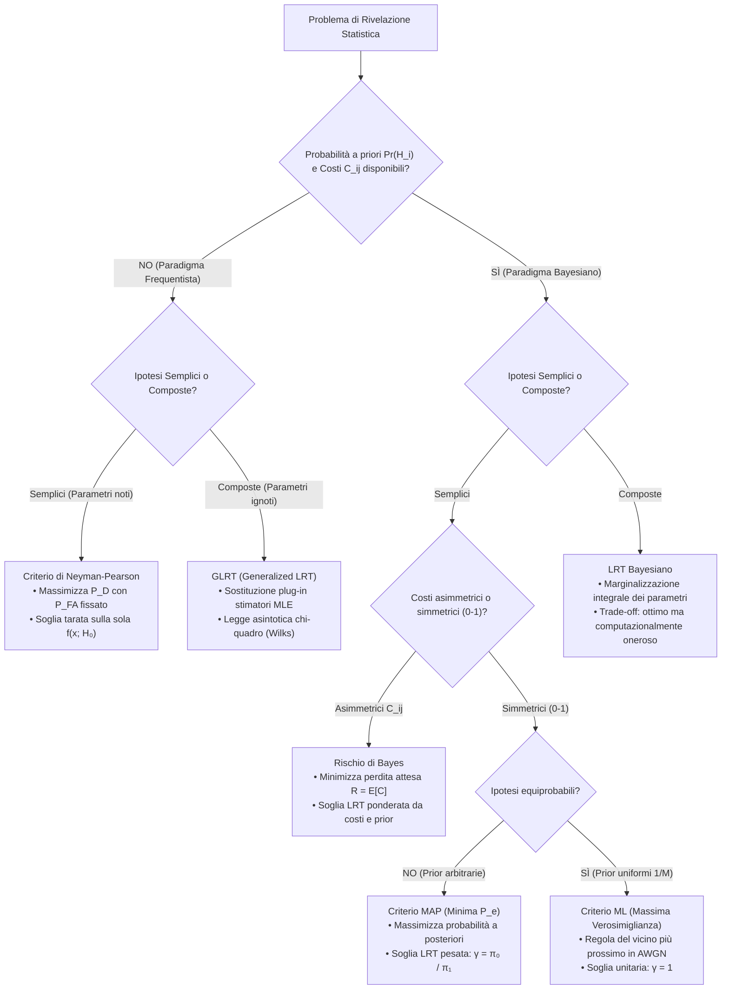

# 5. Rilevazione Multipla E Test Di Ipotesi Composte (GLRT)

Nella realtà applicativa dei sistemi di telecomunicazione digitale, dei radar di sorveglianza e dell'elaborazione di segnali complessi, i problemi di decisione statistica superano il paradigma binario a parametri noti affrontando due complicazioni strutturali:
1. La selezione non avviene tra due soli stati, ma tra una pluralità finita $M > 2$ di ipotesi alternative (trasmissione di costellazioni digitali $M$-arie, classificazione multi-classe).
2. I modelli statistici dei dati contengono parametri fisici incogniti o di disturbo (_nuisance parameters_), quali ampiezze, frequenze, fasi casuali o varianze del rumore, trasformando il problema in un test di __ipotesi composte__.

La formulazione della decisione multi-ipotesi secondo la teoria bayesiana determina la partizione ottima dello spazio delle osservazioni e caratterizza l'asimmetria delle regioni d'errore (evidente già nel caso ternario). Per le ipotesi composte, il __Generalized Likelihood Ratio Test__ (GLRT) e l'approccio bayesiano a marginalizzazione forniscono i due strumenti cardine per discriminare gli stati del sistema in presenza di incertezza parametrica.

## Rilevazione per Ipotesi Multiple

Quando il numero di stati possibili del sistema supera due ($M > 2$), lo spazio campionario $\mathbb{R}^N$ delle osservazioni $\mathbf{x} = [x[0], x[1], \dots, x[N-1]]^T$ deve essere partizionato in $M$ regioni decisionali mutuamente esclusive e congiuntamente esaustive $R_0, R_1, \dots, R_{M-1}$:

$$
R_i \cap R_j = \emptyset \quad \forall i \neq j, \qquad \bigcup_{i=0}^{M-1} R_i = \mathbb{R}^N
$$

La regola operativa consiste nel dichiarare l'ipotesi $\hat{H} = H_i$ se e solo se il vettore campionario cade all'interno della corrispondente regione decisionale $R_i$ ($\mathbf{x} \in R_i$).

La natura seleziona l'ipotesi $H_j$ secondo una distribuzione di probabilità a priori nota:

$$
\text{Pr}\{H_j\} = \pi_j > 0, \qquad \sum_{j=0}^{M-1} \pi_j = 1
$$

Per quantificare la severità economica o operativa delle diverse conseguenze decisionali, associamo a ogni coppia $(H_i, H_j)$ un elemento della matrice dei costi $C_{ij}$, che rappresenta la penalità sostenuta decidendo $H_i$ quando l'ipotesi vera è $H_j$. In conformità con la razionalità fisica, imponiamo che ogni decisione errata costi strettamente più di una decisione corretta:

$$
C_{ij} > C_{jj} \quad \forall i \neq j
$$

### Criterio a Minimo Rischio Di Bayes

Il __Rischio di Bayes__ $R$ rappresenta il valore atteso complessivo delle perdite sostenute dal sistema decisionale:

$$
R = \mathbb{E}[C] = \sum_{i=0}^{M-1} \sum_{j=0}^{M-1} C_{ij} \, \text{Pr}\{\hat{H} = H_i \mid H_j\} \, \pi_j
$$

Esprimendo la probabilità di decisione condizionata come integrale della densità $f(\mathbf{x} \mid H_j)$ sulla regione $R_i$:

$$
R = \sum_{i=0}^{M-1} \int_{R_i} \left[ \sum_{j=0}^{M-1} C_{ij} \, \pi_j \, f(\mathbf{x} \mid H_j) \right] \mathrm{d}\mathbf{x}
$$

Poiché le regioni $\{R_i\}$ formano una partizione disgiunta dell'intero spazio campionario $\mathbb{R}^N$, minimizziamo l'integrale complessivo assegnando ciascun punto $\mathbf{x}$ all'indice $k$ che rende minima la perdita attesa condizionata locale:

$$
\mathbf{x} \in R_k \iff \sum_{j=0}^{M-1} C_{kj} \, \pi_j \, f(\mathbf{x} \mid H_j) < \sum_{j=0}^{M-1} C_{ij} \, \pi_j \, f(\mathbf{x} \mid H_j) \quad \forall i \neq k
$$

### Criterio a Minima Probabilità d'Errore E Regola MAP

Nel caso fondamentale in cui le decisioni corrette abbiano costo nullo e tutti gli errori di classificazione siano penalizzati in modo uniforme con costo unitario:

$$
C_{jj} = 0, \qquad C_{ij} = 1 \quad \forall i \neq j
$$

il rischio di Bayes collassa esattamente sulla __probabilità totale di errore__ $P_e$:

$$
P_e = R = \sum_{j=0}^{M-1} \text{Pr}\{\hat{H} \neq H_j \mid H_j\} \, \pi_j = 1 - \sum_{i=0}^{M-1} \int_{R_i} \pi_i \, f(\mathbf{x} \mid H_i) \, \mathrm{d}\mathbf{x}
$$

Minimizzare la probabilità d'errore $P_e$ equivale a massimizzare la probabilità di decisione corretta $P_c = 1 - P_e$:

$$
P_c = \sum_{i=0}^{M-1} \int_{R_i} \pi_i \, f(\mathbf{x} \mid H_i) \, \mathrm{d}\mathbf{x}
$$

Essendo le regioni $\{R_i\}$ disgiunte e a copertura totale di $\mathbb{R}^N$, massimizziamo la somma integrando punto per punto dove la densità congiunta locale è massima. Assegniamo dunque l'osservazione $\mathbf{x}$ alla regione $R_k$ se:

$$
\mathbf{x} \in R_k \iff \pi_k \, f(\mathbf{x} \mid H_k) > \pi_i \, f(\mathbf{x} \mid H_i) \quad \forall i \neq k
$$

Dividendo ambo i membri per la densità marginale dei dati $f(\mathbf{x}) = \sum_{j=0}^{M-1} \pi_j f(\mathbf{x} \mid H_j)$, la regola operativa coincide con il criterio del __Massimo a Posteriori__ (MAP):

$$
\text{decidi } \hat{H} = H_k \iff \text{Pr}\{H_k \mid \mathbf{x}\} > \text{Pr}\{H_i \mid \mathbf{x}\} \quad \forall i \neq k
$$

La dimostrazione formale della partizione ottima a costo minimo è riportata in [[zz. Argomenti extra#Ottimalità del Criterio MAP per Ipotesi Multiple e Partizione dello Spazio|Ottimalità del Criterio MAP per Ipotesi Multiple]].

### Criterio Di Massima Verosimiglianza per Ipotesi Equiprobabili

Nel caso particolare in cui le $M$ ipotesi risultino __equiprobabili__:

$$
\text{Pr}\{H_i\} = \pi_i = \frac{1}{M} \quad \forall i \in \{0, \dots, M-1\}
$$

le probabilità a priori non influenzano il confronto locale e si elidono. Il rilevatore MAP si riduce al rilevatore di __Massima Verosimiglianza__ (ML, _Maximum Likelihood_):

$$
\text{decidi } \hat{H} = H_k \iff f(\mathbf{x} \mid H_k) > f(\mathbf{x} \mid H_i) \quad \forall i \neq k
$$

## Modulazione Ternaria in Rumore Gaussiano (3-PAM)

Per comprendere la geometria delle decisioni multiple, consideriamo un sistema di trasmissione digitale ternario ($M = 3$, modulazione 3-PAM) in cui un segnale assume tre possibili livelli costanti immersi in rumore bianco gaussiano additivo (AWGN) a media nulla e varianza $\sigma_w^2$:

$$
H_0: x[n] = -A + w[n] \implies \boldsymbol{\mu}_0 = -A \mathbf{1}_N
$$

$$
H_1: x[n] = w[n] \implies \boldsymbol{\mu}_1 = \mathbf{0}_N
$$

$$
H_2: x[n] = A + w[n] \implies \boldsymbol{\mu}_2 = A \mathbf{1}_N
$$

con ampiezza nominale $A > 0$ nota e campioni indipendenti $n = 0, \dots, N-1$. Assumiamo le tre ipotesi equiprobabili ($\text{Pr}\{H_i\} = 1/3$).

### Modello Di Segnale E Statistica Sufficiente

Essendo le ipotesi equiprobabili, il ricevitore ottimo applica il criterio ML, massimizzando la verosimiglianza condizionata $f(\mathbf{x} \mid H_i)$:

$$
\max_{i \in \{0, 1, 2\}} f(\mathbf{x} \mid H_i) = \max_{i \in \{0, 1, 2\}} \frac{1}{(2\pi\sigma_w^2)^{N/2}} \exp\left( -\frac{1}{2\sigma_w^2} \sum_{n=0}^{N-1} (x[n] - A_i)^2 \right)
$$

dove abbiamo posto $A_0 = -A$, $A_1 = 0$, $A_2 = A$. Poiché la funzione esponenziale è strettamente crescente e compare con segno negativo, massimizzare la verosimiglianza equivale a minimizzare la sommatoria degli scarti quadratici:

$$
\min_{i \in \{0, 1, 2\}} \sum_{n=0}^{N-1} (x[n] - A_i)^2 = \min_{i \in \{0, 1, 2\}} \left[ \sum_{n=0}^{N-1} x^2[n] - 2 A_i \sum_{n=0}^{N-1} x[n] + N A_i^2 \right]
$$

Il termine $\sum_{n=0}^{N-1} x^2[n]$ rappresenta l'energia dei campioni osservati: esso è identico per qualsiasi ipotesi $H_i$ e non dipende dal valore ipotizzato $A_i$. Di conseguenza, non altera l'argomento minimizzante e si cancella dal confronto. Dividendo per la costante positiva $N$:

$$
\min_{i \in \{0, 1, 2\}} \left[ -2 A_i \left( \frac{1}{N} \sum_{n=0}^{N-1} x[n] \right) + A_i^2 \right] = \min_{i \in \{0, 1, 2\}} \left[ -2 A_i \bar{x} + A_i^2 \right]
$$

dove $\bar{x} = \frac{1}{N} \sum_{n=0}^{N-1} x[n]$ è la media campionaria. Aggiungiamo ora all'argomento il termine $\bar{x}^2$. Poiché $\bar{x}^2$ dipende unicamente dai campioni osservati $\mathbf{x}$ ed è del tutto invariante rispetto all'indice di ipotesi $i$, la sua aggiunta non modifica la minimizzazione e consente di completare il quadrato di binomio:

$$
\min_{i \in \{0, 1, 2\}} \left[ \bar{x}^2 - 2 A_i \bar{x} + A_i^2 \right] = \min_{i \in \{0, 1, 2\}} (\bar{x} - A_i)^2 = \min_{i \in \{0, 1, 2\}} |\bar{x} - A_i|
$$

L'informazione contenuta nell'intero vettore campionario $\mathbf{x} \in \mathbb{R}^N$ collassa nella sola media campionaria:

$$
T(\mathbf{x}) = \bar{x} = \frac{1}{N} \sum_{n=0}^{N-1} x[n]
$$

che costituisce la statistica sufficiente scalare del problema. Il rilevatore ottimo implementa la __regola del vicino più prossimo__ (_Nearest Neighbor Rule_): decide per l'ipotesi $H_i$ il cui valore nominale $A_i$ presenta la minima distanza euclidea dalla media campionaria $\bar{x}$.

### Regola Del Vicino Più Prossimo E Regioni Di Decisione

I punti di indifferenza (soglie ottime) tra le ipotesi adiacenti si collocano esattamente a metà strada tra i livelli nominali:
- Soglia tra $H_0$ (livello $-A$) e $H_1$ (livello $0$): $\gamma_1' = \frac{-A + 0}{2} = -\frac{A}{2}$.
- Soglia tra $H_1$ (livello $0$) e $H_2$ (livello $A$): $\gamma_2' = \frac{0 + A}{2} = \frac{A}{2}$.

Le tre regioni decisionali nello spazio della statistica di test sono:

$$
R_0 = \left\{ \mathbf{x} \in \mathbb{R}^N : \bar{x} < -\frac{A}{2} \right\}
$$

$$
R_1 = \left\{ \mathbf{x} \in \mathbb{R}^N : -\frac{A}{2} < \bar{x} < \frac{A}{2} \right\}
$$

$$
R_2 = \left\{ \mathbf{x} \in \mathbb{R}^N : \bar{x} > \frac{A}{2} \right\}
$$

![[slide_58_ternary_detection_regions.png|center mid]]

### Calcolo Analitico Della Probabilità d'Errore

Sotto l'ipotesi generica $H_j$, la media campionaria è una variabile aleatoria gaussiana con valore atteso pari ad $A_j$ e varianza ridotta dal fattore $N$:

$$
T(\mathbf{x}) = \bar{x} \sim \mathcal{N}\left( A_j, \, \frac{\sigma_w^2}{N} \right)
$$

Definiamo il coefficiente di deflessione normalizzato tra due livelli contigui:

$$
d = \frac{A}{\sigma_w / \sqrt{N}} = \frac{A \sqrt{N}}{\sigma_w}
$$

Esaminiamo le probabilità di errore condizionate per ciascuna delle tre ipotesi:

1. __Ipotesi $H_0$ (simbolo esterno sinistro, livello $-A$)__:
   L'errore si verifica solo se la media campionaria devia verso destra oltre la soglia $-A/2$. Poiché $H_0$ è una classe di bordo, l'errore è unilaterale:

$$
\text{Pr}\{\hat{H} \neq H_0 \mid H_0\} = \text{Pr}\left\{ \bar{x} > -\frac{A}{2} \;\middle|\; H_0 \right\} = Q\left( \frac{-\frac{A}{2} - (-A)}{\sigma_w / \sqrt{N}} \right) = Q\left( \frac{A \sqrt{N}}{2 \sigma_w} \right) = Q\left( \frac{d}{2} \right)
$$

2. __Ipotesi $H_1$ (simbolo interno centrale, livello $0$)__:
   L'errore si verifica se la media campionaria fuoriesce dall'intervallo protetto, deviando a sinistra oltre $-A/2$ oppure a destra oltre $A/2$. L'errore è bilaterale:

$$
\text{Pr}\{\hat{H} \neq H_1 \mid H_1\} = \text{Pr}\left\{ \bar{x} < -\frac{A}{2} \;\middle|\; H_1 \right\} + \text{Pr}\left\{ \bar{x} > \frac{A}{2} \;\middle|\; H_1 \right\} = 2 Q\left( \frac{A/2}{\sigma_w / \sqrt{N}} \right) = 2 Q\left( \frac{d}{2} \right)
$$

3. __Ipotesi $H_2$ (simbolo esterno destro, livello $A$)__:
   Simmetricamente a $H_0$, l'errore è unilaterale e si verifica se la media campionaria scende sotto la soglia $A/2$:

$$
\text{Pr}\{\hat{H} \neq H_2 \mid H_2\} = \text{Pr}\left\{ \bar{x} < \frac{A}{2} \;\middle|\; H_2 \right\} = Q\left( \frac{A - \frac{A}{2}}{\sigma_w / \sqrt{N}} \right) = Q\left( \frac{d}{2} \right)
$$

Applicando il teorema della probabilità totale con pesi a priori equiprobabili $\text{Pr}\{H_i\} = 1/3$:

$$
P_e = \frac{1}{3} \left[ \text{Pr}\{\hat{H} \neq H_0 \mid H_0\} + \text{Pr}\{\hat{H} \neq H_1 \mid H_1\} + \text{Pr}\{\hat{H} \neq H_2 \mid H_2\} \right]
$$

Sostituendo i singoli contributi:

$$
P_e = \frac{1}{3} \left[ Q\left( \frac{d}{2} \right) + 2 Q\left( \frac{d}{2} \right) + Q\left( \frac{d}{2} \right) \right] = \frac{4}{3} Q\left( \frac{d}{2} \right) = \frac{4}{3} Q\left( \frac{A \sqrt{N}}{2 \sigma_w} \right)
$$

### Asimmetria Delle Regioni d'Errore E Generalizzazione per Costellazioni M-arie

Il coefficiente moltiplicativo $4/3$ riflette l'asimmetria geometrica della costellazione: i due simboli periferici subiscono errore solo su una semiretta, mentre il simbolo centrale è esposto su entrambi i lati.

Possiamo estendere direttamente questo principio a una generica costellazione unidimensionale $M$-PAM con $M$ livelli nominali equidistanti separati da un passo $A$. Nella partizione dello spazio:
- Esistono esattamente $2$ simboli di bordo (estremi), ciascuno caratterizzato da errore unilaterale $Q(d/2)$.
- Esistono esattamente $M - 2$ simboli interni, ciascuno racchiuso tra due soglie e soggetto a errore bilaterale $2 Q(d/2)$.

La probabilità totale di errore per simboli equiprobabili ($\pi_i = 1/M$) assume la forma generale:

$$
P_e = \frac{1}{M} \left[ 2 \cdot Q\left(\frac{d}{2}\right) + (M - 2) \cdot 2 Q\left(\frac{d}{2}\right) \right] = \frac{2(M - 1)}{M} Q\left(\frac{d}{2}\right)
$$

Verifichiamo la formula nei casi notevoli: per $M = 2$ ritroviamo il caso binario $P_e = Q(d/2)$; per $M = 3$ riotteniamo $P_e = \frac{4}{3} Q(d/2)$; per $M = 4$ (4-PAM) ricaviamo $P_e = \frac{3}{2} Q(d/2)$.

> [!warning] Trabocchetto d'Esame: Ipotesi Non Equiprobabili
> Se le probabilità a priori $\pi_j$ non sono identiche, le soglie ottime MAP non coincidono con i punti medi geometrici $\pm A/2$. La soglia ottima tra due livelli adiacenti $A_i$ e $A_{i+1}$ include un termine correttivo logaritmico pari a $\frac{\sigma_w^2}{N(A_{i+1} - A_i)} \ln \frac{\pi_i}{\pi_{i+1}}$, che sposta la soglia verso l'ipotesi meno probabile per allargare la regione di decisione a vantaggio del simbolo dominante.

## Test Di Ipotesi Composte

Nel test di ipotesi binario convenzionale ad ipotesi semplici, le densità $f(\mathbf{x}; H_0)$ e $f(\mathbf{x}; H_1)$ sono perfettamente specificate. Nella maggioranza degli scenari ingegneristici reali, tuttavia, le densità dipendono da parametri fisici incogniti:

$$
H_0: \mathbf{x} \sim f(\mathbf{x}; \boldsymbol{\theta}_0, H_0), \qquad H_1: \mathbf{x} \sim f(\mathbf{x}; \boldsymbol{\theta}_1, H_1)
$$

dove $\boldsymbol{\theta}_0 \in \boldsymbol{\Theta}_0$ e $\boldsymbol{\theta}_1 \in \boldsymbol{\Theta}_1$ sono vettori di parametri incogniti. Tale scenario costituisce un test di __ipotesi composte__ (_composite hypothesis testing_).

In base alla natura e alla disponibilità di informazioni a priori sui parametri incogniti, si delineano tre strategie:

1. __Test Uniformemente Più Potente (UMP)__: Si valuta il test LRT in funzione dei parametri incogniti. Se la statistica di test e la soglia decisionale risultano del tutto indipendenti dal valore assunto dal parametro incognito, il test di Neyman-Pearson è uniformemente ottimo per qualsiasi valore del parametro. Tuttavia, i test UMP esistono solo per classi ristrette di distribuzioni monovariate appartenenti alla famiglia esponenziale a rapporto di verosimiglianza monotono (Teorema di Karlin-Rubin).
2. __Approccio Bayesiano__: Se si dispone di una distribuzione di probabilità a priori sui parametri incogniti $f(\boldsymbol{\theta}_0)$ e $f(\boldsymbol{\theta}_1)$, i parametri vengono rimossi integrando la densità congiunta (marginalizzazione integrale).
3. __Generalized Likelihood Ratio Test (GLRT)__: Se i parametri sono deterministici ma incogniti e non è disponibile alcuna distribuzione a priori, si stima ciascun parametro mediante massima verosimiglianza vincolata all'ipotesi considerata e si inserisce la stima al posto del valore vero nel rapporto di verosimiglianza.

## Generalized Likelihood Ratio Test

Il rilevatore GLRT affronta l'incertezza parametrica frequentista adottando una procedura modulare a due passi.

### Principio Operativo a Due Fasi

1. __Stima di Massima Verosimiglianza vincolata alle singole ipotesi__:
   Si calcolano separatamente gli stimatori MLE dei parametri incogniti ipotizzando valida ciascuna delle due ipotesi:

$$
\hat{\boldsymbol{\theta}}_0 = \arg\max_{\boldsymbol{\theta}_0 \in \boldsymbol{\Theta}_0} f(\mathbf{x}; \boldsymbol{\theta}_0, H_0), \qquad \hat{\boldsymbol{\theta}}_1 = \arg\max_{\boldsymbol{\theta}_1 \in \boldsymbol{\Theta}_1} f(\mathbf{x}; \boldsymbol{\theta}_1, H_1)
$$

2. __Sostituzione (_plug-in_) nel Rapporto di Verosimiglianza__:
   Si formula il rapporto di verosimiglianza generalizzato inserendo le stime di massima verosimiglianza al posto dei valori nominali:

$$
L_G(\mathbf{x}) = \frac{f(\mathbf{x}; \hat{\boldsymbol{\theta}}_1, H_1)}{f(\mathbf{x}; \hat{\boldsymbol{\theta}}_0, H_0)} \underset{H_0}{\overset{H_1}{\gtrless}} \gamma
$$

Quando una delle due ipotesi non contiene parametri incogniti (ad esempio $H_0$ è un'ipotesi semplice di solo rumore), la stima MLE si applica unicamente all'ipotesi composta rimanente.

### Proprietà Fondamentali Del Rilevatore GLRT

Il rilevatore GLRT non gode di una proprietà generale di ottimalità a campioni finiti (come invece garantito dal Lemma di Neyman-Pearson per ipotesi semplici), ma offre tre vantaggi decisivi:
- Garantisce prestazioni asintoticamente ottime e un comportamento operativo robusto nei sistemi pratici.
- Esegue congiuntamente la rivelazione della presenza del segnale e la stima quantitativa dei parametri fisici associati (_joint detection and estimation_).
- È computazionalmente efficiente ogniqualvolta gli stimatori MLE ammettono forme analitiche chiuse.

## Livello DC Con Ampiezza Incognita in Rumore Bianco Gaussiano

Esaminiamo l'applicazione fondamentale del GLRT alla rivelazione di una componente continua $A$ immersa in rumore bianco gaussiano, dove l'ampiezza $A \neq 0$ non è nota a priori (può assumere qualunque valore reale non nullo, sia positivo sia negativo):

$$
H_0: x[n] = w[n] \quad (A = 0), \qquad H_1: x[n] = A + w[n] \quad (A \neq 0 \text{ incognito})
$$

con $w[n] \sim \mathcal{N}(0, \sigma_w^2)$ e $n = 0, \dots, N-1$.

### Derivazione Del Rapporto GLRT E Rilevatore a Legge Quadratica

Sotto $H_0$, l'ipotesi è semplice: il parametro è noto e pari a zero ($A = 0$), pertanto la funzione di verosimiglianza coincide con la densità del solo rumore:

$$
f(\mathbf{x}; H_0) = \frac{1}{(2\pi\sigma_w^2)^{N/2}} \exp\left( -\frac{1}{2\sigma_w^2} \sum_{n=0}^{N-1} x^2[n] \right)
$$

Sotto $H_1$, il parametro $A$ è incognito. La sua stima di massima verosimiglianza coincide con la media campionaria:

$$
\hat{A}_{\text{MLE}} = \arg\max_A f(\mathbf{x}; A, H_1) = \frac{1}{N} \sum_{n=0}^{N-1} x[n] = \bar{x}
$$

Sostituendo la stima $\hat{A}_{\text{MLE}}$ nella funzione di verosimiglianza sotto $H_1$:

$$
f(\mathbf{x}; \hat{A}_{\text{MLE}}, H_1) = \frac{1}{(2\pi\sigma_w^2)^{N/2}} \exp\left( -\frac{1}{2\sigma_w^2} \sum_{n=0}^{N-1} (x[n] - \hat{A}_{\text{MLE}})^2 \right)
$$

Il rapporto GLRT assume la forma:

$$
L_G(\mathbf{x}) = \frac{f(\mathbf{x}; \hat{A}_{\text{MLE}}, H_1)}{f(\mathbf{x}; H_0)} = \exp\left( \frac{1}{2\sigma_w^2} \left[ \sum_{n=0}^{N-1} x^2[n] - \sum_{n=0}^{N-1} (x[n] - \hat{A}_{\text{MLE}})^2 \right] \right)
$$

Espandiamo il binomio algebrico all'esponente:

$$
\sum_{n=0}^{N-1} x^2[n] - \sum_{n=0}^{N-1} \left( x^2[n] - 2 \hat{A}_{\text{MLE}} x[n] + \hat{A}_{\text{MLE}}^2 \right) = 2 \hat{A}_{\text{MLE}} \sum_{n=0}^{N-1} x[n] - N \hat{A}_{\text{MLE}}^2
$$

Poiché per definizione di media campionaria $\sum_{n=0}^{N-1} x[n] = N \hat{A}_{\text{MLE}}$, il primo addendo diventa $2 \hat{A}_{\text{MLE}} (N \hat{A}_{\text{MLE}}) = 2 N \hat{A}_{\text{MLE}}^2$. Sottraendo il secondo addendo:

$$
2 N \hat{A}_{\text{MLE}}^2 - N \hat{A}_{\text{MLE}}^2 = N \hat{A}_{\text{MLE}}^2 = N \bar{x}^2
$$

Pertanto la statistica GLRT si semplifica nell'esponenziale compatto:

$$
L_G(\mathbf{x}) = \exp\left( \frac{N \bar{x}^2}{2 \sigma_w^2} \right) \underset{H_0}{\overset{H_1}{\gtrless}} \gamma
$$

Applicando la monotonicità del logaritmo naturale ad ambo i membri:

$$
\ln L_G(\mathbf{x}) = \frac{N \bar{x}^2}{2 \sigma_w^2} \underset{H_0}{\overset{H_1}{\gtrless}} \ln \gamma \iff \bar{x}^2 \underset{H_0}{\overset{H_1}{\gtrless}} \frac{2 \sigma_w^2 \ln \gamma}{N} = \gamma'
$$

Estraendo la radice quadrata:

$$
|\bar{x}| \underset{H_0}{\overset{H_1}{\gtrless}} \sqrt{\gamma'}
$$

La statistica decisionale è il quadrato della media campionaria: il rilevatore GLRT coincide con un __rilevatore a legge quadratica__ (_energy detector_ unidimensionale). Esso decide per la presenza del segnale ($H_1$) ogni qualvolta l'ampiezza stimata devia significativamente da zero in modulo, a prescindere dal fatto che il livello DC sia positivo o negativo (test simmetrico a due code).

### Distribuzioni Esatte Della Statistica E Taratura Delle Soglie

Per calcolare analiticamente le probabilità operative $P_{\text{FA}}$ e $P_{\text{D}}$, definiamo la statistica di test normalizzata adimensionale:

$$
T(\mathbf{x}) = \frac{N \bar{x}^2}{\sigma_w^2} = \left( \frac{\sqrt{N} \bar{x}}{\sigma_w} \right)^2 = Z^2
$$

dove abbiamo posto $Z = \frac{\sqrt{N}\bar{x}}{\sigma_w}$. Analizziamo la distribuzione di $T(\mathbf{x})$ sotto entrambe le ipotesi:

1. __Sotto $H_0$ ($A = 0$)__:
   La variabile $Z \sim \mathcal{N}(0, 1)$ è una gaussiana standard. Il quadrato di una variabile normale standard possiede per definizione una distribuzione __chi-quadro centrale con $1$ grado di libertà__:

$$
T(\mathbf{x}) \sim \chi_1^2 \quad \text{sotto } H_0
$$

Fissato il vincolo sul falso allarme $P_{\text{FA}} = \alpha$, il test a due code su $Z$ ripartisce equamente l'area d'errore sulle due code simmetriche:

$$
P_{\text{FA}} = \text{Pr}\{ T > \gamma_{\text{norm}} \mid H_0 \} = \text{Pr}\{ |Z| > \sqrt{\gamma_{\text{norm}}} \mid H_0 \} = 2 Q(\sqrt{\gamma_{\text{norm}}}) = \alpha
$$

da cui ricaviamo la soglia normalizzata ottima:

$$
\sqrt{\gamma_{\text{norm}}} = Q^{-1}\left( \frac{\alpha}{2} \right) \implies \gamma_{\text{norm}} = \left[ Q^{-1}\left( \frac{\alpha}{2} \right) \right]^2
$$

2. __Sotto $H_1$ ($A \neq 0$)__:
   La variabile $Z$ presenta varianza unitaria ma media non nulla pari al parametro di deflessione $d$:

$$
\mathbb{E}[Z \mid H_1] = \mathbb{E}\left[ \frac{\sqrt{N}\bar{x}}{\sigma_w} \;\middle|\; H_1 \right] = \frac{\sqrt{N} A}{\sigma_w} = d
$$

Il quadrato di una variabile normale a media non nulla e varianza unitaria segue una distribuzione __chi-quadro non centrale con $1$ grado di libertà__ $\chi_1'^2(\lambda)$, con parametro di non centralità $\lambda$:

$$
T(\mathbf{x}) \sim \chi_1'^2(\lambda) \quad \text{sotto } H_1, \qquad \lambda = d^2 = \frac{N A^2}{\sigma_w^2} = \text{SNR}
$$

La probabilità di rilevazione $P_{\text{D}}$ si calcola integrando la densità di $Z \sim \mathcal{N}(d, 1)$ sulle due regioni di rigetto esterne:

$$
P_{\text{D}} = \text{Pr}\{ |Z| > \sqrt{\gamma_{\text{norm}}} \mid H_1 \} = \text{Pr}\{ Z > \sqrt{\gamma_{\text{norm}}} \mid H_1 \} + \text{Pr}\{ Z < -\sqrt{\gamma_{\text{norm}}} \mid H_1 \}
$$

Standardizzando la variabile gaussiana:

$$
P_{\text{D}} = Q(\sqrt{\gamma_{\text{norm}}} - d) + Q(\sqrt{\gamma_{\text{norm}}} + d) = Q\left( Q^{-1}\left(\frac{\alpha}{2}\right) - \sqrt{\lambda} \right) + Q\left( Q^{-1}\left(\frac{\alpha}{2}\right) + \sqrt{\lambda} \right)
$$

Per valori realistici dell'SNR di rilevazione ($\lambda \ge 4$), il secondo termine ricade nella coda estrema ed è numericamente trascurabile ($Q(\sqrt{\gamma_{\text{norm}}} + \sqrt{\lambda}) \approx 0$), fornendo l'espressione operativa:

$$
P_{\text{D}} \approx Q\left( Q^{-1}\left(\frac{\alpha}{2}\right) - \sqrt{\lambda} \right)
$$

![[glrt_chi_square_distributions.svg|center mid]]

### Convergenza Asintotica E Teorema Di Wilks

La distribuzione esatta ottenuta per il livello DC in rumore AWGN riflette una legge asintotica universale, stabilita dal __Teorema di Wilks__ (1938). Sotto ampie condizioni di regolarità della verosimiglianza, per $N \to \infty$ la statistica del rapporto di verosimiglianza generalizzato converge in legge a:

$$
2 \ln L_G(\mathbf{x}) \xrightarrow{d} \chi_r^2 \quad \text{sotto } H_0
$$

$$
2 \ln L_G(\mathbf{x}) \xrightarrow{d} \chi_r'^2(\lambda) \quad \text{sotto } H_1
$$

dove il numero di gradi di libertà $r$ corrisponde alla differenza tra la dimensionalità dello spazio dei parametri liberi sotto $H_1$ e sotto $H_0$:

$$
r = \dim(\boldsymbol{\Theta}_1) - \dim(\boldsymbol{\Theta}_0)
$$

Nel nostro problema: sotto $H_1$ stimiamo $1$ parametro libero ($A \in \mathbb{R} \setminus \{0\} \implies \dim(\boldsymbol{\Theta}_1) = 1$), mentre sotto $H_0$ il parametro è fissato a zero ($\dim(\boldsymbol{\Theta}_0) = 0$). Di conseguenza $r = 1 - 0 = 1$. Essendo il modello di segnale lineare e immerso in rumore gaussiano, la distribuzione asintotica prevista da Wilks coincide con la distribuzione esatta per qualsiasi valore finito di $N$.

La derivazione rigorosa e la dimostrazione delle condizioni di regolarità del Teorema di Wilks sono trattate in [[zz. Argomenti extra#Teorema di Wilks e Proprietà Asintotiche del GLRT|Teorema di Wilks e Proprietà Asintotiche del GLRT]].

## Approccio Bayesiano a Marginalizzazione Integrale

Quando sui parametri incogniti $\boldsymbol{\theta}_0$ e $\boldsymbol{\theta}_1$ sono disponibili distribuzioni di probabilità a priori $f_{\boldsymbol{\theta}_0}(\boldsymbol{\theta}_0 \mid H_0)$ e $f_{\boldsymbol{\theta}_1}(\boldsymbol{\theta}_1 \mid H_1)$, il paradigma bayesiano elimina l'incertezza parametrica mediante __marginalizzazione integrale__, evitando il ricorso a stime puntuali MLE:

$$
f(\mathbf{x} \mid H_i) = \int_{\boldsymbol{\Theta}_i} f(\mathbf{x} \mid \boldsymbol{\theta}_i, H_i) \, f_{\boldsymbol{\theta}_i}(\boldsymbol{\theta}_i \mid H_i) \, \mathrm{d}\boldsymbol{\theta}_i, \qquad i \in \{0, 1\}
$$

Il test del rapporto di verosimiglianza bayesiano (Bayesian LRT) confronta le verosimiglianze marginalizzate:

$$
L_B(\mathbf{x}) = \frac{f(\mathbf{x} \mid H_1)}{f(\mathbf{x} \mid H_0)} = \frac{\int_{\boldsymbol{\Theta}_1} f(\mathbf{x} \mid \boldsymbol{\theta}_1, H_1) \, f_{\boldsymbol{\theta}_1}(\boldsymbol{\theta}_1 \mid H_1) \, \mathrm{d}\boldsymbol{\theta}_1}{\int_{\boldsymbol{\Theta}_0} f(\mathbf{x} \mid \boldsymbol{\theta}_0, H_0) \, f_{\boldsymbol{\theta}_0}(\boldsymbol{\theta}_0 \mid H_0) \, \mathrm{d}\boldsymbol{\theta}_0} \underset{H_0}{\overset{H_1}{\gtrless}} \gamma
$$

Se sono note anche le probabilità a priori delle due ipotesi $\text{Pr}\{H_0\} = \pi_0$ e $\text{Pr}\{H_1\} = \pi_1$, il test a minima probabilità d'errore (MAP) adotta la soglia pesata dalle prior:

$$
L_B(\mathbf{x}) = \frac{\int_{\boldsymbol{\Theta}_1} f(\mathbf{x} \mid \boldsymbol{\theta}_1, H_1) \, f_{\boldsymbol{\theta}_1}(\boldsymbol{\theta}_1 \mid H_1) \, \mathrm{d}\boldsymbol{\theta}_1}{\int_{\boldsymbol{\Theta}_0} f(\mathbf{x} \mid \boldsymbol{\theta}_0, H_0) \, f_{\boldsymbol{\theta}_0}(\boldsymbol{\theta}_0 \mid H_0) \, \mathrm{d}\boldsymbol{\theta}_0} \underset{H_0}{\overset{H_1}{\gtrless}} \frac{\pi_0}{\pi_1}
$$

### Compromesso Informativo E Computazionale Tra GLRT E Bayes

La scelta tra GLRT e rilevatore bayesiano comporta un trade-off operativo tra requisiti conoscitivi ed efficienza computazionale:

1. __Requisiti Informativi__:
   - Il GLRT non richiede alcuna conoscenza probabilistica a priori sui parametri incogniti, trattandoli come grandezze deterministiche ignote.
   - L'approccio bayesiano esige l'assegnazione esplicita di una densità a priori $f(\boldsymbol{\theta})$. Se la prior ipotizzata è inesatta o mal condizionata, le prestazioni del ricevitore subiscono un forte degrado.
2. __Complessità Computazionale__:
   - Il GLRT richiede un'ottimizzazione puntuale (stima MLE), che per modelli lineari e gaussiani si riduce a un'operazione algebrica immediata (media campionaria, correlatore, filtro adattato).
   - L'approccio bayesiano richiede il calcolo di integrali definiti su spazi multivariati. Al di fuori del caso di distribuzioni a priori coniugate (es. parametri gaussiani con rumore gaussiano), l'integrale non ammette forma analitica chiusa e impone l'impiego di pesanti quadrature numeriche o metodi di campionamento Monte Carlo (MCMC).

## Tassonomia Completa E Quadro Comparativo Dei Rilevatori

L'intero percorso concettuale della Teoria della Rivelazione (Detection Theory) sviluppato nella prima parte del corso si sintetizza in una procedura ad albero che guida l'ingegnere verso il rilevatore ottimale in funzione delle informazioni statistiche disponibili a priori.

### Guida Strutturata Alla Scelta Del Rilevatore Ottimo

### Quadro Sinottico Comparativo Di Tutti I Rilevatori

La tabella seguente riassume e confronta in modo sistematico tutti i rilevatori statistici analizzati:

| Rilevatore | Paradigma | Informazioni Richieste a Priori | Statistica di Test e Regola Decisionale | Proprietà e Criterio di Ottimalità | Applicazione Tipica d'Esame |
| :--- | :--- | :--- | :--- | :--- | :--- |
| __Neyman-Pearson (NP)__ | Frequentista | Nessuna prior $\pi_i$, nessun costo $C_{ij}$; densità condizionate interamente note | $L(\mathbf{x}) = \frac{f(\mathbf{x}; H_1)}{f(\mathbf{x}; H_0)} \gtrless \gamma$ con $\int_\gamma^\infty f_L(l; H_0)\mathrm{d}l = \alpha$ | Ottimo assoluto: massimizza $P_{\text{D}}$ sotto vincolo rigido $P_{\text{FA}} \le \alpha$ (Lemma di NP) | Radar primario di sorveglianza, sonar, test di allarme |
| __Rischio di Bayes__ | Bayesiano | Note le prior $\pi_i$ e la matrice completa dei costi operativi $C_{ij}$ | $L(\mathbf{x}) \gtrless \frac{(C_{10} - C_{00})\pi_0}{(C_{01} - C_{11})\pi_1}$ | Minimizza il danno economico atteso $R = \mathbb{E}[C]$; include il MAP per costi unitari $0\text{-}1$ | Diagnostica clinica, controllo qualità industriale |
| __Minima Probabilità d'Errore (MAP)__ | Bayesiano | Note le prior $\pi_i$, costi uniformi simmetrici ($C_{jj}=0, C_{ij}=1$) | $\text{Pr}\{H_1 \mid \mathbf{x}\} \gtrless \text{Pr}\{H_0 \mid \mathbf{x}\} \iff L(\mathbf{x}) \gtrless \frac{\pi_0}{\pi_1}$ | Minimizza la probabilità totale di errore $P_e$; estendibile al caso $M$-ario $\arg\max_i \text{Pr}\{H_i \mid \mathbf{x}\}$ | Ricevitori per telecomunicazioni digitali con simboli asimmetrici |
| __Massima Verosimiglianza (ML)__ | Bayesiano / Frequentista | Ipotesi equiprobabili ($\pi_i = 1/M$), costi simmetrici $0\text{-}1$ | $f(\mathbf{x} \mid H_1) \gtrless f(\mathbf{x} \mid H_0) \iff L(\mathbf{x}) \gtrless 1$ | Regola del vicino più prossimo in rumore AWGN; minimizza $P_e$ per simboli equiprobabili | Decodifica di costellazioni digitali simmetriche (3-PAM, QAM, PSK) |
| __GLRT__ | Frequentista | Parametri incogniti deterministici, nessuna prior su parametri o ipotesi | $L_G(\mathbf{x}) = \frac{f(\mathbf{x}; \hat{\boldsymbol{\theta}}_1, H_1)}{f(\mathbf{x}; \hat{\boldsymbol{\theta}}_0, H_0)} \gtrless \gamma$ | Esegue rivelazione e stima congiunta; asintoticamente chi-quadro (Teorema di Wilks) | Rilevatore di energia per livello DC o segnale sinusoidale con ampiezza incognita |
| __LRT Bayesiano__ | Bayesiano | Note le prior delle ipotesi $\pi_i$ e le densità a priori dei parametri $f(\boldsymbol{\theta})$ | $L_B(\mathbf{x}) = \frac{\int f(\mathbf{x}\mid \boldsymbol{\theta}_1, H_1) f(\boldsymbol{\theta}_1)\mathrm{d}\boldsymbol{\theta}_1}{\int f(\mathbf{x}\mid \boldsymbol{\theta}_0, H_0) f(\boldsymbol{\theta}_0)\mathrm{d}\boldsymbol{\theta}_0} \gtrless \gamma$ | Elimina i parametri incogniti per marginalizzazione; ottimo bayesiano ma computazionalmente gravoso | Rivelazione di segnali aleatori con parametri distribuiti a priori (es. canali con fading) |
