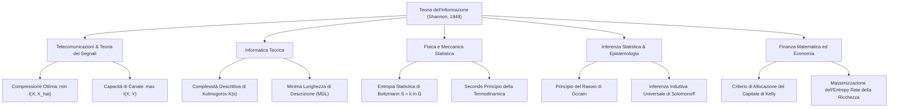

# 6. Introduzione Alla Teoria dell'Informazione Ed Entropia

Nel 1948 Claude Elwood Shannon pubblicò il saggio fondamentale _A Mathematical Theory of Communication_, fondando formalmente la __Teoria dell'Informazione__. Fino ad allora la trasmissione di segnali era considerata un problema prettamente elettrotecnico legato alla potenza analogica e alla propagazione elettromagnetica; Shannon trasformò la nozione intuitiva di informazione in una grandezza probabilistica quantificabile, dimostrando l'esistenza di limiti matematici universali e invalicabili.

L'intera disciplina risponde a due quesiti cardinali:
1. __Qual è il limite fondamentale della compressione dei dati?__ Ovvero, fino a quale livello di brevità possiamo comprimere un messaggio senza perdere informazione? La risposta risiede nell'__entropia__ $H$.
2. __Qual è il limite fondamentale della velocità di comunicazione affidabile?__ Ovvero, a quale ritmo massimo possiamo trasmettere dati attraverso un canale rumoroso garantendo una probabilità d'errore arbitrariamente piccola? La risposta risiede nella __capacità di canale__ $C$.

## Genesi Concettuale E Modello Di Comunicazione Di Shannon

La teoria dell'informazione si colloca al crocevia tra molteplici discipline scientifiche, stabilendo ponti concettuali tra la fisica statistica, la computer science, la probabilità pura, la teoria dei giochi e l'ingegneria delle telecomunicazioni:

Il modello classico di Shannon formalizza qualsiasi catena di comunicazione come una sequenza di trasformazioni matematiche tra una sorgente d'informazione e una destinazione:

![[slide_02_communication_system_block.png|center mid]]

La sorgente genera un messaggio $W$, che l'encoder traduce in una sequenza di canale $X^n$. Il canale fisico introduce un'alterazione aleatoria regolata dalla legge di probabilità di transizione $p(y \mid x)$, restituendo la sequenza ricevuta $Y^n$. Il decodificatore analizza $Y^n$ per formulare una stima $\hat{W}$ del messaggio originale: la trasmissione è considerata affidabile se la probabilità che $\hat{W} \neq W$ può essere resa arbitrariamente piccola al crescere della lunghezza di blocco $n$.

### Complessità Di Kolmogorov Vs Entropia Di Shannon

Nel contesto dell'informatica teorica (Kolmogorov, Chaitin, Solomonoff), la complessità algoritmica o __complessità di Kolmogorov__ $K(s)$ di una sequenza di dati $s$ è definita come la lunghezza in bit del più breve programma per computer universale (es. Macchina di Turing) capace di generare la stringa $s$ come output e poi arrestarsi.

Mentre l'entropia di Shannon è un concetto statistico medio riferito a un insieme di eventi generati da un processo aleatorio, la complessità di Kolmogorov è una misura deterministica applicata a una specifica stringa individuale. Se una sequenza di simboli è generata in modo i.i.d. da una variabile aleatoria discreta $X$ con entropia $H(X)$, la complessità di Kolmogorov normalizzata per simbolo converge con probabilità $1$ all'entropia di Shannon:

$$
\lim_{n \to \infty} \frac{K(X_1, \dots, X_n)}{n} = H(X) \quad \text{con probabilità 1}
$$

Esiste una precisa dualità strutturale: mentre l'analisi degli algoritmi ottimizza la complessità computazionale temporale $O(\cdot)$ o spaziale, la teoria dell'informazione ottimizza la complessità descrittiva dei dati, identificando la minima rappresentazione binaria non comprimibile.

### Tassonomia Dei Problemi Di Elaborazione dell'Informazione

L'ambito applicativo della disciplina si articola in due macro-aree complementari:

1. __Compressione Dati (Codifica di Sorgente)__:
   - _Lossless (senza perdita)_: Ricostruzione esatta e perfetta del messaggio originario (es. algoritmi Deflate, ZIP, PNG, FLAC). Il limite invalicabile di bit medi per simbolo coincide con l'entropia della sorgente.
   - _Lossy (con perdita controllata)_: Tolleranza di una distorsione percettiva o quadratica per abbattere drasticamente la dimensione dei dati (es. JPEG, MPEG, MP3, WebP, JPEG AI). Il limite teorico è dettato dalla funzione Rate-Distortion $R(D)$.
2. __Comunicazione su Canale Rumoroso (Codifica di Canale)__:
   - _Affidabile priva di errori_: Aggiunta di ridondanza strutturata per contrastare il rumore fisico (codici a blocchi, convoluzionali, Turbo, LDPC, Polar) fino al raggiungimento della capacità di canale $C$.
   - _Comunicazione congiunta e semantica_: Trasmissione in cui si ottimizza la preservazione del significato semantico del messaggio sotto vincoli severi di banda e potenza, superando il paradigma della pura ricostruzione bit-a-bit.

## Misura dell'Informazione E Sorpresa Statistica

Nei sistemi fisici e di telecomunicazione, quantificare l'informazione richiede l'adozione di una misura algebricamente consistente. L'intuizione fondamentale di Shannon stabilisce che l'informazione generata da un evento non dipende dal suo significato semantico, bensì dalla sua rarità statistica (il cosiddetto grado di sorpresa):
- L'accadimento di un evento quasi certo ($p \approx 1$) fornisce una quantità di informazione pressoché nulla, poiché l'esito era già previsto con quasi certezza.
- L'accadimento di un evento altamente improbabile ($p \ll 1$) reca una quantità elevata di informazione, poiché dissipa una profonda incertezza pregressa.

Data una variabile aleatoria discreta $X$ che assume valori in un alfabeto finito $\mathcal{X}$ con funzione di massa di probabilità (PMF) $p(x) = \text{Pr}\{X = x\}$, l'__auto-informazione__ (_self-information_ o sorpresa) associata al verificarsi dell'evento $x$ è definita come:

$$
I(x) = \log_b\left( \frac{1}{p(x)} \right) = - \log_b p(x)
$$

### Proprietà Additiva E Motivazione Algebrica Del Logaritmo

Perché utilizziamo proprio il logaritmo per misurare l'informazione? La risposta risiede nella richiesta assiomatica di __additività per eventi statisticamente indipendenti__.

Supponiamo di avere due eventi indipendenti $x_1$ e $x_2$. Poiché gli eventi sono indipendenti, la probabilità congiunta del loro verificarsi simultaneo è data dal prodotto delle singole probabilità:

$$
p(x_1, x_2) = p(x_1) \, p(x_2)
$$

Richiediamo che l'informazione complessiva ottenuta osservando entrambi gli eventi indipendenti sia la somma delle informazioni apportate dai singoli eventi:

$$
I(x_1, x_2) = I(x_1) + I(x_2)
$$

Se esprimiamo l'informazione come funzione della probabilità dell'evento, $I(x) = f(p(x))$, la condizione di additività si traduce nell'equazione funzionale di Cauchy:

$$
f\big( p(x_1) \, p(x_2) \big) = f\big( p(x_1) \big) + f\big( p(x_2) \big)
$$

Sotto l'ipotesi naturale di continuità (o di monotonia decrescente, poiché a probabilità maggiore deve corrispondere sorpresa minore), l'unica famiglia di funzioni reali che trasforma un prodotto in una somma è la funzione logaritmica:

$$
f(p) = -k \log_b p, \quad \text{con } k > 0
$$

Ponendo convenzionalmente la costante di normalizzazione $k = 1$, otteniamo univocamente l'espressione $I(x) = -\log_b p(x)$.

![[self_information_surprise.svg|center mid]]

La curva evidenzia che:
- Per $p = 1$, l'informazione vale $I(1) = -\log_b(1) = 0$: sapere che si è verificato un evento certo non apporta alcuna informazione.
- Per $p \to 0^+$, l'informazione diverge: $I(p) \to +\infty$.
- La funzione è convessa e strettamente decrescente rispetto alla probabilità $p$.

### Basi Del Logaritmo E Unità Di Misura

La scelta della base $b > 1$ del logaritmo fissa la scala e l'unità di misura dell'informazione:
- __Base 2 ($b = 2$)__: L'unità è il __bit__ (contrazione di _binary digit_, detta anche Shannon). Corrisponde alla quantità di informazione generata risolvendo l'incertezza tra due alternative equiprobabili ($p = 1/2 \implies I(x) = -\log_2(1/2) = 1$ bit). Costituisce lo standard assoluto in ingegneria dell'informazione e nelle telecomunicazioni numeriche.
- __Base naturale ($b = e$)__: L'unità è il __nat__. Risulta particolarmente comoda nel calcolo differenziale, nei gradienti di machine learning e nelle formulazioni di meccanica statistica.
- __Base decimale ($b = 10$)__: L'unità è l'__hartley__ (detto anche dit o ban), introdotto da Ralph Hartley nel 1928, corrispondente all'incertezza associata a una scelta equiprobabile tra 10 stati.

Per convertire il valore numerico dell'informazione da una base $b$ a una base $a$, applichiamo la classica regola del cambiamento di base logaritmica:

$$
I_a(x) = \log_a(b) \, I_b(x) = \frac{I_b(x)}{\log_b(a)}
$$

In particolare, per convertire tra nat e bit:

$$
1 \text{ nat} = \log_2(e) \approx 1.442695 \text{ bit}, \qquad 1 \text{ bit} = \ln(2) \approx 0.693147 \text{ nat}
$$

## Entropia Di Shannon

L'auto-informazione $I(x)$ è una variabile aleatoria, poiché dipende dall'esito $x$ che si manifesta con probabilità $p(x)$. L'__entropia di Shannon__ $H(X)$ di una sorgente discreta $X$ è definita come il valore atteso della sorpresa statistica associata a tutte le sue possibili realizzazioni:

$$
H(X) = \mathbb{E}[I(X)] = \mathbb{E}\left[ \log_2 \frac{1}{p(X)} \right] = - \sum_{x \in \mathcal{X}} p(x) \log_2 p(x)
$$

### Proprietà Analitiche Fondamentali

L'entropia gode delle seguenti proprietà cardine, costantemente verificate in sede d'esame:

1. __Funzionale puro della distribuzione__: $H(X)$ non dipende affatto dai valori numerici concreti assunti dalla variabile aleatoria $X$ (che siano tensioni, caratteri alfanumerici o stati quantistici), ma unicamente dal vettore delle probabilità $\mathbf{p} = [p(x_1), \dots, p(x_M)]^T$. Pertanto, scriviamo indistintamente $H(X)$ o $H(\mathbf{p})$.
2. __Continuità sul bordo ($p \to 0^+$)__: Se un evento dell'alfabeto ha probabilità nulla ($p(x) = 0$), conveniamo analiticamente che $0 \log_2 0 = 0$. Questa convenzione non è una scelta arbitraria, ma discende dal calcolo rigoroso del limite mediante la regola di de l'Hôpital:

$$
\lim_{p \to 0^+} p \log_2 p = \lim_{p \to 0^+} \frac{\log_2 p}{\frac{1}{p}} = \lim_{p \to 0^+} \frac{\frac{\mathrm{d}}{\mathrm{d}p} \left( \frac{\ln p}{\ln 2} \right)}{\frac{\mathrm{d}}{\mathrm{d}p} \left( p^{-1} \right)}
$$

Eseguendo le derivate al numeratore e al denominatore:

$$
\lim_{p \to 0^+} \frac{\frac{1}{p \ln 2}}{-\frac{1}{p^2}} = \lim_{p \to 0^+} \left( - \frac{p^2}{p \ln 2} \right) = \lim_{p \to 0^+} \left( - \frac{p}{\ln 2} \right) = 0
$$

Gli eventi impossibili non apportano alcun contributo all'incertezza media del sistema.

3. __Non negatività__: Poiché $0 \le p(x) \le 1$ per ogni realizzazione $x$, si ha che $\log_2(1/p(x)) \ge 0$. Essendo l'entropia una combinazione lineare a pesi non negativi di quantità non negative, concludiamo che:

$$
H(X) \ge 0
$$

L'annullamento $H(X) = 0$ si verifica se e solo se la variabile $X$ è deterministica, ovvero se esiste un unico stato $x_0$ tale che $p(x_0) = 1$ e $p(x) = 0$ per ogni $x \neq x_0$. In tal caso non sussiste alcuna incertezza a priori sull'esito.

La dimostrazione dell'unicità funzionale dell'entropia a partire dai quattro postulati assiomatici di Khinchin è riportata in dettaglio in [[zz. Argomenti extra#Dimostrazione Assiomatica dell'Unicità dell'Entropia di Shannon-Khinchin|Dimostrazione Assiomatica dell'Unicità dell'Entropia di Shannon-Khinchin]].

### Esempio Reale: Entropia Del Linguaggio Naturale

Consideriamo un testo scritto composto da un alfabeto discreto di $M$ simboli tipografici. L'entropia per simbolo quantifica il contenuto informativo intrinseco della lingua:

Analizzando la frequenza unigramma empirica dei circa 400.000 caratteri della _Divina Commedia_ di Dante Alighieri sull'alfabeto italiano (includendo lo spazio interlineare e la punteggiatura principale, per un totale di circa $M \approx 30$ simboli), otteniamo una stima dell'entropia di primo ordine pari a:

$$
H_{\text{Dante}} \approx 4.0126 \text{ bit/carattere}
$$

Se i caratteri fossero generati in modo uniforme ed equiprobabile, l'entropia teorica massima sarebbe:

$$
H_{\text{uniforme}} = \log_2(30) \approx 4.9069 \text{ bit/carattere}
$$

La differenza di quasi $0.9$ bit per carattere quantifica la marcata __ridondanza statistica__ della lingua italiana a livello unigramma (ad esempio l'elevatissima frequenza delle vocali 'e', 'a' contrapposta all'estrema rarità di consonanti come 'q' o 'z').

## Distribuzioni Notevoli Ed Esempi Di Calcolo

### Entropia Binaria Di Bernoulli

Consideriamo una sorgente dicotomica $X \in \{0, 1\}$ governata da una distribuzione di Bernoulli di parametro $p \in [0, 1]$:

$$
p(1) = p, \qquad p(0) = 1 - p
$$

L'entropia di $X$ è descritta dalla celebre __funzione di entropia binaria__ $H_B(p)$:

$$
H_B(p) = - p \log_2 p - (1 - p) \log_2(1 - p)
$$

![[slide_09_binary_entropy_curve.png|center mid]]

Analizziamo il comportamento analitico della funzione:
- __Simmetria rispetto a $p = 1/2$__: $H_B(p) = H_B(1 - p)$. Scambiare le etichette di "successo" e "insuccesso" non modifica l'incertezza intrinseca del processo.
- __Annullamento ai bordi__: Per $p \to 0^+$ e $p \to 1^-$, sfruttando il limite notevole ricavato in precedenza, abbiamo $H_B(0) = H_B(1) = 0$ bit. Quando il risultato della prova è certo a priori, non vi è alcuna incertezza da dissipare.
- __Ricerca del massimo globale__: Calcoliamo la derivata prima rispetto al parametro $p$, convertendo temporaneamente in logaritmi naturali ($\log_2 u = \frac{\ln u}{\ln 2}$):

$$
\frac{\mathrm{d}H_B}{\mathrm{d}p} = \frac{\mathrm{d}}{\mathrm{d}p} \left[ - \frac{p \ln p + (1 - p) \ln(1 - p)}{\ln 2} \right]
$$

Applicando la regola del prodotto di derivazione:

$$
\frac{\mathrm{d}H_B}{\mathrm{d}p} = - \frac{1}{\ln 2} \left[ \left(\ln p + p \cdot \frac{1}{p}\right) + \left((-1)\ln(1 - p) + (1 - p) \cdot \frac{-1}{1 - p}\right) \right]
$$

$$
\frac{\mathrm{d}H_B}{\mathrm{d}p} = - \frac{1}{\ln 2} \left[ \ln p + 1 - \ln(1 - p) - 1 \right]
$$

Notiamo con chiarezza che i termini costanti $+1$ e $-1$ si cancellano esattamente:

$$
\frac{\mathrm{d}H_B}{\mathrm{d}p} = - \frac{1}{\ln 2} \big[ \ln p - \ln(1 - p) \big] = \frac{1}{\ln 2} \ln\left( \frac{1 - p}{p} \right) = \log_2\left( \frac{1 - p}{p} \right)
$$

Imponiamo l'annullamento della derivata prima per determinare i punti stazionari:

$$
\log_2\left( \frac{1 - p}{p} \right) = 0 \iff \frac{1 - p}{p} = 1 \iff 1 - p = p \iff 2p = 1 \iff p = \frac{1}{2}
$$

Verifichiamo la natura del punto stazionario calcolando la derivata seconda:

$$
\frac{\mathrm{d}^2 H_B}{\mathrm{d}p^2} = \frac{\mathrm{d}}{\mathrm{d}p} \left[ \frac{\ln(1 - p) - \ln p}{\ln 2} \right] = \frac{1}{\ln 2} \left( - \frac{1}{1 - p} - \frac{1}{p} \right) = - \frac{1}{p(1 - p)\ln 2}
$$

Poiché $p \in (0, 1)$, il denominatore $p(1 - p)\ln 2$ è strettamente positivo, rendendo la derivata seconda strettamente negativa su tutto l'intervallo:

$$
\frac{\mathrm{d}^2 H_B}{\mathrm{d}p^2} < 0 \quad \forall p \in (0, 1)
$$

La funzione è quindi __strettamente concava__ e il punto $p = 1/2$ è il punto di massimo assoluto, in cui l'incertezza assume il valore di picco pari esattamente a:

$$
H_B\left(\frac{1}{2}\right) = - \frac{1}{2}\log_2\left(\frac{1}{2}\right) - \frac{1}{2}\log_2\left(\frac{1}{2}\right) = \frac{1}{2}(1) + \frac{1}{2}(1) = 1 \text{ bit}
$$

Il lancio di una moneta equa genera esattamente un bit di informazione pura.

### Distribuzione Uniforme Discreta

Consideriamo una variabile aleatoria discreta $X$ che assume $M$ valori distinti equiprobabili:

$$
p(x) = \frac{1}{M}, \quad \forall x \in \mathcal{X} = \{x_1, \dots, x_M\}
$$

Sviluppiamo direttamente la sommatoria dell'entropia:

$$
H(X) = - \sum_{i=1}^M p(x_i) \log_2 p(x_i) = - \sum_{i=1}^M \frac{1}{M} \log_2\left( \frac{1}{M} \right)
$$

Portando i termini costanti fuori dalla sommatoria:

$$
H(X) = - \left( \log_2 \frac{1}{M} \right) \sum_{i=1}^M \frac{1}{M} = - (-\log_2 M) \cdot 1 = \log_2 M \text{ bit}
$$

Questo risultato costituisce un cardine della teoria: per qualsiasi variabile aleatoria a supporto discreto con cardinalità $|\mathcal{X}| = M$, l'entropia è sempre superiormente limitata da $\log_2 M$:

$$
H(X) \le \log_2 M
$$

L'uguaglianza è raggiunta se e solo se la distribuzione è perfettamente uniforme. L'equiprobabilità rappresenta il regime di massima ignoranza o massima imprevedibilità a priori.

### Interpretazione Operativa Tramite Query Binarie: Il Gioco Delle Venti Domande

L'entropia quantifica in modo operativo il numero minimo medio di domande a risposta binaria (sì/no) necessarie per identificare con certezza lo stato assunto da una sorgente aleatoria.

Immaginiamo una variabile aleatoria $X \in \{a, b, c, d\}$ con distribuzione di probabilità non uniforme:

$$
p(a) = \frac{1}{2}, \quad p(b) = \frac{1}{4}, \quad p(c) = \frac{1}{8}, \quad p(d) = \frac{1}{8}
$$

Calcoliamo l'entropia della sorgente:

$$
H(X) = - \left( \frac{1}{2}\log_2 \frac{1}{2} + \frac{1}{4}\log_2 \frac{1}{4} + \frac{1}{8}\log_2 \frac{1}{8} + \frac{1}{8}\log_2 \frac{1}{8} \right)
$$

$$
H(X) = \frac{1}{2}(1) + \frac{1}{4}(2) + \frac{1}{8}(3) + \frac{1}{8}(3) = \frac{4 + 4 + 3 + 3}{8} = \frac{14}{8} = 1.75 \text{ bit}
$$

Costruiamo un albero di interrogazione binaria ottimale per indovinare l'oggetto estratto:
1. Prima domanda: _"La variabile estratta è $a$?"_
   - Se la risposta è sì (probabilità $1/2$), abbiamo identificato la variabile con $1$ sola domanda.
2. Se la risposta è no, poniamo la seconda domanda: _"La variabile estratta è $b$?"_
   - Se la risposta è sì (probabilità $1/4$), abbiamo identificato la variabile con $2$ domande.
3. Se la risposta è no, poniamo la terza domanda: _"La variabile estratta è $c$?"_
   - Se la risposta è sì (probabilità $1/8$), identifichiamo $c$ in $3$ domande.
   - Se la risposta è no (probabilità $1/8$), per esclusione la variabile deve essere $d$, identificata anch'essa con $3$ domande.

Calcoliamo il numero medio atteso di domande binarie necessarie:

$$
\mathbb{E}[\text{domande}] = 1 \cdot p(a) + 2 \cdot p(b) + 3 \cdot p(c) + 3 \cdot p(d)
$$

$$
\mathbb{E}[\text{domande}] = 1 \cdot \left(\frac{1}{2}\right) + 2 \cdot \left(\frac{1}{4}\right) + 3 \cdot \left(\frac{1}{8}\right) + 3 \cdot \left(\frac{1}{8}\right) = 0.5 + 0.5 + 0.375 + 0.375 = 1.75
$$

Il numero medio atteso di decisioni binarie ottimali coincide esattamente con l'entropia di Shannon: $\mathbb{E}[\text{domande}] = H(X) = 1.75$. Quando le probabilità degli eventi sono potenze intere negative di 2 ($p(x) = 2^{-l_x}$), il bound teorico è raggiunto con uguaglianza perfetta senza alcun sovradimensionamento.

### Distribuzioni Asintotiche: Binomiale E Poisson

#### Distribuzione Binomiale

Sia $X \sim \text{Binom}(n, q)$ il conteggio dei successi in $n$ prove bernoulliane indipendenti con probabilità di successo individuale $q$:

$$
p(k) = \binom{n}{k} q^k (1 - q)^{n - k}, \qquad k \in \{0, 1, \dots, n\}
$$

Al crescere di $n$, in virtù del Teorema del Limite Centrale di De Moivre-Laplace, la distribuzione binomiale converge a una densità gaussiana $\mathcal{N}(\mu, \sigma^2)$ con parametri:

$$
\mu = nq, \qquad \sigma^2 = nq(1 - q)
$$

Integrando l'entropia della corrispondente gaussiana discretizzata, otteniamo il comportamento asintotico per grandi campioni:

$$
H(X) \approx \frac{1}{2} \log_2\big( 2\pi e \, n q(1 - q) \big) \text{ bit}
$$

L'incertezza cresce in modo logaritmico rispetto al numero di prove $n$, scalando proporzionalmente alla larghezza della deviazione standard del processo $\sigma = \sqrt{nq(1-q)}$.

#### Distribuzione Di Poisson

Sia $X \sim \text{Pois}(\lambda)$ una variabile aleatoria di Poisson che modella il conteggio di eventi rari con intensità media $\lambda > 0$:

$$
p(k) = \frac{\lambda^k e^{-\lambda}}{k!}, \qquad k = 0, 1, 2, \dots
$$

Espandendo analiticamente il logaritmo di $p(k)$ ed applicando la formula di Stirling per il fattoriale $\ln(k!) \approx k \ln k - k + \frac{1}{2}\ln(2\pi k)$, quando il tasso di arrivo diventa elevato ($\lambda \to \infty$) l'entropia di Shannon manifesta l'andamento asintotico:

$$
H(X) = \frac{1}{2} \log_2(2\pi e \lambda) + O\left(\frac{1}{\lambda}\right) \text{ bit}
$$

La derivazione formale passo-passo basata sull'espansione di Taylor dei momenti centrali e sul controllo analitico del resto è consultabile in [[zz. Argomenti extra#Calcolo Asintotico dell'Entropia di Poisson con Approssimazione di Stirling|Calcolo Asintotico dell'Entropia di Poisson con Approssimazione di Stirling]].

## Entropia Congiunta Ed Entropia Condizionata

Quando un sistema descrive l'interazione tra più variabili aleatorie, è necessario estendere i concetti informativi alle distribuzioni multidimensionali.

Siano $X$ e $Y$ due variabili aleatorie discrete definite rispettivamente sugli insiemi $\mathcal{X}$ e $\mathcal{Y}$, regolate dalla distribuzione di probabilità congiunta $p(x, y) = \text{Pr}\{X = x, Y = y\}$.

L'__Entropia Congiunta__ $H(X, Y)$ quantifica l'incertezza globale associata alla coppia di variabili aleatorie:

$$
H(X, Y) = - \sum_{x \in \mathcal{X}} \sum_{y \in \mathcal{Y}} p(x, y) \log_2 p(x, y) = \mathbb{E}\left[ \log_2 \frac{1}{p(X, Y)} \right]
$$

L'__Entropia Condizionata__ $H(Y \mid X)$ misura l'incertezza residua sulla variabile $Y$ supponendo di aver già osservato l'esito della variabile $X$.

Fissato un valore specifico $X = x$, l'incertezza condizionata a questo singolo evento è data da:

$$
H(Y \mid X = x) = - \sum_{y \in \mathcal{Y}} p(y \mid x) \log_2 p(y \mid x)
$$

L'entropia condizionata globale $H(Y \mid X)$ si ottiene mediando $H(Y \mid X = x)$ rispetto alla distribuzione marginale $p(x)$:

$$
H(Y \mid X) = \sum_{x \in \mathcal{X}} p(x) H(Y \mid X = x) = - \sum_{x \in \mathcal{X}} p(x) \sum_{y \in \mathcal{Y}} p(y \mid x) \log_2 p(y \mid x)
$$

Poiché $p(x) p(y \mid x) = p(x, y)$, ricaviamo la formulazione compatta:

$$
H(Y \mid X) = - \sum_{x \in \mathcal{X}} \sum_{y \in \mathcal{Y}} p(x, y) \log_2 p(y \mid x) = \mathbb{E}\left[ \log_2 \frac{1}{p(Y \mid X)} \right]
$$

### Derivazione Analitica Della Regola Della Catena

L'entropia congiunta e l'entropia condizionata sono collegate dal teorema fondamentale della __regola della catena__ (_chain rule_):

$$
H(X, Y) = H(X) + H(Y \mid X)
$$

e simmetricamente per scambio dei ruoli delle due variabili:

$$
H(X, Y) = H(Y) + H(X \mid Y)
$$

Sviluppiamo la dimostrazione analitica passo dopo passo. Partiamo dalla definizione di entropia congiunta:

$$
H(X, Y) = - \sum_{x \in \mathcal{X}} \sum_{y \in \mathcal{Y}} p(x, y) \log_2 p(x, y)
$$

Sfruttando la regola delle probabilità condizionate, fattorizziamo l'argomento del logaritmo come $p(x, y) = p(x) \, p(y \mid x)$:

$$
H(X, Y) = - \sum_{x \in \mathcal{X}} \sum_{y \in \mathcal{Y}} p(x, y) \log_2\big( p(x) \, p(y \mid x) \big)
$$

Poiché il logaritmo di un prodotto è la somma dei logaritmi, spezziamo la doppia sommatoria in due blocchi:

$$
H(X, Y) = - \sum_{x \in \mathcal{X}} \sum_{y \in \mathcal{Y}} p(x, y) \log_2 p(x) - \sum_{x \in \mathcal{X}} \sum_{y \in \mathcal{Y}} p(x, y) \log_2 p(y \mid x)
$$

Esaminiamo attentamente il primo termine. Il fattore $\log_2 p(x)$ non dipende dall'indice di sommatoria $y$, e può quindi essere raccolto a fattore comune fuori dalla sommatoria interna su $y$:

$$
- \sum_{x \in \mathcal{X}} \log_2 p(x) \left[ \sum_{y \in \mathcal{Y}} p(x, y) \right]
$$

Per la definizione di probabilità marginale, la sommatoria congiunta su tutti i possibili esiti di $y$ collassa esattamente a $p(x)$:

$$
\sum_{y \in \mathcal{Y}} p(x, y) = p(x)
$$

Sostituendo questa identità, il primo termine diventa:

$$
- \sum_{x \in \mathcal{X}} p(x) \log_2 p(x) = H(X)
$$

Il secondo blocco coincide esattamente con la definizione formale di $H(Y \mid X)$:

$$
- \sum_{x \in \mathcal{X}} \sum_{y \in \mathcal{Y}} p(x, y) \log_2 p(y \mid x) = H(Y \mid X)
$$

Sommando i due contributi otteniamo la tesi:

$$
H(X, Y) = H(X) + H(Y \mid X)
$$

L'incertezza globale generata da una coppia di variabili aleatorie è data dall'incertezza associata alla prima variabile più l'incertezza residua della seconda condizionata alla conoscenza della prima.

### Proprietà Del Condizionamento

Una delle proprietà più rilevanti della teoria dell'informazione sancisce che __il condizionamento in media non aumenta mai l'entropia__:

$$
H(Y \mid X) \le H(Y)
$$

con uguaglianza se e solo se le variabili $X$ e $Y$ sono statisticamente indipendenti. In media, acquisire un'osservazione $X$ può soltanto ridurre o lasciare invariata l'incertezza su $Y$, non può mai accrescerla.

> [!WARNING] Trabocchetto d'Esame: Condizionamento Globale vs Singola Realizzazione
> La proprietà di riduzione dell'incertezza vale tassativamente per l'entropia condizionata media $H(Y \mid X) = \sum_x p(x) H(Y \mid X = x)$. Per una singola specifica realizzazione $X = x$, l'entropia puntuale $H(Y \mid X = x)$ può essere sia maggiore sia minore dell'entropia marginale a priori $H(Y)$. Un'osservazione anomala o imprevista può momentaneamente disorientare l'osservatore aumentando l'incertezza locale, ma mediando su tutte le possibili osservazioni l'incertezza media diminuisce sempre.

## Divergenza Di Kullback-Leibler E Cross-Entropia

Nel confronto tra modelli probabilistici, o nella compressione di dati in cui si utilizzi un codice calibrato su un modello statistico errato, è indispensabile quantificare la discrepanza tra due distribuzioni di probabilità distinte $p$ e $q$ definite sul medesimo alfabeto campionario $\mathcal{X}$.

La __Divergenza di Kullback-Leibler__ (chiamata anche __Entropia Relativa__ o _Kullback-Leibler Divergence_, KLD) tra la distribuzione reale $p$ e la distribuzione approssimante $q$ è definita come:

$$
D(p \parallel q) = \sum_{x \in \mathcal{X}} p(x) \log_2\left( \frac{p(x)}{q(x)} \right) = \mathbb{E}_p\left[ \log_2 \frac{p(X)}{q(X)} \right]
$$

### Convenzioni Operative Sui Supporti

Per preservare la coerenza matematica della misura si adottano le convenzioni:
- Se $p(x) = 0$, il relativo termine $0 \log_2(0/q(x))$ vale analiticamente $0$.
- Se $p(x) > 0$ ma $q(x) = 0$, il termine $p(x) \log_2(p(x)/0)$ diverge a $+\infty$, producendo $D(p \parallel q) = +\infty$.

Se il nostro modello $q$ assume a priori che un evento sia categoricamente impossibile ($q(x) = 0$), e nella realtà quell'evento si manifesta ($p(x) > 0$), la penalità da modello errato esplode ad infinito.

### Teorema Di Non-Negatività (Disuguaglianza dell'Entropia Relativa)

La proprietà cardine della divergenza KL è sancita dalla __disuguaglianza di Gibbs__:

$$
D(p \parallel q) \ge 0
$$

con $D(p \parallel q) = 0$ se e solo se $p(x) = q(x)$ per ogni $x \in \mathcal{X}$.

La dimostrazione è immediata applicando la disuguaglianza fondamentale del logaritmo $\ln u \le u - 1$ per ogni $u > 0$ (con uguaglianza se e solo se $u = 1$). Esprimiamo l'opposto della divergenza in base naturale:

$$
- D_e(p \parallel q) = - \sum_{x \in \mathcal{X}} p(x) \ln \frac{p(x)}{q(x)} = \sum_{x \in \mathcal{X}} p(x) \ln\left( \frac{q(x)}{p(x)} \right)
$$

Applicando la disuguaglianza del logaritmo al termine $\ln(q/p)$:

$$
- D_e(p \parallel q) \le \sum_{x \in \mathcal{X}} p(x) \left( \frac{q(x)}{p(x)} - 1 \right) = \sum_{x \in \mathcal{X}} q(x) - \sum_{x \in \mathcal{X}} p(x) = 1 - 1 = 0
$$

Moltiplicando per $-1$ e invertendo il verso della disuguaglianza:

$$
D_e(p \parallel q) \ge 0 \implies D(p \parallel q) \ge 0
$$

L'uguaglianza si verifica se e solo se $q(x)/p(x) = 1$ ovunque sul supporto di $p$, ossia se e solo se le due distribuzioni coincidono perfettamente.

### Asimmetria E Mancanza Di Metrica

Sebbene sia spesso denominata "distanza informativa", la divergenza di Kullback-Leibler __non è una metrica topologica__:
1. __È strutturalmente asimmetrica__: In generale $D(p \parallel q) \neq D(q \parallel p)$.
2. __Viola la disuguaglianza triangolare__: Date tre distribuzioni distinte $p, q, r$, in generale $D(p \parallel r) \not\le D(p \parallel q) + D(q \parallel r)$.

#### Dimostrazione Numerica dell'Asimmetria

Consideriamo due distribuzioni bernoulliane su $\mathcal{X} = \{0, 1\}$:
- Modello equo: $p = (1/2, 1/2)$.
- Modello sbilanciato: $q = (3/4, 1/4)$.

Calcoliamo dapprima $D(p \parallel q)$:

$$
D(p \parallel q) = \frac{1}{2} \log_2\left( \frac{1/2}{3/4} \right) + \frac{1}{2} \log_2\left( \frac{1/2}{1/4} \right)
$$

$$
D(p \parallel q) = \frac{1}{2} \log_2\left(\frac{2}{3}\right) + \frac{1}{2} \log_2(2) = \frac{1}{2}(-0.58496) + \frac{1}{2}(1) = -0.29248 + 0.50000 = 0.20752 \text{ bit}
$$

Calcoliamo ora la divergenza invertendo i ruoli, $D(q \parallel p)$:

$$
D(q \parallel p) = \frac{3}{4} \log_2\left( \frac{3/4}{1/2} \right) + \frac{1}{4} \log_2\left( \frac{1/4}{1/2} \right)
$$

$$
D(q \parallel p) = \frac{3}{4} \log_2\left(\frac{3}{2}\right) + \frac{1}{4} \log_2\left(\frac{1}{2}\right) = \frac{3}{4}(0.58496) + \frac{1}{4}(-1) = 0.43872 - 0.25000 = 0.18872 \text{ bit}
$$

Poiché $0.20752 \neq 0.18872$, l'asimmetria è provata sul campo. L'ordine degli argomenti è determinante: $D(p \parallel q)$ misura il prezzo pagato supponendo $q$ quando la realtà è $p$, mentre $D(q \parallel p)$ misura il prezzo opposto.

### Cross-Entropia E Sovraccarico Di Bit

Strettamente legata alla divergenza KL è la __Cross-Entropia__ tra la distribuzione target $p$ e il modello di stima $q$:

$$
H(p, q) = - \sum_{x \in \mathcal{X}} p(x) \log_2 q(x) = \mathbb{E}_p\left[ \log_2 \frac{1}{q(X)} \right]
$$

Scomponiamo analiticamente l'argomento del logaritmo moltiplicando e dividendo per $p(x)$:

$$
H(p, q) = - \sum_{x \in \mathcal{X}} p(x) \log_2\left( \frac{q(x)}{p(x)} \cdot p(x) \right) = - \sum_{x \in \mathcal{X}} p(x) \log_2 p(x) - \sum_{x \in \mathcal{X}} p(x) \log_2\left( \frac{q(x)}{p(x)} \right)
$$

Riconoscendo le definizioni di entropia e di divergenza di Kullback-Leibler:

$$
H(p, q) = H(p) + \sum_{x \in \mathcal{X}} p(x) \log_2\left( \frac{p(x)}{q(x)} \right)
$$

$$
H(p, q) = H(p) + D(p \parallel q)
$$

Questa scomposizione possiede un'interpretazione fisica fondamentale:
- $H(p)$ è la lunghezza media minima teorica per simbolo ottenibile comprimendo la sorgente $p$ con il suo codice ottimale.
- $H(p, q)$ è la lunghezza media ottenuta codificando la sorgente $p$ con un codice che ritenevamo ottimo per $q$ (lunghezze di codice $\approx \log_2(1/q(x))$).
- $D(p \parallel q)$ rappresenta esattamente il __sovraccarico di bit sprecati per simbolo__ a causa dell'inesattezza del nostro modello statistico.

## Informazione Mutua E Diagrammi Di Venn Informativi

L'__Informazione Mutua__ $I(X; Y)$ tra due variabili aleatorie discrete $X$ e $Y$ quantifica la riduzione di incertezza su una variabile conseguente all'osservazione dell'altra.

Formalmente, l'informazione mutua è definita come la divergenza di Kullback-Leibler tra la distribuzione di probabilità congiunta $p(x, y)$ e il prodotto delle rispettive distribuzioni marginali $p(x)p(y)$:

$$
I(X; Y) = D\big( p(x, y) \parallel p(x)p(y) \big) = \sum_{x \in \mathcal{X}} \sum_{y \in \mathcal{Y}} p(x, y) \log_2\left( \frac{p(x, y)}{p(x)p(y)} \right)
$$

Dalla non-negatività della divergenza KL discende immediatamente che:

$$
I(X; Y) \ge 0
$$

con $I(X; Y) = 0$ se e solo se $p(x, y) = p(x)p(y)$ ovunque, ovvero se e solo se le variabili $X$ e $Y$ sono statisticamente indipendenti. Due variabili indipendenti non condividono alcuna informazione.

### Derivazione Delle Quattro Forme Analitiche Equivalenti

Scomponendo l'argomento del logaritmo mediante le probabilità condizionate, otteniamo quattro espressioni equivalenti dell'informazione mutua, tutte essenziali per la risoluzione dei problemi d'esame:

1. __Prima forma: Riduzione di incertezza su $X$ grazie a $Y$__:
Poiché $\frac{p(x, y)}{p(x)p(y)} = \frac{p(x \mid y)}{p(x)}$, abbiamo:

$$
I(X; Y) = \sum_{x, y} p(x, y) \log_2 p(x \mid y) - \sum_{x, y} p(x, y) \log_2 p(x)
$$

$$
I(X; Y) = - H(X \mid Y) + H(X) = H(X) - H(X \mid Y)
$$

2. __Seconda forma: Riduzione di incertezza su $Y$ grazie a $X$__:
Simmetricamente, poiché $\frac{p(x, y)}{p(x)p(y)} = \frac{p(y \mid x)}{p(y)}$:

$$
I(X; Y) = - H(Y \mid X) + H(Y) = H(Y) - H(Y \mid X)
$$

3. __Terza forma: Relazione con l'entropia congiunta__:
Sostituendo la regola della catena $H(X \mid Y) = H(X, Y) - H(Y)$ nella prima forma:

$$
I(X; Y) = H(X) - \big( H(X, Y) - H(Y) \big) = H(X) + H(Y) - H(X, Y)
$$

4. __Quarta forma: Isolamento della sovrapposizione informativa__:
Sottraendo le incertezze residue dall'unione congiunta:

$$
I(X; Y) = H(X, Y) - H(X \mid Y) - H(Y \mid X)
$$

### Proprietà Fondamentali dell'Informazione Mutua

Dalle formulazioni precedenti deduciamo le proprietà strutturali di $I(X; Y)$:
- __Simmetria__: $I(X; Y) = I(Y; X)$. La quantità di informazione che $X$ rivela su $Y$ è identica alla quantità che $Y$ rivela su $X$.
- __Auto-informazione__: L'informazione mutua che una variabile possiede con se stessa coincide con la sua entropia:

$$
I(X; X) = H(X) - H(X \mid X) = H(X) - 0 = H(X)
$$

Questo risultato chiarisce perché l'entropia di Shannon venga denominata _self-information media_: l'entropia misura l'informazione che una variabile ha su se stessa.
- __Limiti di escursione__: Poiché $H(X \mid Y) \ge 0$ e $H(Y \mid X) \ge 0$, l'informazione mutua è limitata inferiormente da zero e superiormente dalla più piccola delle due entropie marginali:

$$
0 \le I(X; Y) \le \min\big( H(X), H(Y) \big)
$$

### Rappresentazione Insiemistica Tramite Diagrammi Di Venn

Le relazioni algebriche tra le grandezze informative presentano un perfetto isomorfismo con la teoria della misura e con l'algebra degli insiemi:

![[information_venn_diagram.svg|center mid]]

Possiamo confrontare lo schema vettoriale con la rappresentazione canonica:

![[slide_26_mutual_information_venn.png|center mid]]

L'isomorfismo insiemistico si articola nelle seguenti equivalenze:
- La misura dell'insieme $X$ corrisponde all'entropia marginale $H(X)$.
- La misura dell'insieme $Y$ corrisponde all'entropia marginale $H(Y)$.
- L'intersezione insiemistica $X \cap Y$ corrisponde all'informazione mutua $I(X; Y)$.
- Le differenze insiemistiche $X \setminus Y$ e $Y \setminus X$ corrispondono alle entropie condizionate $H(X \mid Y)$ e $H(Y \mid X)$.
- L'unione insiemistica $X \cup Y$ corrisponde all'entropia congiunta:

$$
H(X, Y) = H(X \mid Y) + I(X; Y) + H(Y \mid X) = H(X) + H(Y) - I(X; Y)
$$

Questa formula ricalca fedelmente il principio di inclusione-esclusione $|A \cup B| = |A| + |B| - |A \cap B|$.

### Sviluppo Analitico Completo Di Un Esempio Matriciale

Consideriamo la distribuzione di probabilità congiunta $p(x, y)$ tra due variabili discrete $X, Y \in \{1, 2, 3, 4\}$, in cui le colonne individuano $X$ e le righe individuano $Y$:

| $p(x, y)$ | $X = 1$ | $X = 2$ | $X = 3$ | $X = 4$ | $p(y)$ |
| :---: | :---: | :---: | :---: | :---: | :---: |
| __$Y = 1$__ | $1/8$ | $1/16$ | $1/32$ | $1/32$ | __$1/4$__ |
| __$Y = 2$__ | $1/16$ | $1/8$ | $1/32$ | $1/32$ | __$1/4$__ |
| __$Y = 3$__ | $1/16$ | $1/16$ | $1/16$ | $1/16$ | __$1/4$__ |
| __$Y = 4$__ | $1/4$ | $0$ | $0$ | $0$ | __$1/4$__ |
| __$p(x)$__ | __$1/2$__ | __$1/4$__ | __$1/8$__ | __$1/8$__ | __$1$__ |

Calcoliamo passo-passo tutte le grandezze informative del sistema:

1. __Entropie marginali $H(X)$ e $H(Y)$__:
La distribuzione marginale di $X$ è $p(x) = [1/2, 1/4, 1/8, 1/8]$:

$$
H(X) = \frac{1}{2}\log_2(2) + \frac{1}{4}\log_2(4) + \frac{1}{8}\log_2(8) + \frac{1}{8}\log_2(8)
$$

$$
H(X) = \frac{1}{2}(1) + \frac{1}{4}(2) + \frac{1}{8}(3) + \frac{1}{8}(3) = \frac{4}{8} + \frac{4}{8} + \frac{3}{8} + \frac{3}{8} = \frac{14}{8} = 1.75 \text{ bit}
$$

La distribuzione marginale di $Y$ è uniforme con $p(y) = 1/4$ per $y \in \{1, 2, 3, 4\}$:

$$
H(Y) = \log_2(4) = 2 \text{ bit} = \frac{16}{8} \text{ bit}
$$

2. __Entropia congiunta $H(X, Y)$__:
Raggruppiamo i termini con ugual valore di probabilità nella tabella congiunta:
- $1$ cella con probabilità $1/4$: valore sorpresa $\log_2(4) = 2$
- $2$ celle con probabilità $1/8$: valore sorpresa $\log_2(8) = 3$
- $6$ celle con probabilità $1/16$: valore sorpresa $\log_2(16) = 4$
- $4$ celle con probabilità $1/32$: valore sorpresa $\log_2(32) = 5$
- $3$ celle con probabilità $0$: contributo nullo per limite notevole ($0 \log_2 0 = 0$)

Sviluppiamo la sommatoria:

$$
H(X, Y) = 1 \cdot \left(\frac{1}{4} \cdot 2\right) + 2 \cdot \left(\frac{1}{8} \cdot 3\right) + 6 \cdot \left(\frac{1}{16} \cdot 4\right) + 4 \cdot \left(\frac{1}{32} \cdot 5\right)
$$

$$
H(X, Y) = \frac{2}{4} + \frac{6}{8} + \frac{24}{16} + \frac{20}{32} = \frac{1}{2} + \frac{3}{4} + \frac{3}{2} + \frac{5}{8}
$$

Portando tutto al denominatore comune $8$:

$$
H(X, Y) = \frac{4 + 6 + 12 + 5}{8} = \frac{27}{8} = 3.375 \text{ bit}
$$

3. __Entropie condizionate $H(X \mid Y)$ e $H(Y \mid X)$__:
Applicando la regola della catena:

$$
H(X \mid Y) = H(X, Y) - H(Y) = \frac{27}{8} - \frac{16}{8} = \frac{11}{8} = 1.375 \text{ bit}
$$

$$
H(Y \mid X) = H(X, Y) - H(X) = \frac{27}{8} - \frac{14}{8} = \frac{13}{8} = 1.625 \text{ bit}
$$

Verifichiamo il calcolo di $H(X \mid Y)$ per via diretta mediando sulle singole righe:

$$
H(X \mid Y) = \sum_{y=1}^4 p(y) H(X \mid Y = y)
$$

- Per $y = 1$: le probabilità condizionate sono $[(1/8)/(1/4), (1/16)/(1/4), (1/32)/(1/4), (1/32)/(1/4)] = [1/2, 1/4, 1/8, 1/8] \implies H = 1.75$ bit.
- Per $y = 2$: probabilità condizionate $[1/4, 1/2, 1/8, 1/8] \implies H = 1.75$ bit.
- Per $y = 3$: probabilità condizionate $[1/4, 1/4, 1/4, 1/4] \implies H = \log_2(4) = 2$ bit.
- Per $y = 4$: probabilità condizionate $[1, 0, 0, 0] \implies H = 0$ bit.

Calcolando la media ponderata con pesi $p(y) = 1/4$:

$$
H(X \mid Y) = \frac{1}{4}(1.75) + \frac{1}{4}(1.75) + \frac{1}{4}(2) + \frac{1}{4}(0) = \frac{7/4 + 7/4 + 8/4 + 0}{4} = \frac{22/4}{4} = \frac{11}{8} = 1.375 \text{ bit}
$$

I due metodi concordano perfettamente.

4. __Informazione mutua $I(X; Y)$__:

$$
I(X; Y) = H(X) - H(X \mid Y) = \frac{14}{8} - \frac{11}{8} = \frac{3}{8} = 0.375 \text{ bit}
$$

Verifica mediante la seconda forma simmetrica:

$$
I(X; Y) = H(Y) - H(Y \mid X) = \frac{16}{8} - \frac{13}{8} = \frac{3}{8} = 0.375 \text{ bit}
$$

Verifica mediante la terza forma insiemistica:

$$
I(X; Y) = H(X) + H(Y) - H(X, Y) = \frac{14}{8} + \frac{16}{8} - \frac{27}{8} = \frac{3}{8} = 0.375 \text{ bit}
$$

L'osservazione di $Y$ riduce mediamente l'incertezza su $X$ di $0.375$ bit (e specularmente la conoscenza di $X$ abbatte l'incertezza su $Y$ della medesima quantità).

## Regole Della Catena Multivariate

Le relazioni additive tra entropie, informazioni mutue e divergenze si generalizzano a collezioni arbitrarie di $n$ variabili aleatorie $(X_1, X_2, \dots, X_n)$.

### Regola Della Catena per l'Entropia Generale

Per una sequenza di $n$ variabili aleatorie congiuntamente distribuite:

$$
H(X_1, X_2, \dots, X_n) = \sum_{i=1}^n H(X_i \mid X_{i-1}, X_{i-2}, \dots, X_1)
$$

con la convenzione fondamentale che per il primo termine $i=1$ la variabile è incondizionata: $H(X_1 \mid X_0) \equiv H(X_1)$.

Dimostriamo l'asserto applicando la regola delle probabilità condizionate all'argomento congiunto:

$$
p(x_1, \dots, x_n) = p(x_1) \, p(x_2 \mid x_1) \, p(x_3 \mid x_1, x_2) \cdots p(x_n \mid x_1, \dots, x_{n-1}) = \prod_{i=1}^n p(x_i \mid x^{i-1})
$$

dove abbiamo compattato la notazione vettoriale $x^{i-1} = (x_1, \dots, x_{i-1})$. Sostituendo nella definizione di entropia:

$$
H(X_1, \dots, X_n) = - \mathbb{E}\left[ \log_2 \prod_{i=1}^n p(X_i \mid X^{i-1}) \right] = - \mathbb{E}\left[ \sum_{i=1}^n \log_2 p(X_i \mid X^{i-1}) \right]
$$

Sfruttando la linearità del valore atteso, scambiamo l'operatore di sommatoria con l'aspettazione statistica:

$$
H(X_1, \dots, X_n) = \sum_{i=1}^n \mathbb{E}\left[ -\log_2 p(X_i \mid X^{i-1}) \right] = \sum_{i=1}^n H(X_i \mid X^{i-1})
$$

Nei processi aleatori temporali con memoria, l'incertezza globale della traiettoria è la somma delle incertezze di ciascun campione condizionato a tutta la sua storia passata.

### Informazione Mutua Condizionata

Siano $X, Y, Z$ tre variabili aleatorie. L'__Informazione Mutua Condizionata__ $I(X; Y \mid Z)$ quantifica la riduzione di incertezza su $X$ generata dall'osservazione di $Y$, sapendo che la variabile $Z$ è già nota all'osservatore:

$$
I(X; Y \mid Z) = H(X \mid Z) - H(X \mid Y, Z) = \mathbb{E}_{p(x, y, z)}\left[ \log_2 \frac{p(X, Y \mid Z)}{p(X \mid Z) \, p(Y \mid Z)} \right]
$$

Espandendo con la regola della catena a tre variabili:

$$
I(X; Y \mid Z) = H(X, Z) - H(Z) - \big( H(X, Y, Z) - H(Y, Z) \big) = H(X, Z) + H(Y, Z) - H(X, Y, Z) - H(Z)
$$

> [!NOTE] Comportamento Non Monotono del Condizionamento sull'Informazione Mutua
> A differenza dell'entropia (per cui vale rigorosamente $H(X \mid Z) \le H(X)$), l'informazione mutua condizionata $I(X; Y \mid Z)$ __non è vincolata__ a essere minore di $I(X; Y)$. A seconda della struttura di dipendenza probabilistica:
> - $I(X; Y \mid Z) < I(X; Y)$: quando $Z$ è una causa comune che spiega la correlazione tra $X$ e $Y$ (struttura a forchetta o catena markoviana $X \to Z \to Y$).
> - $I(X; Y \mid Z) > I(X; Y)$: quando $Z$ è un collisore non osservato ($X \to Z \leftarrow Y$, ad esempio un'operazione XOR in cui $X$ e $Y$ sono monete indipendenti e $Z = X \oplus Y$). In tal caso $I(X; Y) = 0$, ma condizionando su $Z$ si ottiene $I(X; Y \mid Z) = 1$ bit!

### Regola Della Catena per l'Informazione Mutua

L'informazione mutua tra un vettore di variabili $(X_1, \dots, X_n)$ e una variabile target $Y$ si scompone additivamente come:

$$
I(X_1, X_2, \dots, X_n; Y) = \sum_{i=1}^n I(X_i; Y \mid X_1, \dots, X_{i-1})
$$

Dimostriamo l'identità espandendo in differenze di entropia:

$$
I(X_1, \dots, X_n; Y) = H(X_1, \dots, X_n) - H(X_1, \dots, X_n \mid Y)
$$

Applichiamo la regola della catena dell'entropia ad ambedue i termini:

$$
H(X_1, \dots, X_n) = \sum_{i=1}^n H(X_i \mid X_1, \dots, X_{i-1})
$$

$$
H(X_1, \dots, X_n \mid Y) = \sum_{i=1}^n H(X_i \mid X_1, \dots, X_{i-1}, Y)
$$

Sottraendo membro a membro e raggruppando sotto la medesima sommatoria:

$$
I(X_1, \dots, X_n; Y) = \sum_{i=1}^n \left[ H(X_i \mid X_1, \dots, X_{i-1}) - H(X_i \mid X_1, \dots, X_{i-1}, Y) \right]
$$

Riconoscendo la definizione di informazione mutua condizionata entro le parentesi quadre:

$$
I(X_1, \dots, X_n; Y) = \sum_{i=1}^n I(X_i; Y \mid X_1, \dots, X_{i-1})
$$

L'informazione apportata congiuntamente da una collezione di variabili è la somma dei contributi informativi incrementali di ciascuna variabile, condizionata a tutte le variabili esaminate nei passaggi precedenti.

### Divergenza KL Condizionata E Regola Della Catena per l'Entropia Relativa

Date due distribuzioni congiunte $p(x, y)$ e $q(x, y)$, la __Divergenza di Kullback-Leibler Condizionata__ $D(p(y \mid x) \parallel q(y \mid x))$ è la media su $p(x)$ delle divergenze tra le leggi condizionate:

$$
D\big( p(y \mid x) \parallel q(y \mid x) \big) = \sum_{x \in \mathcal{X}} p(x) \sum_{y \in \mathcal{Y}} p(y \mid x) \log_2\left( \frac{p(y \mid x)}{q(y \mid x)} \right) = \mathbb{E}_{p(x, y)}\left[ \log_2 \frac{p(Y \mid X)}{q(Y \mid X)} \right]
$$

La __regola della catena per la divergenza KL__ stabilisce che:

$$
D\big( p(x, y) \parallel q(x, y) \big) = D\big( p(x) \parallel q(x) \big) + D\big( p(y \mid x) \parallel q(y \mid x) \big)
$$

Sviluppiamo la dimostrazione analitica partendo dalla divergenza congiunta:

$$
D\big( p(x, y) \parallel q(x, y) \big) = \sum_{x \in \mathcal{X}} \sum_{y \in \mathcal{Y}} p(x, y) \log_2\left( \frac{p(x, y)}{q(x, y)} \right)
$$

Fattorizzando numeratore e denominatore tramite le rispettive distribuzioni condizionate:

$$
\frac{p(x, y)}{q(x, y)} = \frac{p(x) \, p(y \mid x)}{q(x) \, q(y \mid x)} = \frac{p(x)}{q(x)} \cdot \frac{p(y \mid x)}{q(y \mid x)}
$$

Spezzando il logaritmo del prodotto nella somma di due logaritmi:

$$
D\big( p(x, y) \parallel q(x, y) \big) = \sum_{x \in \mathcal{X}} \sum_{y \in \mathcal{Y}} p(x, y) \log_2\left( \frac{p(x)}{q(x)} \right) + \sum_{x \in \mathcal{X}} \sum_{y \in \mathcal{Y}} p(x, y) \log_2\left( \frac{p(y \mid x)}{q(y \mid x)} \right)
$$

Nel primo addendo, il termine $\log_2(p(x)/q(x))$ non dipende da $y$. Raccogliendolo ed eseguendo la marginalizzazione interna su $y$:

$$
\sum_{x \in \mathcal{X}} \log_2\left( \frac{p(x)}{q(x)} \right) \left[ \sum_{y \in \mathcal{Y}} p(x, y) \right] = \sum_{x \in \mathcal{X}} p(x) \log_2\left( \frac{p(x)}{q(x)} \right) = D\big( p(x) \parallel q(x) \big)
$$

Il secondo addendo corrisponde per costruzione a $D(p(y \mid x) \parallel q(y \mid x))$, completando la dimostrazione.

## Quadro Sinottico Delle Misure Di Informazione

La seguente tabella riassume e confronta in modo sistematico le misure di informazione fondamentali, evidenziando definizioni matematiche, proprietà di simmetria, domini di ammissibilità e significati operativi.

| Misura di Informazione | Definizione KaTeX | Simmetria | Dominio Valori | Significato Fisico e Applicativo |
| :--- | :--- | :---: | :---: | :--- |
| __Auto-informazione__ | $I(x) = \log_2\left(\frac{1}{p(x)}\right)$ | — | $[0, +\infty)$ | Grado di sorpresa per il singolo evento $x$. Vale $0$ per eventi certi ($p=1$), diverge per eventi rari. |
| __Entropia di Shannon__ | $H(X) = -\sum_{x} p(x) \log_2 p(x)$ | — | $[0, \log_2\|\mathcal{X}\|]$ | Incertezza media della sorgente; limite insuperabile per la compressione di sorgente lossless. |
| __Entropia Congiunta__ | $H(X, Y) = -\sum_{x,y} p(x, y) \log_2 p(x, y)$ | Sì ($X \leftrightarrow Y$) | $[0, \log_2(\|\mathcal{X}\| \cdot \|\mathcal{Y}\|)]$ | Incertezza globale congiunta della coppia; vale la regola $H(X, Y) = H(X) + H(Y \mid X)$. |
| __Entropia Condizionata__ | $H(Y \mid X) = -\sum_{x,y} p(x, y) \log_2 p(y \mid x)$ | No | $[0, H(Y)]$ | Incertezza residua su $Y$ quando $X$ è nota; in media il condizionamento non aumenta l'entropia. |
| __Divergenza KL__ | $D(p \parallel q) = \sum_{x} p(x) \log_2 \frac{p(x)}{q(x)}$ | No ($p \not\leftrightarrow q$) | $[0, +\infty)$ | Inefficienza o penalità di codifica nell'usare $q$ anziché la vera $p$. Risulta $D(p \parallel q) \ge 0$. |
| __Cross-Entropia__ | $H(p, q) = -\sum_{x} p(x) \log_2 q(x)$ | No | $[H(p), +\infty)$ | Lunghezza media con codice tarato su $q$; $H(p, q) = H(p) + D(p \parallel q)$. Funzione di costo in ML. |
| __Informazione Mutua__ | $I(X; Y) = D(p(x, y) \parallel p(x)p(y))$ | Sì ($X \leftrightarrow Y$) | $[0, \min(H(X), H(Y))]$ | Riduzione di incertezza su $X$ grazie a $Y$; misura l'intersezione informativa condivisa. |
| __Informazione Mutua Condizionata__ | $I(X; Y \mid Z) = H(X \mid Z) - H(X \mid Y, Z)$ | Sì ($X \leftrightarrow Y$) | $[0, \min(H(X \mid Z), H(Y \mid Z))]$ | Riduzione di incertezza tra $X$ e $Y$ quando $Z$ è già nota; non vincolata a essere $\le I(X; Y)$. |

## Takeaway d'Esame E Trabocchetti Operativi

Per massimizzare la prontezza e la sicurezza nella risoluzione degli esercizi d'esame scritti e orali, sintetizziamo i principi e i trabocchetti più ricorrenti:

1. __Attenzione alle basi del logaritmo__:
   Nelle derivazioni algebriche analitiche (es. studio di funzioni, massimizzazione di lagrangiane) è sempre preferibile utilizzare i logaritmi naturali $\ln u$ per semplificare le derivate ($\frac{\mathrm{d}}{\mathrm{d}u} \ln u = \frac{1}{u}$). Ricordiamo sempre di riscalare il risultato finale dividendo per $\ln 2$ quando il problema richiede l'output espresso in __bit__.
2. __Massimizzatore di entropia discreta__:
   Su un alfabeto finito di cardinalità $M$, la distribuzione che massimizza l'entropia è univocamente la __distribuzione uniforme__, con valore $H_{\max} = \log_2 M$. Se in un esercizio si ottiene un'entropia superiore a $\log_2 M$, vi è un errore di calcolo.
3. __L'asimmetria letale della Divergenza KL__:
   All'orale non definire mai la divergenza di Kullback-Leibler come una "distanza metrica". Ricordare sempre che $D(p \parallel q) \neq D(q \parallel p)$ e che non vale la disuguaglianza triangolare. Il primo argomento $p$ è sempre la distribuzione che governa la generazione effettiva dei dati, mentre il secondo argomento $q$ è il modello approssimante.
4. __Condizionamento: media vs istanza puntuale__:
   Non affermare mai superficialmente che "l'entropia condizionata è sempre minore dell'entropia iniziale". L'affermazione corretta è: l'entropia condizionata _media_ $H(Y \mid X)$ è sempre minore o uguale all'entropia marginale $H(Y)$, ma per un singolo valore fissato $x$, $H(Y \mid X = x)$ può essere strettamente maggiore di $H(Y)$.
5. __Variabili indipendenti e informazione mutua__:
   Se due variabili sono indipendenti, $I(X; Y) = 0$, $H(X, Y) = H(X) + H(Y)$ e $H(X \mid Y) = H(X)$. Se invece $Y$ è una funzione deterministica invertibile di $X$ ($Y = g(X)$ biunivoca), allora $I(X; Y) = H(X) = H(Y)$ e $H(Y \mid X) = 0$.
6. __Regole della catena come telescopi informativi__:
   Sia per l'entropia sia per l'informazione mutua, le regole della catena funzionano come somme telescopiche condizionate alla storia passata. Negli esercizi con processi di Markov ($X_1 \to X_2 \to \dots \to X_n$), il condizionamento a tutti i simboli passati si riduce istantaneamente al solo simbolo precedente: $H(X_i \mid X_1, \dots, X_{i-1}) = H(X_i \mid X_{i-1})$.
