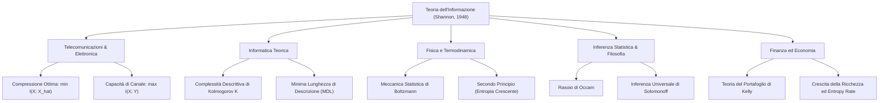

# 6. Introduzione alla Teoria dell'Informazione ed Entropia

Nel 1948 Claude Elwood Shannon pubblicò il saggio fondamentale _A Mathematical Theory of Communication_, fondando formalmente la __Teoria dell'Informazione__. Fino ad allora la trasmissione di segnali era considerata un problema prettamente elettrotecnico legato alla potenza analogica e alla propagazione elettromagnetica; Shannon trasformò la nozione intuitiva di informazione in una grandezza probabilistica quantificabile, dimostrando l'esistenza di limiti matematici invalicabili e universali.

L'intera disciplina risponde a due quesiti cardinali:
1. __Qual è il limite fondamentale della compressione dei dati?__ Ovvero, fino a quale livello di brevità è possibile comprimere un messaggio senza perdere informazione? La risposta risiede nell'__entropia__ $H$.
2. __Qual è il limite fondamentale della velocità di comunicazione affidabile?__ Ovvero, a quale ritmo massimo è possibile trasmettere dati attraverso un canale rumoroso garantendo una probabilità d'errore arbitrariamente piccola? La risposta risiede nella __capacità di canale__ $C$.

## Fondamenti e Significato della Teoria dell'Informazione

La teoria dell'informazione si colloca al crocevia tra molteplici campi scientifici, stabilendo ponti concettuali tra la fisica statistica, la computer science, la probabilità pura e l'ingegneria:

### Complessità di Kolmogorov vs Entropia

Nel contesto della scienza dell'informazione teorica (Kolmogorov, Chaitin, Solomonoff), la complessità algoritmica o __complessità di Kolmogorov__ $K(s)$ di una stringa di dati $s$ è definita come la lunghezza in bit del più breve programma per computer universale (es. Macchina di Turing) in grado di generare la stringa $s$ come output e arrestarsi. 
Mentre l'entropia di Shannon è un concetto statistico che misura l'incertezza media di un processo aleatorio sorgente, la complessità di Kolmogorov è un concetto descrittivo deterministico valido per singole sequenze. Se una sequenza è generata in modo i.i.d. secondo una distribuzione di probabilità avente entropia $H$, la complessità di Kolmogorov normalizzata converge asintoticamente all'entropia di Shannon:

$$
\lim_{n \to \infty} \frac{K(X_1, \dots, X_n)}{n} = H(X) \quad \text{con probabilità 1}
$$

Esiste inoltre una dualità strutturale tra la complessità computazionale $O(\cdot)$ (che ottimizza il tempo di esecuzione) e la complessità di Kolmogorov $K(\cdot)$ (che ottimizza la lunghezza del codice descrittore).

### Tassonomia dei Problemi di Teoria dell'Informazione

L'ambito applicativo dell'elaborazione dell'informazione si articola in due macro-aree complementari:

1. __Compressione Dati (Codifica di Sorgente)__:
   - _Lossless (senza perdita)_: Ricostruzione esatta e perfetta del messaggio originario (es. algoritmi Deflate, ZIP, PNG, FLAC). Il limite invalicabile è l'entropia della sorgente.
   - _Lossy (con perdita controllata)_: Tolleranza di una distorsione percettiva o quadratica per abbattere drasticamente la dimensione dei dati (es. JPEG, MPEG, MP3, JPEG AI). Il limite è dettato dalla teoria Rate-Distortion.
2. __Comunicazione Affidabile (Codifica di Canale)__:
   - _Affidabile priva di errori_: Aggiunta di ridondanza strutturata per contrastare il rumore fisico (codici convoluzionali, Turbo, LDPC) fino al raggiungimento della capacità di canale $C$.
   - _Comunicazione congiunta e semantica_: Trasmissione in cui si ottimizza la preservazione del significato semantico del messaggio sotto vincoli severi di banda e potenza.

## Misura dell'Informazione ed Entropia di Shannon

Nei sistemi fisici e computazionali, quantificare l'informazione richiede l'adozione di un'unità di misura rigorosa. L'intuizione fondamentale di Shannon stabilisce che l'informazione non dipende dal significato semantico del messaggio, bensì dalla sua rarità statistica (effetto sorpresa):
- L'accadimento di un evento quasi certo ($p \approx 1$) fornisce una quantità di informazione trascurabile, in quanto l'esito era già largamente previsto.
- L'accadimento di un evento altamente improbabile ($p \ll 1$) reca una quantità elevata di informazione, poiché dissipa una profonda incertezza pregressa.

Data una variabile aleatoria discreta $X$ che assume valori in un alfabeto finito $\mathcal{X}$ con funzione di massa di probabilità (PMF) $p(x) = \text{Pr}\{X = x\}$, l'__auto-informazione__ (_self-information_ o sorpresa) associata al verificarsi dell'evento $x$ è definita come:

$$
I(x) = \log_b\left( \frac{1}{p(x)} \right) = - \log_b p(x)
$$

### Basi del Logaritmo e Unità di Misura

L'unità di misura dell'informazione è determinata dalla base $b > 1$ del logaritmo:
- __Base 2 ($b = 2$)__: L'unità è il __bit__ (crasi di _binary digit_ o Shannon). Rappresenta l'informazione ottenuta risolvendo un'incertezza equiprobabile tra due alternative ($p = 1/2 \implies I(x) = \log_2(2) = 1$ bit). È lo standard di riferimento in informatica e telecomunicazioni.
- __Base naturale ($b = e$)__: L'unità è il __nat__. Utilizzato nelle derivazioni analitiche, nei gradienti di machine learning e nella fisica teorica.
- __Base decimale ($b = 10$)__: L'unità è l'__hartley__ (o dit, ban). Introdotto da Ralph Hartley nel 1928, corrisponde all'incertezza di una scelta uniforme tra 10 stati.

La conversione tra diverse basi si effettua applicando la regola del cambio di base:

$$
H_a(X) = \log_a(b) \, H_b(X)
$$

Ad esempio, per convertire da nat a bit: $1 \text{ nat} = \log_2(e) \approx 1.442695 \text{ bit}$.

### Definizione Formale dell'Entropia

L'__entropia di Shannon__ $H(X)$ di una variabile aleatoria discreta $X$ è definita come il valore atteso dell'auto-informazione associata ai suoi esiti:

$$
H(X) = \mathbb{E}\left[ \log_2 \frac{1}{p(X)} \right] = - \sum_{x \in \mathcal{X}} p(x) \log_2 p(x)
$$

L'entropia gode delle seguenti proprietà immediate:
1. __Funzionale puro della distribuzione__: $H(X)$ non dipende dai valori numerici assunti dalla variabile $X$, ma unicamente dalla collezione di probabilità $\mathbf{p} = \{p(x)\}_{x \in \mathcal{X}}$. Pertanto viene spesso indicata equivalentemente con $H(\mathbf{p})$.
2. __Continuità sul bordo ($p \to 0$)__: Nei punti in cui un evento ha probabilità nulla ($p(x) = 0$), il termine $0 \log_2 0$ è posto convenzionalmente pari a $0$. Tale convenzione è rigorosamente motivata dal limite analitico:

$$
\lim_{p \to 0^+} p \log_2 p = \lim_{p \to 0^+} \frac{\log_2 p}{1/p} = \lim_{p \to 0^+} \frac{\frac{1}{p \ln 2}}{-\frac{1}{p^2}} = \lim_{p \to 0^+} \left( - \frac{p}{\ln 2} \right) = 0
$$

3. __Non negatività__: Poiché per ogni evento $0 \le p(x) \le 1$, si ha $\log_2(1/p(x)) \ge 0$. Essendo una combinazione lineare a pesi non negativi di termini non negativi:

$$
H(X) \ge 0
$$

con $H(X) = 0$ se e solo se la variabile è deterministica (esiste un elemento $x_0$ tale che $p(x_0) = 1$ e $p(x) = 0$ per ogni $x \neq x_0$).

La dimostrazione dell'unicità funzionale dell'entropia a partire dai quattro postulati assiomatici di consistenza è riportata formalmente in [[zz. Argomenti extra#Dimostrazione Assiomatica dell'Unicità dell'Entropia di Shannon-Khinchin|Dimostrazione Assiomatica dell'Unicità dell'Entropia di Shannon-Khinchin]].

### Esempio Reale: Entropia del Linguaggio Naturale

Considerando un testo scritto composto da un alfabeto discreto di $M$ caratteri, l'entropia per simbolo quantifica la ricchezza informativa del linguaggio. Ad esempio, analizzando la frequenza unigramma dei circa 400.000 caratteri della _Divina Commedia_ di Dante Alighieri sull'alfabeto italiano (includendo spazi e punteggiatura essenziale, $\approx 30$ simboli), si ottiene una stima empirica di entropia di primo ordine pari a:

$$
H_{\text{Dante}} \approx 4.0126 \text{ bit/carattere}
$$

A fronte di un'entropia uniforme teorica di $\log_2(30) \approx 4.9069$ bit/carattere, la differenza riflette la marcata ridondanza statistica (frequenza elevata di vocali come 'a', 'e' e rarità di consonanti come 'q', 'z').

## Distribuzioni Notevoli ed Esempi di Calcolo

### Entropia Binaria (Bernoulli PMF)

Si consideri una variabile aleatoria dicotomica $X \in \{0, 1\}$ governata da una distribuzione di Bernoulli con parametro di successo $p \in [0, 1]$:

$$
p(1) = p, \qquad p(0) = 1 - p
$$

L'entropia di $X$ è data dalla __funzione di entropia binaria__ $H_B(p)$:

$$
H_B(p) = - p \log_2 p - (1 - p) \log_2(1 - p)
$$

![[slide_09_binary_entropy_curve.png|center mid]]

Le proprietà analitiche salienti di $H_B(p)$ evidenziano:
- __Simmetria__: $H_B(p) = H_B(1 - p)$, dovuta all'invarianza per scambio dei ruoli di successo e insuccesso.
- __Annullamento agli estremi__: $H_B(0) = H_B(1) = 0$ bit. Quando l'esito è certo a priori, non vi è alcuna incertezza e il processo non genera informazione.
- __Massimo globale__: Calcolando la derivata prima:

$$
\frac{\mathrm{d}H_B}{\mathrm{d}p} = - \log_2 p - \frac{p}{p \ln 2} + \log_2(1 - p) + \frac{1-p}{(1-p)\ln 2} = \log_2\left( \frac{1 - p}{p} \right)
$$

Annullando la derivata prima:

$$
\log_2\left( \frac{1 - p}{p} \right) = 0 \iff \frac{1 - p}{p} = 1 \iff p = \frac{1}{2}
$$

In $p = 1/2$, la variabile è massimamente imprevedibile (lancio di una moneta perfetta) e l'entropia raggiunge il valore di picco pari esattamente a $H_B(1/2) = 1$ bit. La derivata seconda $\frac{\mathrm{d}^2 H_B}{\mathrm{d}p^2} = -\frac{1}{p(1-p)\ln 2} < 0$ conferma la concavità della funzione su tutto l'intervallo aperto $(0, 1)$.

### Entropia e Strategie di Domande Binarie (Il Gioco delle 20 Domande)

L'entropia di Shannon possiede una rigorosa interpretazione operativa in termini di query binarie. Si consideri una variabile aleatoria $X \in \{a, b, c, d\}$ con distribuzione non uniforme:

$$
p(a) = \frac{1}{2}, \quad p(b) = \frac{1}{4}, \quad p(c) = \frac{1}{8}, \quad p(d) = \frac{1}{8}
$$

L'entropia di questa sorgente è:

$$
H(X) = - \left( \frac{1}{2}\log_2 \frac{1}{2} + \frac{1}{4}\log_2 \frac{1}{4} + \frac{1}{8}\log_2 \frac{1}{8} + \frac{1}{8}\log_2 \frac{1}{8} \right) = \frac{1}{2}(1) + \frac{1}{4}(2) + \frac{1}{8}(3) + \frac{1}{8}(3) = 1.75 \text{ bit}
$$

Si consideri un albero decisionale per indovinare il valore di $X$ ponendo domande con risposta binaria (sì/no):
1. Prima domanda: _"La variabile è $a$?"_ (risolve l'esito $a$ con 1 domanda, probabilità 1/2).
2. Se la risposta è no, seconda domanda: _"La variabile è $b$?"_ (risolve l'esito $b$ con 2 domande, probabilità 1/4).
3. Se la risposta è no, terza domanda: _"La variabile è $c$?"_ (se sì è $c$, se no è $d$; risolve con 3 domande, probabilità $1/8 + 1/8 = 1/4$).

Il numero medio atteso di domande necessarie è:

$$
\mathbb{E}[\text{domande}] = 1 \cdot \frac{1}{2} + 2 \cdot \frac{1}{4} + 3 \cdot \frac{1}{8} + 3 \cdot \frac{1}{8} = 1.75
$$

Il numero medio di domande ottime coincide con l'entropia della sorgente. L'entropia quantifica il numero minimo medio di decisioni binarie per identificare lo stato ignoto.

### Entropia della Distribuzione Binomiale

Si consideri una variabile aleatoria binomiale $X \sim \text{Binom}(n, q)$ che conta i successi su $n$ prove indipendenti con probabilità di successo $q$:

$$
p(k) = \binom{n}{k} q^k (1 - q)^{n - k}, \qquad k = 0, 1, \dots, n
$$

Per valori elevati di $n$, in virtù del teorema del limite centrale di De Moivre-Laplace, la funzione di massa di probabilità può essere approssimata dalla densità normale $\mathcal{N}(\mu, \sigma^2)$ con media $\mu = nq$ e varianza $\sigma^2 = nq(1 - q)$. Integrando la campana gaussiana discreta, l'entropia di Shannon assume l'andamento asintotico:

$$
H(X) \approx \frac{1}{2} \log_2\big( 2\pi e \, n q(1 - q) \big) \quad \text{bit}
$$

L'incertezza cresce logaritmicamente con il numero di prove $n$, scalando proporzionalmente alla deviazione standard del processo $\sigma = \sqrt{nq(1-q)}$.

### Entropia della Distribuzione di Poisson

Si consideri una variabile di Poisson $X \sim \text{Pois}(\lambda)$ che modella il conteggio di eventi rari con intensità media $\lambda > 0$:

$$
p(k) = \frac{\lambda^k e^{-\lambda}}{k!}, \qquad k = 0, 1, 2, \dots
$$

Espandendo analiticamente il logaritmo della probabilità e applicando l'approssimazione di Stirling al termine fattoriale $\ln(k!)$, si dimostra che al divergere del tasso di arrivo ($\lambda \to \infty$) l'entropia si comporta asintoticamente come:

$$
H(X) = \frac{1}{2} \log_2(2\pi e \lambda) + O\left(\frac{1}{\lambda}\right) \quad \text{bit}
$$

La derivazione formale passo-passo basata sull'espansione in serie di Taylor dei momenti centrali è documentata in [[zz. Argomenti extra#Calcolo Asintotico dell'Entropia di Poisson con Approssimazione di Stirling|Calcolo Asintotico dell'Entropia di Poisson con Approssimazione di Stirling]].

## Entropia Congiunta ed Entropia Condizionata

Nello studio di sistemi a più variabili casuali, la caratterizzazione statistica impone di estendere la definizione di entropia alle distribuzioni multivariate e condizionate.

Sia $(X, Y)$ una coppia di variabili aleatorie discrete congiuntamente distribuite secondo la funzione di massa di probabilità $p(x, y)$ su $\mathcal{X} \times \mathcal{Y}$.

L'__Entropia Congiunta__ $H(X, Y)$ misura l'incertezza complessiva associata alla coppia di variabili aleatorie:

$$
H(X, Y) = - \sum_{x \in \mathcal{X}} \sum_{y \in \mathcal{Y}} p(x, y) \log_2 p(x, y) = \mathbb{E}\left[ \log_2 \frac{1}{p(X, Y)} \right]
$$

L'__Entropia Condizionata__ $H(Y \mid X)$ quantifica l'incertezza residua sulla variabile $Y$ quando sia già stato osservato il valore assunto dalla variabile $X$. Definendo l'incertezza condizionata ad un singolo evento fissato $X = x$:

$$
H(Y \mid X = x) = - \sum_{y \in \mathcal{Y}} p(y \mid x) \log_2 p(y \mid x)
$$

L'entropia condizionata globale si ottiene mediando $H(Y \mid X = x)$ rispetto a tutte le possibili realizzazioni di $X$:

$$
H(Y \mid X) = \sum_{x \in \mathcal{X}} p(x) H(Y \mid X = x) = - \sum_{x \in \mathcal{X}} \sum_{y \in \mathcal{Y}} p(x, y) \log_2 p(y \mid x) = \mathbb{E}\left[ \log_2 \frac{1}{p(Y \mid X)} \right]
$$

### Teorema della Regola della Catena per l'Entropia

L'entropia congiunta e l'entropia condizionata sono legate dal teorema fondamentale della __regola della catena__ (_chain rule_):

$$
H(X, Y) = H(X) + H(Y \mid X)
$$

e simmetricamente per scambio dei ruoli:

$$
H(X, Y) = H(Y) + H(X \mid Y)
$$

La dimostrazione algebrica discende dalla scomposizione della probabilità congiunta $p(x, y) = p(x) p(y \mid x)$:

$$
H(X, Y) = - \sum_{x \in \mathcal{X}} \sum_{y \in \mathcal{Y}} p(x, y) \log_2\big( p(x) p(y \mid x) \big)
$$

$$
H(X, Y) = - \sum_{x \in \mathcal{X}} \sum_{y \in \mathcal{Y}} p(x, y) \log_2 p(x) - \sum_{x \in \mathcal{X}} \sum_{y \in \mathcal{Y}} p(x, y) \log_2 p(y \mid x)
$$

Poiché $\sum_{y \in \mathcal{Y}} p(x, y) = p(x)$, il primo termine coincide con $H(X)$, mentre il secondo termine coincide con la definizione di $H(Y \mid X)$:

$$
H(X, Y) = - \sum_{x \in \mathcal{X}} p(x) \log_2 p(x) + H(Y \mid X) = H(X) + H(Y \mid X)
$$

L'incertezza complessiva di due variabili è la somma dell'incertezza della prima più l'incertezza della seconda condizionata alla conoscenza della prima.

## Divergenza di Kullback-Leibler e Cross-Entropia

Nel confronto tra modelli probabilistici o nella compressione di dati con codificatori non ottimali, è indispensabile quantificare la discrepanza statistica tra due distribuzioni di probabilità distinte definite sul medesimo spazio campionario.

Siano $p(x)$ e $q(x)$ due funzioni di massa di probabilità definite sullo stesso alfabeto $\mathcal{X}$.

La __Divergenza di Kullback-Leibler__ (chiamata anche __Entropia Relativa__ o _Kullback-Leibler Divergence_, KLD) tra $p$ e $q$ è definita come:

$$
D(p \parallel q) = \sum_{x \in \mathcal{X}} p(x) \log_2\left( \frac{p(x)}{q(x)} \right) = \mathbb{E}_p\left[ \log_2 \frac{p(X)}{q(X)} \right]
$$

### Convenzioni Operative sui Supporti

Per assicurare la consistenza analitica della misura:
- Se $p(x) = 0$, il contributo vale $0 \log_2(0/q(x)) = 0$.
- Se $p(x) > 0$ e $q(x) = 0$, il contributo è $p(x) \log_2(p(x)/0) = +\infty$. Assegnare probabilità teorica nulla ad un evento che può realmente verificarsi causa una discrepanza infinita.

### Natura Non Metrica della Divergenza KL

Sebbene sia spesso denominata "distanza informativa", la divergenza di Kullback-Leibler __non è una distanza metrica__ in senso topologico:
1. __Non è simmetrica__: In generale $D(p \parallel q) \neq D(q \parallel p)$. Ad esempio, se $p$ ha supporto strettamente contenuto in $q$, $D(p \parallel q)$ è finita mentre $D(q \parallel p)$ diverge ad infinito.
2. __Non soddisfa la disuguaglianza triangolare__: Date tre distribuzioni $p, q, r$, in generale non vale $D(p \parallel r) \le D(p \parallel q) + D(q \parallel r)$.

### Cross-Entropia

Strettamente legata alla divergenza KL è la __Cross-Entropia__ tra la distribuzione target $p$ e la distribuzione approssimante $q$:

$$
H(p, q) = - \sum_{x \in \mathcal{X}} p(x) \log_2 q(x) = \mathbb{E}_p\left[ \log_2 \frac{1}{q(X)} \right]
$$

Scomponendo il logaritmo:

$$
H(p, q) = - \sum_{x \in \mathcal{X}} p(x) \log_2\left( \frac{q(x)}{p(x)} \cdot p(x) \right) = - \sum_{x \in \mathcal{X}} p(x) \log_2 p(x) + \sum_{x \in \mathcal{X}} p(x) \log_2 \frac{p(x)}{q(x)}
$$

$$
H(p, q) = H(p) + D(p \parallel q)
$$

La cross-entropia rappresenta il costo medio in bit per codificare eventi generati secondo la legge $p$ utilizzando un codice ottimo progettato per la legge $q$. Essa eccede l'entropia minima della sorgente $H(p)$ esattamente di una quantità pari alla divergenza di Kullback-Leibler $D(p \parallel q)$, che costituisce la __penalità da modello errato__.

## Informazione Mutua e Diagrammi di Venn Informativi

L'__Informazione Mutua__ $I(X; Y)$ tra due variabili aleatorie discrete $X$ e $Y$ quantifica la quantità di informazione che una variabile contiene rispetto all'altra, ovvero la riduzione di incertezza su $X$ derivante dall'osservazione di $Y$.

Formalmente, l'informazione mutua è definita come la divergenza di Kullback-Leibler tra la distribuzione congiunta $p(x, y)$ e il prodotto delle distribuzioni marginali indipendenti $p(x)p(y)$:

$$
I(X; Y) = D\big( p(x, y) \;\parallel\; p(x)p(y) \big) = \sum_{x \in \mathcal{X}} \sum_{y \in \mathcal{Y}} p(x, y) \log_2\left( \frac{p(x, y)}{p(x)p(y)} \right)
$$

Se $X$ e $Y$ sono statisticamente indipendenti, $p(x, y) = p(x)p(y)$ e l'argomento del logaritmo vale costantemente $1$, producendo $I(X; Y) = 0$.

### Relazioni tra Informazione Mutua ed Entropie

Sviluppando il logaritmo del rapporto:

$$
I(X; Y) = \sum_{x \in \mathcal{X}} \sum_{y \in \mathcal{Y}} p(x, y) \log_2\left( \frac{p(x \mid y)}{p(x)} \right) = \sum_{x, y} p(x, y) \log_2 p(x \mid y) - \sum_{x, y} p(x, y) \log_2 p(x)
$$

$$
I(X; Y) = - H(X \mid Y) + H(X) = H(X) - H(X \mid Y)
$$

Simmetricamente, poiché $p(x, y)/(p(x)p(y)) = p(y \mid x)/p(y)$:

$$
I(X; Y) = H(Y) - H(Y \mid X)
$$

Sostituendo $H(X \mid Y) = H(X, Y) - H(Y)$:

$$
I(X; Y) = H(X) + H(Y) - H(X, Y)
$$

L'informazione mutua soddisfa inoltre le seguenti proprietà fondamentali:
- __Simmetria__: $I(X; Y) = I(Y; X)$. La quantità di informazione che $X$ rivela su $Y$ è identica alla quantità che $Y$ rivela su $X$.
- __Auto-informazione__: L'informazione mutua di una variabile con se stessa coincide con la sua entropia:

$$
I(X; X) = H(X) - H(X \mid X) = H(X) - 0 = H(X)
$$

Questo risultato giustifica rigorosamente perché l'entropia di Shannon venga denominata __auto-informazione media__.

### Rappresentazione Insiemistica tramite Diagrammi di Venn

Le identità analitiche tra $H(X), H(Y), H(X \mid Y), H(Y \mid X), I(X; Y)$ e $H(X, Y)$ presentano un perfetto isomorfismo con le relazioni della teoria degli insiemi, sintetizzato dai diagrammi di Venn dell'informazione:

![[slide_26_mutual_information_venn.png|center mid]]

La corrispondenza biunivoca con l'algebra degli insiemi evidenzia:
- L'insieme $X$ ha misura pari all'entropia marginale $H(X)$.
- L'insieme $Y$ ha misura pari all'entropia marginale $H(Y)$.
- L'intersezione $X \cap Y$ corrisponde all'informazione mutua $I(X; Y)$.
- Le differenze insiemistiche $X \setminus Y$ e $Y \setminus X$ corrispondono alle entropie condizionate $H(X \mid Y)$ e $H(Y \mid X)$.
- L'unione insiemistica $X \cup Y$ corrisponde all'entropia congiunta $H(X, Y) = H(X) + H(Y) - I(X; Y)$.

### Esempio Numerico di Calcolo

Si consideri la distribuzione di probabilità congiunta $p(x, y)$ tra due variabili discrete $X, Y \in \{1, 2, 3, 4\}$, in cui $X$ individua le colonne e $Y$ le righe:

| $p(x, y)$ | $X = 1$ | $X = 2$ | $X = 3$ | $X = 4$ | $p(y)$ |
| :---: | :---: | :---: | :---: | :---: | :---: |
| __$Y = 1$__ | $1/8$ | $1/16$ | $1/32$ | $1/32$ | __$1/4$__ |
| __$Y = 2$__ | $1/16$ | $1/8$ | $1/32$ | $1/32$ | __$1/4$__ |
| __$Y = 3$__ | $1/16$ | $1/16$ | $1/16$ | $1/16$ | __$1/4$__ |
| __$Y = 4$__ | $1/4$ | $0$ | $0$ | $0$ | __$1/4$__ |
| __$p(x)$__ | __$1/2$__ | __$1/4$__ | __$1/8$__ | __$1/8$__ | __$1$__ |

Calcolando le grandezze informative:
- Distribuzione marginale di $X$: $p(x) = \{1/2, 1/4, 1/8, 1/8\} \implies H(X) = 1(1/2) + 2(1/4) + 3(1/8) + 3(1/8) = 7/4 = 1.75$ bit.
- Distribuzione marginale di $Y$: $p(y) = 1/4$ per $y \in \{1, 2, 3, 4\}$ (distribuzione uniforme) $\implies H(Y) = \log_2(4) = 2$ bit.
- Entropia congiunta:
  $$H(X, Y) = - \left[ 1 \cdot \left(\frac{1}{4}\log_2 \frac{1}{4}\right) + 2 \cdot \left(\frac{1}{8}\log_2 \frac{1}{8}\right) + 6 \cdot \left(\frac{1}{16}\log_2 \frac{1}{16}\right) + 4 \cdot \left(\frac{1}{32}\log_2 \frac{1}{32}\right) \right]$$
  $$H(X, Y) = \frac{1}{4}(2) + \frac{2}{8}(3) + \frac{6}{16}(4) + \frac{4}{32}(5) = \frac{1}{2} + \frac{3}{4} + \frac{3}{2} + \frac{5}{8} = \frac{27}{8} = 3.375 \text{ bit}$$
- Entropie condizionate:
  $$H(X \mid Y) = H(X, Y) - H(Y) = \frac{27}{8} - \frac{16}{8} = \frac{11}{8} = 1.375 \text{ bit}$$
  $$H(Y \mid X) = H(X, Y) - H(X) = \frac{27}{8} - \frac{14}{8} = \frac{13}{8} = 1.625 \text{ bit}$$
  In alternativa, calcolando direttamente $H(X \mid Y)$ tramite media ponderata:
  $$H(X \mid Y) = \frac{1}{4}H\left(\frac{1}{2}, \frac{1}{4}, \frac{1}{8}, \frac{1}{8}\right) + \frac{1}{4}H\left(\frac{1}{4}, \frac{1}{2}, \frac{1}{8}, \frac{1}{8}\right) + \frac{1}{4}H\left(\frac{1}{4}, \frac{1}{4}, \frac{1}{4}, \frac{1}{4}\right) + \frac{1}{4}H(1, 0, 0, 0) = \frac{1}{4}\left(\frac{7}{4}\right) + \frac{1}{4}\left(\frac{7}{4}\right) + \frac{1}{4}(2) + \frac{1}{4}(0) = \frac{11}{8} \text{ bit}$$
- Informazione mutua:
  $$I(X; Y) = H(X) - H(X \mid Y) = \frac{14}{8} - \frac{11}{8} = \frac{3}{8} = 0.375 \text{ bit}$$
  Verifica simmetrica: $I(X; Y) = H(Y) - H(Y \mid X) = \frac{16}{8} - \frac{13}{8} = \frac{3}{8} = 0.375$ bit.

La conoscenza di $Y$ riduce l'incertezza su $X$ di $0.375$ bit (e specularmente la conoscenza di $X$ riduce l'incertezza su $Y$ della medesima quantità).

## Regole della Catena Multivariate

Le relazioni additive tra entropie e divergenze si generalizzano a collezioni arbitrarie di $n$ variabili aleatorie $(X_1, X_2, \dots, X_n)$.

### Regola della Catena per l'Entropia Generale

Per una sequenza di $n$ variabili aleatorie congiuntamente distribuite:

$$
H(X_1, X_2, \dots, X_n) = \sum_{i=1}^n H(X_i \mid X_{i-1}, X_{i-2}, \dots, X_1)
$$

con la convenzione che per $i=1$ il termine è non condizionato $H(X_1)$.

La dimostrazione si ottiene iterando ricorsivamente la regola a due variabili:

$$
H(X_1, X_2, X_3) = H(X_1) + H(X_2, X_3 \mid X_1) = H(X_1) + H(X_2 \mid X_1) + H(X_3 \mid X_1, X_2)
$$

Estendendo il procedimento fino a $n$ componenti, l'incertezza congiunta di una traiettoria temporale è pari alla somma delle incertezze di ciascun campione condizionato a tutta la propria storia passata.

### Informazione Mutua Condizionata

Date tre variabili aleatorie $X, Y, Z$, l'__Informazione Mutua Condizionata__ $I(X; Y \mid Z)$ misura la riduzione di incertezza su $X$ dovuta alla conoscenza di $Y$, quando $Z$ è già nota:

$$
I(X; Y \mid Z) = H(X \mid Z) - H(X \mid Y, Z) = \mathbb{E}\left[ \log_2 \frac{p(X, Y \mid Z)}{p(X \mid Z) p(Y \mid Z)} \right]
$$

### Regola della Catena per l'Informazione Mutua

L'informazione mutua tra un vettore di variabili $(X_1, \dots, X_n)$ e una variabile target $Y$ si scompone additivamente come:

$$
I(X_1, X_2, \dots, X_n; Y) = \sum_{i=1}^n I(X_i; Y \mid X_{i-1}, \dots, X_1)
$$

Dimostrazione per espansione entropica:

$$
I(X_1, \dots, X_n; Y) = H(X_1, \dots, X_n) - H(X_1, \dots, X_n \mid Y)
$$

Applicando la regola della catena dell'entropia ad ambo i termini:

$$
I(X_1, \dots, X_n; Y) = \sum_{i=1}^n H(X_i \mid X_1, \dots, X_{i-1}) - \sum_{i=1}^n H(X_i \mid X_1, \dots, X_{i-1}, Y)
$$

$$
I(X_1, \dots, X_n; Y) = \sum_{i=1}^n \left[ H(X_i \mid X_1, \dots, X_{i-1}) - H(X_i \mid X_1, \dots, X_{i-1}, Y) \right] = \sum_{i=1}^n I(X_i; Y \mid X_1, \dots, X_{i-1})
$$

### Divergenza KL Condizionata e Regola della Catena per l'Entropia Relativa

Date due distribuzioni congiunte $p(x, y)$ e $q(x, y)$, la __Divergenza di Kullback-Leibler Condizionata__ è la media su $p(x)$ delle divergenze tra le distribuzioni condizionate:

$$
D\big( p(y \mid x) \;\parallel\; q(y \mid x) \big) = \sum_{x \in \mathcal{X}} p(x) \sum_{y \in \mathcal{Y}} p(y \mid x) \log_2\left( \frac{p(y \mid x)}{q(y \mid x)} \right) = \mathbb{E}_{p(x, y)}\left[ \log_2 \frac{p(Y \mid X)}{q(Y \mid X)} \right]
$$

La __regola della catena per la divergenza KL__ afferma che:

$$
D\big( p(x, y) \;\parallel\; q(x, y) \big) = D\big( p(x) \;\parallel\; q(x) \big) + D\big( p(y \mid x) \;\parallel\; q(y \mid x) \big)
$$

Dimostrazione per scomposizione logaritmica:

$$
D\big( p(x, y) \;\parallel\; q(x, y) \big) = \sum_{x, y} p(x, y) \log_2 \frac{p(x, y)}{q(x, y)} = \sum_{x, y} p(x, y) \log_2\left( \frac{p(x) p(y \mid x)}{q(x) q(y \mid x)} \right)
$$

$$
D\big( p(x, y) \;\parallel\; q(x, y) \big) = \sum_{x, y} p(x, y) \log_2 \frac{p(x)}{q(x)} + \sum_{x, y} p(x, y) \log_2 \frac{p(y \mid x)}{q(y \mid x)}
$$

Sommando su $y$ nel primo termine ($\sum_y p(x, y) = p(x)$) si ottiene esattamente $D(p(x) \parallel q(x))$, mentre il secondo termine riproduce la definizione di divergenza condizionata.

## Quadro Sinottico delle Misure di Informazione

La seguente tabella riassume e confronta in modo sistematico le misure di informazione fondamentali introdotte, evidenziando definizioni matematiche, proprietà di simmetria e significati operativi.

| Misura di Informazione | Notazione e Formula KaTeX | Simmetria | Valori Ammissibili | Significato Fisico e Applicativo |
| :--- | :--- | :---: | :---: | :--- |
| __Auto-informazione__ | $I(x) = \log_2\left(\frac{1}{p(x)}\right)$ | — | $[0, +\infty)$ | Grado di sorpresa per il singolo evento $x$. Nulli se $p=1$, infinito se $p \to 0$. |
| __Entropia di Shannon__ | $H(X) = -\sum p(x) \log_2 p(x)$ | — | $[0, \log_2\|\mathcal{X}\|]$ | Incertezza media della sorgente; limite insuperabile di compressione lossless. |
| __Entropia Congiunta__ | $H(X, Y) = -\sum_{x,y} p(x, y) \log_2 p(x, y)$ | Sì ($X \leftrightarrow Y$) | $[0, \log_2(\|\mathcal{X}\| \cdot \|\mathcal{Y}\|)]$ | Incertezza globale congiunta della coppia; $H(X, Y) = H(X) + H(Y \mid X)$. |
| __Entropia Condizionata__ | $H(Y \mid X) = -\sum_{x,y} p(x, y) \log_2 p(y \mid x)$ | No | $[0, H(Y)]$ | Incertezza residua su $Y$ quando $X$ è nota; vale $H(Y \mid X) \le H(Y)$. |
| __Divergenza KL (Entropia Relativa)__ | $D(p \parallel q) = \sum p(x) \log_2 \frac{p(x)}{q(x)}$ | No ($p \not\leftrightarrow q$) | $[0, +\infty)$ | Inefficienza o penalità di codifica nell'usare $q$ anziché la vera $p$. $D(p \parallel q) \ge 0$. |
| __Cross-Entropia__ | $H(p, q) = -\sum p(x) \log_2 q(x)$ | No | $[H(p), +\infty)$ | Lunghezza media con codice tarato su $q$; $H(p, q) = H(p) + D(p \parallel q)$. Funzione di loss in ML. |
| __Informazione Mutua__ | $I(X; Y) = D(p(x, y) \parallel p(x)p(y))$ | Sì ($X \leftrightarrow Y$) | $[0, \min(H(X), H(Y))]$ | Riduzione di incertezza su $X$ grazie a $Y$; misura l'intersezione informativa. |
