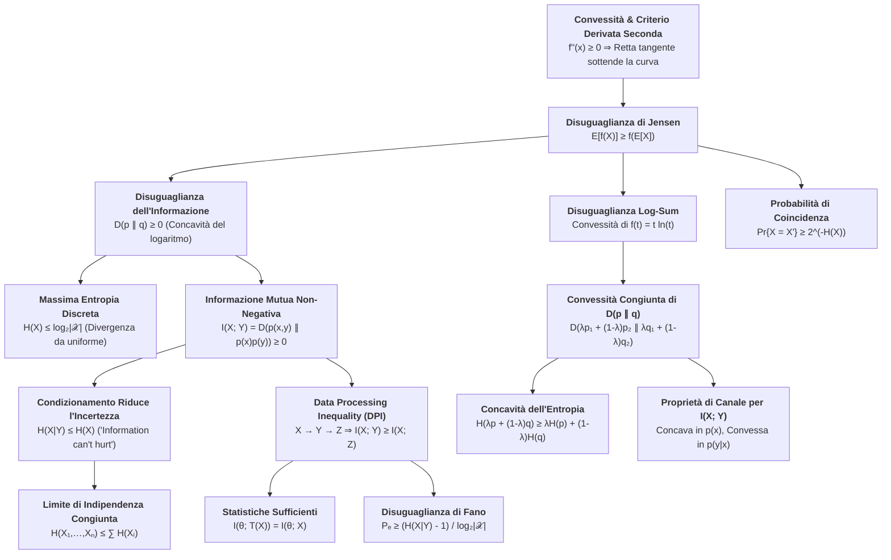

# 7. Proprietà dell'Entropia e Disuguaglianze Fondamentali

L'impalcatura della teoria dell'informazione shannoniana poggia sulle proprietà geometriche e algebriche dell'analisi convessa. Le disuguaglianze informative non sono semplici esercizi matematici: esse stabiliscono i limiti fisici invalicabili per la compressione dei dati, la trasmissione su canale rumoroso, la stima statistica e l'inferenza probabilistica.

In questo capitolo sviluppiamo l'intero apparato delle disuguaglianze fondamentali, partendo dalla radice geometrica della convessità fino ai teoremi cardine di elaborazione dei dati e ai limiti universali d'errore.

## Convessità, Concavità e Disuguaglianza di Jensen

La quasi totalità delle proprietà fondamentali delle misure di informazione discende dalle caratteristiche di convessità e concavità delle funzioni logaritmiche e ponderate.

### Geometria della Convessità e Definizioni

Sia dato un intervallo $(a, b) \subseteq \mathbb{R}$. Una funzione reale $f: (a, b) \to \mathbb{R}$ si definisce __convessa__ se per ogni coppia di punti $x_1, x_2 \in (a, b)$ e per qualunque scalare $\lambda \in [0, 1]$ soddisfa la disuguaglianza:

$$
f(\lambda x_1 + (1-\lambda) x_2) \le \lambda f(x_1) + (1-\lambda) f(x_2)
$$

Dal punto di vista geometrico, la funzione è convessa se il grafico della curva si trova costantemente al di sotto (o al più tocca) della corda secante che unisce i punti $(x_1, f(x_1))$ e $(x_2, f(x_2))$.

![[slide_33_convex_chord.png|center mid]]

La funzione si definisce __strettamente convessa__ se la disuguaglianza vale in forma stretta per ogni $x_1 \neq x_2$ e per ogni $\lambda \in (0, 1)$, ovvero se la curva tocca la corda secante esclusivamente nei due estremi $\lambda = 0$ e $\lambda = 1$.

Una funzione $f(x)$ si definisce __concava__ (rispettivamente __strettamente concava__) se l'opposto $-f(x)$ è convesso (strettamente convesso), il che equivale a richiedere che il grafico della funzione giaccia sempre al di sopra di qualunque corda secante:

$$
f(\lambda x_1 + (1-\lambda) x_2) \ge \lambda f(x_1) + (1-\lambda) f(x_2)
$$

Le funzioni affini lineari $f(x) = ax + b$ soddisfano simultaneamente entrambe le disuguaglianze con il segno di uguaglianza per qualsiasi $\lambda \in [0, 1]$, risultando pertanto sia convesse sia concave.

### Criterio della Derivata Seconda e Teorema di Convessità

Se una funzione $f(x)$ è derivabile due volte con continuità su un intervallo $(a, b)$, possiamo accertarne la convessità verificando il segno della derivata seconda.

__Teorema__: Se la funzione $f$ possiede derivata seconda non negativa $f''(x) \ge 0$ (rispettivamente strettamente positiva $f''(x) > 0$) su un intervallo $(a, b)$, allora $f$ è convessa (rispettivamente strettamente convessa) su tale intervallo.

### Dimostrazione Analitica con Resto di Lagrange

Consideriamo lo sviluppo in serie di Taylor di $f(x)$ centrato in un generico punto $x_0 \in (a, b)$ con resto di Lagrange del secondo ordine:

$$
f(x) = f(x_0) + f'(x_0)(x - x_0) + \frac{f''(x^*)}{2}(x - x_0)^2
$$

dove $x^*$ è un opportuno punto compreso tra $x_0$ e $x$. Poiché per ipotesi $f''(x^*) \ge 0$ su tutto l'intervallo, il termine quadratico $\frac{f''(x^*)}{2}(x - x_0)^2$ è non negativo per ogni $x$. Ne deriva che la retta tangente sottende sempre la funzione:

$$
f(x) \ge f(x_0) + f'(x_0)(x - x_0)
$$

Fissiamo ora due punti arbitrari $x_1, x_2 \in (a, b)$ e un peso $\lambda \in [0, 1]$, e scegliamo come punto di espansione $x_0$ la loro combinazione convessa:

$$
x_0 = \lambda x_1 + (1-\lambda) x_2
$$

Valutiamo la disuguaglianza della tangente nei due punti estremi $x_1$ e $x_2$.

Nel punto $x = x_1$, la distanza dal centro vale:

$$
x_1 - x_0 = x_1 - \left[ \lambda x_1 + (1-\lambda) x_2 \right] = (1-\lambda)(x_1 - x_2)
$$

Sostituendo nella relazione di tangenza otteniamo:

$$
f(x_1) \ge f(x_0) + f'(x_0)(1-\lambda)(x_1 - x_2)
$$

Nel punto $x = x_2$, la distanza dal centro vale:

$$
x_2 - x_0 = x_2 - \left[ \lambda x_1 + (1-\lambda) x_2 \right] = -\lambda(x_1 - x_2)
$$

Sostituendo nella relazione di tangenza otteniamo:

$$
f(x_2) \ge f(x_0) - f'(x_0)\lambda(x_1 - x_2)
$$

Moltiplichiamo ora la prima disuguaglianza per $\lambda \ge 0$, la seconda per $(1-\lambda) \ge 0$ e sommiamo membro a membro:

$$
\lambda f(x_1) + (1-\lambda) f(x_2) \ge \lambda f(x_0) + (1-\lambda) f(x_0) + f'(x_0)(x_1 - x_2) \left[ \lambda(1-\lambda) - (1-\lambda)\lambda \right]
$$

Osserviamo il termine differenziale del primo ordine: la parentesi quadra si annulla identicamente per cancellazione algebrica esatta:

$$
\lambda(1-\lambda) - (1-\lambda)\lambda = 0
$$

Di conseguenza, il contributo della derivata prima scompare completamente, lasciando:

$$
\lambda f(x_1) + (1-\lambda) f(x_2) \ge f(x_0) = f(\lambda x_1 + (1-\lambda) x_2)
$$

La relazione coincide esattamente con la definizione di funzione convessa. Se la derivata seconda è strettamente positiva $f''(x) > 0$ ovunque e $x_1 \neq x_2$ con $\lambda \in (0, 1)$, il resto di Lagrange è strettamente positivo e la disuguaglianza risulta stretta.

### Catalogo delle Funzioni Fondamentali

Applicando il criterio della derivata seconda verifichiamo immediatamente le funzioni analitiche che costituiscono i mattoni fondamentali della teoria dell'informazione:
- $f(x) = x^2$: $f''(x) = 2 > 0$ per ogni $x \in \mathbb{R}$ (strettamente convessa).
- $f(x) = e^x$: $f''(x) = e^x > 0$ per ogni $x \in \mathbb{R}$ (strettamente convessa).
- $f(x) = x \ln x$ su $\mathbb{R}^+$: $f'(x) = 1 + \ln x$, $f''(x) = \frac{1}{x} > 0$ per ogni $x > 0$ (strettamente convessa).
- $f(x) = \ln x$ su $\mathbb{R}^+$: $f'(x) = \frac{1}{x}$, $f''(x) = -\frac{1}{x^2} < 0$ per ogni $x > 0$ (strettamente concava).
- $f(x) = \sqrt{x}$ su $\mathbb{R}^+$: $f'(x) = \frac{1}{2\sqrt{x}}$, $f''(x) = -\frac{1}{4 x^{3/2}} < 0$ per ogni $x > 0$ (strettamente concava).

### Teorema della Disuguaglianza di Jensen

La disuguaglianza di Jensen generalizza la nozione di convessità dal caso banale a due punti al valore atteso di una variabile aleatoria arbitraria.

__Teorema (Disuguaglianza di Jensen)__: Sia $f$ una funzione convessa definita su un intervallo contenente il supporto della variabile aleatoria $X$. Se i valori attesi $\mathbb{E}[X]$ ed $\mathbb{E}[f(X)]$ esistono e sono finiti, allora:

$$
\mathbb{E}[f(X)] \ge f(\mathbb{E}[X])
$$

Se la funzione $f$ è strettamente convessa, la condizione di uguaglianza $\mathbb{E}[f(X)] = f(\mathbb{E}[X])$ si verifica se e solo se la variabile aleatoria $X$ è degenere, ovvero costante quasi certamente: $X = \mathbb{E}[X]$ con probabilità $1$.

Per una funzione concava $g(x)$, invertendo i segni otteniamo la forma duale:

$$
\mathbb{E}[g(X)] \le g(\mathbb{E}[X])
$$

### Dimostrazione Induttiva su Distribuzioni Discrete

Dimostriamo il teorema per distribuzioni discrete a supporto finito procedendo per induzione matematica sul numero di masse di probabilità $k$ della PMF $p(x_i) = \text{Pr}\{X = x_i\}$ con $i \in \{1, \dots, k\}$.

_Passo Base ($k=2$)_: Siano $x_1, x_2$ due realizzazioni con probabilità $p_1, p_2 \ge 0$ tali che $p_1 + p_2 = 1$. Ponendo $\lambda = p_1$ e $1-\lambda = p_2$, la definizione stessa di convessità fornisce direttamente:

$$
p_1 f(x_1) + p_2 f(x_2) \ge f(p_1 x_1 + p_2 x_2) \iff \mathbb{E}[f(X)] \ge f(\mathbb{E}[X])
$$

_Passo Induttivo_: Assumiamo che la disuguaglianza sia valida per qualunque distribuzione discreta su $k-1$ punti di massa. Consideriamo una distribuzione su $k$ punti $\{x_1, \dots, x_k\}$ con probabilità $\{p_1, \dots, p_k\}$.

Se $p_k = 1$, la variabile è concentrata su un solo punto e l'uguaglianza è banale. Se $p_k < 1$, definiamo la distribuzione riscalata sui primi $k-1$ punti:

$$
p'_i = \frac{p_i}{1 - p_k}, \quad i \in \{1, \dots, k-1\}, \qquad \sum_{i=1}^{k-1} p'_i = \frac{1}{1 - p_k} \sum_{i=1}^{k-1} p_i = \frac{1 - p_k}{1 - p_k} = 1
$$

Scomponiamo la media d'insieme isolando il $k$-esimo termine:

$$
\sum_{i=1}^k p_i f(x_i) = p_k f(x_k) + (1 - p_k) \sum_{i=1}^{k-1} p'_i f(x_i)
$$

Poiché $\{p'_1, \dots, p'_{k-1}\}$ è una PMF valida su $k-1$ masse, applichiamo l'ipotesi induttiva alla sommatoria interna:

$$
\sum_{i=1}^{k-1} p'_i f(x_i) \ge f\left( \sum_{i=1}^{k-1} p'_i x_i \right)
$$

Sostituendo questa maggiorazione:

$$
\sum_{i=1}^k p_i f(x_i) \ge p_k f(x_k) + (1 - p_k) f\left( \sum_{i=1}^{k-1} p'_i x_i \right)
$$

Il membro destro è ora una semplice combinazione convessa a due punti tra $x_k$ e la quantità $\sum_{i=1}^{k-1} p'_i x_i$, pesati rispettivamente con $p_k$ e $(1 - p_k)$. Applichiamo nuovamente il passo base $k=2$:

$$
p_k f(x_k) + (1 - p_k) f\left( \sum_{i=1}^{k-1} p'_i x_i \right) \ge f\left( p_k x_k + (1 - p_k) \sum_{i=1}^{k-1} p'_i x_i \right)
$$

Semplifichiamo l'argomento interno:

$$
p_k x_k + (1 - p_k) \sum_{i=1}^{k-1} \frac{p_i}{1 - p_k} x_i = p_k x_k + \sum_{i=1}^{k-1} p_i x_i = \sum_{i=1}^k p_i x_i = \mathbb{E}[X]
$$

Otteniamo quindi:

$$
\sum_{i=1}^k p_i f(x_i) \ge f\left( \sum_{i=1}^k p_i x_i \right) = f(\mathbb{E}[X])
$$

Il principio di induzione garantisce la validità della disuguaglianza per qualunque intero finito $k \ge 2$. L'estensione a variabili continue segue per densità mediante somme di Riemann o integrali di Lebesgue sfruttando la continuità delle funzioni convesse.

### Ruolo della Stretta Convessità e Variabili Degeneri

Se la funzione $f$ è strettamente convessa, la corda secante giace strettamente al di sopra della curva in ogni punto interno. Ne consegue che l'uguaglianza $\mathbb{E}[f(X)] = f(\mathbb{E}[X])$ non può verificarsi se la variabile aleatoria assume due o più valori distinti con probabilità non nulla.

L'uguaglianza sussiste se e solo se la distribuzione collassa su una delta di Dirac discreta:

$$
\text{Pr}\{X = \mathbb{E}[X]\} = 1
$$

Questo vincolo algebrico costituisce il cardine per identificare le distribuzioni ottime nei problemi variazionali dell'ingegneria dell'informazione.

## Disuguaglianza dell'Informazione e Non-Negatività della Divergenza KL

La divergenza di Kullback-Leibler (o entropia relativa) quantifica la distanza statistica non simmetrica tra due distribuzioni di probabilità definite sul medesimo supporto.

### Teorema Fondamentale dell'Informazione

__Teorema (Disuguaglianza dell'Informazione)__: Siano $p(x)$ e $q(x)$ due funzioni di massa di probabilità discrete con supporto $\mathcal{X}$. Allora:

$$
D(p \parallel q) \ge 0
$$

con uguaglianza se e solo se $p(x) = q(x)$ per ogni $x \in \mathcal{X}$.

### Dimostrazione tramite Concavità del Logaritmo

Sia $\mathcal{A} = \{x \in \mathcal{X} : p(x) > 0\}$ il supporto effettivo della distribuzione $p(x)$. Esprimiamo l'opposto della divergenza KL portando il segno meno dentro il logaritmo:

$$
-D(p \parallel q) = -\sum_{x \in \mathcal{A}} p(x) \log_2 \frac{p(x)}{q(x)} = \sum_{x \in \mathcal{A}} p(x) \log_2 \frac{q(x)}{p(x)}
$$

Il membro destro rappresenta il valore atteso della variabile aleatoria $Z = \frac{q(X)}{p(X)}$ sotto la distribuzione $p(x)$, ovvero $\mathbb{E}_p\left[\log_2 \frac{q(X)}{p(X)}\right]$.

Poiché la funzione $g(t) = \log_2 t$ è strettamente concava su tutto il semiasse positivo $\mathbb{R}^+$, applichiamo la disuguaglianza di Jensen per funzioni concave portando la media dentro il logaritmo:

$$
\sum_{x \in \mathcal{A}} p(x) \log_2 \frac{q(x)}{p(x)} \le \log_2 \left( \sum_{x \in \mathcal{A}} p(x) \frac{q(x)}{p(x)} \right) = \log_2 \left( \sum_{x \in \mathcal{A}} q(x) \right)
$$

I fattori $p(x)$ nell'argomento della sommatoria si semplificano. Esaminiamo ora la somma parziale delle probabilità $q(x)$ sul sottoinsieme $\mathcal{A}$: poiché $\mathcal{A} \subseteq \mathcal{X}$ e la distribuzione $q$ è non negativa ($q(x) \ge 0$), la somma ristretta è al più pari alla somma totale sull'intero alfabeto:

$$
\sum_{x \in \mathcal{A}} q(x) \le \sum_{x \in \mathcal{X}} q(x) \le 1
$$

La disuguaglianza sussiste anche nel caso generale in cui $q(x)$ sia una sotto-distribuzione (distribuzione difettiva con $\sum_{x \in \mathcal{X}} q(x) \le 1$). Essendo la funzione logaritmo monotona strettamente crescente:

$$
\log_2 \left( \sum_{x \in \mathcal{A}} q(x) \right) \le \log_2(1) = 0
$$

Abbiamo quindi stabilito la catena di relazioni:

$$
-D(p \parallel q) \le 0 \implies D(p \parallel q) \ge 0
$$

### Condizioni di Uguaglianza Stretta e Pseudodistanza

Affinché la divergenza si annulli ($D(p \parallel q) = 0$), entrambe le disuguaglianze della derivazione devono valere simultaneamente come uguaglianze strette.

Nel passaggio di Jensen, la stretta concavità della funzione $\log_2 t$ impone che l'argomento sia costante quasi certamente su tutto il supporto $\mathcal{A}$:

$$
\frac{q(x)}{p(x)} = c \quad \forall x \in \mathcal{A}
$$

Nella maggiorazione del supporto deve valere l'uguaglianza piena:

$$
\sum_{x \in \mathcal{A}} q(x) = \sum_{x \in \mathcal{X}} q(x) = 1
$$

il che richiede che $q(x) = 0$ per ogni $x \notin \mathcal{A}$.

Sommando la condizione di proporzionalità su tutti i punti $x \in \mathcal{A}$:

$$
\sum_{x \in \mathcal{A}} q(x) = c \sum_{x \in \mathcal{A}} p(x) \implies 1 = c \cdot 1 \implies c = 1
$$

Otteniamo quindi $q(x) = p(x)$ per ogni $x \in \mathcal{A}$, e $q(x) = p(x) = 0$ per ogni $x \notin \mathcal{A}$. La divergenza di Kullback-Leibler si annulla se e solo se le due distribuzioni coincidono puntualmente ovunque.

Sebbene $D(p \parallel q) \ge 0$ e $D(p \parallel q) = 0 \iff p = q$, la divergenza di Kullback-Leibler non è una metrica euclidea: non è generalmente simmetrica ($D(p \parallel q) \neq D(q \parallel p)$) e non rispetta la disuguaglianza triangolare. Rappresenta tuttavia la pseudodistanza informativa canonica tra modelli probabilistici.

## Conseguenze Fondamentali per le Misure Informative

Dalla disuguaglianza dell'informazione discendono direttamente tutte le proprietà di ordinamento tra entropia marginale, entropia congiunta ed informazione mutua.

### Non-Negatività dell'Informazione Mutua e Forma Condizionata

Esprimiamo l'informazione mutua come divergenza di Kullback-Leibler tra la distribuzione congiunta $p(x, y)$ e il prodotto delle distribuzioni marginali indipendenti $p(x)p(y)$:

$$
I(X; Y) = D(p(x, y) \parallel p(x)p(y)) \ge 0
$$

Per il teorema dell'informazione, $I(X; Y) \ge 0$ con uguaglianza se e solo se:

$$
p(x, y) = p(x)p(y) \quad \forall (x, y) \in \mathcal{X} \times \mathcal{Y}
$$

ovvero se e solo se le variabili aleatorie $X$ e $Y$ sono statisticamente indipendenti. L'informazione mutua non può mai assumere valori negativi.

Estendendo il risultato alla divergenza condizionata e all'informazione mutua condizionata rispetto a una terza variabile $Z$:

$$
D(p(y \mid x) \parallel q(y \mid x)) = \sum_{x \in \mathcal{X}} p(x) \sum_{y \in \mathcal{Y}} p(y \mid x) \log_2 \frac{p(y \mid x)}{q(y \mid x)} \ge 0
$$

$$
I(X; Y \mid Z) = D(p(x, y \mid z) \parallel p(x \mid z)p(y \mid z)) \ge 0
$$

con uguaglianza se e solo se $X$ e $Y$ risultano condizionatamente indipendenti dato $Z$.

### Teorema di Massima Entropia su Alfabeti Finiti

Sia $X$ una variabile aleatoria discreta a valori nell'alfabeto finito $\mathcal{X}$ con cardinalità $|\mathcal{X}| = M$. Sia $u(x) = \frac{1}{M}$ la distribuzione uniforme su $\mathcal{X}$.

Calcoliamo la divergenza di Kullback-Leibler tra la PMF arbitraria $p(x)$ e la distribuzione uniforme $u(x)$:

$$
D(p \parallel u) = \sum_{x \in \mathcal{X}} p(x) \log_2 \frac{p(x)}{u(x)} = \sum_{x \in \mathcal{X}} p(x) \log_2 p(x) - \sum_{x \in \mathcal{X}} p(x) \log_2 \left( \frac{1}{M} \right)
$$

Riconoscendo la definizione di entropia $H(X) = -\sum p(x) \log_2 p(x)$ e sfruttando la normalizzazione della probabilità $\sum_{x} p(x) = 1$:

$$
D(p \parallel u) = -H(X) + \log_2 M \sum_{x \in \mathcal{X}} p(x) = \log_2 M - H(X)
$$

Poiché per la disuguaglianza dell'informazione $D(p \parallel u) \ge 0$, otteniamo immediatamente:

$$
\log_2 M - H(X) \ge 0 \implies H(X) \le \log_2 M = \log_2 |\mathcal{X}|
$$

L'uguaglianza è raggiunta se e solo se $p(x) = u(x) = \frac{1}{|\mathcal{X}|}$ per ogni $x \in \mathcal{X}$.

La distribuzione uniforme è l'unica configurazione a massima entropia tra tutte le distribuzioni discrete definite su un alfabeto finito fissato, formalizzando il principio per cui l'equiprobabilità esprime il massimo disordine o incertezza a priori.

### Il Condizionamento Riduce l'Incertezza Media

Dalla scomposizione fondamentale dell'informazione mutua $I(X; Y) = H(X) - H(X \mid Y)$, la non-negatività $I(X; Y) \ge 0$ si traduce nella relazione:

$$
H(X \mid Y) \le H(X)
$$

con uguaglianza se e solo se $X$ e $Y$ sono stocasticamente indipendenti.

Questo risultato sancisce il principio operativo secondo cui l'osservazione di una variabile $Y$ non può mai aumentare, in media d'insieme, l'incertezza residua sul parametro $X$ ("_information can't hurt_").

### Trabocchetto d'Esame: Incertezza Puntuale contro Incertezza Media

Sebbene l'entropia condizionata media rispetti rigorosamente la disuguaglianza $H(X \mid Y) \le H(X)$, la realizzazione specifica $Y = y$ può localmente incrementare oppure decrementare l'incertezza residua su $X$.

L'incertezza condizionata puntuale:

$$
H(X \mid Y = y) = -\sum_{x \in \mathcal{X}} p(x \mid y) \log_2 p(x \mid y)
$$

può risultare strettamente maggiore, uguale o strettamente minore di $H(X)$. La disuguaglianza opera esclusivamente sulla media ponderata:

$$
H(X \mid Y) = \mathbb{E}_Y [H(X \mid Y = y)] = \sum_{y \in \mathcal{Y}} p(y) H(X \mid Y = y) \le H(X)
$$

### Esempio Pratico: Monete Truccate ed Incertezza Condizionata

Consideriamo un sacchetto contenente due tipologie di monete:
- Moneta truccata ($Y = 1$): produce invariabilmente Testa ($p = 1$).
- Moneta equa ($Y = 2$): produce Testa e Croce con probabilità $1/2$.

Sia $X \in \{0, 1\}$ l'esito del lancio ($0 = \text{Croce}$, $1 = \text{Testa}$). Nel sacchetto le monete truccate sono presenti con probabilità $3/4$ e le monete eque con probabilità $1/4$.

Costruiamo la tabella della distribuzione congiunta $p(x, y)$:

| | $X = 0$ (Croce) | $X = 1$ (Testa) | Marginale $p(y)$ |
| :--- | :---: | :---: | :---: |
| __$Y = 1$ (Truccata)__ | $0$ | $\frac{3}{4}$ | $\frac{3}{4}$ |
| __$Y = 2$ (Equa)__ | $\frac{1}{8}$ | $\frac{1}{8}$ | $\frac{1}{4}$ |
| __Marginale $p(x)$__ | $\frac{1}{8}$ | $\frac{7}{8}$ | $1$ |

Calcoliamo l'entropia a priori di $X$:

$$
H(X) = H_B\left(\frac{1}{8}\right) = -\frac{1}{8}\log_2 \frac{1}{8} - \frac{7}{8}\log_2 \frac{7}{8} \approx 0.544 \quad \text{bit}
$$

Valutiamo ora le incertezze puntuali condizionate alle singole realizzazioni di $Y$:
- Se osserviamo che la moneta estratta è truccata ($Y = 1$): la probabilità a posteriori di ottenere Testa è certa ($p(X = 1 \mid Y = 1) = 1$), per cui:

$$
  H(X \mid Y = 1) = 0 \quad \text{bit} < H(X)
$$

- Se osserviamo che la moneta estratta è equa ($Y = 2$): la distribuzione a posteriori diviene perfettamente bilanciata ($p(X = 0 \mid Y = 2) = p(X = 1 \mid Y = 2) = 1/2$), per cui:

$$
  H(X \mid Y = 2) = 1.000 \quad \text{bit} > H(X)
$$

In questa specifica realizzazione, l'osservazione ha fatto salire l'incertezza da $0.544$ bit a $1.000$ bit. Tuttavia, calcolando la media ponderata d'insieme:

$$
H(X \mid Y) = p(Y = 1) H(X \mid Y = 1) + p(Y = 2) H(X \mid Y = 2) = \frac{3}{4} \cdot 0 + \frac{1}{4} \cdot 1 = 0.250 \quad \text{bit}
$$

In media statistica, l'osservazione di $Y$ riduce l'incertezza residua su $X$ da $0.544$ bit a $0.250$ bit, confermando la disuguaglianza $H(X \mid Y) \le H(X)$.

### Limite di Indipendenza per l'Entropia Congiunta

__Teorema__: Date $n$ variabili aleatorie discrete $X_1, X_2, \dots, X_n$ regolate dalla distribuzione congiunta $p(x_1, \dots, x_n)$:

$$
H(X_1, X_2, \dots, X_n) \le \sum_{i=1}^n H(X_i)
$$

con uguaglianza se e solo se le variabili $X_i$ sono mutuamente indipendenti.

#### Dimostrazione

Applichiamo la regola della catena per l'entropia congiunta:

$$
H(X_1, X_2, \dots, X_n) = \sum_{i=1}^n H(X_i \mid X_{i-1}, \dots, X_1)
$$

Poiché il condizionamento non incrementa l'entropia:

$$
H(X_i \mid X_{i-1}, \dots, X_1) \le H(X_i)
$$

Sommando termine a termine su tutti gli indici $i \in \{1, \dots, n\}$:

$$
H(X_1, X_2, \dots, X_n) \le \sum_{i=1}^n H(X_i)
$$

L'uguaglianza è raggiunta se e solo se $H(X_i \mid X_{i-1}, \dots, X_1) = H(X_i)$ per ogni $i$, condizione che coincide con l'indipendenza mutua delle $n$ variabili.

## Disuguaglianza Log-Sum e Analisi Convessa delle Misure

La disuguaglianza log-sum costituisce lo strumento analitico principale per dimostrare la convessità della divergenza di Kullback-Leibler e la concavità dell'entropia di Shannon.

### Teorema della Disuguaglianza Log-Sum

__Teorema (Log-Sum Inequality)__: Siano $a_1, \dots, a_n$ e $b_1, \dots, b_n$ numeri reali non negativi. Allora:

$$
\sum_{i=1}^n a_i \log_2 \frac{a_i}{b_i} \ge \left( \sum_{i=1}^n a_i \right) \log_2 \frac{\sum_{i=1}^n a_i}{\sum_{i=1}^n b_i}
$$

con uguaglianza se e solo se i rapporti $\frac{a_i}{b_i}$ sono costanti per tutti gli indici in cui $a_i > 0$.

### Dimostrazione Analitica Diretta via Funzione Convessa

Consideriamo la funzione $f(t) = t \ln t$ definita per $t > 0$. Calcoliamo le sue derivate:

$$
f'(t) = 1 + \ln t, \qquad f''(t) = \frac{1}{t} > 0 \quad \forall t > 0
$$

Essendo la derivata seconda strettamente positiva, $f(t)$ è strettamente convessa.

Applichiamo la disuguaglianza di Jensen in forma pesata. Definiamo i coefficienti normalizzati $\alpha_i$ e le coordinate $t_i$:

$$
\alpha_i = \frac{b_i}{\sum_{j=1}^n b_j}, \qquad t_i = \frac{a_i}{b_i}
$$

I coefficienti $\alpha_i \ge 0$ sommano a $1$:

$$
\sum_{i=1}^n \alpha_i = \sum_{i=1}^n \frac{b_i}{\sum_{j=1}^n b_j} = \frac{\sum_{i=1}^n b_i}{\sum_{j=1}^n b_j} = 1
$$

Per la disuguaglianza di Jensen:

$$
\sum_{i=1}^n \alpha_i f(t_i) \ge f\left( \sum_{i=1}^n \alpha_i t_i \right)
$$

Moltiplichiamo entrambi i membri per la costante positiva $\sum_{j=1}^n b_j$. Nel membro sinistro:

$$
\left( \sum_{j=1}^n b_j \right) \sum_{i=1}^n \frac{b_i}{\sum_{j=1}^n b_j} f\left( \frac{a_i}{b_i} \right) = \sum_{i=1}^n b_i \left( \frac{a_i}{b_i} \ln \frac{a_i}{b_i} \right) = \sum_{i=1}^n a_i \ln \frac{a_i}{b_i}
$$

Nel membro destro, calcoliamo prima l'argomento medio di $f$:

$$
\sum_{i=1}^n \alpha_i t_i = \sum_{i=1}^n \frac{b_i}{\sum_{j=1}^n b_j} \cdot \frac{a_i}{b_i} = \frac{\sum_{i=1}^n a_i}{\sum_{j=1}^n b_j}
$$

Applicando $f$ e riscalando per $\sum_{j=1}^n b_j$:

$$
\left( \sum_{j=1}^n b_j \right) f\left( \frac{\sum_{i=1}^n a_i}{\sum_{j=1}^n b_j} \right) = \left( \sum_{j=1}^n b_j \right) \left( \frac{\sum_{i=1}^n a_i}{\sum_{j=1}^n b_j} \ln \frac{\sum_{i=1}^n a_i}{\sum_{j=1}^n b_j} \right) = \left( \sum_{i=1}^n a_i \right) \ln \frac{\sum_{i=1}^n a_i}{\sum_{j=1}^n b_j}
$$

I fattori $\sum b_j$ si cancellano algebricamente, completando la dimostrazione della disuguaglianza in base naturale (e quindi in qualunque base per cambio di scala). Per approfondimenti formali su estensioni a cardinalità infinita o casi limite a denominatore nullo, si consulti la [[zz. Argomenti extra#Dimostrazione Analitica della Disuguaglianza Log-Sum e Convessità Congiunta della Divergenza KL|dimostrazione analitica della disuguaglianza Log-Sum e convessità congiunta della divergenza KL]].

### Convessità Congiunta della Divergenza di Kullback-Leibler

__Teorema__: La divergenza di Kullback-Leibler $D(p \parallel q)$ è una funzione convessa congiuntamente nella coppia di distribuzioni $(p, q)$. Dati $\lambda \in [0, 1]$ e due coppie di PMF $(p_1, q_1)$ e $(p_2, q_2)$:

$$
D(\lambda p_1 + (1-\lambda) p_2 \parallel \lambda q_1 + (1-\lambda) q_2) \le \lambda D(p_1 \parallel q_1) + (1-\lambda) D(p_2 \parallel q_2)
$$

#### Dimostrazione

Fissiamo un generico elemento $x \in \mathcal{X}$ e applichiamo la disuguaglianza log-sum con $n = 2$ termini, ponendo:

$$
a_1 = \lambda p_1(x), \quad a_2 = (1-\lambda) p_2(x), \quad b_1 = \lambda q_1(x), \quad b_2 = (1-\lambda) q_2(x)
$$

Le somme delle coppie valgono:

$$
a_1 + a_2 = \lambda p_1(x) + (1-\lambda) p_2(x) = p_\lambda(x)
$$

$$
b_1 + b_2 = \lambda q_1(x) + (1-\lambda) q_2(x) = q_\lambda(x)
$$

Applicando la log-sum al punto $x$:

$$
p_\lambda(x) \log_2 \frac{p_\lambda(x)}{q_\lambda(x)} \le \lambda p_1(x) \log_2 \frac{\lambda p_1(x)}{\lambda q_1(x)} + (1-\lambda) p_2(x) \log_2 \frac{(1-\lambda) p_2(x)}{(1-\lambda) q_2(x)}
$$

I fattori positivi $\lambda$ e $(1-\lambda)$ all'interno dei logaritmi si elidono:

$$
p_\lambda(x) \log_2 \frac{p_\lambda(x)}{q_\lambda(x)} \le \lambda p_1(x) \log_2 \frac{p_1(x)}{q_1(x)} + (1-\lambda) p_2(x) \log_2 \frac{p_2(x)}{q_2(x)}
$$

Sommando membro a membro su tutti gli elementi $x \in \mathcal{X}$:

$$
\sum_{x \in \mathcal{X}} p_\lambda(x) \log_2 \frac{p_\lambda(x)}{q_\lambda(x)} \le \lambda \sum_{x \in \mathcal{X}} p_1(x) \log_2 \frac{p_1(x)}{q_1(x)} + (1-\lambda) \sum_{x \in \mathcal{X}} p_2(x) \log_2 \frac{p_2(x)}{q_2(x)}
$$

Riconoscendo le definizioni di divergenza KL otteniamo esattamente la convessità congiunta.

### Concavità dell'Entropia di Shannon

__Teorema__: L'entropia di Shannon $H(p)$ è una funzione __strettamente concava__ della distribuzione di probabilità $p$. Per ogni coppia di PMF $p, q$ e per ogni $\lambda \in [0, 1]$:

$$
H(\lambda p + (1-\lambda) q) \ge \lambda H(p) + (1-\lambda) H(q)
$$

#### Dimostrazione

Esprimiamo l'entropia in termini della divergenza rispetto alla distribuzione uniforme $u(x) = \frac{1}{|\mathcal{X}|}$:

$$
H(p) = \log_2 |\mathcal{X}| - D(p \parallel u)
$$

Valutando la relazione sulla combinazione convessa $\lambda p + (1-\lambda) q$:

$$
H(\lambda p + (1-\lambda) q) = \log_2 |\mathcal{X}| - D(\lambda p + (1-\lambda) q \parallel u)
$$

Poiché possiamo decomporre la distribuzione uniforme come $u = \lambda u + (1-\lambda) u$, applichiamo la convessità della divergenza rispetto al primo argomento:

$$
D(\lambda p + (1-\lambda) q \parallel u) \le \lambda D(p \parallel u) + (1-\lambda) D(q \parallel u)
$$

Moltiplicando per $-1$ e sommando la costante identica $\log_2 |\mathcal{X}| = \lambda \log_2 |\mathcal{X}| + (1-\lambda)\log_2 |\mathcal{X}|$:

$$
\log_2 |\mathcal{X}| - D(\lambda p + (1-\lambda) q \parallel u) \ge \lambda \left[ \log_2 |\mathcal{X}| - D(p \parallel u) \right] + (1-\lambda) \left[ \log_2 |\mathcal{X}| - D(q \parallel u) \right]
$$

Riconoscendo le entropie nei singoli termini:

$$
H(\lambda p + (1-\lambda) q) \ge \lambda H(p) + (1-\lambda) H(q)
$$

### Significato Fisico e Termodinamico dell'Entropia di Miscelamento

La concavità dell'entropia riflette il secondo principio della termodinamica e l'entropia di miscelamento nella fisica statistica.

Quando misceliamo due sorgenti informative indipendenti dotate di distribuzioni $p$ e $q$, l'entropia della miscela risultante $\lambda p + (1-\lambda) q$ è strettamente superiore alla media ponderata delle entropie originali. L'incremento netto quantifica l'incertezza microscopica addizionale generata dal non sapere da quale delle due sorgenti provenga ciascun campione estratto.

### Concavità e Convessità dell'Informazione Mutua nei Canali

Sia $(X, Y) \sim p(x, y) = p(x) p(y \mid x)$ un sistema di trasmissione con ingresso $X$, canale $p(y \mid x)$ e uscita $Y$.

__Teorema__: L'informazione mutua $I(X; Y)$ è:
1. Una funzione __concava__ della distribuzione di ingresso $p(x)$ a canale di transizione $p(y \mid x)$ fissato.
2. Una funzione __convessa__ della distribuzione del canale $p(y \mid x)$ a distribuzione di ingresso $p(x)$ fissata.

#### Dimostrazione

Per dimostrare la prima proprietà, esprimiamo l'informazione mutua come:

$$
I(X; Y) = H(Y) - H(Y \mid X) = H(Y) - \sum_{x \in \mathcal{X}} p(x) H(Y \mid X = x)
$$

A canale $p(y \mid x)$ fissato, la distribuzione marginale di uscita $p(y) = \sum_x p(x) p(y \mid x)$ è una trasformazione lineare della distribuzione di ingresso $p(x)$. Poiché l'entropia $H(Y)$ è una funzione concava della sua distribuzione $p(y)$, essa risulta concava anche rispetto a $p(x)$.

Il secondo termine $\sum_x p(x) H(Y \mid X = x)$ è una combinazione lineare a coefficienti costanti in $p(x)$ (poiché le entropie condizionate $H(Y \mid X = x)$ dipendono unicamente dalle righe del canale $p(y \mid x)$), ed è quindi una funzione affine di $p(x)$. Poiché la differenza tra una funzione concava e una funzione affine preserva la concavità, $I(X; Y)$ è concava in $p(x)$.

Per dimostrare la seconda proprietà, fissiamo $p(x)$ e consideriamo due canali $p_1(y \mid x)$ e $p_2(y \mid x)$ e la loro combinazione convessa $p_\lambda(y \mid x) = \lambda p_1(y \mid x) + (1-\lambda) p_2(y \mid x)$. Le distribuzioni congiunte e i prodotti delle marginali corrispondenti soddisfano:

$$
p_\lambda(x, y) = \lambda p_1(x, y) + (1-\lambda) p_2(x, y)
$$

$$
q_\lambda(x, y) = p(x) p_\lambda(y) = \lambda p(x) p_1(y) + (1-\lambda) p(x) p_2(y) = \lambda q_1(x, y) + (1-\lambda) q_2(x, y)
$$

Poiché $I(X; Y) = D(p(x, y) \parallel q(x, y))$ e la divergenza KL è congiuntamente convessa nella coppia $(p, q)$:

$$
I_\lambda(X; Y) = D(p_\lambda \parallel q_\lambda) \le \lambda D(p_1 \parallel q_1) + (1-\lambda) D(p_2 \parallel q_2) = \lambda I_1(X; Y) + (1-\lambda) I_2(X; Y)
$$

Questo comportamento duale è di primaria importanza ingegneristica: la concavità rispetto a $p(x)$ garantisce l'esistenza e l'unicità del massimo globale nel calcolo della capacità di canale $C = \max_{p(x)} I(X; Y)$, mentre la convessità rispetto al canale garantisce la risolubilità convessa nei problemi di codifica di sorgente con perdita $R(D) = \min_{p(y \mid x)} I(X; Y)$.

## Data Processing Inequality per Catene di Markov

La disuguaglianza di elaborazione dei dati (Data Processing Inequality, DPI) formalizza il principio fisico secondo cui nessuna manipolazione dei dati, deterministica o stocastica, può estrarre o generare informazione statistica non già presente nelle osservazioni originarie.

### Catene di Markov Discrete e Indipendenza Condizionata

Tre variabili aleatorie $X, Y, Z$ formano una __catena di Markov__ nell'ordine $X \longrightarrow Y \longrightarrow Z$ se la distribuzione condizionata di $Z$ dipende unicamente da $Y$ ed è condizionatamente indipendente da $X$.

La distribuzione di probabilità congiunta fattorizza come:

$$
p(x, y, z) = p(x) p(y \mid x) p(z \mid y)
$$

La condizione di Markovità è equivalente all'indipendenza condizionata tra $X$ e $Z$ dato $Y$:

$$
p(x, z \mid y) = \frac{p(x, y, z)}{p(y)} = \frac{p(x) p(y \mid x) p(z \mid y)}{p(y)} = \frac{p(x, y) p(z \mid y)}{p(y)} = p(x \mid y) p(z \mid y)
$$

In termini informativi, ciò si traduce nell'annullamento dell'informazione mutua condizionata:

$$
X \longrightarrow Y \longrightarrow Z \iff I(X; Z \mid Y) = 0
$$

### Proprietà Strutturali delle Catene Markoviane

1. __Reversibilità Temporale e Topologica__: La relazione $X \longrightarrow Y \longrightarrow Z$ implica $Z \longrightarrow Y \longrightarrow X$. Infatti, applicando la regola di Bayes alla fattorizzazione congiunta otteniamo $p(x, y, z) = p(z) p(y \mid z) p(x \mid y)$.
2. __Trasformazioni Post-Processing__: Se $Z = g(Y)$ è una funzione deterministica o randomizzata che opera esclusivamente sui campioni $Y$, la terna $X \longrightarrow Y \longrightarrow g(Y)$ costituisce invariabilmente una catena di Markov, poiché la legge di $Z$ dato $Y$ non dipende da $X$.

### Teorema della Data Processing Inequality

__Teorema (DPI)__: Se tre variabili aleatorie formano la catena di Markov $X \longrightarrow Y \longrightarrow Z$, allora:

$$
I(X; Y) \ge I(X; Z)
$$

e per simmetria:

$$
I(Y; Z) \ge I(X; Z)
$$

La condizione di uguaglianza $I(X; Y) = I(X; Z)$ sussiste se e solo se $I(X; Y \mid Z) = 0$, il che equivale a dire che anche $X \longrightarrow Z \longrightarrow Y$ costituisce una valida catena di Markov (nessuna perdita informativa nel passaggio da $Y$ a $Z$).

### Dimostrazione tramite Espansione a Catena

Consideriamo l'informazione mutua congiunta $I(X; Y, Z)$ ed espandiamola applicando la regola della catena in due ordini distinti:

$$
I(X; Y, Z) = I(X; Z) + I(X; Y \mid Z)
$$

$$
I(X; Y, Z) = I(X; Y) + I(X; Z \mid Y)
$$

Poiché $X \longrightarrow Y \longrightarrow Z$ è una catena di Markov, per la proprietà di indipendenza condizionata il secondo termine della seconda espansione si annulla:

$$
I(X; Z \mid Y) = 0
$$

Uguagliando le due espressioni:

$$
I(X; Z) + I(X; Y \mid Z) = I(X; Y)
$$

Dalla non-negatività fondamentale dell'informazione mutua condizionata, sappiamo che $I(X; Y \mid Z) \ge 0$. Sottraendo tale quantità non negativa:

$$
I(X; Y) - I(X; Z) = I(X; Y \mid Z) \ge 0 \implies I(X; Y) \ge I(X; Z)
$$

L'uguaglianza è verificata se e solo se $I(X; Y \mid Z) = 0$.

![[slide_52_dpi_venn.png|center mid]]

La disuguaglianza $I(Y; Z) \ge I(X; Z)$ segue in modo del tutto speculare sfruttando la reversibilità topologica della catena $Z \longrightarrow Y \longrightarrow X$.

### Conseguenze Operative e Invarianza nel Post-Processing

1. __Degradazione sotto Elaborazione Dati__: Se $Z = g(Y)$, allora $I(X; Y) \ge I(X; g(Y))$. Nessun algoritmo software, filtro analogico o rete neurale applicata alle osservazioni $Y$ può incrementare l'informazione disponibile sul parametro originario $X$. L'informazione può soltanto essere preservata o irrimediabilmente dispersa.
2. __Effetto del Condizionamento a Valle__: Se $X \longrightarrow Y \longrightarrow Z$, allora:

$$
I(X; Y \mid Z) \le I(X; Y)
$$

L'osservazione di una variabile secondaria a valle $Z$ diminuisce (o lascia invariata) la dipendenza informativa tra $X$ e $Y$.

### Trabocchetto d'Esame: Il Paradosso del Collider Fuori dalla Catena

La disuguaglianza $I(X; Y \mid Z) \le I(X; Y)$ è valida esclusivamente se le tre variabili formano una catena di Markov. Se la struttura markoviana viene a mancare, condizionare su una terza variabile può generare dipendenza e far aumentare l'informazione mutua.

Siano $X$ e $Y$ due variabili binarie indipendenti ed equiprobabili in $\{0, 1\}$, per cui $I(X; Y) = 0$. Definiamo $Z = X + Y$ come somma algebrica ordinaria. Calcoliamo l'informazione condizionata:

$$
I(X; Y \mid Z) = H(X \mid Z) - H(X \mid Y, Z) = H(X \mid Z) - 0
$$

La distribuzione di $Z$ vale $p(Z = 0) = 1/4$, $p(Z = 1) = 1/2$, $p(Z = 2) = 1/4$.
- Se $Z = 0$ o $Z = 2$, il valore di $X$ è noto con certezza ($H(X \mid Z = 0) = 0$).
- Se $Z = 1$, sapendo che la somma è 1, $X$ è uniformemente distribuito su $\{0, 1\}$ con entropia pari a $1$ bit.

Calcolando la media ponderata:

$$
I(X; Y \mid Z) = \frac{1}{2} \cdot 1 = 0.500 \quad \text{bit} > I(X; Y) = 0 \quad \text{bit}
$$

Condizionare su un effetto comune (_collider_) crea correlazione spuria tra cause indipendenti, violando la disuguaglianza markoviana.

### Statistiche Sufficienti in Prospettiva Informativa

Nel contesto della teoria della stima parametrica e dell'inferenza statistica, sia $\{f_\theta(\mathbf{x})\}$ una famiglia di densità di probabilità indicizzata dal parametro $\theta$. Sia $\mathbf{X} = (X_1, \dots, X_n)$ il vettore delle osservazioni campionarie e sia $T(\mathbf{X})$ una statistica (funzione del campione).

Il processo di osservazione e calcolo genera naturalmente la catena di Markov:

$$
\theta \longrightarrow \mathbf{X} \longrightarrow T(\mathbf{X})
$$

Per la Data Processing Inequality, la statistica non può contenere più informazione del dato grezzo:

$$
I(\theta; T(\mathbf{X})) \le I(\theta; \mathbf{X})
$$

Una statistica $T(\mathbf{X})$ si definisce __sufficiente__ per il parametro $\theta$ se la distribuzione condizionata dei campioni dato $T(\mathbf{X})$ è completamente indipendente da $\theta$. In termini di catene di Markov, ciò equivale a richiedere che valga anche la catena inversa:

$$
\theta \longrightarrow T(\mathbf{X}) \longrightarrow \mathbf{X}
$$

Applicando la DPI a questa seconda catena otteniamo $I(\theta; \mathbf{X}) \le I(\theta; T(\mathbf{X}))$. Combinando le due disuguaglianze perveniamo all'identità fondamentale:

$$
I(\theta; T(\mathbf{X})) = I(\theta; \mathbf{X})
$$

Una statistica è sufficiente se e solo se __preserva integralmente l'informazione mutua shannoniana__ contenuta nell'intero dataset osservato rispetto al parametro $\theta$, per qualunque distribuzione a priori di $\theta$.

### Criterio di Fattorizzazione di Neyman-Fisher e Minimalità

Una statistica $T(\mathbf{X})$ è sufficiente se e solo se la funzione di verosimiglianza congiunta si fattorizza secondo il teorema di Neyman-Fisher:

$$
f(\mathbf{x} \mid \theta) = u(\mathbf{x}) \cdot v(T(\mathbf{x}), \theta)
$$

dove $u(\mathbf{x}) \ge 0$ dipende unicamente dai dati osservati e non dal parametro $\theta$, mentre $v \ge 0$ dipende da $\theta$ e dipende dai dati esclusivamente tramite il valore della statistica $T(\mathbf{x})$.

Una statistica sufficiente $T(\mathbf{X})$ si definisce __minimale__ se è funzione di qualunque altra statistica sufficiente $U(\mathbf{X})$, ovvero se $T(\mathbf{X}) = \psi(U(\mathbf{X}))$. In termini operativi, la statistica minimale realizza la massima compressione dimensionale possibile del dato campionario senza alcuna dispersione di informazione mutua:

$$
\theta \longrightarrow T(\mathbf{X}) \longrightarrow U(\mathbf{X}) \longrightarrow \mathbf{X}
$$

Esempi classici d'esame:
- __Campioni Bernoulli i.i.d.__ ($X_i \sim \text{Bern}(\theta)$): la statistica $T(\mathbf{X}) = \sum_{i=1}^n X_i$ è sufficiente e minimale.
- __Campioni Gaussiani i.i.d.__ ($X_i \sim \mathcal{N}(\theta, \sigma^2)$ con varianza nota): la media campionaria $\bar{X} = \frac{1}{n}\sum_{i=1}^n X_i$ è sufficiente e minimale. La coppia formata separatamente dalla media dei campioni pari e dalla media dei campioni dispari costituisce una statistica sufficiente ma non minimale.
- __Campioni Uniformi i.i.d.__ ($X_i \sim \mathcal{U}(\theta, \theta + 1)$): la statistica sufficiente minimale è costituita dalla coppia degli estremi campionari $T(\mathbf{X}) = (\min_i X_i, \, \max_i X_i)$.

## Disuguaglianza di Fano e Limiti Universali sull'Errore di Stima

Nei sistemi di comunicazione digitale, nel riconoscimento di pattern e nella classificazione statistica, un ricevitore riceve un segnale rumoroso $Y$ correlato a un messaggio discreto $X \in \mathcal{X}$ e costruisce uno stimatore o regola di decisione $\hat{X} = g(Y)$.

La __disuguaglianza di Fano__ stabilisce il limite inferiore universale sulla probabilità d'errore di decisione $P_e = \text{Pr}\{\hat{X} \neq X\}$ in funzione dell'entropia equivoca residua $H(X \mid Y)$.

### Modello di Stima e Formulazione del Problema

Sia data la catena di Markov generata dalla sorgente, dal canale e dal decisore:

$$
X \longrightarrow Y \longrightarrow \hat{X}
$$

dove $X$ assume valori nell'alfabeto finito $\mathcal{X}$ con cardinalità $|\mathcal{X}| = M$. Definiamo la probabilità d'errore di decisione:

$$
P_e = \text{Pr}\{\hat{X} \neq X\}
$$

### Teorema Fondamentale di Fano

__Teorema (Disuguaglianza di Fano)__: Sotto la catena di Markov $X \longrightarrow Y \longrightarrow \hat{X}$, l'incertezza residua a posteriori soddisfa:

$$
H_B(P_e) + P_e \log_2(|\mathcal{X}| - 1) \ge H(X \mid \hat{X}) \ge H(X \mid Y)
$$

dove $H_B(P_e) = -P_e \log_2 P_e - (1 - P_e) \log_2(1 - P_e)$ indica l'entropia della variabile binaria d'errore.

### Dimostrazione Rigorosa con Variabile Indicatrice d'Errore

Per collegare in modo rigoroso l'entropia residua alla probabilità d'errore, introduciamo la variabile aleatoria binaria indicatrice d'errore $E$:

$$
E = \begin{cases} 1 & \text{se } \hat{X} \neq X \\ 0 & \text{se } \hat{X} = X \end{cases}
$$

La variabile $E$ ha distribuzione bernoulliana con parametri $\text{Pr}\{E = 1\} = P_e$ e $\text{Pr}\{E = 0\} = 1 - P_e$, da cui $H(E) = H_B(P_e)$.

Consideriamo l'entropia congiunta condizionata $H(E, X \mid \hat{X})$ ed espandiamola con la regola della catena in due modalità distinte.

#### Primo Sviluppo della Catena

Condizionando inizialmente rispetto a $X$ dato $\hat{X}$:

$$
H(E, X \mid \hat{X}) = H(X \mid \hat{X}) + H(E \mid X, \hat{X})
$$

Poiché l'indicatrice $E$ è una funzione deterministica della coppia $(X, \hat{X})$, noti sia il valore reale sia la stima non residua alcuna incertezza su $E$:

$$
H(E \mid X, \hat{X}) = 0
$$

Il primo sviluppo si riduce esattamente a:

$$
H(E, X \mid \hat{X}) = H(X \mid \hat{X})
$$

#### Secondo Sviluppo della Catena

Condizionando inizialmente rispetto ad $E$ dato $\hat{X}$:

$$
H(E, X \mid \hat{X}) = H(E \mid \hat{X}) + H(X \mid E, \hat{X})
$$

Valutiamo i due addendi:
1. Poiché il condizionamento non incrementa l'entropia, maggioriamo il primo addendo:

$$
   H(E \mid \hat{X}) \le H(E) = H_B(P_e)
$$

2. Sviluppiamo il secondo addendo mediante la definizione esplicita di valore atteso condizionato:

$$
   H(X \mid E, \hat{X}) = (1 - P_e) H(X \mid E = 0, \hat{X}) + P_e H(X \mid E = 1, \hat{X})
$$

   - Se $E = 0$, per definizione non vi è errore: $\hat{X} = X$. Condizionatamente a $(E = 0, \hat{X} = \hat{x})$, la variabile $X$ assume l'unico valore $\hat{x}$ con probabilità $1$, per cui $H(X \mid E = 0, \hat{X}) = 0$.
   - Se $E = 1$, si è verificato un errore: $X \neq \hat{X}$. Condizionatamente a $(E = 1, \hat{X} = \hat{x})$, la variabile $X$ può assumere valori esclusivamente nel sottoinsieme complementare $\mathcal{X} \setminus \{\hat{x}\}$, la cui cardinalità è pari a $|\mathcal{X}| - 1$. L'entropia di una distribuzione discreta a supporto finito è massimizzata dalla distribuzione uniforme sulla cardinalità residua:

$$
     H(X \mid E = 1, \hat{X}) \le \log_2(|\mathcal{X}| - 1)
$$

Sostituendo queste due valutazioni otteniamo:

$$
H(X \mid E, \hat{X}) \le (1 - P_e) \cdot 0 + P_e \log_2(|\mathcal{X}| - 1) = P_e \log_2(|\mathcal{X}| - 1)
$$

Sommando i contributi, il secondo sviluppo fornisce:

$$
H(E, X \mid \hat{X}) \le H_B(P_e) + P_e \log_2(|\mathcal{X}| - 1)
$$

#### Uguaglianza dei Due Sviluppi e Applicazione della DPI

Uguagliando i risultati del primo e del secondo sviluppo:

$$
H(X \mid \hat{X}) \le H_B(P_e) + P_e \log_2(|\mathcal{X}| - 1)
$$

Applichiamo infine la Data Processing Inequality alla catena $X \longrightarrow Y \longrightarrow \hat{X}$:

$$
I(X; \hat{X}) \le I(X; Y) \iff H(X) - H(X \mid \hat{X}) \le H(X) - H(X \mid Y)
$$

Sottraendo $H(X)$ e invertendo il segno:

$$
H(X \mid Y) \le H(X \mid \hat{X})
$$

Concatenando le disuguaglianze otteniamo la forma rigorosa e completa della disuguaglianza di Fano:

$$
H(X \mid Y) \le H(X \mid \hat{X}) \le H_B(P_e) + P_e \log_2(|\mathcal{X}| - 1)
$$

Per la dimostrazione formale e ulteriori varianti parametriche, si rimanda alla [[zz. Argomenti extra#Dimostrazione Rigorosa della Disuguaglianza di Fano|dimostrazione formale della disuguaglianza di Fano tramite variabile indicatrice d'errore]].

### Forma Indebolita e Limite Esplicito sulla Probabilità d'Errore

Poiché la funzione di entropia binaria è limitata superiormente da $1$ bit ($H_B(P_e) \le 1$), possiamo maggiorare $H_B(P_e)$ con $1$ e maggiorare $|\mathcal{X}| - 1$ con $|\mathcal{X}|$:

$$
H(X \mid Y) \le 1 + P_e \log_2 |\mathcal{X}|
$$

Risolvendo algebricamente rispetto alla probabilità d'errore $P_e$, ricaviamo il bound inferiore esplicito:

$$
P_e \ge \frac{H(X \mid Y) - 1}{\log_2 |\mathcal{X}|}
$$

![[fano_inequality_bound_curve.svg|center mid]]

### Soglia Critica di Errore Inevitabile

Il limite inferiore esplicito di Fano rivela una soglia fisica fondamentale: se l'entropia equivoca residua $H(X \mid Y)$ supera $1$ bit, la probabilità d'errore minima è strettamente positiva:

$$
H(X \mid Y) > 1 \implies P_e > 0
$$

In questo regime è teoricamente impossibile ottenere una stima a probabilità d'errore nulla, a prescindere dalla sofisticazione dell'algoritmo di stima, dalla profondità della rete neurale o dalla potenza di calcolo disponibile. L'incertezza residua supera la capacità del ricevitore di discriminare senza ambiguità il simbolo trasmesso.

### Distribuzione Avversa Peggiore e Raggiungibilità dell'Uguaglianza

In assenza di osservazioni ($Y = \emptyset$), la stima deve avvenire a priori sulla base della sola PMF $p(x)$ su $\mathcal{X} = \{1, \dots, m\}$ con probabilità ordinate in senso decrescente $p_1 \ge p_2 \ge \dots \ge p_m$. La stima ottima a minima probabilità d'errore seleziona la classe a massima verosimiglianza a priori $\hat{X} = 1$, ottenendo probabilità d'errore $P_e = 1 - p_1$.

In questo scenario, la disuguaglianza di Fano assume la forma:

$$
H(X) \le H_B(P_e) + P_e \log_2(m - 1)
$$

L'uguaglianza è raggiunta se e solo se tutte le restanti $m - 1$ classi d'errore sono rigorosamente equiprobabili:

$$
p(x) = \left( 1 - P_e, \, \frac{P_e}{m-1}, \, \frac{P_e}{m-1}, \, \dots, \, \frac{P_e}{m-1} \right)
$$

come verificato analiticamente in [[zz. Argomenti extra#Condizione di Raggiungibilità dell'Uguaglianza|raggiungibilità dell'uguaglianza nel limite di Fano]].

### Esempio Operativo: Decodifica su Canale Ternario

Consideriamo un canale digitale ternario in cui il trasmettitore invia simboli appartenenti all'alfabeto $\mathcal{X} = \{0, 1, 2\}$ ($|\mathcal{X}| = 3$). Il ricevitore produce una decisione $\hat{X} \in \{0, 1, 2\}$ con probabilità d'errore misurata $P_e = 0.1$.

Valutiamo il limite superiore sull'incertezza residua $H(X \mid \hat{X})$ fornito da Fano:

$$
H(X \mid \hat{X}) \le H_B(P_e) + P_e \log_2(|\mathcal{X}| - 1)
$$

Calcoliamo l'entropia binaria per $P_e = 0.1$:

$$
H_B(0.1) = -0.1 \log_2(0.1) - 0.9 \log_2(0.9) \approx 0.1 \times 3.3219 + 0.9 \times 0.1520 \approx 0.3322 + 0.1368 = 0.4690 \quad \text{bit}
$$

Calcoliamo il termine di dispersione sui simboli alternativi $|\mathcal{X}| - 1 = 2$:

$$
P_e \log_2(3 - 1) = 0.1 \log_2 2 = 0.1 \times 1 = 0.1000 \quad \text{bit}
$$

Sommando i due contributi:

$$
H(X \mid \hat{X}) \le 0.4690 + 0.1000 = 0.5690 \quad \text{bit}
$$

In unità naturali (nat), moltiplicando per $\ln 2 \approx 0.6931$:

$$
H_e(X \mid \hat{X}) \le -0.1 \ln 0.1 - 0.9 \ln 0.9 + 0.1 \ln 2 \approx 0.2303 + 0.0948 + 0.0693 = 0.3944 \quad \text{nat}
$$

L'incertezza residua sul simbolo trasmesso non può eccedere $0.569$ bit, delimitando quantitativamente la qualità della ricostruzione del canale.

## Probabilità di Coincidenza per Sequenze Indipendenti

Nella crittografia, nell'apprendimento automatico e nella codifica di sorgente, una questione centrale riguarda la probabilità che due estrazioni indipendenti generino il medesimo esito simbolico.

### Lemma per Variabili Identicamente Distribuite

__Lemma__: Siano $X$ e $X'$ due variabili aleatorie indipendenti e identicamente distribuite (i.i.d.) secondo la PMF $p(x)$ su $\mathcal{X}$, con entropia $H(X)$. La probabilità che $X$ e $X'$ coincidano soddisfa:

$$
\text{Pr}\{X = X'\} = \sum_{x \in \mathcal{X}} p^2(x) \ge 2^{-H(X)}
$$

con uguaglianza se e solo se la distribuzione $p(x)$ è uniforme su $\mathcal{X}$.

### Dimostrazione via Convessità Esponenziale

Poiché $X$ e $X'$ sono i.i.d.:

$$
\text{Pr}\{X = X'\} = \sum_{x \in \mathcal{X}} \text{Pr}\{X = x, X' = x\} = \sum_{x \in \mathcal{X}} p(x) p(x) = \sum_{x \in \mathcal{X}} p^2(x) = \mathbb{E}_p [p(X)]
$$

Consideriamo la funzione esponenziale $f(t) = 2^t$. Poiché la sua derivata seconda è strettamente positiva:

$$
f''(t) = (\ln 2)^2 2^t > 0 \quad \forall t \in \mathbb{R}
$$

la funzione $f(t)$ è strettamente convessa. Applichiamo la disuguaglianza di Jensen alla variabile aleatoria $\log_2 p(X)$ sotto la distribuzione $p$:

$$
2^{\mathbb{E}[\log_2 p(X)]} \le \mathbb{E}\left[ 2^{\log_2 p(X)} \right]
$$

Sviluppiamo il primo membro riconoscendo l'entropia di Shannon:

$$
\mathbb{E}[\log_2 p(X)] = \sum_{x \in \mathcal{X}} p(x) \log_2 p(x) = -H(X) \implies 2^{\mathbb{E}[\log_2 p(X)]} = 2^{-H(X)}
$$

Sviluppiamo il secondo membro semplificando l'esponenziale con il logaritmo:

$$
\mathbb{E}\left[ 2^{\log_2 p(X)} \right] = \sum_{x \in \mathcal{X}} p(x) \cdot p(x) = \sum_{x \in \mathcal{X}} p^2(x)
$$

Uguagliando i risultati otteniamo:

$$
\sum_{x \in \mathcal{X}} p^2(x) \ge 2^{-H(X)}
$$

Per la stretta convessità della funzione esponenziale, l'uguaglianza vale se e solo se $\log_2 p(x)$ è costante quasi certamente, ovvero se $p(x) = \frac{1}{|\mathcal{X}|}$ per ogni $x \in \mathcal{X}$ (distribuzione uniforme).

### Estensione a Distribuzioni Eterogenee e Cross-Entropia

__Teorema__: Siano $X$ e $X'$ due variabili aleatorie indipendenti definite sullo stesso alfabeto $\mathcal{X}$, con distribuzioni $X \sim p(x)$ e $X' \sim r(x)$. Allora:

$$
\text{Pr}\{X = X'\} \ge 2^{-H(p) - D(p \parallel r)} = 2^{-H(p, r)}
$$

$$
\text{Pr}\{X = X'\} \ge 2^{-H(r) - D(r \parallel p)} = 2^{-H(r, p)}
$$

dove $H(p, r) = -\sum_{x} p(x) \log_2 r(x)$ indica la cross-entropia tra $p$ ed $r$.

#### Dimostrazione

La probabilità congiunta di coincidenza vale:

$$
\text{Pr}\{X = X'\} = \sum_{x \in \mathcal{X}} p(x) r(x) = \mathbb{E}_p [r(X)]
$$

Scomponiamo l'esponente della cross-entropia:

$$
-H(p, r) = \sum_{x \in \mathcal{X}} p(x) \log_2 r(x) = \sum_{x \in \mathcal{X}} p(x) \log_2 p(x) - \sum_{x \in \mathcal{X}} p(x) \log_2 \frac{p(x)}{r(x)} = -H(p) - D(p \parallel r)
$$

Applichiamo la disuguaglianza di Jensen alla funzione strettamente convessa $f(t) = 2^t$ applicata a $\log_2 r(X)$ sotto la misura $p$:

$$
2^{-H(p, r)} = 2^{\sum_{x} p(x) \log_2 r(x)} \le \sum_{x \in \mathcal{X}} p(x) 2^{\log_2 r(x)} = \sum_{x \in \mathcal{X}} p(x) r(x) = \text{Pr}\{X = X'\}
$$

La relazione simmetrica si ottiene scambiando i ruoli di $p$ ed $r$: $\text{Pr}\{X = X'\} = \sum_x r(x) p(x) = \mathbb{E}_r [p(X')]$.

### Connessione Fondamentale con le Funzioni di Perdita nel Machine Learning

Nel pattern recognition e nell'addestramento di reti neurali profonde per compiti di classificazione multiclasse, $p(x)$ rappresenta la distribuzione reale (ground truth) delle etichette (spesso one-hot), mentre $r(x)$ rappresenta la distribuzione di probabilità predetta dal modello tramite normalizzazione softmax.

Minimizzare la funzione di loss a cross-entropia $H(p, r)$ (o equivalentemente la divergenza KL $D(p \parallel r)$) corrisponde esattamente a __massimizzare il limite inferiore teorico sulla probabilità di corretta classificazione__ $\text{Pr}\{X = X'\}$. Questo legame fornisce la giustificazione informativa assiomatica all'adozione universale della cross-entropia nei moderni sistemi di intelligenza artificiale.

## Quadro Sinottico delle Disuguaglianze Informative

La seguente tabella riassume organicamente le relazioni fondamentali trattate nel capitolo:

| Denominazione | Espressione Matematica | Condizione di Uguaglianza | Significato Ingegneristico |
| :--- | :--- | :--- | :--- |
| __Disuguaglianza di Jensen__ | $\mathbb{E}[f(X)] \ge f(\mathbb{E}[X])$ ($f$ convessa) | $X = \mathbb{E}[X]$ q.c. (degenere) | Fondamento geometrico dell'analisi convessa |
| __Disuguaglianza dell'Informazione__ | $D(p \parallel q) \ge 0$ | $p(x) = q(x) \quad \forall x$ | La divergenza KL è una pseudodistanza non negativa |
| __Non-Negatività dell'Informazione Mutua__ | $I(X; Y) \ge 0$ | $X, Y$ indipendenti | La correlazione statistica non può generare informazione negativa |
| __Condizionamento Riduce l'Entropia__ | $H(X \mid Y) \le H(X)$ | $X, Y$ indipendenti | L'osservazione di una variabile non aumenta l'incertezza media |
| __Massima Entropia Discreta__ | $H(X) \le \log_2 \|\mathcal{X}\|$ | $p(x) = \frac{1}{\|\mathcal{X}\|}$ (uniforme) | Massima incertezza in condizioni di totale equiprobabilità |
| __Limite di Indipendenza__ | $H(X_1, \dots, X_n) \le \sum_{i=1}^n H(X_i)$ | $X_1, \dots, X_n$ indipendenti | L'entropia congiunta è subadditiva |
| __Disuguaglianza Log-Sum__ | $\sum a_i \log \frac{a_i}{b_i} \ge (\sum a_i) \log \frac{\sum a_i}{\sum b_i}$ | $\frac{a_i}{b_i} = c \quad \forall i$ | Convessità congiunta della divergenza KL |
| __Concavità dell'Entropia__ | $H(\lambda p + (1-\lambda)q) \ge \lambda H(p) + (1-\lambda)H(q)$ | $p = q$ | Il mescolamento di sorgenti incrementa l'entropia media |
| __Data Processing Inequality (DPI)__ | $I(X; Y) \ge I(X; Z)$ per $X \to Y \to Z$ | $I(X; Y \mid Z) = 0$ | Nessuna elaborazione dati può creare nuova informazione |
| __Sufficienza Statistica__ | $I(\theta; T(\mathbf{X})) = I(\theta; \mathbf{X})$ | $T(\mathbf{X})$ sufficiente per $\theta$ | Preservazione totale dell'informazione parametrica |
| __Disuguaglianza di Fano__ | $P_e \ge \frac{H(X \mid Y) - 1}{\log_2 \|\mathcal{X}\|}$ | Distribuzione peggiore a blocchi | Limite invalicabile alla probabilità d'errore di stima |
| __Probabilità di Coincidenza__ | $\sum p^2(x) \ge 2^{-H(X)}$ | $p(x)$ uniforme | Legame tra entropia shannoniana e collisione di sequenze |
