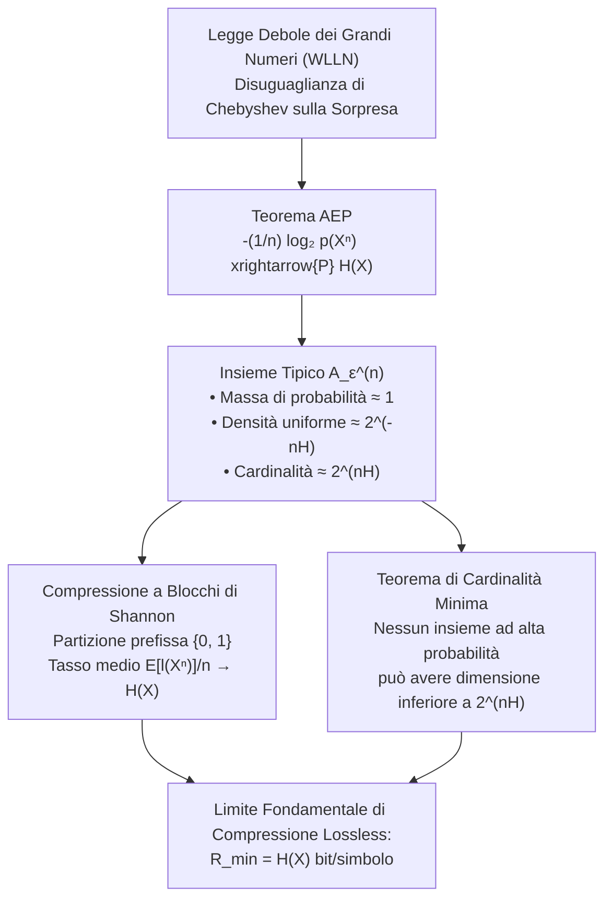

# 8. Proprietà di Equipartizione Asintotica (AEP)

La Proprietà di Equipartizione Asintotica (__Asymptotic Equipartition Property__, AEP) costituisce il fondamento matematico su cui poggia l'intera teoria dell'informazione e della compressione dei dati formulata da Claude Shannon nel 1948. L'AEP rappresenta la naturale estensione della Legge Debole dei Grandi Numeri (WLLN) allo spazio delle realizzazioni informative: all'aumentare della lunghezza delle sequenze generate da una sorgente stazionaria priva di memoria, lo spazio combinatorio si polarizza in modo netto.

La quasi totalità della misura di probabilità si concentra su un sottoinsieme compatto dello spazio delle configurazioni, denominato __insieme tipico__, i cui elementi condividono tutti la medesima densità di probabilità asintotica, scandita unicamente dall'entropia di Shannon della sorgente.

## Fondamenti Probabilistici: Dalla Legge dei Grandi Numeri alla Sorpresa Informativa

L'architettura concettuale dell'AEP nasce direttamente dall'applicazione dei teoremi limite della teoria della probabilità classica a una trasformazione non lineare delle variabili di sorgente: la funzione di sorpresa campionaria.

### Legge Debole dei Grandi Numeri e Disuguaglianza di Chebyshev

Consideriamo una successione di $n$ variabili aleatorie reali $X_1, X_2, \dots, X_n$ indipendenti e identicamente distribuite (i.i.d.), dotate di valore atteso comune $\mathbb{E}[X_i] = \mu$ e varianza finita $\text{Var}(X_i) = \sigma^2 < \infty$. Definiamo la variabile aleatoria media campionaria:

$$
\bar{X}_n = \frac{1}{n} \sum_{i=1}^n X_i
$$

Sfruttando la linearità dell'operatore valore atteso e la mutua indipendenza delle variabili, calcoliamo i momenti del primo e del secondo ordine centrato:

$$
\mathbb{E}[\bar{X}_n] = \frac{1}{n} \sum_{i=1}^n \mathbb{E}[X_i] = \frac{n \mu}{n} = \mu
$$

$$
\text{Var}(\bar{X}_n) = \mathbb{E}\left[ (\bar{X}_n - \mu)^2 \right] = \frac{1}{n^2} \sum_{i=1}^n \text{Var}(X_i) = \frac{n \sigma^2}{n^2} = \frac{\sigma^2}{n}
$$

Notiamo come la varianza della media campionaria decada come $1/n$: all'aumentare del numero di campioni, la dispersione attorno al valore atteso si contrae progressivamente. Applichiamo la disuguaglianza di Chebyshev per quantificare la probabilità che la media campionaria devii dal valor medio oltre una soglia arbitraria $\epsilon > 0$:

$$
\text{Pr}\left\{ |\bar{X}_n - \mu| \ge \epsilon \right\} \le \frac{\text{Var}(\bar{X}_n)}{\epsilon^2} = \frac{\sigma^2}{n \epsilon^2}
$$

Facendo tendere la dimensione campionaria $n$ all'infinito:

$$
\lim_{n \to \infty} \text{Pr}\left\{ |\bar{X}_n - \mu| \ge \epsilon \right\} \le \lim_{n \to \infty} \frac{\sigma^2}{n \epsilon^2} = 0 \iff \lim_{n \to \infty} \text{Pr}\left\{ |\bar{X}_n - \mu| < \epsilon \right\} = 1
$$

Questo risultato formalizza la __Legge Debole dei Grandi Numeri__ (Weak Law of Large Numbers, WLLN): la media campionaria converge in probabilità al valore atteso teorico, ossia $\bar{X}_n \xrightarrow{P} \mu$.

### Modalità di Convergenza per Sequenze Stocastiche

Nel formalismo probabilistico avanzato distinguiamo tre nozioni fondamentali di convergenza per una sequenza di variabili aleatorie $\{Z_n\}$ verso una variabile limite $Z$:

1. __Convergenza in Probabilità__ ($Z_n \xrightarrow{P} Z$): per qualsiasi tolleranza prefissata $\epsilon > 0$, la massa di probabilità della discrepanza decade a zero:

$$
\lim_{n \to \infty} \text{Pr}\left\{ |Z_n - Z| > \epsilon \right\} = 0
$$

2. __Convergenza in Media Quadratica__ ($Z_n \xrightarrow{L^2} Z$): la potenza attesa dell'errore si annulla asintoticamente:

$$
\lim_{n \to \infty} \mathbb{E}\left[ (Z_n - Z)^2 \right] = 0
$$

3. __Convergenza Quasi Certa__ o con probabilità 1 ($Z_n \xrightarrow{\text{a.s.}} Z$): l'insieme delle traiettorie campionarie che non convergono ha misura di probabilità nulla:

$$
\text{Pr}\left\{ \lim_{n \to \infty} Z_n = Z \right\} = 1
$$

La Legge Debole dei Grandi Numeri assicura la convergenza in probabilità, mentre la Legge Forte (SLLN) governa la convergenza quasi certa. Nella derivazione analitica dell'AEP di Shannon è sufficiente invocare la convergenza in probabilità.

### Dal Valore Campionario alla Sorpresa Informativa

Per trasporre questi principi probabilistici nell'alveo della teoria dell'informazione, consideriamo una sorgente discreta stazionaria e priva di memoria (DMS) che emette blocchi di lunghezza $n$:

$$
X^n = (X_1, X_2, \dots, X_n), \quad X_i \in \mathcal{X}
$$

I simboli sono i.i.d. con funzione di massa di probabilità marginale $p(x) = \text{Pr}\{X = x\}$ definita sull'alfabeto finito $\mathcal{X}$. Per l'indipendenza statistica, la probabilità congiunta della sequenza realizzata fattorizza esattamente nel prodotto delle probabilità dei singoli simboli costituenti:

$$
p(X^n) = p(X_1, X_2, \dots, X_n) = \prod_{i=1}^n p(X_i)
$$

Sebbene la probabilità $p(X^n)$ sia una variabile aleatoria (poiché funzione deterministica dei campioni aleatori $X_i$), operare direttamente sul prodotto risulta algebricamente ostico. Applichiamo quindi l'operatore logaritmico in base 2 e normalizziamo per la lunghezza del blocco $n$, introducendo la __densità di sorpresa campionaria normalizzata__ (o tasso empirico di auto-informazione):

$$
-\frac{1}{n} \log_2 p(X_1, \dots, X_n) = -\frac{1}{n} \log_2 \left( \prod_{i=1}^n p(X_i) \right) = \frac{1}{n} \sum_{i=1}^n \left( -\log_2 p(X_i) \right)
$$

Riconosciamo immediatamente che la densità di sorpresa non è altro che la media campionaria della variabile aleatoria trasformata $Y_i = -\log_2 p(X_i)$.

## Il Teorema AEP e la Convergenza dell'Entropia Empirica

Il Teorema della Proprietà di Equipartizione Asintotica sancisce che la sorpresa empirica normalizzata converge in probabilità all'entropia nominale della sorgente.

> [!NOTE] Teorema (AEP di Shannon)
> Siano $X_1, X_2, \dots, X_n$ variabili aleatorie discrete i.i.d. distribuite secondo la PMF $p(x)$ su alfabeto finito $\mathcal{X}$. Allora:
>
> $$
> -\frac{1}{n} \log_2 p(X_1, X_2, \dots, X_n) \xrightarrow{P} H(X) \quad \text{per } n \to \infty
> $$
>
> ovvero, per ogni $\epsilon > 0$ arbitrariamente piccolo:
>
> $$
> \lim_{n \to \infty} \text{Pr}\left\{ \left| -\frac{1}{n} \log_2 p(X_1, \dots, X_n) - H(X) \right| > \epsilon \right\} = 0
> $$

### Dimostrazione Analitica tramite Chebyshev sulla Varianza della Sorpresa

Dimostriamo il teorema in modo costruttivo calcolando esplicitamente i momenti della variabile sorpresa e sfruttando la disuguaglianza di Chebyshev.

Poiché le variabili $X_i$ sono mutuamente indipendenti e identicamente distribuite, qualsiasi trasformazione deterministica scalare $g(X_i)$ preserva la proprietà i.i.d. Definiamo la variabile aleatoria sorpresa associata al singolo simbolo:

$$
Y_i = -\log_2 p(X_i)
$$

Valutiamo il valore atteso di $Y_i$ applicando la definizione statistica:

$$
\mathbb{E}[Y_i] = \mathbb{E}[-\log_2 p(X)] = \sum_{x \in \mathcal{X}} p(x) (-\log_2 p(x)) = -\sum_{x \in \mathcal{X}} p(x) \log_2 p(x) = H(X)
$$

Il valore atteso della sorpresa coincide esattamente con l'entropia di Shannon $H(X)$. Calcoliamo ora la varianza della sorpresa del singolo simbolo $\sigma_Y^2 = \text{Var}(Y_i)$:

$$
\sigma_Y^2 = \mathbb{E}\left[ (Y_i - \mathbb{E}[Y_i])^2 \right] = \sum_{x \in \mathcal{X}} p(x) \left( -\log_2 p(x) - H(X) \right)^2
$$

Poiché l'alfabeto di sorgente $\mathcal{X}$ è finito ($|\mathcal{X}| < \infty$) e per ogni simbolo con probabilità non nulla $p(x) > 0$ la quantità $\log_2 p(x)$ è finita, la sommatoria è una combinazione lineare finita di termini limitati. Di conseguenza la varianza è strettamente finita:

$$
\sigma_Y^2 < \infty
$$

Esprimiamo ora la densità di sorpresa della sequenza come media campionaria $\bar{Y}_n$:

$$
\bar{Y}_n = \frac{1}{n} \sum_{i=1}^n Y_i = -\frac{1}{n} \log_2 p(X_1, \dots, X_n)
$$

Calcoliamo i momenti della media campionaria della sorpresa:

$$
\mathbb{E}[\bar{Y}_n] = \frac{1}{n} \sum_{i=1}^n \mathbb{E}[Y_i] = \frac{n H(X)}{n} = H(X)
$$

$$
\text{Var}(\bar{Y}_n) = \frac{1}{n^2} \sum_{i=1}^n \text{Var}(Y_i) = \frac{n \sigma_Y^2}{n^2} = \frac{\sigma_Y^2}{n}
$$

Applichiamo la disuguaglianza di Chebyshev alla variabile $\bar{Y}_n$ rispetto alla soglia di tolleranza $\epsilon > 0$:

$$
\text{Pr}\left\{ |\bar{Y}_n - \mathbb{E}[\bar{Y}_n]| \ge \epsilon \right\} \le \frac{\text{Var}(\bar{Y}_n)}{\epsilon^2}
$$

Sostituendo la media e la varianza appena derivate:

$$
\text{Pr}\left\{ \left| -\frac{1}{n} \log_2 p(X_1, \dots, X_n) - H(X) \right| \ge \epsilon \right\} \le \frac{\sigma_Y^2}{n \epsilon^2}
$$

Prendiamo il limite per $n \to \infty$: con $\epsilon > 0$ e $\sigma_Y^2 < \infty$ costanti, il membro destro decade a zero come $O(1/n)$:

$$
\lim_{n \to \infty} \text{Pr}\left\{ \left| -\frac{1}{n} \log_2 p(X_1, \dots, X_n) - H(X) \right| \ge \epsilon \right\} \le \lim_{n \to \infty} \frac{\sigma_Y^2}{n \epsilon^2} = 0
$$

Poiché una misura di probabilità è intrinsecamente non negativa, per il teorema del confronto dei limiti otteniamo:

$$
\lim_{n \to \infty} \text{Pr}\left\{ \left| -\frac{1}{n} \log_2 p(X^n) - H(X) \right| \ge \epsilon \right\} = 0
$$

La disuguaglianza di Chebyshev non solo certifica la convergenza in probabilità, ma fornisce una delimitazione quantitativa rigorosa della velocità di convergenza asintotica. Per la trattazione analitica dettagliata, rimandiamo alla [[zz. Argomenti extra#Dimostrazione Analitica del Teorema AEP tramite Disuguaglianza di Chebyshev sulla Varianza della Sorpresa|dimostrazione analitica del teorema AEP tramite disuguaglianza di Chebyshev sulla varianza della sorpresa]].

### Risoluzione del Paradosso dell'AEP: Probabilità Individuale vs Massa Collettiva

La convergenza stocastica espressa dall'AEP conduce alla fondamentale conseguenza per cui le sequenze effettivamente osservabili per $n$ elevato possiedono quasi tutte la medesima probabilità asintotica:

$$
p(X^n) \approx 2^{-n H(X)}
$$

Questo fenomeno riflette il celebre principio euristico: _"quasi tutti gli eventi che si verificano nella realtà possiedono approssimativamente lo stesso grado di sorpresa"_.

Qui emerge un apparente paradosso concettuale che costituisce uno dei più frequenti trabocchetti d'esame: __le sequenze a priori singolarmente più probabili NON sono sequenze tipiche!__

Per visualizzare il paradosso, consideriamo una sorgente binaria con $p(0) = 0.9$ e $p(1) = 0.1$.
1. La singola sequenza dotata della massima verosimiglianza assoluta in tutto lo spazio è la sequenza composta da soli zeri: $x^n = (0, 0, \dots, 0)$.
2. La sua probabilità vale $p(x^n) = 0.9^n$, che è esponenzialmente maggiore di $2^{-n H(X)}$ (essendo $H(X) \approx 0.469$ bit e $-\log_2(0.9) \approx 0.152$ bit).
3. Calcolando la densità di sorpresa normalizzata della sequenza di soli zeri:

$$
-\frac{1}{n} \log_2(0.9^n) = -\log_2(0.9) \approx 0.152 \quad \text{bit/simbolo} \ll H(X) \approx 0.469 \quad \text{bit/simbolo}
$$

La discrepanza $|0.152 - 0.469| \approx 0.317$ supera abbondantemente qualsiasi tolleranza $\epsilon$: la sequenza di soli zeri non appartiene all'insieme tipico!

Come si risolve il paradosso? Esaminando il ruolo della __molteplicità combinatoria__:
- Esiste __una sola__ sequenza formata da tutti zeri. La sua probabilità aggregata decade esponenzialmente a zero: $\lim_{n \to \infty} 0.9^n = 0$.
- Le sequenze tipiche contengono invece circa $0.9n$ zeri e $0.1n$ uni, rispecchiando fedelmente la PMF della sorgente. La probabilità di ciascuna sequenza tipica è singolarmente infinitesima ($p(x^n) \approx 2^{-n H(X)}$), ma il numero complessivo di tali sequenze è astronomico:

$$
\binom{n}{0.1n} \approx 2^{n H_B(0.1)} = 2^{n H(X)}
$$

Moltiplicando la probabilità individuale per il numero di sequenze tipiche otteniamo:

$$
\text{Massa Totale} \approx |A_\epsilon^{(n)}| \cdot p(x^n) \approx 2^{n H(X)} \cdot 2^{-n H(X)} = 1
$$

La massa di probabilità si concentra dove il prodotto tra probabilità individuale e molteplicità combinatoria raggiunge il proprio culmine asintotico.

### Esempio Didattico a Lunghezza Finita ($n=3$)

Per fissare le idee con un modello analitico immediato, consideriamo una sorgente di Bernoulli con $p(1) = p = 0.7$ e $p(0) = q = 0.3$. L'entropia nominale di Shannon vale:

$$
H(X) = H_B(0.7) = -0.7 \log_2(0.7) - 0.3 \log_2(0.3) \approx 0.3602 + 0.5211 \approx 0.8813 \quad \text{bit}
$$

A lunghezza finita $n = 3$, lo spazio campionario comprende $2^3 = 8$ sequenze binarie distinte. Raggruppiamo le sequenze in base al numero di uni:

| Sequenze $X^3$ | Numero di '1' | Probabilità del Singolo Evento $p(x^3)$ | Molteplicità $\binom{3}{k}$ | Probabilità Cumulata del Gruppo | Densità di Sorpresa $-\frac{1}{3}\log_2 p(x^3)$ |
| :---: | :---: | :---: | :---: | :---: | :---: |
| `000` | $0$ | $q^3 = 0.3^3 = 0.027$ | $1$ | $0.027$ | $-\frac{1}{3}\log_2(0.027) \approx 1.737$ bit |
| `001`, `010`, `100` | $1$ | $p q^2 = 0.7 \times 0.3^2 = 0.063$ | $3$ | $3 \times 0.063 = 0.189$ | $-\frac{1}{3}\log_2(0.063) \approx 1.329$ bit |
| `011`, `101`, `110` | $2$ | $p^2 q = 0.7^2 \times 0.3 = 0.147$ | $3$ | $3 \times 0.147 = 0.441$ | $-\frac{1}{3}\log_2(0.147) \approx 0.922$ bit |
| `111` | $3$ | $p^3 = 0.7^3 = 0.343$ | $1$ | $0.343$ | $-\frac{1}{3}\log_2(0.343) \approx 0.515$ bit |

Confrontiamo i risultati:
- La singola sequenza `111` è la più probabile in assoluto ($34.3\%$), ma la sua sorpresa normalizzata ($0.515$ bit) dista ben $0.366$ bit dall'entropia teorica ($0.8813$ bit).
- La classe delle sequenze con 2 uni (`011`, `101`, `110`), pur avendo una probabilità per elemento inferiore ($0.147$), cattura la frazione maggioritaria della massa totale ($44.1\%$). La sorpresa associata a ciascuna di esse è pari a $0.922$ bit, straordinariamente vicina all'entropia nominale $H(X) = 0.8813$ bit.

## L'Insieme Tipico e la Sua Geometria Iperdimensionale

Formalizziamo la nozione di traiettorie a sorpresa media introducendo l'oggetto geometrico cardine della teoria dell'informazione: l'insieme tipico.

### Definizione Analitica dell'Insieme Tipico

Fissata una tolleranza reale arbitraria $\epsilon > 0$, definiamo l'__insieme tipico__ $A_\epsilon^{(n)}$ rispetto alla distribuzione $p(x)$ come il sottoinsieme delle sequenze $x^n \in \mathcal{X}^n$ la cui densità di sorpresa campionaria dista da $H(X)$ non più di $\epsilon$:

$$
A_\epsilon^{(n)} = \left\{ x^n \in \mathcal{X}^n \;\middle|\; \left| -\frac{1}{n} \log_2 p(x^n) - H(X) \right| \le \epsilon \right\}
$$

Esplicitando il modulo della disuguaglianza:

$$
H(X) - \epsilon \le -\frac{1}{n} \log_2 p(x^n) \le H(X) + \epsilon
$$

Moltiplicando tutti i membri per $-n$ (invertendo il verso delle disuguaglianze) ed esponenzializzando in base 2, otteniamo la delimitazione a sandwich per la probabilità di ogni sequenza tipica:

$$
2^{-n(H(X) + \epsilon)} \le p(x^n) \le 2^{-n(H(X) - \epsilon)} \quad \forall x^n \in A_\epsilon^{(n)}
$$

![[slide_11_typical_set_partition.png|center mid]]

La rappresentazione geometrica iperdimensionale evidenzia la natura dell'insieme tipico come un guscio sferico sottile che racchiude la quasi totalità della probabilità dello spazio.

![[typical_set_hyperdimensional_concentration.svg|center big]]

### Teorema dell'Insieme Tipico e Proprietà Fondamentali

L'insieme tipico soddisfa quattro proprietà asintotiche fondamentali su cui poggia l'intera teoria della compressione dati:

> [!IMPORTANT] Proprietà Fondamentali dell'Insieme Tipico
> 1. __Equipartizione della Densità__: per ogni $x^n \in A_\epsilon^{(n)}$, la densità di probabilità è uniformemente vincolata da $2^{-n(H(X) + \epsilon)} \le p(x^n) \le 2^{-n(H(X) - \epsilon)}$.
> 2. __Quasi-Certezza Asintotica__: per qualunque $\epsilon > 0$, la probabilità totale dell'insieme tipico converge a 1, ossia $\text{Pr}\{A_\epsilon^{(n)}\} > 1 - \epsilon$ per $n$ sufficientemente grande.
> 3. __Delimitazione Superiore della Cardinalità__: la dimensione complessiva di $A_\epsilon^{(n)}$ è superiormente vincolata da $|A_\epsilon^{(n)}| \le 2^{n(H(X) + \epsilon)}$.
> 4. __Delimitazione Inferiore della Cardinalità__: per $n$ sufficientemente grande, la dimensione è inferiormente vincolata da $|A_\epsilon^{(n)}| \ge (1 - \epsilon) 2^{n(H(X) - \epsilon)}$.

#### Dimostrazione delle Proprietà Cardinali

Dimostriamo le proprietà con passaggi algebrici diretti:

1. La prima proprietà coincide con la definizione esplicita dell'insieme tipico.
2. La seconda proprietà discende immediatamente dal Teorema AEP. Poiché $-\frac{1}{n}\log_2 p(X^n) \xrightarrow{P} H(X)$, per ogni coppia $(\epsilon, \delta)$ con $\delta > 0$ esiste un indice $n_0$ tale che per ogni $n \ge n_0$:

$$
\text{Pr}\left\{ \left| -\frac{1}{n} \log_2 p(X^n) - H(X) \right| \le \epsilon \right\} > 1 - \delta
$$

Ponendo $\delta = \epsilon$, otteniamo direttamente $\text{Pr}\{A_\epsilon^{(n)}\} > 1 - \epsilon$.
3. Per dimostrare il limite superiore sulla cardinalità, sfruttiamo l'assioma di normalizzazione della probabilità sull'intero spazio campionario $\mathcal{X}^n$:

$$
1 = \sum_{x^n \in \mathcal{X}^n} p(x^n) \ge \sum_{x^n \in A_\epsilon^{(n)}} p(x^n)
$$

Per definizione di $A_\epsilon^{(n)}$, per ogni elemento tipico sussiste la minorazione $p(x^n) \ge 2^{-n(H(X) + \epsilon)}$. Sostituendo tale limite inferiore nella sommatoria:

$$
1 \ge \sum_{x^n \in A_\epsilon^{(n)}} 2^{-n(H(X) + \epsilon)} = 2^{-n(H(X) + \epsilon)} \sum_{x^n \in A_\epsilon^{(n)}} 1 = 2^{-n(H(X) + \epsilon)} |A_\epsilon^{(n)}|
$$

Moltiplicando ambo i membri per il termine strettamente positivo $2^{n(H(X) + \epsilon)}$:

$$
|A_\epsilon^{(n)}| \le 2^{n(H(X) + \epsilon)}
$$

4. Per dimostrare il limite inferiore sulla cardinalità, consideriamo la probabilità totale dell'insieme tipico per $n \ge n_0$:

$$
1 - \epsilon < \text{Pr}\{A_\epsilon^{(n)}\} = \sum_{x^n \in A_\epsilon^{(n)}} p(x^n)
$$

Poiché per ogni sequenza tipica sussiste la maggiorazione $p(x^n) \le 2^{-n(H(X) - \epsilon)}$:

$$
1 - \epsilon < \sum_{x^n \in A_\epsilon^{(n)}} 2^{-n(H(X) - \epsilon)} = 2^{-n(H(X) - \epsilon)} |A_\epsilon^{(n)}|
$$

Moltiplicando per $2^{n(H(X) - \epsilon)}$:

$$
|A_\epsilon^{(n)}| \ge (1 - \epsilon) 2^{n(H(X) - \epsilon)}
$$

Abbiamo così isolato la cardinalità dell'insieme tipico all'interno di una morsa esponenziale: la sua dimensione scala asintoticamente come $|A_\epsilon^{(n)}| \approx 2^{n H(X)}$.

### Esempio Analitico Esaustivo a Lunghezza Finita ($n=4$)

Applichiamo la teoria dell'insieme tipico a una sorgente bernoulliana $X \sim \text{Bern}(p)$ con $p = 0.4$ su alfabeto $\mathcal{X} = \{0, 1\}$.
Fissiamo la tolleranza $\epsilon = 0.1$.
L'entropia nominale della sorgente vale:

$$
H(X) = -0.4 \log_2(0.4) - 0.6 \log_2(0.6) \approx 0.5288 + 0.4422 = 0.9710 \quad \text{bit}
$$

L'intervallo di ammissibilità per la sorpresa media $-\frac{1}{4}\log_2 p(x^4)$ associata alle sequenze tipiche risulta:

$$
[H(X) - \epsilon, \, H(X) + \epsilon] = [0.9710 - 0.1, \, 0.9710 + 0.1] = [0.8710, \, 1.0710] \quad \text{bit}
$$

Lo spazio campionario $\mathcal{X}^4$ comprende $2^4 = 16$ sequenze. Valutiamo l'ammissibilità classe per classe in base al numero di uni:

1. __0 uni (1 sequenza)__: $x^4 = (0, 0, 0, 0)$.
   - Probabilità: $p(x^4) = 0.4^0 \times 0.6^4 = 0.1296$.
   - Sorpresa media: $-\frac{1}{4}\log_2(0.1296) \approx 0.7370$ bit.
   - Deviazione da $H(X)$: $|0.7370 - 0.9710| = 0.2340 > 0.1000$.
   - Esito: __Non Tipica__ (la sequenza singolarmente più probabile di tutto lo spazio campionario resta esclusa da $A_\epsilon^{(n)}$).

2. __1 uno (4 sequenze)__: `0001`, `0010`, `0100`, `1000`.
   - Probabilità singola: $p(x^4) = 0.4^1 \times 0.6^3 = 0.0864$.
   - Sorpresa media: $-\frac{1}{4}\log_2(0.0864) \approx 0.8832$ bit.
   - Deviazione da $H(X)$: $|0.8832 - 0.9710| = 0.0878 \le 0.1000$.
   - Esito: __Tipica__ (tutte le 4 sequenze appartengono ad $A_{0.1}^{(4)}$).

3. __2 uni (6 sequenze)__: `0011`, `0101`, `0110`, `1001`, `1010`, `1100`.
   - Probabilità singola: $p(x^4) = 0.4^2 \times 0.6^2 = 0.0576$.
   - Sorpresa media: $-\frac{1}{4}\log_2(0.0576) \approx 1.0294$ bit.
   - Deviazione da $H(X)$: $|1.0294 - 0.9710| = 0.0584 \le 0.1000$.
   - Esito: __Tipica__ (tutte le 6 sequenze appartengono ad $A_{0.1}^{(4)}$).

4. __3 uni (4 sequenze)__: `0111`, `1011`, `1101`, `1110`.
   - Probabilità singola: $p(x^4) = 0.4^3 \times 0.6^1 = 0.0384$.
   - Sorpresa media: $-\frac{1}{4}\log_2(0.0384) \approx 1.1757$ bit.
   - Deviazione da $H(X)$: $|1.1757 - 0.9710| = 0.2047 > 0.1000$.
   - Esito: __Non Tipica__.

5. __4 uni (1 sequenza)__: `1111`.
   - Probabilità singola: $p(x^4) = 0.4^4 \times 0.6^0 = 0.0256$.
   - Sorpresa media: $-\frac{1}{4}\log_2(0.0256) \approx 1.3219$ bit.
   - Deviazione da $H(X)$: $|1.3219 - 0.9710| = 0.3509 > 0.1000$.
   - Esito: __Non Tipica__.

L'insieme tipico è costituito esattamente dall'unione delle 10 sequenze aventi 1 oppure 2 uni:

$$
A_{0.1}^{(4)} = \{0001, 0010, 0100, 1000, 0011, 0101, 0110, 1001, 1010, 1100\}
$$

La cardinalità effettiva è $|A_{0.1}^{(4)}| = 10$. Verifichiamo il limite superiore teorico:

$$
|A_{0.1}^{(4)}| = 10 \le 2^{4(0.9710 + 0.1)} = 2^{4 \times 1.0710} = 2^{4.284} \approx 19.48
$$

La disuguaglianza teorica è pienamente verificata.

## Codifica di Sorgente a Blocchi di Shannon (Compressione Lossless)

La delimitazione della cardinalità dell'insieme tipico fornisce lo strumento costruttivo per dimostrare il primo teorema fondamentale di Shannon: la comprimibilità asintotica senza perdita fino alla soglia invalicabile dell'entropia.

### Architettura di Codifica a Partizione Binaria

Consideriamo il problema di codificare sequenze $x^n \in \mathcal{X}^n$ generate da una sorgente stazionaria e priva di memoria. Partizioniamo lo spazio campionario $\mathcal{X}^n$ nei due sottoinsiemi complementari e disgiunti: l'insieme tipico $A_\epsilon^{(n)}$ e l'insieme atipico $(A_\epsilon^{(n)})^c$.

Ordinando lessicograficamente gli elementi interni a ciascun blocco, costruiamo un codice binario istantaneamente decodificabile secondo il seguente schema strutturale:

1. __Sequenze Tipiche ($x^n \in A_\epsilon^{(n)}$)__:
   - Il numero di sequenze tipiche è al massimo $2^{n(H(X) + \epsilon)}$.
   - Ciascuna sequenza tipica può essere indicizzata univocamente mediante un numero intero che richiede al più $\lceil \log_2 |A_\epsilon^{(n)}| \rceil \le \lceil n(H(X) + \epsilon) \rceil \le n(H(X) + \epsilon) + 1$ bit.
   - Anteponiamo a tutte queste parole di codice un bit di flag prefisso pari a `0`.
   - La lunghezza complessiva della parola di codice per ogni elemento tipico è:

$$
l(x^n) \le n(H(X) + \epsilon) + 2 \quad \text{bit}
$$

2. __Sequenze Atipiche ($x^n \notin A_\epsilon^{(n)}$)__:
   - Il numero di sequenze atipiche è strettamente inferiore alla cardinalità totale $|\mathcal{X}|^n$.
   - L'indicizzazione di un elemento generico nello spazio campionario richiede al più $\lceil \log_2 |\mathcal{X}|^n \rceil \le n \log_2 |\mathcal{X}| + 1$ bit.
   - Anteponiamo a queste parole di codice un bit di flag prefisso pari a `1`.
   - La lunghezza complessiva della parola di codice per ogni elemento atipico è:

$$
l(x^n) \le n \log_2 |\mathcal{X}| + 2 \quad \text{bit}
$$

Il bit iniziale agisce da flag indicatore di lunghezza: alla ricezione di `0`, il decodificatore sa esattamente che seguiranno $\lceil n(H+\epsilon) \rceil$ bit; alla ricezione di `1`, sa che seguiranno $\lceil n\log_2|\mathcal{X}| \rceil$ bit. La decodifica è univoca, istantanea e a prefisso.

![[slide_12_typical_set_block_coding.png|center mid]]

### Derivazione del Valore Atteso della Lunghezza del Codice

Sia $l(X^n)$ la variabile aleatoria che descrive la lunghezza della stringa binaria emessa dal codificatore. Calcoliamo il valore atteso della lunghezza del codice:

$$
\mathbb{E}[l(X^n)] = \sum_{x^n \in \mathcal{X}^n} p(x^n) l(x^n) = \sum_{x^n \in A_\epsilon^{(n)}} p(x^n) l(x^n) + \sum_{x^n \notin A_\epsilon^{(n)}} p(x^n) l(x^n)
$$

Sostituiamo le maggiorazioni sulle lunghezze derivate in precedenza:

$$
\mathbb{E}[l(X^n)] \le \sum_{x^n \in A_\epsilon^{(n)}} p(x^n) \left[ n(H(X) + \epsilon) + 2 \right] + \sum_{x^n \notin A_\epsilon^{(n)}} p(x^n) \left[ n \log_2 |\mathcal{X}| + 2 \right]
$$

Riorganizziamo i termini estraendo le somme e raccogliendo a fattor comune le costanti additive dei flag:

$$
\mathbb{E}[l(X^n)] \le n(H(X) + \epsilon) \sum_{x^n \in A_\epsilon^{(n)}} p(x^n) + n \log_2 |\mathcal{X}| \sum_{x^n \notin A_\epsilon^{(n)}} p(x^n) + 2 \left( \sum_{x^n \in A_\epsilon^{(n)}} p(x^n) + \sum_{x^n \notin A_\epsilon^{(n)}} p(x^n) \right)
$$

Riconosciamo le misure di probabilità degli eventi:

$$
\sum_{x^n \in A_\epsilon^{(n)}} p(x^n) = \text{Pr}\{A_\epsilon^{(n)}\}, \quad \sum_{x^n \notin A_\epsilon^{(n)}} p(x^n) = \text{Pr}\{(A_\epsilon^{(n)})^c\}
$$

Poiché $A_\epsilon^{(n)}$ e $(A_\epsilon^{(n)})^c$ costituiscono una partizione esaustiva dello spazio, la somma delle loro probabilità vale rigorosamente 1:

$$
\text{Pr}\{A_\epsilon^{(n)}\} + \text{Pr}\{(A_\epsilon^{(n)})^c\} = 1
$$

Il termine costante dovuto ai flag prefissi vale pertanto esattamente $2 \cdot 1 = 2$.
Inoltre, maggioriamo banalmente $\text{Pr}\{A_\epsilon^{(n)}\} \le 1$ e sfruttiamo la proprietà dell'AEP per cui, per $n$ sufficientemente grande, $\text{Pr}\{(A_\epsilon^{(n)})^c\} < \epsilon$:

$$
\mathbb{E}[l(X^n)] \le n(H(X) + \epsilon) + \epsilon n \log_2 |\mathcal{X}| + 2
$$

Raccogliamo la lunghezza $n$ a fattor comune:

$$
\mathbb{E}[l(X^n)] \le n \left[ H(X) + \epsilon + \epsilon \log_2 |\mathcal{X}| + \frac{2}{n} \right]
$$

Definendo la quantità residua $\epsilon'$:

$$
\epsilon' = \epsilon (1 + \log_2 |\mathcal{X}|) + \frac{2}{n}
$$

otteniamo la delimitazione compatta:

$$
\mathbb{E}[l(X^n)] \le n (H(X) + \epsilon')
$$

### Teorema di Compressione di Shannon e Limite di Entropia

Dividendo la disuguaglianza per la lunghezza del blocco $n$, valutiamo il tasso medio di codifica per simbolo di sorgente $R = \frac{1}{n}\mathbb{E}[l(X^n)]$:

$$
\frac{1}{n} \mathbb{E}[l(X^n)] \le H(X) + \epsilon'
$$

Possiamo rendere la quantità residua $\epsilon'$ arbitrariamente piccola scegliendo dapprima una tolleranza $\epsilon$ sufficientemente vicina a zero e, successivamente, una dimensione di blocco $n$ sufficientemente elevata affinché il termine $2/n$ diventi trascurabile.

> [!NOTE] Teorema di Compressione di Shannon (Source Coding Theorem)
> Sia $X^n$ una sequenza di variabili aleatorie discrete i.i.d. tratte da una PMF $p(x)$ con entropia $H(X)$. Per qualsiasi $\epsilon > 0$, esiste un codice invertibile e privo di perdita da $\mathcal{X}^n$ in stringhe binarie tale che, per $n$ sufficientemente grande:
>
> $$
> \frac{1}{n} \mathbb{E}[l(X^n)] \le H(X) + \epsilon
> $$

Questo risultato sancisce il significato operativo primario dell'entropia di Shannon: $H(X)$ rappresenta la quantità minima assoluta di bit per simbolo necessaria e sufficiente per memorizzare o trasmettere la sorgente senza alcuna perdita di informazione.

## Insiemi ad Alta Probabilità e Teorema di Cardinalità Minima

A questo punto sorge un interrogativo fondamentale per la teoria dell'informazione: l'insieme tipico $A_\epsilon^{(n)}$ è il più piccolo insieme in grado di catturare la quasi totalità della probabilità? Oppure è possibile concentrare una probabilità arbitrariamente alta in un sottoinsieme con un numero di sequenze esponenzialmente inferiore?

Il Teorema di Cardinalità Minima dimostra che nessun insieme ad alta probabilità può scalare con un esponente inferiore ad $H(X)$.

### Formulazione del Problema di Minima Dimensione

Fissiamo una soglia massima tollerata d'errore $\delta \in (0, 1/2)$. Per ogni intero $n$, sia $B_\delta^{(n)} \subset \mathcal{X}^n$ un sottoinsieme arbitrario dello spazio combinatorio che concentra una probabilità non inferiore a $1 - \delta$:

$$
\text{Pr}\{B_\delta^{(n)}\} \ge 1 - \delta
$$

Ci proponiamo di delimitare inferiormente la cardinalità $|B_\delta^{(n)}|$ per grandi valori di $n$.

> [!NOTE] Teorema di Cardinalità Minima per Insiemi ad Alta Probabilità
> Siano $X_1, X_2, \dots, X_n$ variabili aleatorie i.i.d. $\sim p(x)$. Per ogni $\delta < 1/2$ e qualunque $\epsilon > 0$, se $\text{Pr}\{B_\delta^{(n)}\} \ge 1 - \delta$, allora per $n$ sufficientemente grande:
>
> $$
> \frac{1}{n} \log_2 |B_\delta^{(n)}| > H(X) - 2\epsilon
> $$
>
> ossia la cardinalità deve soddisfare:
>
> $$
> |B_\delta^{(n)}| \ge (1 - \delta - \epsilon) 2^{n(H(X) - \epsilon)}
> $$

### Dimostrazione Analitica Formale

Dimostriamo il teorema esaminando l'intersezione tra l'insieme generico $B_\delta^{(n)}$ e l'insieme tipico $A_\epsilon^{(n)}$.

Dalla teoria elementare della probabilità, la misura dell'unione di due eventi è limitata superiormente da 1:

$$
\text{Pr}\{B_\delta^{(n)} \cup A_\epsilon^{(n)}\} = \text{Pr}\{B_\delta^{(n)}\} + \text{Pr}\{A_\epsilon^{(n)}\} - \text{Pr}\{B_\delta^{(n)} \cap A_\epsilon^{(n)}\} \le 1
$$

Riorganizzando i termini, otteniamo una delimitazione inferiore per la misura dell'intersezione:

$$
\text{Pr}\{B_\delta^{(n)} \cap A_\epsilon^{(n)}\} \ge \text{Pr}\{B_\delta^{(n)}\} + \text{Pr}\{A_\epsilon^{(n)}\} - 1
$$

Per ipotesi $\text{Pr}\{B_\delta^{(n)}\} \ge 1 - \delta$. Inoltre, per il Teorema dell'Insieme Tipico, per qualsiasi $\epsilon > 0$ prefissato esiste $n_0$ tale che per ogni $n \ge n_0$ si ha $\text{Pr}\{A_\epsilon^{(n)}\} > 1 - \epsilon$. Sostituendo entrambe le minorazioni:

$$
\text{Pr}\{B_\delta^{(n)} \cap A_\epsilon^{(n)}\} \ge (1 - \delta) + (1 - \epsilon) - 1 = 1 - \delta - \epsilon
$$

Poiché $\delta < 1/2$, scegliendo $\epsilon < 1/2 - \delta$ si ha la certezza che la costante $1 - \delta - \epsilon > 0$ è strettamente positiva.

D'altra parte, per definizione di insieme tipico, ogni sequenza $x^n \in A_\epsilon^{(n)}$ soddisfa la maggiorazione uniforme $p(x^n) \le 2^{-n(H(X) - \epsilon)}$. Poiché l'intersezione è un sottoinsieme di $A_\epsilon^{(n)}$ ($B_\delta^{(n)} \cap A_\epsilon^{(n)} \subseteq A_\epsilon^{(n)}$), tale maggiorazione sussiste per ogni elemento dell'intersezione. Esprimendo la probabilità dell'intersezione come sommatoria discreta:

$$
\text{Pr}\{B_\delta^{(n)} \cap A_\epsilon^{(n)}\} = \sum_{x^n \in B_\delta^{(n)} \cap A_\epsilon^{(n)}} p(x^n) \le \sum_{x^n \in B_\delta^{(n)} \cap A_\epsilon^{(n)}} 2^{-n(H(X) - \epsilon)} = |B_\delta^{(n)} \cap A_\epsilon^{(n)}| \cdot 2^{-n(H(X) - \epsilon)}
$$

Poiché banalmente $|B_\delta^{(n)} \cap A_\epsilon^{(n)}| \le |B_\delta^{(n)}|$, abbiamo:

$$
\text{Pr}\{B_\delta^{(n)} \cap A_\epsilon^{(n)}\} \le |B_\delta^{(n)}| \cdot 2^{-n(H(X) - \epsilon)}
$$

Concatenando le due delimitazioni analitiche:

$$
1 - \delta - \epsilon \le |B_\delta^{(n)}| \cdot 2^{-n(H(X) - \epsilon)}
$$

Moltiplicando ambo i membri per il termine strettamente positivo $2^{n(H(X) - \epsilon)}$:

$$
|B_\delta^{(n)}| \ge (1 - \delta - \epsilon) 2^{n(H(X) - \epsilon)}
$$

Applichiamo il logaritmo in base 2 ad ambo i membri:

$$
\log_2 |B_\delta^{(n)}| \ge n(H(X) - \epsilon) + \log_2(1 - \delta - \epsilon)
$$

Dividendo l'intera disuguaglianza per la lunghezza del blocco $n$:

$$
\frac{1}{n} \log_2 |B_\delta^{(n)}| \ge H(X) - \epsilon + \frac{1}{n} \log_2(1 - \delta - \epsilon)
$$

Poiché $(1 - \delta - \epsilon)$ è una costante positiva non nulla indipendente da $n$, il termine $\frac{1}{n}\log_2(1 - \delta - \epsilon)$ converge a zero per $n \to \infty$. Esiste pertanto un indice $n_1$ tale che per ogni $n \ge n_1$:

$$
\frac{1}{n} \log_2(1 - \delta - \epsilon) > -\epsilon
$$

Ne discende che per ogni $n \ge \max(n_0, n_1)$:

$$
\frac{1}{n} \log_2 |B_\delta^{(n)}| > H(X) - 2\epsilon
$$

Questo risultato dimostra in modo inconfutabile che l'insieme tipico possiede la minima dimensione asintotica all'esponente tra tutti i possibili insiemi ad alta probabilità. Per ulteriori dettagli analitici, si veda la [[zz. Argomenti extra#Dimostrazione del Teorema di Cardinalità Minima per Insiemi ad Alta Probabilità|dimostrazione analitica del teorema di cardinalità minima per insiemi ad alta probabilità]].

### Costruzione Greedy dell'Insieme Minimo a Lunghezza Finita ($n=4$)

Per comprendere il divario operativo tra insiemi a lunghezza finita e comportamento asintotico, riprendiamo la sorgente bernoulliana con $p = 0.4$ a lunghezza $n = 4$, imponendo una soglia di probabilità cumulata pari a $1 - \delta = 0.90$.

Per costruire l'insieme a cardinalità minima $B_{0.1}^{(4)}$, adottiamo un algoritmo ingordo (__greedy__): ordiniamo tutte le 16 sequenze dello spazio campionario in ordine rigorosamente decrescente di probabilità e accumuliamo elementi finché la somma delle probabilità non raggiunge o supera la quota $0.90$:

1. Includiamo la sequenza a 0 uni: `0000`.
   - Probabilità: $0.1296$. Cumulato: $0.1296$. (1 sequenza accumulata).

2. Includiamo le 4 sequenze a 1 uno: `0001`, `0010`, `0100`, `1000`.
   - Probabilità singola: $0.0864$. Contributo: $4 \times 0.0864 = 0.3456$.
   - Cumulato: $0.1296 + 0.3456 = 0.4752$. (5 sequenze accumulate).

3. Includiamo le 6 sequenze a 2 uni: `0011`, `0101`, `0110`, `1001`, `1010`, `1100`.
   - Probabilità singola: $0.0576$. Contributo: $6 \times 0.0576 = 0.3456$.
   - Cumulato: $0.4752 + 0.3456 = 0.8208$. (11 sequenze accumulate).

4. Per colmare la quota residua di $0.9000 - 0.8208 = 0.0792$, attingiamo dalle sequenze a 3 uni (probabilità singola $0.0384$). Selezionando 2 sequenze otterremmo $0.8208 + 2 \times 0.0384 = 0.8976 < 0.9000$. Risulta quindi necessario selezionare 3 sequenze a 3 uni (ad esempio `0111`, `1011`, `1101`):
   - Contributo: $3 \times 0.0384 = 0.1152$.
   - Cumulato finale: $0.8208 + 0.1152 = 0.9360 \ge 0.9000$. (14 sequenze accumulate).

L'insieme minimo greedy $B_{0.1}^{(4)}$ ha cardinalità:

$$
|B_{0.1}^{(4)}| = 14
$$

Confrontiamo i due insiemi:
- L'insieme tipico $A_{0.1}^{(4)}$ conteneva 10 sequenze.
- L'insieme greedy $B_{0.1}^{(4)}$ ne contiene 14.

Questo accade perché per $n = 4$ la legge dei grandi numeri non si è ancora stabilizzata: l'approccio greedy seleziona prioritariamente la sequenza `0000`, che possiede la singola probabilità più alta ($0.1296$) ma è del tutto atipica. All'aumentare di $n \to \infty$, la probabilità cumulata di tali sequenze isolate decade a zero, e l'algoritmo greedy finisce per selezionare esattamente le sequenze dell'insieme tipico.

## Equivalenza Asintotica all'Esponente e Rapporto Volumetrico

Nel confronto asintotico tra famiglie di sequenze si introduce la nozione rigorosa di equivalenza al primo ordine dell'esponente.

### Definizione di Equivalenza all'Esponente ($\doteq$)

Date due successioni a valori positivi $\{a_n\}$ e $\{b_n\}$, diciamo che $a_n$ e $b_n$ sono __equivalenti all'esponente__, denotato con il simbolo $a_n \doteq b_n$, se e solo se:

$$
a_n \doteq b_n \iff \lim_{n \to \infty} \frac{1}{n} \log_2 \left( \frac{a_n}{b_n} \right) = 0
$$

La relazione $a_n \doteq b_n$ certifica che le due successioni possiedono il medesimo tasso di crescita esponenziale dominante, ammettendo discrepanze sub-esponenziali (quali fattori polinomiali $n^k$ o costanti moltiplicative).

### Il Teorema di Equivalenza dell'AEP

Se le tolleranze soddisfano $\epsilon_n \to 0$ e $\delta_n \to 0$ per $n \to \infty$, allora la cardinalità di qualsiasi insieme ad alta probabilità e quella dell'insieme tipico coincidono all'esponente:

$$
|B_{\delta_n}^{(n)}| \doteq |A_{\epsilon_n}^{(n)}| \doteq 2^{n H(X)}
$$

#### Dimostrazione

Dalle proprietà cardinali dell'insieme tipico:

$$
(1 - \epsilon_n) 2^{n(H(X) - \epsilon_n)} \le |A_{\epsilon_n}^{(n)}| \le 2^{n(H(X) + \epsilon_n)}
$$

Applichiamo il logaritmo in base 2 all'intera catena di disuguaglianze:

$$
\log_2(1 - \epsilon_n) + n H(X) - n \epsilon_n \le \log_2 |A_{\epsilon_n}^{(n)}| \le n H(X) + n \epsilon_n
$$

Sottraiamo il termine $n H(X)$:

$$
\log_2(1 - \epsilon_n) - n \epsilon_n \le \log_2 |A_{\epsilon_n}^{(n)}| - n H(X) \le n \epsilon_n
$$

Dividiamo ciascun membro per la lunghezza del blocco $n$:

$$
\frac{1}{n} \log_2(1 - \epsilon_n) - \epsilon_n \le \frac{1}{n} \log_2 \left( \frac{|A_{\epsilon_n}^{(n)}|}{2^{n H(X)}} \right) \le \epsilon_n
$$

Facendo tendere $n \to \infty$: per ipotesi $\epsilon_n \to 0$, e poiché $\lim_{n \to \infty} \frac{1}{n}\log_2(1 - \epsilon_n) = 0$, sia il membro sinistro sia il membro destro convergono a 0. Per il teorema del confronto dei due carabinieri:

$$
\lim_{n \to \infty} \frac{1}{n} \log_2 \left( \frac{|A_{\epsilon_n}^{(n)}|}{2^{n H(X)}} \right) = 0 \iff |A_{\epsilon_n}^{(n)}| \doteq 2^{n H(X)}
$$

### Interpretazione Volumetrica: Il Paradosso della Sfera Iperdimensionale

L'equivalenza asintotica $2^{n H(X)}$ svela una proprietà geometrica sbalorditiva dello spazio campionario ad alta dimensione:
1. Lo spazio combinatorio complessivo cresce esponenzialmente come:

$$
|\mathcal{X}|^n = 2^{n \log_2 |\mathcal{X}|}
$$

2. Lo spazio delle sequenze "effettivamente generabili" dalla sorgente (l'insieme tipico) cresce esponenzialmente come:

$$
|A_\epsilon^{(n)}| \approx 2^{n H(X)}
$$

3. Il rapporto volumetrico tra l'insieme tipico e l'intero spazio campionario è dato da:

$$
\frac{|A_\epsilon^{(n)}|}{|\mathcal{X}|^n} \approx \frac{2^{n H(X)}}{2^{n \log_2 |\mathcal{X}|}} = 2^{-n (\log_2 |\mathcal{X}| - H(X))}
$$

Poiché per qualsiasi sorgente non degenere e non uniforme l'entropia è strettamente inferiore alla massima entropia ($H(X) < \log_2 |\mathcal{X}|$), la differenza $(\log_2 |\mathcal{X}| - H(X))$ è una costante positiva $\Delta > 0$. Ne discende che:

$$
\lim_{n \to \infty} \frac{|A_\epsilon^{(n)}|}{|\mathcal{X}|^n} = \lim_{n \to \infty} 2^{-n \Delta} = 0
$$

La frazione di volume occupata dall'insieme tipico si annulla esponenzialmente all'aumentare di $n$.

L'insieme tipico costituisce dunque una frazione infinitesima dello spazio delle configurazioni (un guscio iperdimensionale sottilissimo), eppure racchiude la totalità della misura di probabilità. Qualsiasi sistema di trasmissione o archiviazione che riservi risorse unicamente per rappresentare le sequenze tipiche opererà con tasso d'errore asintoticamente nullo, comprimendo l'occupazione di memoria da $\log_2 |\mathcal{X}|$ ad $H(X)$ bit per simbolo.

## Trabocchetti Operativi e Domande Tipiche d'Esame

Nei colloqui d'esame e nelle prove scritte sulla teoria dell'informazione, la proprietà AEP è frequentemente oggetto di quesiti concettuali e trabocchetti mirati.

### Confondere la Sequenza più Probabile con una Sequenza Tipica

__Errore tipico__: Affermare che la sequenza a priori più probabile appartiene all'insieme tipico $A_\epsilon^{(n)}$.

__Spiegazione rigorosa__: L'appartenenza ad $A_\epsilon^{(n)}$ richiede che la sorpresa empirica $-\frac{1}{n}\log_2 p(x^n)$ sia compresa nell'intorno $[H(X)-\epsilon, H(X)+\epsilon]$. La sequenza singolarmente più probabile (ad esempio $(0, 0, \dots, 0)$ per $p(0) > p(1)$) ha una probabilità individuale molto alta, per cui la sua sorpresa è molto bassa ($-\log_2 p(0) < H(X)$). Di conseguenza non cade nell'intervallo tipico: è singolarmente la più probabile, ma è __completamente atipica__.

### Confondere la Probabilità della Singola Sequenza con la Probabilità dell'Insieme

__Errore tipico__: Ritenere che, poiché ogni sequenza tipica ha probabilità infinitesima $\approx 2^{-n H(X)}$, anche la probabilità dell'insieme tipico $\text{Pr}\{A_\epsilon^{(n)}\}$ sia piccola.

__Spiegazione rigorosa__: La probabilità dell'insieme tipico è la somma delle probabilità delle sue sequenze. Essendovi circa $2^{n H(X)}$ sequenze tipiche, ciascuna con probabilità circa $2^{-n H(X)}$, la moltiplicazione produce una probabilità aggregata arbitrariamente vicina a 1:

$$
\text{Pr}\{A_\epsilon^{(n)}\} \approx |A_\epsilon^{(n)}| \cdot 2^{-n H(X)} \approx 2^{n H(X)} \cdot 2^{-n H(X)} = 1
$$

### Dimenticare il Bit di Flag nella Codifica a Blocchi

__Errore tipico__: Calcolare la lunghezza attesa del codice dimenticando il bit di prefisso per distinguere blocchi tipici da blocchi atipici, oppure dimenticare che l'arrotondamento all'intero superiore $\lceil \cdot \rceil$ introduce un termine $+1$.

__Spiegazione rigorosa__: L'indicizzazione di un insieme di cardinalità $M$ richiede $\lceil \log_2 M \rceil \le \log_2 M + 1$ bit. L'aggiunta del flag indicatore di classe (`0` per tipico, `1` per atipico) comporta un ulteriore bit, portando la lunghezza massima per le sequenze tipiche a $n(H(X)+\epsilon) + 2$ e per quelle atipiche a $n\log_2|\mathcal{X}| + 2$. Il fattore costante $+2$ è cruciale nella dimostrazione del teorema di codifica di Shannon: dividendolo per $n$, esso decade come $2/n \to 0$.

### Scambiare i Segni all'Esponente nelle Proprietà Cardinali

__Errore tipico__: Scrivere $|A_\epsilon^{(n)}| \le 2^{n(H(X) - \epsilon)}$ o confondere i bound superiori e inferiori di probabilità e cardinalità.

__Regola mnemonica d'esame__:
- Probabilità individuale tipica: $p(x^n) \approx 2^{-n H(X)}$ (esponente __negativo__). Più una sequenza è lunga, minore è la sua probabilità individuale: l'intervallo è $[2^{-n(H+\epsilon)}, 2^{-n(H-\epsilon)}]$.
- Cardinalità dell'insieme tipico: $|A_\epsilon^{(n)}| \approx 2^{+n H(X)}$ (esponente __positivo__). Più la sequenza è lunga, maggiore è il numero di sequenze: l'intervallo è $[(1-\epsilon)2^{n(H-\epsilon)}, 2^{n(H+\epsilon)}]$.
- Relazione di reciprocità: la cardinalità massima è il reciproco della probabilità minima ($1 / 2^{-n(H+\epsilon)} = 2^{n(H+\epsilon)}$), mentre la cardinalità minima è legata alla probabilità massima ($1 / 2^{-n(H-\epsilon)} = 2^{n(H-\epsilon)}$).

## Quadro Sinottico delle Proprietà dell'Insieme Tipico

La tabella seguente riassume in modo organico e sistematico tutte le proprietà fondamentali dell'insieme tipico $A_\epsilon^{(n)}$:

| Proprietà | Formulazione Analitica | Significato Fisico e Geometrico | Ruolo Operativo nella Compressione |
| :--- | :--- | :--- | :--- |
| __Equipartizione Probabilistica__ | $p(x^n) = 2^{-n(H(X) \pm \epsilon)}$ | Ogni sequenza tipica ha circa la medesima densità di probabilità | Consente l'indicizzazione a lunghezza quasi fissa dei blocchi tipici |
| __Quasi-Certezza Asintotica__ | $\text{Pr}\{A_\epsilon^{(n)}\} > 1 - \epsilon$ | La quasi totalità delle sequenze generate cade nel guscio tipico | Rende trascurabile la probabilità di generare parole atipiche |
| __Delimitazione Cardinalità__ | $(1-\epsilon)2^{n(H-\epsilon)} \le \|A_\epsilon^{(n)}\| \le 2^{n(H+\epsilon)}$ | La dimensione dello spazio tipico scala esattamente come $2^{n H(X)}$ | Fissa il fabbisogno di bit a $n(H(X)+\epsilon)$ per l'indicizzazione |
| __Minima Dimensione Asintotica__ | $\|B_\delta^{(n)}\| \doteq 2^{n H(X)}$ | Nessun insieme ad alta probabilità può avere dimensione inferiore all'esponente | Dimostra che $H(X)$ è il limite fisico invalicabile di compressione |
| __Rapporto Volumetrico Nullo__ | $\frac{\|A_\epsilon^{(n)}\|}{\|\mathcal{X}\|^n} \doteq 2^{-n(\log_2 \|\mathcal{X}\| - H(X))}$ | L'insieme tipico occupa una frazione infinitesima dello spazio campionario | Giustifica l'efficienza estrema della codifica di sorgente a blocchi |
