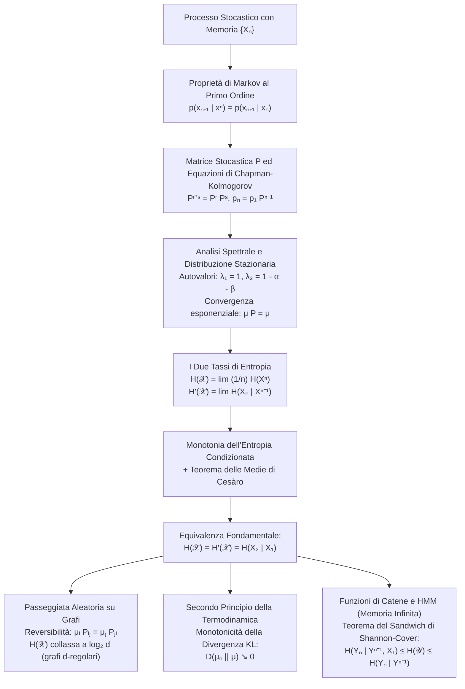

# 9. Entropia Di Sorgenti Con Memoria Ed Entropy Rates

L'ipotesi di campionamento indipendente e identicamente distribuito (i.i.d.), pur costituendo un paradigma analitico fondamentale, non riflette la realtà dei flussi informativi fisici e digitali. Nelle comunicazioni digitali su canali con fading o rumore impulsivo, nel testo in linguaggio naturale, nei segnali bioelettrici, nell'elaborazione audio-video e nella telemetria di sistemi complessi, ogni simbolo generato manifesta una correlazione statistica marcata con gli eventi passati.

La teoria delle sorgenti con memoria estende l'apparato concettuale di Shannon ai processi stocastici stazionari introducendo la nozione di __entropy rate__ (tasso di entropia per simbolo), che quantifica la velocità asintotica con cui un sistema dinamico probabilistico genera nuova e irriducibile informazione.

## Fondamenti Dei Processi Stocastici E Dipendenza Temporale

Un processo stocastico discreto a tempo discreto è formalmente definito come una successione infinita di variabili aleatorie $\{X_i\}_{i=1}^\infty$ (con indice temporale $i \in \mathbb{N}$), definite sul medesimo spazio di probabilità e a valori in un alfabeto discreto $\mathcal{X}$.

La struttura probabilistica del processo è interamente caratterizzata dalla famiglia coerente delle funzioni di massa di probabilità congiunte su blocchi finiti di lunghezza arbitraria $n$:

$$
p(x^n) = p(x_1, x_2, \dots, x_n) = \text{Pr}\{X_1 = x_1, X_2 = x_2, \dots, X_n = x_n\}
$$

La misura di probabilità congiunta governa sia la frequenza con cui compaiono i singoli simboli, sia la memoria statistica che lega sequenze di osservazioni temporalmente distanti.

### Esempio Didattico Fondamentale: La Passeggiata Aleatoria Unidimensionale

Consideriamo una successione di variabili aleatorie binarie $Y_1, Y_2, \dots$ indipendenti e identicamente distribuite (i.i.d.), che modellano passi elementari equiprobabili verso destra o verso sinistra:

$$
\text{Pr}\{Y_i = +1\} = \text{Pr}\{Y_i = -1\} = \frac{1}{2}
$$

Definiamo la passeggiata aleatoria semplice unidimensionale (1D Random Walk) imponendo la posizione iniziale deterministica $X_0 = 0$ e accumulando la somma parziale degli incrementi:

$$
X_n = \sum_{i=1}^n Y_i, \quad n \ge 1
$$

Lo spazio dei valori assumibili all'istante $n$ si dilata linearmente nel tempo: $|\mathcal{X}_n| = n + 1$, con supporto $x_n \in \{-n, -n+2, \dots, n-2, n\}$. Valutiamo i momenti di ordine uno e due della posizione:

$$
\mathbb{E}[X_n] = \sum_{i=1}^n \mathbb{E}[Y_i] = 0
$$

$$
\text{Var}(X_n) = \sum_{i=1}^n \text{Var}(Y_i) = n \cdot 1 = n
$$

Notiamo che la varianza cresce linearmente con il numero di passi $n$. Di conseguenza, per il Teorema del Limite Centrale, la variabile standardizzata $\frac{1}{\sqrt{n}}X_n$ converge in legge a una distribuzione gaussiana normale $\mathcal{N}(0, 1)$. Poiché i momenti del secondo ordine dipendono esplicitamente dal tempo, il processo $\{X_n\}$ è intrinsecamente __non stazionario__.

Tuttavia, se applichiamo l'operatore di differenziazione temporale all'indietro:

$$
Z_n = X_n - X_{n-1} = Y_n
$$

il processo differenziato $\{Z_n\}$ coincide identicamente con la sequenza di incrementi originaria, risultando un processo i.i.d. perfettamente stazionario.

Esaminiamo ora il comportamento dell'informazione:
1. Condizionatamente alla posizione nota al passo precedente $X_{n-1} = x_{n-1}$, il passo successivo $X_n$ può assumere esclusivamente i due valori equiprobabili $x_{n-1} + 1$ e $x_{n-1} - 1$. L'incertezza residua a ogni singolo passo è dunque costante e unitaria:

$$
H(X_n \mid X_{n-1}) = H_B\left(\frac{1}{2}\right) = 1 \quad \text{bit/passo}
$$

2. Poiché la corrispondenza tra la traiettoria delle posizioni $(X_1, \dots, X_n)$ e la sequenza degli incrementi $(Y_1, \dots, Y_n)$ è una trasformazione deterministica invertibile a matrice triangolare con determinante unitario discreto, l'entropia congiunta dell'intera traiettoria è:

$$
H(X_1, X_2, \dots, X_n) = H(Y_1, Y_2, \dots, Y_n) = \sum_{i=1}^n H(Y_i) = n \quad \text{bit}
$$

Ne discende che l'entropia media per simbolo è costante e pari a $\frac{1}{n} H(X^n) = 1$ bit/passo.
3. Al contrario, l'entropia marginale del singolo stato non condizionato $H(X_n)$ riflette la dispersione della distribuzione binomiale su una varianza $n$. Per valori elevati di $n$, la massa di probabilità si approssima a una campana gaussiana campionata su passo 2, la cui entropia discreta diverge logaritmicamente:

$$
H(X_n) \sim \frac{1}{2} \log_2(2\pi e n) \to \infty \quad \text{per } n \to \infty
$$

Questo fenomeno illustra un fondamentale trabocchetto d'esame: per processi non stazionari, l'entropia del singolo stato non riflette il tasso di innovazione informativa del processo, poiché la dispersione marginale continua ad accumulare la varianza storica.

### Processi Stazionari in Senso Stretto

Un processo stocastico discreto $\{X_n\}_{n=1}^\infty$ si definisce __stazionario in senso stretto__ (Strict-Sense Stationary, SSS) se la distribuzione di probabilità congiunta di qualsiasi blocco di variabili aleatorie è invariante rispetto a una traslazione temporale arbitraria $l \in \mathbb{Z}$:

$$
\text{Pr}\{X_1 = x_1, X_2 = x_2, \dots, X_n = x_n\} = \text{Pr}\{X_{1+l} = x_1, X_{2+l} = x_2, \dots, X_{n+l} = x_n\}
$$

per ogni dimensione di blocco $n \ge 1$ e per qualunque stringa $(x_1, \dots, x_n) \in \mathcal{X}^n$.

La stazionarietà in senso stretto comporta due proprietà essenziali:
- Le distribuzioni marginali dei singoli campioni sono rigorosamente tempo-invarianti: $p(X_n = x) = p(X_1 = x)$ per ogni istante $n$, il che implica che l'entropia marginale $H(X_n) = H(X_1)$ è costante;
- La distribuzione congiunta di due campioni $p(X_i, X_{i+k})$ dipende esclusivamente dalla loro distanza temporale relativa $k$, e non dalla loro collocazione temporale assoluta $i$.

## Catene Di Markov Discrete E Matrici Di Transizione Stocastiche

La famiglia di modelli con memoria più rilevante per le telecomunicazioni e la teoria dell'informazione è costituita dalle catene di Markov, in cui la dipendenza temporale è circoscritta unicamente allo stato più recente del sistema.

### Proprietà Di Markov E Fattorizzazione a Cascata

Un processo stocastico discreto $\{X_n\}_{n=1}^\infty$ su un alfabeto finito di stati $\mathcal{X} = \{1, 2, \dots, m\}$ è una __catena di Markov__ del primo ordine se soddisfa la proprietà di assenza di memoria storica:

$$
\text{Pr}\{X_{n+1} = x_{n+1} \mid X_n = x_n, X_{n-1} = x_{n-1}, \dots, X_1 = x_1\} = \text{Pr}\{X_{n+1} = x_{n+1} \mid X_n = x_n\}
$$

per ogni indice temporale $n \ge 1$ e per ogni sequenza ammissibile $(x_1, \dots, x_{n+1}) \in \mathcal{X}^{n+1}$.

Applicando la regola della catena della probabilità condizionata e semplificando i condizionamenti storici grazie alla proprietà di Markov, la distribuzione congiunta fattorizza in forma telescopica:

$$
p(x_1, x_2, \dots, x_n) = p(x_1) p(x_2 \mid x_1) p(x_3 \mid x_2) \cdots p(x_n \mid x_{n-1}) = p(x_1) \prod_{i=1}^{n-1} p(x_{i+1} \mid x_i)
$$

### Omogeneità Temporale E Matrice Stocastica

Una catena di Markov si definisce __omogenea__ (tempo-invariante) se le probabilità di transizione tra gli stati non dipendono esplicitamente dall'istante di osservazione $n$:

$$
\text{Pr}\{X_{n+1} = j \mid X_n = i\} = \text{Pr}\{X_2 = j \mid X_1 = i\} = P_{ij} \quad \forall n \ge 1
$$

Raccogliamo le probabilità di transizione nella __matrice stocastica__ quadrata $\mathbf{P} \in \mathbb{R}^{m \times m}$:

$$
\mathbf{P} = \begin{bmatrix} P_{11} & P_{12} & \cdots & P_{1m} \\ P_{21} & P_{22} & \cdots & P_{2m} \\ \vdots & \vdots & \ddots & \vdots \\ P_{m1} & P_{m2} & \cdots & P_{mm} \end{bmatrix}
$$

Ogni riga della matrice rappresenta una distribuzione di probabilità condizionata valida. Pertanto, gli elementi soddisfano $P_{ij} \ge 0$ e la somma lungo ciascuna riga è unitaria:

$$
\sum_{j=1}^m P_{ij} = 1 \quad \forall i \in \{1, \dots, m\} \iff \mathbf{P} \mathbf{1} = \mathbf{1}
$$

dove $\mathbf{1}$ indica il vettore colonna di tutti uno. L'equazione $\mathbf{P}\mathbf{1} = \mathbf{1}$ esprime il fatto che il vettore unitario è sempre un autovettore destro di $\mathbf{P}$ associato all'autovalore $\lambda = 1$.

### Propagazione Temporale Ed Equazioni Di Chapman-Kolmogorov

Sia $\mathbf{p}_n = [p_n(1), p_n(2), \dots, p_n(m)]$ il vettore riga che descrive la distribuzione di probabilità dello stato all'istante $n$, dove $p_n(i) = \text{Pr}\{X_n = i\}$. Applicando il teorema della probabilità totale, l'evoluzione della distribuzione a uno step corrisponde al prodotto vettore-matrice:

$$
p_{n+1}(j) = \sum_{i=1}^m p_n(i) P_{ij} \iff \mathbf{p}_{n+1} = \mathbf{p}_n \mathbf{P}
$$

Iterando il prodotto a partire dalla distribuzione dello stato iniziale $\mathbf{p}_1$, ricaviamo la legge di propagazione su un orizzonte di $n-1$ passi:

$$
\mathbf{p}_n = \mathbf{p}_1 \mathbf{P}^{n-1} \iff \mathbf{p}_{n+1} = \mathbf{p}_1 \mathbf{P}^n
$$

L'elemento nella posizione $(i, j)$ della matrice potenza $\mathbf{P}^k$, indicato con $P_{ij}^k$, denota la probabilità di transizione in $k$ passi dallo stato $i$ allo stato $j$:

$$
P_{ij}^k = \text{Pr}\{X_{n+k} = j \mid X_n = i\}
$$

La composizione delle traiettorie su intervalli intermedi soddisfa le celebri __equazioni di Chapman-Kolmogorov__: per ogni coppia di passi temporali interi $r, s \ge 0$, la probabilità di raggiungere $j$ da $i$ in $r+s$ passi è pari alla somma ponderata su tutti i possibili stati intermedi $k$ attraversati al passo intermedio $r$:

$$
P_{ij}^{r+s} = \sum_{k=1}^m P_{ik}^r P_{kj}^s \iff \mathbf{P}^{r+s} = \mathbf{P}^r \mathbf{P}^s
$$

In termini matriciali, le equazioni di Chapman-Kolmogorov equivalgono alla naturale proprietà associativa del prodotto tra potenze della matrice di transizione $\mathbf{P}$.

### Proprietà Topologiche: Irriducibilità E Aperiodicità

Il comportamento a lungo termine di una catena di Markov dipende dalla topologia del suo grafo di transizione orientato:

1. __Irriducibilità__: una catena di Markov è irriducibile se è possibile transitare da qualsiasi stato $i$ a qualunque altro stato $j$ in un numero finito di passi con probabilità strettamente positiva:

$$
\forall i, j \in \mathcal{X}, \quad \exists k \ge 1 : P_{ij}^k > 0
$$

Nel grafo degli stati, ciò equivale a richiedere che il grafo sia fortemente connesso.

2. __Aperiodicità__: il periodo di uno stato $i$ è definito come il massimo comune divisore delle lunghezze di tutti i cicli chiusi che partono e ritornano in $i$:

$$
d(i) = \gcd\{k \ge 1 : P_{ii}^k > 0\}
$$

Se per tutti gli stati vale $d(i) = 1$, la catena si dice aperiodica, escludendo intrappolamenti in oscillazioni deterministiche cicliche.

Una catena a stati finiti sia irriducibile che aperiodica viene definita __ergodica__.

## Distribuzione Stazionaria E Convergenza Asintotica

Quando una catena di Markov ergodica evolve nel tempo, la distribuzione di probabilità dello stato si disaccoppia progressivamente dalle condizioni iniziali e converge a un equilibrio dinamico immutabile.

### Definizione Di Distribuzione Stazionaria

Un vettore riga di probabilità $\boldsymbol{\mu} = [\mu_1, \mu_2, \dots, \mu_m]$ è una __distribuzione stazionaria__ (o invariante) per la catena regolata dalla matrice $\mathbf{P}$ se rappresenta un punto fisso della trasformazione:

$$
\boldsymbol{\mu} \mathbf{P} = \boldsymbol{\mu}
$$

unitamente ai vincoli di normalizzazione probabilistica:

$$
\mu_i \ge 0 \quad \forall i \in \{1, \dots, m\}, \qquad \sum_{i=1}^m \mu_i = 1
$$

Dal punto di vista dell'algebra lineare, $\boldsymbol{\mu}$ è un autovettore sinistro normalizzato della matrice $\mathbf{P}$ associato all'autovalore $\lambda_1 = 1$. Se la variabile iniziale è distribuita secondo la stazionaria ($X_1 \sim \boldsymbol{\mu}$), allora $X_n \sim \boldsymbol{\mu}$ per ogni $n \ge 1$, rendendo l'intero processo una sequenza strettamente stazionaria.

### Teorema Di Convergenza Asintotica

Se una catena di Markov a stati finiti è irriducibile e aperiodica, il Teorema di Perron-Frobenius garantisce che:
1. Esiste un'unica distribuzione stazionaria $\boldsymbol{\mu}$;
2. Indipendentemente dalla distribuzione di probabilità iniziale $\mathbf{p}_1$, l'evoluzione temporale converge esponenzialmente verso $\boldsymbol{\mu}$:

$$
\lim_{n \to \infty} \mathbf{p}_n = \lim_{n \to \infty} \mathbf{p}_1 \mathbf{P}^{n-1} = \boldsymbol{\mu}
$$

3. La matrice di transizione a $n$ passi converge a una matrice avente tutte le righe identiche ed uguali al vettore stazionario $\boldsymbol{\mu}$:

$$
\lim_{n \to \infty} \mathbf{P}^n = \mathbf{1} \boldsymbol{\mu} = \begin{bmatrix} \mu_1 & \mu_2 & \cdots & \mu_m \\ \mu_1 & \mu_2 & \cdots & \mu_m \\ \vdots & \vdots & \ddots & \vdots \\ \mu_1 & \mu_2 & \cdots & \mu_m \end{bmatrix} \iff \lim_{n \to \infty} P_{ij}^n = \mu_j \quad \forall i, j
$$

### Analisi Dettagliata Della Catena Di Markov a Due Stati

Consideriamo una catena di Markov binaria a due stati $\mathcal{X} = \{1, 2\}$, ampiamente adottata per modellare canali radiomobili affetti da dissolvenze lente o burst di errore (modello di Gilbert-Elliott):

$$
\mathbf{P} = \begin{bmatrix} P_{11} & P_{12} \\ P_{21} & P_{22} \end{bmatrix} = \begin{bmatrix} 1 - \alpha & \alpha \\ \beta & 1 - \beta \end{bmatrix}
$$

con parametri di transizione $\alpha, \beta \in (0, 1)$.

![[slide_14_two_state_markov_chain.png|center mid]]

#### Determinazione Della Distribuzione Stazionaria

Imponiamo la condizione di punto fisso $\boldsymbol{\mu} \mathbf{P} = \boldsymbol{\mu}$ sul vettore riga $\boldsymbol{\mu} = [\mu_1, \, \mu_2]$:

$$
\begin{bmatrix} \mu_1 & \mu_2 \end{bmatrix} \begin{bmatrix} 1 - \alpha & \alpha \\ \beta & 1 - \beta \end{bmatrix} = \begin{bmatrix} \mu_1 & \mu_2 \end{bmatrix}
$$

Esplicitiamo la prima equazione scalare e sostituiamo il vincolo di normalizzazione $\mu_2 = 1 - \mu_1$:

$$
\mu_1 (1 - \alpha) + \mu_2 \beta = \mu_1 \implies \mu_1 - \alpha \mu_1 + \beta (1 - \mu_1) = \mu_1
$$

Semplificando il termine $\mu_1$ a entrambi i membri:

$$
-\alpha \mu_1 + \beta - \beta \mu_1 = 0 \iff (\alpha + \beta) \mu_1 = \beta
$$

Otteniamo la distribuzione stazionaria in forma chiusa:

$$
\mu_1 = \frac{\beta}{\alpha + \beta}, \qquad \mu_2 = \frac{\alpha}{\alpha + \beta}
$$

Notiamo l'intuitiva interpretazione fisica: la probabilità di risiedere nello stato 1 è direttamente proporzionale alla probabilità $\beta$ di entrarvi provenendo dallo stato 2, e inversamente proporzionale alla somma dei tassi di transizione $\alpha + \beta$.

#### Analisi Spettrale E Dinamica Di Convergenza

Calcoliamo gli autovalori della matrice $\mathbf{P}$ annullando il polinomio caratteristico:

$$
\det(\lambda \mathbf{I} - \mathbf{P}) = \det \begin{bmatrix} \lambda - (1 - \alpha) & -\alpha \\ -\beta & \lambda - (1 - \beta) \end{bmatrix} = (\lambda - 1 + \alpha)(\lambda - 1 + \beta) - \alpha \beta = 0
$$

Sviluppiamo il prodotto:

$$
\lambda^2 - (2 - \alpha - \beta)\lambda + (1 - \alpha)(1 - \beta) - \alpha \beta = \lambda^2 - (2 - \alpha - \beta)\lambda + (1 - \alpha - \beta) = 0
$$

Fattorizzando l'equazione quadratica:

$$
(\lambda - 1)[\lambda - (1 - \alpha - \beta)] = 0
$$

Identifichiamo immediatamente i due autovalori del sistema:

$$
\lambda_1 = 1, \qquad \lambda_2 = 1 - \alpha - \beta
$$

La decomposizione spettrale della matrice di transizione alla potenza $n$-esima fornisce:

$$
\mathbf{P}^n = \frac{1}{\alpha + \beta} \begin{bmatrix} \beta & \alpha \\ \beta & \alpha \end{bmatrix} + \frac{(1 - \alpha - \beta)^n}{\alpha + \beta} \begin{bmatrix} \alpha & -\alpha \\ -\beta & \beta \end{bmatrix}
$$

Esaminiamo il ruolo del secondo autovalore $\lambda_2 = 1 - \alpha - \beta$:
- Poiché $\alpha, \beta \in (0, 1)$, si ha strettamente $|\lambda_2| < 1$, confermando che il termine transitorio decade esponenzialmente a zero come $\lambda_2^n = (1 - \alpha - \beta)^n$.
- Se $\alpha + \beta = 1$, allora $\lambda_2 = 0$: la matrice di transizione $\mathbf{P}$ ha righe identiche pari a $[\beta, \, \alpha]$, la memoria svanisce istantaneamente al primo passo e le variabili del processo sono indipendenti.
- Se $\alpha + \beta \to 0$, allora $\lambda_2 \to 1$: il tempo di rilassamento $\tau \approx -\frac{1}{\ln|\lambda_2|}$ diverge; il sistema manifesta forte metastabilità, permanendo confinato per lunghi intervalli nello stato corrente.
- Se $\alpha = \beta = 1$, allora $\lambda_2 = -1$: la catena diventa puramente periodica con oscillazione deterministica alternata tra stato 1 e stato 2.

A regime stazionario, l'entropia marginale dello stato coincide con l'entropia binaria di Shannon calcolata sulla probabilità stazionaria:

$$
H(X_n) = H_B(\mu_2) = H_B\left( \frac{\alpha}{\alpha + \beta} \right) \quad \text{bit}
$$

## Entropia E Tassi Di Entropia (Entropy Rates)

Quando analizziamo una sorgente con memoria temporale, l'entropia della sequenza congiunta $H(X_1, X_2, \dots, X_n)$ cresce asintoticamente in modo lineare con la lunghezza di blocco $n$. La pendenza asintotica di questa crescita definisce l'__entropy rate__ della sorgente.

### Definizioni Dei Due Tassi Di Entropia

Nella letteratura dell'information theory si introducono due differenti definizioni analitiche per quantificare la velocità di generazione dell'informazione:

1. __Tasso di Entropia per Simbolo__ $H(\mathcal{X})$: quantifica l'incertezza media per carattere normalizzata sulla lunghezza del blocco:

$$
H(\mathcal{X}) = \lim_{n \to \infty} \frac{1}{n} H(X_1, X_2, \dots, X_n)
$$

2. __Tasso di Entropia Condizionata__ $H'(\mathcal{X})$: quantifica l'incertezza residua sulla generazione del prossimo simbolo quando si possiede la conoscenza integrale della traiettoria passata:

$$
H'(\mathcal{X}) = \lim_{n \to \infty} H(X_n \mid X_{n-1}, X_{n-2}, \dots, X_1)
$$

### Casi Particolari Immediati

- __Macchina da Scrivere Casuale (Typewriter di Shannon)__: se la sorgente genera caratteri indipendenti ed equiprobabili estratti da un alfabeto di cardinalità $m$, la probabilità di ciascuna delle $m^n$ sequenze è $m^{-n}$. Otteniamo:

$$
H(X_1, \dots, X_n) = \log_2(m^n) = n \log_2 m \implies H(\mathcal{X}) = \log_2 m \quad \text{bit/simbolo}
$$

- __Sorgente i.i.d. Generica__: se le variabili $X_i$ sono indipendenti e identicamente distribuite con entropia $H(X_1)$:

$$
H(X_1, \dots, X_n) = \sum_{i=1}^n H(X_i) = n H(X_1) \implies H(\mathcal{X}) = H'(\mathcal{X}) = H(X_1)
$$

- __Passeggiata Aleatoria 1D__: per la passeggiata aleatoria abbiamo verificato che il tasso condizionato è $H'( \mathcal{X} ) = H(X_n \mid X_{n-1}) = 1$ bit/passo e che il tasso medio per blocco è $\frac{1}{n}H(X^n) = 1$ bit/passo. Tuttavia, a causa della non stazionarietà della varianza ($\text{Var}(X_n) = n$), l'entropia del singolo stato diverge come $H(X_n) \sim \frac{1}{2}\log_2(2\pi e n) \to \infty$.

### Teorema Di Equivalenza Dei Tassi Di Entropia

__Teorema__: Per qualsiasi processo stocastico discreto stazionario in senso stretto, entrambi i limiti $H(\mathcal{X})$ e $H'(\mathcal{X})$ esistono finiti e coincidono:

$$
H(\mathcal{X}) = H'(\mathcal{X})
$$

La derivazione si articola su due pilastri analitici consequenziali:

1. __Monotonia dell'Entropia Condizionata__:
Definiamo la successione delle entropie condizionate $a_n = H(X_n \mid X^{n-1}) = H(X_n \mid X_{n-1}, \dots, X_1)$. Sfruttando la stazionarietà temporale (traslazione di un passo indietro):

$$
a_n = H(X_n \mid X_{n-1}, \dots, X_1) = H(X_{n+1} \mid X_n, \dots, X_2)
$$

Aggiungendo il condizionamento sulla variabile iniziale $X_1$, per la proprietà fondamentale secondo cui il condizionamento non aumenta mai l'entropia ($H(A \mid B, C) \le H(A \mid B)$):

$$
a_n \ge H(X_{n+1} \mid X_n, \dots, X_2, X_1) = H(X_{n+1} \mid X^n) = a_{n+1}
$$

La successione $a_n$ è dunque monotona non crescente ($a_{n+1} \le a_n$). Essendo inferiormente limitata da zero ($a_n \ge 0$ per variabili discrete), per il Teorema di Weierstrass sui limiti ammette limite finito:

$$
\lim_{n \to \infty} a_n = H'(\mathcal{X})
$$

2. __Regola della Catena e Teorema delle Medie di Cesàro__:
Applicando la regola della catena multivariata dell'entropia congiunta:

$$
H(X_1, X_2, \dots, X_n) = \sum_{i=1}^n H(X_i \mid X_{i-1}, \dots, X_1) = \sum_{i=1}^n a_i
$$

Dividendo ambo i membri per la lunghezza del blocco $n$:

$$
\frac{1}{n} H(X_1, \dots, X_n) = \frac{1}{n} \sum_{i=1}^n a_i
$$

L'entropia per simbolo $\frac{1}{n} H(X^n)$ coincide esattamente con la media aritmetica campionaria dei primi $n$ termini della successione $a_i$. Il Teorema delle Medie di Cesàro stabilisce che se una successione numerica $a_n$ converge a un limite $L$, anche la successione delle sue medie aritmetiche $\frac{1}{n}\sum_{i=1}^n a_i$ converge al medesimo limite $L$.

Ne deduciamo l'uguaglianza rigorosa:

$$
H(\mathcal{X}) = \lim_{n \to \infty} \frac{1}{n} H(X^n) = \lim_{n \to \infty} a_n = H'(\mathcal{X})
$$

Per la dimostrazione analitica integrale $\epsilon$-$\delta$ del Teorema di Cesàro, rimandiamo alla [[zz. Argomenti extra#Dimostrazione Analitica della Convergenza di Cesàro e dell'Uguaglianza dei Tassi di Entropia|dimostrazione analitica della convergenza di Cesàro e dell'uguaglianza dei tassi di entropia]].

### Significato Operativo Ed Epistemologico dell'Entropy Rate

Il valore fondante dell'entropy rate $H(\mathcal{X})$ risiede nell'estensione del Teorema di Shannon-McMillan-Breiman ai processi stazionari ed ergodici:

$$
-\frac{1}{n} \log_2 p(X_1, X_2, \dots, X_n) \xrightarrow{\text{a.s.}} H(\mathcal{X}) \quad \text{per } n \to \infty
$$

Questo risultato garantisce che l'insieme tipico $A_\epsilon^{(n)}$ per sorgenti con memoria possiede cardinalità concentrata su $|A_\epsilon^{(n)}| \approx 2^{n H(\mathcal{X})}$, dove ciascuna sequenza tipica compare con probabilità uniforme $p(x^n) \approx 2^{-n H(\mathcal{X})}$.

Ne consegue il principio cardine della compressione:

$$
\mathbb{E}\left[ \frac{1}{n} l(X^n) \right] \to H(\mathcal{X}) \quad \text{bit/simbolo}
$$

L'entropy rate $H(\mathcal{X})$ rappresenta la soglia fisica e matematica invalicabile per la codifica lossless di qualunque sorgente di informazione stazionaria ed ergodica dotata di memoria.

## Calcolo dell'Entropy Rate per Catene Di Markov E Grafi

Per le catene di Markov stazionarie, la proprietà di assenza di memoria storica oltre il primo passo consente di calcolare l'entropy rate in forma algebrica chiusa.

### Formula Analitica per Catene Di Markov Stazionarie

__Teorema__: Sia $\{X_n\}$ una catena di Markov stazionaria con distribuzione invariante $\boldsymbol{\mu} = [\mu_1, \dots, \mu_m]$ e matrice di transizione $\mathbf{P} = [P_{ij}]$. L'entropy rate del processo vale:

$$
H(\mathcal{X}) = H(X_2 \mid X_1) = -\sum_{i=1}^m \mu_i \sum_{j=1}^m P_{ij} \log_2 P_{ij} = \sum_{i=1}^m \mu_i H(X_2 \mid X_1 = i)
$$

#### Dimostrazione Passo-Passo

Sfruttando l'equivalenza dei tassi $H(\mathcal{X}) = H'(\mathcal{X})$ e la definizione di catena di Markov, la dipendenza condizionata collassa sull'istante immediatamente precedente:

$$
H(\mathcal{X}) = \lim_{n \to \infty} H(X_n \mid X_{n-1}, \dots, X_1) = \lim_{n \to \infty} H(X_n \mid X_{n-1})
$$

Poiché la catena è tempo-invariante e stazionaria ($X_{n-1} \sim \boldsymbol{\mu}$ e $\mathbf{P}$ costante), per ogni $n \ge 2$ l'entropia condizionata a un passo è rigorosamente identica:

$$
H(X_n \mid X_{n-1}) = H(X_2 \mid X_1)
$$

Sviluppiamo $H(X_2 \mid X_1)$ applicando la definizione di entropia condizionata:

$$
H(X_2 \mid X_1) = -\sum_{i=1}^m \sum_{j=1}^m p(X_1 = i, X_2 = j) \log_2 p(X_2 = j \mid X_1 = i)
$$

Sostituiamo la fattorizzazione $p(X_1 = i, X_2 = j) = p(X_1 = i) P_{ij} = \mu_i P_{ij}$:

$$
H(\mathcal{X}) = -\sum_{i=1}^m \mu_i \sum_{j=1}^m P_{ij} \log_2 P_{ij} = \sum_{i=1}^m \mu_i \left( -\sum_{j=1}^m P_{ij} \log_2 P_{ij} \right) = \sum_{i=1}^m \mu_i H(\mathbf{P}_{i,:})
$$

L'entropy rate di una catena di Markov stazionaria è la media pesata dell'entropia di ciascuna riga della matrice di transizione, dove i pesi coincidono con le probabilità stazionarie dei rispettivi stati di partenza.

### Entropy Rate Della Catena a Due Stati

Applichiamo la formula generale alla catena binaria a due stati regolata da $\mathbf{P} = \begin{bmatrix} 1-\alpha & \alpha \\ \beta & 1-\beta \end{bmatrix}$ e distribuzione stazionaria $\mu_1 = \frac{\beta}{\alpha+\beta}, \, \mu_2 = \frac{\alpha}{\alpha+\beta}$:
- La riga 1 ha entropia binaria $H_B(\alpha) = -\alpha \log_2 \alpha - (1-\alpha)\log_2(1-\alpha)$;
- La riga 2 ha entropia binaria $H_B(\beta) = -\beta \log_2 \beta - (1-\beta)\log_2(1-\beta)$.

L'entropy rate complessivo è:

$$
H(\mathcal{X}) = \mu_1 H_B(\alpha) + \mu_2 H_B(\beta) = \frac{\beta}{\alpha + \beta} H_B(\alpha) + \frac{\alpha}{\alpha + \beta} H_B(\beta) \quad \text{bit/simbolo}
$$

Confrontiamo $H(\mathcal{X})$ con l'entropia dello stato isolato $H(X_n) = H_B\left( \frac{\alpha}{\alpha+\beta} \right)$. Poiché il condizionamento non aumenta l'entropia:

$$
H(\mathcal{X}) = H(X_2 \mid X_1) \le H(X_2) = H(X_n)
$$

L'uguaglianza $H(\mathcal{X}) = H(X_n)$ sussiste se e solo se $X_2$ è statisticamente indipendente da $X_1$, il che richiede che le due righe di $\mathbf{P}$ siano identiche:

$$
1 - \alpha = \beta \iff \alpha + \beta = 1
$$

Se $\alpha + \beta \neq 1$, la correlazione temporale riduce strettamente l'incertezza generata a regime: conoscere lo stato precedente restringe lo spazio delle transizioni ammissibili, abbattendo il tasso informativo rispetto all'incertezza del singolo stato.

### Passeggiata Aleatoria Su Grafi Pesati Non Orientati

Sia $G = (V, E)$ un grafo non orientato connesso privo di cappi autoconnessi ($W_{ii} = 0$), con pesi simmetrici $W_{ij} = W_{ji} \ge 0$. Definiamo il grado pesato del vertice $i$ e il peso totale del grafo:

$$
d_i = \sum_{j \in V} W_{ij}, \qquad 2m = \sum_{i \in V} d_i = \sum_{i \in V} \sum_{j \in V} W_{ij}
$$

Una particella esegue un random walk sul grafo scegliendo il nodo successivo proporzionalmente al peso dell'arco di collegamento:

$$
P_{ij} = \frac{W_{ij}}{d_i}
$$

Verifichiamo la condizione di bilancio dettagliato (reversibilità temporale) associando a ciascun vertice la probabilità stazionaria proporzionale al suo grado:

$$
\mu_i = \frac{d_i}{2m}
$$

Calcoliamo il flusso di probabilità dal vertice $i$ al vertice $j$:

$$
\mu_i P_{ij} = \left( \frac{d_i}{2m} \right) \left( \frac{W_{ij}}{d_i} \right) = \frac{W_{ij}}{2m} = \frac{W_{ji}}{2m} = \left( \frac{d_j}{2m} \right) \left( \frac{W_{ji}}{d_j} \right) = \mu_j P_{ji}
$$

La condizione di reversibilità $\mu_i P_{ij} = \mu_j P_{ji}$ è identicamente soddisfatta per simmetria dei pesi. Sommando su $i$:

$$
\sum_{i \in V} \mu_i P_{ij} = \sum_{i \in V} \mu_j P_{ji} = \mu_j \sum_{i \in V} P_{ji} = \mu_j \cdot 1 = \mu_j \iff \boldsymbol{\mu} \mathbf{P} = \boldsymbol{\mu}
$$

La distribuzione $\mu_i = \frac{d_i}{2m}$ è la distribuzione stazionaria della catena. Calcoliamo ora l'entropy rate del random walk:

$$
H(\mathcal{X}) = -\sum_{i \in V} \mu_i \sum_{j \in V} P_{ij} \log_2 P_{ij} = -\sum_{i \in V} \frac{d_i}{2m} \sum_{j \in V} \frac{W_{ij}}{d_i} \log_2 \left( \frac{W_{ij}}{d_i} \right)
$$

Sfruttando le proprietà dei logaritmi $\log_2(W_{ij}/d_i) = \log_2 W_{ij} - \log_2 d_i$:

$$
H(\mathcal{X}) = -\frac{1}{2m} \sum_{i \in V} \sum_{j \in V} W_{ij} \log_2 W_{ij} + \frac{1}{2m} \sum_{i \in V} \left( \sum_{j \in V} W_{ij} \right) \log_2 d_i
$$

Poiché $\sum_j W_{ij} = d_i$, riorganizziamo i termini nell'espressione in forma chiusa:

$$
H(\mathcal{X}) = \frac{1}{2m} \sum_{i \in V} d_i \log_2 d_i - \frac{1}{2m} \sum_{i \in V} \sum_{j \in V} W_{ij} \log_2 W_{ij}
$$

Esaminiamo il caso notevole di un grafo non pesato ($W_{ij} \in \{0, 1\}$) e $d$-regolare, in cui ogni vertice possiede esattamente grado uniforme $d_i = d$:
- Per gli archi attivi $W_{ij} = 1$, il termine $\log_2 1 = 0$, annullando il secondo addendo;
- Il primo addendo si semplifica notando che $\sum_i d_i = 2m$:

$$
H(\mathcal{X}) = \frac{1}{2m} \left( \sum_{i \in V} d_i \right) \log_2 d = \log_2 d \quad \text{bit/passo}
$$

A ogni passo la particella sceglie uniformemente tra i $d$ nodi adiacenti, generando esattamente $\log_2 d$ bit di incertezza.

Per la trattazione completa e le condizioni sui grafi orientati, si veda la [[zz. Argomenti extra#Derivazione Rigorosa della Distribuzione Stazionaria e dell'Entropy Rate per il Random Walk su Grafi|derivazione rigorosa per il random walk su grafi]].

### Entropia Del Linguaggio Naturale (Shannon 1951)

Nel celebre articolo del 1951 (_Prediction and Entropy of Printed English_), Claude Shannon stimò l'entropy rate del testo scritto in lingua inglese mediante l'analisi statistica a $n$-grammi e test di predizione sequenziale eseguiti da parlanti umani:

| Modello Statistico | Formula del Tasso Informativo | Stima dell'Entropy Rate (Inglese) |
| :--- | :--- | :---: |
| __Ordine 0 (Equiprobabile)__ | $H_0 = \log_2 27$ (26 lettere + spazio) | $\approx 4.76 \quad \text{bit/carattere}$ |
| __Ordine 1 (Frequenze Unigrammi)__ | $H_1 = -\sum p(x) \log_2 p(x)$ | $\approx 4.03 \quad \text{bit/carattere}$ |
| __Ordine 2 (Frequenze Bigrammi)__ | $H_2 = H(X_2 \mid X_1)$ | $\approx 3.32 \quad \text{bit/carattere}$ |
| __Ordine 3 (Frequenze Trigrammi)__ | $H_3 = H(X_3 \mid X_2, X_1)$ | $\approx 3.10 \quad \text{bit/carattere}$ |
| __Limite Asintotico (Umano / Modellistica)__ | $H(\mathcal{X}) = \lim_{n \to \infty} H(X_n \mid X^{n-1})$ | $\approx 1.0 \text{ – } 1.5 \quad \text{bit/carattere}$ |

La ridondanza $R$ del linguaggio naturale scritto supera il $70\%$:

$$
R = 1 - \frac{H(\mathcal{X})}{\log_2 |\mathcal{X}|} \approx 1 - \frac{1.3}{4.76} \approx 0.73
$$

Questa marcata ridondanza strutturale garantisce la comprensibilità dei testi in presenza di rumore, errori ortografici o cancellazioni, e spiega l'eccellente fattore di compressione ottenuto dagli algoritmi a dizionario (LZ77 e LZ78) su file di testo.

## Connessione Con Il Secondo Principio Della Termodinamica

Nella fisica statistica, l'entropia quantifica il volume dello spazio delle fasi occupato dai microstati compatibili con un dato macrostato termodinamico. Nella teoria dell'informazione, il Secondo Principio della Termodinamica si riflette nel comportamento monotonico della divergenza di Kullback-Leibler e dell'entropia sotto l'azione dissipativa di catene di Markov.

### Le Cinque Formulazioni Informative Di Monotonicità

Siano $\boldsymbol{\mu}_n$ e $\boldsymbol{\mu}'_n$ due distribuzioni di probabilità distinte definite sullo spazio degli stati che evolvono sotto l'azione della medesima matrice di transizione stocastica $\mathbf{P}$, e sia $\boldsymbol{\mu}$ la distribuzione stazionaria della catena:

1. __Decrescita Temporale della Divergenza Relativa__:

$$
D(\boldsymbol{\mu}_n \parallel \boldsymbol{\mu}'_n) \le D(\boldsymbol{\mu}_{n-1} \parallel \boldsymbol{\mu}'_{n-1})
$$

Dimostrazione: poiché la transizione temporale forma la catena di Markov $X_{n-1} \to X_n$, la proprietà discende direttamente dalla Data Processing Inequality (DPI) applicata alla divergenza KL. Due distribuzioni soggette al medesimo operatore stocastico diventano progressivamente più indistinguibili.

2. __Attrazione Monotona Verso la Distribuzione Stazionaria__:
Ponendo $\boldsymbol{\mu}'_{n-1} = \boldsymbol{\mu}$ (invariante sotto $\mathbf{P}$):

$$
D(\boldsymbol{\mu}_n \parallel \boldsymbol{\mu}) \le D(\boldsymbol{\mu}_{n-1} \parallel \boldsymbol{\mu})
$$

La discrepanza informativa tra lo stato corrente del sistema e la configurazione di equilibrio asintotico decresce monotonicamente verso zero.

3. __Crescita dell'Entropia sotto Matrici Doppiamente Stocastiche__:
Se la matrice di transizione $\mathbf{P}$ è __doppiamente stocastica__ (ossia la somma su ogni colonna è unitaria: $\sum_i P_{ij} = 1$), la distribuzione stazionaria è uniforme: $\boldsymbol{\mu} = \mathbf{u} = [1/m, \dots, 1/m]$. In tal caso:

$$
D(\boldsymbol{\mu}_n \parallel \mathbf{u}) = \sum_{i=1}^m \mu_n(i) \log_2 \frac{\mu_n(i)}{1/m} = \log_2 m - H(X_n)
$$

Poiché $D(\boldsymbol{\mu}_n \parallel \mathbf{u})$ è non crescente nel tempo, ricaviamo:

$$
H(X_n) \ge H(X_{n-1})
$$

L'entropia di un sistema isolato governato da transizioni doppiamente stocastiche cresce nel tempo, riproducendo il principio termodinamico classico di Clausius ($\mathrm{d}S \ge 0$). Se tuttavia $\mathbf{P}$ non è doppiamente stocastica, l'entropia di stato $H(X_n)$ può decrescere localmente qualora il sistema parta da una distribuzione uniforme e collassi verso uno stato stazionario fortemente sbilanciato.

4. __Crescita dell'Incertezza Condizionata sul Futuro Remoto__:
Per una catena di Markov stazionaria:

$$
H(X_n \mid X_1) \ge H(X_{n-1} \mid X_1)
$$

La capacità di prevedere l'evoluzione futura del sistema conoscendo la condizione iniziale decade monotonicamente all'aumentare dell'orizzonte temporale $n$.

5. __Oblio Stocastico delle Condizioni Iniziali__:
Per qualsiasi catena di Markov:

$$
H(X_1 \mid X_n) \ge H(X_1 \mid X_{n-1})
$$

Con il trascorrere del tempo, l'osservazione dello stato presente $X_n$ rivela una quantità di informazione decrescente sull'istante iniziale $X_1$: il sistema cancella progressivamente la propria memoria microscopica.

## Funzioni Di Catene Di Markov E Modelli Nascosti (HMM)

Nei problemi applicativi di elaborazione del segnale, lo stato microscopico del sistema non è direttamente accessibile, ma viene osservato tramite una trasformazione deterministica con perdita di iniettività o attraverso un canale rumoroso.

### Il Paradosso Della Memoria Nelle Funzioni Di Catene

Sia $\{X_n\}$ una catena di Markov stazionaria del primo ordine e sia $Y_n = \phi(X_n)$ il processo osservabile ottenuto applicando la funzione non iniettiva $\phi: \mathcal{X} \to \mathcal{Y}$.

Sebbene la dinamica sottostante $\{X_n\}$ possegga memoria limitata al passo precedente, il processo proiettato $\{Y_n\}$ in generale __non è una catena di Markov di alcun ordine finito__. Le osservazioni passate $(Y_1, \dots, Y_{n-1})$ forniscono evidenza statistica che restringe lo spazio di verosimiglianza dello stato nascosto $X_{n-1}$, proiettando correlazioni informative fino all'istante iniziale.

Tuttavia, poiché $\{X_n\}$ è stazionario, anche il processo $\{Y_n\}$ eredita la stazionarietà in senso stretto. Il calcolo dell'entropy rate $H(\mathcal{Y})$ è complicato dal fatto che il condizionamento $H(Y_n \mid Y^{n-1})$ converge lentamente.

### Il Teorema Del Sandwich (Delimitazione Di Shannon-Cover)

Per calcolare e delimitare l'entropy rate $H(\mathcal{Y})$ di una funzione di catena di Markov si adotta il __Teorema del Sandwich__:

![[entropy_rate_sandwich_bounds.svg|center mid]]

__Teorema__: Per ogni indice temporale $n \ge 1$:

$$
H(Y_n \mid Y_{n-1}, \dots, Y_1, X_1) \le H(\mathcal{Y}) \le H(Y_n \mid Y_{n-1}, \dots, Y_1)
$$

e al tendere di $n$ all'infinito:

$$
\lim_{n \to \infty} H(Y_n \mid Y_{n-1}, \dots, Y_1, X_1) = H(\mathcal{Y}) = \lim_{n \to \infty} H(Y_n \mid Y_{n-1}, \dots, Y_1)
$$

#### Dimostrazione Della Chiusura Del Sandwich

Definiamo il limite superiore $U_n = H(Y_n \mid Y^{n-1})$ e il limite inferiore $L_n = H(Y_n \mid Y^{n-1}, X_1)$:
1. Per il ramo superiore, $U_n$ è monotono non crescente per il lemma di condizionamento ($U_{n+1} \le U_n$) e converge a $H(\mathcal{Y})$ per il Teorema di Cesàro.
2. Per il ramo inferiore, aggiungendo $X_1$ otteniamo una successione monotona non decrescente ($L_{n+1} \ge L_n$).
3. Valutiamo l'ampiezza dell'intervallo di incertezza (gap informativo):

$$
U_n - L_n = H(Y_n \mid Y^{n-1}) - H(Y_n \mid Y^{n-1}, X_1) = I(X_1; Y_n \mid Y^{n-1})
$$

Sommando il divario su un orizzonte temporale $k$ e applicando la regola della catena per l'informazione mutua:

$$
\sum_{n=1}^k (U_n - L_n) = \sum_{n=1}^k I(X_1; Y_n \mid Y^{n-1}) = I(X_1; Y_1, Y_2, \dots, Y_k) \le H(X_1) \le \log_2 m < \infty
$$

La serie telescopica a termini positivi converge a un valore finito maggiorato dall'entropia dello stato iniziale $H(X_1)$. Ne consegue che il termine generale deve necessariamente annullarsi asintoticamente:

$$
\lim_{n \to \infty} [U_n - L_n] = \lim_{n \to \infty} I(X_1; Y_n \mid Y^{n-1}) = 0
$$

I limiti superiore e inferiore si stringono a tenaglia attorno al medesimo valore asintotico $H(\mathcal{Y})$.

Per i dettagli analitici, si consulti la [[zz. Argomenti extra#Delimitazione dell'Entropy Rate per Funzioni di Catene di Markov e Modelli Nascosti|delimitazione per funzioni di catene di Markov]].

### Modelli Di Markov Nascosti (Hidden Markov Models, HMM)

Nei modelli HMM, la catena di Markov sottostante $\{X_n\}$ governa l'emissione stocastica di un segnale osservabile $\{Y_n\}$ attraverso una matrice di emissione rumorosa:

$$
p(x^n, y^n) = p(x_1) \prod_{i=1}^{n-1} p(x_{i+1} \mid x_i) \prod_{i=1}^n p(y_i \mid x_i)
$$

![[slide_30_hidden_markov_model.png|center mid]]

Un modello HMM è univocamente specificato dalla terna di parametri $(\boldsymbol{\pi}, \mathbf{A}, \mathbf{B})$:
- $\boldsymbol{\pi} = [\pi_i]$: vettore della distribuzione iniziale dello stato nascosto $\pi_i = \text{Pr}\{X_1 = i\}$;
- $\mathbf{A} = [a_{ij}]$: matrice stocastica di transizione di stato $a_{ij} = \text{Pr}\{X_{n+1} = j \mid X_n = i\}$;
- $\mathbf{B} = [b_i(k)]$: matrice di emissione osservabile $b_i(k) = \text{Pr}\{Y_n = v_k \mid X_n = i\}$.

L'impiego computazionale degli HMM si fonda sulla risoluzione di tre problemi classici:

1. __Valutazione (Algoritmo Forward-Backward)__: calcola la verosimiglianza di una sequenza osservata $p(y^n \mid \boldsymbol{\pi}, \mathbf{A}, \mathbf{B})$. Mediante programmazione dinamica, la complessità collassa da esponenziale $O(m^n)$ a polinomiale $O(m^2 n)$ tramite la propagazione delle variabili in avanti $\alpha_t(i)$ e all'indietro $\beta_t(i)$.
2. __Decodifica (Algoritmo di Viterbi)__: determina la traiettoria di stati nascosti più probabile $\hat{x}^n = \arg\max_{x^n} p(x^n \mid y^n)$. L'algoritmo opera sul traliccio temporale ricercando il cammino a costo minimo con complessità $O(m^2 n)$.
3. __Apprendimento (Algoritmo di Baum-Welch / EM)__: stima i parametri ottimi $(\mathbf{A}, \mathbf{B})$ a partire dalle osservazioni non etichettate. L'algoritmo alterna iterativamente la fase di aspettazione (E-step, calcolo delle frequenze attese di transizione) con la fase di massimizzazione (M-step, riassegnazione vincolata delle probabilità).

## Quadro Sinottico Dei Modelli Stocastici Ed Entropy Rates

La tabella seguente riassume in modo organico le formulazioni dell'entropy rate per le classi fondamentali di processi stocastici analizzate:

| Modello Stocastico | Proprietà di Memoria | Espressione dell'Entropy Rate $H(\mathcal{X})$ | Condizioni di Validità | Applicazione Ingegneristica |
| :--- | :--- | :--- | :--- | :--- |
| __Sorgente Senza Memoria (i.i.d.)__ | Nulla ($p(x_n \mid x^{n-1}) = p(x_n)$) | $H(X_1) = -\sum p(x) \log_2 p(x)$ | Sempre valida | Codifica di sorgente elementare e quantizzazione |
| __Processo Stazionario Generico__ | Memoria arbitraria a lungo raggio | $\lim_{n \to \infty} H(X_n \mid X_{n-1}, \dots, X_1)$ | Stazionarietà in senso stretto (SSS) | Compressione dati universale e serie temporali |
| __Catena di Markov Omogenea__ | Memoria al primo ordine ($X_{n-1}$) | $-\sum_{i} \mu_i \sum_{j} P_{ij} \log_2 P_{ij}$ | Irriducibile ed aperiodica con $\boldsymbol{\mu} \mathbf{P} = \boldsymbol{\mu}$ | Canali radiomobili a burst (Gilbert-Elliott) |
| __Passeggiata Aleatoria 1D__ | Incrementi indipendenti | $H'( \mathcal{X} ) = H_B(1/2) = 1 \text{ bit/passo}$ | Processo non stazionario ($\text{Var}(X_n) = n$) | Modelli diffusivi, moto browniano e passeggiate |
| __Random Walk su Grafo Pesato__ | Transizioni proporzionali a $W_{ij}$ | $\frac{1}{2m} \sum d_i \log_2 d_i - \frac{1}{2m} \sum W_{ij} \log_2 W_{ij}$ | Grafo connesso non orientato simmetrico | PageRank, analisi di reti complesse e web search |
| __Grafo Regolare di Grado $d$__ | $d$ vicini equiprobabili per nodo | $\log_2 d \quad \text{bit/passo}$ | Grafo non pesato $d$-regolare | Routing simmetrico su topologie di rete uniformi |
| __Funzione di Catena / HMM__ | Memoria a raggio infinito | $H(Y_n \mid Y^{n-1}, X_1) \le H(\mathcal{Y}) \le H(Y_n \mid Y^{n-1})$ | Convergenza a sandwich per $n \to \infty$ | Riconoscimento vocale, sintesi ed elaborazione NLP |

## Takeaway d'Esame E Trabocchetti Operativi

In sede d'esame e nella risoluzione degli esercizi emergono frequentemente alcuni trabocchetti concettuali ed operativi da presidiare con rigore:

1. __Confusione tra $H(X_n)$ ed $H(\mathcal{X})$ nelle Catene di Markov__:
   - L'entropia marginale $H(X_n) = H_B(\mu_2)$ quantifica l'incertezza dello stato singolo osservato isolatamente;
   - L'entropy rate $H(\mathcal{X}) = H(X_2 \mid X_1)$ quantifica la nuova informazione generata a regime ad ogni passo temporale;
   - Vale sempre la disuguaglianza $H(\mathcal{X}) \le H(X_n)$, con uguaglianza stretta se e solo se la catena è a variabili indipendenti ($\alpha + \beta = 1$ nel modello a due stati).
2. __Il Falso Mito della Crescita Universale dell'Entropia di Stato__:
   - Nelle catene di Markov, l'entropia di stato $H(X_n)$ cresce monotonicamente nel tempo se e solo se la matrice di transizione $\mathbf{P}$ è doppiamente stocastica (il che comporta distribuzione stazionaria uniforme $\boldsymbol{\mu} = \mathbf{u}$);
   - Se $\mathbf{P}$ non è doppiamente stocastica, $H(X_n)$ può decrescere o manifestare andamenti non monotoni qualora il sistema parta da condizioni iniziali disordinate per convergere a uno stato stazionario concentrato.
3. __Il Paradosso del Random Walk 1D__:
   - Per la passeggiata aleatoria semplice, il tasso di entropia condizionata è unitario ($H'(\mathcal{X}) = 1$ bit/passo) e l'entropia media normalizzata è $\frac{1}{n}H(X^n) = 1$ bit/passo;
   - Tuttavia, l'entropia marginale dello stato diverge logaritmicamente: $H(X_n) \sim \frac{1}{2}\log_2(2\pi e n) \to \infty$, a causa della non stazionarietà della varianza $\text{Var}(X_n) = n$.
4. __Analisi Spettrale e Velocità di Rilassamento__:
   - Nella catena a due stati, la velocità con cui la distribuzione temporale si allinea all'equilibrio dipende dal secondo autovalore $\lambda_2 = 1 - \alpha - \beta$;
   - La discrepanza rispetto alla distribuzione stazionaria decade come $|\lambda_2|^n$. Se $\lambda_2 \approx 1$ la convergenza è lentissima e la catena mostra persistenza dinamica (metastabilità); se $\lambda_2 = 0$ la convergenza è istantanea.
5. __Perdita della Proprietà di Markov nelle Funzioni di Catena__:
   - L'applicazione di una funzione non iniettiva allo stato di una catena di Markov produce un processo $\{Y_n\}$ dotato di memoria infinita;
   - Per calcolare l'entropy rate $H(\mathcal{Y})$ non si può usare la formula a un passo, ma occorre serrare i limiti del Teorema del Sandwich sfruttando l'estinzione asintotica dell'informazione mutua residua $I(X_1; Y_n \mid Y^{n-1}) \to 0$.
