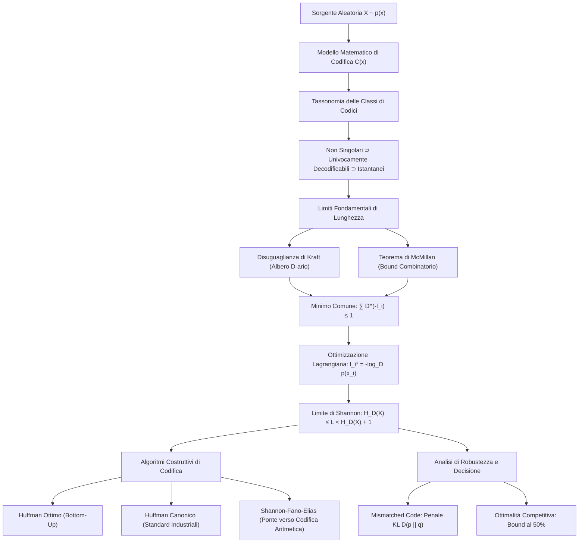

# A. Compressione Dati e Codifica di Sorgente

La compressione dei dati rappresenta l'applicazione ingegneristica più diretta e pervasiva della teoria dell'informazione di Claude Shannon. L'obiettivo primario della codifica di sorgente senza perdita (__lossless data compression__) consiste nel convertire una sequenza di simboli emessa da una sorgente aleatoria in una sequenza binaria di lunghezza media attesa minima, garantendo al contempo che il decodificatore possa ricostruire la sequenza originale in modo deterministico, esatto e privo di ambiguità.

In questo capitolo formalizziamo il modello matematico della codifica di sorgente, analizziamo la tassonomia delle classi di codici e dimostriamo i teoremi fondamentali di Kraft e McMillan. Esaminiamo poi il limite teorico di Shannon, l'algoritmo ottimo di David Huffman, le architetture canoniche impiegate negli standard industriali (Deflate, JPEG, PNG), la codifica di Shannon-Fano-Elias e i criteri di dominanza stocastica nell'ottimalità competitiva.

## Architettura Concettuale della Codifica di Sorgente

Il diagramma seguente sintetizza la mappa delle dipendenze concettuali e matematiche sviluppate nel capitolo:

## Modello Matematico della Codifica di Sorgente

Consideriamo una sorgente discreta senza memoria (__Discrete Memoryless Source__, DMS) modellata come una variabile aleatoria discreta $X$ definita su un alfabeto finito $\mathcal{X} = \{x_1, x_2, \dots, x_m\}$.

La distribuzione statistica della sorgente è descritta dalla funzione di massa di probabilità (PMF) $p(x) = \text{Pr}\{X = x\}$, con $p(x_i) > 0$ per ciascun indice $i$ e condizione di normalizzazione $\sum_{i=1}^m p(x_i) = 1$.

L'alfabeto di codice $\mathcal{D} = \{0, 1, \dots, D-1\}$ è un insieme discreto di simboli di cardinalità finita $D \ge 2$. Nei sistemi informatici e nelle telecomunicazioni digitali si adotta quasi universalmente l'alfabeto binario con $D = 2$ e $\mathcal{D} = \{0, 1\}$.

Indichiamo con $\mathcal{D}^*$ l'insieme di tutte le sequenze finite (parole o stringhe) ottenute concatenando un numero arbitrario di simboli dell'alfabeto $\mathcal{D}$:

$$
\mathcal{D}^* = \bigcup_{k=1}^\infty \mathcal{D}^k = \mathcal{D} \cup \mathcal{D}^2 \cup \mathcal{D}^3 \cup \dots
$$

### Definizione Formale di Codice di Sorgente

Un __codice di sorgente__ $C$ per la variabile aleatoria $X$ è una mappa deterministica che associa a ciascun simbolo dell'alfabeto di sorgente una sequenza finita di simboli di codice:

$$
C: \mathcal{X} \to \mathcal{D}^*
$$

L'immagine $C(x)$ prende il nome di __parola di codice__ (__codeword__) assegnata al simbolo di sorgente $x$.

La __lunghezza__ della parola di codice $C(x)$, misurata come numero di simboli di codice (bit se $D = 2$), è indicata con la notazione scalare $l(x)$ oppure $l_i = l(x_i)$ per $i = 1, \dots, m$.

### Lunghezza Media Attesa del Codice

La prestazione di un codice di sorgente si misura attraverso la sua __lunghezza media attesa__ $L(C)$, definita come il valore atteso della lunghezza delle parole rispetto alla distribuzione di probabilità della sorgente:

$$
L(C) = \mathbb{E}[l(X)] = \sum_{x \in \mathcal{X}} p(x) l(x) = \sum_{i=1}^m p(x_i) l_i
$$

Il problema fondamentale della compressione senza perdita consiste nel minimizzare $L(C)$ selezionando opportunamente le lunghezze $l_i$, sotto il vincolo inderogabile che il ricevitore possa decodificare ogni sequenza senza equivoci.

## Tassonomia e Classi Fondamentali di Codici

Non tutte le funzioni di mappa $C: \mathcal{X} \to \mathcal{D}^*$ consentono una decodifica affidabile. Quando trasmettiamo simboli isolati o flussi continui privi di spaziatori, dobbiamo imporre condizioni di invertibilità via via più restrittive.

I codici di sorgente si articolano in quattro classi gerarchiche nidificate.

### Codici Non Singolari

Un codice $C$ si definisce __non singolare__ se assegna parole di codice distinte a simboli di sorgente distinti:

$$
x_i \neq x_j \implies C(x_i) \neq C(x_j)
$$

La non singolarità garantisce l'iniettività della mappa $C$ per singoli simboli isolati. Se un codice fosse singolare (ad esempio $C(x_1) = C(x_2) = 0$), il decodificatore non potrebbe risalire al simbolo emesso nemmeno in assenza di rumore.

Tuttavia, la non singolarità non è sufficiente quando la sorgente emette una sequenza continua di simboli nel tempo.

### Estensione di un Codice

Nella trasmissione di flussi continui, la sorgente emette stringhe composte da più simboli $x_{i_1} x_{i_2} \dots x_{i_n} \in \mathcal{X}^*$. L'__estensione di codice__ $C^*$ è la funzione definita dalla concatenazione diretta delle parole di codice corrispondenti:

$$
C^*(x_{i_1} x_{i_2} \dots x_{i_n}) = C(x_{i_1}) C(x_{i_2}) \dots C(x_{i_n}) \in \mathcal{D}^*
$$

### Codici Univocamente Decodificabili

Un codice $C$ si definisce __univocamente decodificabile__ (__uniquely decodable__) se la sua estensione $C^*$ è non singolare su sequenze di lunghezza arbitraria:

$$
\mathbf{x} \neq \mathbf{x}' \implies C^*(\mathbf{x}) \neq C^*(\mathbf{x}')
$$

Nei codici univocamente decodificabili, qualsiasi sequenza di bit concatenata può derivare da una sola sequenza originaria di simboli di sorgente.

Un codice può essere non singolare senza essere univocamente decodificabile. Consideriamo ad esempio l'alfabeto $\mathcal{X} = \{1, 2, 3, 4\}$ con assegnazione:

$$
C(1) = 0, \quad C(2) = 010, \quad C(3) = 01, \quad C(4) = 10
$$

La mappa è iniettiva sui singoli simboli, dunque il codice è non singolare. Tuttavia, ricevendo la sequenza binaria $010$, il decodificatore si trova davanti a un'ambiguità insanabile: la sequenza può rappresentare il singolo simbolo $2$, oppure la coppia $14$ (cioè $0$ seguito da $10$), oppure la coppia $31$ (cioè $01$ seguito da $0$). Il codice non è univocamente decodificabile.

### Codici Istantanei o Codici Prefisso

Un codice $C$ si definisce __istantaneo__ o __codice a prefisso__ (__prefix-free code__) se nessuna parola di codice valida costituisce il prefisso di un'altra parola di codice dello stesso insieme:

$$
\forall i \neq j, \quad C(x_i) \text{ non è prefisso di } C(x_j)
$$

Nei codici istantanei la delimitazione di ciascuna parola è intrinseca: non appena il decodificatore riconosce una sequenza di bit corrispondente a una parola di codice valida, può emettere immediatamente il simbolo decodificato. Non occorre attendere i bit successivi (zero ritardo di decodifica) né inserire caratteri di spaziatura.

### Gerarchia Insiemistica delle Classi

Le quattro classi formano una catena di inclusioni proprie:

$$
\text{Tutti i Codici} \supset \text{Codici Non Singolari} \supset \text{Codici Univocamente Decodificabili} \supset \text{Codici Istantanei}
$$

![[slide_12_code_classes_venn.png|center mid]]

Ogni codice istantaneo è univocamente decodificabile, ogni codice univocamente decodificabile è non singolare, ma i viceversa non valgono.

### Il Caso Storico del Codice Morse

Nel codice telegrafico ideato da Samuel Morse, le lettere sono rappresentate da sequenze di punti e linee: la lettera $E$ corrisponde a un punto $(\cdot)$ e la lettera $A$ a un punto seguito da una linea $(\cdot -)$. Poiché la sequenza per $E$ è prefisso esatto di quella per $A$, il codice Morse binario non sarebbe né istantaneo né univocamente decodificabile.

Nella pratica telegrafica il sistema opera in modo affidabile perché introduce una __pausa di silenzio__ tra lettere consecutive e una pausa più lunga tra parole. L'alfabeto di codice reale non è binario ma ternario: $\mathcal{D} = \{\text{punto}, \text{linea}, \text{pausa}\}$, dove la pausa funge da delimitatore esplicito di fine parola.

### Confronto Operativo tra le Classi di Codici

Consideriamo una sorgente a quattro simboli $\mathcal{X} = \{1, 2, 3, 4\}$. La tabella seguente illustra il comportamento delle quattro classi:

| Simbolo | Codice Singolare | Non Singolare, Non UD | Univocamente Decodificabile, Non Istantaneo | Codice Istantaneo (Prefisso) |
| :---: | :---: | :---: | :---: | :---: |
| $1$ | $0$ | $0$ | $10$ | $0$ |
| $2$ | $0$ | $010$ | $00$ | $10$ |
| $3$ | $0$ | $01$ | $11$ | $110$ |
| $4$ | $0$ | $10$ | $110$ | $111$ |

Analizziamo il terzo codice della tabella: la parola $C(3) = 11$ è prefisso di $C(4) = 110$, quindi il codice non è istantaneo. Tuttavia, esso è univocamente decodificabile: se la sequenza inizia per $00$ o $10$, decodifichiamo subito $2$ o $1$. Se invece inizia per $11$, dobbiamo guardare i bit successivi:
- Se segue un $1$, il primo simbolo è certamente $3$ ($11$ seguito da un blocco che inizia per $1$).
- Se segue una serie di zeri terminata da un uno, contiamo gli zeri: un numero dispari individua il simbolo $4$ ($110$ seguito da blocchi che iniziano per $00$ o $10$), mentre un numero pari individua il simbolo $3$ ($11$ seguito da sequenze di $00$).

La decodifica è esatta ma richiede ritardo e ispezione dei bit futuri (__lookahead__). Nel quarto codice, invece, nessuna parola è prefisso di un'altra: la lettura di uno $0$ identifica univocamente $1$, la stringa $10$ identifica $2$, $110$ identifica $3$ e $111$ identifica $4$, istantaneamente e a zero memoria.

## La Disuguaglianza di Kraft per Codici Istantanei

La richiesta che nessun codice sia prefisso di un altro impone un vincolo geometrico e algebrico stringente sulle lunghezze delle parole: non possiamo assegnare stringhe corte a troppi simboli contemporaneamente. Tale limite è sancito dalla celebre __disuguaglianza di Kraft__ (1949).

### Enunciato del Teorema di Kraft

Sia dato un codice istantaneo definito su un alfabeto di codice di dimensione $D$, avente parole di codice con lunghezze intere $l_1, l_2, \dots, l_m$. Allora le lunghezze soddisfano necessariamente la disuguaglianza:

$$
\sum_{i=1}^m D^{-l_i} \le 1
$$

Viceversa, assegnato un qualsiasi insieme di interi positivi $l_1, l_2, \dots, l_m$ che soddisfi tale disuguaglianza, esiste sempre un codice istantaneo su alfabeto $D$-ario con esattamente tali lunghezze di parola.

### Dimostrazione Geometrica tramite Albero D-ario

Rappresentiamo le parole di codice come nodi all'interno di un albero $D$-ario completo di profondità massima:

$$
l_{\max} = \max_{1 \le i \le m} l_i
$$

La radice dell'albero rappresenta la stringa vuota, i $D$ rami uscenti da ogni nodo rappresentano i simboli dell'alfabeto $\mathcal{D}$, e ciascun nodo a profondità $l$ corrisponde biunivocamente a una sequenza di lunghezza $l$.

Il numero totale di foglie (nodi terminali) al livello massimo $l_{\max}$ è pari a:

$$
N_{\text{foglie}} = D^{l_{\max}}
$$

![[slide_17_kraft_tree.png|center mid]]

Consideriamo ora una parola di codice $C(x_i)$ avente lunghezza $l_i \le l_{\max}$. Essa corrisponde a un nodo collocato a profondità $l_i$.

Affinché il codice sia istantaneo, nessun'altra parola può trovarsi nel sottoalbero generato da tale nodo (altrimenti $C(x_i)$ ne sarebbe prefisso) e tale nodo non può trovarsi nel sottoalbero di una parola già selezionata a profondità inferiore.

La selezione del nodo a profondità $l_i$ __elimina e riserva l'intero sottoalbero discendente__. Il numero di foglie al livello massimo $l_{\max}$ che discendono da tale nodo è pari a:

$$
D^{l_{\max} - l_i}
$$

Poiché nessun nodo di codice può essere discendente di un altro, i sottoalberi riservati dai simboli $i = 1, \dots, m$ sono reciprocamente disgiunti.

La somma delle foglie eliminate da tutte le $m$ parole di codice non può superare la capienza complessiva dell'ultimo livello dell'albero:

$$
\sum_{i=1}^m D^{l_{\max} - l_i} \le D^{l_{\max}}
$$

Raccogliendo il fattore $D^{l_{\max}}$ a primo membro:

$$
D^{l_{\max}} \sum_{i=1}^m D^{-l_i} \le D^{l_{\max}}
$$

Dividendo entrambi i membri per la costante strettamente positiva $D^{l_{\max}}$, otteniamo direttamente la disuguaglianza di Kraft:

$$
\sum_{i=1}^m D^{-l_i} \le 1
$$

### Dimostrazione della Condizione Sufficiente

Assumiamo che un insieme di interi positivi $\{l_1, l_2, \dots, l_m\}$, ordinati in senso non decrescente ($l_1 \le l_2 \le \dots \le l_m$), soddisfi la condizione $\sum_{i=1}^m D^{-l_i} \le 1$.

Possiamo costruire il codice istantaneo mediante una procedura costruttiva greedy:
1. Al passo $k$, scegliamo un nodo disponibile a profondità $l_k$ che non sia discendente di alcun nodo già assegnato.
2. Tale assegnazione riserva $D^{l_{\max} - l_k}$ foglie al livello massimo $l_{\max}$.
3. Il numero totale di foglie occupate dopo aver assegnato i primi $k-1$ simboli è $\sum_{j=1}^{k-1} D^{l_{\max} - l_j}$.
4. Poiché per ipotesi $\sum_{i=1}^m D^{-l_i} \le 1$, per ciascun indice intermedio $k \le m$ vale:

$$
\sum_{j=1}^{k-1} D^{l_{\max} - l_j} < \sum_{i=1}^m D^{l_{\max} - l_i} \le D^{l_{\max}}
$$

All'ultimo livello rimane sempre almeno una foglia libera. Risalendo l'albero fino a quota $l_k$, troviamo necessariamente un nodo genitore disponibile.

L'algoritmo costruttivo assegna tutti gli $m$ simboli senza conflitti di prefisso, dimostrando la sufficienza della condizione.

### Estensione ad Alfabeti Numerabili Infiniti

Se l'alfabeto di sorgente è infinito numerabile ($\mathcal{X} = \{x_1, x_2, \dots\}$ con $m \to \infty$), la disuguaglianza di Kraft mantiene la propria validità nella forma di serie convergente:

$$
\sum_{i=1}^\infty D^{-l_i} \le 1
$$

Se la serie diverge o supera l'unità, non può esistere alcun codice istantaneo con tali lunghezze.

## Il Teorema di McMillan per Codici Univocamente Decodificabili

Sorge spontaneo un quesito ingegneristico fondamentale: se rinunciamo alla decodifica istantanea e ammettiamo un ritardo temporale (utilizzando codici univocamente decodificabili con lookahead), possiamo violare la disuguaglianza di Kraft e ottenere parole di codice più corte?

Il __Teorema di McMillan__ (1956) risponde negativamente: la medesima disuguaglianza governa l'intera classe dei codici univocamente decodificabili.

### Enunciato del Teorema di McMillan

Sia $C$ un codice univocamente decodificabile definito su un alfabeto di codice di dimensione $D$, con lunghezze delle parole $l_1, l_2, \dots, l_m$. Allora le lunghezze soddisfano necessariamente la disuguaglianza di Kraft:

$$
\sum_{i=1}^m D^{-l_i} \le 1
$$

### Dimostrazione Algebrica tramite Bound Combinatorio

Dimostriamo il teorema elevando la sommatoria a una potenza intera arbitraria $k \ge 1$:

$$
\left( \sum_{i=1}^m D^{-l_i} \right)^k = \sum_{i_1=1}^m \sum_{i_2=1}^m \dots \sum_{i_k=1}^m D^{-(l_{i_1} + l_{i_2} + \dots + l_{i_k})}
$$

La somma a secondo membro scorre su tutte le $m^k$ possibili sequenze di $k$ simboli di sorgente. 

Raggruppiamo i termini in base alla lunghezza complessiva della sequenza di codice concatenata:

$$
j = \sum_{r=1}^k l_{i_r}
$$

Poiché ogni parola ha lunghezza minima pari a $1$ e massima pari a $l_{\max}$, la lunghezza complessiva $j$ assume valori nell'intervallo discreto:

$$
k \le j \le k l_{\max}
$$

Possiamo quindi riscrivere la potenza $k$-esima raccogliendo i termini con la medesima lunghezza $j$:

$$
\left( \sum_{i=1}^m D^{-l_i} \right)^k = \sum_{j=k}^{k l_{\max}} N_{k, j} D^{-j}
$$

dove $N_{k, j}$ indica il numero esatto di sequenze composte da $k$ simboli di sorgente la cui parola di codice estesa ha lunghezza pari a $j$.

Qui interviene il punto logico cruciale: poiché il codice è univocamente decodificabile per ipotesi, sequenze distinte di $k$ simboli di sorgente devono necessariamente produrre stringhe binarie distinte.

D'altra parte, il numero totale di sequenze distinte di lunghezza $j$ costruibili con un alfabeto di dimensione $D$ è pari a $D^j$. Ne consegue il bound combinatorio:

$$
N_{k, j} \le D^j
$$

Sostituendo questa disuguaglianza nella sommatoria, ciascun termine soddisfa:

$$
N_{k, j} D^{-j} \le D^j D^{-j} = 1
$$

La sommatoria contiene al più $k l_{\max} - k + 1 \le k l_{\max}$ termini, ciascuno limitato superiormente da $1$:

$$
\left( \sum_{i=1}^m D^{-l_i} \right)^k \le \sum_{j=k}^{k l_{\max}} 1 \le k l_{\max}
$$

Estraendo la radice $k$-esima da entrambi i membri:

$$
\sum_{i=1}^m D^{-l_i} \le (k l_{\max})^{1/k}
$$

Poiché la disuguaglianza vale per qualsiasi intero positivo $k$, facciamo tendere $k$ all'infinito:

$$
\lim_{k \to \infty} (k l_{\max})^{1/k} = 1
$$

Otteniamo così in modo inconfutabile:

$$
\sum_{i=1}^m D^{-l_i} \le 1
$$

Per la trattazione analitica estesa e ulteriori note storiche rimandiamo all'[[zz. Argomenti extra#Dimostrazione Integrale del Teorema di McMillan per Codici Univocamente Decodificabili|approfondimento analitico di McMillan]].

### Conseguenza Fondamentale: Nessun Vantaggio dal Ritardo

Poiché i codici istantanei sono un sottoinsieme proprio dei codici univocamente decodificabili, ed entrambe le classi condividono esattamente il medesimo vincolo algebrico $\sum D^{-l_i} \le 1$:

$$
\min_{C \in \text{Univocamente Decodificabili}} L(C) = \min_{C \in \text{Istantanei}} L(C)
$$

Ammettere un ritardo di decodifica o una complessità di parsing retrogrado non consente di guadagnare nemmeno una frazione di bit nella lunghezza media attesa. Ai fini della compressione ottima possiamo quindi restringere l'attenzione esclusivamente ai codici prefissi.

## Lunghezza Media Ottima e Limite di Shannon

Avendo dimostrato che ogni codice ammissibile deve rispettare il vincolo di Kraft, il problema della progettazione ottima si traduce nel problema di ottimizzazione matematica vincolata:

$$
\min_{l_1, \dots, l_m \in \mathbb{N}^+} \sum_{i=1}^m p_i l_i \quad \text{soggetto a} \quad \sum_{i=1}^m D^{-l_i} \le 1
$$

### Rilassamento Continuo e Ottimizzazione Lagrangiana

Rilassiamo momentaneamente il vincolo di interezza, ammettendo che le lunghezze possano assumere valori reali continui $l_i \in \mathbb{R}^+$.

Poiché la funzione obiettivo è lineare e il vincolo definisce un insieme convesso, l'ottimo si troverà sul bordo del vincolo ($\sum D^{-l_i} = 1$). Formuliamo la funzione Lagrangiana:

$$
\mathcal{L}(l_1, \dots, l_m, \lambda) = \sum_{i=1}^m p_i l_i + \lambda \left( \sum_{i=1}^m D^{-l_i} - 1 \right)
$$

Esprimendo la base $D$ tramite esponenziale naturale $D^{-l_i} = e^{-l_i \ln D}$ e derivando parzialmente rispetto a ciascuna lunghezza $l_i$:

$$
\frac{\partial \mathcal{L}}{\partial l_i} = p_i - \lambda D^{-l_i} \ln D = 0
$$

Risolvendo rispetto al termine esponenziale:

$$
D^{-l_i} = \frac{p_i}{\lambda \ln D}
$$

Sommiamo su tutti gli indici $i = 1, \dots, m$ per imporre la saturazione del vincolo di Kraft:

$$
\sum_{i=1}^m D^{-l_i} = \frac{\sum_{i=1}^m p_i}{\lambda \ln D} = \frac{1}{\lambda \ln D} = 1 \implies \lambda \ln D = 1
$$

Sostituendo il moltiplicatore ottimo $\lambda \ln D = 1$ nella relazione precedente:

$$
D^{-l_i^*} = p_i \iff l_i^* = -\log_D p_i = \log_D \frac{1}{p_i}
$$

Calcoliamo ora la lunghezza media attesa corrispondente alle lunghezze ottime continue:

$$
L^* = \sum_{i=1}^m p_i l_i^* = -\sum_{i=1}^m p_i \log_D p_i = H_D(X)
$$

L'entropia di sorgente $H_D(X)$ costituisce il limite inferiore invalicabile per la lunghezza media attesa di qualsiasi codice di sorgente decodificabile senza ambiguità.

### Distribuzioni Diadiche e Compressione Ideale

Una distribuzione di probabilità si definisce __diadica__ (o $D$-adica) se ogni probabilità è una potenza intera negativa della base dell'alfabeto di codice:

$$
p_i = D^{-k_i}, \quad k_i \in \mathbb{N}^+
$$

Per le distribuzioni $D$-adiche, le lunghezze ottime continue $l_i^* = -\log_D(D^{-k_i}) = k_i$ sono già numeri interi esatti. In questo scenario ideale:
1. La disuguaglianza di Kraft è saturata all'uguaglianza: $\sum D^{-k_i} = \sum p_i = 1$.
2. La lunghezza media attesa del codice prefisso coincide esattamente con l'entropia della sorgente:

$$
L = H_D(X)
$$

Non vi è alcuno spreco di bit, e il codice è perfetto.

### Teorema del Limite di Shannon per Sorgenti Generiche

Nelle sorgenti reali le probabilità non sono generalmente potenze negative di $D$, per cui i valori $-\log_D p_i$ non risultano interi.

Per preservare la decodificabilità istantanea garantendo la validità del vincolo di Kraft, Claude Shannon propose di arrotondare ciascuna lunghezza continua all'intero superiore immediato tramite la funzione soffitto (__ceiling__):

$$
l_i = \left\lceil \log_D \frac{1}{p_i} \right\rceil
$$

Tale schema costruttivo prende il nome di __codice di Shannon__.

Verifichiamo che il codice di Shannon soddisfi la disuguaglianza di Kraft:

$$
l_i \ge \log_D \frac{1}{p_i} \implies D^{-l_i} \le D^{-\log_D(1/p_i)} = p_i
$$

Sommando su tutti i simboli della sorgente:

$$
\sum_{i=1}^m D^{-l_i} \le \sum_{i=1}^m p_i = 1
$$

La condizione di Kraft è rigorosamente soddisfatta, assicurando l'esistenza di un codice prefisso avente tali lunghezze.

Dalla definizione della funzione soffitto, ogni lunghezza intera rispetta la doppia disuguaglianza:

$$
\log_D \frac{1}{p_i} \le l_i < \log_D \frac{1}{p_i} + 1
$$

Moltiplichiamo ciascun termine per la probabilità $p_i$ e sommiamo su tutti i simboli $i = 1, \dots, m$:

$$
\sum_{i=1}^m p_i \log_D \frac{1}{p_i} \le \sum_{i=1}^m p_i l_i < \sum_{i=1}^m p_i \log_D \frac{1}{p_i} + \sum_{i=1}^m p_i
$$

Riconoscendo l'entropia $H_D(X)$ a primo membro e ricordando che $\sum p_i = 1$, otteniamo il celebre __Teorema del Limite di Shannon__:

$$
H_D(X) \le L < H_D(X) + 1
$$

Sia $L^*$ la lunghezza media attesa del codice prefisso globalmente ottimo (il codice di Huffman). Poiché il codice di Huffman minimizza la lunghezza media su tutti i codici prefissi e il codice di Shannon è un codice prefisso ammissibile, vale la catena di disuguaglianze:

$$
H_D(X) \le L^* \le L_{\text{Shannon}} < H_D(X) + 1
$$

L'inefficienza dovuta all'arrotondamento all'intero non supera mai $1$ simbolo di codice per simbolo di sorgente ($1$ bit per simbolo se $D = 2$).

### Abbattimento del Sovraccarico tramite Codifica a Blocchi

Un sovraccarico fino a $1$ bit/simbolo può risultare inaccettabile quando l'entropia della sorgente è molto bassa (ad esempio se $H(X) = 0.2$ bit/simbolo, pagare $1.2$ bit significa introdurre una ridondanza percentuale del $500\%$).

Per abbattere tale sovraccarico, raggruppiamo la sequenza in blocchi di $n$ simboli consecutivi:

$$
X^n = (X_1, X_2, \dots, X_n) \in \mathcal{X}^n
$$

Trattiamo il vettore $X^n$ come un super-simbolo appartenente all'alfabeto prodotto di cardinalità $m^n$. Applicando il Teorema di Shannon al codice ottimo per il blocco $X^n$:

$$
H_D(X^n) \le L_n^* < H_D(X^n) + 1
$$

Dividendo l'intera disuguaglianza per la dimensione del blocco $n$, la lunghezza media per singolo simbolo di sorgente $L_n^* / n$ soddisfa:

$$
\frac{H_D(X^n)}{n} \le \frac{L_n^*}{n} < \frac{H_D(X^n)}{n} + \frac{1}{n}
$$

Se la sorgente è priva di memoria e identicamente distribuita (i.i.d.), l'entropia congiunta si fattorizza in $H_D(X^n) = n H_D(X)$, per cui:

$$
H_D(X) \le \frac{L_n^*}{n} < H_D(X) + \frac{1}{n}
$$

Facendo tendere la lunghezza del blocco all'infinito:

$$
\lim_{n \to \infty} \frac{L_n^*}{n} = H_D(X)
$$

Se la sorgente presenta memoria statistica ma è stazionaria, per il teorema dell'entropy rate vale $\lim_{n \to \infty} \frac{H(X^n)}{n} = H(\mathcal{X})$, ottenendo:

$$
\lim_{n \to \infty} \frac{L_n^*}{n} = H(\mathcal{X})
$$

La codifica a blocchi consente di avvicinarsi all'entropia con precisione arbitraria, al prezzo di una complessità combinatoria crescente esponenzialmente con la dimensione del blocco ($m^n$).

### Il Costo della Statistica Errata: Mismatched Code e Divergenza KL

Supponiamo che un progettista ottimizzi un codice prefisso assumendo un modello teorico errato $q(x)$, mentre la realtà fisica della sorgente è governata dalla distribuzione $p(x)$.

Le lunghezze assegnate ai simboli saranno determinate in base al modello presunto:

$$
l_q(x) = \left\lceil \log_2 \frac{1}{q(x)} \right\rceil
$$

Calcoliamo la lunghezza media attesa rispetto alla vera misura di probabilità $p(x)$:

$$
\mathbb{E}_p[l_q(X)] = \sum_{x \in \mathcal{X}} p(x) \left\lceil \log_2 \frac{1}{q(x)} \right\rceil
$$

Sfruttando la delimitazione $\log_2 \frac{1}{q(x)} \le l_q(x) < \log_2 \frac{1}{q(x)} + 1$:

$$
\sum_{x \in \mathcal{X}} p(x) \log_2 \frac{1}{q(x)} \le \mathbb{E}_p[l_q(X)] < \sum_{x \in \mathcal{X}} p(x) \log_2 \frac{1}{q(x)} + 1
$$

Scomponiamo l'argomento logaritmico moltiplicando e dividendo per la vera probabilità $p(x)$:

$$
\log_2 \frac{1}{q(x)} = \log_2 \frac{p(x)}{q(x)} + \log_2 \frac{1}{p(x)}
$$

Moltiplicando per $p(x)$ e sommando su tutto l'alfabeto $\mathcal{X}$:

$$
\sum_{x \in \mathcal{X}} p(x) \log_2 \frac{1}{p(x)} + \sum_{x \in \mathcal{X}} p(x) \log_2 \frac{p(x)}{q(x)} = H(p) + D(p \parallel q)
$$

Ne discende il __Teorema del Codice Mismatched__:

$$
H(p) + D(p \parallel q) \le \mathbb{E}_p[l_q(X)] < H(p) + D(p \parallel q) + 1
$$

Il prezzo esatto, misurato in bit sprecati per simbolo, pagato per aver formulato un modello statistico errato coincide con la __divergenza di Kullback-Leibler__ $D(p \parallel q) \ge 0$. La divergenza KL quantifica l'inefficienza intrinseca di compressione derivante dall'adozione del modello $q$ al posto della realtà $p$.

## Algoritmo di Huffman Ottimo

Mentre il codice di Shannon assegna lunghezze teoriche $l_i = \lceil \log(1/p_i) \rceil$ senza garantire l'ottimalità globale a blocchi finiti, David Huffman (1952) ideò una procedura deterministica greedy che costruisce il codice prefisso a minima lunghezza media attesa assoluta.

### Procedura Costruttiva Bottom-Up

L'algoritmo di Huffman costruisce l'albero di codice partendo dalle foglie (i simboli meno probabili) e risalendo progressivamente verso la radice:

1. __Ordinamento__: Elenchiamo i simboli della sorgente in ordine decrescente di probabilità.
2. __Fusione (Merge)__: Selezioniamo i due simboli con le probabilità più basse e li fondiamo in un unico super-nodo avente probabilità pari alla somma delle due probabilità.
3. __Ricorsione__: Riordiniamo la lista ridotta di $m-1$ elementi e iteriamo la fusione fino a ottenere un unico nodo radice di probabilità $1.00$.
4. __Backtracking e Assegnazione Bit__: Partendo dalla radice, assegniamo a ciascuna diramazione un bit binario ('0' al ramo superiore, '1' al ramo inferiore). Ripercorrendo l'albero dalla radice alle foglie, ricaviamo le parole di codice definitive.

### Sviluppo Analitico Completo su Esempio a Cinque Simboli

Consideriamo una sorgente a 5 simboli $\mathcal{X} = \{1, 2, 3, 4, 5\}$ caratterizzata dal seguente vettore di probabilità:

$$
p(1) = 0.25, \quad p(2) = 0.25, \quad p(3) = 0.20, \quad p(4) = 0.15, \quad p(5) = 0.15
$$

![[slide_04_huffman_reduction_example.png|center mid]]

Seguiamo l'evoluzione dell'albero di riduzione passo dopo passo:
1. I due simboli a probabilità minima sono $4$ e $5$ ($p(4) = p(5) = 0.15$). Li fondiamo nel super-nodo $\{4, 5\}$ con probabilità $0.15 + 0.15 = 0.30$.
2. L'insieme ridotto contiene ora $\{1: 0.25, 2: 0.25, 3: 0.20, \{4, 5\}: 0.30\}$. Ordinando in modo decrescente: $\{4, 5\}: 0.30$, $1: 0.25$, $2: 0.25$, $3: 0.20$.
3. I due elementi minimi sono $2$ e $3$. Li fondiamo nel super-nodo $\{2, 3\}$ avente probabilità $0.25 + 0.20 = 0.45$.
4. L'insieme ridotto contiene $\{\{2, 3\}: 0.45, \{4, 5\}: 0.30, 1: 0.25\}$. I due elementi minimi sono $\{4, 5\}$ e $1$. Li fondiamo generando il nodo $\{\{4, 5\}, 1\}$ con probabilità $0.30 + 0.25 = 0.55$.
5. Rimangono due super-nodi: $\{\{4, 5\}, 1\}$ ($0.55$) e $\{2, 3\}$ ($0.45$). La loro fusione finale chiude la radice a probabilità $1.00$.

Ripercorrendo l'albero per l'assegnazione dei bit otteniamo la tabella seguente:

| Simbolo $x$ | Probabilità $p(x)$ | Parola di Codice $C(x)$ | Lunghezza $l(x)$ | Lunghezza Ideale $-\log_2 p(x)$ |
| :---: | :---: | :---: | :---: | :---: |
| $1$ | $0.25$ | $01$ | $2$ bit | $2.00$ bit |
| $2$ | $0.25$ | $10$ | $2$ bit | $2.00$ bit |
| $3$ | $0.20$ | $11$ | $2$ bit | $2.32$ bit |
| $4$ | $0.15$ | $000$ | $3$ bit | $2.74$ bit |
| $5$ | $0.15$ | $001$ | $3$ bit | $2.74$ bit |

Calcoliamo la lunghezza media attesa del codice di Huffman:

$$
L(C_{\text{Huff}}) = 0.25(2) + 0.25(2) + 0.20(2) + 0.15(3) + 0.15(3) = 0.50 + 0.50 + 0.40 + 0.45 + 0.45 = 2.30 \quad \text{bit}
$$

Calcoliamo l'entropia di Shannon della sorgente:

$$
H(X) = 2(0.25 \log_2 4) + 0.20 \log_2 5 + 2\left(0.15 \log_2 \frac{1}{0.15}\right) \approx 2(0.50) + 0.20(2.3219) + 0.30(2.7370) \approx 2.2855 \quad \text{bit}
$$

La ridondanza del codice di Huffman è trascurabile:

$$
R = L(C_{\text{Huff}}) - H(X) = 2.30 - 2.2855 = 0.0145 \quad \text{bit/simbolo}
$$

L'efficienza di compressione raggiunge:

$$
\eta = \frac{H(X)}{L(C_{\text{Huff}})} = \frac{2.2855}{2.30} \approx 99.37\%
$$

### Codici di Huffman D-ari e Calcolo dei Simboli Dummy

Quando l'alfabeto di codice ha cardinalità $D > 2$ (ad esempio ternario con $D = 3$), a ciascun passo di riduzione dobbiamo fondere $D$ nodi anziché $2$.

A ogni fusione, il numero totale di elementi si riduce esattamente di $D - 1$:

$$
m_{\text{nuovo}} = m_{\text{vecchio}} - (D - 1)
$$

Affinché l'albero si chiuda perfettamente su un unico nodo radice dopo un numero intero $k$ di aggregazioni successive, la dimensione iniziale dell'alfabeto deve soddisfare la congruenza modulare:

$$
m = 1 + k(D - 1) \iff m \equiv 1 \pmod{D - 1}
$$

Se la dimensione originaria $m$ non soddisfa tale condizione, all'ultimo passo di riduzione rimarrebbero meno di $D$ rami (tra $2$ e $D-1$), generando una biforcazione incompleta alla radice che viola la compattezza ottima dell'albero.

Risolviamo il problema aggiungendo $m_{\text{dummy}}$ __simboli fittizi__ (__dummy symbols__) aventi probabilità rigorosamente nulla ($p_{\text{dummy}} = 0$). Il numero di simboli dummy necessari è dato dalla formula analitica:

$$
m_{\text{dummy}} = [-(m - 1)] \bmod (D - 1) = \begin{cases} 0 & \text{se } (m - 1) \bmod (D - 1) = 0 \\ (D - 1) - [(m - 1) \bmod (D - 1)] & \text{altrimenti} \end{cases}
$$

I simboli fittizi vengono collocati in fondo alla lista ordinata e assorbiti immediatamente nella primissima fusione, garantendo la perfetta simmetria dell'albero $D$-ario.

### Dimostrazione di Ottimalità tramite Forma Canonica

L'ottimalità globale dell'algoritmo di Huffman poggia sulle tre proprietà necessarie di un codice prefisso ottimo in forma canonica:
1. __Inversione dell'ordine__: se $p_j > p_k$, allora $l_j \le l_k$ (simboli più frequenti hanno parole non più lunghe).
2. __Parità di lunghezza minima__: i due simboli a probabilità minima hanno la medesima lunghezza massima: $l_{m-1} = l_m$.
3. __Gemellaggio__: i due simboli a probabilità minima differiscono solo per l'ultimo bit, ossia condividono lo stesso nodo genitore nell'albero di codice.

Dimostriamo l'ottimalità per induzione matematica sul numero di simboli $m$.

Per la base induttiva $m = 2$, l'unico codice prefisso ammissibile assegna un singolo bit a ciascun simbolo ($l_1 = l_2 = 1$). La lunghezza media è $L = 1$, che coincide con la costruzione di Huffman.

Assumiamo ora come ipotesi induttiva che l'algoritmo di Huffman sia ottimo per qualsiasi sorgente con $m - 1$ simboli.

Consideriamo una sorgente a $m$ simboli e sia $C_m$ il codice generato da Huffman. La fusione dei due simboli minimi $m-1$ e $m$ in un super-simbolo aggregato genera una sorgente ridotta a $m-1$ simboli con codice $C_{m-1}$.

Esprimiamo la lunghezza media di $C_m$ in funzione di quella di $C_{m-1}$:

$$
L(C_m) = \sum_{i=1}^{m-2} p_i l_i + p_{m-1} l_{m-1} + p_m l_m
$$

Poiché $l_{m-1} = l_m = l_{\text{super}} + 1$:

$$
L(C_m) = \sum_{i=1}^{m-2} p_i l_i + (p_{m-1} + p_m)(l_{\text{super}} + 1) = L(C_{m-1}) + p_{m-1} + p_m
$$

Sia ora $C_m^*$ un codice prefisso ipoteticamente ottimo a $m$ simboli. Senza perdita di generalità, possiamo riorganizzare $C_m^*$ in modo che i due simboli minimi siano fratelli a profondità massima. Fondendoli, otteniamo un codice prefisso ammissibile $C_{m-1}^*$ per la sorgente ridotta, per cui vale analogamente:

$$
L(C_m^*) = L(C_{m-1}^*) + p_{m-1} + p_m
$$

Sottraendo membro a membro le due relazioni:

$$
L(C_m) - L(C_m^*) = L(C_{m-1}) - L(C_{m-1}^*)
$$

Per ipotesi induttiva, Huffman è globalmente ottimo per alfabeti di $m-1$ simboli, dunque $L(C_{m-1}) \le L(C_{m-1}^*)$, da cui $L(C_{m-1}) - L(C_{m-1}^*) \le 0$.

D'altra parte, per definizione di codice ottimo su $m$ simboli, deve valere $L(C_m^*) \le L(C_m)$, ossia $L(C_m) - L(C_m^*) \ge 0$.

L'unica condizione compatibile è l'identità a somma zero:

$$
L(C_m) - L(C_m^*) = 0 \iff L(C_m) = L(C_m^*)
$$

Il codice di Huffman è rigorosamente ottimo per ogni $m$. Per i dettagli completi si veda la [[zz. Argomenti extra#Dimostrazione Formale del Teorema di Ottimalità dei Codici di Huffman tramite Riduzione Canonica|dimostrazione formale di ottimalità di Huffman]].

## Codici di Huffman Canonici e Standard Industriali

In un'applicazione ingegneristica reale (come la decompressione di un archivio ZIP o la riproduzione di un flusso JPEG), trasmettere l'albero di Huffman esplicito comporterebbe un overhead di metadati inaccettabile: salvare la topologia dei nodi e i puntatori per un alfabeto di $256$ byte richiederebbe svariate centinaia di byte aggiuntivi.

I __Codici di Huffman Canonici__ risolvono il problema alla radice standardizzando l'assegnazione delle parole di codice a partire dalla sola conoscenza della lista ordinata delle lunghezze $\{l_1, l_2, \dots, l_m\}$.

### Il Problema dell'Overhead dei Metadati

Un albero di Huffman non è univoco: a ogni fusione possiamo scambiare arbitrariamente l'assegnazione dello '0' e dell' '1' sui due rami, generando decine di codici equivalenti con la medesima lunghezza media $L$.

Nei sistemi industriali vogliamo eliminare questa ambiguità imponendo una convenzione deterministica universale nota sia al codificatore sia al decodificatore.

### Algoritmo Deterministico di Assegnazione Canonica

L'algoritmo di canonizzazione opera secondo due regole fondamentali:

1. __Ordinamento Primario e Secondario__: Ordiniamo i simboli primariamente per lunghezza di parola crescente ($l_i \le l_{i+1}$) e secondariamente per ordine lessicografico naturale per simboli aventi la medesima lunghezza.
2. __Assegnazione del Primo Codice__: Alla prima parola (la più corta in assoluto) assegniamo una sequenza interamente formata da $l_1$ zeri:

$$
C(x_1) = 00\dots0_2 \quad (V_1 = 0)
$$

3. __Regola di Avanzamento Sequenziale__: Per calcolare la parola successiva $C(x_{i+1})$ avente lunghezza $l_{i+1}$:
   - Se la lunghezza non cambia ($l_{i+1} = l_i$), incrementiamo di un'unità il valore intero binario:

$$
V_{i+1} = V_i + 1
$$

   - Se la lunghezza aumenta ($l_{i+1} > l_i$), incrementiamo prima di uno il valore precedente e poi eseguiamo uno shift a sinistra di $l_{i+1} - l_i$ posizioni binarie, accodando $l_{i+1} - l_i$ zeri:

$$
V_{i+1} = (V_i + 1) \ll (l_{i+1} - l_i) = (V_i + 1) \cdot 2^{l_{i+1} - l_i}
$$

Lo shift a sinistra garantisce che il nuovo valore occupi un sottoalbero distinto e che nessuna parola precedente possa diventarne prefisso.

### Generazione Dettagliata del Codebook Canonico

Applichiamo la procedura al vettore delle lunghezze ricavato nell'esempio a 5 simboli: $l = [2, 2, 2, 3, 3]$.

1. Simbolo $x_1$ ($l_1 = 2$): assegniamo $2$ zeri $\implies C(x_1) = 00_2$ ($V_1 = 0$).
2. Simbolo $x_2$ ($l_2 = 2$): stessa lunghezza $\implies V_2 = V_1 + 1 = 1 \implies C(x_2) = 01_2$.
3. Simbolo $x_3$ ($l_3 = 2$): stessa lunghezza $\implies V_3 = V_2 + 1 = 2 \implies C(x_3) = 10_2$.
4. Simbolo $x_4$ ($l_4 = 3$): salto di lunghezza ($l_4 - l_3 = 1$ bit) $\implies V_4 = (V_3 + 1) \ll 1 = (2 + 1) \ll 1 = 6 \implies C(x_4) = 110_2$.
5. Simbolo $x_5$ ($l_5 = 3$): stessa lunghezza $\implies V_5 = V_4 + 1 = 7 \implies C(x_5) = 111_2$.

Il diagramma vettoriale seguente illustra il flusso deterministico di generazione:

![[huffman_canonical_codebook.svg|center mid]]

### Vantaggi Hardware e Implementazioni nei Formati Reali

Questa formulazione offre vantaggi ingegneristici straordinari:
- __Minimo overhead nel file compresso__: il trasmettitore non deve inviare l'albero né le parole di codice; è sufficiente trasmettere il conteggio di quante parole esistono per ciascuna lunghezza. Per un alfabeto di $256$ byte bastano poche decine di byte di header.
- __Decodifica hardware istantanea__: il ricevitore memorizza unicamente due array compatti (`base_code[len]` e `symbol_offset[len]`). La decodifica si riduce a un semplice confronto numerico e a un accesso indicizzato in tabella (__lookup table__), senza alcun puntatore ad albero in memoria RAM.
- __Standard industriali__: i codici canonici di Huffman costituiscono il nucleo di compressione di formati universali come __Deflate (ZIP, gzip, zlib)__, __PNG__, __JPEG__, __MP3__ e __Brotli__.

## Equivalenza con il Gioco delle Venti Domande

Un'elegante interpretazione della codifica di sorgente risiede nella sua equivalenza formale con il gioco logico delle "20 Domande", in cui un giocatore deve identificare un oggetto incognito $X \sim p(x)$ formulando domande binarie a risposta esclusiva (Sì / No).

### Strategia Ottima con Domande Binarie Libere

Sia $Q$ il numero di domande necessarie per individuare con certezza l'oggetto $X$. Ogni domanda corrisponde a partizionare lo spazio $\mathcal{X}$ in due insiemi complementari $A$ e $A^c$, chiedendo «$X \in A$ ?».

Se il giocatore può scegliere arbitrariamente i sottoinsiemi $A$:
- La sequenza delle risposte Sì ($1$) e No ($0$) corrisponde a un cammino su un albero binario prefisso le cui foglie sono i singoli oggetti di $\mathcal{X}$.
- Il numero di domande formulate per identificare l'oggetto $x$ coincide con la profondità della foglia, ossia la lunghezza della parola $l(x)$.
- Il numero medio atteso di domande coincide con la lunghezza media attesa del codice:

$$
\mathbb{E}[Q] = \sum_{x \in \mathcal{X}} p(x) l(x) = L(C)
$$

- La strategia di interrogazione che minimizza il numero medio di quesiti è esattamente l'__algoritmo di Huffman__.
- Il numero medio di domande è delimitato inferiormente e superiormente dall'entropia di Shannon:

$$
H(X) \le \mathbb{E}[Q_{\text{ottimo}}] < H(X) + 1
$$

### Domande Vincolate all'Ordine e Codici a Fetta

Consideriamo ora una variante in cui gli elementi di $\mathcal{X} = \{1, 2, \dots, m\}$ possiedono un ordinamento intrinseco e le uniche domande ammissibili sono della forma «$X > a$ ?» per una data soglia $a$ (__slice questions__ o domande a fetta).

Si distinguono due scenari fondamentali:

1. __Ordinamento per probabilità decrescente ($p_1 \ge p_2 \ge \dots \ge p_m$)__:
   - Se preleviamo il vettore delle lunghezze ottime di Huffman ordinate $l_1 \le l_2 \le \dots \le l_m$ e assegniamo le parole ordinatamente da sinistra a destra sull'albero, ogni bit partiziona lo spazio in insiemi contigui del tipo $\{x : x \le a\}$ e $\{x : x > a\}$.
   - Le lunghezze rimangono identiche a quelle del codice di Huffman originario:

$$
L_{\text{slice}} = L_{\text{Huff}} = 2.30 \quad \text{bit}
$$

   Il codice a fette è contemporaneamente alfabetico e globalmente ottimo.

2. __Ordinamento lessicografico arbitrario indipendente dalle probabilità__:
   - Se l'alfabeto possiede un ordine alfabetico fisso in cui le probabilità non sono monotone, l'albero di Huffman standard non può essere riordinato senza alterare le lunghezze.
   - Il codice ottimo che rispetta il vincolo d'ordine (albero binario di ricerca ottimo) viene ricavato mediante algoritmi dedicati, quali l'__algoritmo di Hu-Tucker__ o di __Gilbert-Moore__.
   - In questo scenario generale, la lunghezza media soddisfa la delimitazione:

$$
H(X) \le L_{\text{alfabetico}} < H(X) + 2
$$

Il vincolo d'ordine costa al più $1$ bit aggiuntivo rispetto a Huffman.

## Confronto Prestazionale: Shannon, Fano e Huffman

Prima dell'algoritmo di Huffman, Claude Shannon (1948) e Robert Fano (1949) avevano proposto due approcci indipendenti di codifica a prefisso.

### Filosofie Algoritmiche a Confronto

- __Codice di Shannon (Analitico Diretto)__: calcola le lunghezze $l_i = \lceil \log_2(1/p_i) \rceil$ a partire dalle probabilità cumulative. Garantisce la decodificabilità prefissa e la convergenza asintotica a blocchi, ma su singoli simboli è spesso sub-ottimo.
- __Codice di Fano (Top-Down Greedy)__: ordina i simboli per probabilità decrescente e li partiziona ricorsivamente in due sottoinsiemi contigui di massa probabilistica il più vicina possibile a $0.5$. Assegna il bit '0' al primo gruppo e '1' al secondo, procedendo dall'alto verso il basso.
- __Codice di Huffman (Bottom-Up Esatto)__: fonde i nodi minimi dal basso verso l'alto, garantendo l'ottimalità globale matematica.

### Il Controesempio di Cover e Thomas: Sub-Ottimalità di Fano

L'approccio greedy top-down di Fano è intuitivo ma soffre di miopia algoritmica: una decisione localmente ottima alla radice può vincolare le partizioni successive a configurazioni complessivamente inefficienti.

Thomas Cover e Joy Thomas illustrano questa discrepanza tramite una celebre distribuzione a 5 simboli (Esempio 5.5.1):

| Simbolo $x$ | Probabilità $p(x)$ | Codice di Fano | Lunghezza $l_F(x)$ | Codice di Huffman | Lunghezza $l_H(x)$ |
| :---: | :---: | :---: | :---: | :---: | :---: |
| $1$ | $0.35$ | $00$ | $2$ bit | $0$ | $1$ bit |
| $2$ | $0.17$ | $01$ | $2$ bit | $100$ | $3$ bit |
| $3$ | $0.17$ | $10$ | $2$ bit | $101$ | $3$ bit |
| $4$ | $0.16$ | $110$ | $3$ bit | $110$ | $3$ bit |
| $5$ | $0.15$ | $111$ | $3$ bit | $111$ | $3$ bit |

Esaminiamo le scelte compiute dai due algoritmi:

1. __Costruzione di Fano__:
   - Alla prima bipartizione, l'algoritmo confronta la separazione $\{1\}$ ($0.35$) vs $\{2, 3, 4, 5\}$ ($0.65$), scarto $|0.35 - 0.65| = 0.30$, con la separazione $\{1, 2\}$ ($0.52$) vs $\{3, 4, 5\}$ ($0.48$), scarto $|0.52 - 0.48| = 0.04$.
   - Fano sceglie avidamente la seconda partizione, assegnando il prefisso '0' a $\{1, 2\}$ e '1' a $\{3, 4, 5\}$.
   - Le suddivisioni successive producono le lunghezze $\{2, 2, 2, 3, 3\}$.
   - Calcolo della lunghezza media di Fano:

$$
L_{\text{Fano}} = 0.35(2) + 0.17(2) + 0.17(2) + 0.16(3) + 0.15(3) = 0.70 + 0.34 + 0.34 + 0.48 + 0.45 = 2.31 \quad \text{bit}
$$

2. __Costruzione di Huffman__:
   - Fonde dal basso i simboli $4$ e $5$: $0.16 + 0.15 = 0.31$.
   - Fonde i simboli $2$ e $3$: $0.17 + 0.17 = 0.34$.
   - Fonde i due super-nodi: $0.34 + 0.31 = 0.65$.
   - Fusione finale alla radice: il simbolo più frequente $1$ ($0.35$) si unisce con il super-nodo ($0.65$).
   - Al simbolo $1$ viene assegnata una parola di un solo bit ('0'), mentre agli altri quattro simboli è assegnata una parola di $3$ bit.
   - Calcolo della lunghezza media di Huffman:

$$
L_{\text{Huff}} = 0.35(1) + (0.17 + 0.17 + 0.16 + 0.15) \cdot 3 = 0.35 + 3(0.65) = 2.30 \quad \text{bit}
$$

Il confronto numerico dimostra in modo inconfutabile la stretta sub-ottimalità di Fano:

$$
L_{\text{Huff}} = 2.30 \quad \text{bit} < L_{\text{Fano}} = 2.31 \quad \text{bit}
$$

## Codifica di Shannon-Fano-Elias e Fondamenti della Codifica Aritmetica

La codifica di __Shannon-Fano-Elias__ riveste un'importanza concettuale primaria perché stabilisce il legame matematico diretto tra la codifica a simboli discreti e la moderna __codifica aritmetica__.

### Funzione di Ripartizione Cumulativa Modificata

Sia $\mathcal{X} = \{1, 2, \dots, m\}$ un alfabeto discreto ordinato con probabilità $p(x) > 0$. Definiamo la funzione di distribuzione cumulativa (CDF):

$$
F(x) = \sum_{a=1}^x p(a)
$$

con la convenzione iniziale $F(0) = 0$.

La funzione $F(x)$ definisce gradini discreti di ampiezza $p(x)$ nell'intervallo $[0, 1]$. Peter Elias propose di utilizzare il __punto medio__ di ciascun gradino, introducendo la funzione cumulativa modificata:

$$
\bar{F}(x) = \sum_{a=1}^{x-1} p(a) + \frac{1}{2} p(x) = F(x-1) + \frac{1}{2} p(x)
$$

Poiché $p(x) > 0$, i punti medi di simboli distinti sono rigorosamente separati:

$$
x \neq y \implies \bar{F}(x) \neq \bar{F}(y)
$$

Il numero reale $\bar{F}(x) \in [0, 1)$ identifica univocamente il simbolo $x$.

![[slide_28_shannon_fano_elias_interval.png|center mid]]

### Troncamento Binario ed Estrazione della Codeword

Essendo un numero reale continuo in $[0, 1)$, $\bar{F}(x)$ richiederebbe in linea di principio un numero infinito di bit. Per ricavare una parola finita, consideriamo il suo sviluppo binario:

$$
\bar{F}(x) = 0.b_1 b_2 b_3 \dots = \sum_{i=1}^\infty b_i 2^{-i}
$$

Definiamo il troncamento di $\bar{F}(x)$ a $l(x)$ bit:

$$
\lfloor \bar{F}(x) \rfloor_{l(x)} = 0.b_1 b_2 \dots b_{l(x)} = \sum_{i=1}^{l(x)} b_i 2^{-i}
$$

La sequenza finita di bit $b_1 b_2 \dots b_{l(x)}$ costituisce la parola di codice $C(x)$.

### Dimostrazione Rigorosa della Proprietà Prefissa

Scegliendo come lunghezza di troncamento:

$$
l(x) = \left\lceil \log_2 \frac{1}{p(x)} \right\rceil + 1
$$

il codice di Shannon-Fano-Elias risulta rigorosamente __istantaneo (prefisso)__.

Dimostriamo questa proprietà fondamentale. Dalla scelta di $l(x)$:

$$
l(x) \ge \log_2 \frac{1}{p(x)} + 1 \implies 2^{-l(x)} \le 2^{-(\log_2(1/p(x)) + 1)} = \frac{p(x)}{2}
$$

D'altra parte, per le proprietà elementari dello sviluppo binario, l'errore commesso trascurando i bit successivi a $l(x)$ è strettamente delimitato:

$$
\bar{F}(x) - \lfloor \bar{F}(x) \rfloor_{l(x)} = \sum_{i=l(x)+1}^\infty b_i 2^{-i} < 2^{-l(x)} \le \frac{p(x)}{2}
$$

Associamo al troncamento l'intervallo diadico semiaperto:

$$
I(x) = \left[ \lfloor \bar{F}(x) \rfloor_{l(x)}, \, \lfloor \bar{F}(x) \rfloor_{l(x)} + 2^{-l(x)} \right)
$$

L'intervallo $I(x)$ ha ampiezza $2^{-l(x)} \le p(x)/2$ e contiene il punto medio $\bar{F}(x)$. Poiché per definizione $\bar{F}(x) = F(x-1) + \frac{1}{2}p(x)$ dista esattamente $p(x)/2$ da entrambi gli estremi del gradino $[F(x-1), F(x))$, l'intero intervallo diadico $I(x)$ cade strettamente all'interno del gradino:

$$
I(x) \subset [F(x-1), F(x))
$$

Poiché i gradini associati a simboli differenti sono mutuamente disgiunti, anche gli intervalli diadici $I(x)$ e $I(y)$ per $x \neq y$ sono disgiunti.

Nessun intervallo diadico può contenerne un altro. In termini di stringhe binarie, ciò implica che nessuna sequenza troncata può essere prefisso di un'altra. Il codice è rigorosamente prefisso.

### Delimitazione della Lunghezza Media Attesa

Calcoliamo il valore atteso della lunghezza del codice di Shannon-Fano-Elias:

$$
L_{\text{SFE}} = \sum_{x \in \mathcal{X}} p(x) l(x) = \sum_{x \in \mathcal{X}} p(x) \left( \left\lceil \log_2 \frac{1}{p(x)} \right\rceil + 1 \right)
$$

Applicando la disuguaglianza $\lceil z \rceil < z + 1$:

$$
l(x) < \log_2 \frac{1}{p(x)} + 2
$$

Moltiplicando per $p(x)$ e sommando su tutti i simboli:

$$
L_{\text{SFE}} < \sum_{x \in \mathcal{X}} p(x) \log_2 \frac{1}{p(x)} + 2 \sum_{x \in \mathcal{X}} p(x) = H(X) + 2 \quad \text{bit}
$$

D'altra parte, poiché $l(x) \ge \log_2(1/p(x)) + 1$:

$$
H(X) + 1 \le L_{\text{SFE}} < H(X) + 2
$$

Il codice di Shannon-Fano-Elias richiede tra $1$ e $2$ bit in più rispetto all'entropia teorica della sorgente.

### Connessione Architetturale con la Codifica Aritmetica

La codifica di Shannon-Fano-Elias paga un prezzo di circa $1$ bit di sovraccarico in più rispetto a Huffman sul singolo simbolo. Tuttavia, essa presenta un vantaggio concettuale decisivo: non richiede la costruzione di alberi combinatori.

Quando la applichiamo a una sequenza di $n$ simboli consecutivi, l'intervallo $[0, 1)$ viene suddiviso ricorsivamente moltiplicando le probabilità condizionate dei simboli in arrivo. Al termine della sequenza, è sufficiente trasmettere i bit corrispondenti al punto medio dell'intervallo finale.

Il sovraccarico di $2$ bit viene così spalmato sull'intera sequenza di $n$ simboli, riducendo l'overhead a soli $2/n$ bit per simbolo. Questo principio costituisce il fondamento matematico diretto della __Codifica Aritmetica__, impiegata nei moderni standard di compressione video (H.264/AVC, H.265/HEVC tramite CABAC) e immagini (JPEG 2000, JPEG XL).

## Teorema sull'Ottimalità Competitiva della Codifica di Sorgente

La formulazione classica di ottimalità mira a minimizzare la lunghezza media attesa:

$$
C^* = \arg\min_C \mathbb{E}[l_C(X)]
$$

Tuttavia, in uno scenario di teoria dei giochi o di decisione competitiva, possiamo porci una domanda più profonda: _un codice concorrente $C'$ potrebbe risultare migliore del codice di Shannon o di Huffman nella maggioranza delle trasmissioni individuali, pagando una media peggiore solo a causa di parole molto lunghe assegnate a eventi rarissimi?_

Il __Teorema dell'Ottimalità Competitiva__ (Thomas Cover e Joy Thomas, Sez. 5.10) dimostra che ciò è matematicamente impossibile: il codice ottimo domina stocasticamente qualsiasi concorrente anche nel confronto a coppie.

### Il Modello del Gioco a Somma Zero tra Codificatori

Consideriamo due progettisti che competono per codificare la medesima variabile aleatoria $X \sim p(x)$. Il primo giocatore assegna le lunghezze $l(x)$ previste dal codice di Shannon, mentre il secondo adotta un qualsiasi codice alternativo univocamente decodificabile con lunghezze $l'(x)$.

A ogni estrazione del simbolo $X$, definiamo il payoff $W$ per il codice di Shannon come:

$$
W = \begin{cases} +1 & \text{se } l(X) < l'(X) \quad (\text{Shannon vince}) \\ 0 & \text{se } l(X) = l'(X) \quad (\text{Parità}) \\ -1 & \text{se } l(X) > l'(X) \quad (\text{Shannon perde}) \end{cases}
$$

### Enunciato e Dimostrazione del Teorema di Cover e Thomas

Sia $l(x) = \lceil \log_2(1/p(x)) \rceil$ la lunghezza assegnata dal codice di Shannon per una distribuzione $p(x)$, e sia $l'(x)$ la lunghezza assegnata da un qualsiasi codice concorrente univocamente decodificabile.

Per ogni intero $c \ge 1$, la probabilità che il codice concorrente batta il codice di Shannon di almeno $c$ bit decade esponenzialmente:

$$
\text{Pr}\{l(X) \ge l'(X) + c\} \le \frac{1}{2^{c-1}}
$$

Dimostriamo il teorema in modo rigoroso. Definiamo l'insieme dei simboli per cui il codice concorrente supera il codice di Shannon di almeno $c$ bit:

$$
S = \{x \in \mathcal{X} : l(x) - l'(x) \ge c\}
$$

Dalla definizione della funzione soffitto nel codice di Shannon, abbiamo:

$$
l(x) < \log_2 \frac{1}{p(x)} + 1 \iff 2^{l(x) - 1} < \frac{1}{p(x)} \iff p(x) < 2^{-(l(x) - 1)} = 2 \cdot 2^{-l(x)}
$$

Per ogni simbolo $x \in S$, vale la condizione $l(x) \ge l'(x) + c$, da cui $-l(x) \le -l'(x) - c$. Sostituendo nella disequazione precedente:

$$
p(x) < 2 \cdot 2^{-l'(x) - c} = 2^{-(c-1)} 2^{-l'(x)}
$$

Sommiamo ora le probabilità su tutti gli elementi dell'insieme critico $S$:

$$
\text{Pr}\{l(X) - l'(X) \ge c\} = \sum_{x \in S} p(x) < 2^{-(c-1)} \sum_{x \in S} 2^{-l'(x)} \le 2^{-(c-1)} \sum_{x \in \mathcal{X}} 2^{-l'(x)}
$$

Poiché il codice alternativo $l'$ è univocamente decodificabile per ipotesi, esso deve rispettare la disuguaglianza di McMillan: $\sum_{x \in \mathcal{X}} 2^{-l'(x)} \le 1$.

Sostituendo questo limite superiore unitario:

$$
\text{Pr}\{l(X) \ge l'(X) + c\} \le 2^{-(c-1)}
$$

La disuguaglianza è pienamente dimostrata. Per ulteriori dettagli e generalizzazioni si veda la sezione dedicata in [[zz. Argomenti extra#Teorema sull'Ottimalità Competitiva della Codifica di Shannon e Huffman|approfondimento sull'ottimalità competitiva]].

### Conseguenze Operative: Bound al Cinquanta Percento e Payoff Atteso

Questo risultato comporta conseguenze decisive:

1. __Bound al 50% per $c = 2$__: ponendo $c = 2$ nella disuguaglianza:

$$
\text{Pr}\{l(X) - l'(X) \ge 2\} \le \frac{1}{2^{2-1}} = \frac{1}{2}
$$

Nessun codice al mondo può superare il codice di Shannon di $2$ o più bit per più del $50\%$ delle trasmissioni.
2. __Decadimento Esponenziale__: per margini maggiori la probabilità crolla: un codice alternativo può vincere con un vantaggio di $c = 5$ bit in meno di $2^{-(5-1)} = 1/16$ dei casi ($6.25\%$), e di $c = 10$ bit in meno dello $0.2\%$.
3. __Dominanza Stocastica a Coppie__: considerando il confronto globale tra vittoria e sconfitta:

$$
\text{Pr}\{l(X) < l'(X)\} \ge \text{Pr}\{l(X) > l'(X)\}
$$

Il codice di Shannon (e a maggior ragione il codice globalmente ottimo di Huffman) garantisce che la probabilità di vincere sia sempre maggiore o uguale alla probabilità di perdere contro qualsiasi avversario, assicurando un payoff medio atteso intrinsecamente non negativo:

$$
\mathbb{E}[W] \ge 0
$$

Ottimizzare la media attesa $\mathbb{E}[L]$ non espone a rischi occulti nella stragrande maggioranza delle realizzazioni individuali.

## Quadro Sinottico Comparativo dei Metodi di Codifica

La tabella seguente riassume le caratteristiche matematiche, algoritmiche e prestazionali degli schemi di codifica senza perdita analizzati nel capitolo:

| Metodo di Codifica | Filosofia Costruttiva | Assegnazione Lunghezze $l(x)$ | Delimitazione Lunghezza Media $L$ | Grado di Ottimalità | Standard e Applicazioni |
| :--- | :--- | :--- | :--- | :--- | :--- |
| __Codice di Shannon (1948)__ | Assegnazione analitica diretta | $l(x) = \lceil \log_D(1/p(x)) \rceil$ | $H_D(X) \le L < H_D(X) + 1$ | Sub-ottimo a blocchi finiti; asintotico per $n \to \infty$ | Dimostrazioni teoriche, teoremi limite |
| __Codice di Fano (1949)__ | Top-down greedy per bisezione di probabilità | Bipartizione ricorsiva con $p(A) \approx p(B)$ | $H(X) \le L < H(X) + 2$ | Sub-ottimo (decisioni top-down irreversibili) | Primi protocolli telematici, architetture storiche |
| __Codice di Huffman (1952)__ | Bottom-up esatto tramite fusione nodi minimi | Topologia dell'albero binario/D-ario | $H_D(X) \le L^* < H_D(X) + 1$ | __Ottimo Assoluto__ su blocchi a cardinalità fissa | Compressione generica, archivi ZIP, gzip |
| __Huffman Canonico__ | Generazione deterministica lessicografica | Dal solo vettore delle lunghezze $\{l_i\}$ | Coincide esattamente con Huffman | Ottimo con trasmissione minima dei metadati | __Deflate (ZIP, gzip)__, __JPEG__, __PNG__, __MP3__, __Brotli__ |
| __Shannon-Fano-Elias__ | Troncamento binario del punto medio CDF | $l(x) = \lceil \log_2(1/p(x)) \rceil + 1$ | $H(X) + 1 \le L < H(X) + 2$ | Sub-ottimo per singoli simboli (+2 bit) | Fondamento teorico della __Codifica Aritmetica__ |
| __Codifica a Blocchi ($n$-estesa)__ | Huffman applicato a super-simboli $\mathcal{X}^n$ | Lunghezze ottime su alfabeto $\mathcal{X}^n$ | $H(\mathcal{X}) \le \frac{L_n^*}{n} < H(\mathcal{X}) + \frac{1}{n}$ | Asintoticamente convergente all'entropy rate | Compressione testi naturali, fax, immagini |
