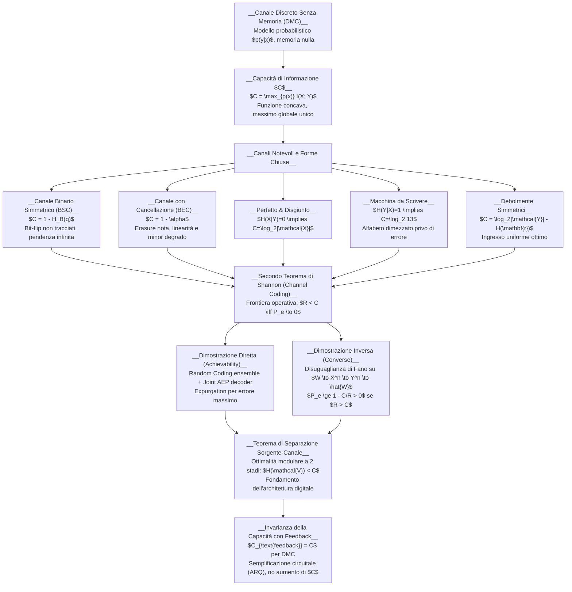

# B. Capacità Di Canale E Teorema Di Shannon

La trasmissione affidabile di flussi informativi attraverso mezzi fisici reali costituisce il cuore teorico e applicativo delle telecomunicazioni e dell'ingegneria dell'informazione. Qualsiasi canale materiale — dal doppino in rame alla fibra ottica monomodale, dal collegamento radio satellitare al bus di memoria su silicio — è soggetto a dissipazione, dispersione e perturbazioni termiche di natura stocastica.

Nel suo storico trattato del 1948, Claude Shannon scardinò il senso comune dell'epoca dimostrando un principio straordinario: il rumore non impone un pavimento intrinseco alla probabilità d'errore di una trasmissione, bensì delimita esclusivamente la velocità massima con cui l'informazione può attraversare il mezzo. Fintanto che il tasso di trasmissione $R$ (in bit per uso di canale) si mantiene inferiore a una soglia critica calcolata analiticamente, denominata __capacità di canale__ ($C$), possiamo trasmettere con una probabilità d'errore arbitrariamente prossima a zero, sfruttando codici a correzione d'errore su blocchi sufficientemente lunghi.

La mappa concettuale seguente illustra l'architettura logica della trasmissione su canale, tracciando il percorso analitico dalla definizione fisica di canale discreto fino alle frontiere asintotiche di Shannon:

## Il Modello Del Canale Di Comunicazione

Sul piano fisico e logico, un processo di telecomunicazione tra un trasmettitore e un ricevitore consiste nell'indurre, mediante una sequenza di sollecitazioni controllate, uno stato fisico correlato e interpretabile all'altro capo del mezzo. La comunicazione ha successo se e solo se il ricevitore riesce a ricostruire univocamente il messaggio inteso dal trasmettitore.

Lo schema a blocchi fondamentale introdotto da Shannon formalizza tale catena di elaborazione:

![[slide_02_communication_system_block.png|center mid]]

Analizziamo i quattro elementi cardine che costituiscono l'architettura:

1. __Sorgente di Informazione e Messaggio__: La sorgente genera un messaggio $W$ selezionato da un insieme finito di $M$ messaggi equiprobabili:

   $$
   W \in \mathcal{W} = \{1, 2, \dots, M\}
   $$

   Poiché i messaggi sono equiprobabili, l'entropia della sorgente è pari a $H(W) = \log_2 M$ bit.

2. __Codificatore di Canale (Encoder)__: Assegna a ciascun indice di messaggio $W$ una parola di codice (__codeword__) composta da $n$ simboli appartenenti all'alfabeto di canale $\mathcal{X}$:

   $$
   X^n(W) = \big(X_1(W), X_2(W), \dots, X_n(W)\big) \in \mathcal{X}^n
   $$

   Il parametro intero $n$ rappresenta la __lunghezza di blocco__ (il numero di utilizzi elementari del canale necessari a recapitare il messaggio). L'insieme delle $M$ parole $\{X^n(1), \dots, X^n(M)\}$ costituisce il __codebook__.

3. __Canale Rumoroso__: È il mezzo fisico stocastico, descritto statisticamente da una famiglia di probabilità di transizione condizionate $p(y^n \mid x^n)$. Il canale altera la sequenza inviata e restituisce al ricevitore la sequenza aleatoria osservata:

   $$
   Y^n = (Y_1, Y_2, \dots, Y_n) \in \mathcal{Y}^n
   $$

4. __Decodificatore di Canale (Decoder)__: Riceve la sequenza perturbata $Y^n$ e applica una regola di decisione deterministica:

   $$
   g: \mathcal{Y}^n \to \{1, 2, \dots, M\}
   $$

   generando la stima del messaggio trasmesso $\hat{W} = g(Y^n)$.

Definiamo il __tasso di trasmissione__ (__code rate__) $R$, misurato in bit per uso di canale (bit/simbolo), come il rapporto tra il contenuto informativo del messaggio e il numero di impieghi del canale:

$$
R = \frac{\log_2 M}{n} \quad \text{bit/uso} \iff M = \lceil 2^{nR} \rceil
$$

Un codice identificato da $M$ parole di lunghezza $n$ viene denotato convenzionalmente come codice $(2^{nR}, n)$ o codice $(M, n)$.

## Confusione Tra Sequenze E Principio Delle Sfere Di Decodifica

L'insorgenza degli errori di decodifica scaturisce dal fenomeno della __confusione di canale__: poiché il rumore è un processo stocastico dispersivo, due ingressi distinti $X^n(1)$ e $X^n(2)$ possono produrre all'uscita la medesima sequenza $Y^n$ con probabilità strettamente positiva.

### L'Intuizione Nel Linguaggio Naturale

Consideriamo due frasi trasmesse attraverso un canale di testo rumoroso che altera sporadicamente i caratteri:
- Messaggio 1: «The cat sat on the mat»
- Messaggio 2: «The cat sat on the map»

Se il canale scambia l'ultimo carattere con una 'd', il ricevitore osserva:
- Sequenza ricevuta: «The cat sat on the mad»

In sede di decodifica, entrambe le ipotesi originarie risultano ugualmente plausibili: la stima collassa nell'ambiguità «The cat sat on the ma?». Gli ingressi sono tra loro __confondibili__ perché la loro distanza metrica (in questo caso una sola lettera di differenza) è inferiore all'entità della perturbazione indotta dal canale.

### Il Ruolo Della Ridondanza Controllata

Per sopprimere l'ambiguità, introduciamo __ridondanza geometrica strutturata__: anziché consentire l'uso di tutte le sequenze possibili dell'alfabeto, il trasmettitore seleziona un sottoinsieme ristretto di sequenze opportunamente distanziate.

Proteggiamo le due frasi precedenti con caratteri ridondanti:
- Messaggio 1 codificato: «The cat sat on the mattt»
- Messaggio 2 codificato: «The cat sat on the mappp»

Se il canale altera la consonante centrale e introduce rumore residuo sull'estensione, producendo in ricezione:
- Sequenza ricevuta: «The cat sat on the madpp»

Il decodificatore confronta l'osservazione con le sole parole lecite del codebook. La correlazione statistica con il Messaggio 2 è schiacciante: la stima restituisce senza esitazione $\hat{W} =$ «The cat sat on the map».

### Interpretazione Geometrica Dei Volumi Di Decodifica

Questo principio trova una formulazione geometrica rigorosa nello spazio asintotico delle sequenze tipiche:
- A ciascuna codeword trasmessa $X^n(w)$ corrisponde nello spazio delle uscite $\mathcal{Y}^n$ un insieme di sequenze condizionatamente tipiche di volume orientativo:

  $$
  |A_\epsilon^{(n)}(Y \mid X^n(w))| \approx 2^{n H(Y \mid X)}
  $$

  Tale insieme rappresenta la "sfera di incertezza" o cono di rumore generato da quell'ingresso.
- Lo spazio complessivo delle sequenze di uscita tipiche ha volume pari a:

  $$
  |A_\epsilon^{(n)}(Y)| \approx 2^{n H(Y)}
  $$

- Affinché il ricevitore possa decodificare senza equivoci, le sfere di rumore associate alle diverse parole di codice devono risultare mutuamente disgiunte. Il numero massimo $M$ di parole collocabili nello spazio delle uscite senza sovrapposizioni critiche è delimitato dal rapporto dei volumi:

  $$
  M \approx \frac{2^{n H(Y)}}{2^{n H(Y \mid X)}} = 2^{n [H(Y) - H(Y \mid X)]} = 2^{n I(X; Y)}
  $$

- Ricordando la definizione di rate $M = 2^{nR}$, notiamo immediatamente che il tasso massimo a cui possiamo comunicare senza confusione coincide con la mutua informazione $I(X; Y)$.

## Canale Discreto Senza Memoria E Capacità Di Informazione

Un canale di comunicazione discreto è identificato dalla terna $(\mathcal{X}, p(y \mid x), \mathcal{Y})$, dove:
- $\mathcal{X}$ è l'alfabeto d'ingresso discreto e finito;
- $\mathcal{Y}$ è l'alfabeto d'uscita discreto e finito;
- $p(y \mid x) = \text{Pr}\{Y = y \mid X = x\}$ è la matrice delle probabilità di transizione condizionate, soggetta ai vincoli di conservazione della probabilità:

  $$
  p(y \mid x) \ge 0, \quad \sum_{y \in \mathcal{Y}} p(y \mid x) = 1, \quad \forall x \in \mathcal{X}
  $$

### La Proprietà Di Memoria Nulla (DMC)

Un canale si definisce __discreto senza memoria__ (__Discrete Memoryless Channel__, DMC) se la distribuzione di probabilità dell'uscita all'istante presente $k$ dipende unicamente dal simbolo d'ingresso al medesimo istante, risultando condizionatamente indipendente da tutti gli ingressi e dalle uscite precedenti:

$$
p(y_k \mid x_1, x_2, \dots, x_k, y_1, y_2, \dots, y_{k-1}) = p(y_k \mid x_k)
$$

Grazie alla memoria nulla, la probabilità condizionata associata a un intero blocco di lunghezza $n$ si fattorizza esattamente nel prodotto delle singole probabilità di transizione marginali:

$$
p(y^n \mid x^n) = \prod_{k=1}^n p(y_k \mid x_k)
$$

### Definizione Variazionale Della Capacità Di Informazione

Definiamo __capacità di informazione__ di un canale discreto senza memoria la massima mutua informazione ottenibile tra l'ingresso $X$ e l'uscita $Y$ su un singolo utilizzo del canale, massimizzando rispetto a tutte le distribuzioni di probabilità ammissibili all'ingresso:

$$
C = \max_{p(x)} I(X; Y)
$$

La massimizzazione varia sul simplesso probabilistico di dimensione $|\mathcal{X}| - 1$:

$$
\mathcal{P}(\mathcal{X}) = \left\{ p(x) \in \mathbb{R}^{|\mathcal{X}|} : p(x) \ge 0, \; \sum_{x \in \mathcal{X}} p(x) = 1 \right\}
$$

Questo problema variazionale gode di una proprietà analitica decisiva: per una matrice di transizione $p(y \mid x)$ fissata, la mutua informazione $I(X; Y)$ è una __funzione concava__ rispetto al vettore di probabilità d'ingresso $p(x)$ (Teorema di Cover & Thomas 2.7.4). Poiché il simplesso $\mathcal{P}(\mathcal{X})$ è un insieme convesso e compatto (chiuso e limitato in spazio euclideo), per il Teorema di Weierstrass il valore massimo $C$ esiste sempre ed è unico: ogni massimo locale individuato corrisponde tassativamente al massimo globale assoluto (l'eventuale molteplicità dei massimizzatori $p^*(x)$ sussiste unicamente in presenza di simboli d'ingresso ridondanti con righe di transizione identiche).

### Proprietà E Bound Fondamentali Della Capacità

Dalla definizione variazionale $C = \max_{p(x)} I(X; Y)$ discendono immediatamente tre proprietà fondamentali che delimitano la capacità di qualsiasi canale discreto:

1. __Non-negatività__: Poiché l'informazione mutua tra due variabili aleatorie è sempre non negativa ($I(X; Y) \ge 0$), vale:

   $$
   C \ge 0
   $$

   con $C = 0$ se e solo se $X$ e $Y$ sono statisticamente indipendenti per qualsiasi scelta di $p(x)$ (canale totalmente rumoroso, ad es. BSC con $q = 1/2$).

2. __Delimitazione Superiore da Ingresso e Uscita__:
   - Sviluppando l'informazione mutua rispetto all'ingresso:

     $$
     I(X; Y) = H(X) - H(X \mid Y) \le H(X) \le \log_2 |\mathcal{X}|
     $$

   - Sviluppando l'informazione mutua rispetto all'uscita:

     $$
     I(X; Y) = H(Y) - H(Y \mid X) \le H(Y) \le \log_2 |\mathcal{Y}|
     $$

   Prendendo il massimo su $p(x)$, otteniamo il limite fondamentale invalicabile:

   $$
   0 \le C \le \min\big(\log_2 |\mathcal{X}|, \; \log_2 |\mathcal{Y}|\big) \quad \text{bit/uso}
   $$

Il canale non può trasferire più bit di quanti ne contenga il suo alfabeto d'ingresso (bottleneck di modulazione/trasmissione) né più bit di quanti ne possa distinguere il suo alfabeto d'uscita (bottleneck di osservazione/ricezione).

### Capacità Operativa Di Canale

Distinguiamo accuratamente la capacità di informazione (costrutto matematico astratto) dalla __capacità operativa__, definita come l'estremo superiore di tutti i tassi di trasmissione per i quali esiste una sequenza di codici con probabilità d'errore asintoticamente nulla:

$$
C_{\text{operativa}} = \sup \left\{ R : \lim_{n \to \infty} P_e^{(n)} = 0 \right\}
$$

Il cardine su cui poggia l'intera teoria di Shannon è la perfetta equivalenza tra queste due quantità:

$$
C_{\text{operativa}} = C = \max_{p(x)} I(X; Y)
$$

La massimizzazione di $I(X; Y)$ non è una mera curiosità analitica, ma quantifica con precisione assoluta il limite invalicabile di velocità imposto dalla fisica alla comunicazione numerica.

## Calcolo Della Capacità per Canali Canonici

Esaminiamo ora l'applicazione del principio variazionale $C = \max_{p(x)} I(X; Y)$ alle principali topologie di canale, derivando in forma chiusa le rispettive capacità e interpretandone i risvolti ingegneristici.

### Canale Perfetto Privo Di Rumore (Noiseless Channel)

Nel canale ideale, l'uscita riproduce fedelmente e deterministicamente l'ingresso: $Y = X$. La matrice di transizione è la matrice identità: $p(y \mid x) = \delta_{xy}$.

Espandiamo l'informazione mutua:

$$
I(X; Y) = H(X) - H(X \mid Y)
$$

Dato che $Y = X$, conoscere l'uscita azzera ogni incertezza residua sull'ingresso: $H(X \mid Y) = 0$. Ne consegue:

$$
I(X; Y) = H(X)
$$

Massimizzando rispetto alla distribuzione d'ingresso:

$$
C = \max_{p(x)} H(X) = \log_2 |\mathcal{X}| \quad \text{bit/uso}
$$

Il massimo è raggiunto quando i simboli d'ingresso sono equiprobabili: $p^*(x) = 1/|\mathcal{X}|$. A ciascun uso del canale trasmettiamo esattamente $\log_2 |\mathcal{X}|$ bit privi di rumore.

### Canale Con Uscite Disgiunte Non Sovrapposte

Consideriamo un canale in cui a ingressi distinti corrispondono sottoinsiemi di uscite mutuamente disgiunti. Sia ad esempio $\mathcal{X} = \{0, 1\}$ e $\mathcal{Y} = \{1, 2, 3, 4\}$ con le seguenti transizioni:
- Se $X = 0$, $Y$ assume equiprobabilmente i valori $\{1, 2\}$;
- Se $X = 1$, $Y$ assume equiprobabilmente i valori $\{3, 4\}$.

Sebbene l'uscita $Y$ sia stocastica e presenti dispersione, osservare il valore di $Y$ identifica senza ombra di dubbio quale ingresso sia stato inviato: se riceviamo $1$ o $2$, l'ingresso era $0$; se riceviamo $3$ o $4$, l'ingresso era $1$.

L'entropia condizionata dell'ingresso data l'uscita è nulla: $H(X \mid Y) = 0$. Calcoliamo la mutua informazione:

$$
I(X; Y) = H(X) - H(X \mid Y) = H(X) - 0 = H(X)
$$

Massimizzando su $p(x)$ otteniamo:

$$
C = \max_{p(x)} H(X) = \log_2 |\mathcal{X}| = 1 \quad \text{bit/uso}
$$

Questo risultato evidenzia un punto fondamentale per l'esame: l'aleatorietà dell'uscita non penalizza la capacità fintanto che non produce __confusione__ (sovrapposizione) tra le uscite generate da ingressi diversi.

### Macchina Da Scrivere Rumorosa (Noisy Typewriter)

Immaginiamo una macchina da scrivere con una tastiera circolare di $26$ lettere. Quando premiamo il tasto $x$, il dispositivo batte la lettera corretta $x$ con probabilità $1/2$, oppure batte la lettera successiva $(x+1) \bmod 26$ con probabilità $1/2$.

Calcoliamo l'entropia condizionata dell'uscita per un simbolo fissato:

$$
H(Y \mid X = x) = H_B(1/2) = 1 \quad \text{bit}
$$

Poiché tale incertezza è identica per ogni tasto, la media su qualsiasi distribuzione d'ingresso produce:

$$
H(Y \mid X) = \sum_{x} p(x) H(Y \mid X = x) = 1 \quad \text{bit}
$$

L'informazione mutua si riduce a:

$$
I(X; Y) = H(Y) - H(Y \mid X) = H(Y) - 1
$$

Per massimizzare $I(X; Y)$ dobbiamo massimizzare l'entropia marginale dell'uscita $H(Y)$. Poiché l'alfabeto di ricezione conta $26$ simboli, l'entropia è superiormente limitata da $H(Y) \le \log_2 26$. Alimentando il canale con una distribuzione d'ingresso uniforme $p(x) = 1/26$, la simmetria circolare rende uniforme anche l'uscita, saturando il limite $H(Y) = \log_2 26$.

La capacità vale dunque:

$$
C = \log_2 26 - 1 = \log_2 26 - \log_2 2 = \log_2\left( \frac{26}{2} \right) = \log_2 13 \approx 3.70 \quad \text{bit/uso}
$$

Notiamo l'elegante risvolto operativo: per trasmettere con probabilità d'errore esattamente zero senza ricorrere ad algoritmi complessi di correzione d'errore, è sufficiente utilizzare un alfabeto dimezzato selezionando $13$ lettere alternate (ad esempio $A, C, E, G, \dots$). In questo modo le coppie di uscite possibili associate a ciascuna lettera selezionata non si sovrappongono mai, consentendo una decodifica perfetta al tasso di $\log_2 13$ bit per battuta.

### Il Canale Binario Simmetrico (Binary Symmetric Channel, BSC)

Il Canale Binario Simmetrico costituisce il modello di riferimento per tutti i sistemi affetti da rumore additivo binario non controllato (fenomeno del bit-flip).

Gli alfabeti sono strettamente binari: $\mathcal{X} = \{0, 1\}$ e $\mathcal{Y} = \{0, 1\}$. Il parametro $q \in [0, 1]$ rappresenta la probabilità di inversione del bit:

$$
p(0 \mid 0) = 1 - q, \quad p(1 \mid 0) = q, \quad p(0 \mid 1) = q, \quad p(1 \mid 1) = 1 - q
$$

![[slide_06_bsc_channel_model.png|center mid]]

Nel BSC il rumore opera in modo del tutto cieco rispetto all'informazione: il ricevitore osserva un bit, ma non ha alcun mezzo per sapere se quel bit sia arrivato integro o invertito.

Deriviamo analiticamente la capacità. Calcoliamo l'entropia condizionata dell'uscita condizionata al simbolo inviato:

$$
H(Y \mid X = 0) = -q \log_2 q - (1 - q) \log_2(1 - q) = H_B(q)
$$

$$
H(Y \mid X = 1) = -q \log_2 q - (1 - q) \log_2(1 - q) = H_B(q)
$$

Poiché l'entropia delle righe della matrice di transizione è identica e indipendente dal simbolo trasmesso, la media su qualsiasi distribuzione d'ingresso $p(x)$ fornisce:

$$
H(Y \mid X) = p(0) H_B(q) + p(1) H_B(q) = H_B(q)
$$

Sviluppiamo la mutua informazione:

$$
I(X; Y) = H(Y) - H(Y \mid X) = H(Y) - H_B(q)
$$

Il termine di rumore $H_B(q)$ è una costante fissata dal canale. Di conseguenza, massimizzare $I(X; Y)$ equivale a massimizzare l'entropia marginale d'uscita $H(Y)$. Poiché $Y$ è una variabile binaria, la sua entropia non può eccedere $1$ bit:

$$
H(Y) \le 1 \quad \text{bit}
$$

con uguaglianza se e solo se l'uscita è equiprobabile: $\text{Pr}\{Y = 0\} = \text{Pr}\{Y = 1\} = 1/2$. Esprimiamo la probabilità di ricevere '1' in funzione della probabilità d'ingresso $p = \text{Pr}\{X = 1\}$:

$$
\text{Pr}\{Y = 1\} = p(1 - q) + (1 - p)q = p + q - 2pq
$$

Imponendo la condizione di ottimalità $\text{Pr}\{Y = 1\} = 1/2$:

$$
p + q - 2pq = \frac{1}{2} \iff p(1 - 2q) = \frac{1}{2} - q = \frac{1}{2}(1 - 2q)
$$

Per qualsiasi canale non degenere ($q \neq 1/2$), semplifichiamo il fattore $(1 - 2q)$ ricavando l'unica soluzione ottima:

$$
p^* = \frac{1}{2}
$$

Scegliendo l'ingresso uniforme $p^*(0) = p^*(1) = 1/2$, saturiamo l'uscita a $H(Y) = 1$ bit. Otteniamo così la celebre espressione per la __capacità del Canale Binario Simmetrico__:

$$
C_{\text{BSC}} = 1 - H_B(q) \quad \text{bit/uso}
$$

Esaminiamo il comportamento della capacità nei regimi operativi notevoli:

1. __Canale Perfetto ($q = 0$)__: $H_B(0) = 0 \implies C = 1$ bit/uso. Il mezzo trasferisce l'informazione alla massima velocità consentita dall'alfabeto.
2. __Canale a Rumore Puro ($q = 1/2$)__: $H_B(1/2) = 1 \implies C = 0$ bit/uso. L'uscita è stocasticamente indipendente dall'ingresso ($\text{Pr}\{Y = 1\} = 1/2$ a prescindere da $X$). Nessuna correlazione sopravvive: la trasmissione a tasso positivo è impossibile.
3. __Canale Invertitore Deterministico ($q = 1$)__: $H_B(1) = 0 \implies C = 1$ bit/uso. Ogni bit viene sistematicamente negato. Poiché la regola di inversione è nota e priva di aleatorietà, il decodificatore inverte l'uscita ($\hat{X} = 1 - Y$), recuperando il flusso a tasso massimo.
4. __Simmetria Funzionale__: Poiché $H_B(q) = H_B(1 - q)$, la curva di capacità è perfettamente simmetrica attorno a $q = 1/2$. Operare a $q = 0.9$ offre le medesime prestazioni teoriche di operare a $q = 0.1$.

### Il Canale Binario Con Cancellazione (Binary Erasure Channel, BEC)

In numerosi contesti reali — quali le reti a commutazione di pacchetto dove i checksum scartano i pacchetti corrotti, o le memorie a semiconduttore con letture sotto-soglia — il ricevitore non subisce inversioni invisibili, ma è consapevole di quando un simbolo è andato perduto.

Il __Canale Binario con Cancellazione__ possiede un ingresso binario $\mathcal{X} = \{0, 1\}$ e un'uscita ternaria $\mathcal{Y} = \{0, 1, e\}$, dove $e$ denota l'evento di __cancellazione__ (__erasure__). Il parametro $\alpha \in [0, 1]$ rappresenta la probabilità di cancellazione:

$$
p(0 \mid 0) = 1 - \alpha, \quad p(e \mid 0) = \alpha, \quad p(1 \mid 0) = 0
$$

$$
p(1 \mid 1) = 1 - \alpha, \quad p(e \mid 1) = \alpha, \quad p(0 \mid 1) = 0
$$

Sia $p = \text{Pr}\{X = 1\}$ la probabilità di trasmettere '1'. La distribuzione marginale dell'uscita vale:

$$
\text{Pr}\{Y = 0\} = (1 - p)(1 - \alpha), \quad \text{Pr}\{Y = 1\} = p(1 - \alpha), \quad \text{Pr}\{Y = e\} = \alpha
$$

Per calcolare l'entropia dell'uscita $H(Y)$ in modo rigoroso ed elegante, definiamo la variabile aleatoria indicatrice di cancellazione:

$$
E = \mathbf{1}_{\{Y = e\}} = \begin{cases} 1 & \text{se } Y = e \\ 0 & \text{se } Y \in \{0, 1\} \end{cases}
$$

Applicando la regola di scomposizione della catena per l'entropia congiunta:

$$
H(Y, E) = H(E) + H(Y \mid E)
$$

Poiché $E$ è una funzione deterministica di $Y$, l'entropia congiunta coincide con l'entropia marginale: $H(Y, E) = H(Y)$. Sviluppando i singoli addendi:
- $H(E) = H_B(\alpha)$, in quanto $E$ è una variabile bernoulliana con parametro $\alpha$.
- $H(Y \mid E) = (1 - \alpha) H(Y \mid E = 0) + \alpha H(Y \mid E = 1)$.

Quando $E = 1$, l'uscita è deterministicamente pari a $e$, dunque $H(Y \mid E = 1) = 0$. Quando $E = 0$, l'uscita assume i valori $0$ e $1$ con probabilità condizionate $1 - p$ e $p$, per cui $H(Y \mid E = 0) = H_B(p)$. Sostituendo:

$$
H(Y) = H_B(\alpha) + (1 - \alpha) H_B(p)
$$

Calcoliamo l'entropia condizionata del canale: per qualunque simbolo trasmesso $x$, l'uscita è pari a $x$ con probabilità $1 - \alpha$ oppure a $e$ con probabilità $\alpha$:

$$
H(Y \mid X) = H_B(\alpha)
$$

Sottraendo i due termini per ottenere la mutua informazione, notiamo una semplificazione esatta:

$$
I(X; Y) = H(Y) - H(Y \mid X) = \big[ H_B(\alpha) + (1 - \alpha) H_B(p) \big] - H_B(\alpha) = (1 - \alpha) H_B(p)
$$

Il termine di rumore $H_B(\alpha)$ scompare per cancellazione algebrica. Massimizzando rispetto a $p$, saturiamo $H_B(p) \le 1$ ponendo l'ingresso uniforme $p^* = 1/2$. Otteniamo la __capacità del Canale Binario con Cancellazione__:

$$
C_{\text{BEC}} = 1 - \alpha \quad \text{bit/uso}
$$

### Confronto Critico E Geometrico Tra BSC E BEC

Il confronto tra le prestazioni del canale BSC e del canale BEC rivela uno dei concetti più fecondi della teoria dell'informazione: il valore della localizzazione dell'errore.

![[bsc_vs_bec_capacity_curves.svg|center mid]]

Analizziamo i contrasti strutturali emergenti dal grafico:

1. __Linearità vs Decadimento Entropico__:
   - La capacità del BEC decade in modo perfettamente lineare: $C_{\text{BEC}} = 1 - \alpha$.
   - La capacità del BSC segue la curva dell'entropia binaria: $C_{\text{BSC}} = 1 - H_B(q)$.

2. __Pendenza Infinita all'Origine per il BSC__:
   Calcoliamo la derivata prima della capacità del BSC rispetto alla probabilità d'errore $q$:

   $$
   \frac{\mathrm{d}C_{\text{BSC}}}{\mathrm{d}q} = -\frac{\mathrm{d}H_B(q)}{\mathrm{d}q} = \log_2\left( \frac{q}{1 - q} \right)
   $$

   Facendo tendere il rumore a zero ($q \to 0^+$), notiamo che:

   $$
   \lim_{q \to 0^+} \frac{\mathrm{d}C_{\text{BSC}}}{\mathrm{d}q} = -\infty
   $$

   Al contrario, per il canale BEC la pendenza è costante: $\frac{\mathrm{d}C_{\text{BEC}}}{\mathrm{d}\alpha} = -1$.
   Significato fisico fondamentale: un livello infinitesimo di bit-flip inosservati distrugge capacità a una velocità infinitamente superiore rispetto a un livello equivalente di cancellazioni.

3. __Gap Informativo e Localizzazione del Guasto__:
   Fissiamo un tasso di perturbazione del $10\%$ ($q = \alpha = 0.1$):
   - Nel BEC: $C_{\text{BEC}}(0.1) = 1 - 0.1 = 0.90$ bit/uso.
   - Nel BSC: $C_{\text{BSC}}(0.1) = 1 - H_B(0.1) \approx 1 - 0.469 = 0.531$ bit/uso.
   Il canale con cancellazione conserva quasi il $70\%$ di capacità in più rispetto al canale con bit-flip ($\Delta C \approx +0.369$ bit). Sapere _dove_ si è verificata la perdita di informazione riduce drasticamente l'entropia residua che il codice deve risolvere.

4. __Divergenza nei Punti Singolari__:
   - A $q = \alpha = 0.5$: il BSC collassa a $C=0$ (indipendenza stocastica totale), mentre il BEC mantiene $C = 0.50$ bit/uso (la metà dei bit arriva perfettamente integra e identificata).
   - A $q = \alpha = 1.0$: il BEC collassa a $C=0$ (tutti i bit vengono cancellati), mentre il BSC risale a $C=1$ bit/uso grazie alla decodifica deterministica per inversione.

### Canali Debolmente Simmetrici

Generalizziamo i risultati analitici precedenti introducendo la classe dei canali debolmente simmetrici, per i quali la capacità ammette una derivazione immediata.

Un canale $(\mathcal{X}, p(y \mid x), \mathcal{Y})$ si definisce __debolmente simmetrico__ (__weakly symmetric__) se soddisfa due condizioni strutturali sulla matrice di transizione $[p(y \mid x)]$:
1. Ogni riga della matrice è una permutazione di qualsiasi altra riga. Di conseguenza, l'entropia condizionata associata a ciascuna riga $\mathbf{r}$ è costante:

   $$
   H(Y \mid X = x) = -\sum_{y \in \mathcal{Y}} p(y \mid x) \log_2 p(y \mid x) = H(\mathbf{r}), \quad \forall x \in \mathcal{X}
   $$

2. Tutte le somme per colonna sono identiche tra loro:

   $$
   \sum_{x \in \mathcal{X}} p(y \mid x) = c = \frac{|\mathcal{X}|}{|\mathcal{Y}|}, \quad \forall y \in \mathcal{Y}
   $$

#### Teorema Di Capacità per Canali Debolmente Simmetrici

Per qualsiasi canale debolmente simmetrico, la capacità di informazione vale:

$$
C = \log_2 |\mathcal{Y}| - H(\mathbf{r}) \quad \text{bit/uso}
$$

ed è raggiunta tassativamente dalla distribuzione di probabilità d'ingresso uniforme:

$$
p^*(x) = \frac{1}{|\mathcal{X}|}, \quad \forall x \in \mathcal{X}
$$

#### Dimostrazione

Grazie alla costanza dell'entropia di riga, l'entropia condizionata non dipende dalla distribuzione d'ingresso:

$$
H(Y \mid X) = \sum_{x \in \mathcal{X}} p(x) H(Y \mid X = x) = H(\mathbf{r}) \sum_{x \in \mathcal{X}} p(x) = H(\mathbf{r})
$$

Esprimiamo la mutua informazione e imponiamo il limite superiore sull'entropia dell'uscita:

$$
I(X; Y) = H(Y) - H(Y \mid X) = H(Y) - H(\mathbf{r}) \le \log_2 |\mathcal{Y}| - H(\mathbf{r})
$$

Verifichiamo se la distribuzione uniforme d'ingresso $p(x) = 1/|\mathcal{X}|$ riesce a saturare la disuguaglianza. Calcoliamo la distribuzione marginale d'uscita indotta:

$$
p(y) = \sum_{x \in \mathcal{X}} p(x) p(y \mid x) = \frac{1}{|\mathcal{X}|} \sum_{x \in \mathcal{X}} p(y \mid x) = \frac{1}{|\mathcal{X}|} \cdot \left( \frac{|\mathcal{X}|}{|\mathcal{Y}|} \right) = \frac{1}{|\mathcal{Y}|}
$$

L'uscita risulta rigorosamente equiprobabile sull'intero alfabeto $\mathcal{Y}$. Ne deriva che $H(Y) = \log_2 |\mathcal{Y}|$, saturando il bound e confermando che $p^*(x) = 1/|\mathcal{X}|$ realizza la capacità.

## Secondo Teorema Di Shannon (Channel Coding Theorem)

Il Secondo Teorema Fondamentale di Claude Shannon (1948) stabilisce il confine invalicabile tra la regione di trasmissione affidabile a errore nullo e la regione in cui la comunicazione collassa irreversibilmente nell'ambiguità stocastica.

### Enunciato Globale Del Teorema

Dato un canale discreto senza memoria con capacità di informazione $C = \max_{p(x)} I(X; Y)$:

1. __Parte Diretta (Achievability)__:
   Per ogni tasso di trasmissione $R < C$ e per qualsiasi margine di tolleranza $\epsilon > 0$, per blocchi di lunghezza $n$ sufficientemente grande esiste un codice di canale $(2^{nR}, n)$ la cui probabilità massima d'errore di decodifica soddisfa:

   $$
   \lambda_{\max}^{(n)} = \max_{w \in \{1, \dots, 2^{nR}\}} \text{Pr}\{g(Y^n) \neq w \mid W = w\} < \epsilon
   $$

2. __Parte Inversa (Converse)__:
   Qualsiasi sequenza di codici di blocco $(2^{nR}, n)$ che tenti di trasmettere a un tasso $R > C$ presenta una probabilità media d'errore $P_e^{(n)}$ confinata inferiormente lontano da zero per $n \to \infty$:

   $$
   P_e^{(n)} \ge 1 - \frac{C}{R} - \frac{1}{nR} \xrightarrow{n \to \infty} 1 - \frac{C}{R} > 0
   $$

   È fisicamente e matematicamente impossibile comunicare con affidabilità ideale superando la capacità del canale.

### Rottura Del Paradigma Classico Della Ripetizione

Prima del 1948, la prassi ingegneristica riteneva che l'unico modo per contrastare il rumore consistesse nel ripetere i bit un numero crescente di volte (codici a ripetizione). Tuttavia, ripetere un bit $n$ volte riduce il rate effettivo come $R = 1/n$: per azzerare l'errore ($n \to \infty$), il tasso di trasmissione precipita a zero ($R \to 0$).

Shannon dimostrò la sub-ottimalità di tale approccio. Anziché confinare i segnali su traiettorie monodimensionali collineari, costruiamo parole di codice vettoriali distribuite nell'iperspazio $n$-dimensionale. Sfruttando il fenomeno della concentrazione della misura (AEP congiunta), le sfere di dispersione del rumore si disgiungono quasi totalmente, rendendo possibile comunicare con errore nullo a qualsiasi tasso positivo $R$ purché inferiore a $C$.

### Struttura Della Dimostrazione Diretta (Random Coding E Joint AEP)

La dimostrazione diretta di Shannon non produce un algoritmo costruttivo deterministico (la ricerca di codici pratici capacity-achieving richiederà mezzo secolo, culminando con i codici Turbo, LDPC e Polari), ma prova l'esistenza del codice ottimo mediante il celebre metodo probabilistico:

1. __Generazione Casuale dell'Ensemble (Random Coding)__:
   Sia $p^*(x)$ la distribuzione che massimizza la capacità. Generiamo casualmente una matrice di codice (codebook) di $2^{nR}$ parole, ciascuna di $n$ simboli, estraendo ogni elemento in modo indipendente secondo la distribuzione prodotto:

   $$
   p(x^n) = \prod_{j=1}^n p^*(x_j)
   $$

2. __Decodifica a Tipicità Congiunta (Joint Typicality Decoder)__:
   Il ricevitore osserva la sequenza $Y^n$ e verifica l'appartenenza all'insieme congiuntamente tipico $A_\epsilon^{(n)}$. Dichiara che il messaggio trasmesso è l'indice $\hat{w}$ se e solo se:
   - La coppia $(X^n(\hat{w}), Y^n)$ appartiene ad $A_\epsilon^{(n)}$;
   - Non esiste nessun altro indice $k \neq \hat{w}$ tale che $(X^n(k), Y^n) \in A_\epsilon^{(n)}$.
   In caso contrario, il ricevitore segnala un errore di decodifica.

3. __Analisi degli Eventi d'Errore tramite Joint AEP__:
   Assumiamo senza perdita di generalità che sia stato trasmesso il messaggio $W = 1$. L'errore si manifesta se si verifica l'unione di due eventi:
   - Evento $E_1$: la parola corretta non è tipica con l'uscita, $(X^n(1), Y^n) \notin A_\epsilon^{(n)}$. Per la proprietà fondamentale dell'AEP congiunta (legge dei grandi numeri), la probabilità decade a zero:

     $$
     \text{Pr}(E_1) \le \epsilon \quad \text{per } n \text{ sufficientemente grande}
     $$

   - Eventi $E_i$ ($i \ge 2$): una parola incorretta $X^n(i)$ risulta casualmente congiuntamente tipica con l'uscita osservata $Y^n$. Poiché per $i \neq 1$ la parola $X^n(i)$ e l'uscita $Y^n$ sono statisticamente indipendenti, la proprietà di dispersione dell'AEP stabilisce che:

     $$
     \text{Pr}\big((X^n(i), Y^n) \in A_\epsilon^{(n)}\big) \le 2^{-n(I(X; Y) - 3\epsilon)}
     $$

4. __Applicazione dello Union Bound e Convergenza__:
   Valutiamo la probabilità media d'errore mediata sull'intero ensemble di codici casuali:

   $$
   \mathbb{E}[P_e^{(n)}] \le \text{Pr}(E_1) + \sum_{i=2}^{2^{nR}} \text{Pr}(E_i) \le \epsilon + (2^{nR} - 1) 2^{-n(I(X; Y) - 3\epsilon)} \le \epsilon + 2^{-n(I(X; Y) - R - 3\epsilon)}
   $$

   Se imponiamo la condizione fondamentale sul tasso:

   $$
   R < I(X; Y) - 3\epsilon = C - 3\epsilon
   $$

   l'esponente è strettamente negativo. Per $n \to \infty$, il termine esponenziale decade a zero, garantendo:

   $$
   \mathbb{E}[P_e^{(n)}] \le 2\epsilon
   $$

5. __Tecnica di Expurgation (Passaggio all'Errore Massimo)__:
   Poiché la media sull'ensemble è inferiore a $2\epsilon$, deve esistere almeno un codice deterministico $\mathcal{C}^*$ la cui probabilità d'errore media soddisfa $P_e^{(n)}(\mathcal{C}^*) \le 2\epsilon$.
   Per convertire la garanzia sull'errore medio in una garanzia sull'errore massimo $\lambda_{\max}$, ordiniamo le $2^{nR}$ parole di codice in base alla loro probabilità d'errore individuale $\lambda_w$ ed eliminiamo la metà peggiore ($2^{nR-1}$ parole). Sulle parole rimanenti, per la disuguaglianza di Markov, l'errore massimo non può eccedere il doppio della media:

   $$
   \lambda_{\max} \le 2 P_e^{(n)}(\mathcal{C}^*) \le 4\epsilon
   $$

   Il tasso di trasmissione del codice epurato è pari a:

   $$
   R' = \frac{\log_2(2^{nR-1})}{n} = \frac{nR - 1}{n} = R - \frac{1}{n} \xrightarrow{n \to \infty} R
   $$

   La perdita di tasso è asintoticamente nulla, completando la dimostrazione diretta.

Per consultare lo sviluppo analitico integrale di ogni singolo passaggio, si rimanda alla [[zz. Argomenti extra#Dimostrazione del Teorema di Codifica di Canale (Diretta: Random Coding e Joint AEP)|Dimostrazione del Teorema di Codifica di Canale (Diretta: Random Coding e Joint AEP)]].

### Struttura Della Dimostrazione Inversa (Converse via Fano)

Dimostriamo ora che nessun sistema può operare in modo affidabile al di sopra della capacità. Consideriamo la catena di elaborazione:

$$
W \to X^n(W) \to Y^n \to \hat{W} = g(Y^n)
$$

Il messaggio $W$ è distribuito uniformemente su $\{1, \dots, 2^{nR}\}$, da cui $H(W) = nR$. Applicando la Disuguaglianza di Fano alla stima di $W$ a partire da $Y^n$, l'incertezza residua sul messaggio è delimitata superiormente da:

$$
H(W \mid Y^n) \le 1 + P_e^{(n)} \log_2 M = 1 + P_e^{(n)} n R
$$

Espandiamo l'entropia del messaggio applicando la definizione di mutua informazione:

$$
nR = H(W) = H(W \mid Y^n) + I(W; Y^n)
$$

Poiché $W \to X^n \to Y^n$ forma una catena di Markov, per la Data Processing Inequality (DPI) la mutua informazione non può aumentare lungo la catena:

$$
I(W; Y^n) \le I(X^n; Y^n)
$$

Inoltre, per la proprietà di memoria nulla del canale (DMC), l'informazione mutua di blocco è limitata dalla somma delle capacità sui singoli utilizzi:

$$
I(X^n; Y^n) = H(Y^n) - H(Y^n \mid X^n) \le \sum_{i=1}^n H(Y_i) - \sum_{i=1}^n H(Y_i \mid X_i) = \sum_{i=1}^n I(X_i; Y_i) \le n C
$$

Combinando le disuguaglianze ottenute:

$$
nR \le 1 + P_e^{(n)} n R + n C
$$

Riorganizziamo i termini per isolare la probabilità d'errore $P_e^{(n)}$:

$$
nR(1 - P_e^{(n)}) \le 1 + nC \iff 1 - P_e^{(n)} \le \frac{1}{nR} + \frac{C}{R}
$$

Concludiamo ricavando il limite inferiore invalicabile:

$$
P_e^{(n)} \ge 1 - \frac{C}{R} - \frac{1}{nR} \xrightarrow{n \to \infty} 1 - \frac{C}{R}
$$

Se $R > C$, la quantità $1 - C/R$ è strettamente positiva. Indipendentemente dalla complessità dell'algoritmo di decodifica o dalla lunghezza di blocco $n$, la probabilità d'errore non potrà mai scendere sotto tale valore.

I dettagli analitici formali sono consultabili nella [[zz. Argomenti extra#Dimostrazione della Parte Inversa del Teorema di Codifica di Canale (Converse via Fano)|Dimostrazione della Parte Inversa del Teorema di Codifica di Canale (Converse via Fano)]].

## Dualità Di Shannon Tra Compressione E Trasmissione

Tra i due pilastri della teoria dell'informazione sussiste una profonda simmetria speculare, formalizzata dal principio di dualità di Shannon:

1. __Compressione Dati (Codifica di Sorgente)__:
   La sorgente produce sequenze affette da ridondanza statistica (dipendenze temporali, disomogeneità probabilistiche). Il codificatore di sorgente rimuove sistematicamente tale ridondanza, comprimendo i dati fino al tasso minimo rappresentato dall'entropia $H(X)$. Il flusso compresso risultante è denso e privo di struttura, indistinguibile all'analisi spettrale da rumore bianco.

2. __Trasmissione su Canale (Codifica di Canale)__:
   Ricevuto il flusso compresso privo di ridondanza, il codificatore di canale vi reintroduce deliberatamente una ridondanza controllata e rigidamente strutturata nello spazio geometrico dei segnali (parità, grafi di Tanner, vincoli di traliccio). Questa ridondanza allontana le parole nello spazio di Hamming, respingendo le perturbazioni stocastiche introdotte dal canale fino al limite di velocità $C$.

La compressione elimina la ridondanza naturale non strutturata; la codifica di canale inietta ridondanza artificiale strutturata.

## Teorema Di Separazione Sorgente-Canale Di Shannon

In un impianto di trasmissione reale, si potrebbe ipotizzare che progettare un unico codificatore congiunto non lineare — che mappi direttamente i campioni della sorgente nei simboli fisici di canale — consenta di superare le prestazioni di un'architettura modulare a stadi disaccoppiati.

Il celebre __Teorema di Separazione Sorgente-Canale__ (Shannon 1948) dimostra inconfutabilmente che tale congettura è errata: l'architettura a due stadi separati è __globalmente e asintoticamente ottima__.

### Enunciato Del Teorema

Sia assegnata una sorgente stazionaria ed ergodica $\mathcal{V}$ con tasso di entropia $H(\mathcal{V})$ (espressa in bit per simbolo di sorgente), e sia assegnato un canale discreto senza memoria con capacità $C$ (in bit per uso di canale). Supponiamo che il sistema utilizzi il canale $n$ volte per trasmettere ogni blocco di $k$ simboli di sorgente.

1. __Condizione di Trasmissibilità Affidabile__:
   Se il tasso di entropia normalizzato è inferiore alla capacità del canale:

   $$
   \frac{k}{n} H(\mathcal{V}) < C
   $$

   possiamo comprimere la sorgente e codificare il canale mediante due stadi indipendenti, garantendo una probabilità di ricostruzione errata asintoticamente nulla per blocchi sufficientemente lunghi.

2. __Condizione di Intrasmissibilità__:
   Se $\frac{k}{n} H(\mathcal{V}) > C$, per qualsiasi sistema di codifica (anche congiunto) la probabilità d'errore di ricostruzione è confinata inferiormente lontano da zero.

La dimostrazione rigorosa è consultabile nella sezione [[zz. Argomenti extra#Dimostrazione del Teorema di Separazione Sorgente-Canale di Shannon|Dimostrazione del Teorema di Separazione Sorgente-Canale di Shannon]].

### Impatto Architetturale Del Principio Di Separazione

Il Teorema di Separazione costituisce l'architrave su cui si fonda l'intera industria informatica e delle telecomunicazioni contemporanee:
- __Disaccoppiamento dei Livelli di Progettazione__: L'ingegnere software che sviluppa un algoritmo di compressione video (es. H.264, HEVC, AV1) deve unicamente ottimizzare la rimozione della ridondanza per minimizzare il bitrate in uscita, senza preoccuparsi del mezzo fisico di destinazione.
- __Universalità del Canale Digitale__: L'ingegnere delle telecomunicazioni che progetta un collegamento fisico 5G, Wi-Fi 7 o un transponder ottico deve unicamente massimizzare la capacità $C$ del canale e correggere gli errori di bit, trattando il flusso informativo come una sequenza astratta di bit priva di significato semantico.
- __L'Architettura di Internet__: Senza il Teorema di Separazione, la pila di protocolli ISO/OSI e l'architettura a pacchetti TCP/IP — fondate sul disaccoppiamento tra il livello applicativo e il livello fisico — non avrebbero alcuna giustificazione teorica di ottimalità.

## Capacità Di Canale in Presenza Di Feedback Causale

Un fondamentale quesito teorico riguarda l'impiego del canale di ritorno: se il ricevitore dispone di un collegamento privo di rumore attraverso il quale rinvia immediatamente al trasmettitore i simboli $Y$ ricevuti negli istanti precedenti, la capacità di trasmissione del canale aumenta?

### Teorema Di Shannon sull'Invarianza Della Capacità Con Feedback

Per qualsiasi canale discreto senza memoria (DMC), l'introduzione di un canale di feedback causale privo di rumore non incrementa in alcun modo la capacità di canale:

$$
C_{\text{feedback}} = C
$$

#### Dimostrazione

In un sistema con feedback causale, il simbolo trasmesso all'istante $i$ può dipendere sia dal messaggio originario $W \in \{1, \dots, 2^{nR}\}$ sia da tutte le uscite di canale registrate fino all'istante precedente $Y^{i-1} = (Y_1, \dots, Y_{i-1})$:

$$
X_i = f_i(W, Y^{i-1})
$$

Applicando la Disuguaglianza di Fano alla stima del messaggio $W \sim \text{Uniform}\{1, \dots, 2^{nR}\}$ a partire dall'intera sequenza di ricezione $Y^n$:

$$
nR = H(W) = H(W \mid Y^n) + I(W; Y^n) \le 1 + P_e^{(n)} n R + I(W; Y^n)
$$

Scomponiamo l'informazione mutua $I(W; Y^n)$ mediante la regola della catena:

$$
I(W; Y^n) = H(Y^n) - H(Y^n \mid W) = \sum_{i=1}^n H(Y_i \mid Y^{i-1}) - \sum_{i=1}^n H(Y_i \mid Y^{i-1}, W)
$$

Poiché il condizionamento non può aumentare l'entropia, abbiamo $H(Y_i \mid Y^{i-1}) \le H(Y_i)$.
Esaminiamo ora il secondo addendo. Per la proprietà di memoria nulla del canale (DMC), condizionatamente al simbolo d'ingresso $X_i$, l'uscita $Y_i$ è statisticamente indipendente da tutti i simboli precedenti $Y^{i-1}$ e dal messaggio $W$:

$$
H(Y_i \mid Y^{i-1}, W, X_i) = H(Y_i \mid X_i)
$$

Poiché per ipotesi $X_i$ è una funzione deterministica di $(W, Y^{i-1})$, condizionare rispetto a $(Y^{i-1}, W)$ equivale a condizionare rispetto a $(Y^{i-1}, W, X_i)$. Otteniamo:

$$
H(Y_i \mid Y^{i-1}, W) = H(Y_i \mid X_i)
$$

Sostituendo queste relazioni nella mutua informazione:

$$
I(W; Y^n) \le \sum_{i=1}^n H(Y_i) - \sum_{i=1}^n H(Y_i \mid X_i) = \sum_{i=1}^n I(X_i; Y_i) \le \sum_{i=1}^n C = n C
$$

Inserendo questo limite superiore nel bound di Fano:

$$
nR \le 1 + P_e^{(n)} n R + n C \implies R \le \frac{1}{n} + P_e^{(n)} R + C
$$

Prendendo il limite per $n \to \infty$ sotto l'ipotesi di trasmissione affidabile ($P_e^{(n)} \to 0$), ricaviamo che $R \le C$. Ne consegue:

$$
C_{\text{feedback}} \le C
$$

D'altra parte, trasmettere ignorando il segnale di feedback è un caso particolare di trasmissione con feedback: vale banalmente $C_{\text{feedback}} \ge C$. Concludiamo che $C_{\text{feedback}} = C$.

#### Ruolo Ingegneristico Del Feedback

Sebbene il feedback non aumenti la capacità asintotica di un canale privo di memoria, esso riveste un'importanza applicativa eccezionale:
1. __Semplificazione Circuitale__: Consente di implementare codici con complessità di codifica e decodifica quasi nulla (come i protocolli ARQ a ritrasmissione rapida e gli schemi ad aggiornamento di stima alla Horstein-Schalkwijk-Kailath).
2. __Accelerazione della Convergenza__: Aumenta drasticamente l'esponente d'errore di affidabilità ($E(R)$), facendo decadere la probabilità d'errore a zero per lunghezze di blocco $n$ ordini di grandezza inferiori rispetto ai codici aperti.
3. __Canali con Memoria__: Se il canale presenta memoria temporale o dissolvenza (fading), la conoscenza dello stato del canale al trasmettitore (CSIT) tramite feedback _aumenta effettivamente la capacità_, consentendo di attuare tecniche di allocazione dinamica di potenza (water-filling temporale) e modulazione adattativa.

## Quadro Sinottico E Prontuario per l'Esame

Riepiloghiamo nella tabella seguente le formule e le caratteristiche strutturali dei canali di comunicazione esaminati:

| Modello di Canale | Alfabeti $\mathcal{X}, \mathcal{Y}$ | Meccanismo di Rumore | Ingresso Ottimo $p^*(x)$ | Capacità $C$ [bit/uso] | Proprietà Geometrica e Operativa |
| :--- | :--- | :--- | :--- | :--- | :--- |
| __Canale Perfetto (Noiseless)__ | $|\mathcal{X}| = |\mathcal{Y}| = m$ | Nessun rumore ($Y = X$) | Uniforme: $p^*(x) = 1/m$ | $\log_2 m$ | Canale ideale privo di dispersione |
| __Canale a Uscite Disgiunte__ | $|\mathcal{X}| = m, \; |\mathcal{Y}| = m \cdot k$ | Rumore interno non sovrapposto | Uniforme: $p^*(x) = 1/m$ | $\log_2 m$ | Zero confusione: decodifica perfetta |
| __Macchina da Scrivere Rumorosa__ | $|\mathcal{X}| = |\mathcal{Y}| = 26$ | Errore ciclico con probabilità $1/2$ | Uniforme su 13 lettere alternate | $\log_2 13 \approx 3.70$ | Raggiungibile a zero errori dimezzando l'alfabeto |
| __Canale Binario Simmetrico (BSC)__ | $\mathcal{X} = \mathcal{Y} = \{0, 1\}$ | Inversione bit cieca con probabilità $q$ | Uniforme: $p^*(0) = p^*(1) = 1/2$ | $1 - H_B(q)$ | Pendenza infinita a $q \to 0^+$, simmetria $q \leftrightarrow 1-q$ |
| __Canale Binario con Cancellazione (BEC)__ | $\mathcal{X} = \{0, 1\}, \; \mathcal{Y} = \{0, 1, e\}$ | Cancellazione palese con probabilità $\alpha$ | Uniforme: $p^*(0) = p^*(1) = 1/2$ | $1 - \alpha$ | Decadimento lineare: localizzazione nota dell'errore |
| __Canale Debolmente Simmetrico__ | Alfabeti discreti arbitrari | Righe e colonne permutate | Uniforme: $p^*(x) = 1/|\mathcal{X}|$ | $\log_2 |\mathcal{Y}| - H(\mathbf{r})$ | Uscita uniforme garantita dalla simmetria di colonna |
| __DMC con Feedback Causale__ | Alfabeti del canale originario | Feedback causale privo di rumore | Coincidente con il caso aperto | Identica a $C$ del DMC | Non sposta $C$, abbatte la complessità circuitale (ARQ) |

### Trabocchetti d'Esame E Check-List Operativa

- __Massimizzazione di $I(X; Y)$__: Ricorda che $I(X; Y) = H(Y) - H(Y \mid X)$. Nei canali simmetrici (come BSC o weakly symmetric), il termine condizionato $H(Y \mid X)$ è una costante numerica indipendente da $p(x)$; perciò la massimizzazione si riduce a rendere uniforme l'uscita $H(Y)$. Nei canali generici non simmetrici, $H(Y \mid X)$ dipende invece esplicitamente da $p(x)$ e non può essere estratto dall'operatore di massimo.
- __Probabilità Media vs Probabilità Massima nel Teorema di Canale__: Nella dimostrazione diretta di Shannon, il Random Coding e lo Union Bound dimostrano inizialmente che la probabilità media d'errore sull'ensemble decade a zero ($\mathbb{E}[P_e^{(n)}] \to 0$). All'orale viene spesso chiesto: _come si passa alla probabilità massima d'errore su ogni singola parola?_ La risposta è la tecnica di __expurgation__ (epurazione della metà peggiore delle parole), che costa solo una perdita trascurabile di $1/n$ sul rate.
- __Il Feedback aumenta la capacità?__: Risposta immediata: __No__ per i canali discreti senza memoria ($C_{\text{feedback}} = C$). La dimostrazione poggia sul fatto che, condizionatamente all'ingresso attuale $X_i$, l'uscita presente $Y_i$ è indipendente dalla storia passata. Aggiungi il commento brillante: il feedback aumenta la capacità _soltanto_ nei canali con memoria o tempo-varianti mediante water-filling temporale.
- __Confronto numerico BSC vs BEC__: Tieni a mente il caso $q = \alpha = 0.1$. Nel BEC la capacità è $0.90$ bit/uso, nel BSC scende a $0.531$ bit/uso. Sapere dove si trova l'errore equivale a un guadagno informativo tangibile di oltre il $70\%$.
