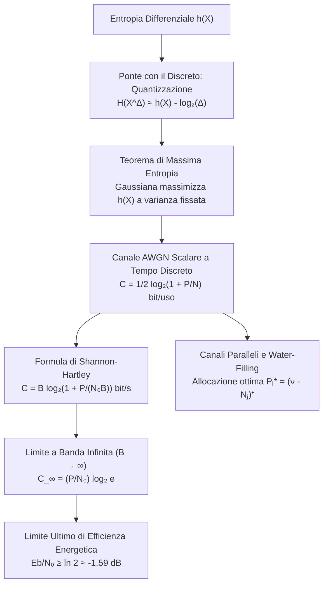

# C. Entropia Differenziale E Canale Gaussiano

Nelle sorgenti e nei canali a valori discreti, l'entropia di Shannon misura in modo assoluto e strettamente non negativo il contenuto informativo medio o il minimo tasso di compressione senza perdita. Quando passiamo ai sistemi fisici analogici (linee di trasmissione, comunicazioni radio, sensori continui), i segnali assumono valori su insiemi continui come la retta reale $\mathbb{R}$ o lo spazio vettoriale $\mathbb{R}^n$.

L'estensione dell'entropia al dominio continuo, introdotta da Claude Shannon nel 1948 con la definizione di __entropia differenziale__, presenta proprietà geometriche e analitiche profondamente differenti rispetto al dominio discreto: può assumere valori negativi, non è invariante per un semplice cambio di scala delle unità di misura e riflette la densità geometrica di volume occupata dalla distribuzione.

Tuttavia, l'entropia differenziale preserva la nozione fondamentale di volume dell'insieme tipico e costituisce la chiave di volta per calcolare la capacità dei canali fisici continui, culminando nella celebre formula di Shannon-Hartley e nel principio di allocazione ottima tramite water-filling.

## Limiti dell'Entropia Discreta E Fondamenti dell'Entropia Differenziale

Consideriamo una variabile aleatoria continua $X$ dotata di funzione di distribuzione cumulativa (CDF) $F(x) = \text{Pr}\{X \le x\}$. Se $F(x)$ è assolutamente continua rispetto alla misura di Lebesgue, esiste la funzione di densità di probabilità (PDF) definita dalla derivata quasi ovunque:

$$
f(x) = \frac{\mathrm{d}F(x)}{\mathrm{d}x}
$$

con $\int_{-\infty}^{+\infty} f(x) \mathrm{d}x = 1$. Definiamo il supporto $\mathcal{S}$ della variabile aleatoria come l'insieme dei punti in cui la densità è strettamente positiva:

$$
\mathcal{S} = \{ x \in \mathbb{R} : f(x) > 0 \}
$$

L'__entropia differenziale__ $h(X)$ di una variabile aleatoria continua $X$ avente densità $f(x)$ è definita dall'integrale:

$$
h(X) = -\int_{\mathcal{S}} f(x) \log_2 f(x) \mathrm{d}x = \mathbb{E}[-\log_2 f(X)]
$$

Analogamente al caso discreto, l'entropia differenziale dipende unicamente dalla forma analitica della densità $f(x)$ e non dai particolari valori numerici assunti dalla variabile; per tale ragione viene indicata anche con la notazione funzionale $h(f)$.

### Perché l'Entropia Differenziale Può Essere Negativa

Nel caso discreto abbiamo la certezza matematica $H(X) \ge 0$, poiché ogni singola probabilità elementare è una massa limitata $0 \le p_i \le 1$, per cui $-\log_2 p_i \ge 0$. Nel dominio continuo, invece, $f(x)$ è una __densità di probabilità per unità di misura__ infinitesima ($\mathrm{d}x$) e non una probabilità adimensionale.

Una densità di probabilità può assumere valori locali arbitrariamente grandi ($f(x) > 1$), purché l'area sottesa totale rimanga unitaria. Quando la probabilità si concentra in un intervallo di ampiezza inferiore all'unità, la densità supera 1 e il logaritmo $-\log_2 f(x)$ diviene strettamente negativo:

$$
f(x) > 1 \implies \log_2 f(x) > 0 \implies -\log_2 f(x) < 0
$$

Se l'intera massa si comprime in una regione minuscola (ad esempio una variabile uniforme su un intervallo di ampiezza $1/8$ o una gaussiana con deviazione standard infinitesima $\sigma \to 0$), l'integrale risulta negativo o diverge:

$$
\lim_{\sigma \to 0} h(X) = -\infty
$$

L'entropia differenziale non quantifica il numero assoluto di bit di informazione della sorgente (che per una variabile continua è infinito), ma misura il grado di dispersione relativo della densità rispetto alla misura di Lebesgue di riferimento.

### Comportamento Sotto Trasformazioni Affini E Non Invarianza Di Scala

Una variabile discreta gode di invarianza per qualsiasi trasformazione biunivoca: $H(g(X)) = H(X)$. Per l'entropia differenziale questa proprietà fallisce a causa dello Jacobiano introdotto nel cambio di coordinate della misura differenziale infinitesima.

Sia $X$ una variabile aleatoria continua ed esaminiamo la trasformazione affine $Y = aX + b$, con $a \neq 0$ e $b \in \mathbb{R}$. La trasformazione è invertibile con $x = \frac{y - b}{a}$ e derivata $\frac{\mathrm{d}x}{\mathrm{d}y} = \frac{1}{a}$. La densità della variabile trasformata $Y$ vale:

$$
f_Y(y) = \frac{1}{|a|} f_X\left( \frac{y - b}{a} \right)
$$

Calcoliamo l'entropia differenziale di $Y$ applicando la definizione:

$$
h(Y) = -\int_{-\infty}^{+\infty} f_Y(y) \log_2 f_Y(y) \mathrm{d}y = -\int_{-\infty}^{+\infty} \frac{1}{|a|} f_X\left( \frac{y - b}{a} \right) \log_2 \left[ \frac{1}{|a|} f_X\left( \frac{y - b}{a} \right) \right] \mathrm{d}y
$$

Eseguiamo il cambio di variabile nell'integrale ponendo $x = \frac{y - b}{a}$, da cui la relazione differenziale $\mathrm{d}y = |a|\mathrm{d}x$:

$$
h(Y) = -\int_{-\infty}^{+\infty} \frac{1}{|a|} f_X(x) \left[ \log_2 f_X(x) - \log_2 |a| \right] |a|\mathrm{d}x
$$

Semplificando il fattore di scala $|a|$ tra numeratore e denominatore ed espandendo la somma:

$$
h(Y) = -\int_{-\infty}^{+\infty} f_X(x) \log_2 f_X(x) \mathrm{d}x + \log_2 |a| \int_{-\infty}^{+\infty} f_X(x) \mathrm{d}x
$$

Poiché l'integrale di $f_X(x)$ su tutto l'asse reale è pari ad 1 per conservazione della probabilità, otteniamo il __Teorema della Trasformazione Scalare__:

$$
h(aX + b) = h(X) + \log_2 |a|
$$

Da questo risultato discendono due conseguenze fondamentali per l'analisi dei segnali:
1. __Invarianza rigorosa per pura traslazione__: Ponendo $a = 1$, per qualunque costante di offset $c \in \mathbb{R}$ troviamo:

$$
h(X + c) = h(X)
$$

   Spostare rigidamente una distribuzione lungo l'asse delle ascisse non altera la forma della densità né il volume occupato dalla variabile.
2. __Dipendenza dalla scala metrica__: Se raddoppiamo l'ampiezza del segnale ($a = 2$), l'entropia differenziale aumenta esattamente di 1 bit: $h(2X) = h(X) + 1$. Cambiare unità di misura (ad esempio passare da metri a millimetri con $a = 1000$) trasla l'entropia differenziale di una costante additiva $\log_2(1000) \approx 9.97$ bit.

Nel caso multivariato di un vettore aleatorio continuo $\mathbf{X} \in \mathbb{R}^n$ trasformato linearmente secondo $\mathbf{Y} = \mathbf{A}\mathbf{X} + \mathbf{b}$, dove $\mathbf{A} \in \mathbb{R}^{n \times n}$ è invertibile ($\det \mathbf{A} \neq 0$), la misura infinitesima si trasforma tramite lo Jacobiano $\mathrm{d}\mathbf{y} = |\det \mathbf{A}|\mathrm{d}\mathbf{x}$, determinando:

$$
h(\mathbf{A}\mathbf{X} + \mathbf{b}) = h(\mathbf{X}) + \log_2 |\det \mathbf{A}|
$$

Se $\mathbf{A} = \mathbf{Q}$ è una matrice ortogonale (rotazione o riflessione pura nello spazio, per cui $\mathbf{Q}^T\mathbf{Q} = \mathbf{I}$ e $|\det \mathbf{Q}| = 1$), l'entropia differenziale rimane identica: $h(\mathbf{Q}\mathbf{X}) = h(\mathbf{X})$.

### Volume Effettivo Del Supporto

Sebbene $h(X)$ possa essere negativa, la grandezza esponenziale $2^{h(X)}$ definisce il __volume effettivo__ (o lunghezza effettiva per $n=1$) occupato dalla distribuzione nello spazio campionario:

$$
\text{Vol}_{\text{eff}}(X) = 2^{h(X)} \ge 0
$$

Tale valore è sempre rigorosamente non negativo e quantifica la misura dell'intervallo che conterrebbe la stessa incertezza qualora la variabile fosse distribuita in modo perfettamente uniforme.

## Ponte Tra Continuo E Discreto Tramite Quantizzazione Uniforme

Per stabilire un collegamento rigoroso tra l'entropia differenziale e l'entropia discreta di Shannon, analizziamo la conversione analogico-digitale (ADC) operata mediante una __quantizzazione uniforme__ con passo $\Delta > 0$.

Suddividiamo l'asse reale in intervalli contigui disgiunti di larghezza $\Delta$:

$$
I_i = [i\Delta, (i+1)\Delta), \quad i \in \mathbb{Z}
$$

![[slide_13_quantized_continuous_rv.png|center mid]]

Assumendo che la densità $f(x)$ sia continua all'interno di ciascun intervallo, per il Teorema della Media Integrale esiste almeno un punto interno $x_i \in I_i$ tale che la probabilità associata al bin $I_i$ sia pari all'area del rettangolo elementare:

$$
p_i = \text{Pr}\{X \in I_i\} = \int_{i\Delta}^{(i+1)\Delta} f(x) \mathrm{d}x = f(x_i)\Delta
$$

Definiamo la variabile quantizzata discreta $X^\Delta$ che associa a ciascun intervallo $I_i$ il valore rappresentativo $x_i$:

$$
X^\Delta = x_i \quad \text{se } X \in I_i
$$

Calcoliamo l'entropia discreta di Shannon della variabile quantizzata $X^\Delta$:

$$
H(X^\Delta) = -\sum_{i=-\infty}^{+\infty} p_i \log_2 p_i = -\sum_{i=-\infty}^{+\infty} f(x_i)\Delta \log_2 \left( f(x_i)\Delta \right)
$$

Applichiamo la proprietà dei logaritmi scomponendo il prodotto $\log_2(f(x_i)\Delta) = \log_2 f(x_i) + \log_2 \Delta$:

$$
H(X^\Delta) = -\sum_{i=-\infty}^{+\infty} f(x_i)\Delta \log_2 f(x_i) - \sum_{i=-\infty}^{+\infty} f(x_i)\Delta \log_2 \Delta
$$

Nel secondo termine raccogliamo la costante $\log_2 \Delta$ al di fuori della sommatoria. Poiché la somma delle probabilità elementari si normalizza all'unità ($\sum_i f(x_i)\Delta = \sum_i p_i = 1$), otteniamo:

$$
H(X^\Delta) = -\sum_{i=-\infty}^{+\infty} \Delta f(x_i) \log_2 f(x_i) - \log_2 \Delta
$$

### Teorema Del Limite Di Quantizzazione E Costo Informativo Del Continuo

Se la funzione integranda $f(x)\log_2 f(x)$ è Riemann-integrabile, la prima sommatoria rappresenta la somma di Riemann che converge all'integrale di Lebesgue quando il passo di quantizzazione tende a zero ($\Delta \to 0$):

$$
\lim_{\Delta \to 0} \left( -\sum_{i=-\infty}^{+\infty} \Delta f(x_i) \log_2 f(x_i) \right) = -\int_{-\infty}^{+\infty} f(x) \log_2 f(x) \mathrm{d}x = h(X)
$$

Otteniamo così la celebre relazione asintotica tra l'entropia della variabile quantizzata e l'entropia differenziale continua:

$$
H(X^\Delta) \approx h(X) - \log_2 \Delta
$$

oppure, nella forma limite esatta:

$$
\lim_{\Delta \to 0} \left[ H(X^\Delta) + \log_2 \Delta \right] = h(X)
$$

Questa equazione rivela il significato concettuale più profondo dell'entropia differenziale:
- Il termine $-\log_2 \Delta$ diverge a $+\infty$ per $\Delta \to 0$. Rappresenta il __costo informativo infinito__ necessario per specificare con precisione assoluta un numero reale sulla retta continua (occorrono infiniti bit per descrivere infinite cifre decimali).
- L'entropia differenziale $h(X)$ rappresenta la __parte finita__ (l'offset asintotico) che sopravvive alla sottrazione del costo di discretizzazione divergente $-\log_2 \Delta$.

### Risoluzione a $n$ Bit E Interpretazione Pratica

Se quantizziamo il segnale tramite un convertitore analogico-digitale uniforme con risoluzione pari a $n$ bit frazionari, il passo di quantizzazione vale $\Delta = 2^{-n}$, da cui $\log_2 \Delta = -n$. Sostituendo nella relazione asintotica:

$$
H(X^\Delta) \approx h(X) - \log_2(2^{-n}) = h(X) + n \quad \text{bit}
$$

Troviamo due implicazioni immediate per la progettazione dei sistemi:
1. $h(X) + n$ quantifica il numero medio di bit necessari per descrivere la variabile continua $X$ con un'accuratezza di $n$ bit.
2. Per aumentare la risoluzione di 1 bit (dimezzando il passo $\Delta$), l'entropia della parola digitale deve crescere esattamente di 1 bit.
3. Sorgenti con entropia differenziale più bassa richiedono meno bit a parità di risoluzione richiesta: l'entropia differenziale misura il risparmio o surplus di codifica intrinseco della sorgente rispetto al livello zero.

Verifichiamo questo comportamento su configurazioni concrete:
- __Uniforme su $[0, 1]$__: Essendo $h(X) = \log_2(1) = 0$ bit, la quantizzazione a $n$ bit richiede $H(X^\Delta) \approx 0 + n = n$ bit, che coincide con la scelta equiprobabile tra $2^n$ livelli discreti.
- __Uniforme compressa su $[0, 1/8]$__: L'entropia differenziale vale $h(X) = \log_2(1/8) = -3$ bit. Con una quantizzazione a $n$ bit, otteniamo $H(X^\Delta) \approx n - 3$ bit: risparmiamo esattamente 3 bit perché i primi tre bit dopo la virgola sono costantemente fissati a zero ($2^{-1}=0, 2^{-2}=0, 2^{-3}=0$).
- __Gaussiana a dispersione $\sigma = 10$__: Avendo $h(X) = \frac{1}{2}\log_2(2\pi e \cdot 100) \approx 5.37$ bit, la quantizzazione a $n$ bit richiede mediamente $n + 5.37$ bit di codifica.
- __Collasso per variabili puramente discrete__: Se applichiamo formalmente la procedura a una variabile discreta pura, l'entropia di quantizzazione satura al valore finito $H(X)$ appena $\Delta$ è abbastanza piccolo da separare i singoli atomi. Al limite troviamo $h(X) = \lim_{\Delta \to 0} [H(X) + \log_2 \Delta] = H(X) + (-\infty) = -\infty$, coerentemente con il fatto che punti isolati occupano misura di Lebesgue nulla.

## Calcolo Analitico per Distribuzioni Notevoli

Sviluppiamo il calcolo esplicito dell'entropia differenziale per le famiglie di densità di probabilità standard.

### Distribuzione Uniforme

Sia $X \sim \mathcal{U}[a, b]$ con ampiezza di supporto $b - a > 0$. La densità vale:

$$
f(x) = \begin{cases} \frac{1}{b - a} & \text{se } a \le x \le b \\ 0 & \text{altrove} \end{cases}
$$

Integrando sul supporto:

$$
h(X) = -\int_a^b \frac{1}{b - a} \log_2 \left( \frac{1}{b - a} \right) \mathrm{d}x = \log_2(b - a) \int_a^b \frac{1}{b - a} \mathrm{d}x = \log_2(b - a) \quad \text{bit}
$$

L'analisi al variare dell'ampiezza mostra:
- Per $b - a = 1$: $h(X) = \log_2 1 = 0$ bit.
- Per $b - a > 1$: $h(X) > 0$ bit (ad esempio, per $b - a = 4$, $h(X) = 2$ bit).
- Per $b - a < 1$: $h(X) < 0$ bit (ad esempio, per $b - a = 0.5$, $h(X) = -1$ bit).
- Il volume effettivo vale $2^{h(X)} = 2^{\log_2(b - a)} = b - a$, che coincide esattamente con la lunghezza geometrica del supporto.

### Distribuzione Normale (Gaussiana) Unidimensionale

Sia $X \sim \mathcal{N}(\mu, \sigma^2)$ con media $\mu$ e varianza $\sigma^2 > 0$. La densità è:

$$
\phi(x) = \frac{1}{\sqrt{2\pi\sigma^2}} \exp\left( -\frac{(x - \mu)^2}{2\sigma^2} \right)
$$

Per semplificare l'algebra, calcoliamo prima l'entropia differenziale naturale in nats ($h_e$):

$$
\ln \phi(x) = -\frac{1}{2}\ln(2\pi\sigma^2) - \frac{(x - \mu)^2}{2\sigma^2}
$$

Sostituiamo nel valore atteso dell'entropia differenziale:

$$
h_e(\phi) = -\mathbb{E}[\ln \phi(X)] = \mathbb{E}\left[ \frac{1}{2}\ln(2\pi\sigma^2) + \frac{(X - \mu)^2}{2\sigma^2} \right]
$$

Sfruttiamo la linearità del valore atteso e l'identità fondamentale $\mathbb{E}[(X - \mu)^2] = \sigma^2$:

$$
h_e(\phi) = \frac{1}{2}\ln(2\pi\sigma^2) + \frac{\mathbb{E}[(X - \mu)^2]}{2\sigma^2} = \frac{1}{2}\ln(2\pi\sigma^2) + \frac{\sigma^2}{2\sigma^2} = \frac{1}{2}\ln(2\pi\sigma^2) + \frac{1}{2}
$$

Esprimendo la costante additiva come $\frac{1}{2} = \frac{1}{2}\ln(e)$ e unendo i logaritmi:

$$
h_e(\phi) = \frac{1}{2}\ln(2\pi\sigma^2) + \frac{1}{2}\ln(e) = \frac{1}{2}\ln(2\pi e \sigma^2) \quad \text{nat}
$$

Convertendo l'unità di misura in bit moltiplicando per $\log_2(e) = \frac{1}{\ln 2}$:

$$
h(X) = \frac{1}{2}\log_2(2\pi e \sigma^2) \quad \text{bit}
$$

Evidenziamo tre aspetti cruciali:
1. __Indipendenza dalla media__: L'entropia gaussiana dipende unicamente dalla dispersione $\sigma^2$ e non dal valore atteso $\mu$.
2. __Valore per varianza unitaria__: Per $\sigma^2 = 1$, $h(X) = \frac{1}{2}\log_2(2\pi e) \approx 2.0471$ bit.
3. __Soglia di annullamento__: L'entropia si annulla ($h(X) = 0$) quando l'argomento del logaritmo vale 1:

$$
2\pi e \sigma^2 = 1 \iff \sigma = \frac{1}{\sqrt{2\pi e}} \approx 0.2420
$$

   Per $\sigma < 0.2420$, l'entropia della gaussiana diviene negativa.

### Vettore Gaussiano Multivariato

Sia $\mathbf{X} = (X_1, \dots, X_n)^T \sim \mathcal{N}_n(\boldsymbol{\mu}, \mathbf{K})$ un vettore gaussiano in $\mathbb{R}^n$, con matrice di covarianza simmetrica definita positiva $\mathbf{K} > 0$. La densità congiunta vale:

$$
\phi_{\mathbf{K}}(\mathbf{x}) = \frac{1}{(2\pi)^{n/2} (\det \mathbf{K})^{1/2}} \exp\left( -\frac{1}{2}(\mathbf{x} - \boldsymbol{\mu})^T \mathbf{K}^{-1}(\mathbf{x} - \boldsymbol{\mu}) \right)
$$

L'entropia differenziale congiunta in bit è data da:

$$
h(\mathbf{X}) = \frac{1}{2}\log_2\left( (2\pi e)^n \det \mathbf{K} \right) \quad \text{bit}
$$

Possiamo comprendere l'origine di questa formula diagonalizzando la matrice di covarianza. Poiché $\mathbf{K}$ è reale e simmetrica, ammette la scomposizione spettrale $\mathbf{K} = \mathbf{Q}\boldsymbol{\Lambda}\mathbf{Q}^T$, dove $\mathbf{Q}$ è una matrice ortogonale ($\mathbf{Q}^T\mathbf{Q} = \mathbf{I}$, $|\det \mathbf{Q}| = 1$) contenente gli autovettori ortonormali e $\boldsymbol{\Lambda} = \text{diag}(\lambda_1, \dots, \lambda_n)$ è la matrice degli autovalori positivi $\lambda_i > 0$.

Definendo il vettore ruotato centrato $\mathbf{Y} = \mathbf{Q}^T(\mathbf{X} - \boldsymbol{\mu})$, la matrice di covarianza di $\mathbf{Y}$ vale:

$$
\mathbf{K}_{\mathbf{Y}} = \mathbb{E}[\mathbf{Y}\mathbf{Y}^T] = \mathbf{Q}^T \mathbf{K} \mathbf{Q} = \boldsymbol{\Lambda}
$$

Nel sistema di riferimento degli assi principali, le coordinate $Y_i$ sono gaussiane scalari mutuamente incorrelate e quindi indipendenti, ciascuna con varianza pari all'autovalore $\lambda_i$. Per l'invarianza dell'entropia sotto rotazioni ortogonali ($|\det \mathbf{Q}^T| = 1$):

$$
h(\mathbf{X}) = h(\mathbf{Y}) = \sum_{i=1}^n h(Y_i) = \sum_{i=1}^n \frac{1}{2}\log_2(2\pi e \lambda_i) = \frac{1}{2}\log_2\left( (2\pi e)^n \prod_{i=1}^n \lambda_i \right)
$$

Poiché il determinante coincide con il prodotto degli autovalori ($\det \mathbf{K} = \prod_{i=1}^n \lambda_i$), ritroviamo l'espressione generale.

### Distribuzione Esponenziale

Sia $X \sim \text{Exp}(\lambda)$ con parametro di tasso $\lambda > 0$, supportata sulla semiretta positiva $[0, +\infty)$. La densità vale:

$$
f(x) = \begin{cases} \lambda e^{-\lambda x} & \text{se } x \ge 0 \\ 0 & \text{se } x < 0 \end{cases}
$$

con valore atteso $\mathbb{E}[X] = \frac{1}{\lambda}$. Calcoliamo il logaritmo naturale della densità:

$$
\ln f(x) = \ln \lambda - \lambda x
$$

Valutiamo l'entropia differenziale in nats:

$$
h_e(X) = -\mathbb{E}[\ln f(X)] = -\mathbb{E}[\ln \lambda - \lambda X] = -\ln \lambda + \lambda \mathbb{E}[X]
$$

Sostituendo la media $\mathbb{E}[X] = \frac{1}{\lambda}$, il termine $\lambda \mathbb{E}[X]$ collassa all'unità:

$$
h_e(X) = -\ln \lambda + \lambda \left(\frac{1}{\lambda}\right) = 1 - \ln \lambda = \ln\left( \frac{e}{\lambda} \right) \quad \text{nat}
$$

Convertendo in bit:

$$
h(X) = \log_2\left( \frac{e}{\lambda} \right) = \log_2 e - \log_2 \lambda \approx 1.4427 - \log_2 \lambda \quad \text{bit}
$$

Se esprimiamo l'entropia in funzione della media $\mu = \mathbb{E}[X] = \frac{1}{\lambda}$, otteniamo $h(X) = \log_2(e \mu)$, che mostra come l'entropia cresca logaritmicamente con il valore medio del fenomeno.

## Teorema Di Massima Entropia Differenziale E Principi Variazionali

Uno dei pilastri teorici dell'Information Theory è la risposta al problema variazionale: quale distribuzione continua presenta la massima incertezza sotto determinati vincoli fisici?

### Massimizzazione Sotto Vincolo Di Varianza (Gaussiana)

Sia $X$ una variabile aleatoria continua con media $\mu$ e varianza assegnata $\sigma^2 = \mathbb{E}[(X - \mu)^2]$.

__Teorema di Massima Entropia Differenziale__: Tra tutte le distribuzioni di probabilità continue aventi varianza fissata $\sigma^2$, la distribuzione Normale $\mathcal{N}(\mu, \sigma^2)$ massimizza in modo assoluto e unico l'entropia differenziale:

$$
h(X) \le \frac{1}{2}\log_2(2\pi e \sigma^2)
$$

con uguaglianza se e solo se $X \sim \mathcal{N}(\mu, \sigma^2)$.

__Dimostrazione Variazionale tramite Divergenza KL__:
Sia $\phi(x) = \frac{1}{\sqrt{2\pi\sigma^2}} \exp\left( -\frac{(x-\mu)^2}{2\sigma^2} \right)$ la densità normale e sia $g(x)$ una qualsiasi altra densità avente la medesima media $\mu$ e la medesima varianza $\sigma^2$.

Consideriamo la divergenza di Kullback-Leibler tra la densità generica $g(x)$ e la densità gaussiana $\phi(x)$, sapendo che $D(g \parallel \phi) \ge 0$:

$$
D(g \parallel \phi) = \int_{-\infty}^{+\infty} g(x) \ln \left( \frac{g(x)}{\phi(x)} \right) \mathrm{d}x = \int g(x) \ln g(x) \mathrm{d}x - \int g(x) \ln \phi(x) \mathrm{d}x \ge 0
$$

Riconosciamo nel primo termine l'opposto dell'entropia differenziale di $g$: $\int g(x)\ln g(x)\mathrm{d}x = -h_e(g)$.

Esaminiamo ora il secondo integrale $-\int g(x) \ln \phi(x) \mathrm{d}x$. Ricordiamo che:

$$
\ln \phi(x) = -\frac{1}{2}\ln(2\pi\sigma^2) - \frac{(x - \mu)^2}{2\sigma^2}
$$

Integrando questa forma quadratica rispetto alla densità $g(x)$:

$$
\int_{-\infty}^{+\infty} g(x) \ln \phi(x) \mathrm{d}x = -\frac{1}{2}\ln(2\pi\sigma^2) \int g(x)\mathrm{d}x - \frac{1}{2\sigma^2}\int g(x)(x - \mu)^2 \mathrm{d}x
$$

Poiché $g(x)$ è una densità valida, $\int g(x)\mathrm{d}x = 1$. Poiché per ipotesi $g(x)$ possiede varianza $\sigma^2$, $\int g(x)(x - \mu)^2 \mathrm{d}x = \sigma^2$. Sostituendo:

$$
\int g(x) \ln \phi(x) \mathrm{d}x = -\frac{1}{2}\ln(2\pi\sigma^2) - \frac{\sigma^2}{2\sigma^2} = -\frac{1}{2}\ln(2\pi e \sigma^2)
$$

Notiamo che il risultato dipende unicamente dai momenti di ordine zero, uno e due di $g$, i quali coincidono con quelli di $\phi$. Di conseguenza:

$$
\int g(x) \ln \phi(x) \mathrm{d}x = \int \phi(x) \ln \phi(x) \mathrm{d}x = -h_e(\phi)
$$

Sostituendo questa identità fondamentale nella divergenza KL:

$$
D(g \parallel \phi) = -h_e(g) - (-h_e(\phi)) = h_e(\phi) - h_e(g) \ge 0
$$

Otteniamo direttamente:

$$
h_e(g) \le h_e(\phi)
$$

Poiché la divergenza KL si annulla se e solo se le due distribuzioni coincidono quasi ovunque ($g(x) = \phi(x)$), la distribuzione Gaussiana è il massimizzatore unico dell'entropia differenziale a varianza data.

La generalizzazione a $\mathbb{R}^n$ sotto vincolo di matrice di covarianza $\mathbf{K}$ segue identicamente sfruttando la traccia $\mathbb{E}_g[(\mathbf{X}-\boldsymbol{\mu})^T \mathbf{K}^{-1}(\mathbf{X}-\boldsymbol{\mu})] = \text{Tr}(\mathbf{K}^{-1}\mathbf{K}) = n$. I dettagli analitici estesi sono consultabili in [[zz. Argomenti extra#Dimostrazione Variazionale dell'Ottimalità della PDF Gaussiana come Massimizzatore di Entropia Differenziale]].

### Altri Problemi Di Massima Entropia

Lo stesso impianto dimostrativo basato sulla divergenza KL risolve immediatamente altri vincoli geometrici e fisici fondamentali:
- __Supporto limitato $[a, b]$ senza vincoli di momenti__: La distribuzione che massimizza l'entropia differenziale è la __Uniforme__ $\mathcal{U}[a, b]$, con $h_{\max} = \log_2(b - a)$.
- __Supporto semiretta $[0, +\infty)$ con media fissata $\mu = \mathbb{E}[X]$__: La distribuzione che massimizza l'entropia è la __Esponenziale__ di parametro $\lambda = 1/\mu$, con $h_{\max} = \log_2(e \mu)$.

Il principio di massima entropia assegna alla distribuzione Gaussiana un ruolo cruciale: a parità di potenza del segnale (energia del secondo ordine), il rumore gaussiano è il perturbatore più distruttivo possibile per un canale di comunicazione, poiché genera la massima incertezza informativa.

## Dimostrazione Informatica Della Disuguaglianza Di Hadamard

La Disuguaglianza di Hadamard (1893) stabilisce che per qualsiasi matrice simmetrica definita positiva $\mathbf{K} \in \mathbb{R}^{n \times n}$, il determinante è maggiorato dal prodotto degli elementi sulla diagonale principale:

$$
\det \mathbf{K} \le \prod_{i=1}^n K_{ii}
$$

con uguaglianza se e solo se la matrice $\mathbf{K}$ è diagonale ($K_{ij} = 0$ per ogni $i \neq j$).

L'Information Theory offre una dimostrazione immediata ed elegante basata sull'entropia differenziale di un vettore gaussiano $\mathbf{X} \sim \mathcal{N}_n(\mathbf{0}, \mathbf{K})$.

Applichiamo la regola della catena dell'entropia differenziale e la proprietà per cui il condizionamento riduce (o lascia inalterata) l'entropia:

$$
h(X_1, X_2, \dots, X_n) = \sum_{i=1}^n h(X_i \mid X_1, \dots, X_{i-1}) \le \sum_{i=1}^n h(X_i)
$$

Esprimiamo i due membri sfruttando le formule note per le distribuzioni gaussiane:
- L'entropia congiunta del vettore $\mathbf{X}$ vale:

$$
h(\mathbf{X}) = \frac{1}{2}\log_2\left( (2\pi e)^n \det \mathbf{K} \right)
$$

- Ciascuna componente marginale $X_i$ è una variabile gaussiana scalare con varianza $K_{ii}$ (l'$i$-esimo elemento diagonale di $\mathbf{K}$), per cui:

$$
h(X_i) = \frac{1}{2}\log_2(2\pi e K_{ii})
$$

Sostituendo nella disuguaglianza:

$$
\frac{1}{2}\log_2\left( (2\pi e)^n \det \mathbf{K} \right) \le \sum_{i=1}^n \frac{1}{2}\log_2(2\pi e K_{ii}) = \frac{1}{2}\log_2\left( (2\pi e)^n \prod_{i=1}^n K_{ii} \right)
$$

Sottraendo il termine costante $\frac{1}{2}\log_2((2\pi e)^n)$ da ambo i membri ed elevando ad esponente in base 2, otteniamo istantaneamente:

$$
\det \mathbf{K} \le \prod_{i=1}^n K_{ii}
$$

L'uguaglianza è raggiunta se e solo se $h(X_i \mid X_1, \dots, X_{i-1}) = h(X_i)$ per ogni $i$, ossia se e solo se le coordinate gaussiane sono reciprocamente indipendenti ($K_{ij} = 0$ per $i \neq j$). La derivazione completa è disponibile in [[zz. Argomenti extra#Dimostrazione Informatica della Disuguaglianza di Hadamard]].

## Proprietà Di Equipartizione Asintotica Nel Continuo Ed Insieme Tipico

In analogia con la [[8. Proprietà di Equipartizione Asintotica (AEP)]] nel dominio discreto, l'entropia differenziale governa il comportamento geometrico asintotico di vettori composti da campioni continui indipendenti e identicamente distribuiti (i.i.d.).

Sia $X_1, X_2, \dots, X_n$ una sequenza di variabili aleatorie continue i.i.d. regolate dalla densità $f(x)$. La densità congiunta della sequenza vettoriale $\mathbf{X} = (X_1, \dots, X_n)^T$ fattorizza come:

$$
f(\mathbf{x}) = \prod_{i=1}^n f(x_i)
$$

### Teorema AEP Continuo

Per una sequenza di variabili i.i.d. con densità $f(x)$, la densità campionaria normalizzata converge in probabilità all'entropia differenziale:

$$
-\frac{1}{n}\log_2 f(X_1, X_2, \dots, X_n) \xrightarrow{P} \mathbb{E}[-\log_2 f(X)] = h(X)
$$

__Dimostrazione__:
Definiamo la successione di variabili aleatorie scalari $Y_i = -\log_2 f(X_i)$. Essendo le $X_i$ i.i.d., anche le $Y_i$ sono i.i.d., con valore atteso finito $\mathbb{E}[Y_i] = \mathbb{E}[-\log_2 f(X_i)] = h(X)$.

Per la Legge Debole dei Grandi Numeri (WLLN), la media campionaria converge in probabilità al valore atteso:

$$
-\frac{1}{n}\log_2 f(X_1, \dots, X_n) = \frac{1}{n}\sum_{i=1}^n Y_i \xrightarrow{P} h(X)
$$

### Definizione Geometrica E Proprietà dell'Insieme Tipico Continuo

Fissato $\epsilon > 0$, definiamo l'__insieme tipico continuo__ $A_\epsilon^{(n)}$ rispetto alla densità $f(x)$ come:

$$
A_\epsilon^{(n)} = \left\{ (x_1, \dots, x_n) \in \mathcal{S}^n : \left| -\frac{1}{n}\log_2 f(x_1, \dots, x_n) - h(X) \right| \le \epsilon \right\}
$$

Ogni configurazione appartenente all'insieme tipico soddisfa la doppia limitazione esponenziale:

$$
2^{-n(h(X) + \epsilon)} \le f(x_1, \dots, x_n) \le 2^{-n(h(X) - \epsilon)}
$$

Nel continuo, la nozione di cardinalità dell'insieme è sostituita dalla misura euclidea di __volume__ $n$-dimensionale:

$$
\text{Vol}(A_\epsilon^{(n)}) = \int_{A_\epsilon^{(n)}} \mathrm{d}x_1 \dots \mathrm{d}x_n
$$

![[slide_07_typical_set_continuous_volume.png|center mid]]

L'insieme tipico continuo soddisfa tre proprietà strutturali:
1. $\text{Pr}\{A_\epsilon^{(n)}\} > 1 - \epsilon$ per $n$ sufficientemente grande (la quasi totalità della probabilità risiede in questa regione).
2. $\text{Vol}(A_\epsilon^{(n)}) \le 2^{n(h(X) + \epsilon)}$ per ogni $n$, ricavabile integrando: $1 = \int f(\mathbf{x})\mathrm{d}\mathbf{x} \ge \int_{A_\epsilon^{(n)}} f(\mathbf{x})\mathrm{d}\mathbf{x} \ge 2^{-n(h(X)+\epsilon)}\text{Vol}(A_\epsilon^{(n)})$.
3. $\text{Vol}(A_\epsilon^{(n)}) \ge (1 - \epsilon) 2^{n(h(X) - \epsilon)}$ per $n$ grande, ricavabile da $1 - \epsilon \le \text{Pr}\{A_\epsilon^{(n)}\} \le 2^{-n(h(X)-\epsilon)}\text{Vol}(A_\epsilon^{(n)})$.

Combinando i vincoli, il volume dell'insieme tipico scala asintoticamente come:

$$
\text{Vol}(A_\epsilon^{(n)}) \approx 2^{n h(X)}
$$

L'insieme tipico continuo costituisce l'insieme di __volume minimo__ che concentra una massa di probabilità prossima a 1. La lunghezza del lato di un ipercubo equivalente $n$-dimensionale vale:

$$
L_{\text{lato}} = \left( \text{Vol}(A_\epsilon^{(n)}) \right)^{1/n} \approx 2^{h(X)}
$$

Se l'entropia differenziale è piccola o negativa, il volume occupato nello spazio campionario si riduce drasticamente, concentrando le sequenze fisiche osservabili attorno alla traiettoria media.

## Informazione Mutua Continua E Invarianza per Trasformazioni Invertibili

L'__informazione mutua__ tra due variabili aleatorie continue congiuntamente distribuite secondo la densità $f(x, y)$ è definita come la divergenza di Kullback-Leibler tra la densità congiunta e il prodotto delle densità marginali:

$$
I(X; Y) = D(f(x, y) \parallel f(x)f(y)) = \int_{-\infty}^{+\infty} \int_{-\infty}^{+\infty} f(x, y) \log_2 \left( \frac{f(x, y)}{f(x)f(y)} \right) \mathrm{d}x \mathrm{d}y
$$

Scomponendo il logaritmo del quoziente, esprimiamo l'informazione mutua tramite le entropie differenziali:

$$
I(X; Y) = h(X) - h(X \mid Y) = h(Y) - h(Y \mid X) = h(X) + h(Y) - h(X, Y)
$$

A differenza dell'entropia differenziale, l'informazione mutua continua gode della proprietà cardinale di essere __strettamente non negativa__:

$$
I(X; Y) \ge 0
$$

con $I(X; Y) = 0$ se e solo se $X$ e $Y$ sono statisticamente indipendenti ($f(x, y) = f(x)f(y)$ quasi ovunque).

### Invarianza Rigorosa per Trasformazioni Invertibili

Mentre l'entropia differenziale $h(X)$ varia sotto riscalamenti o trasformazioni di coordinate, l'informazione mutua è __completamente invariante__ per qualsiasi trasformazione invertibile applicata alle variabili.

Siano $U = g(X)$ e $V = \psi(Y)$ trasformazioni biunivoche e differenziabili con derivate $g'(x) \neq 0$ e $\psi'(y) \neq 0$. Per il teorema di trasformazione delle coordinate, l'entropia differenziale marginale di $U$ acquisisce un termine di scala pari al valore atteso del logaritmo del fattore di scala jacobiano:

$$
h(U) = h(X) + \mathbb{E}[\log_2 |g'(X)|]
$$

Valutiamo l'entropia condizionata $h(U \mid V)$. Poiché la trasformazione $V = \psi(Y)$ è deterministica e biunivoca, condizionare rispetto a $V$ equivale a condizionare rispetto a $Y$. La trasformazione condizionata su $U$ applica lo stesso identico riscalamento locale:

$$
h(U \mid V) = h(U \mid Y) = h(X \mid Y) + \mathbb{E}[\log_2 |g'(X)|]
$$

Sottraendo le due espressioni per ottenere l'informazione mutua $I(U; V)$:

$$
I(U; V) = h(U) - h(U \mid V) = \left( h(X) + \mathbb{E}[\log_2 |g'(X)|] \right) - \left( h(X \mid Y) + \mathbb{E}[\log_2 |g'(X)|] \right)
$$

Il termine di distorsione jacobiana $\mathbb{E}[\log_2 |g'(X)|]$ è identico in entrambi i blocchi e si annulla per perfetta cancellazione algebrica:

$$
I(g(X); \psi(Y)) = h(X) - h(X \mid Y) = I(X; Y)
$$

L'informazione mutua non dipende dalla scelta delle coordinate geometriche né dalle unità fisiche adottate per registrare le osservazioni.

### Limite Delle Variabili Quantizzate E Formulazione Di Kolmogorov

Consideriamo le versioni discretizzate $X^\Delta$ e $Y^\Delta$ ottenute quantizzando uniformemente con passo $\Delta$:

$$
I(X^\Delta; Y^\Delta) = H(X^\Delta) - H(X^\Delta \mid Y^\Delta) \approx \left[ h(X) - \log_2 \Delta \right] - \left[ h(X \mid Y) - \log_2 \Delta \right]
$$

I termini divergenti $-\log_2 \Delta$ si cancellano reciprocamente, garantendo la convergenza esatta:

$$
\lim_{\Delta \to 0} I(X^\Delta; Y^\Delta) = I(X; Y)
$$

Questo risultato convalida la definizione assiomatica di Kolmogorov e Gelfand-Yaglom per spazi di probabilità generali:

$$
I(X; Y) = \sup_{\mathcal{P}, \mathcal{Q}} I([X]_\mathcal{P}; [Y]_\mathcal{Q})
$$

dove il supremum è calcolato su tutte le possibili partizioni finite $\mathcal{P}$ e $\mathcal{Q}$ degli spazi campionari.

### Esempio Analitico: Variabili Gaussiane Bivariate Correlate

Sia $(X, Y)^T \sim \mathcal{N}_2(\mathbf{0}, \mathbf{K})$ una coppia di variabili aleatorie congiuntamente gaussiane a media nulla con matrice di covarianza:

$$
\mathbf{K} = \begin{bmatrix} \sigma^2 & \rho\sigma^2 \\ \rho\sigma^2 & \sigma^2 \end{bmatrix}
$$

dove $\rho \in (-1, 1)$ è il coefficiente di correlazione lineare di Pearson. Il determinante vale:

$$
\det \mathbf{K} = \sigma^4(1 - \rho^2)
$$

Le entropie differenziali marginali sono $h(X) = h(Y) = \frac{1}{2}\log_2(2\pi e \sigma^2)$, mentre l'entropia congiunta bivariata vale $h(X, Y) = \frac{1}{2}\log_2\left( (2\pi e)^2 \sigma^4 (1 - \rho^2) \right)$.

Calcoliamo l'informazione mutua:

$$
I(X; Y) = h(X) + h(Y) - h(X, Y) = \frac{1}{2}\log_2\left( \frac{(2\pi e \sigma^2)^2}{(2\pi e)^2 \sigma^4 (1 - \rho^2)} \right)
$$

Semplificando il fattore $(2\pi e \sigma^2)^2$:

$$
I(X; Y) = -\frac{1}{2}\log_2(1 - \rho^2) \quad \text{bit}
$$

Osserviamo che:
- Per $\rho = 0$, $I(X; Y) = -\frac{1}{2}\log_2(1) = 0$ bit: l'incorrelazione implica l'indipendenza statistica per le gaussiane.
- Per $|\rho| \to 1$, $I(X; Y) \to +\infty$: la dipendenza deterministica tra variabili continue condivide un quantitativo infinito di informazione.
- L'espressione è indipendente dalla varianza $\sigma^2$, confermando l'invarianza per amplificazione lineare.

## Errore Di Stima, Disuguaglianza Di Fano Continua Ed Entropy Power

La teoria dell'informazione si salda intimamente con la teoria della stima classica e bayesiana ([[0. Fondamenti di Stima Classica e Limite di Cramer-Rao]] e [[2. Stima Bayesiana - MMSE e LMMSE]]), stabilendo limiti invalicabili sull'errore quadratico medio conseguibile.

### Teorema Del Limite Inferiore sull'Errore Di Stima (Fano Continuo)

Sia $X$ una variabile aleatoria continua avente entropia differenziale $h(X)$. Per qualunque stimatore scalare deterministico $\hat{X}$ di $X$:

$$
\mathbb{E}[(X - \hat{X})^2] \ge \frac{1}{2\pi e} 2^{2 h(X)}
$$

con uguaglianza se e solo se $X$ è distribuita normalmente ($X \sim \mathcal{N}$) e lo stimatore è il valore atteso $\hat{X} = \mathbb{E}[X]$.

__Dimostrazione__:
L'errore quadratico medio per una stima costante è minimizzato scegliendo la media:

$$
\min_{\hat{X}} \mathbb{E}[(X - \hat{X})^2] = \mathbb{E}[(X - \mathbb{E}[X])^2] = \text{Var}(X) = \sigma_X^2
$$

Per il Teorema di Massima Entropia Differenziale a varianza fissata $\sigma_X^2$:

$$
h(X) \le \frac{1}{2}\log_2(2\pi e \sigma_X^2)
$$

Esponenziamo in base 2 entrambi i membri:

$$
2^{2 h(X)} \le 2\pi e \sigma_X^2 \implies \sigma_X^2 \ge \frac{1}{2\pi e} 2^{2 h(X)}
$$

Combinando le disuguaglianze otteniamo l'asserto:

$$
\mathbb{E}[(X - \hat{X})^2] \ge \text{Var}(X) \ge \frac{1}{2\pi e} 2^{2 h(X)}
$$

Se disponiamo di un'osservazione collaterale $Y$ e costruiamo uno stimatore $\hat{X}(Y)$, la disuguaglianza si estende all'entropia condizionata:

$$
\mathbb{E}[(X - \hat{X}(Y))^2] \ge \frac{1}{2\pi e} 2^{2 h(X \mid Y)}
$$

L'uguaglianza è raggiunta se e solo se la coppia $(X, Y)$ è congiuntamente gaussiana e lo stimatore adottato è il predittore ottimo MMSE bayesiano $\hat{X}_{\text{MMSE}}(Y) = \mathbb{E}[X \mid Y]$.

### Entropy Power E Ponte Con Il Limite Di Cramér-Rao

Shannon definì la grandezza:

$$
N(X) = \frac{1}{2\pi e} 2^{2 h(X)}
$$

denominata __potenza di entropia__ (Entropy Power). Essa esprime la varianza di una variabile casuale gaussiana equivalente che possiede la stessa entropia differenziale di $X$.

Nella stima classica non polarizzata di un parametro di traslazione $\theta$ da osservazioni $X = \theta + W$, la potenza di entropia è legata all'Informazione di Fisher $J(X)$ dalla celebre __Disuguaglianza Isoperimetrica di Fisher-Shannon__:

$$
J(X) \cdot N(X) \ge 1 \iff \frac{1}{J(X)} \le N(X) = \frac{1}{2\pi e} 2^{2 h(X)}
$$

Poiché $N(X) \le \text{Var}(X)$ per massima entropia e $\text{Var}(\hat{\theta}) \ge \frac{1}{J(X)}$ per il Limite di Cramér-Rao (CRLB), otteniamo la catena fondamentale delle disuguaglianze informative:

$$
\text{Var}(X) \ge \frac{1}{2\pi e} 2^{2 h(X)} \ge \frac{1}{J(X)}
$$

con uguaglianze simultanee se e solo se la distribuzione è perfettamente Gaussiana.

## Il Canale Gaussiano AWGN E la Formula Di Shannon-Hartley

L'applicazione più celebre dell'Information Theory alle telecomunicazioni è la caratterizzazione della capacità di trasmissione di un canale perturbato da rumore additivo bianco gaussiano (AWGN).

### Canale Gaussiano a Tempo Discreto

Consideriamo il canale a tempo discreto modellato dall'equazione d'ingresso-uscita:

$$
Y_i = X_i + Z_i, \quad i = 1, 2, \dots
$$

dove:
- $X_i$ è il simbolo trasmesso al tempo $i$, soggetto a un vincolo di potenza media: $\frac{1}{n}\sum_{i=1}^n x_i^2 \le P$ (ossia $\mathbb{E}[X_i^2] \le P$).
- $Z_i \sim \mathcal{N}(0, N)$ è un rumore additivo bianco gaussiano indipendente da $X_i$, con potenza (varianza) $\sigma_Z^2 = N$.

L'informazione mutua per singolo uso del canale vale:

$$
I(X; Y) = h(Y) - h(Y \mid X) = h(Y) - h(X + Z \mid X) = h(Y) - h(Z)
$$

Poiché $Z$ è gaussiana a varianza $N$, la sua entropia è fissata e non dipende dalla trasmissione:

$$
h(Z) = \frac{1}{2}\log_2(2\pi e N)
$$

Calcoliamo la potenza media del segnale ricevuto $Y$:

$$
\mathbb{E}[Y^2] = \mathbb{E}[(X + Z)^2] = \mathbb{E}[X^2] + \mathbb{E}[Z^2] + 2\mathbb{E}[X]\mathbb{E}[Z] = \mathbb{E}[X^2] + N \le P + N
$$

Per massimizzare l'informazione mutua $I(X; Y)$ dobbiamo rendere massima l'entropia del segnale ricevuto $h(Y)$ sotto il vincolo di potenza $\mathbb{E}[Y^2] \le P + N$.

Per il Teorema di Massima Entropia Differenziale, $h(Y)$ è massimizzata se e solo se $Y$ è gaussiana a varianza massima $P + N$:

$$
h(Y) \le \frac{1}{2}\log_2(2\pi e (P + N))
$$

Poiché la somma di variabili indipendenti è gaussiana se e solo se entrambi gli addendi sono gaussiani, tale condizione richiede che il trasmettitore generi simboli gaussiani: $X \sim \mathcal{N}(0, P)$.

Sostituendo le due entropie nell'espressione dell'informazione mutua, ricaviamo la __capacità del canale gaussiano a tempo discreto__:

$$
C = \max_{f(x): \mathbb{E}[X^2] \le P} I(X; Y) = \frac{1}{2}\log_2(2\pi e (P + N)) - \frac{1}{2}\log_2(2\pi e N) = \frac{1}{2}\log_2\left( 1 + \frac{P}{N} \right) \quad \text{bit/uso}
$$

### Canale Continuo a Banda Limitata: La Formula Di Shannon-Hartley

Nei sistemi fisici a tempo continuo, il segnale è una forma d'onda $X(t)$ limitata rigorosamente a una banda di frequenze pari a $B$ Hertz (intervallo $[-B, B]$) e vincolata a una potenza media $P$ Watt:

$$
Y(t) = X(t) + Z(t)
$$

dove $Z(t)$ è rumore termico gaussiano stazionario avente densità spettrale di potenza (PSD) bilaterale piatta pari a $\frac{N_0}{2}$ W/Hz.

Per il Teorema del Campionamento di Nyquist-Shannon, qualsiasi forma d'onda a banda limitata $B$ è univocamente descritta da $2B$ campioni ortogonali al secondo. Ciascun campione di rumore che attraversa il filtro passa-basso di ricezione possiede una varianza pari alla potenza di rumore integrata nella banda:

$$
N = \sigma_Z^2 = \int_{-B}^B \frac{N_0}{2} \mathrm{d}f = N_0 B
$$

Moltiplicando la capacità informativa di ogni singolo campione per il numero di campioni indipendenti generati in un secondo ($2B$), approdiamo alla celebre __Formula di Shannon-Hartley__:

$$
C = 2B \cdot \left[ \frac{1}{2}\log_2\left( 1 + \frac{P}{N_0 B} \right) \right] = B \log_2\left( 1 + \frac{P}{N_0 B} \right) \quad \text{bit/s}
$$

Spesso la formula viene espressa in funzione dell'SNR adimensionale di banda $\text{SNR} = \frac{P}{N_0 B}$:

$$
C = B \log_2(1 + \text{SNR}) \quad \text{bit/s}
$$

La derivazione formale a partire dallo sviluppo in serie di Fourier e dall'espansione di Karhunen-Loève è esposta in [[zz. Argomenti extra#Derivazione Rigorosa della Formula di Capacità di Shannon-Hartley]].

### Limite a Banda Infinita ($B \to \infty$)

Cosa accade se disponiamo di una banda infinita ($B \to \infty$) mantenendo costante la potenza totale trasmessa $P$? La capacità non cresce all'infinito, ma satura a un valore asintotico finito.

Calcoliamo il limite al tendere di $B$ all'infinito:

$$
C_\infty = \lim_{B \to \infty} B \log_2\left( 1 + \frac{P}{N_0 B} \right) = \lim_{B \to \infty} \frac{B}{\ln 2} \ln\left( 1 + \frac{P}{N_0 B} \right)
$$

Poniamo $x = \frac{P}{N_0 B} \to 0$ ed espandiamo con lo sviluppo di Taylor $\ln(1 + x) = x - \frac{x^2}{2} + \dots$:

$$
C_\infty = \lim_{B \to \infty} \frac{B}{\ln 2} \left( \frac{P}{N_0 B} \right) = \frac{P}{N_0 \ln 2} = \frac{P}{N_0}\log_2 e \approx 1.4427 \frac{P}{N_0} \quad \text{bit/s}
$$

La motivazione fisica della saturazione risiede nel fatto che espandere la banda $B$ incrementa linearmente il numero di campioni disponibili al secondo ($2B$), ma al contempo raccoglie una quantità proporzionale di rumore termico complessivo in banda ($N_0 B$). L'SNR per singolo campione degrada esattamente alla stessa velocità con cui cresce il numero di campioni.

### Il Limite Ultimo Di Shannon ($E_b / N_0 \ge -1.59$ dB)

Esprimiamo la potenza di trasmissione $P$ come prodotto tra l'energia spesa per singolo bit di informazione $E_b$ e il tasso di trasmissione effettivo $R$ espresso in bit/s ($P = R \cdot E_b$). Imponendo la condizione di Shannon per una trasmissione a tasso affidabile priva di errori ($R \le C$):

$$
R \le B \log_2\left( 1 + \frac{R E_b}{N_0 B} \right)
$$

Dividendo ambo i membri per la banda $B$ e definendo l'efficienza spettrale $\eta = \frac{R}{B}$ (espressa in bit/s/Hz):

$$
\eta \le \log_2\left( 1 + \eta \frac{E_b}{N_0} \right)
$$

Applicando l'esponenziale in base 2 e riorganizzando i termini:

$$
2^\eta - 1 \le \eta \frac{E_b}{N_0} \implies \frac{E_b}{N_0} \ge \frac{2^\eta - 1}{\eta}
$$

Nel regime di massima espansione spettrale (banda infinita, $\eta \to 0$), calcoliamo il limite notevole del rapporto:

$$
\lim_{\eta \to 0} \frac{2^\eta - 1}{\eta} = \ln 2 \approx 0.69315
$$

Convertendo questo valore adimensionale in decibel:

$$
\left( \frac{E_b}{N_0} \right)_{\text{dB}} \ge 10 \log_{10}(\ln 2) \approx -1.5917 \quad \text{dB}
$$

Il valore $-1.59$ dB rappresenta il __Limite Ultimo di Shannon__: al di sotto di questa soglia fisica universale, nessun codice di correzione d'errore (indipendentemente dalla complessità algoritmica o dalla lunghezza di blocco) potrà mai garantire una trasmissione a probabilità d'errore arbitrariamente piccola su canale AWGN.

## Canali Gaussiani Paralleli E Algoritmo Di Water-Filling

Nei moderni sistemi di telecomunicazione multifrequenza (modulazioni multicarrier come OFDM in Wi-Fi e 5G) o spaziali (sistemi MIMO), il canale complessivo si scompone in un insieme di $k$ subcanali gaussiani paralleli e indipendenti:

$$
Y_j = X_j + Z_j, \quad j = 1, 2, \dots, k
$$

dove ciascun subcanale presenta un livello di rumore indipendente $Z_j \sim \mathcal{N}(0, N_j)$, con potenza di rumore $N_j = \sigma_{Z_j}^2$.

Il trasmettitore dispone di un budget complessivo di potenza $P$ che deve distribuire tra i vari sottocanali:

$$
\sum_{j=1}^k P_j \le P, \quad \text{con } P_j \ge 0 \quad \forall j
$$

Poiché i sottocanali sono mutuamente indipendenti, l'informazione mutua complessiva è la somma delle informazioni mutue dei singoli canali. Massimizzando rispetto alle distribuzioni d'ingresso, ogni $X_j$ deve essere gaussiana a potenza $P_j$, e la capacità complessiva corrisponde al problema di ottimizzazione convessa:

$$
C = \max_{\{P_1, \dots, P_k\}} \sum_{j=1}^k \frac{1}{2}\log_2\left( 1 + \frac{P_j}{N_j} \right) \quad \text{soggetto a} \quad \sum_{j=1}^k P_j \le P, \quad P_j \ge 0
$$

### Formulazione Variazionale Con Condizioni KKT

Costruiamo la funzione Lagrangiana incorporando il vincolo globale di potenza (con moltiplicatore di Lagrange $\lambda$) e i vincoli di non negatività sulle potenze locali (con moltiplicatori $\mu_j$):

$$
\mathcal{L}(P_1, \dots, P_k, \lambda, \mu_1, \dots, \mu_k) = \sum_{j=1}^k \frac{1}{2}\log_2\left( 1 + \frac{P_j}{N_j} \right) - \lambda \left( \sum_{j=1}^k P_j - P \right) + \sum_{j=1}^k \mu_j P_j
$$

Convertiamo la base del logaritmo in base naturale ($\log_2(\cdot) = \frac{\ln(\cdot)}{\ln 2}$) e imponiamo le condizioni di ottimalità di Karush-Kuhn-Tucker (KKT):

1. __Stazionarietà rispetto a $P_j$__:

$$
\frac{\partial \mathcal{L}}{\partial P_j} = \frac{1}{2\ln 2} \frac{1}{P_j + N_j} - \lambda + \mu_j = 0
$$

2. __Ammissibilità primale e duale__:

$$
P_j \ge 0, \quad \sum_{j=1}^k P_j \le P, \quad \lambda \ge 0, \quad \mu_j \ge 0
$$

3. __Complementarietà KKT__:

$$
\mu_j P_j = 0, \quad \lambda \left( \sum_{j=1}^k P_j - P \right) = 0
$$

Analizziamo i due scenari possibili per ciascun subcanale:
- Se $P_j > 0$: per la complementarietà deve risultare $\mu_j = 0$. Dalla condizione di stazionarietà ricaviamo:

$$
\frac{1}{2\ln 2} \frac{1}{P_j + N_j} = \lambda \implies P_j + N_j = \frac{1}{2\lambda \ln 2} \equiv \nu \implies P_j = \nu - N_j
$$

- Se $P_j = 0$: la complementarietà consente $\mu_j \ge 0$. Dalla stazionarietà troviamo:

$$
\frac{1}{2\ln 2} \frac{1}{N_j} - \lambda + \mu_j = 0 \implies \frac{1}{2\ln 2 N_j} \le \lambda \implies N_j \ge \nu
$$

Unificando i due rami in una formula compatta, l'allocazione ottima di potenza $P_j^*$ su ciascun subcanale assume la celebre forma dell'__Algoritmo di Water-Filling__:

$$
P_j^* = (\nu - N_j)^+ = \max(0, \nu - N_j)
$$

dove la costante $\nu$ (detta __livello dell'acqua__) è determinata imponendo il consumo completo della potenza disponibile:

$$
\sum_{j=1}^k (\nu - N_j)^+ = P
$$

![[water_filling_gaussian_channels.svg|center mid]]

### Significato Fisico dell'Algoritmo Di Riempimento d'Acqua

La metafora idraulica illustra con trasparenza la fisica dell'allocazione:
1. Immaginiamo un recipiente con fondo irregolare, dove i gradini rappresentano i pavimenti di rumore $N_j$ dei vari subcanali.
2. Versiamo nel recipiente una quantità di "acqua" pari alla potenza complessiva disponibile $P$.
3. L'acqua si dispone raggiungendo una superficie libera orizzontale uniforme a quota $\nu$.
4. __Subcanali a basso rumore ($N_j < \nu$)__: Ricevono un quantitativo d'acqua proporzionale alla loro bontà: $P_j^* = \nu - N_j$. Notiamo che per tutti i canali attivi la potenza totale (segnale + rumore) è costante: $P_j^* + N_j = \nu$.
5. __Subcanali fortemente degradati ($N_j \ge \nu$)__: Il loro pavimento di rumore supera il livello dell'acqua. La condizione KKT impone di porre $P_j^* = 0$. Il sistema spegne completamente i canali in forte evanescenza (_deep fade_) per non sprecare budget di potenza in collegamenti a basso rendimento.

### Algoritmo Operativo Passo-Passo per l'Esame

All'esame, quando ci viene richiesto di calcolare l'allocazione ottima e la capacità di canali paralleli, applichiamo questa procedura sistematica:

1. __Ordinamento crescente dei rumori__: Riordiniamo i subcanali in modo che $N_{(1)} \le N_{(2)} \le \dots \le N_{(k)}$.
2. __Ipotesi iniziale di tutti i canali attivi ($m = k$)__: Ipotizziamo che tutti i canali ricevano potenza. Risolviamo rispetto a $\nu$:

$$
\sum_{j=1}^m (\nu - N_{(j)}) = P \implies m\nu - \sum_{j=1}^m N_{(j)} = P \implies \nu = \frac{1}{m}\left( P + \sum_{j=1}^m N_{(j)} \right)
$$

3. __Verifica della soglia__: Controlliamo se il canale più rumoroso soddisfa la condizione di accensione: $N_{(m)} < \nu$.
   - Se la condizione è verificata, allora tutti i canali $j \le m$ sono attivi: l'allocazione è trovata con $P_j^* = \nu - N_{(j)}$.
   - Se la condizione è violata ($N_{(m)} \ge \nu$), spegniamo il subcanale $m$ ponendo $P_{(m)}^* = 0$, decrementiamo il numero di canali attivi ($m \leftarrow m - 1$) e ricalcoliamo la nuova soglia $\nu$ sui soli canali superstiti fino a ottenere consistenza.
4. __Calcolo della capacità complessiva__:

$$
C = \sum_{j: N_j < \nu} \frac{1}{2}\log_2\left( \frac{\nu}{N_j} \right) \quad \text{bit/uso}
$$

## Sintesi Comparativa E Guida Operativa all'Esame

Riepiloghiamo i concetti cardine per consolidare la memorizzazione e prevenire errori nei calcoli d'esame.

### Tabella Sinottica: Dominio Discreto Vs Dominio Continuo

| Proprietà Informatica | Dominio Discreto ($X \in \mathcal{X}$) | Dominio Continuo ($X \in \mathbb{R}$) |
| :--- | :--- | :--- |
| __Definizione di base__ | $H(X) = -\sum p_i \log_2 p_i$ | $h(X) = -\int f(x) \log_2 f(x) \mathrm{d}x$ |
| __Non negatività__ | Rigorosa: $H(X) \ge 0$ | Violata: $h(X)$ può essere $< 0$ o $-\infty$ |
| __Riscalamento lineare__ | Invariante: $H(aX) = H(X)$ | Varia con Jacobiano: $h(aX) = h(X) + \log_2 \|a\|$ |
| __Pura traslazione__ | Invariante: $H(X + c) = H(X)$ | Invariante: $h(X + c) = h(X)$ |
| __Legame di Quantizzazione__ | — | $H(X^\Delta) \approx h(X) - \log_2 \Delta$ |
| __Informazione Mutua__ | $I(X; Y) = H(X) - H(X \mid Y) \ge 0$ | $I(X; Y) = h(X) - h(X \mid Y) \ge 0$ |
| __Invarianza Informazione Mutua__| Invariante per qualsiasi biiezione | Invariante per qualsiasi trasformazione invertibile |
| __Distribuzione Massimizzante__| Uniforme su alfabeto finito ($H = \log_2 K$) | Gaussiana a varianza fissata ($h = \frac{1}{2}\log_2(2\pi e \sigma^2)$) |

### Formulario Condensato per l'Esame

- __Uniforme su $[a, b]$__: $h(X) = \log_2(b - a)$ bit.
- __Gaussiana scalare $\mathcal{N}(\mu, \sigma^2)$__: $h(X) = \frac{1}{2}\log_2(2\pi e \sigma^2)$ bit.
- __Vettore Gaussiano $\mathcal{N}_n(\boldsymbol{\mu}, \mathbf{K})$__: $h(\mathbf{X}) = \frac{1}{2}\log_2\left((2\pi e)^n \det \mathbf{K}\right)$ bit.
- __Esponenziale $\text{Exp}(\lambda)$__: $h(X) = \log_2(e / \lambda) = \log_2 e - \log_2 \lambda$ bit.
- __Disuguaglianza di Hadamard__: $\det \mathbf{K} \le \prod_{i=1}^n K_{ii}$.
- __Canale AWGN Discreto__: $C = \frac{1}{2}\log_2\left(1 + \frac{P}{N}\right)$ bit/uso.
- __Formula di Shannon-Hartley__: $C = B \log_2\left(1 + \frac{P}{N_0 B}\right)$ bit/s.
- __Limite a Banda Infinita__: $C_\infty = \frac{P}{N_0}\log_2 e \approx 1.4427 \frac{P}{N_0}$ bit/s.
- __Limite di Efficienza Energetica__: $\frac{E_b}{N_0} \ge \ln 2 \approx -1.59$ dB.
- __Water-Filling__: $P_j^* = \max(0, \nu - N_j)$ con $\sum_{j} (\nu - N_j)^+ = P$.

### Trabocchetti Tipici d'Esame E Check-list

1. __Confondere nats e bit nei calcoli gaussiani__:
   Ricordiamo che $\frac{1}{2}\ln(2\pi e \sigma^2)$ è espressa in __nats__. Se l'esercizio richiede i bit, dobbiamo tassativamente usare $\log_2$ oppure dividere per $\ln 2 \approx 0.6931$.
2. __Dimenticare il fattore Jacobiano nel riscalamento multivariato__:
   Se $\mathbf{Y} = \mathbf{A}\mathbf{X}$ con $\mathbf{X} \in \mathbb{R}^n$, ricordiamo che l'incremento additivo è $\log_2 |\det \mathbf{A}|$. Se $\mathbf{A} = c \mathbf{I}$, allora $\det \mathbf{A} = c^n$, e il termine da sommare è $n \log_2 |c|$, non semplicemente $\log_2 |c|$.
3. __Attribuire valori negativi all'informazione mutua__:
   Mentre l'entropia differenziale $h(X)$ può risultare negativa, l'informazione mutua $I(X; Y)$ deve risultare sempre $\ge 0$. Se durante un calcolo troviamo un valore negativo, abbiamo commesso un errore di segno nella combinazione di $h(X) + h(Y) - h(X, Y)$ o invertito l'argomento del logaritmo.
4. __Scambiare potenza di rumore $N$ con la densità spettrale $N_0$__:
   Nel canale continuo a tempo, la varianza per campione è $N = N_0 B$. Nella formula di capacità per campione abbiamo $\frac{P_{\text{campione}}}{N}$, mentre nella capacità complessiva al secondo abbiamo $B \log_2\left(1 + \frac{P}{N_0 B}\right)$ dove $P$ è la potenza media continua in Watt.
5. __Assegnare potenze negative nel Water-Filling__:
   Non dimentichiamo mai la parentesi positiva $(\nu - N_j)^+$. Se per un subcanale calcoliamo $\nu - N_j < 0$, quel subcanale deve essere spento ($P_j^* = 0$) e la soglia $\nu$ deve essere ricalcolata ripartendo la potenza totale $P$ unicamente tra i rimanenti canali attivi.
