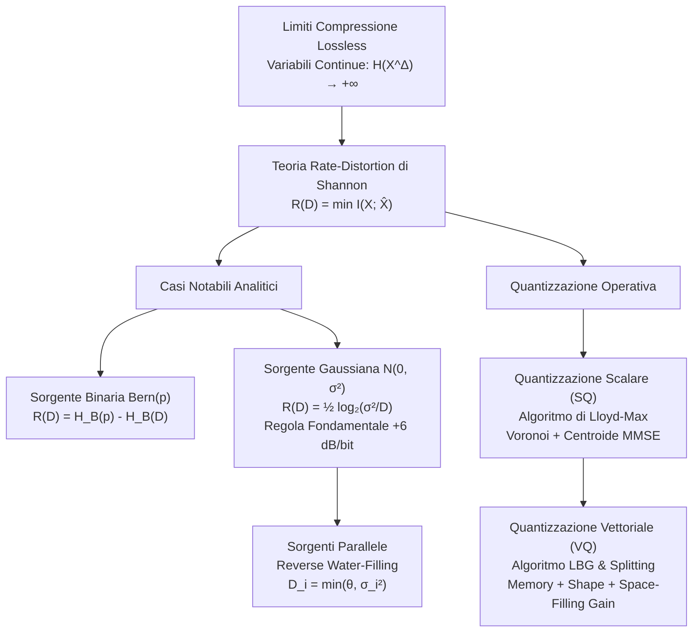

# D. Teoria Rate-Distortion e Quantizzazione Ottima

La codifica di sorgente senza perdita (lossless), formalizzata dai teoremi di Shannon e implementata da algoritmi quali Huffman e Lempel-Ziv, impone che la sequenza originale di dati sia ricostruita con probabilità d'errore rigorosamente nulla. In tale paradigma, il limite invalicabile al tasso medio di compressione coincide con l'entropia della sorgente:

$$
R \ge H(X)
$$

Quando trattiamo grandezze fisiche continue nel tempo o nell'ampiezza (quali segnali audio, flussi video, immagini ad alta risoluzione o telemetrie sensoristiche), una ricostruzione esatta richiederebbe una risoluzione infinitesima ($\Delta \to 0$), provocando la divergenza all'infinito dell'entropia di quantizzazione discreta ($H(X^\Delta) \to +\infty$). Trasmettere o memorizzare tali segnali senza perdita richiederebbe pertanto una capacità di canale infinita.

La __compressione con perdita__ (lossy compression) supera questo limite accettando una discrepanza controllata tra il segnale originale $X$ e la sua approssimazione discreta $\hat{X}$. La __Teoria Rate-Distortion__, formulata da Claude Shannon nel 1959, stabilisce il limite teorico fondamentale e insuperabile tra il tasso di informazione $R$ (in bit per campione) e la distorsione media tollerata $D$.

## Mappa Concettuale del Capitolo

## Dai Limiti della Compressione Lossless alla Teoria Rate-Distortion

Comprendere la necessità della compressione con perdita richiede un'analisi puntuale di cosa accade quando discretizziamo una variabile aleatoria continua.

### Divergenza dell'Entropia per Variabili Continue

Consideriamo una variabile aleatoria continua $X$ con densità di probabilità $f(x)$ ed [[C. Entropia Differenziale e Canale Gaussiano|entropia differenziale]] $h(X)$. Se partizioniamo l'asse reale in intervalli elementari di ampiezza uniforme $\Delta$, la variabile quantizzata $X^\Delta$ presenta una distribuzione discreta con probabilità $p_i \approx f(x_i) \Delta$.

Calcolando l'entropia discreta di Shannon di $X^\Delta$, otteniamo:

$$
H(X^\Delta) = -\sum_i p_i \log_2 p_i \approx h(X) - \log_2 \Delta
$$

Nel limite in cui ricerchiamo una rappresentazione digitale infinitamente fedele ($\Delta \to 0$):

$$
\lim_{\Delta \to 0} H(X^\Delta) = h(X) - \lim_{\Delta \to 0} \log_2 \Delta = +\infty
$$

Questo risultato dimostra che una sorgente continua possiede un contenuto informativo intrinsecamente illimitato. Non potendo allocare infiniti bit, dobbiamo necessariamente introdurre un criterio matematico che quantifichi l'inevitabile errore di approssimazione.

### Criteri di Fedeltà e Funzioni di Distorsione

Sia $\mathcal{X}$ l'alfabeto della sorgente e $\hat{\mathcal{X}}$ l'alfabeto dei simboli di ricostruzione. Una __funzione di distorsione__ (o costo di riproduzione) per singolo simbolo è un'applicazione non negativa:

$$
d: \mathcal{X} \times \hat{\mathcal{X}} \to \mathbb{R}^+, \quad (x, \hat{x}) \mapsto d(x, \hat{x}) \ge 0
$$

Le metriche di gran lunga più utilizzate nella teoria e nella pratica ingegneristica sono:

1. __Distorsione di Hamming (alfabeti discreti)__:

$$
d_H(x, \hat{x}) = \begin{cases} 0 & \text{se } x = \hat{x} \\ 1 & \text{se } x \neq \hat{x} \end{cases}
$$

   Il valore atteso $\mathbb{E}[d_H(X, \hat{X})]$ coincide esattamente con la probabilità d'errore di simbolo $P_e = \text{Pr}\{X \neq \hat{X}\}$.

2. __Distorsione Quadratica MSE (alfabeti continui)__:

$$
d(x, \hat{x}) = (x - \hat{x})^2
$$

   Il valore atteso coincide con l'errore quadratico medio $\mathbb{E}[(X - \hat{X})^2]$, standard indiscusso per segnali audio, elaborazione d'immagini e stima parametrica.

Estendendo il criterio a blocchi di $n$ campioni $\mathbf{x} = (x_1, \dots, x_n)$ e $\hat{\mathbf{x}} = (\hat{x}_1, \dots, \hat{x}_n)$, definiamo la distorsione media additiva per campione come:

$$
\bar{d}(\mathbf{x}, \hat{\mathbf{x}}) = \frac{1}{n} \sum_{k=1}^n d(x_k, \hat{x}_k)
$$

## La Funzione Rate-Distortion di Shannon

Shannon ha affrontato il problema ponendosi la domanda fondamentale: qual è il numero minimo di bit per campione necessario per codificare una sorgente in modo tale che il ricevitore possa ricostruirla con una distorsione media non superiore a una soglia assegnata $D$?

### Codici a Blocchi con Perdita e Regione Ammissibile

Un codice Rate-Distortion $(2^{nR}, n)$ è composto da:
- un codificatore $f_n: \mathcal{X}^n \to \{1, 2, \dots, 2^{nR}\}$ che associa a ogni sequenza di sorgente un indice discreto;
- un decodificatore $g_n: \{1, 2, \dots, 2^{nR}\} \to \hat{\mathcal{X}}^n$ che associa all'indice una parola di codice di ricostruzione $\hat{\mathbf{x}}$.

Il tasso di trasmissione del codice è pari a $R$ bit per simbolo. Una coppia tasso-distorsione $(R, D)$ è detta __ammissibile__ (o raggiungibile) se, per qualsiasi $\epsilon > 0$ e per $n$ sufficientemente grande, esiste un codice di lunghezza $n$ e tasso al più $R + \epsilon$ la cui distorsione media soddisfa:

$$
\mathbb{E}\left[ \bar{d}(X^n, \hat{X}^n) \right] \le D + \epsilon
$$

La frontiera inferiore dell'insieme di tutte le coppie ammissibili definisce la __curva Rate-Distortion operativa__.

![[slide_20_rate_distortion_curve.png|center mid]]

### Formulazione Variazionale dell'Informazione di Shannon

Shannon ha dimostrato che il limite operativo coincide con una grandezza probabilistica computabile, detta __funzione di informazione Rate-Distortion__:

$$
R(D) = \min_{p(\hat{x} \mid x) : \, \mathbb{E}[d(X, \hat{X})] \le D} I(X; \hat{X})
$$

dove il minimo è valutato rispetto a tutte le distribuzioni di probabilità condizionate $p(\hat{x} \mid x)$ (dette canali test di quantizzazione) che soddisfano il vincolo di distorsione media:

$$
\mathbb{E}[d(X, \hat{X})] = \sum_{x \in \mathcal{X}} \sum_{\hat{x} \in \hat{\mathcal{X}}} p(x) p(\hat{x} \mid x) d(x, \hat{x}) \le D
$$

Perché minimizziamo rispetto a $p(\hat{x} \mid x)$ tenendo fissa la sorgente $p(x)$?
La densità di sorgente $p(x)$ è un dato della natura non modificabile. La matrice di transizione $p(\hat{x} \mid x)$ descrive invece il meccanismo di quantizzazione e approssimazione. Minimizzare l'informazione mutua $I(X; \hat{X})$ equivale a cercare il quantizzatore più "parsimonioso", ossia quello che estrae dalla sorgente il minor quantitativo di bit indispensabile a garantire la fedeltà $D$.

### Il Teorema Fondamentale di Rate-Distortion

Il risultato cardine della teoria della compressione lossy si articola in due parti speculari:

1. __Raggiungibilità (Direct Coding Theorem)__: Per ogni tasso $R > R(D)$, esiste una sequenza di codici a blocchi con lunghezza di blocco $n \to \infty$ che consegue una distorsione media asintotica $\le D$.
2. __Converso (Converse Theorem)__: È fisicamente e matematicamente impossibile progettare un sistema di compressione operante a un tasso $R < R(D)$ che rispetti il vincolo di distorsione media $D$, qualunque sia la complessità del codice o la memoria utilizzata.

### Proprietà Geometriche e Punti Notevoli della Curva R(D)

La funzione $R(D)$ gode di proprietà geometriche strutturali:

1. __Convessità__: La funzione $R(D)$ è convessa rispetto alla distorsione $D$:

$$
R(\alpha D_1 + (1-\alpha) D_2) \le \alpha R(D_1) + (1-\alpha) R(D_2), \quad \forall \alpha \in [0, 1]
$$

   La dimostrazione formale, basata sulla convessità dell'informazione mutua rispetto ai canali di transizione per distribuzione d'ingresso fissata, è consultabile in [[zz. Argomenti extra#Dimostrazione della Convessità della Funzione di Rate-Distortion $R(D)$]].

2. __Monotonia Decrescente e Rendimenti Marginali Decrescenti__:
   La derivata prima (pendenza della curva) è sempre non positiva:

$$
s = \frac{\mathrm{d}R}{\mathrm{d}D} \le 0, \quad \frac{\mathrm{d}^2 R}{\mathrm{d}D^2} \ge 0
$$

   All'aumentare della distorsione tollerata, il tasso in bit decresce rapidamente. Al contrario, quando $D \to 0$, la pendenza diverge ($s \to -\infty$), indicando che guadagnare frazioni minime di fedeltà a livelli di rumore bassissimi richiede un dispendio esponenziale di bit.

3. __Punto a Distorsione Nulla $R(0)$__:
   Per sorgenti discrete, quando non tolleriamo alcun errore ($D = 0$), il canale test forza $\hat{X} = X$, da cui $R(0) = I(X; X) = H(X)$. La teoria con perdita riaggancia perfettamente l'entropia della compressione senza perdita. Per sorgenti continue, invece, $R(0) \to +\infty$.

4. __Distorsione Massima a Tasso Nullo $D_{\max}$__:
   Se abbiamo a disposizione un tasso nullo ($R = 0$), non possiamo trasmettere alcun bit sul canale. Il ricevitore deve quindi generare un valore di ricostruzione deterministico costante $\hat{x}^*$ basandosi esclusivamente sulla conoscenza statistica a priori della sorgente. La distorsione massima ammissibile oltre la quale il tasso si azzera è data da:

$$
D_{\max} = \min_{\hat{x} \in \hat{\mathcal{X}}} \mathbb{E}[d(X, \hat{x})]
$$

   Per ogni $D \ge D_{\max}$, la funzione vale identicamente $R(D) = 0$.

## Calcolo Analitico: Sorgente Binaria con Distorsione di Hamming

Consideriamo una sorgente binaria senza memoria che emette simboli $X \in \{0, 1\}$ governati da una legge di Bernoulli con parametro di sbilanciamento $p$:

$$
\text{Pr}\{X = 1\} = p, \quad \text{Pr}\{X = 0\} = 1 - p
$$

Senza perdita di generalità, assumiamo $0 \le p \le \frac{1}{2}$. Adottiamo come metrica la distorsione di Hamming $d_H(x, \hat{x})$.

### Derivazione Analitica del Limite Inferiore

Sviluppiamo l'informazione mutua per un generico canale test $p(\hat{x} \mid x)$:

$$
I(X; \hat{X}) = H(X) - H(X \mid \hat{X}) = H_B(p) - H(X \oplus \hat{X} \mid \hat{X})
$$

dove $H_B(q) = -q \log_2 q - (1-q) \log_2(1-q)$ rappresenta la funzione di entropia binaria e $\oplus$ indica la somma modulo 2 (operatore XOR).

Poiché il condizionamento non può mai incrementare l'entropia:

$$
H(X \oplus \hat{X} \mid \hat{X}) \le H(X \oplus \hat{X})
$$

Definiamo la variabile binaria indicatrice d'errore $E = X \oplus \hat{X}$. Il vincolo di distorsione impone che:

$$
\text{Pr}\{E = 1\} = \mathbb{E}[d_H(X, \hat{X})] \le D
$$

Essendo la funzione $H_B(q)$ monotona strettamente crescente nell'intervallo $q \in [0, 1/2]$, per qualsiasi distorsione $D \le p \le 1/2$ abbiamo:

$$
H(X \oplus \hat{X}) = H_B(\text{Pr}\{E = 1\}) \le H_B(D)
$$

Concatenando le disuguaglianze, otteniamo il limite inferiore:

$$
I(X; \hat{X}) \ge H_B(p) - H_B(D)
$$

### Raggiungibilità e Comportamento ad Alta Distorsione

Dimostriamo che questo limite è esattamente raggiungibile costruendo il canale test inverso (backward channel). Poniamo:

$$
X = \hat{X} \oplus Z
$$

dove $Z \sim \text{Bern}(D)$ è indipendente da $\hat{X}$. Affinché la marginale di $X$ mantenga parametro $p$, la distribuzione di $\hat{X}$ deve soddisfare:

$$
p = \text{Pr}\{\hat{X} = 1\}(1 - D) + \text{Pr}\{\hat{X} = 0\} D
$$

Risolvendo rispetto a $\text{Pr}\{\hat{X} = 1\}$, otteniamo:

$$
\text{Pr}\{\hat{X} = 1\} = \frac{p - D}{1 - 2D}
$$

Poiché per $D \le p$ tale probabilità è compresa in $[0, 1/2]$, il canale inverso esiste ed è legittimo. In questa configurazione, $H(X \oplus \hat{X} \mid \hat{X}) = H(Z) = H_B(D)$, e la disuguaglianza diventa un'uguaglianza stretta.

Cosa accade se tolleriamo una distorsione $D \ge p$?
In questo caso, il codificatore non ha bisogno di trasmettere alcun bit ($R = 0$). Il ricevitore pone deterministicamente $\hat{X} = 0$ per ogni simbolo. La distorsione media risulta pari a:

$$
\mathbb{E}[d_H(X, 0)] = \text{Pr}\{X \neq 0\} = \text{Pr}\{X = 1\} = p \le D
$$

Pertanto, per $D \ge p$, la distorsione tollerata è già soddisfatta a costo informativo nullo. La funzione Rate-Distortion per la sorgente di Bernoulli vale:

$$
R(D) = \begin{cases} H_B(p) - H_B(D) & \text{se } 0 \le D \le p \\ 0 & \text{se } D > p \end{cases} \quad \text{bit/simbolo}
$$

### Caso Studio Applicativo: Griglie di Occupazione in Robotica Autonoma

Nei robot mobili dotati di sensori LiDAR o radar per la navigazione autonoma, l'ambiente circostante è discretizzato in una mappa a griglia di occupazione bidimensionale (Occupancy Grid Map). Ciascuna cella è una variabile binaria: $X = 1$ indica presenza di un ostacolo, $X = 0$ indica spazio libero calpestabile.

In ambienti industriali strutturati, la densità media di ostacoli è pari al $30\%$ ($p = 0.30$). Per trasmettere la mappa senza perdite via radio al server di flotta occorrono:

$$
H_B(0.30) = -0.30 \log_2(0.30) - 0.70 \log_2(0.70) \approx 0.8813 \quad \text{bit/cella}
$$

Se l'algoritmo di pianificazione delle traiettorie tollera un tasso d'errore di classificazione del $10\%$ ($D = 0.10$):

$$
H_B(0.10) = -0.10 \log_2(0.10) - 0.90 \log_2(0.90) \approx 0.4690 \quad \text{bit/cella}
$$

Il tasso trasmissivo minimo richiesto crolla a:

$$
R(0.10) = H_B(0.30) - H_B(0.10) = 0.8813 - 0.4690 = 0.4123 \quad \text{bit/cella}
$$

Accettando una distorsione del $10\%$, il robot riduce l'occupazione di banda radio del $53.2\%$.

> [!TIP] __Trabocchetto d'Esame: Il Dominio della Distorsione Binaria__
> Nei compiti d'esame capita spesso che venga richiesto di calcolare $R(D)$ per $D > p$. L'errore più comune consiste nell'applicare ciecamente la formula $H_B(p) - H_B(D)$, ottenendo un valore negativo privo di senso fisico.
> Ricorda sempre: non appena $D \ge p$, la stima banale costante $\hat{X} = 0$ soddisfa il vincolo con zero bit, imponendo tassativamente $R(D) = 0$.

## Calcolo Analitico: Sorgente Gaussiana con Distorsione Quadratica

La sorgente gaussiana sotto distorsione quadratica MSE rappresenta il pilastro teorico dell'elaborazione numerica dei segnali continui.

### Derivazione Analitica della Funzione R(D)

Sia $X \sim \mathcal{N}(0, \sigma^2)$ una variabile continua normale con varianza $\sigma^2$, e consideriamo la distorsione quadratica $d(x, \hat{x}) = (x - \hat{x})^2$.

Sviluppiamo l'informazione mutua sfruttando l'entropia differenziale:

$$
I(X; \hat{X}) = h(X) - h(X \mid \hat{X}) = h(X) - h(X - \hat{X} \mid \hat{X})
$$

Poiché condizionare riduce l'entropia differenziale:

$$
h(X - \hat{X} \mid \hat{X}) \le h(X - \hat{X})
$$

Il vincolo di fedeltà impone che l'errore di quantizzazione soddisfi $\mathbb{E}[(X - \hat{X})^2] \le D$. Tra tutte le distribuzioni continue aventi varianza fissata o limitata da $D$, la distribuzione gaussiana è quella che massimizza l'entropia differenziale (come dimostrato in [[zz. Argomenti extra#Dimostrazione Variazionale dell'Ottimalità della PDF Gaussiana come Massimizzatore di Entropia Differenziale]]):

$$
h(X - \hat{X}) \le \frac{1}{2} \log_2(2\pi e D)
$$

Sapendo che l'entropia differenziale della sorgente è $h(X) = \frac{1}{2}\log_2(2\pi e \sigma^2)$, otteniamo la disuguaglianza:

$$
I(X; \hat{X}) \ge \frac{1}{2} \log_2(2\pi e \sigma^2) - \frac{1}{2} \log_2(2\pi e D) = \frac{1}{2} \log_2\left( \frac{\sigma^2}{D} \right)
$$

Per dimostrare l'esatta uguaglianza, costruiamo il canale test inverso ponendo:

$$
X = \hat{X} + Z
$$

dove $Z \sim \mathcal{N}(0, D)$ è indipendente dalla ricostruzione $\hat{X}$. Affinché la varianza totale di $X$ sia $\sigma^2$, la variabile di ricostruzione deve seguire la distribuzione $\hat{X} \sim \mathcal{N}(0, \sigma^2 - D)$.

Tale costruzione è matematicamente valida se e solo se $\sigma^2 - D \ge 0$, ossia $D \le \sigma^2$. Se $D > \sigma^2$, il ricevitore adotta la stima costante a media nulla $\hat{X} = 0$, conseguendo una distorsione pari alla varianza naturale $\mathbb{E}[X^2] = \sigma^2 < D$ a costo zero bit.

La funzione Rate-Distortion della sorgente gaussiana è quindi:

$$
R(D) = \begin{cases} \frac{1}{2} \log_2\left( \frac{\sigma^2}{D} \right) & \text{se } 0 \le D \le \sigma^2 \\ 0 & \text{se } D > \sigma^2 \end{cases} \quad \text{bit/campione}
$$

La derivazione formale completa è consultabile in [[zz. Argomenti extra#Teorema di Rate-Distortion per la Sorgente Gaussiana con Distorsione Quadratica]].

### Funzione Distortion-Rate e la Regola Fondamentale dei +6 dB per Bit

Invertendo la relazione tra tasso e distorsione per $R \ge 0$, otteniamo la formulazione duale della __funzione Distortion-Rate__:

$$
D(R) = \sigma^2 2^{-2R}
$$

Questa relazione esponenziale evidenzia una legge cardine di tutto il signal processing digitale. Calcoliamo il rapporto segnale-rumore di quantizzazione (Signal-to-Distortion Ratio, SDR) espresso in decibel:

$$
\text{SDR}_{\text{dB}} = 10 \log_{10}\left( \frac{\sigma^2}{D(R)} \right) = 10 \log_{10}(2^{2R}) = 2R \cdot 10 \log_{10}(2)
$$

Poiché $10 \log_{10}(2) \approx 3.0103$ dB:

$$
\text{SDR}_{\text{dB}} \approx 6.02 \cdot R \quad \text{dB}
$$

Se aumentiamo la risoluzione di un singolo bit per campione ($R \to R + 1$):

$$
D(R+1) = \sigma^2 2^{-2(R+1)} = \frac{1}{4} D(R)
$$

$$
\Delta \text{SDR} = 10 \log_{10}(4) \approx 6.02 \quad \text{dB}
$$

> [!IMPORTANT] __Regola d'Oro dei +6 dB per Bit__
> Ogni bit supplementare allocato per campione dimezza la dispersione dell'errore, riduce la distorsione quadratica di un fattore 4 e incrementa il rapporto segnale-rumore di quantizzazione esattamente di circa __$6.02$ dB__.

### Caso Studio Applicativo: Telemetria Sensoristica LoRaWAN

Consideriamo un sensore IoT per il monitoraggio sismico di un ponte, collegato tramite rete a lungo raggio LoRaWAN. Il sensore rileva vibrazioni meccaniche modellate come una gaussiana $\mathcal{N}(0, \sigma^2)$.

A causa delle severe limitazioni di banda e di trasmissione (duty cycle all'1%), dobbiamo comprimere i dati al minimo bitrate possibile:
- A $R = 1$ bit/campione: il limite di Shannon impone una distorsione minima $D = \sigma^2 / 4$, fornendo uno $\text{SDR} = 6.02$ dB.
- A $R = 2$ bit/campione: la distorsione scende a $D = \sigma^2 / 16$, raggiungendo uno $\text{SDR} = 12.04$ dB.
- A $R = 3$ bit/campione: la distorsione crolla a $D = \sigma^2 / 64$, ottenendo uno $\text{SDR} = 18.06$ dB.

Ciascun incremento unitario di bit aggiunge esattamente $6.02$ dB di qualità al segnale ricostruito a destinazione.

> [!TIP] __Trabocchetto d'Esame: Canale Diretto vs Canale Retrogrado__
> Nella derivazione gaussiana, non commettere l'errore di scrivere $X = \hat{X} + Z$ con $\hat{X}$ e $Z$ indipendenti nel quantizzatore reale. Nel quantizzatore fisico, $\hat{X} = Q(X)$, quindi l'errore $X - \hat{X}$ è correlato con $X$.
> L'indipendenza statistica sussiste esclusivamente nel canale test fittizio orientato a ritroso da $\hat{X}$ verso $X$.

## Sorgenti Gaussiane Parallele e Principio di Reverse Water-Filling

Nei moderni algoritmi di compressione audio, immagini e video (quali MP3, AAC, JPEG e H.264), i segnali reali presentano forte correlazione temporale o spaziale. Tramite trasformate ortogonali (come la KLT, la DCT o le Wavelet), il segnale viene decomposto in un insieme di $m$ componenti spettrali tra loro incorrelate.

Consideriamo un vettore di $m$ sorgenti gaussiane indipendenti:

$$
X_i \sim \mathcal{N}(0, \sigma_i^2), \quad i = 1, 2, \dots, m
$$

ordinate in senso non crescente di energia: $\sigma_1^2 \ge \sigma_2^2 \ge \dots \ge \sigma_m^2$.

Assegniamo al codificatore un budget di distorsione quadratica totale $D$. Il problema consiste nel distribuire la distorsione tra le singole componenti ($D = \sum_{i=1}^m D_i$) in modo da minimizzare il tasso complessivo di codifica:

$$
R(D) = \min_{\substack{\{D_i\}_{i=1}^m : \\ \sum D_i \le D, \\ 0 < D_i \le \sigma_i^2}} \sum_{i=1}^m \frac{1}{2} \log_2\left( \frac{\sigma_i^2}{D_i} \right)
$$

### Formulazione Variazionale dell'Allocazione congiunta

Impostiamo la funzione Lagrangiana associata al problema di minimizzazione convessa vincolata:

$$
\mathcal{L}(D_1, \dots, D_m, \mu, \boldsymbol{\lambda}) = \sum_{i=1}^m \frac{1}{2} \log_2\left( \frac{\sigma_i^2}{D_i} \right) + \mu \left( \sum_{i=1}^m D_i - D \right) - \sum_{i=1}^m \lambda_i (\sigma_i^2 - D_i)
$$

dove $\mu \ge 0$ è il moltiplicatore associato al vincolo di budget globale e $\lambda_i \ge 0$ sono i moltiplicatori associati ai vincoli di non eccedenza $D_i \le \sigma_i^2$.

### Risoluzione Analitica tramite Moltiplicatori di Lagrange e KKT

Calcoliamo la derivata parziale rispetto a ciascuna distorsione $D_i$ e imponiamo le condizioni di Karush-Kuhn-Tucker (KKT):

$$
\frac{\partial \mathcal{L}}{\partial D_i} = -\frac{1}{2 \ln 2 \cdot D_i} + \mu + \lambda_i = 0
$$

Definiamo la soglia costante di distorsione:

$$
\theta = \frac{1}{2 \ln 2 \cdot \mu}
$$

Dalle condizioni di complementarità KKT ($\lambda_i (\sigma_i^2 - D_i) = 0$ con $\lambda_i \ge 0$):

1. __Componenti dominanti ad alta energia ($\sigma_i^2 > \theta$)__:
   Il vincolo $D_i \le \sigma_i^2$ non è attivo, quindi $\lambda_i = 0$. Dalla derivata ricaviamo:

$$
D_i = \theta
$$

   Il tasso allocato è strettamente positivo:

$$
R_i = \frac{1}{2} \log_2\left( \frac{\sigma_i^2}{\theta} \right) > 0
$$

2. __Componenti deboli a bassa energia ($\sigma_i^2 \le \theta$)__:
   Se imponessimo $D_i = \theta$, avremmo $D_i > \sigma_i^2$, violando il vincolo. Il vincolo deve quindi essere attivo ($\lambda_i > 0$), imponendo:

$$
D_i = \sigma_i^2
$$

   Il tasso assegnato alla componente si annulla:

$$
R_i = 0
$$

Riassumendo, la legge di allocazione ottima per ciascuna componente vale:

$$
D_i = \min(\theta, \sigma_i^2) = \begin{cases} \theta & \text{se } \sigma_i^2 > \theta \\ \sigma_i^2 & \text{se } \sigma_i^2 \le \theta \end{cases}
$$

$$
R_i = \max\left( 0, \, \frac{1}{2}\log_2\left( \frac{\sigma_i^2}{\theta} \right) \right) = \begin{cases} \frac{1}{2}\log_2\left( \frac{\sigma_i^2}{\theta} \right) & \text{se } \sigma_i^2 > \theta \\ 0 & \text{se } \sigma_i^2 \le \theta \end{cases}
$$

dove il parametro di soglia $\theta$ è individuato in modo univoco imponendo la conservazione del budget di distorsione:

$$
\sum_{i=1}^m \min(\theta, \sigma_i^2) = D
$$

Il tasso complessivo per il blocco di sorgenti gaussiane parallele risulta pari a:

$$
R(D) = \sum_{i=1}^m R_i = \sum_{i=1}^m \max\left( 0, \, \frac{1}{2} \log_2\left( \frac{\sigma_i^2}{\theta} \right) \right)
$$

La derivazione formale estesa è consultabile in [[zz. Argomenti extra#Derivazione Rigorosa della Soluzione di Reverse Water-Filling per Sorgenti Gaussiane Parallele]].

### Interpretazione Geometrica e Contrasto con il Canale Parallelo

La dinamica geometrica di questa soluzione prende il nome di __Reverse Water-Filling__ (riempimento inverso d'acqua).

![[reverse_water_filling_geometry.svg|center mid]]

![[slide_46_reverse_water_filling.png|center mid]]

Analizziamo il contrasto logico e operativo fondamentale tra i due algoritmi di Shannon:

1. __Water-Filling Diretto di Canale (Capitolo C)__:
   - Nel problema di trasmissione su canali paralleli con rumori $\{N_i\}$, disponiamo di un budget di __potenza__ $P$.
   - Versiamo la potenza nei canali che presentano il __minor livello di rumore__ ($N_i < \nu$), garantendo la massima capacità. I canali rumorosi e degradati vengono spenti ponendo $P_i = 0$.

2. __Reverse Water-Filling di Sorgente (Capitolo D)__:
   - Nel problema di compressione con distorsione su sorgenti con energie $\{\sigma_i^2\}$, disponiamo di un budget di __distorsione tollerata__ $D$.
   - Riempiamo le componenti di distorsione dal basso fino al livello $\theta$.
   - Proteggiamo e codifichiamo con bit ($R_i > 0$) unicamente le componenti ad __alta varianza__ ($\sigma_i^2 > \theta$), pareggiandone la distorsione residua alla quota comune $\theta$.
   - Al contrario, le componenti a bassa varianza ($\sigma_i^2 \le \theta$) vengono completamente scartate dal codificatore ponendo $R_i = 0$ e assorbendo la loro intera varianza naturale come distorsione: $D_i = \sigma_i^2$.

### Impatto Ingegneristico: la Codifica per Trasformata

Il Reverse Water-Filling fornisce la giustificazione teorica universale della __codifica per trasformata__ (Transform Coding, Goyal 2001).

Nello standard JPEG per immagini fisse o nei codec video MPEG:
1. L'immagine viene suddivisa in blocchi $8 \times 8$ pixel e proiettata nel dominio della frequenza spaziale tramite la Trasformata Discreta del Coseno (DCT).
2. La DCT concentra l'energia visiva su pochissimi coefficienti a bassa frequenza (ad altissima varianza), lasciando i coefficienti ad alta frequenza con varianza prossima allo zero.
3. Il quantizzatore alloca bit quasi esclusivamente ai coefficienti a grande varianza, azzerando completamente i coefficienti al di sotto della soglia di distorsione $\theta$.

Questo principio permette di eliminare oltre il $90\%$ dei dati senza che l'occhio umano percepisca artefatti visibili.

> [!TIP] __Trabocchetto d'Esame: Determinazione della Soglia $\theta$__
> Negli esercizi numerici d'esame con Reverse Water-Filling, non ipotizzare a priori che tutte le componenti siano attive ($R_i > 0$).
> Procedi a ritroso: calcola $\theta$ ipotizzando che tutte le $m$ componenti siano accese ($\theta = D / m$). Se verifichi che per una o più componenti $\sigma_i^2 \le \theta$, scartale immediatamente ponendo $D_i = \sigma_i^2$, sottrai la loro varianza dal budget totale ($D_{\text{rimasto}} = D - \sum_{\text{spente}} \sigma_i^2$) e ricalcola la soglia $\theta$ unicamente sul sottoinsieme delle componenti rimaste attive.

## Quantizzazione Scalare Ottima di Lloyd-Max

La teoria Rate-Distortion di Shannon definisce il limite teorico insuperabile operando su blocchi di lunghezza infinita ($n \to \infty$). Nella pratica implementativa di convertitori analogico-digitali (ADC) e DSP a bassissima latenza, il dispositivo basilare è il __quantizzatore scalare__, che elabora i campioni uno alla volta in modo istantaneo.

### Formulazione Matematica del Quantizzatore a K Livelli

Sia $X \in \mathbb{R}$ una variabile aleatoria continua con densità di probabilità $f(x)$. Un quantizzatore scalare a $K$ livelli è una funzione:

$$
Q: \mathbb{R} \to \{y_1, y_2, \dots, y_K\}
$$

che partiziona l'asse reale in $K$ intervalli disgiunti (celle di quantizzazione) mediante $K+1$ soglie di decisione ordinate:

$$
-\infty = t_0 < t_1 < t_2 < \dots < t_{K-1} < t_K = +\infty
$$

Assegnando a ciascun intervallo $\mathcal{R}_i = (t_{i-1}, t_i]$ un unico livello discreto di ricostruzione $y_i \in \mathbb{R}$:

$$
Q(x) = y_i \quad \text{se } x \in \mathcal{R}_i = (t_{i-1}, t_i]
$$

Sotto distorsione quadratica, l'errore medio totale è dato dal funzionale:

$$
D = \mathbb{E}[(X - Q(X))^2] = \sum_{i=1}^K \int_{t_{i-1}}^{t_i} (x - y_i)^2 f(x) \mathrm{d}x
$$

Il problema della quantizzazione scalare ottima consiste nell'individuare simultaneamente le $K-1$ soglie interne $\{t_i\}_{i=1}^{K-1}$ e i $K$ livelli di ricostruzione $\{y_i\}_{i=1}^K$ che minimizzano $D$.

### Derivazione delle Due Condizioni di Ottimalità

Derivando il funzionale $D$ e imponendo l'annullamento del gradiente, Stuart Lloyd (1957) e Joel Max (1960) hanno stabilito che qualsiasi quantizzatore ottimo deve verificare due condizioni necessarie:

1. __Condizione della Soglia (Nearest Neighbor / Partizione di Voronoi)__:
   Deriviamo $D$ rispetto alla generica soglia interna $t_i$:

$$
\frac{\partial D}{\partial t_i} = (t_i - y_i)^2 f(t_i) - (t_i - y_{i+1})^2 f(t_i) = 0
$$

   Assumendo che la densità di probabilità non sia nulla sulla soglia ($f(t_i) > 0$):

$$
(t_i - y_i)^2 = (t_i - y_{i+1})^2 \implies t_i - y_i = -(t_i - y_{i+1})
$$

   da cui otteniamo la regola fondamentale:

$$
t_i = \frac{y_i + y_{i+1}}{2}, \quad i = 1, 2, \dots, K-1
$$

   Fissati i livelli di ricostruzione $\{y_i\}$, ciascuna soglia ottima coincide esattamente con il punto medio tra due livelli adiacenti. Ogni regione $\mathcal{R}_i$ è una cella di Voronoi unidimensionale in cui ciascun punto $x$ è associato al livello $y_i$ geometricamente più vicino.

2. __Condizione del Centroide (Stima MMSE / Baricentro Condizionato)__:
   Deriviamo $D$ rispetto al generico livello di ricostruzione $y_i$:

$$
\frac{\partial D}{\partial y_i} = -2 \int_{t_{i-1}}^{t_i} (x - y_i) f(x) \mathrm{d}x = 0
$$

   Sviluppando l'integrale:

$$
\int_{t_{i-1}}^{t_i} x f(x) \mathrm{d}x = y_i \int_{t_{i-1}}^{t_i} f(x) \mathrm{d}x
$$

   da cui discende:

$$
y_i = \frac{\int_{t_{i-1}}^{t_i} x f(x) \mathrm{d}x}{\int_{t_{i-1}}^{t_i} f(x) \mathrm{d}x} = \mathbb{E}[X \mid X \in \mathcal{R}_i], \quad i = 1, 2, \dots, K
$$

   Fissata la partizione dello spazio, ciascun livello di ricostruzione deve coincidere con il valore atteso condizionato di $X$ all'interno della cella, in perfetta risonanza con lo stimatore bayesiano MMSE ricavato in [[zz. Argomenti extra#Ottimalità della Media a Posteriori per il Criterio MMSE]].

### Algoritmo Iterativo ad Alternanza e Proprietà di Convergenza

Poiché le soglie dipendono dai livelli e i livelli dipendono a loro volta dalle soglie, il sistema di equazioni non ammette soluzione analitica in forma chiusa per distribuzioni generali.

L'__algoritmo di Lloyd-Max__ risolve il problema tramite iterazione alternata:
1. __Inizializzazione__: Si sceglie un insieme arbitrario di $K$ livelli distinti $\{y_i^{(0)}\}$.
2. __Passo di Partizione__: Si aggiornano le soglie come punti medi:

$$
t_i^{(k)} = \frac{y_i^{(k)} + y_{i+1}^{(k)}}{2}
$$

3. __Passo del Centroide__: Si ricalcolano i livelli come baricentri sulle nuove celle:

$$
y_i^{(k+1)} = \mathbb{E}\left[ X \mid X \in (t_{i-1}^{(k)}, t_i^{(k)}] \right]
$$

4. __Arresto__: Si calcola la variazione di distorsione. Poiché ciascun semipasso minimizza la distorsione condizionata lasciando inalterata l'altra variabile, la sequenza di distorsioni $\{D^{(k)}\}$ è monotona non crescente e converge a un minimo locale (che coincide con il minimo globale per densità log-concave come la gaussiana).

### Caso Studio Analitico: Quantizzatore Gaussiano a 1 Bit

Calcoliamo analiticamente il quantizzatore ottimo di Lloyd-Max a 1 bit ($K = 2$ livelli) per una gaussiana standard $X \sim \mathcal{N}(0, \sigma^2)$.

Per ragioni di simmetria rispetto all'origine:
- la soglia di decisione è $t_1 = 0$, determinando le due regioni $\mathcal{R}_1 = (-\infty, 0]$ e $\mathcal{R}_2 = (0, +\infty)$;
- i livelli sono opposti: $y_1 = -y_2$.

Calcoliamo il livello positivo $y_2$ applicando la condizione del centroide:

$$
y_2 = \mathbb{E}[X \mid X > 0] = \frac{\int_0^{+\infty} x \frac{1}{\sqrt{2\pi\sigma^2}} e^{-\frac{x^2}{2\sigma^2}} \mathrm{d}x}{\text{Pr}\{X > 0\}} = \frac{\frac{1}{\sqrt{2\pi\sigma^2}} \left[ -\sigma^2 e^{-\frac{x^2}{2\sigma^2}} \right]_0^{+\infty}}{\frac{1}{2}}
$$

Sostituendo gli estremi di integrazione:

$$
y_2 = 2 \cdot \frac{\sigma^2}{\sqrt{2\pi\sigma^2}} (0 - (-1)) = \sqrt{\frac{2}{\pi}} \sigma \approx 0.7979 \sigma
$$

I due livelli ottimi di ricostruzione sono quindi:

$$
y_1 = -\sqrt{\frac{2}{\pi}}\sigma, \quad y_2 = +\sqrt{\frac{2}{\pi}}\sigma
$$

Calcoliamo la distorsione quadratica media risultante:

$$
D = \mathbb{E}[(X - Q(X))^2] = \mathbb{E}[X^2] - 2\mathbb{E}[X Q(X)] + \mathbb{E}[Q(X)^2]
$$

Notiamo che $Q(X)^2 = y_2^2 = \frac{2}{\pi}\sigma^2$ con probabilità 1. Inoltre:

$$
\mathbb{E}[X Q(X)] = \int_{-\infty}^0 x y_1 f(x) \mathrm{d}x + \int_0^{+\infty} x y_2 f(x) \mathrm{d}x = 2 y_2 \left( \frac{1}{2} y_2 \right) = y_2^2
$$

La distorsione minima vale quindi:

$$
D = \sigma^2 - y_2^2 = \sigma^2 - \frac{2}{\pi}\sigma^2 = \sigma^2 \left( 1 - \frac{2}{\pi} \right) \approx 0.3634 \sigma^2
$$

Il rapporto segnale-rumore di quantizzazione (SQNR) in decibel è:

$$
\text{SQNR} = 10 \log_{10}\left( \frac{\sigma^2}{D} \right) = 10 \log_{10}\left( \frac{1}{1 - 2/\pi} \right) \approx 10 \log_{10}(2.752) \approx 4.40 \quad \text{dB}
$$

Confrontiamo questo risultato con il limite teorico di Shannon $R(D)$:
Per $R = 1$ bit, la formula di Shannon fornisce una distorsione minima pari a $D_{\text{Shannon}} = \sigma^2 2^{-2(1)} = 0.25 \sigma^2$, con uno $\text{SQNR} = 6.02$ dB.
Il miglior quantizzatore scalare possibile paga uno scarto incolmabile di $1.62$ dB rispetto al limite ultimo della teoria dell'informazione.

### Quantizzatore Gaussiano a 2 Bit e Confronto con la Quantizzazione Uniforme

Risolvendo l'algoritmo di Lloyd-Max per $K = 4$ livelli ($R = 2$ bit) su una gaussiana standard $X \sim \mathcal{N}(0, 1)$, l'iterazione numerica converge a:
- Soglie ottime: $t_1 = -0.9816$, $t_2 = 0.0000$, $t_3 = +0.9816$;
- Livelli di ricostruzione: $y_1 = -1.5104$, $y_2 = -0.4528$, $y_3 = +0.4528$, $y_4 = +1.5104$;
- Distorsione quadratica: $D \approx 0.1175 \sigma^2$;
- Rapporto segnale-rumore: $\text{SQNR} \approx 9.30$ dB.

A titolo di confronto:
- Un quantizzatore scalare a passo uniforme con 4 livelli produce uno $\text{SQNR} \approx 7.84$ dB. Lloyd-Max guadagna ben $1.46$ dB senza alcun costo di banda.
- Il bound di Shannon a $R = 2$ bit è pari a $D = \sigma^2 / 16 = 0.0625 \sigma^2$, ossia $\text{SQNR} = 12.04$ dB. Il divario tra quantizzazione scalare e limite teorico sale a $2.74$ dB.

> [!TIP] __Trabocchetto d'Esame: Centroide vs Punto Medio__
> In un quantizzatore di Lloyd-Max, le soglie sono a metà strada tra i livelli di ricostruzione ($t_i = (y_i + y_{i+1})/2$), ma i livelli di ricostruzione __non__ si trovano a metà strada tra le soglie ($y_i \neq (t_{i-1} + t_i)/2$).
> I livelli $y_i$ sono i baricentri probabilistici condizionati, quindi sono spostati verso le zone in cui la densità $f(x)$ è più alta. Solo per la distribuzione uniforme i centroidi coincidono con i punti medi geometrici.

## Quantizzazione Vettoriale e Algoritmo LBG

Il crescente divario tra le prestazioni di Lloyd-Max e il limite di Shannon dimostra che elaborare i campioni in modo isolato è intrinsecamente subottimo. Per superare questa limitazione si adotta la __Quantizzazione Vettoriale__ (Vector Quantization, VQ).

In un quantizzatore vettoriale di dimensione $n$, raggruppiamo i campioni della sorgente in vettori $\mathbf{X} = (X_1, \dots, X_n)^T \in \mathbb{R}^n$. Lo spazio euclideo multidimensionale viene partizionato direttamente in celle di Voronoi $n$-dimensionali $\{\mathcal{R}_j\}_{j=1}^K$, associando a ciascuna cella una parola di codice vettoriale (codeword) $\mathbf{y}_j \in \mathbb{R}^n$.

![[slide_41_lbg_vector_quantization.png|center mid]]

### Perché Quantizzare Vettori: i Tre Guadagni Strutturali

Come formalizzato da Allen Lookabaugh e Robert M. Gray (1989), la superiorità della quantizzazione vettoriale rispetto a quella scalare risiede in tre vantaggi matematici distinti:

1. __Guadagno di Memoria (Memory/Correlation Gain)__:
   Se i campioni consecutivi del segnale sono correlati o dipendenti, la loro densità di probabilità congiunta si concentra su iper-ellissoidi orientati. La quantizzazione scalare cartesiana alloca celle su un'intera griglia quadrata o cubica, sprecando parole di codice in regioni a probabilità nulla. La VQ adatta invece la geometria dei centroidi disponendoli esclusivamente dove la densità di probabilità è elevata.

2. __Guadagno di Forma della PDF (Shape Gain)__:
   Anche per sorgenti prive di memoria con componenti incorrelate, le superfici di livello della densità congiunta sono sferiche o ellissoidali. Le celle scalari hanno la forma rigida di ipercubi, i cui spigoli si allontanano notevolmente dal centroide aumentando il momento d'inerzia medio. La VQ modella invece celle sferoidali con dispersione radiale minima.

3. __Guadagno di Riempimento dello Spazio (Space-Filling Gain)__:
   Nello spazio bidimensionale $\mathbb{R}^2$, il reticolo che minimizza il momento d'inerzia normalizzato per unità di volume non è la griglia quadrata cartesiana $\mathbb{Z}^2$, bensì il __reticolo esagonale__ $A_2$:

$$
G(A_2) = \frac{5}{36\sqrt{3}} \approx 0.080188
$$

   mentre per il reticolo cubico cartesiano $\mathbb{Z}^2$ (prodotto di quantizzatori scalari):

$$
G(\mathbb{Z}^2) = \frac{1}{12} \approx 0.083333
$$

   La quantizzazione vettoriale su reticolo esagonale garantisce un guadagno immediato:

$$
\Delta \text{SQNR} = 10 \log_{10}\left( \frac{0.083333}{0.080188} \right) \approx 0.169 \quad \text{dB}
$$

   Al crescere della dimensione dello spazio vettoriale verso l'infinito ($n \to \infty$), il celebre __Teorema di Zador__ dimostra che il guadagno di riempimento satura al limite asintotico universale:

$$
\Delta \text{SQNR}_{\max} = 10 \log_{10}\left( \frac{\pi e}{6} \right) \approx 1.53 \quad \text{dB}
$$

### L'Algoritmo di Linde-Buzo-Gray su Dataset Empirici

La progettazione analitica di un quantizzatore vettoriale richiederebbe il calcolo di integrali multipli di volume su politopi complessi in $\mathbb{R}^n$, operazione analiticamente intrattabile.

Nel 1980, Yoseph Linde, Andrés Buzo e Robert M. Gray hanno sviluppato l'__algoritmo LBG__, che consente di sintetizzare un codebook vettoriale ottimo operando direttamente su un insieme di campioni di addestramento (Training Set), senza alcuna necessità di conoscere la PDF analitica della sorgente.

Sia dato un training set composto da $N$ vettori continui $n$-dimensionali:

$$
\mathcal{T} = \{ \mathbf{x}_1, \mathbf{x}_2, \dots, \mathbf{x}_N \}, \quad \mathbf{x}_k \in \mathbb{R}^n
$$

L'obiettivo è individuare un codebook $\mathcal{C} = \{ \mathbf{y}_1, \dots, \mathbf{y}_K \}$ che minimizzi la distorsione empirica:

$$
J = \frac{1}{N} \sum_{k=1}^N \min_{1 \le j \le K} \|\mathbf{x}_k - \mathbf{y}_j\|^2
$$

L'algoritmo alterna due semipassi fondamentali (equivalente al $k$-means per l'elaborazione dei segnali):

1. __Passo di Partizione di Voronoi__:
   Assegniamo ciascun vettore di addestramento $\mathbf{x}_k$ al centroide corrente più vicino secondo la distanza euclidea minima, partizionando $\mathcal{T}$ in $K$ cluster disgiunti:

$$
\mathcal{S}_j = \left\{ \mathbf{x} \in \mathcal{T} : \|\mathbf{x} - \mathbf{y}_j\|^2 \le \|\mathbf{x} - \mathbf{y}_i\|^2 \quad \forall i \neq j \right\}
$$

2. __Passo di Aggiornamento dei Centroidi__:
   Ricalcoliamo ciascuna codeword come centroide empirico (media aritmetica vettoriale) dei campioni assegnati al rispettivo cluster:

$$
\mathbf{y}_j = \frac{1}{|\mathcal{S}_j|} \sum_{\mathbf{x} \in \mathcal{S}_j} \mathbf{x}
$$

A ogni iterazione la distorsione empirica $J$ decresce monotonicamente. L'iterazione si arresta quando il decremento relativo scende sotto una soglia di tolleranza $\epsilon$:

$$
\frac{J^{(k-1)} - J^{(k)}}{J^{(k)}} < \epsilon
$$

### Tecnica di Splitting del Codebook

Per evitare di rimanere intrappolati in minimi locali sfavorevoli e costruire codebook con cardinalità pari a potenze di due ($K = 2^m$), l'algoritmo LBG impiega la tecnica di __sdoppiamento ricorsivo__ (Codebook Splitting):

1. Si calcola il baricentro globale unico dell'intero dataset ($K = 1$):

$$
\mathbf{y}_1^{(0)} = \frac{1}{N} \sum_{k=1}^N \mathbf{x}_k
$$

2. Si sdoppia ciascun centroide esistente $\mathbf{y}_j$ lungo un vettore di perturbazione casuale $\boldsymbol{\epsilon}$:

$$
\mathbf{y}_j^+ = \mathbf{y}_j + \boldsymbol{\epsilon}, \quad \mathbf{y}_j^- = \mathbf{y}_j - \boldsymbol{\epsilon}
$$

   raddoppiando istantaneamente la dimensione del codebook ($1 \to 2 \to 4 \to 8 \dots \to K$).
3. Si esegue l'alternanza LBG (Voronoi + Centroide) fino a convergenza prima di procedere al successivo sdoppiamento.

### Evidenza Sperimentale su Sorgenti Gaussiane Correlate

L'impatto della quantizzazione vettoriale emerge chiaramente comprimendo una sorgente bivariata gaussiana fortemente correlata ($\rho = 0.8$) con varianza unitaria a un tasso di 6 bit per coppia di campioni ($K = 64$ centroidi):

- __Quantizzazione Scalare Indipendente__: Quantizzando separatamente le due coordinate con 3 bit ciascuna (griglia cartesiana $8 \times 8$), la distorsione quadratica media risultante è pari a $D_{\text{scalare}} = 0.0345$.
- __Quantizzazione Vettoriale LBG__: L'algoritmo LBG adatta l'orientamento dei 64 centroidi disponendoli lungo l'asse principale dell'ellisse di covarianza, abbattendo la distorsione a $D_{\text{vettoriale}} = 0.0174$.

A parità identica di bitrate di trasmissione (3 bit/campione), l'algoritmo LBG dimezza la distorsione, conseguendo un guadagno netto di __$3.0$ dB__.

### Quadro Sinottico: Lloyd-Max versus Linde-Buzo-Gray

| Caratteristica | Quantizzatore di Lloyd-Max | Algoritmo LBG (Vector Quantization) |
| :--- | :--- | :--- |
| __Dominio di Operazione__ | Scalare unidimensionale ($n = 1$) | Vettoriale multidimensionale ($n \ge 2$) |
| __Conoscenza della Sorgente__ | Richiede la PDF analitica $f(x)$ | Opera su dataset empirico di training $\mathcal{T}$ |
| __Partizione dello Spazio__ | Intervalli continui su $\mathbb{R}$ | Celle di Voronoi multidimensionali in $\mathbb{R}^n$ |
| __Aggiornamento Livelli__ | Integrazione analitica $\mathbb{E}[X \mid \mathcal{R}_i]$ | Media aritmetica empirica dei campioni |
| __Sfruttamento Dipendenze__ | Nullo (tratta i campioni come incorrelati) | Completo (sfrutta correlazione, forma e reticolo) |
| __Prestazioni vs Shannon__ | Ampio gap strutturale | Asintoticamente ottimale per $n \to \infty$ |

## Strumenti Avanzati: Teorema di Separazione, Bound e Metodi Numerici

Completiamo il quadro della teoria con i teoremi di convergenza sistemica e gli strumenti di calcolo numerico avanzato.

### Teorema di Separazione Congiunta Sorgente-Canale con Distorsione

Unendo la teoria Rate-Distortion con la teoria della capacità di canale sviluppata nel capitolo [[B. Capacità di Canale e Teorema di Shannon]], Shannon ha formulato il __Teorema di Separazione con Criterio di Fedeltà__:

Una sorgente stazionaria con funzione Rate-Distortion $R(D)$ può essere trasmessa su un canale con capacità $C$ e ricostruita a destinazione con distorsione media non superiore a $D$ se e solo se:

$$
R(D) < C
$$

Se $R(D) > C$, è matematicamente impossibile soddisfare il vincolo di distorsione $D$, indipendentemente dalla lunghezza dei blocchi o dalla complessità del sistema di codifica congiunta.

### Shannon Lower Bound per Variabili Continue

Per sorgenti continue con distorsione basata sulla differenza $d(x - \hat{x})$, Shannon ha introdotto una delimitazione universale denominata __Shannon Lower Bound (SLB)__:

$$
R(D) \ge h(X) - \frac{1}{2}\log_2(2\pi e D)
$$

dove $h(X)$ è l'entropia differenziale della sorgente.
- Per sorgenti gaussiane, il bound coincide esattamente con $R(D)$.
- Per qualsiasi altra sorgente continua, l'SLB diventa asintoticamente esatto nel limite di alta risoluzione e bassa distorsione ($D \to 0$):

$$
\lim_{D \to 0} \left[ R(D) - \left( h(X) - \frac{1}{2}\log_2(2\pi e D) \right) \right] = 0
$$

### Algoritmo di Blahut-Arimoto per il Calcolo Numerico di R(D)

Quando la distribuzione di probabilità della sorgente o la metrica di distorsione non consentono soluzioni analitiche in forma chiusa, la funzione $R(D)$ viene calcolata numericamente tramite l'__algoritmo di Blahut-Arimoto__ (1972).

Riformulando il problema variazionale tramite minimizzazione alternata (Alternating Minimization) parametrizzata dalla pendenza della curva $s = \frac{\mathrm{d}R}{\mathrm{d}D} < 0$:

$$
\min_{p(\hat{x} \mid x)} \min_{q(\hat{x})} \sum_{x} \sum_{\hat{x}} p(x) p(\hat{x} \mid x) \ln \frac{p(\hat{x} \mid x)}{q(\hat{x})} - s \sum_{x} \sum_{\hat{x}} p(x) p(\hat{x} \mid x) d(x, \hat{x})
$$

l'algoritmo alterna ricorsivamente due passaggi:
1. Calcolo del canale test condizionato secondo la distribuzione di Gibbs:

$$
p^{(k+1)}(\hat{x} \mid x) = \frac{q^{(k)}(\hat{x}) e^{s d(x, \hat{x})}}{\sum_{\hat{x}'} q^{(k)}(\hat{x}') e^{s d(x, \hat{x}')}}
$$

2. Aggiornamento della marginale di ricostruzione:

$$
q^{(k+1)}(\hat{x}) = \sum_x p(x) p^{(k+1)}(\hat{x} \mid x)
$$

La procedura converge monotonicamente alla soluzione esatta $(D(s), R(s))$. La derivazione analitica completa è consultabile in [[zz. Argomenti extra#Algoritmo di Blahut-Arimoto per il Calcolo Numerico della Funzione Rate-Distortion]].

### Compendio delle Formule Chiave e Regole Decisionali per l'Esame

1. __Sorgente Binaria $\text{Bern}(p)$ con Hamming__:

$$
R(D) = \begin{cases} H_B(p) - H_B(D) & \text{se } 0 \le D \le \min(p, 1-p) \\ 0 & \text{se } D > \min(p, 1-p) \end{cases}, \quad D_{\max} = \min(p, 1-p)
$$

2. __Sorgente Gaussiana $\mathcal{N}(0, \sigma^2)$ con Errore Quadratico__:

$$
R(D) = \max\left(0, \, \frac{1}{2}\log_2\left(\frac{\sigma^2}{D}\right)\right), \quad D(R) = \sigma^2 2^{-2R}, \quad D_{\max} = \sigma^2
$$

3. __Regola dei +6 dB per Bit__:
   Ogni bit aggiuntivo dimezza l'errore standard e incrementa la qualità di $10\log_{10}(4) \approx 6.02$ dB.

4. __Reverse Water-Filling su Componenti Parallele__:

$$
D_i = \min(\theta, \sigma_i^2), \quad R_i = \max\left(0, \, \frac{1}{2}\log_2\left(\frac{\sigma_i^2}{\theta}\right)\right), \quad \sum_{i=1}^m \min(\theta, \sigma_i^2) = D
$$

5. __Condizioni di Lloyd-Max__:
   - Soglia: $t_i = (y_i + y_{i+1})/2$ (Nearest Neighbor / Voronoi)
   - Centroide: $y_i = \mathbb{E}[X \mid X \in (t_{i-1}, t_i]]$ (MMSE / Baricentro)

6. __Quantizzatore Gaussiano 1-Bit__:
   - Livelli: $y = \pm \sqrt{2/\pi}\sigma \approx \pm 0.798\sigma$
   - Distorsione: $D = \sigma^2(1 - 2/\pi) \approx 0.363\sigma^2$
   - $\text{SQNR} \approx 4.40$ dB (a fronte dei $6.02$ dB di Shannon, gap di $1.62$ dB)

7. __Quantizzazione Vettoriale LBG__:
   Guadagno di memoria + guadagno di forma + guadagno di riempimento reticolare (fino a $1.53$ dB per Zador).
