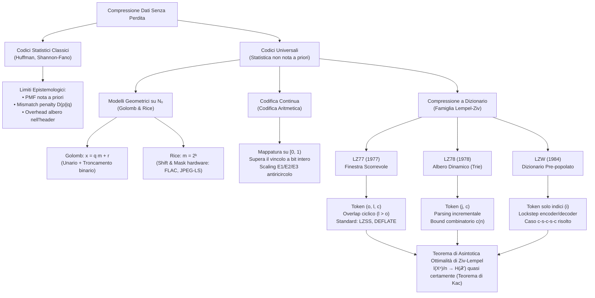

# E. Codici Universali e Compressione Dizionario

Nei capitoli precedenti abbiamo costruito la teoria fondamentale della codifica di sorgente senza perdita (_lossless_), culminata nell'algoritmo di Huffman e nei codici ottimi di Shannon. Tuttavia, l'efficienza teorica di tali schemi poggia su un'ipotesi restrittiva: la perfetta e preliminare conoscenza della funzione di massa di probabilità (PMF) $p(x)$ che governa la sorgente.

Nelle applicazioni ingegneristiche reali, nei moderni sistemi informatici e nelle telecomunicazioni, questa condizione è quasi sempre inapplicabile:
1. La statistica dei dati non è nota a priori: si pensi a un archivio contenente codice sorgente, testo formattato, eseguibili binari e matrici numeriche eterogenee.
2. Molti processi reali sono non stazionari: la frequenza locale dei caratteri varia continuamente lungo il flusso.
3. Spesso i dati consistono in una singola sequenza finita e deterministica (come un firmware o un genoma) priva di un _ensemble_ probabilistico sottostante, la cui comprimibilità limite risponde ai canoni della __complessità di Kolmogorov__.

Un approccio empirico a due passate (_offline_), in cui calcoliamo l'istogramma dei caratteri nella prima passata e codifichiamo nella seconda mediante Huffman, introduce latenze inaccettabili nei sistemi in streaming e impone di trasmettere l'albero o la tabella di decodifica nell'header, introducendo un sensibile sovraccarico (_overhead_).

La __codifica universale di sorgente__ supera questo scoglio mediante algoritmi a singola passata (_online_ / _streaming_): il codificatore non assume alcuna conoscenza probabilistica iniziale, ma "apprende" la struttura statistica del flusso durante l'elaborazione dei simboli, sfruttando progressivamente le regolarità riscontrate per comprimere il testo.

## Limiti Epistemologici dei Codici Statistici Classici

Perché Huffman e Shannon-Fano falliscono nei contesti industriali moderni? Quando progettiamo un codice prefisso assumendo una distribuzione nominale $q(x)$ differente dalla vera distribuzione di sorgente $p(x)$, paghiamo una penalità inevitabile denominata __costo di mismatch__.

La lunghezza media attesa del codice $L_q$ rispetto alla vera misura $p(x)$ soddisfa:

$$
L_q = \sum_{x \in \mathcal{X}} p(x) l_q(x) \approx \sum_{x \in \mathcal{X}} p(x) \log_2 \frac{1}{q(x)}
$$

Scomponendo il logaritmo mediante il rapporto tra probabilità:

$$
L_q = \sum_{x \in \mathcal{X}} p(x) \log_2 \frac{p(x)}{q(x)} + \sum_{x \in \mathcal{X}} p(x) \log_2 \frac{1}{p(x)} = H(p) + D(p \parallel q)
$$

Notiamo che il costo medio di codifica si incrementa esattamente della __divergenza di Kullback-Leibler__ $D(p \parallel q) \ge 0$. Se stimiamo male la statistica o se la sorgente cambia regime stazionario nel tempo, $D(p \parallel q)$ degrada l'efficienza di compressione fino a rendere il flusso codificato più lungo del messaggio grezzo.

Inoltre, trasmettere la tabella dei simboli o l'albero di Huffman al decodificatore richiede un costo di testata pari a:

$$
\text{Overhead}_{\text{header}} = O(|\mathcal{X}| \log_2 |\mathcal{X}|) \quad \text{bit}
$$

Su blocchi di dati medio-piccoli, questo overhead annulla qualsiasi beneficio di compressione. Da qui nasce la necessità di costruire algoritmi universali che comprimano senza richiedere né stimare esplicitamente $p(x)$.

## Definizione Formale di Codice Universale

Diamo una definizione rigorosa di universalità nel senso della teoria dell'informazione.

Sia $\mathcal{S}$ una classe di sorgenti stocastiche stazionarie ed ergodiche $\mathbf{X} = \{X_i\}_{i \ge 1}$ definite su un medesimo alfabeto finito $\mathcal{X}$. Una successione di codici di sorgente $\{C_n\}_{n \ge 1}$, dove $C_n: \mathcal{X}^n \to \{0, 1\}^*$, è definita __debolmente universale__ per la classe $\mathcal{S}$ se il tasso medio di compressione per simbolo converge all'entropy rate $H(\mathbf{X})$ della sorgente:

$$
\limsup_{n \to \infty} \frac{1}{n} \mathbb{E}\left[ l(C_n(X^n)) \right] \le H(\mathbf{X}) \quad \forall \mathbf{X} \in \mathcal{S}
$$

Il codice è detto __fortemente universale__ (o universale quasi certamente) se la convergenza si verifica con probabilità 1 per ogni singola sequenza infinita generata dalla sorgente:

$$
\lim_{n \to \infty} \frac{1}{n} l(C_n(X^n)) = H(\mathbf{X}) \quad \text{quasi certamente}
$$

Né il trasmettitore né il ricevitore necessitano di conoscere la PMF della sorgente o i parametri di transizione: il codice estrae l'informazione comprimibile unicamente dalle correlazioni e dalle ricorrenze lessicali del testo.

## Codici di Golomb e Rice per Distribuzioni Geometriche

Nei contesti applicativi in cui i dati da comprimere sono numeri interi non negativi $x \in \mathbb{N}_0 = \{0, 1, 2, \dots\}$ con probabilità monotona decrescente, l'alfabeto di sorgente è infinito numerabile. La costruzione di un classico albero di Huffman richiederebbe una tabella infinita, risultando impraticabile.

Questo scenario si riscontra regolarmente:
- Nelle lunghezze delle sequenze di zeri nella codifica Run-Length (RLC);
- Negli errori di predizione (residui differenziali) nei codec lossless audio, video e per immagini;
- Nelle matrici di coefficienti spettrali quantizzati.

La famiglia dei __codici di Golomb__ (Solomon Golomb, 1966) e la sua specializzazione binaria, i __codici di Rice__ (Robert Rice, 1979), risolvono il problema con un modello parametrico analitico a complessità minima.

### Modello di Sorgente e Decomposizione Euclidea

Consideriamo una variabile aleatoria discreta $X \in \mathbb{N}_0$ con distribuzione geometrica unificata di parametro $\theta \in (0, 1)$ (indicato talvolta con $p$):

$$
p(x) = (1 - \theta) \theta^x, \quad x = 0, 1, 2, \dots
$$

Fissato un intero positivo $M \ge 1$ (parametro di Golomb), scomponiamo qualsiasi intero $x \ge 0$ tramite divisione euclidea:

$$
x = q M + r
$$

dove:
- $q = \left\lfloor \frac{x}{M} \right\rfloor \in \{0, 1, 2, \dots\}$ è il quoziente intero;
- $r = x \bmod M \in \{0, 1, \dots, M-1\}$ è il resto.

Esaminiamo la probabilità congiunta della coppia $(q, r)$:

$$
p(x) = p(q M + r) = (1 - \theta) \theta^{q M + r} = (\theta^M)^q \cdot (1 - \theta) \theta^r
$$

Calcoliamo ora la probabilità marginale del quoziente $q$:

$$
p_Q(q) = \sum_{r=0}^{M-1} p(q M + r) = (1 - \theta) \theta^{q M} \sum_{r=0}^{M-1} \theta^r = (1 - \theta) \theta^{q M} \frac{1 - \theta^M}{1 - \theta} = (1 - \theta^M) (\theta^M)^q
$$

Notiamo che il quoziente $q$ segue esattamente una distribuzione geometrica di parametro $\theta^M$.

Valutiamo ora la distribuzione condizionata del resto $r$ dato $q$:

$$
p_{R \mid Q}(r \mid q) = \frac{p(q M + r)}{p_Q(q)} = \frac{(1 - \theta) \theta^{q M + r}}{(1 - \theta^M) \theta^{q M}} = \frac{1 - \theta}{1 - \theta^M} \theta^r
$$

Questa espressione non dipende in alcun modo da $q$. Di conseguenza, __il quoziente $q$ e il resto $r$ sono variabili aleatorie statisticamente indipendenti__. L'albero di codifica ottimo si scompone nel prodotto di due codici indipendenti: uno per il quoziente e uno per il resto.

### Codice Unario per Sorgenti Diadiche

La codifica più elementare per il quoziente $q$ è il __codice unario__: rappresentiamo $q$ con $q$ bit posti a '1' seguiti da un bit di terminazione '0':

$$
C_{\text{unario}}(q) = \underbrace{11\dots1}_{q \text{ volte}} 0
$$

La lunghezza della parola di codice è $l(q) = q + 1$ bit:
- $q = 0 \implies 0$ (1 bit)
- $q = 1 \implies 10$ (2 bit)
- $q = 2 \implies 110$ (3 bit)
- $q = 3 \implies 1110$ (4 bit)

Il codice unario coincide con il codice di Huffman ottimo per una sorgente geometrica avente parametro diadico $\theta = 1/2$, la cui probabilità vale $p(q) = 2^{-(q+1)}$. Poiché $l(q) = -\log_2 p(q)$, l'efficienza è identicamente pari al $100\%$ e il codice raggiunge l'entropia della sorgente.

### Struttura del Codice di Golomb e Teorema di Gallager-Van Voorhis

Robert Gallager e David Van Voorhis (1975) hanno dimostrato che il codice di Huffman ottimo su alfabeto infinito per una distribuzione geometrica coincide con il codice di Golomb se e solo se il parametro $M$ è l'unico intero che soddisfa la relazione:

$$
\theta^M + \theta^{M+1} \le 1 < \theta^M + \theta^{M-1}
$$

la cui soluzione chiusa ottimale vale:

$$
M = \left\lceil -\frac{\log_2(1 + \theta)}{\log_2 \theta} \right\rceil
$$

Sotto questa scelta ottimale, $\theta^M \approx 1/2$. Il quoziente $q$ ha una distribuzione geometrica quasi diadica, per cui la sua codifica mediante codice unario risulta strettamente ottima.

Per codificare il resto $r \in \{0, 1, \dots, M-1\}$, utilizziamo un __codice a troncamento binario__ (_Truncated Binary Code_):
1. Calcoliamo la potenza inferiore di due $k = \lfloor \log_2 M \rfloor$ e il disavanzo $u = 2^{k+1} - M$.
2. Se $r < u$, assegniamo a $r$ una rappresentazione binaria standard su $k$ bit.
3. Se $r \ge u$, assegniamo a $r$ una rappresentazione binaria su $k + 1$ bit del valore traslato $r + u$.

In questo modo, i simboli più probabili (quelli con resto piccolo) ricevono $k$ bit, mentre i simboli meno probabili ricevono $k+1$ bit, rispettando rigorosamente la condizione del prefisso di Kraft-McMillan.

La parola di codice finale per l'intero $x$ è la concatenazione:

$$
C_M(x) = \big[ C_{\text{unario}}(q) \big] \, \big[ C_{\text{troncato}}(r) \big]
$$

### Esempio Operativo Dettagliato: Golomb con Parametro $M = 5$

Progettiamo il codice di Golomb per $M = 5$:
- $k = \lfloor \log_2 5 \rfloor = 2$
- $k + 1 = 3$
- $u = 2^{2+1} - 5 = 8 - 5 = 3$

I primi $u = 3$ resti ($r \in \{0, 1, 2\}$) sono codificati con $k = 2$ bit:
- $r = 0 \to 00$
- $r = 1 \to 01$
- $r = 2 \to 10$

I restanti $M - u = 2$ resti ($r \in \{3, 4\}$) sono codificati con $k + 1 = 3$ bit rappresentando $r + u = r + 3$:
- $r = 3 \to 3 + 3 = 6 \to 110_2$
- $r = 4 \to 4 + 3 = 7 \to 111_2$

Verifichiamo la codifica per vari interi non negativi $x$:

| Intero $x$ | Quoziente $q = \lfloor x/5 \rfloor$ | Resto $r = x \bmod 5$ | Codice Quoziente (Unario) | Codice Resto (Troncato) | Parola di Codice $C_5(x)$ | Lunghezza Totale |
| :---: | :---: | :---: | :---: | :---: | :---: | :---: |
| 0 | 0 | 0 | `0` | `00` | `0 00` | 3 bit |
| 1 | 0 | 1 | `0` | `01` | `0 01` | 3 bit |
| 2 | 0 | 2 | `0` | `10` | `0 10` | 3 bit |
| 3 | 0 | 3 | `0` | `110` | `0 110` | 4 bit |
| 4 | 0 | 4 | `0` | `111` | `0 111` | 4 bit |
| 5 | 1 | 0 | `10` | `00` | `10 00` | 4 bit |
| 8 | 1 | 3 | `10` | `110` | `10 110` | 5 bit |
| 13 | 2 | 3 | `110` | `110` | `110 110` | 6 bit |

Se dobbiamo comprimere interi relativi $x \in \mathbb{Z}$ (come gli errori di predizione che oscillano attorno allo zero), applichiamo la mappatura a zigzag biunivoca $\mathbb{Z} \to \mathbb{N}_0$:

$$
x_{\text{mappato}} = \begin{cases} 2x & \text{se } x \ge 0 \\ 2|x| - 1 & \text{se } x < 0 \end{cases}
$$

che ordina i numeri secondo la sequenza $0, -1, +1, -2, +2, -3, +3, \dots \to 0, 1, 2, 3, 4, 5, 6, \dots$.

### Codici di Rice ed Efficienza di Calcolo Hardware

Quando vincoliamo il parametro $M$ ad essere una potenza intera di due:

$$
M = 2^k, \quad k \in \mathbb{N}_0
$$

il codice prende il nome di __codice di Rice__ (Robert Rice, 1979). In questa configurazione notiamo che:

$$
u = 2^{k+1} - 2^k = 2^k = M
$$

Il numero di resti da codificare con $k$ bit coincide con l'intero insieme dei resti ($u = M$). Di conseguenza, __tutti i resti $r$ sono codificati con una parola binaria a lunghezza fissa di esattamente $k$ bit__.

Questo conferisce ai codici di Rice un vantaggio hardware enorme nei sistemi embedded, FPGA e DSP:
- Il quoziente $q$ si calcola con un semplice scorrimento logico a destra di $k$ bit: $q = x \gg k$.
- Il resto $r$ si estrae con un'operazione bitwise AND con maschera binaria: $r = x \ \& \ (2^k - 1)$.
- Non è richiesta alcuna operazione di divisione aritmetica o calcolo di modulo, operando a frequenze di clock elevatissime con consumo energetico minimo.

La dimostrazione dell'ottimalità asintotica dei codici di Golomb-Rice è approfondita in [[zz. Argomenti extra#Dimostrazione dell'Ottimalità dei Codici di Golomb per Distribuzioni Geometriche]]. Grazie a questa efficienza, i codici di Rice costituiscono il cuore algoritmico del codec audio lossless FLAC, dello standard per immagini JPEG-LS (ITU-T T.87), della compressione dati per sonde spaziali CCSDS 121.0-B-3 e dei residui di moto nei profili video H.264/MPEG-4 AVC.

## Codifica Aritmetica ad Intervalli Continui

L'algoritmo di Huffman assegna a ciascun simbolo un numero intero di bit di codice ($l_i \in \mathbb{N}$). Sebbene ottimo tra i codici a blocchi prefissati, questo vincolo introduce una severa perdita di efficienza quando la sorgente presenta probabilità sbilanciate.

### Superamento del Vincolo di Lunghezza Intera dei Simboli

Consideriamo una sorgente binaria con simboli fortemente asimmetrici: $p(0) = 0.95$ e $p(1) = 0.05$. L'auto-informazione associata al simbolo più probabile è:

$$
I(0) = -\log_2(0.95) \approx 0.074 \quad \text{bit}
$$

Poiché qualsiasi codice prefisso deve allocare almeno 1 bit per ogni parola di codice, Huffman assegna 1 bit al simbolo '0'. Spendiamo $1.0$ bit per trasmettere un contenuto informativo reale di appena $0.074$ bit: una perdita secca del $92.6\%$. Per avvicinarsi al limite di Shannon con Huffman, dovremmo raggruppare i simboli in blocchi lunghi $n$, ma la complessità dell'albero esploderebbe esponenzialmente ($|\mathcal{X}|^n = 2^n$).

La __codifica aritmetica__ (_Arithmetic Coding_, Jorma Rissanen 1976; Richard Pasco 1976; Witten, Neal & Cleary 1987) supera radicalmente questo limite: invece di associare una stringa di bit a ciascun simbolo isolato, mappa l'intera sequenza di simboli $x_1 x_2 \dots x_n$ in un unico sotto-intervallo del segmento reale unitario $[0, 1)$.

### Fondamento Matematico: La Trasformata Integrale di Probabilità

La codifica aritmetica trae la sua giustificazione analitica dal codice di Shannon-Fano-Elias e dal __Lemma della Trasformata Integrale di Probabilità__:
Sia $Y$ una variabile aleatoria continua con funzione di distribuzione cumulativa $F(y)$. Allora la variabile aleatoria trasformata $U = F(Y)$ è distribuita uniformemente sull'intervallo continuo:

$$
U \sim \mathcal{U}[0, 1]
$$

Se interpretiamo una sequenza infinita di simboli discreti $X_1 X_2 \dots$ come la parte frazionaria di un numero reale $0.X_1 X_2 \dots$, la CDF progressiva mappa tale successione in una variabile uniforme $U \in [0, 1]$. La rappresentazione in base 2 di una variabile distribuita uniformemente su $[0, 1)$ produce una sequenza di bit indipendenti ed equiprobabili ($\text{Bernoulli}(1/2)$). Tali bit possiedono entropia massima pari a 1 bit/simbolo e sono pertanto del tutto incomprimibili: essi costituiscono già la rappresentazione compressa ottima della sequenza.

### Algoritmo di Partizione Progressiva dell'Intervallo

La codifica aritmetica opera ricorsivamente partizionando l'intervallo unitario:
1. Inizializziamo l'intervallo corrente:

$$
[L^{(0)}, H^{(0)}) = [0, 1)
$$

2. All'arrivo del $k$-esimo simbolo $x_k \in \{1, 2, \dots, m\}$ avente probabilità $p(x_k)$ e probabilità cumulata $F(x) = \sum_{y \le x} p(y)$ (ponendo per convenzione $F(0) = 0$), partizioniamo l'intervallo precedente $[L^{(k-1)}, H^{(k-1)})$ in sotto-intervalli proporzionali alla probabilità di ciascun simbolo.
3. Aggiorniamo il limite inferiore $L^{(k)}$ e il limite superiore $H^{(k)}$ mediante le equazioni di scaling:

$$
L^{(k)} = L^{(k-1)} + \left( H^{(k-1)} - L^{(k-1)} \right) F(x_k - 1)
$$

$$
H^{(k)} = L^{(k-1)} + \left( H^{(k-1)} - L^{(k-1)} \right) F(x_k)
$$

L'ampiezza dell'intervallo al termine dell'elaborazione di $n$ simboli indipendenti coincide con la probabilità congiunta dell'intera sequenza:

$$
\text{Width}^{(n)} = H^{(n)} - L^{(n)} = \prod_{k=1}^n p(x_k) = p(x^n)
$$

Qualsiasi numero reale all'interno del sotto-intervallo finale $[L^{(n)}, H^{(n)})$ identifica univocamente la sequenza originale $x^n$.

![[slide_16_arithmetic_coding_3ary_example.png|center mid]]

### Generazione del Bitstream e Dimostrazione dell'Efficienza

Per trasformare l'intervallo finale in un flusso binario univocamente decodificabile:
1. Selezioniamo il punto medio dell'intervallo:

$$
T = \frac{L^{(n)} + H^{(n)}}{2}
$$

2. Tronchiamo l'espansione binaria del valore reale $T$ a un numero di bit pari a:

$$
l(x^n) = \left\lceil -\log_2 p(x^n) \right\rceil + 1 \quad \text{bit}
$$

Perché questa lunghezza garantisce la correttezza? Un troncamento a $l$ bit definisce un intervallo diadico di ampiezza $2^{-l}$. Poiché:

$$
2^{-l} = 2^{-\lceil -\log_2 p(x^n) \rceil - 1} \le 2^{\log_2 p(x^n) - 1} = \frac{p(x^n)}{2} = \frac{\text{Width}^{(n)}}{2}
$$

l'intervallo diadico generato dal troncamento attorno al punto medio $T$ è interamente contenuto all'interno dell'intervallo finale $[L^{(n)}, H^{(n)})$. Questo garantisce che nessun'altra sequenza di simboli possa generare lo stesso prefisso binario, assicurando decodificabilità istantanea e univoca.

Calcoliamo la lunghezza media per simbolo su una sorgente stazionaria di entropia $H(X)$:

$$
\frac{1}{n} \mathbb{E}[l(X^n)] \le \frac{1}{n} \mathbb{E}\left[ -\log_2 p(X^n) + 2 \right] = \frac{n H(X) + 2}{n} = H(X) + \frac{2}{n} \quad \text{bit/simbolo}
$$

Al crescere della lunghezza della sequenza ($n \to \infty$), il termine di overhead additivo $\frac{2}{n}$ tende a zero:

$$
\lim_{n \to \infty} \frac{1}{n} \mathbb{E}[l(X^n)] = H(X)
$$

La codifica aritmetica raggiunge l'entropia della sorgente senza richiedere alcuna aggregazione preliminare in macro-blocchi.

### Esempio Operativo Completo: Alfabeto Ternario

Consideriamo un alfabeto ternario $\mathcal{X} = \{A, B, C\}$ con vettore delle probabilità:

$$
p(A) = 0.40, \quad p(B) = 0.40, \quad p(C) = 0.20
$$

La funzione di distribuzione cumulata vale:

$$
F(A) = 0.40, \quad F(B) = 0.80, \quad F(C) = 1.00 \quad (F(0) = 0)
$$

Vogliamo codificare in streaming la sequenza di 4 simboli:

$$
x^4 = A \, C \, A \, A
$$

Seguiamo l'evoluzione degli estremi passo dopo passo:
- Passo 0: $[L^{(0)}, H^{(0)}) = [0.0000, 1.0000)$, ampiezza $\text{Width} = 1.0000$.
- Passo 1 (Simbolo $A$):
  - $L^{(1)} = 0 + 1.0 \cdot F(0) = 0.0000$
  - $H^{(1)} = 0 + 1.0 \cdot F(A) = 0.4000$
  - Intervallo corrente: $[0.0000, 0.4000)$, ampiezza $0.4000$.
- Passo 2 (Simbolo $C$):
  - Ampiezza precedente: $0.4000 - 0.0000 = 0.4000$.
  - $L^{(2)} = 0.0000 + 0.4000 \cdot F(B) = 0.0000 + 0.4000 \cdot 0.80 = 0.3200$
  - $H^{(2)} = 0.0000 + 0.4000 \cdot F(C) = 0.0000 + 0.4000 \cdot 1.00 = 0.4000$
  - Intervallo corrente: $[0.3200, 0.4000)$, ampiezza $0.0800$.
- Passo 3 (Simbolo $A$):
  - Ampiezza precedente: $0.4000 - 0.3200 = 0.0800$.
  - $L^{(3)} = 0.3200 + 0.0800 \cdot F(0) = 0.3200$
  - $H^{(3)} = 0.3200 + 0.0800 \cdot F(A) = 0.3200 + 0.0800 \cdot 0.40 = 0.3520$
  - Intervallo corrente: $[0.3200, 0.3520)$, ampiezza $0.0320$.
- Passo 4 (Simbolo $A$):
  - Ampiezza precedente: $0.3520 - 0.3200 = 0.0320$.
  - $L^{(4)} = 0.3200 + 0.0320 \cdot F(0) = 0.3200$
  - $H^{(4)} = 0.3200 + 0.0320 \cdot F(A) = 0.3200 + 0.0320 \cdot 0.40 = 0.3328$
  - Intervallo finale: $[0.3200, 0.3328)$.

Verifichiamo la probabilità congiunta:

$$
p(ACAA) = 0.40 \cdot 0.20 \cdot 0.40 \cdot 0.40 = 0.0128
$$

L'ampiezza dell'intervallo finale è esattamente pari a:

$$
H^{(4)} - L^{(4)} = 0.3328 - 0.3200 = 0.0128 = p(ACAA)
$$

Determiniamo il punto medio $T$ e la lunghezza di codice richiesta:

$$
T = \frac{0.3200 + 0.3328}{2} = 0.3264
$$

$$
l = \lceil -\log_2(0.0128) \rceil + 1 = \lceil 6.2877 \rceil + 1 = 7 + 1 = 8 \quad \text{bit}
$$

Convertiamo $T = 0.3264$ in forma binaria tramite moltiplicazioni successive per 2:
- $0.3264 \times 2 = 0.6528 \to 0$
- $0.6528 \times 2 = 1.3056 \to 1$ (residuo $0.3056$)
- $0.3056 \times 2 = 0.6112 \to 0$
- $0.6112 \times 2 = 1.2224 \to 1$ (residuo $0.2224$)
- $0.2224 \times 2 = 0.4448 \to 0$
- $0.4448 \times 2 = 0.8896 \to 0$
- $0.8896 \times 2 = 1.7792 \to 1$ (residuo $0.7792$)
- $0.7792 \times 2 = 1.5584 \to 1$

La sequenza binaria a 8 bit emessa dal codificatore è:

$$
01010011
$$

Il decodificatore confronta il valore frazionario binario $0.01010011_2 \approx 0.3242$ con le soglie cumulative dell'alfabeto, ricostruendo univocamente i simboli $A, C, A, A$.

### Rinormalizzazione e Gestione della Precisione Finita

L'algoritmo teorico presuppone precisione aritmetica infinita. Su un processore reale con registri a 32 o 64 bit, man mano che $n$ cresce l'intervallo si restringe esponenzialmente e i registri collassano per __underflow aritmetico__.

Per consentire l'elaborazione in streaming su registri a dimensione finita, si adottano tre operazioni di __rinormalizzazione dinamica__ (Witten-Neal-Cleary):
1. __Condizione E1 (Entrambi i limiti nella metà inferiore, $H < 0.5$)__: Il bit più significativo (MSB) dei due estremi è identicamente '0'. Il codificatore emette subito il bit '0' nel bitstream e riscala l'intervallo verso l'alto:
   $$
   L \leftarrow 2L, \quad H \leftarrow 2H
   $$
2. __Condizione E2 (Entrambi i limiti nella metà superiore, $L \ge 0.5$)__: Il bit MSB di entrambi gli estremi è identicamente '1'. Il codificatore emette subito il bit '1' e riscala l'intervallo:
   $$
   L \leftarrow 2(L - 0.5), \quad H \leftarrow 2(H - 0.5)
   $$
3. __Condizione E3 (Straddle / Underflow: $L \ge 0.25$ e $H < 0.75$)__: I due estremi convergono verso il centro $0.5$ senza condividere il bit MSB ($L = 0.01\dots_2$ e $H = 0.10\dots_2$). In questo caso l'intervallo collasserebbe senza che possiamo determinare il bit immediato. Si rimuove il secondo bit sottraendo $0.25$ e raddoppiando:
   $$
   L \leftarrow 2(L - 0.25), \quad H \leftarrow 2(H - 0.25)
   $$
   incrementando un contatore interno `underflow_bits`. Non appena si verifica un evento E1 o E2, il codificatore emette il bit principale seguito da `underflow_bits` bit opposti di compensazione.

Grazie a questo meccanismo di scaling, la codifica aritmetica opera indefinitamente con registri interi a 16 o 32 bit. È il principio alla base di CABAC (_Context-Adaptive Binary Arithmetic Coding_) impiegato negli standard video H.264, H.265/HEVC e nelle immagini JPEG 2000.

## Compressione a Finestra Scorrevole: L'Algoritmo LZ77

Gli algoritmi a dizionario abbandonano il paradigma della modellazione probabilistica esplicita: essi sostituiscono sequenze di caratteri ripetuti con riferimenti numerici (puntatori) a occorrenze identiche già comparse in precedenza nel flusso dei dati.

L'algoritmo __LZ77__ (Jacob Ziv & Abraham Lempel, 1977) mantiene in memoria una __finestra scorrevole__ (_Sliding Window_) di dimensione finita $W$, composta da due buffer adiacenti:
1. __Search Buffer__ (buffer di ricerca, dimensione $S_B$): Contiene gli ultimi $S_B$ caratteri già processati e memorizzati nella cronologia recente.
2. __Lookahead Buffer__ (buffer di anticipazione, dimensione $L_B$): Contiene i prossimi $L_B$ simboli entranti da comprimere.

![[lz77_sliding_window_parsing.svg|center mid]]

### Regola di Matching ed Emissione dei Token

Il codificatore analizza i simboli nel lookahead buffer e cerca all'interno del search buffer la più lunga sottostringa identica (_Longest Match_):
- Sia $o$ l'__offset__ (distanza a ritroso rispetto al cursore corrente, $1 \le o \le S_B$) in cui comincia la corrispondenza;
- Sia $l$ la __lunghezza__ del match ($l \ge 0$);
- Sia $c$ il primo __carattere non corrispondente__ (carattere innovatore) che segue immediatamente il match nel lookahead buffer.

L'algoritmo LZ77 classico emette ad ogni passo una tripletta di dati:

$$
(o, l, c)
$$

dove:
- $o$: posizione relativa all'indietro nella finestra di ricerca ($\lceil \log_2 S_B \rceil$ bit);
- $l$: numero di caratteri del match più lungo individuato ($\lceil \log_2 L_B \rceil$ bit);
- $c$: nuovo carattere letterale successivo ($\lceil \log_2 |\mathcal{X}| \rceil$ bit).

Dopo l'emissione del token, la finestra di scansione avanza di $l + 1$ posizioni lungo il flusso del testo.

### La Proprietà di Overlap Ciclico per Pattern Periodici

Una proprietà algebrica fondamentale di LZ77 è la capacità di gestire corrispondenze con __lunghezza superiore all'offset__ ($l > o$).

Come può la lunghezza del match superare la distanza della posizione iniziale rispetto al cursore?
Il decodificatore opera in streaming: per ricostruire i dati legge dal proprio buffer a partire dalla posizione $t - o$ e scrive in avanti. Se $l > o$, mentre il decoder scrive i caratteri, essi diventano immediatamente parte della sorgente di lettura.

Se la sequenza da codificare è un pattern periodico (ad esempio `ABABABAB…` con periodo $o = 2$), un unico token $(o = 2, l = 6, c)$ replica ciclicamente l'intera serie. In questo modo, LZ77 emula nativamente la codifica Run-Length senza richiedere istruzioni speciali.

![[slide_24_lz77_sliding_window_example.png|center mid]]

### Esempio Operativo Dettagliato di LZ77

Codifichiamo la stringa di 16 caratteri su alfabeto binario $\mathcal{X} = \{A, B\}$:

$$
\text{"ABBABBABBBAABABA"}
$$

Assumiamo una finestra di ricerca di dimensione $S_B = 4$ e un lookahead buffer sufficiente ad accogliere i match. All'inizio il search buffer è vuoto.

Esaminiamo l'evoluzione sequenziale adottando la notazione standard LZSS con bit di flag: $(F=0, c)$ per i caratteri non compressi e $(F=1, o, l)$ per i puntatori a ritroso (dove $o$ è l'offset all'indietro nella finestra e $l$ la lunghezza del match):
1. `A`: Search buffer vuoto. Nessun match. Emette token letterale: $(0, A)$ con flag $F=0$. Il search buffer diventa `[A]`.
2. `B`: Nel search buffer è presente `[A]`. Nessun match con `B`. Emette token letterale: $(0, B)$ con flag $F=0$. Search buffer: `[AB]`.
3. `B`: Nel search buffer c'è `[AB]`. Il carattere `B` compare a offset $o = 1$ con lunghezza $l = 1$. Emette token puntatore: $(1, 1, 1)$ con flag $F=1$, offset $o=1$ e lunghezza $l=1$. Search buffer: `[ABB]`.
4. `ABBABB`: Nel search buffer c'è `[ABB]`. La stringa `ABBABB` (6 caratteri) comincia a offset $o = 3$ e si ripete sfruttando l'overlap ciclico ($l = 6 > o = 3$). Emette token puntatore con overlap: $(1, 3, 6)$ con flag $F=1$, offset $o=3$ e lunghezza $l=6$. Search buffer aggiornato agli ultimi 4 caratteri: `[BABB]`.
5. `BA`: Nel search buffer `[BABB]`, la stringa `BA` comincia a offset $o = 4$ con lunghezza $l = 2$. Emette token puntatore: $(1, 4, 2)$ con flag $F=1$, offset $o=4$ e lunghezza $l=2$. Search buffer: `[BBBA]`.
6. `A`: Nel search buffer `[BBBA]`, il carattere `A` si trova a offset $o = 1$ con lunghezza $l = 1$. Emette token puntatore: $(1, 1, 1)$ con flag $F=1$, offset $o=1$ e lunghezza $l=1$. Search buffer: `[BBAA]`.
7. `BA`: Nel search buffer `[BBAA]`, la stringa `BA` compare a offset $o = 3$ con lunghezza $l = 2$. Emette token puntatore: $(1, 3, 2)$ con flag $F=1$, offset $o=3$ e lunghezza $l=2$. Search buffer: `[AABA]`.
8. `BA`: Nel search buffer `[AABA]`, la stringa `BA` compare a offset $o = 2$ con lunghezza $l = 2$. Emette token puntatore: $(1, 2, 2)$ con flag $F=1$, offset $o=2$ e lunghezza $l=2$.

La sequenza emessa in notazione a token con flag binario di discriminazione (variante LZSS) produce 8 token:

$$
(0, A), \, (0, B), \, (1, 1, 1), \, (1, 3, 6), \, (1, 4, 2), \, (1, 1, 1), \, (1, 3, 2), \, (1, 2, 2)
$$

Valutiamo il costo in bit:
- Token letterale $(F = 0, C)$: 1 bit per il flag $F=0$ e 1 bit per il carattere ($A=0, B=1$), per un totale di 2 bit.
- Token puntatore $(F = 1, o-1, l-1)$: 1 bit per il flag $F=1$, 2 bit per l'offset ($S_B=4 \implies 2$ bit) e 3 bit per la lunghezza ($L_B \le 8 \implies 3$ bit), per un totale di 6 bit.

Il flusso binario complessivo richiede esattamente 40 bit:

$$
\underbrace{00}_{(0,A)} \quad \underbrace{01}_{(0,B)} \quad \underbrace{100000}_{(1,1,1)} \quad \underbrace{110101}_{(1,3,6)} \quad \underbrace{111001}_{(1,4,2)} \quad \underbrace{100000}_{(1,1,1)} \quad \underbrace{110001}_{(1,3,2)} \quad \underbrace{101001}_{(1,2,2)}
$$

### Varianti Industriali: LZSS e DEFLATE

Nella formulazione originaria di LZ77, l'emissione del carattere innovatore $c$ in ogni token comporta uno spreco di bit quando incontriamo corrispondenze molto lunghe. Al contempo, emettere un puntatore $(o, l)$ per un match di 1 solo carattere occupa più bit del carattere grezzo stesso.

Per risolvere queste inefficienze sono nate due evoluzioni fondamentali:
1. __LZSS (Lempel-Ziv-Storer-Szymanski, 1982)__: Introduce un flag iniziale a 1 bit che discrimina tra:
   - Token Letterale $(0, c)$: emesso quando non c'è match o quando $l < 2$ (evita l'overhead del puntatore);
   - Token Puntatore $(1, o, l)$: emesso quando il match è conveniente ($l \ge 2$), omettendo il carattere letterale esplicito.
2. __DEFLATE (Phil Katz, 1991)__: È lo standard industriale che muove l'archiviazione dati mondiale (`ZIP`, `GZIP`, `tar.gz`, file `.png` e compressione HTTP/HTTPS). DEFLATE combina LZSS con una finestra $S_B = 32\text{ KB}$ e $L_B = 258\text{ byte}$, e sottopone i token emessi a una successiva compressione mediante codici di Huffman canonici bivariati: un albero per i simboli letterali e le lunghezze dei match, e un secondo albero per le distanze di offset.

### Fondamento Analitico: Il Teorema del Tempo di Ricorrenza di Kac

Perché LZ77 è asintoticamente universale? L'ottimalità asintotica globale di LZ77 è stata dimostrata da Wyner e Ziv (1989) sfruttando il __Lemma del Tempo di Ritorno di Kac__ (1947).

Per qualsiasi processo stazionario ed ergodico, il tempo medio di prima ricorrenza $R_n$ necessario per riosservare all'indietro una sequenza tipica di $n$ simboli soddisfa:

$$
\mathbb{E}\left[ R_n(X^n) \mid X^n = x^n \right] = \frac{1}{p(x^n)}
$$

Prendendo il logaritmo e passando al limite per $n \to \infty$:

$$
\lim_{n \to \infty} \frac{1}{n} \log_2 R_n(X^n) = H(\mathcal{X}) \quad \text{quasi certamente}
$$

Ciò implica che una sequenza tipica di lunghezza $n$ ricorre nel passato a una distanza media $W \approx 2^{n H(\mathcal{X})}$. Per codificare l'offset in una finestra di tale dimensione occorrono $\log_2 W \approx n H(\mathcal{X})$ bit. Il costo per simbolo di sorgente è quindi:

$$
\frac{\text{Costo del puntatore}}{n} \approx \frac{\log_2 W}{n} = \frac{n H(\mathcal{X})}{n} = H(\mathcal{X}) \quad \text{bit/simbolo}
$$

La derivazione integrale è disponibile in [[zz. Argomenti extra#Teorema del Tempo di Ricorrenza di Kac e Ottimalità Asintotica di LZ77]].

## Compressione ad Albero di Prefissi: L'Algoritmo LZ78

Mentre LZ77 effettua ricerche all'interno di un buffer lineare a memoria limitata, l'algoritmo __LZ78__ (Ziv & Lempel 1978) memorizza le frasi incontrate in un __dizionario dinamico indicizzato ad albero__. In questo modo, l'algoritmo non soffre della perdita di memoria dovuta allo scorrimento della finestra.

### Meccanismo di Parsing Incrementale ad Albero Dinamico

La sequenza di dati entrante viene segmentata in modo incrementale in una successione di $c(n)$ frasi distinte:

$$
x^n = w_1 \, w_2 \, \dots \, w_{c(n)}
$$

secondo la regola fondamentale:
Ogni frase $w_k$ è la più breve sottostringa della sequenza che non è mai comparsa tra le frasi registrate nel dizionario fino a quel momento.

Di conseguenza, ogni nuova frase $w_k$ si ottiene estendendo una frase già censita $w_{j(k)}$ (con $0 \le j(k) < k$, dove $w_0 = \epsilon$ denota la stringa vuota associata alla radice) con un singolo carattere innovatore $c_k \in \mathcal{X}$:

$$
w_k = w_{j(k)} \cdot c_k
$$

Il token emesso dal codificatore ad ogni passo è la coppia:

$$
(j, c)
$$

dove:
- $j$ è l'indice numerico del prefisso nel dizionario;
- $c \in \mathcal{X}$ è il nuovo carattere innovatore.

Subito dopo l'emissione del token, la nuova frase $w_k$ viene registrata nel dizionario all'indice $k$. La struttura dati sottostante è un albero di prefissi (_trie_): ogni nodo rappresenta una frase del dizionario e i rami uscenti sono etichettati con i caratteri dell'alfabeto.

![[slide_27_lz78_tree_structure.png|center mid]]

### Struttura del Token ed Esempio Operativo Completo

Applichiamo LZ78 alla medesima sequenza di 17 caratteri su alfabeto $\mathcal{X} = \{A, B\}$:

$$
\text{"ABBABBABBBAABABAA"}
$$

Inizializziamo il dizionario con l'elemento nullo all'indice 0: $D[0] = \epsilon$.

Eseguiamo il parsing passo dopo passo:
1. `A`: Non è nel dizionario. Prefisso vuoto $D[0] = \epsilon$, carattere $A$. Emette $(0, A)$. Inserisce $D[1] = \text{'A'}$.
2. `B`: Non è nel dizionario. Prefisso $\epsilon$, carattere $B$. Emette $(0, B)$. Inserisce $D[2] = \text{'B'}$.
3. `BA`: Legge `B` (presente come $D[2]$), il successivo è `A`. La stringa `BA` non è nel dizionario. Emette $(2, A)$. Inserisce $D[3] = \text{'BA'}$.
4. `BB`: Legge `B` (presente come $D[2]$), il successivo è `B`. La stringa `BB` non è presente. Emette $(2, B)$. Inserisce $D[4] = \text{'BB'}$.
5. `AB`: Legge `A` (presente come $D[1]$), il successivo è `B`. `AB` non è nel dizionario. Emette $(1, B)$. Inserisce $D[5] = \text{'AB'}$.
6. `BBA`: Legge `BB` (presente come $D[4]$), il successivo è `A`. `BBA` non è presente. Emette $(4, A)$. Inserisce $D[6] = \text{'BBA'}$.
7. `ABA`: Legge `AB` (presente come $D[5]$), il successivo è `A`. `ABA` non è presente. Emette $(5, A)$. Inserisce $D[7] = \text{'ABA'}$.
8. `BAA`: Legge `BA` (presente come $D[3]$), il successivo è `A`. `BAA` non è presente. Emette $(3, A)$. Inserisce $D[8] = \text{'BAA'}$.

La sequenza emessa è composta da 8 coppie:

$$
(0, A), \, (0, B), \, (2, A), \, (2, B), \, (1, B), \, (4, A), \, (5, A), \, (3, A)
$$

Poiché l'indice massimo del dizionario richiamato prima dell'emissione dei puntatori è $5$, per rappresentare gli indici bastano $\lceil \log_2 6 \rceil = 3$ bit, a cui aggiungiamo 1 bit per il carattere binario ($A=0, B=1$). Il bitstream completo a 32 bit è dato da:

$$
\underbrace{0000}_{(0,A)} \quad \underbrace{0001}_{(0,B)} \quad \underbrace{0100}_{(2,A)} \quad \underbrace{0101}_{(2,B)} \quad \underbrace{0011}_{(1,B)} \quad \underbrace{1000}_{(4,A)} \quad \underbrace{1010}_{(5,A)} \quad \underbrace{0110}_{(3,A)} \implies 32 \text{ bit}
$$

### Dimostrazione dell'Ottimalità Asintotica e Bound Combinatorio di Ziv-Lempel

L'ottimalità universale di LZ78 si fonda sulla limitazione superiore del numero di frasi distinte $c(n)$ ottenibili dal parsing di una sequenza di $n$ simboli.

Ziv e Lempel (1978) hanno dimostrato che il numero di frasi $c(n)$ è massimizzato quando la sequenza contiene tutte le possibili parole corte prima di quelle lunghe ($|\mathcal{X}|$ frasi di lunghezza 1, $|\mathcal{X}|^2$ di lunghezza 2, e così via). Da tale analisi combinatoria discende il bound superiore uniforme:

$$
c(n) \le \frac{n}{(1 - \epsilon_n) \log_{|\mathcal{X}|} n}
$$

dove $\epsilon_n \to 0$ per $n \to \infty$.

Poiché ciascuna delle $c(n)$ frasi richiede $\lceil \log_2 c(n) \rceil$ bit per l'indice e $\lceil \log_2 |\mathcal{X}| \rceil$ bit per il carattere innovatore, la lunghezza complessiva del codice binario generato soddisfa:

$$
l(x^n) \le c(n) \log_2 c(n) + O(c(n))
$$

Sostituendo il bound combinatorio di $c(n)$:

$$
l(x^n) \le \frac{n}{\log_{|\mathcal{X}|} n} \log_2 \left( \frac{n}{\log_{|\mathcal{X}|} n} \right) \approx n \log_2 |\mathcal{X}|
$$

Applicando il Teorema di Shannon-McMillan-Breiman per processi ergodici (in cui le sequenze generate ricadono nell'insieme tipico di entropia $H(\mathcal{X})$), Ziv e Lempel hanno dimostrato che:

$$
\lim_{n \to \infty} \frac{l(X^n)}{n} = H(\mathcal{X}) \quad \text{quasi certamente}
$$

La trattazione analitica integrale del lemma combinatorio è documentata in [[zz. Argomenti extra#Dimostrazione del Teorema di Ziv-Lempel sull'Efficienza Asintotica di LZ78]].

## L'Algoritmo LZW (Lempel-Ziv-Welch)

Nell'algoritmo LZ78 classico, l'emissione del carattere letterale esplicito $c$ ad ogni passo genera un overhead sensibile. Nel 1984, Terry A. Welch propose una variante ingegneristica denominata __LZW__ (_A Technique for High-Performance Data Compression_), destinata a diventare lo standard de facto dell'informatica per oltre un ventennio.

### Architettura a Dizionario Pre-Popolato

L'intuizione fondamentale di Welch consiste nel __pre-popolare il dizionario__ con tutti i singoli simboli dell'alfabeto elementare prima di iniziare la compressione.

Nel caso standard di un flusso di byte a 8 bit ($|\mathcal{X}| = 256$):
- Le posizioni iniziali (indici da $0$ a $255$) sono pre-assegnate a tutti i singoli caratteri ASCII/byte isolati;
- Il token emesso dal codificatore non contiene più alcun carattere letterale: esso è costituito __esclusivamente da un indice intero di dizionario__.

### Sincronizzazione Encoder-Decoder in Lockstep

Come fa il decodificatore a comprendere le stringhe se trasmettiamo solo indici numerici?
Il ricevitore possiede lo stesso dizionario iniziale pre-popolato (indici $0\text{–}255$).
- Quando l'encoder individua nel dizionario la più lunga sequenza corrispondente $S$ e legge il simbolo successivo $c$, emette l'indice di $S$ e memorizza nel proprio dizionario la stringa estesa $S \cdot c$.
- Quando il decoder riceve l'indice di $S$, emette la stringa $S$ e, conoscendo la stringa decodificata al passo precedente, inserisce anch'esso nel proprio dizionario la stringa estesa.

I due dizionari si aggiornano in perfetto sincronismo (_lockstep_) senza che sia necessario inviare stringhe esplicite sul canale di comunicazione.

### Esempio Operativo Dettagliato di LZW

Comprimiamo la medesima sequenza di 17 caratteri `ABBABBABBBAABABAA` sull'alfabeto binario $\{A, B\}$.
- Pre-popolazione: Indice 1 = `A`, Indice 2 = `B`.

Evoluzione sequenziale:
1. Legge `A`. Successivo `B`. La stringa `AB` non è nel dizionario. Emette l'indice di `A` (__1__). Inserisce Indice 3 = `AB`.
2. Legge `B`. Successivo `B`. `BB` non è presente. Emette l'indice di `B` (__2__). Inserisce Indice 4 = `BB`.
3. Legge `B`. Successivo `A`. `BA` non è presente. Emette l'indice di `B` (__2__). Inserisce Indice 5 = `BA`.
4. Legge `AB` (presente all'indice 3). Successivo `B`. `ABB` non è presente. Emette indice __3__ (`AB`). Inserisce Indice 6 = `ABB`.
5. Legge `BA` (presente all'indice 5). Successivo `B`. `BAB` non è presente. Emette indice __5__ (`BA`). Inserisce Indice 7 = `BAB`.
6. Legge `BB` (presente all'indice 4). Successivo `B`. `BBB` non è presente. Emette indice __4__ (`BB`). Inserisce Indice 8 = `BBB`.
7. Legge `BA` (presente all'indice 5). Successivo `A`. `BAA` non è presente. Emette indice __5__ (`BA`). Inserisce Indice 9 = `BAA`.
8. Legge `AB` (presente all'indice 3). Successivo `A`. `ABA` non è presente. Emette indice __3__ (`AB`). Inserisce Indice 10 = `ABA`.
9. Legge `ABA` (presente all'indice 10). Successivo `A`. `ABAA` non è presente. Emette indice __10__ (`ABA`). Inserisce Indice 11 = `ABAA`.
10. Legge `A` (presente all'indice 1). Fine sequenza. Emette l'indice finale __1__ (`A`).

La sequenza emessa da LZW consiste in 10 indici interi:

$$
1, \, 2, \, 2, \, 3, \, 5, \, 4, \, 5, \, 3, \, 10, \, 1
$$

Codificando gli indici con larghezza di bit progressiva commisurata alla cardinalità del dizionario:

$$
\underbrace{0}_{(1)} \quad \underbrace{01}_{(2)} \quad \underbrace{01}_{(2)} \quad \underbrace{010}_{(3)} \quad \underbrace{100}_{(5)} \quad \underbrace{011}_{(4)} \quad \underbrace{100}_{(5)} \quad \underbrace{0010}_{(3)} \quad \underbrace{1001}_{(10)} \quad \underbrace{0000}_{(1)}
$$

otteniamo un costo di soli __29 bit__, a fronte dei 40 bit di LZ77 e dei 32 bit di LZ78 sulla stessa stringa.

### Risoluzione del Caso Limite Eccezionale di Decodifica

Nell'algoritmo LZW esiste una singolarità di decodifica ben nota che si verifica quando la sorgente genera un pattern del tipo $c \cdot s \cdot c \cdot s \cdot c$ (dove $c$ è un carattere e $s$ una sottostringa, es. `ABABABA`):
1. Il codificatore legge una stringa già presente nel dizionario, incontra un carattere, inserisce la nuova stringa $S$ nel dizionario ed emette il relativo indice.
2. Al passo immediatamente successivo, l'encoder incontra nuovamente la stessa stringa $S$ appena creata ed emette subito il suo indice.
3. Quando il decodificatore riceve questo indice, constata che tale numero __non è ancora stato registrato__ nel proprio dizionario locale: l'indice ricevuto corrisponde esattamente alla voce che il decoder sta per definire al passo corrente.

Welch dimostrò che questo paradosso si risolve in modo deterministico: la stringa ignota ha necessariamente come primo e ultimo carattere il medesimo simbolo iniziale della frase decodificata al passo precedente:

$$
S_{\text{ignota}} = S_{\text{precedente}} \cdot \text{FirstChar}(S_{\text{precedente}})
$$

Applicando questa regola di deduzione logica, il decodificatore inserisce la stringa corretta nel dizionario senza richiedere alcuna informazione aggiuntiva dal trasmettitore.

### Standard Applicativi di LZW

L'algoritmo LZW è stato impiegato nelle più diffuse tecnologie informatiche:
- Lo storico comando di sistema `compress` degli ambienti UNIX;
- Il formato grafico d'immagine `GIF` (Graphics Interchange Format, 1987), con codifica ad ampiezza variabile da 9 a 12 bit;
- Il formato di archiviazione grafica ad alta risoluzione `TIFF`;
- La compressione dei flussi vettoriali e testuali nei file `PDF`;
- Lo standard per comunicazioni modem su linea commutata `ITU-T V.42bis`.

## Quadro Sinottico Comparativo dei Metodi di Compressione

Mettiamo a confronto l'intero spettro delle tecnologie di codifica analizzate nel corso:

| Algoritmo | Conoscenza Statistica Richiesta | Modello Operativo | Lunghezza Media per Simbolo | Complessità di Memoria | Standard e Ambiti di Riferimento |
| :--- | :--- | :--- | :--- | :--- | :--- |
| __Huffman__ | PMF $p(x)$ esatta a priori | Simbolo isolato o blocchi prefissati | $H(X) \le L < H(X) + 1$ | Bassa (tabella dell'albero prefisso) | JPEG (codifica DCT finale), MP3, DEFLATE |
| __Golomb-Rice__ | Parametro $\theta$ (distribuzione geometrica) | Quoziente unario + Resto binario troncato | $H(X) \le L < H(X) + 1$ | Minima (operazioni bitwise shift/mask in Rice) | FLAC, JPEG-LS, telemetria satellitare CCSDS |
| __Aritmetica__ | PMF statica o adattiva | Sotto-intervallo continuo in $[0, 1)$ | $H(X) \le \frac{L_n}{n} \le H(X) + \frac{2}{n}$ | Moderata (registri interi con scaling E1/E2/E3) | CABAC (H.264/HEVC), JPEG 2000, VP9 |
| __LZ77__ | Nessuna (Universale, 1-pass) | Puntatori a ritroso $(o, l, c)$ in finestra scorrevole $W$ | $\to H(\mathcal{X})$ per $W \to \infty$ | Costante (limitata alla dimensione di finestra $W$) | `gzip`, `zip`, `PNG`, formato DEFLATE |
| __LZ78__ | Nessuna (Universale, 1-pass) | Parsing incrementale ad albero dinamico $(j, c)$ | $\to H(\mathcal{X})$ per $n \to \infty$ | Crescente con la lunghezza del file (albero _trie_) | Modem ITU-T V.42bis, compressione testuale |
| __LZW__ | Nessuna (Universale, 1-pass) | Dizionario pre-popolato; soli indici interi $(i)$ | $\to H(\mathcal{X})$ per $n \to \infty$ | Controllata (dizionari a $2^{12}$ o $2^{16}$ ingressi con reset) | UNIX `compress`, immagini `GIF`, `TIFF`, `PDF` |

## Takeaway d'Esame e Trabocchetti Operativi

Nelle prove d'esame e nelle applicazioni numeriche, prestiamo particolare attenzione a questi punti critici:

1. __Parametro di Golomb $M$ e Resto Troncato__:
   - Non confondere $\theta$ (probabilità di continuazione) con $1 - \theta$.
   - Nel calcolo del resto troncato, verifica sempre il disavanzo $u = 2^{k+1} - M$. Ricorda che i resti $r < u$ occupano $k$ bit, mentre i resti $r \ge u$ occupano $k+1$ bit codificando il valore traslato $r + u$. Solo nei codici di Rice ($M = 2^k$) tutti i resti hanno esattamente $k$ bit.
2. __Codifica Aritmetica e Troncamento Diadico__:
   - L'ampiezza dell'intervallo finale è sempre identicamente uguale alla probabilità congiunta del blocco: $\text{Width}^{(n)} = p(x^n)$.
   - Per determinare il numero di bit, usa sempre la formula $l = \lceil -\log_2 p(x^n) \rceil + 1$. Il bit $+1$ non è facoltativo: è il margine analitico che garantisce che l'intervallo diadico generato dal troncamento binario cada strettamente all'interno dell'intervallo $[L^{(n)}, H^{(n)})$.
   - Negli esercizi con scaling/rinormalizzazione, ricorda che E1 e E2 scartano i bit MSB identici ('0' e '1'), mentre E3 espande la regione centrale (straddle attorno a 0.5) accumulando bit di underflow.
3. __Proprietà di Overlap in LZ77__:
   - È un errore comune ritenere che la lunghezza del match $l$ non possa superare l'offset $o$. Quando $l > o$, la sequenza si auto-replica periodicamente con periodo $o$. Questa è la modalità con cui LZ77 gestisce la compressione Run-Length.
4. __Distinzione Cruciale tra i Token di LZ78 e LZW__:
   - In __LZ78__, il dizionario parte dalla sola parola vuota $D[0] = \epsilon$. Il token emesso è SEMPRE la coppia $(j, c)$ formata da un puntatore numerico e da un carattere letterale esplicito.
   - In __LZW__, il dizionario parte già popolato con tutti i singoli caratteri dell'alfabeto (indici $0 \dots |\mathcal{X}|-1$). Il token emesso è UNICAMENTE un indice numerico intero $(i)$. Non vengono mai trasmessi caratteri letterali espliciti.
5. __La Singolarità $c \cdot s \cdot c \cdot s \cdot c$ in LZW__:
   - Se in un esercizio di decodifica LZW il ricevitore incontra un indice che corrisponde all'ingresso non ancora inserito nel dizionario, applica immediatamente la formula:
     $$
     S_{\text{ignota}} = S_{\text{precedente}} \cdot S_{\text{precedente}}[0]
     $$
   - Il simbolo mancante è sempre la prima lettera della frase decodificata al passo precedente.
6. __Assunzioni del Teorema di Asintotica Ottimalità__:
   - Gli algoritmi di Ziv-Lempel sono universali perché comprimono senza conoscere la PMF $p(x)$. Tuttavia, la convergenza quasi certa a $H(\mathcal{X})$ richiede che il processo stocastico sottostante sia __stazionario ed ergodico__. Se la sorgente è non ergodica, l'entropy rate oscilla tra diversi regimi e la convergenza si attesta sull'entropia condizionata al regime macroscopico osservato.
