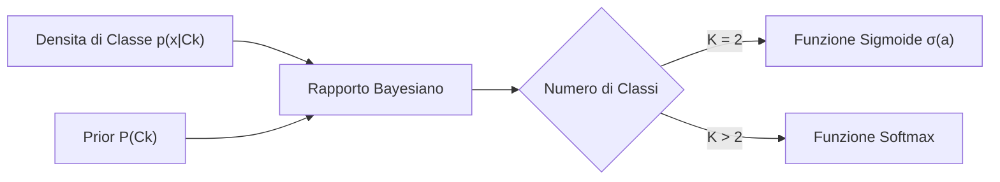

# 5. Modelli Generativi per la Classificazione

I modelli generativi per la classificazione affrontano l'assegnazione delle etichette adottando una prospettiva probabilistica globale. Mentre i modelli discriminativi (come la regressione logistica) modellano direttamente la probabilità condizionata a posteriori della classe date le feature $p(\mathcal{C}_k \mid \mathbf{x})$, i modelli generativi descrivono il meccanismo con cui la natura genera i dati, stimando la distribuzione congiunta $p(\mathbf{x}, \mathcal{C}_k) = p(\mathbf{x} \mid \mathcal{C}_k) P(\mathcal{C}_k)$ per poi invertire il condizionamento mediante il Teorema di Bayes.

In questo capitolo formalizziamo la teoria generale dei modelli generativi, la Linear Discriminant Analysis (LDA) e la Quadratic Discriminant Analysis (QDA) per descrittori continui, la stima analitica di massima verosimiglianza dei parametri, il classificatore Naive Bayes discreto con correzione di Laplace e il modello Bag of Words (BoW) per l'elaborazione del linguaggio naturale.

## Paradigma dei Modelli Generativi

L'obiettivo fondamentale dell'approccio generativo consiste nel modellare la densità di probabilità condizionata di classe $p(\mathbf{x} \mid \mathcal{C}_k)$ e la probabilità a priori della classe $P(\mathcal{C}_k)$.

Conoscendo queste quantità per ciascuna delle $K$ categorie, calcoliamo la probabilità a posteriori che un campione osservato $\mathbf{x}$ appartenga alla classe $\mathcal{C}_k$ invertendo il condizionamento con il Teorema di Bayes:

$$
p(\mathcal{C}_k \mid \mathbf{x}) = \frac{p(\mathbf{x} \mid \mathcal{C}_k) P(\mathcal{C}_k)}{p(\mathbf{x})} = \frac{p(\mathbf{x} \mid \mathcal{C}_k) P(\mathcal{C}_k)}{\sum_{j=1}^K p(\mathbf{x} \mid \mathcal{C}_j) P(\mathcal{C}_j)}
$$

Il denominatore $p(\mathbf{x}) = \sum_{j=1}^K p(\mathbf{x} \mid \mathcal{C}_j) P(\mathcal{C}_j)$ funge da fattore di normalizzazione (_evidenza_), garantendo che la somma delle probabilità a posteriori sull'insieme esaustivo delle classi sia identicamente pari a 1.

### Genesi della Funzione Sigmoide nel Caso Binario

Nel contesto della classificazione binaria con due classi $\mathcal{C}_1$ e $\mathcal{C}_2$, esplicitiamo la probabilità a posteriori per la classe $\mathcal{C}_1$:

$$
p(\mathcal{C}_1 \mid \mathbf{x}) = \frac{p(\mathbf{x} \mid \mathcal{C}_1) P(\mathcal{C}_1)}{p(\mathbf{x} \mid \mathcal{C}_1) P(\mathcal{C}_1) + p(\mathbf{x} \mid \mathcal{C}_2) P(\mathcal{C}_2)}
$$

Dividiamo numeratore e denominatore per la quantità $p(\mathbf{x} \mid \mathcal{C}_1) P(\mathcal{C}_1)$:

$$
p(\mathcal{C}_1 \mid \mathbf{x}) = \frac{1}{1 + \frac{p(\mathbf{x} \mid \mathcal{C}_2) P(\mathcal{C}_2)}{p(\mathbf{x} \mid \mathcal{C}_1) P(\mathcal{C}_1)}}
$$

Riscriviamo il rapporto al denominatore sfruttando l'identità esponenziale $\frac{A}{B} = \exp(-\ln \frac{B}{A})$:

$$
p(\mathcal{C}_1 \mid \mathbf{x}) = \frac{1}{1 + \exp(-a(\mathbf{x}))} = \sigma(a(\mathbf{x}))
$$

dove la quantità scalare $a(\mathbf{x})$ rappresenta il logaritmo del rapporto tra le probabilità congiunte delle due classi (log-odds ratio):

$$
a(\mathbf{x}) = \ln \left( \frac{p(\mathbf{x} \mid \mathcal{C}_1) P(\mathcal{C}_1)}{p(\mathbf{x} \mid \mathcal{C}_2) P(\mathcal{C}_2)} \right) = \ln \frac{p(\mathbf{x} \mid \mathcal{C}_1)}{p(\mathbf{x} \mid \mathcal{C}_2)} + \ln \frac{P(\mathcal{C}_1)}{P(\mathcal{C}_2)}
$$

> [!NOTE] Emersione Analitica della Funzione Sigmoide
> La funzione logistica non costituisce una scelta euristica posticcia introdotta per comprimere l'asse reale nell'intervallo $(0, 1)$: essa scaturisce in modo rigoroso e necessario dall'inversione bayesiana delle densità congiunte nel caso a due classi. La geometria del confine decisionale dipenderà unicamente dal comportamento funzionale di $a(\mathbf{x})$.

### Genesi della Funzione Softmax nel Caso Multi-Classe

Estendiamo l'analisi al problema generale con $K > 2$ classi. Definiamo per ogni categoria $k \in \{1, \dots, K\}$ l'argomento logaritmico:

$$
a_k(\mathbf{x}) = \ln \left( p(\mathbf{x} \mid \mathcal{C}_k) P(\mathcal{C}_k) \right) \iff \exp(a_k(\mathbf{x})) = p(\mathbf{x} \mid \mathcal{C}_k) P(\mathcal{C}_k)
$$

Sostituendo tale equivalenza nella regola bayesiana, otteniamo:

$$
p(\mathcal{C}_k \mid \mathbf{x}) = \frac{\exp(a_k(\mathbf{x}))}{\sum_{j=1}^K \exp(a_j(\mathbf{x}))} = \mathrm{softmax}(a_k(\mathbf{x}))
$$

La funzione Softmax rappresenta l'estensione multivariata esatta della sigmoide ed emerge in via diretta dalla normalizzazione probabilistica su $K$ ipotesi mutualmente esclusive.

## Densita Condizionate Gaussiane

Quando le feature di ingresso $\mathbf{x} \in \mathbb{R}^{D \times 1}$ sono variabili continue a valori reali, l'assunzione di riferimento consiste nel modellare le densità condizionate di classe mediante distribuzioni Gaussiane multivariate:

$$
p(\mathbf{x} \mid \mathcal{C}_k) = \mathcal{N}(\mathbf{x} \mid \boldsymbol{\mu}_k, \mathbf{\Sigma}_k) = \frac{1}{(2\pi)^{D/2} |\mathbf{\Sigma}_k|^{1/2}} \exp\left( -\frac{1}{2} (\mathbf{x} - \boldsymbol{\mu}_k)^T \mathbf{\Sigma}_k^{-1} (\mathbf{x} - \boldsymbol{\mu}_k) \right)
$$

dove $\boldsymbol{\mu}_k \in \mathbb{R}^{D \times 1}$ rappresenta il baricentro medio della classe $k$-esima e $\mathbf{\Sigma}_k \in \mathbb{R}^{D \times D}$ è la corrispondente matrice di covarianza (simmetrica e definita positiva). La classe di modelli generativi fondata su questa distribuzione prende il nome di __Gaussian Discriminant Analysis (GDA)__.

## Linear Discriminant Analysis

L'assunzione cardine della __Linear Discriminant Analysis (LDA)__ stabilisce che tutte le classi condividano la __medesima matrice di covarianza__:

$$
\mathbf{\Sigma}_k = \mathbf{\Sigma} \quad \forall k \in \{1, \dots, K\}
$$

Sotto tale vincolo, le distribuzioni gaussiane delle differenti classi presentano dispersione, orientamento ed eccentricità identici nello spazio delle feature, differendo unicamente per la collocazione spaziale del rispettivo baricentro $\boldsymbol{\mu}_k$.

### Derivazione del Decision Boundary Lineare nel Caso Binario

Per ricavare il confine di decisione nel caso a due classi ($K = 2$), sviluppiamo l'argomento $a(\mathbf{x})$ della funzione sigmoide:

$$
a(\mathbf{x}) = \ln \frac{p(\mathbf{x} \mid \mathcal{C}_1)}{p(\mathbf{x} \mid \mathcal{C}_2)} + \ln \frac{P(\mathcal{C}_1)}{P(\mathcal{C}_2)}
$$

Sostituendo la densità normale multivariata con covarianza comune $\mathbf{\Sigma}$, i fattori moltiplicativi di normalizzazione $(2\pi)^{-D/2} |\mathbf{\Sigma}|^{-1/2}$ sono identici e si elidono a vicenda nel quoziente:

$$
\ln \frac{p(\mathbf{x} \mid \mathcal{C}_1)}{p(\mathbf{x} \mid \mathcal{C}_2)} = -\frac{1}{2} (\mathbf{x} - \boldsymbol{\mu}_1)^T \mathbf{\Sigma}^{-1} (\mathbf{x} - \boldsymbol{\mu}_1) + \frac{1}{2} (\mathbf{x} - \boldsymbol{\mu}_2)^T \mathbf{\Sigma}^{-1} (\mathbf{x} - \boldsymbol{\mu}_2)
$$

Espandiamo le due forme quadratiche sfruttando la simmetria di $\mathbf{\Sigma}^{-1}$, per cui $\mathbf{x}^T \mathbf{\Sigma}^{-1} \boldsymbol{\mu} = \boldsymbol{\mu}^T \mathbf{\Sigma}^{-1} \mathbf{x}$:

$$
(\mathbf{x} - \boldsymbol{\mu}_1)^T \mathbf{\Sigma}^{-1} (\mathbf{x} - \boldsymbol{\mu}_1) = \mathbf{x}^T \mathbf{\Sigma}^{-1} \mathbf{x} - 2 \boldsymbol{\mu}_1^T \mathbf{\Sigma}^{-1} \mathbf{x} + \boldsymbol{\mu}_1^T \mathbf{\Sigma}^{-1} \boldsymbol{\mu}_1
$$

$$
(\mathbf{x} - \boldsymbol{\mu}_2)^T \mathbf{\Sigma}^{-1} (\mathbf{x} - \boldsymbol{\mu}_2) = \mathbf{x}^T \mathbf{\Sigma}^{-1} \mathbf{x} - 2 \boldsymbol{\mu}_2^T \mathbf{\Sigma}^{-1} \mathbf{x} + \boldsymbol{\mu}_2^T \mathbf{\Sigma}^{-1} \boldsymbol{\mu}_2
$$

Sottraendo le due espressioni, i termini quadratici puri $\mathbf{x}^T \mathbf{\Sigma}^{-1} \mathbf{x}$ si cancellano esattamente:

$$
\ln \frac{p(\mathbf{x} \mid \mathcal{C}_1)}{p(\mathbf{x} \mid \mathcal{C}_2)} = (\boldsymbol{\mu}_1 - \boldsymbol{\mu}_2)^T \mathbf{\Sigma}^{-1} \mathbf{x} - \frac{1}{2} \boldsymbol{\mu}_1^T \mathbf{\Sigma}^{-1} \boldsymbol{\mu}_1 + \frac{1}{2} \boldsymbol{\mu}_2^T \mathbf{\Sigma}^{-1} \boldsymbol{\mu}_2
$$

Sommando il contributo a priori delle classi, l'argomento $a(\mathbf{x})$ si riduce a una combinazione lineare dell'input:

$$
a(\mathbf{x}) = \mathbf{w}^T \mathbf{x} + w_0
$$

dove il vettore dei pesi $\mathbf{w}$ e il termine scalare di bias $w_0$ valgono analiticamente:

$$
\mathbf{w} = \mathbf{\Sigma}^{-1} (\boldsymbol{\mu}_1 - \boldsymbol{\mu}_2)
$$

$$
w_0 = -\frac{1}{2} \boldsymbol{\mu}_1^T \mathbf{\Sigma}^{-1} \boldsymbol{\mu}_1 + \frac{1}{2} \boldsymbol{\mu}_2^T \mathbf{\Sigma}^{-1} \boldsymbol{\mu}_2 + \ln \frac{P(\mathcal{C}_1)}{P(\mathcal{C}_2)}
$$

![[fig_7_1_lda_decision_boundary.svg|center small]] ![[fig_7_2_sigmoide_lda_superficie.svg|center small]]

Poiché la probabilità a posteriori assume la forma $p(\mathcal{C}_1 \mid \mathbf{x}) = \sigma(\mathbf{w}^T \mathbf{x} + w_0)$, la condizione di equi-probabilità decisionale $p(\mathcal{C}_1 \mid \mathbf{x}) = 0.5$ equivale a imporre l'annullamento dell'argomento lineare:

$$
\mathbf{w}^T \mathbf{x} + w_0 = \sigma^{-1}(0.5) = \ln \left( \frac{0.5}{1 - 0.5} \right) = 0
$$

Il confine di separazione di LDA è dunque un __iperpiano rigorosamente lineare__ di dimensione $D - 1$. Il vettore normale $\mathbf{w}$ è orientato lungo la congiungente delle medie ruotata per l'inversa della covarianza $\mathbf{\Sigma}^{-1}(\boldsymbol{\mu}_1 - \boldsymbol{\mu}_2)$. Nel caso in cui le classi siano equiprobabili a priori ($P(\mathcal{C}_1) = P(\mathcal{C}_2)$), il termine logaritmico scompare e l'iperpiano passa esattamente a metà strada tra i due centri nello spazio distorto dalla metrica di Mahalanobis.

### Estensione di LDA al Caso Multi-Classe

Nel contesto a $K > 2$ classi con matrice di covarianza condivisa $\mathbf{\Sigma}$, esaminiamo il logaritmo della densità congiunta di ciascuna classe $a_k(\mathbf{x}) = \ln p(\mathbf{x} \mid \mathcal{C}_k) + \ln P(\mathcal{C}_k)$:

$$
\ln p(\mathbf{x} \mid \mathcal{C}_k) = -\frac{D}{2}\ln(2\pi) - \frac{1}{2}\ln|\mathbf{\Sigma}| - \frac{1}{2}(\mathbf{x} - \boldsymbol{\mu}_k)^T \mathbf{\Sigma}^{-1} (\mathbf{x} - \boldsymbol{\mu}_k)
$$

Espandendo la forma quadratica:

$$
-\frac{1}{2}(\mathbf{x} - \boldsymbol{\mu}_k)^T \mathbf{\Sigma}^{-1} (\mathbf{x} - \boldsymbol{\mu}_k) = -\frac{1}{2}\mathbf{x}^T \mathbf{\Sigma}^{-1} \mathbf{x} + \boldsymbol{\mu}_k^T \mathbf{\Sigma}^{-1} \mathbf{x} - \frac{1}{2} \boldsymbol{\mu}_k^T \mathbf{\Sigma}^{-1} \boldsymbol{\mu}_k
$$

I termini $-\frac{D}{2}\ln(2\pi) - \frac{1}{2}\ln|\mathbf{\Sigma}| - \frac{1}{2}\mathbf{x}^T \mathbf{\Sigma}^{-1} \mathbf{x}$ sono identici per tutte le classi $k \in \{1, \dots, K\}$. Comparendo all'interno della funzione softmax sia a numeratore che a denominatore, si fattorizzano e si cancellano per semplificazione algebrica.

Possiamo quindi definire per ciascuna classe una funzione discriminante lineare:

$$
a_k(\mathbf{x}) = \mathbf{w}_k^T \mathbf{x} + w_{k0}
$$

con parametri determinati da:

$$
\mathbf{w}_k = \mathbf{\Sigma}^{-1} \boldsymbol{\mu}_k
$$

$$
w_{k0} = -\frac{1}{2} \boldsymbol{\mu}_k^T \mathbf{\Sigma}^{-1} \boldsymbol{\mu}_k + \ln P(\mathcal{C}_k)
$$

La regola di decisione ottimale assegna il campione alla classe che massimizza il discriminante:

$$
\hat{\mathcal{C}} = \arg\max_{k \in \{1, \dots, K\}} a_k(\mathbf{x})
$$

Le superfici di separazione a coppie $a_i(\mathbf{x}) = a_j(\mathbf{x})$ si riducono a iperpiani lineari $(\mathbf{w}_i - \mathbf{w}_j)^T \mathbf{x} + (w_{i0} - w_{j0}) = 0$, suddividendo lo spazio $\mathbb{R}^D$ in regioni di decisione convesse poliedriche.

## Quadratic Discriminant Analysis

Rimuovendo l'ipotesi di omogeneità delle matrici di covarianza, otteniamo la __Quadratic Discriminant Analysis (QDA)__. In questo modello ogni classe possiede una matrice di covarianza indipendente $\mathbf{\Sigma}_k$:

$$
p(\mathbf{x} \mid \mathcal{C}_k) = \mathcal{N}(\mathbf{x} \mid \boldsymbol{\mu}_k, \mathbf{\Sigma}_k)
$$

Calcolando la differenza logaritmica nel caso binario, i determinanti $|\mathbf{\Sigma}_1| \neq |\mathbf{\Sigma}_2|$ non si semplificano e le forme quadratiche $\mathbf{x}^T \mathbf{\Sigma}_1^{-1} \mathbf{x}$ e $\mathbf{x}^T \mathbf{\Sigma}_2^{-1} \mathbf{x}$ non si elidono:

$$
a(\mathbf{x}) = -\frac{1}{2} \mathbf{x}^T (\mathbf{\Sigma}_1^{-1} - \mathbf{\Sigma}_2^{-1}) \mathbf{x} + (\mathbf{\Sigma}_1^{-1} \boldsymbol{\mu}_1 - \mathbf{\Sigma}_2^{-1} \boldsymbol{\mu}_2)^T \mathbf{x} - \frac{1}{2} \boldsymbol{\mu}_1^T \mathbf{\Sigma}_1^{-1} \boldsymbol{\mu}_1 + \frac{1}{2} \boldsymbol{\mu}_2^T \mathbf{\Sigma}_2^{-1} \boldsymbol{\mu}_2 - \frac{1}{2} \ln \frac{|\mathbf{\Sigma}_1|}{|\mathbf{\Sigma}_2|} + \ln \frac{P(\mathcal{C}_1)}{P(\mathcal{C}_2)}
$$

Raccogliendo i coefficienti rispetto alla variabile $\mathbf{x}$, l'espressione assume la struttura di una quadrica generale:

$$
a(\mathbf{x}) = \mathbf{x}^T \mathbf{W} \mathbf{x} + \mathbf{w}^T \mathbf{x} + w_0
$$

dove la matrice quadratica $\mathbf{W} = -\frac{1}{2} (\mathbf{\Sigma}_1^{-1} - \mathbf{\Sigma}_2^{-1}) \in \mathbb{R}^{D \times D}$ risulta non nulla.

![[fig_ex_5_lda_vs_qda_confronto.png|center big]]

Il confine decisionale $a(\mathbf{x}) = 0$ non è più un piano, bensì una __superficie quadratica__ (conica in due dimensioni: ellisse, parabola o iperbole).

> [!IMPORTANT] Trade-off Parametrico e Rischio di Overfitting tra LDA e QDA
> La scelta tra LDA e QDA riflette il compromesso operativo tra bias e varianza:
> - __LDA__: stima una sola matrice di covarianza comune, richiedendo $\frac{D(D + 1)}{2}$ parametri indipendenti di dispersione e $K \times D$ parametri per le medie. Presenta una forte regolarità geometrica e varianza ridotta, risultando preferibile quando il numero di campioni è contenuto ($N \approx D$).
> - __QDA__: stima $K$ matrici di covarianza distinte, richiedendo $K \times \frac{D(D + 1)}{2}$ parametri. Offre confini curvi estremamente flessibili a basso bias, ma la complessità parametrica cresce come $\mathcal{O}(K D^2)$. Richiede una numerosità campionaria $N$ molto elevata per evitare che le matrici campionarie diventino singolari e scongiurare l'overfitting.

## Stima di Massima Verosimiglianza per LDA

Per calibrare i parametri di LDA sui dati osservati, applichiamo il principio di __Massima Verosimiglianza (MLE)__.

Consideriamo un dataset di addestramento $\mathcal{D} = \{(\mathbf{x}^{(i)}, t^{(i)})\}_{i=0}^{N-1}$ composto da $N$ campioni i.i.d., dove $\mathbf{x}^{(i)} \in \mathbb{R}^{D \times 1}$ e il target binario vale $t^{(i)} = 1$ per la classe $\mathcal{C}_1$ e $t^{(i)} = 0$ per la classe $\mathcal{C}_2$. Modelliamo il prior delle classi mediante una distribuzione di Bernoulli di parametro $\phi$:

$$
P(\mathcal{C}_1) = \phi, \qquad P(\mathcal{C}_2) = 1 - \phi
$$

La densità congiunta del singolo campione $(\mathbf{x}^{(i)}, t^{(i)})$ si esprime come prodotto tra condizionata e prior:

$$
p(\mathbf{x}^{(i)}, \mathcal{C}_1) = \phi \mathcal{N}_1(\mathbf{x}^{(i)} \mid \boldsymbol{\mu}_1, \mathbf{\Sigma}), \qquad p(\mathbf{x}^{(i)}, \mathcal{C}_2) = (1 - \phi) \mathcal{N}_2(\mathbf{x}^{(i)} \mid \boldsymbol{\mu}_2, \mathbf{\Sigma})
$$

Combinando le due espressioni mediante gli esponenti selettori $t^{(i)}$ e $1 - t^{(i)}$, la verosimiglianza congiunta dell'intero dataset assume la forma:

$$
p(\mathbf{t}, \mathbf{X} \mid \phi, \boldsymbol{\mu}_1, \boldsymbol{\mu}_2, \mathbf{\Sigma}) = \prod_{i=0}^{N-1} \left[ \phi \mathcal{N}_1(\mathbf{x}^{(i)} \mid \boldsymbol{\mu}_1, \mathbf{\Sigma}) \right]^{t^{(i)}} \left[ (1 - \phi) \mathcal{N}_2(\mathbf{x}^{(i)} \mid \boldsymbol{\mu}_2, \mathbf{\Sigma}) \right]^{1 - t^{(i)}}
$$

Calcoliamo la log-verosimiglianza congiunta:

$$
\ln L(\phi, \boldsymbol{\mu}_1, \boldsymbol{\mu}_2, \mathbf{\Sigma}) = \sum_{i=0}^{N-1} \left[ t^{(i)} \left( \ln \phi + \ln \mathcal{N}_1(\mathbf{x}^{(i)} \mid \boldsymbol{\mu}_1, \mathbf{\Sigma}) \right) + (1 - t^{(i)}) \left( \ln(1 - \phi) + \ln \mathcal{N}_2(\mathbf{x}^{(i)} \mid \boldsymbol{\mu}_2, \mathbf{\Sigma}) \right) \right]
$$

### Stima del Prior delle Classi

Isoliamo nella log-verosimiglianza i soli termini dipendenti dal parametro $\phi$ e imponiamo l'annullamento della derivata:

$$
\frac{\partial \ln L}{\partial \phi} = \sum_{i=0}^{N-1} \left( \frac{t^{(i)}}{\phi} - \frac{1 - t^{(i)}}{1 - \phi} \right) = \frac{N_1}{\phi} - \frac{N_0}{1 - \phi} = 0
$$

dove $N_1 = \sum_{i=0}^{N-1} t^{(i)}$ e $N_0 = \sum_{i=0}^{N-1} (1 - t^{(i)}) = N - N_1$ indicano il numero di campioni appartenenti rispettivamente alla classe $\mathcal{C}_1$ e $\mathcal{C}_2$. Risolvendo per $\phi$:

$$
N_1 (1 - \phi) - N_0 \phi = 0 \implies N_1 = (N_1 + N_0) \phi \implies \phi_{\text{ML}} = \frac{N_1}{N}
$$

La stima di massima verosimiglianza del prior corrisponde alla frequenza empirica dei campioni appartenenti a ciascuna categoria nel training set.

### Stima dei Vettori delle Medie

Calcoliamo il gradiente rispetto al vettore medio $\boldsymbol{\mu}_1$. I termini dipendenti da $\boldsymbol{\mu}_1$ risiedono esclusivamente nella forma quadratica della prima normale:

$$
\nabla_{\boldsymbol{\mu}_1} \ln L = \nabla_{\boldsymbol{\mu}_1} \sum_{i=0}^{N-1} t^{(i)} \left( -\frac{1}{2} (\mathbf{x}^{(i)} - \boldsymbol{\mu}_1)^T \mathbf{\Sigma}^{-1} (\mathbf{x}^{(i)} - \boldsymbol{\mu}_1) \right) = \mathbf{0}
$$

Sviluppiamo il prodotto quadratico sfruttando la simmetria di $\mathbf{\Sigma}^{-1}$:

$$
(\mathbf{x}^{(i)} - \boldsymbol{\mu}_1)^T \mathbf{\Sigma}^{-1} (\mathbf{x}^{(i)} - \boldsymbol{\mu}_1) = (\mathbf{x}^{(i)})^T \mathbf{\Sigma}^{-1} \mathbf{x}^{(i)} - 2 (\mathbf{x}^{(i)})^T \mathbf{\Sigma}^{-1} \boldsymbol{\mu}_1 + \boldsymbol{\mu}_1^T \mathbf{\Sigma}^{-1} \boldsymbol{\mu}_1
$$

Derivando rispetto al vettore $\boldsymbol{\mu}_1$, il termine costante rispetto a $\boldsymbol{\mu}_1$ si annulla, mentre la parte lineare e quadratica producono:

$$
\nabla_{\boldsymbol{\mu}_1} \ln L = \sum_{i=0}^{N-1} t^{(i)} \mathbf{\Sigma}^{-1} (\mathbf{x}^{(i)} - \boldsymbol{\mu}_1) = \mathbf{\Sigma}^{-1} \sum_{i=0}^{N-1} t^{(i)} (\mathbf{x}^{(i)} - \boldsymbol{\mu}_1) = \mathbf{0}
$$

Moltiplicando a sinistra per la matrice non singolare $\mathbf{\Sigma}$:

$$
\sum_{i=0}^{N-1} t^{(i)} \mathbf{x}^{(i)} - \boldsymbol{\mu}_1 \sum_{i=0}^{N-1} t^{(i)} = \mathbf{0} \implies \boldsymbol{\mu}_{1, \text{ML}} = \frac{1}{N_1} \sum_{i=0}^{N-1} t^{(i)} \mathbf{x}^{(i)} = \frac{1}{N_1} \sum_{i \in \mathcal{C}_1} \mathbf{x}^{(i)}
$$

Procedendo in modo del tutto identico per $\boldsymbol{\mu}_2$:

$$
\boldsymbol{\mu}_{2, \text{ML}} = \frac{1}{N_0} \sum_{i=0}^{N-1} (1 - t^{(i)}) \mathbf{x}^{(i)} = \frac{1}{N_0} \sum_{i \in \mathcal{C}_2} \mathbf{x}^{(i)}
$$

I vettori delle medie ottimali corrispondono ai baricentri campionari calcolati separatamente sui dati di ciascuna classe.

### Stima della Matrice di Covarianza Condivisa

Isoliamo nella funzione obiettivo i contributi dipendenti dalla matrice di covarianza $\mathbf{\Sigma}$, omettendo i termini dei prior il cui gradiente rispetto a $\mathbf{\Sigma}$ è nullo:

$$
\nabla_{\mathbf{\Sigma}} \ln L = \nabla_{\mathbf{\Sigma}} \sum_{i=0}^{N-1} \left[ t^{(i)} \ln \mathcal{N}_1(\mathbf{x}^{(i)} \mid \boldsymbol{\mu}_1, \mathbf{\Sigma}) + (1 - t^{(i)}) \ln \mathcal{N}_2(\mathbf{x}^{(i)} \mid \boldsymbol{\mu}_2, \mathbf{\Sigma}) \right] = \mathbf{0}
$$

Esplicitiamo la densità normale multivariata separando il termine di scala e l'esponente:

$$
\ln \mathcal{N}(\mathbf{x}^{(i)} \mid \boldsymbol{\mu}, \mathbf{\Sigma}) = -\frac{D}{2} \ln(2\pi) - \frac{1}{2} \ln |\mathbf{\Sigma}| - \frac{1}{2} (\mathbf{x}^{(i)} - \boldsymbol{\mu})^T \mathbf{\Sigma}^{-1} (\mathbf{x}^{(i)} - \boldsymbol{\mu})
$$

Richiamiamo le due identità fondamentali del calcolo differenziale matriciale per matrici simmetriche non singolari:

$$
\nabla_{\mathbf{\Sigma}} \ln |\mathbf{\Sigma}| = (\mathbf{\Sigma}^{-1})^T = \mathbf{\Sigma}^{-1}
$$

$$
\nabla_{\mathbf{\Sigma}} \left( \mathbf{a}^T \mathbf{\Sigma}^{-1} \mathbf{a} \right) = -\mathbf{\Sigma}^{-1} \mathbf{a} \mathbf{a}^T \mathbf{\Sigma}^{-1}
$$

Sostituendo queste relazioni nel gradiente del singolo campione:

$$
\nabla_{\mathbf{\Sigma}} \ln \mathcal{N}(\mathbf{x}^{(i)} \mid \boldsymbol{\mu}, \mathbf{\Sigma}) = -\frac{1}{2} \mathbf{\Sigma}^{-1} + \frac{1}{2} \mathbf{\Sigma}^{-1} (\mathbf{x}^{(i)} - \boldsymbol{\mu})(\mathbf{x}^{(i)} - \boldsymbol{\mu})^T \mathbf{\Sigma}^{-1}
$$

Sostituendo nella sommatoria complessiva ed eliminando il fattore $-\frac{1}{2}$:

$$
\sum_{i=0}^{N-1} \left[ t^{(i)} \mathbf{\Sigma}^{-1} + (1 - t^{(i)}) \mathbf{\Sigma}^{-1} \right] - \mathbf{\Sigma}^{-1} \left[ \sum_{i=0}^{N-1} t^{(i)} (\mathbf{x}^{(i)} - \boldsymbol{\mu}_1)(\mathbf{x}^{(i)} - \boldsymbol{\mu}_1)^T \right] \mathbf{\Sigma}^{-1} - \mathbf{\Sigma}^{-1} \left[ \sum_{i=0}^{N-1} (1 - t^{(i)}) (\mathbf{x}^{(i)} - \boldsymbol{\mu}_2)(\mathbf{x}^{(i)} - \boldsymbol{\mu}_2)^T \right] \mathbf{\Sigma}^{-1} = \mathbf{0}
$$

Poiché $t^{(i)} + (1 - t^{(i)}) = 1$, la prima sommatoria restituisce $N \mathbf{\Sigma}^{-1}$. Introduciamo le matrici di dispersione interne alle due classi:

$$
\mathbf{S}_1 = \sum_{i=0}^{N-1} t^{(i)} (\mathbf{x}^{(i)} - \boldsymbol{\mu}_1)(\mathbf{x}^{(i)} - \boldsymbol{\mu}_1)^T = \sum_{i \in \mathcal{C}_1} (\mathbf{x}^{(i)} - \boldsymbol{\mu}_1)(\mathbf{x}^{(i)} - \boldsymbol{\mu}_1)^T
$$

$$
\mathbf{S}_2 = \sum_{i=0}^{N-1} (1 - t^{(i)}) (\mathbf{x}^{(i)} - \boldsymbol{\mu}_2)(\mathbf{x}^{(i)} - \boldsymbol{\mu}_2)^T = \sum_{i \in \mathcal{C}_2} (\mathbf{x}^{(i)} - \boldsymbol{\mu}_2)(\mathbf{x}^{(i)} - \boldsymbol{\mu}_2)^T
$$

L'uguaglianza si riduce a:

$$
N \mathbf{\Sigma}^{-1} - \mathbf{\Sigma}^{-1} \mathbf{S}_1 \mathbf{\Sigma}^{-1} - \mathbf{\Sigma}^{-1} \mathbf{S}_2 \mathbf{\Sigma}^{-1} = \mathbf{0}
$$

Moltiplicando a sinistra e a destra per la matrice $\mathbf{\Sigma}$:

$$
N \mathbf{\Sigma} - \mathbf{S}_1 - \mathbf{S}_2 = \mathbf{0} \implies \mathbf{\Sigma}_{\text{ML}} = \frac{1}{N} \mathbf{S}_1 + \frac{1}{N} \mathbf{S}_2
$$

Esprimendo le covarianze campionarie individuali come $\mathbf{\Sigma}_1 = \frac{1}{N_1} \mathbf{S}_1$ e $\mathbf{\Sigma}_2 = \frac{1}{N_0} \mathbf{S}_2$:

$$
\mathbf{\Sigma}_{\text{ML}} = \frac{N_1}{N} \mathbf{\Sigma}_1 + \frac{N_0}{N} \mathbf{\Sigma}_2
$$

> [!NOTE] Combinazione Convessa delle Covarianze Interne
> La matrice di covarianza comune $\mathbf{\Sigma}_{\text{ML}}$ coincide con la __combinazione convessa__ delle matrici di covarianza campionarie calcolate internamente a ciascuna classe, ponderata per le rispettive frazioni campionarie $\frac{N_1}{N}$ e $\frac{N_0}{N}$.

## Classificatore Naive Bayes per Feature Discrete

Quando i descrittori in ingresso sono variabili discrete o categoriche, la formulazione gaussiana continua non è più impiegabile.

Consideriamo un vettore di $D$ descrittori binari $\mathbf{x} = [x_0, x_1, \dots, x_{D-1}]^T \in \{0, 1\}^D$. Se volessimo modellare la distribuzione congiunta $p(\mathbf{x} \mid \mathcal{C}_k)$ in forma generale e non strutturata, dovremmo determinare $2^D - 1$ parametri probabilistici indipendenti per ogni classe. In problemi pratici come il filtro anti-spam con un lessico di $D = 50\,000$ lemmi, ciò richiederebbe $2^{50000} - 1$ parametri: una quantità computazionalmente intrattabile che renderebbe impossibile qualsiasi inferenza statistica affidabile.

Per superare la maledizione della dimensionalità, il modello __Naive Bayes__ introduce un'ipotesi semplificatrice radicale: l'__indipendenza condizionale di tutte le feature data la classe__:

$$
p(\mathbf{x} \mid \mathcal{C}_k) = \prod_{j=0}^{D-1} p(x_j \mid \mathcal{C}_k)
$$

Sotto questa assunzione, sebbene due vocaboli come `"gratis"` e `"vincita"` siano fortemente correlati nel parlato quotidiano, una volta nota l'etichetta di classe (ad esempio $t = \text{"spam"}$), l'osservazione di una parola non fornisce alcuna informazione probabilistica addizionale sulla presenza dell'altra.

### Modello di Bernoulli e Stima dei Parametri

Nel caso di feature binarie $x_j \in \{0, 1\}$, ciascuna probabilità condizionata segue una legge di Bernoulli parametrizzata da $\phi_{j \mid k} = P(x_j = 1 \mid \mathcal{C}_k)$:

$$
p(x_j \mid \mathcal{C}_k) = \phi_{j \mid k}^{x_j} (1 - \phi_{j \mid k})^{1 - x_j}
$$

La densità congiunta condizionata della classe si fattorizza nel prodotto univariato:

$$
p(\mathbf{x} \mid \mathcal{C}_k) = \prod_{j=0}^{D-1} \phi_{j \mid k}^{x_j} (1 - \phi_{j \mid k})^{1 - x_j}
$$

Grazie all'indipendenza condizionale, il numero di parametri da stimare per ciascuna classe scende da $2^D - 1$ a soli $D$ parametri $\phi_{j \mid k}$. Includendo il parametro a priori $\phi_t = P(\mathcal{C}_1)$, il modello complessivo richiede unicamente $2D + 1$ valori.

Impostiamo la verosimiglianza su un dataset di $N$ campioni i.i.d.:

$$
p(\mathbf{t} \mid \mathbf{X}, \boldsymbol{\phi}) \propto \prod_{i=0}^{N-1} p(\mathbf{x}^{(i)} \mid t^{(i)}) p(t^{(i)}) = \prod_{i=0}^{N-1} \left[ \prod_{j=0}^{D-1} \phi_{j \mid t^{(i)}}^{x_j^{(i)}} (1 - \phi_{j \mid t^{(i)}})^{1 - x_j^{(i)}} \right] p(t^{(i)})
$$

Passando alla log-verosimiglianza e derivando rispetto al parametro $\phi_{j \mid 1}$:

$$
\frac{\partial \ln L}{\partial \phi_{j \mid 1}} = \sum_{i=0}^{N-1} I(t^{(i)} = 1) \left[ \frac{x_j^{(i)}}{\phi_{j \mid 1}} - \frac{1 - x_j^{(i)}}{1 - \phi_{j \mid 1}} \right] = 0
$$

Risolvendo per $\phi_{j \mid 1}$ e $\phi_{j \mid 0}$, otteniamo le stime di massima verosimiglianza:

$$
\phi_{j \mid 1, \text{ML}} = \frac{\sum_{i=0}^{N-1} I(x_j^{(i)} = 1 \land t^{(i)} = 1)}{\sum_{i=0}^{N-1} I(t^{(i)} = 1)} = \frac{N_{j \mid 1}}{N_1}
$$

$$
\phi_{j \mid 0, \text{ML}} = \frac{\sum_{i=0}^{N-1} I(x_j^{(i)} = 1 \land t^{(i)} = 0)}{\sum_{i=0}^{N-1} I(t^{(i)} = 0)} = \frac{N_{j \mid 0}}{N_0}
$$

Nel caso binario ($K = 2$), calcoliamo il logaritmo delle probabilità a posteriori per verificare la forma della superficie di separazione:

$$
a(\mathbf{x}) = \ln \frac{p(\mathcal{C}_1 \mid \mathbf{x})}{p(\mathcal{C}_2 \mid \mathbf{x})} = \sum_{j=0}^{D-1} \left[ x_j \ln \frac{\phi_{j \mid 1}}{\phi_{j \mid 0}} + (1 - x_j) \ln \frac{1 - \phi_{j \mid 1}}{1 - \phi_{j \mid 0}} \right] + \ln \frac{P(\mathcal{C}_1)}{P(\mathcal{C}_2)}
$$

Riorganizzando i termini:

$$
a(\mathbf{x}) = \sum_{j=0}^{D-1} x_j \ln \left( \frac{\phi_{j \mid 1}(1 - \phi_{j \mid 0})}{\phi_{j \mid 0}(1 - \phi_{j \mid 1})} \right) + \sum_{j=0}^{D-1} \ln \left( \frac{1 - \phi_{j \mid 1}}{1 - \phi_{j \mid 0}} \right) + \ln \frac{P(\mathcal{C}_1)}{P(\mathcal{C}_2)} = \mathbf{w}^T \mathbf{x} + w_0
$$

Anche il classificatore Naive Bayes di Bernoulli genera un __confine di decisione rigorosamente lineare__ rispetto al vettore binario delle feature.

## Correzione di Laplace

L'approccio di massima verosimiglianza per Naive Bayes manifesta una vulnerabilità patologica nota come __problema della frequenza zero__ (_Zero Frequency Problem_).

Se nel dataset di addestramento una determinata parola $j$ non compare mai all'interno dei campioni della classe $\mathcal{C}_1$ ($N_{j \mid 1} = 0$), la stima MLE produce $\phi_{j \mid 1, \text{ML}} = 0$. In fase di test, se un campione contiene la feature $j$ ($x_j = 1$), la probabilità congiunta crolla a zero:

$$
p(\mathbf{x} \mid \mathcal{C}_1) = \prod_{l=0}^{D-1} p(x_l \mid \mathcal{C}_1) = 0
$$

Un singolo fattore moltiplicativo nullo azzera l'intero prodotto, determinando $p(\mathcal{C}_1 \mid \mathbf{x}) = 0$ (oppure conducendo a una forma indeterminata $0/0$ qualora il vocabolo non sia mai apparso in nessuna classe). Il modello esclude categoricamente la classe $\mathcal{C}_1$, rendendo totalmente vano l'apporto informativo favorevole fornito dalle rimanenti $D - 1$ feature.

Per impedire che il modello attribuisca probabilità nulla a eventi non osservati a causa della sola limitatezza del campione, si introduce la __Correzione di Laplace__ (_Laplace Smoothing_).

La tecnica consiste nell'introdurre uno pseudo-conteggio unitario a priori a numeratore e a denominatore:

$$
\phi_{j \mid 1} = \frac{\sum_{i=0}^{N-1} I(x_j^{(i)} = 1 \land t^{(i)} = 1) + 1}{\sum_{i=0}^{N-1} I(t^{(i)} = 1) + 2} = \frac{N_{j \mid 1} + 1}{N_1 + 2}
$$

e per la classe $\mathcal{C}_2$ (associata a $t = 0$):

$$
\phi_{j \mid 0} = \frac{\sum_{i=0}^{N-1} I(x_j^{(i)} = 1 \land t^{(i)} = 0) + 1}{\sum_{i=0}^{N-1} I(t^{(i)} = 0) + 2} = \frac{N_{j \mid 0} + 1}{N_0 + 2}
$$

Nella formulazione generale in cui una variabile categorica può assumere $K$ valori discreti:

$$
\mu_{j, l \mid 1} = \frac{\sum_{i=0}^{N-1} I(x_{j,l}^{(i)} = 1 \land t^{(i)} = 1) + 1}{\sum_{i=0}^{N-1} I(t^{(i)} = 1) + K}
$$

mentre per il prior della classe binaria:

$$
\phi_t = \frac{N_1 + 1}{N + 2}
$$

> [!TIP] Interpretazione Bayesiana di Laplace
> La correzione di Laplace equivale ad adottare un'inferenza bayesiana MAP con un prior uniforme (distribuzione Beta nel caso binario, Dirichlet nel caso multinomiale). In assenza di osservazioni ($N_1 = 0$), la probabilità assume il valore neutro $1/2$; al crescere del campione ($N_1 \to \infty$), il termine correttivo unitario diventa trascurabile e la stima converge asintoticamente al rapporto empirico MLE.

## Modello Bag of Words per la Classificazione Testuale

Il modello __Bag of Words (BoW)__ costituisce la tecnica cardine per convertire documenti di testo non strutturati a lunghezza variabile in vettori di feature a dimensione fissa $D$, rendendoli trattabili dagli algoritmi di classificazione.

![[fig_7_3_bag_of_words_vocabolario.svg|center mid]]

La procedura di vettorizzazione si articola in due passaggi sequenziali:

1. __Costruzione del Vocabolario $\mathcal{V}$__: si analizza il corpus dei documenti di addestramento, estraendo l'insieme delle $D$ parole più rilevanti e frequenti:
   $$
   \mathcal{V} = \{w_0, w_1, \dots, w_{D-1}\}
   $$
   Dalla collezione vengono escluse le parole puramente grammaticali prive di valore discriminante (__Stop-words__, quali congiunzioni, articoli e preposizioni) e si riconducono i termini alla rispettiva radice morfologica tramite tecniche di _Stemming_ o _Lemmatization_.
2. __Rappresentazione Vettoriale del Documento__: ogni testo $d$ viene trasformato in un vettore di dimensione $D$ in cui ciascuna coordinata corrisponde a un lemma del vocabolario:
   - __Codifica Binaria__: $x_j = 1$ se il vocabolo $w_j \in \mathcal{V}$ è presente nel documento, $x_j = 0$ altrimenti (utilizzata da Bernoulli Naive Bayes).
   - __Term Frequency (TF)__: $x_j$ quantifica la frequenza con cui il lemma $w_j$ ricorre all'interno del documento $d$.

### Ponderazione TF-IDF

La semplice frequenza assoluta dei termini presenta due limiti strutturali: tende a favorire i documenti più lunghi e assegna peso elevato a parole generiche ripetute molte volte ma poco discriminanti.

Per calibrare il peso in funzione della specificità informativa di ciascun lemma, si adotta la metrica combinata __TF-IDF__ (_Term Frequency - Inverse Document Frequency_):

$$
\text{TF-IDF}(j, d) = \mathrm{TF}(j, d) \times \mathrm{IDF}(j, \mathcal{D})
$$

La __Term Frequency Normalizzata__ impedisce che i documenti più lunghi ricevano pesi sproporzionati, normalizzando la frequenza grezza del termine $j$ rispetto alla frequenza del termine più comune nel documento $d$:

$$
\mathrm{TF}(j, d) = 0.5 + 0.5 \frac{\#\{j \text{ in } d\}}{\max_{k \in d} \#\{k \text{ in } d\}}
$$

La componente __Inverse Document Frequency__ penalizza i lemmi diffusi in modo ubiquo in tutti i testi e amplifica il peso dei lemmi rari e specifici:

$$
\mathrm{IDF}(j, \mathcal{D}) = \ln \left( \frac{|\mathcal{D}|}{|\{d \in \mathcal{D} : j \in d\}|} \right)
$$

dove $|\mathcal{D}|$ indica il numero totale di documenti nel corpus e il denominatore misura quanti documenti contengono il lemma $j$:
- Se una parola è presente in quasi tutti i documenti (ad esempio `"sistema"` in un archivio informatico), il quoziente interno tende a 1 e il logaritmo annulla l'IDF ($\ln 1 = 0$).
- Se una parola è rara e circoscritta a pochissimi testi (come `"iperpiano"` o `"backpropagation"`), il denominatore è piccolo e l'IDF assume un valore elevato, massimizzando il peso della feature.

### Espansione delle Feature e N-Grammi

Il limite connaturato al modello Bag of Words risiede nella totale perdita dell'ordine sintattico e della struttura sequenziale delle frasi: la stringa `"borsa non bella"` produce lo stesso identico vettore di conteggio di `"bella borsa non"`.

Per preservare le relazioni lessicali locali, si adotta l'__espansione con N-grammi__: anziché considerare unicamente singoli lemmi isolati, si definiscono feature corrispondenti a sequenze ordinate di $n$ vocaboli adiacenti:
- __Unigrammi__ ($n = 1$): singole parole isolate.
- __Bigrammi__ ($n = 2$): coppie di vocaboli contigui (ad esempio `"non male"`, `"carta credito"`).
- __Trigrammi__ ($n = 3$): terne di parole consecutive (ad esempio `"tasso interesse fisso"`).

Questo processo è concettualmente analogo all'espansione polinomiale delle feature nella regressione lineare: incrementa la capacità descrittiva e discriminante del modello a fronte di una crescita combinatoria della dimensionalità $D$, aumentando il rischio di overfitting e rendendo indispensabili opportune tecniche di regolarizzazione o selezione delle feature.
