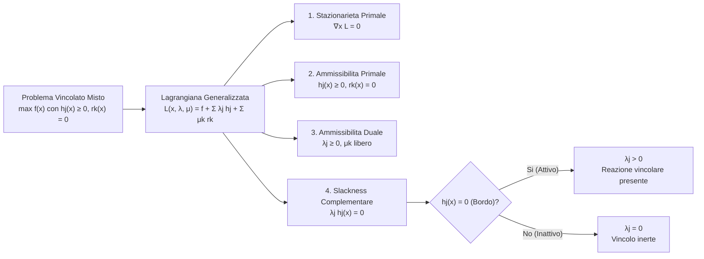

# 6. Metodo dei Moltiplicatori di Lagrange

Nei capitoli precedenti abbiamo affrontato problemi di stima e apprendimento ottimizzando funzioni obiettivo libere da vincoli, azzerando il gradiente in forma analitica oppure iterando con la discesa del gradiente. Nel Machine Learning avanzato (Support Vector Machines, Principal Component Analysis, regolarizzazione vincolata Ridge e Lasso), i parametri del modello devono invece soddisfare precisi vincoli geometrici, fisici o probabilistici sullo spazio di ricerca.

In questo capitolo formalizziamo il __metodo dei moltiplicatori di Lagrange__, analizzandone l'interpretazione geometrica basata sull'ortogonalità e sul parallelismo dei gradienti, la formulazione della funzione Lagrangiana per vincoli di uguaglianza, l'estensione ai vincoli di disuguaglianza con le condizioni di Karush-Kuhn-Tucker (KKT), lo studio analitico dei segni del moltiplicatore e la loro rilevanza teorica nelle macchine a vettori di supporto.

## Fondamenti dell'Ottimizzazione Vincolata

Inquadriamo il problema generale dell'ottimizzazione vincolata: cerchiamo i punti estremali (massimi o minimi) di una funzione obiettivo scalare $f(\mathbf{x})$ sotto un insieme di $M$ vincoli di uguaglianza:

$$
\min_{\mathbf{x}} \quad (\text{oppure } \max_{\mathbf{x}}) \quad f(\mathbf{x})
$$

sotto le condizioni ammissibili:

$$
h_1(\mathbf{x}) = 0, \quad h_2(\mathbf{x}) = 0, \quad \dots, \quad h_M(\mathbf{x}) = 0
$$

dove $\mathbf{x} \in \mathbb{R}^{D \times 1}$ è il vettore delle variabili da ottimizzare, mentre la funzione obiettivo $f(\mathbf{x})$ e le funzioni vincolo $h_m(\mathbf{x})$ appartengono alla classe $C^2$ (funzioni continue dotate di derivate parziali prime e seconde continue su tutto il dominio).

Un primo approccio elementare consisterebbe nell'utilizzare l'equazione del vincolo per esplicitare una coordinata in funzione delle altre (ad esempio $x_2 = g(x_1)$ in dimensione due), sostituire tale relazione nella funzione obiettivo per ottenere una funzione univariata $f(x_1, g(x_1))$, e procedere alla massimizzazione o minimizzazione non vincolata rispetto a $x_1$.

Questa strategia per sostituzione diretta presenta due gravi limiti operativi:
- Non è sempre agevole, né analiticamente possibile, invertire l'equazione $h(\mathbf{x}) = 0$ in forma chiusa rispetto a una singola coordinata.
- Il metodo tratta le variabili in modo asimmetrico, rompendo la naturale simmetria geometrica insita nel vincolo.

Per superare queste limitazioni introduciamo il parametro scalare ausiliario $\lambda \in \mathbb{R}$, denominato __moltiplicatore di Lagrange__, la cui genesi emerge naturalmente dallo studio della geometria differenziale delle superfici di livello.

## Geometria dei Vincoli di Uguaglianza

Per comprendere il significato fisico del moltiplicatore, partiamo dal caso bidimensionale ($D = 2$) con un singolo vincolo di uguaglianza $h(x_1, x_2) = 0$.

L'equazione $h(x_1, x_2) = 0$ definisce una curva nello spazio $\mathbb{R}^2$ (e in generale un'ipersuperficie di dimensione $D - 1$ in $\mathbb{R}^D$).

### Ortogonalità tra Gradiente e Vettore Tangente

Differenziamo l'equazione del vincolo rispetto a $x_1$ applicando la regola della catena (_Chain Rule_):

$$
\frac{\partial h}{\partial x_1} + \frac{\partial h}{\partial x_2} \frac{\mathrm{d}x_2}{\mathrm{d}x_1} = 0
$$

Possiamo riscrivere questa equazione come il prodotto scalare tra due vettori fondamentali:

$$
\nabla h(\mathbf{x}) = \begin{bmatrix} \frac{\partial h}{\partial x_1} \\[1ex] \frac{\partial h}{\partial x_2} \end{bmatrix}, \qquad \boldsymbol{\epsilon} = \begin{bmatrix} 1 \\[1ex] \frac{\mathrm{d}x_2}{\mathrm{d}x_1} \end{bmatrix}
$$

L'annullamento della derivata si traduce nella condizione di ortogonalità:

$$
(\nabla h)^T \boldsymbol{\epsilon} = 0
$$

Il vettore $\boldsymbol{\epsilon}$ è per definizione parallelo alla tangente alla curva $h(x_1, x_2) = 0$ nel punto $\mathbf{x}$, mentre $\nabla h$ rappresenta il vettore gradiente del vincolo. Ne consegue che il vettore gradiente $\nabla h$ è __rigorosamente ortogonale alla curva del vincolo__ in ogni suo punto.

![[fig_8_1_gradiente_e_tangente_vincolo.svg|center small]] ![[fig_8_2_componente_gradiente_non_nullo.svg|center small]]

Possiamo verificare questa fondamentale proprietà anche attraverso lo sviluppo in serie di Taylor al primo ordine attorno al punto $\mathbf{x}$. Consideriamo un piccolo spostamento $\boldsymbol{\epsilon}$ vincolato a giacere lungo la curva:

$$
h(\mathbf{x} + \boldsymbol{\epsilon}) \approx h(\mathbf{x}) + \boldsymbol{\epsilon}^T \nabla h(\mathbf{x})
$$

Poiché sia $\mathbf{x}$ sia $\mathbf{x} + \boldsymbol{\epsilon}$ appartengono alla curva del vincolo, abbiamo per definizione $h(\mathbf{x}) = 0$ e $h(\mathbf{x} + \boldsymbol{\epsilon}) = 0$. Per spostamenti infinitesimi $\|\boldsymbol{\epsilon}\| \to 0$, l'equazione impone:

$$
\boldsymbol{\epsilon}^T \nabla h(\mathbf{x}) = 0
$$

La direzione di massima variazione $\nabla h$ non possiede alcuna componente lungo la curva di livello: ogni variazione ammissibile deve compiersi ortogonalmente al gradiente del vincolo.

### Condizione di Estremo e Parallelismo dei Gradienti

Consideriamo ora la variazione della funzione obiettivo $f(\mathbf{x})$ quando ci muoviamo lungo la curva del vincolo $h(\mathbf{x}) = 0$.

Se uno spostamento infinitesimo $\boldsymbol{\epsilon}$ lungo la curva produce una variazione non nulla del valore di $f$, significa che il moto possiede una componente proiettata non nulla lungo la direzione di massima pendenza $\nabla f$, ovvero $(\nabla f)^T \boldsymbol{\epsilon} \neq 0$. In tale situazione possiamo scorrere lungo il vincolo (in avanti o all'indietro) per incrementare o ridurre ulteriormente il valore di $f$.

In un punto estremale vincolato $\mathbf{x}^*$ (massimo o minimo locale ammissibile sulla curva), non deve essere più possibile migliorare il valore di $f$ muovendosi lungo la curva ammissibile. La derivata direzionale lungo la direzione tangente $\boldsymbol{\epsilon}$ deve quindi annullarsi identicamente:

$$
(\nabla f)^T \boldsymbol{\epsilon} = 0
$$

Nel punto di ottimo vincolato $\mathbf{x}^*$, il vettore tangente $\boldsymbol{\epsilon}$ è simultaneamente ortogonale sia a $\nabla h(\mathbf{x}^*)$ sia a $\nabla f(\mathbf{x}^*)$. Nello spazio bidimensionale $\mathbb{R}^2$, due vettori perpendicolari alla medesima retta tangente devono necessariamente essere collineari tra loro.

I gradienti $\nabla f$ e $\nabla h$ devono quindi essere __paralleli__ (o antiparalleli). Esiste dunque un coefficiente scalare $\lambda \neq 0$ tale che:

$$
\nabla f(\mathbf{x}^*) + \lambda \nabla h(\mathbf{x}^*) = \mathbf{0} \iff \nabla f(\mathbf{x}^*) = -\lambda \nabla h(\mathbf{x}^*)
$$

![[fig_8_3_parallelismo_gradienti_punto_estremale.svg|center small]] ![[fig_8_4_curve_di_livello_minimo_vincolato.svg|center small]]

L'interpretazione visiva sulle curve di livello chiarisce perfettamente il fenomeno: le curve di livello di $f(\mathbf{x})$ sono definite dagli insiemi $\{\mathbf{x} \in \mathbb{R}^D : f(\mathbf{x}) = c\}$. Nel punto di ottimo vincolato $\mathbf{x}^*$, la curva del vincolo $h(\mathbf{x}) = 0$ è __tangente alla curva di livello__ $f(\mathbf{x}) = c^*$.

Se non vi fosse tangenza, la curva del vincolo taglierebbe trasversalmente la curva di livello: potremmo scivolare lungo il vincolo attraversando curve di livello a quota più elevata (per la massimizzazione) o più bassa (per la minimizzazione). L'estremo vincolato corrisponde al punto in cui il vincolo sfiora l'ultima curva di livello accessibile.

I punti estremali vincolati sono identificati dal sistema congiunto a $D + 1$ equazioni e $D + 1$ incognite:

$$
\begin{cases}
\nabla f(\mathbf{x}) + \lambda \nabla h(\mathbf{x}) = \mathbf{0} \\[1ex]
h(\mathbf{x}) = 0
\end{cases}
$$

## Formulazione della Funzione Lagrangiana

Il metodo dei moltiplicatori di Lagrange trasforma elegantemente un problema vincolato in $\mathbb{R}^D$ in un problema stazionario non vincolato in uno spazio a dimensione aumentata $\mathbb{R}^{D + 1}$.

Definiamo la __funzione Lagrangiana__ associata al problema con vincolo di uguaglianza:

$$
\mathcal{L}(\mathbf{x}, \lambda) = f(\mathbf{x}) + \lambda h(\mathbf{x})
$$

Calcoliamo le derivate parziali di $\mathcal{L}$ rispetto a tutte le variabili primali $\mathbf{x}$ e al moltiplicatore $\lambda$, imponendone l'annullamento:

$$
\nabla_{\mathbf{x}} \mathcal{L}(\mathbf{x}, \lambda) = \nabla f(\mathbf{x}) + \lambda \nabla h(\mathbf{x}) = \mathbf{0}
$$

$$
\frac{\partial \mathcal{L}(\mathbf{x}, \lambda)}{\partial \lambda} = h(\mathbf{x}) = 0
$$

Possiamo esprimere il gradiente complessivo in forma compatta:

$$
\nabla \mathcal{L} = \begin{bmatrix} \nabla_{\mathbf{x}} \mathcal{L} \\[1ex] \frac{\partial \mathcal{L}}{\partial \lambda} \end{bmatrix} = \begin{bmatrix} \nabla f(\mathbf{x}) + \lambda \nabla h(\mathbf{x}) \\[1ex] h(\mathbf{x}) \end{bmatrix} = \mathbf{0}
$$

La derivata rispetto al parametro lagrangiano $\lambda$ ripristina esattamente il vincolo originario $h(\mathbf{x}) = 0$, mentre la derivata rispetto al vettore primale $\mathbf{x}$ impone il parallelismo dei gradienti. La determinazione dei punti stazionari di $\mathcal{L}$ risolve completamente il problema vincolato.

### Esempio Analitico Svolto

Applichiamo il formalismo al problema di determinare il punto stazionario della funzione quadratica:

$$
\max_{x_1, x_2} \quad f(x_1, x_2) = 1 - 2x_1^2 - 2x_2^2
$$

sotto il vincolo lineare di uguaglianza:

$$
h(x_1, x_2) = 2x_1 + 2x_2 - 1 = 0
$$

Costruiamo la funzione Lagrangiana:

$$
\mathcal{L}(x_1, x_2, \lambda) = 1 - 2x_1^2 - 2x_2^2 + \lambda (2x_1 + 2x_2 - 1)
$$

Calcoliamo le derivate parziali e poniamole uguali a zero:

$$
\begin{cases}
\frac{\partial \mathcal{L}}{\partial x_1} = -4x_1 + 2\lambda = 0 \\[1ex]
\frac{\partial \mathcal{L}}{\partial x_2} = -4x_2 + 2\lambda = 0 \\[1ex]
\frac{\partial \mathcal{L}}{\partial \lambda} = 2x_1 + 2x_2 - 1 = 0
\end{cases}
$$

Dalle prime due equazioni ricaviamo le coordinate ottime in funzione del moltiplicatore $\lambda$:

$$
x_1 = \frac{\lambda}{2}, \qquad x_2 = \frac{\lambda}{2}
$$

Sostituendo nella terza equazione (il vincolo ammissibile):

$$
2 \left(\frac{\lambda}{2}\right) + 2 \left(\frac{\lambda}{2}\right) - 1 = 0 \implies 2\lambda = 1 \implies \lambda^* = \frac{1}{2}
$$

Determiniamo le coordinate del punto stazionario ottimale:

$$
x_1^* = \frac{1}{4}, \qquad x_2^* = \frac{1}{4}
$$

Il valore assunto dalla funzione obiettivo nel punto di ottimo vincolato è:

$$
f\left(\frac{1}{4}, \frac{1}{4}\right) = 1 - 2\left(\frac{1}{16}\right) - 2\left(\frac{1}{16}\right) = 1 - \frac{1}{4} = \frac{3}{4}
$$

Osserviamo che il massimo globale non vincolato di $f$ varrebbe $1$ (in corrispondenza dell'origine $(0, 0)$), ma la presenza del vincolo $h(x_1, x_2) = 0$ confina la soluzione sul segmento ammissibile, riducendo il valore massimo raggiungibile a $3/4$.

## Vincoli di Disuguaglianza

Estendiamo ora la formulazione a problemi in cui i vincoli sono espressi mediante disuguaglianze, ovvero della forma:

$$
h(\mathbf{x}) \ge 0 \quad (\text{oppure } h(\mathbf{x}) \le 0)
$$

Il vincolo definisce una __regione ammissibile__ $\mathcal{F} = \{\mathbf{x} \in \mathbb{R}^D : h(\mathbf{x}) \ge 0\}$ delimitata dalla frontiera $\partial \mathcal{F} = \{\mathbf{x} \in \mathbb{R}^D : h(\mathbf{x}) = 0\}$.

![[fig_8_5_vincoli_disuguaglianza_kkt.svg|center mid]]

In questa configurazione si presentano due scenari qualitativamente distinti:
- __Vincolo Inattivo__: l'ottimo non vincolato della funzione obiettivo cade strettamente all'interno della regione ammissibile ($h(\mathbf{x}^*) > 0$). In questo caso il vincolo non limita la ricerca e non influisce sulla posizione della soluzione. La condizione di ottimalità è semplicemente $\nabla f(\mathbf{x}^*) = \mathbf{0}$. Questo scenario corrisponde all'annullamento del moltiplicatore di Lagrange: $\lambda = 0$.
- __Vincolo Attivo__: l'ottimo non vincolato si trova al di fuori della regione ammissibile. La funzione $f$ tenta di spingersi oltre il bordo, ma viene arrestata dal confine della regione ammissibile. La soluzione ottima deve pertanto giacere esattamente sulla frontiera ($h(\mathbf{x}^*) = 0$). In questo caso il vincolo è operante ed esercita una reazione non nulla: $\lambda \neq 0$.

In entrambi i contesti, il prodotto tra il moltiplicatore e il valore del vincolo si annulla identicamente:

$$
\lambda h(\mathbf{x}^*) = 0
$$

Questa relazione essenziale prende il nome di __condizione di slackness complementare__ (_Complementary Slackness_): o il vincolo è inattivo all'interno (per cui $\lambda = 0$ e $h > 0$), oppure il vincolo è attivo sul bordo (per cui $h = 0$ e $\lambda \neq 0$). I due fattori sono reciprocamente esclusivi e non possono mai essere contemporaneamente diversi da zero.

### I Quattro Scenari per il Segno del Moltiplicatore

Nel caso di vincolo attivo ($h(\mathbf{x}) = 0$), il segno del moltiplicatore $\lambda$ non è arbitrario: esso è rigidamente vincolato dalla natura del problema (massimizzazione vs minimizzazione) e dal verso della disuguaglianza.

Dalla condizione di stazionarietà $\nabla f + \lambda \nabla h = \mathbf{0}$, isoliamo la relazione vettoriale:

$$
\nabla f = -\lambda \nabla h
$$

Il segno di $\lambda$ dipende dall'orientamento reciproco dei due gradienti:
- Se $\nabla f$ e $\nabla h$ hanno __versi opposti__ (antiparalleli), allora $-\lambda$ deve essere negativo, imponendo $\lambda > 0$.
- Se $\nabla f$ e $\nabla h$ hanno lo __stesso verso__ (paralleli), allora $-\lambda$ deve essere positivo, imponendo $\lambda < 0$.

Deduciamo fisicamente la direzione dei gradienti nei quattro scenari possibili:

1. __Scenario 1: Massimizzazione con vincolo $h(\mathbf{x}) \ge 0$__:
   - Il gradiente $\nabla h$ punta per definizione verso l'interno della regione ammissibile (direzione in cui $h$ cresce verso valori positivi).
   - Poiché il massimo si trova sulla frontiera, la funzione $f$ deve continuare a crescere muovendosi verso l'esterno; se puntasse verso l'interno, potremmo addentrarci nella regione per aumentare $f$, contraddicendo l'ipotesi che il massimo sia sul bordo. Dunque $\nabla f$ punta verso l'esterno.
   - I gradienti $\nabla f$ e $\nabla h$ sono __antiparalleli__. Poiché $\nabla f = -\lambda \nabla h$, deve valere tassativamente:
     $$
     \lambda > 0
     $$

2. __Scenario 2: Massimizzazione con vincolo $h(\mathbf{x}) \le 0$__:
   - La regione ammissibile corrisponde a $h \le 0$: i valori maggiori di $h$ si trovano all'esterno, quindi $\nabla h$ punta verso l'esterno della regione ammissibile.
   - Trattandosi di un massimo sul bordo, la funzione $f$ deve continuare a salire verso l'esterno: il gradiente $\nabla f$ punta verso l'esterno della regione ammissibile.
   - I gradienti $\nabla f$ e $\nabla h$ hanno lo stesso verso, ovvero sono __paralleli__. Poiché $\nabla f = -\lambda \nabla h$, deve valere:
     $$
     \lambda < 0
     $$

3. __Scenario 3: Minimizzazione con vincolo $h(\mathbf{x}) \ge 0$__:
   - Il gradiente $\nabla h$ punta verso l'interno della regione ammissibile.
   - Poiché cerchiamo un minimo sul bordo, la funzione $f$ deve decrescere muovendosi verso l'esterno (e crescere muovendosi verso l'interno); se decrescesse verso l'interno, potremmo addentrarci nella regione per ridurre $f$. La direzione di massima crescita $\nabla f$ deve quindi puntare verso l'interno della regione ammissibile.
   - I gradienti $\nabla f$ e $\nabla h$ sono entrambi rivolti verso l'interno, ovvero sono __paralleli__. Poiché $\nabla f = -\lambda \nabla h$, otteniamo:
     $$
     \lambda < 0
     $$

4. __Scenario 4: Minimizzazione con vincolo $h(\mathbf{x}) \le 0$__:
   - Il gradiente $\nabla h$ punta verso l'esterno della regione ammissibile.
   - Per lo stesso principio dello Scenario 3, la direzione di massima crescita $\nabla f$ deve puntare verso l'interno della regione ammissibile.
   - I gradienti $\nabla f$ e $\nabla h$ hanno versi opposti, ovvero sono __antiparalleli__. Poiché $\nabla f = -\lambda \nabla h$, deve valere:
     $$
     \lambda > 0
     $$

![[fig_ex_6_kkt_4_scenari_segni_lambda.png|center big]]

La seguente tabella sinottica sintetizza la deduzione fisica per la memorizzazione d'esame:

| Obiettivo Primale | Verso del Vincolo | Direzione $\nabla h$ | Direzione $\nabla f$ | Allineamento | Segno Moltiplicatore |
| :--- | :--- | :--- | :--- | :--- | :---: |
| $\max f(\mathbf{x})$ | $h(\mathbf{x}) \ge 0$ | Verso l'interno | Verso l'esterno | Antiparalleli ($\uparrow \downarrow$) | $\lambda > 0$ |
| $\max f(\mathbf{x})$ | $h(\mathbf{x}) \le 0$ | Verso l'esterno | Verso l'esterno | Paralleli ($\uparrow \uparrow$) | $\lambda < 0$ |
| $\min f(\mathbf{x})$ | $h(\mathbf{x}) \ge 0$ | Verso l'interno | Verso l'interno | Paralleli ($\uparrow \uparrow$) | $\lambda < 0$ |
| $\min f(\mathbf{x})$ | $h(\mathbf{x}) \le 0$ | Verso l'esterno | Verso l'interno | Antiparalleli ($\uparrow \downarrow$) | $\lambda > 0$ |

> [!IMPORTANT] Regola Mnemonica per l'Esame sui Segni di $\lambda$
> Nello studio dei vincoli di disuguaglianza con formulazione della Lagrangiana $\mathcal{L} = f + \lambda h$:
> - Se i vettori $\nabla f$ e $\nabla h$ sono __antiparalleli__ (versi opposti), il moltiplicatore è positivo: $\lambda > 0$.
> - Se i vettori $\nabla f$ e $\nabla h$ sono __paralleli__ (stesso verso), il moltiplicatore è negativo: $\lambda < 0$.
>
> Per il problema canonico del Machine Learning (massimizzazione con $h(\mathbf{x}) \ge 0$, oppure minimizzazione con $g(\mathbf{x}) \le 0$), il segno associato al moltiplicatore duale è sempre non-negativo: $\lambda \ge 0$.

## Condizioni di Karush-Kuhn-Tucker

Raccogliendo tutti i requisiti analitici derivati per il problema di massimizzazione con vincolo di disuguaglianza $h(\mathbf{x}) \ge 0$, la funzione Lagrangiana assume la forma:

$$
\mathcal{L}(\mathbf{x}, \lambda) = f(\mathbf{x}) + \lambda h(\mathbf{x})
$$

Le condizioni necessarie per l'ottimalità del punto $\mathbf{x}^*$ sono riassunte dalle __condizioni di Karush-Kuhn-Tucker (KKT)__:

$$
\begin{cases}
\nabla_{\mathbf{x}} \mathcal{L}(\mathbf{x}, \lambda) = \mathbf{0} \\[1ex]
\frac{\partial \mathcal{L}(\mathbf{x}, \lambda)}{\partial \lambda} = 0 \iff h(\mathbf{x}) = 0 \quad (\text{se vincolo attivo}) \\[1ex]
\lambda h(\mathbf{x}) = 0 \\[1ex]
h(\mathbf{x}) \ge 0 \\[1ex]
\lambda \ge 0
\end{cases}
$$

### Estensione a Vincoli Multipli Misti

Nei problemi reali di ottimizzazione dobbiamo gestire simultaneamente $J$ vincoli di disuguaglianza e $K$ vincoli di uguaglianza:

$$
\max_{\mathbf{x}} \quad f(\mathbf{x}) \quad \text{sotto i vincoli} \quad \begin{cases} h_j(\mathbf{x}) \ge 0, & j = 1, \dots, J \\[1ex] r_k(\mathbf{x}) = 0, & k = 1, \dots, K \end{cases}
$$

Introducendo un moltiplicatore $\lambda_j$ per ciascun vincolo di disuguaglianza e un moltiplicatore $\mu_k$ per ciascun vincolo di uguaglianza, costruiamo la Lagrangiana generalizzata:

$$
\mathcal{L}(\mathbf{x}, \boldsymbol{\lambda}, \boldsymbol{\mu}) = f(\mathbf{x}) + \sum_{j=1}^J \lambda_j h_j(\mathbf{x}) + \sum_{k=1}^K \mu_k r_k(\mathbf{x})
$$

Le condizioni KKT complete per il punto di ottimo assumono la forma:

$$
\begin{cases}
\nabla_{\mathbf{x}} \mathcal{L}(\mathbf{x}, \boldsymbol{\lambda}, \boldsymbol{\mu}) = \mathbf{0} \\[1.5ex]
\frac{\partial \mathcal{L}}{\partial \lambda_j} = 0 \iff h_j(\mathbf{x}) = 0 \quad (\text{se vincolo attivo}), & \forall j \in \{1, \dots, J\} \\[1.5ex]
\frac{\partial \mathcal{L}}{\partial \mu_k} = 0 \iff r_k(\mathbf{x}) = 0, & \forall k \in \{1, \dots, K\} \\[1.5ex]
\lambda_j h_j(\mathbf{x}) = 0, & \forall j \in \{1, \dots, J\} \\[1.5ex]
r_k(\mathbf{x}) = 0, & \forall k \in \{1, \dots, K\} \\[1.5ex]
h_j(\mathbf{x}) \ge 0, & \forall j \in \{1, \dots, J\} \\[1.5ex]
\lambda_j \ge 0, & \forall j \in \{1, \dots, J\}
\end{cases}
$$

I moltiplicatori associati ai vincoli di uguaglianza $\mu_k \in \mathbb{R}$ sono liberi nel segno, poiché il movimento sul vincolo è rigidamente confinato sulla curva bidirezionale e la normale può avere verso concorde o discorde senza violare l'ammissibilità. I moltiplicatori $\lambda_j \ge 0$ associati alle disuguaglianze devono invece rispettare il vincolo di non-negatività per garantire che la forza vincolare agisca esclusivamente verso l'interno della regione ammissibile.

## Rilevanza nei Modelli di Machine Learning

Il formalismo dei moltiplicatori di Lagrange e delle condizioni KKT non rappresenta una parentesi teorica astratta, bensì l'impalcatura matematica portante dei principali modelli che analizzeremo nei capitoli successivi:

- __Support Vector Machines (SVM)__: la massimizzazione del margine di separazione tra classi equivale a minimizzare la norma dei pesi $\min_{\mathbf{w}, b} \frac{1}{2}\|\mathbf{w}\|^2$ sotto i vincoli di corretta classificazione $t_i (\mathbf{w}^T \mathbf{x}_i + b) \ge 1$ per ogni campione $i = 0, \dots, N-1$. Scrivendo il vincolo come $h_i(\mathbf{w}, b) = t_i (\mathbf{w}^T \mathbf{x}_i + b) - 1 \ge 0$, la condizione di slackness complementare KKT impone $\lambda_i [t_i (\mathbf{w}^T \mathbf{x}_i + b) - 1] = 0$. La stragrande maggioranza dei campioni cade all'interno della regione corretta ($h_i > 0$) e riceve $\lambda_i = 0$, risultando del tutto ininfluente nella determinazione del bordo di decisione. Solo i campioni giacenti esattamente sul margine soddisfano $h_i = 0$ con $\lambda_i > 0$: essi costituiscono i celebri __vettori di supporto__, gli unici punti del dataset che determinano la posizione dell'iperpiano separatore ottimo.
- __Principal Component Analysis (PCA)__: la ricerca della prima direzione principale $\mathbf{u}_1$ corrisponde a massimizzare la varianza proiettata $\mathbf{u}_1^T \mathbf{S} \mathbf{u}_1$ (dove $\mathbf{S}$ è la matrice di covarianza empirica dei dati) sotto il vincolo di normalizzazione $\mathbf{u}_1^T \mathbf{u}_1 = 1$. Impostando la Lagrangiana $\mathcal{L}(\mathbf{u}_1, \lambda) = \mathbf{u}_1^T \mathbf{S} \mathbf{u}_1 - \lambda(\mathbf{u}_1^T \mathbf{u}_1 - 1)$, la condizione di stazionarietà $\nabla_{\mathbf{u}_1} \mathcal{L} = 2\mathbf{S}\mathbf{u}_1 - 2\lambda \mathbf{u}_1 = \mathbf{0}$ conduce direttamente all'equazione secolare agli autovalori $\mathbf{S}\mathbf{u}_1 = \lambda \mathbf{u}_1$. La varianza proiettata coincide con $\mathbf{u}_1^T \mathbf{S} \mathbf{u}_1 = \lambda$: la direzione a massima varianza è quindi l'autovettore associato al massimo autovalore di $\mathbf{S}$.
- __Regolarizzazione Vincolata (Ridge e Lasso)__: la minimizzazione dell'errore empirico sotto il vincolo sferico $\|\mathbf{w}\|_2^2 \le s$ (Ridge) o sotto il vincolo a politopo $\|\mathbf{w}\|_1 \le s$ (Lasso) conduce, tramite la dualità lagrangiana e le condizioni KKT, all'esatta equivalenza con la forma penalizzata lagrangiana $\min E(\mathbf{w}) + \lambda \Omega(\mathbf{w})$. La geometria del vincolo (la sfera liscia in Ridge contro i vertici cuspidali del politopo in Lasso) determina il punto di tangenza con le curve di livello dell'errore quadratico, spiegando geometricamente perché Lasso annulla esattamente i coefficienti generando modelli sparsi.
