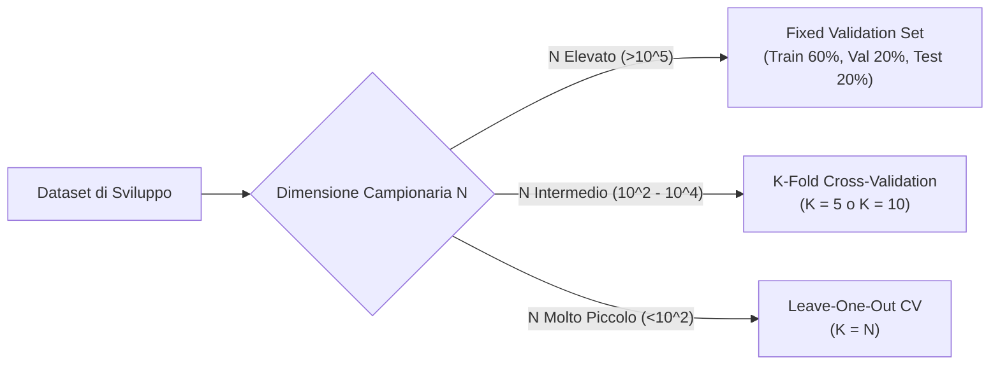
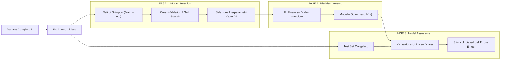

# 7. Model Selection e Model Assessment

L'apprendimento supervisionato mira a stimare, a partire dai dati osservati, una funzione in grado di mappare il vettore delle feature $\mathbf{x}$ nella variabile target $t$. Queste due grandezze sono governate da una distribuzione di probabilità congiunta $p(\mathbf{x}, t)$ a noi ignota, di cui possediamo informazioni unicamente attraverso un insieme discreto di realizzazioni campionarie: il dataset di addestramento $\mathcal{D}_{\text{train}} = \{(\mathbf{x}^{(i)}, t^{(i)})\}_{i=0}^{N-1}$.

Il problema metodologico centrale del Machine Learning risiede nella capacità del modello di generalizzare correttamente su campioni mai osservati durante la fase di apprendimento. L'analisi si fonda sulla distinzione concettuale tra __Model Selection__ e __Model Assessment__, sulla derivazione analitica della __decomposizione Bias-Varianza__, sulle proprietà asintotiche per i regressori K-NN e OLS, sui protocolli empirici di validazione (Hold-out, K-Fold Cross-Validation, Leave-One-Out) e sulla dinamica delle curve di apprendimento al variare della numerosità campionaria.

## Obiettivo di Apprendimento ed Errore di Generalizzazione

Indipendentemente dalla specifica strategia adottata (funzione discriminante diretta, modello discriminativo o approccio generativo), il processo di ottimizzazione agisce minimizzando una funzione di costo calcolata sui dati di addestramento. La funzione di perdita (_Loss Function_) $L(t, \hat{t})$ quantifica la discrepanza tra il valore target reale $t$ e la stima $\hat{t} = h_{\mathbf{w}}(\mathbf{x})$ prodotta dal modello.

Abbiamo introdotto, ad esempio, la perdita quadratica per la regressione:

$$
L(t, \hat{t}) = (t - \hat{t})^2 = (t - \mathbf{w}^T \boldsymbol{\phi}(\mathbf{x}))^2
$$

e la perdita basata sulla Cross-Entropy per la classificazione logistica:

$$
L(t, \hat{t}) = - \left[ t \ln \sigma(\mathbf{w}^T \mathbf{x}) + (1 - t) \ln (1 - \sigma(\mathbf{w}^T \mathbf{x})) \right]
$$

Valutando la perdita su tutti i campioni del dataset di addestramento, otteniamo l'__errore di addestramento__ (_Training Error_):

$$
E_{\text{train}} = \frac{1}{N} \sum_{i=0}^{N-1} L(t^{(i)}, h_{\mathbf{w}}( \mathbf{x}^{(i)} ))
$$

Tuttavia, ottenere un errore di training nullo o estremamente ridotto non costituisce il nostro reale traguardo. L'obiettivo primario consiste nel garantire che il modello fornisca previsioni accurate su campioni indipendenti mai visti in fase di addestramento: i campioni di test.

Definiamo l'__errore di test__ (_Test Error_ o Errore di Generalizzazione) come il valore atteso della perdita calcolato sulla distribuzione congiunta dei dati rispetto a un dataset di addestramento fissato:

$$
E_{\text{test}} = \mathbb{E}_{(\mathbf{x}, t) \sim p(\mathbf{x}, t)} \left[ L(t, h_{\mathbf{w}^*}(\mathbf{x})) \mid \mathcal{D}_{\text{train}} \right]
$$

Un modello efficace deve garantire un errore di test contenuto e comparabile all'errore di training. Quando questo equilibrio si spezza, si manifestano due patologie estreme:
- __Underfitting__: il modello manifesta un errore elevato già sui campioni di addestramento ($E_{\text{train}}$ alto). La classe di ipotesi scelta è eccessivamente rigida e non possiede la capacità rappresentativa necessaria per descrivere la struttura del processo generativo.
- __Overfitting__: il modello ottiene un errore di addestramento quasi nullo ($E_{\text{train}} \approx 0$), ma manifesta un errore elevato sui dati di test ($E_{\text{test}} \gg E_{\text{train}}$). L'algoritmo ha memorizzato le peculiarità e il rumore stocastico del campione specifico, perdendo la capacità di estrapolazione.

## Complessità del Modello e Gradi di Libertà

Mentre l'algoritmo di ottimizzazione calibra automaticamente i parametri addestrabili $\mathbf{w}$, noi progettisti controlliamo la struttura dell'ipotesi $h_{\mathbf{w}}(\mathbf{x})$ agendo sulle scelte architetturali e sugli iperparametri. Questi fattori governano la __complessità__ complessiva o i __gradi di libertà__ (_Degrees of Freedom_, DoF) del modello:
- La forma funzionale dell'ipotesi (modello lineare, rete neurale profonda, albero di decisione);
- Il grado di espansione polinomiale $M$;
- Il numero, la scala e la tipologia delle funzioni base $\phi_j(\mathbf{x})$;
- L'intensità del coefficiente di regolarizzazione $\lambda$ (come in Ridge e Lasso);
- Il numero di vicini $K$ nel classificatore o regressore K-NN;
- La parametrizzazione delle matrici di covarianza nei modelli generativi gaussiani (covarianza condivisa in LDA vs covarianze distinte in QDA).

![[fig_9_1_curve_errore_complessita_modello.svg|center mid]]

Incrementando i gradi di libertà, il modello acquisisce maggiore flessibilità: l'errore di addestramento $E_{\text{train}}$ decresce in modo strettamente monotono, poiché l'ottimizzatore dispone di un numero maggiore di parametri liberi per interpolare i campioni noti.

L'errore di test $E_{\text{test}}$, al contrario, segue una curva a U: inizialmente diminuisce attenuando l'underfitting, raggiunge un punto di minimo in corrispondenza del modello ottimo, e successivamente risale bruscamente entrando nel regime di overfitting.

![[fig_9_3_tradeoff_underfitting_overfitting_best_model.svg|center big]]

## Decomposizione Bias-Varianza

Per comprendere analiticamente le forze matematiche che guidano la traiettoria a U dell'errore di generalizzazione, sviluppiamo la __decomposizione Bias-Varianza__ per problemi di regressione con perdita quadratica.

Assumiamo che la variabile target $t$ sia generata da un processo fisico deterministico sottostante $f(\mathbf{x})$, corrotto da rumore additivo a media nulla e varianza finita:

$$
t = f(\mathbf{x}) + \epsilon, \qquad \mathbb{E}[\epsilon] = 0, \quad \mathrm{Var}[\epsilon] = \sigma_\epsilon^2
$$

con rumore $\epsilon$ indipendente dalle feature $\mathbf{x}$. I primi due momenti statistici del target condizionato valgono:

$$
\mathbb{E}[t \mid \mathbf{x}] = f(\mathbf{x})
$$

$$
\mathrm{Var}[t \mid \mathbf{x}] = \mathbb{E}[(t - f(\mathbf{x}))^2 \mid \mathbf{x}] = \sigma_\epsilon^2
$$

Fissiamo ora un punto di test arbitrario $\mathbf{x}_0$ e indichiamo con $h_{\mathbf{w}^*}(\mathbf{x}_0)$ la predizione prodotta dal nostro modello, addestrato su un generico dataset $\mathcal{D}$. Poiché il dataset $\mathcal{D}$ è una realizzazione campionaria casuale, il vettore dei parametri ottimali stimati $\mathbf{w}^*$ e la predizione $h_{\mathbf{w}^*}(\mathbf{x}_0)$ sono a loro volta variabili aleatorie.

Vogliamo calcolare l'errore quadratico atteso su $\mathbf{x}_0$, mediando congiuntamente rispetto alle realizzazioni del rumore di test $\epsilon$ e rispetto a tutti i possibili dataset di addestramento $\mathcal{D}$:

$$
\mathrm{Err}(\mathbf{x}_0) = \mathbb{E}_{\mathcal{D}, \epsilon} \left[ (t - h_{\mathbf{w}^*}(\mathbf{x}_0))^2 \right]
$$

### Derivazione Analitica della Decomposizione

Sviluppiamo il quadrato del binomio all'interno del valore atteso:

$$
\mathrm{Err}(\mathbf{x}_0) = \mathbb{E}_{\mathcal{D}, \epsilon} \left[ t^2 - 2 t \, h_{\mathbf{w}^*}(\mathbf{x}_0) + h_{\mathbf{w}^*}(\mathbf{x}_0)^2 \right]
$$

Per linearità del valore atteso, scomponiamo l'espressione in tre componenti distinte:

$$
\mathrm{Err}(\mathbf{x}_0) = \mathbb{E}[t^2] - 2 \mathbb{E}[t \, h_{\mathbf{w}^*}(\mathbf{x}_0)] + \mathbb{E}[h_{\mathbf{w}^*}(\mathbf{x}_0)^2]
$$

Analizziamo ora l'origine probabilistica di ciascuno dei tre addendi:

1. __Momento secondo del target $\mathbb{E}[t^2]$__:
   Ricordiamo la definizione fondamentale di varianza per una variabile aleatoria $Z$, $\mathrm{Var}[Z] = \mathbb{E}[Z^2] - (\mathbb{E}[Z])^2$, da cui ricaviamo $\mathbb{E}[Z^2] = (\mathbb{E}[Z])^2 + \mathrm{Var}[Z]$. Applicando questa scomposizione a $t = f(\mathbf{x}_0) + \epsilon$ condizionato a $\mathbf{x}_0$, dove $\mathbb{E}[t] = f(\mathbf{x}_0)$ e $\mathrm{Var}[t] = \sigma_\epsilon^2$:

   $$
   \mathbb{E}[t^2] = (\mathbb{E}[t])^2 + \mathrm{Var}[t] = f(\mathbf{x}_0)^2 + \sigma_\epsilon^2
   $$

2. __Termine di correlazione incrociata $\mathbb{E}[t \, h_{\mathbf{w}^*}(\mathbf{x}_0)]$__:
   Il target $t = f(\mathbf{x}_0) + \epsilon$ dipende dal rumore stocastico $\epsilon$ associato alla specifica misurazione di test in $\mathbf{x}_0$. Al contrario, la funzione stimata $h_{\mathbf{w}^*}(\mathbf{x}_0)$ dipende esclusivamente dai campioni del dataset di addestramento $\mathcal{D}$ impiegati per ottimizzare i pesi $\mathbf{w}^*$.
   Poiché il punto di test è campionato in modo indipendente dal training set, il rumore $\epsilon$ e l'ipotesi $h_{\mathbf{w}^*}(\mathbf{x}_0)$ sono stocasticamente indipendenti condizionatamente a $\mathbf{x}_0$. Il valore atteso del loro prodotto si fattorizza quindi nel prodotto dei singoli valori attesi:

   $$
   \mathbb{E}[t \, h_{\mathbf{w}^*}(\mathbf{x}_0)] = \mathbb{E}[t] \, \mathbb{E}[h_{\mathbf{w}^*}(\mathbf{x}_0)] = f(\mathbf{x}_0) \, \mathbb{E}[h_{\mathbf{w}^*}(\mathbf{x}_0)]
   $$

3. __Momento secondo della predizione $\mathbb{E}[h_{\mathbf{w}^*}(\mathbf{x}_0)^2]$__:
   Applicando nuovamente la scomposizione della varianza alla variabile aleatoria $h_{\mathbf{w}^*}(\mathbf{x}_0)$, la cui aleatorietà è indotta dall'estrazione campionaria del dataset $\mathcal{D}$:

   $$
   \mathbb{E}[h_{\mathbf{w}^*}(\mathbf{x}_0)^2] = (\mathbb{E}[h_{\mathbf{w}^*}(\mathbf{x}_0)])^2 + \mathrm{Var}[h_{\mathbf{w}^*}(\mathbf{x}_0)]
   $$

Sostituiamo ora i tre risultati nell'espressione dell'errore atteso:

$$
\mathrm{Err}(\mathbf{x}_0) = \sigma_\epsilon^2 + f(\mathbf{x}_0)^2 - 2 f(\mathbf{x}_0) \mathbb{E}[h_{\mathbf{w}^*}(\mathbf{x}_0)] + (\mathbb{E}[h_{\mathbf{w}^*}(\mathbf{x}_0)])^2 + \mathrm{Var}[h_{\mathbf{w}^*}(\mathbf{x}_0)]
$$

Riconosciamo immediatamente lo sviluppo del quadrato di un binomio nei tre termini centrali:

$$
f(\mathbf{x}_0)^2 - 2 f(\mathbf{x}_0) \mathbb{E}[h_{\mathbf{w}^*}(\mathbf{x}_0)] + (\mathbb{E}[h_{\mathbf{w}^*}(\mathbf{x}_0)])^2 = \left( \mathbb{E}[h_{\mathbf{w}^*}(\mathbf{x}_0)] - f(\mathbf{x}_0) \right)^2
$$

Giungiamo così alla celebre formulazione canonica:

$$
\mathrm{Err}(\mathbf{x}_0) = \sigma_\epsilon^2 + \left( \mathbb{E}[h_{\mathbf{w}^*}(\mathbf{x}_0)] - f(\mathbf{x}_0) \right)^2 + \mathrm{Var}[h_{\mathbf{w}^*}(\mathbf{x}_0)]
$$

L'errore quadratico atteso totale su un punto non visto si scompone rigorosamente nella somma di tre componenti non negative ortogonali:

$$
\mathrm{Err}(\mathbf{x}_0) = \underbrace{\sigma_\epsilon^2}_{\text{Errore Irriducibile}} + \underbrace{\left( \mathbb{E}[h_{\mathbf{w}^*}(\mathbf{x}_0)] - f(\mathbf{x}_0) \right)^2}_{\text{Bias}^2} + \underbrace{\mathrm{Var}[h_{\mathbf{w}^*}(\mathbf{x}_0)]}_{\text{Varianza}}
$$

![[fig_ex_7_scomposizione_bias_varianza_tradeoff.png|center big]]

### Significato Fisico dei Tre Addendi

- __Errore Irriducibile ($\sigma_\epsilon^2$)__: quantifica la varianza intrinseca del rumore di misura del processo reale. Costituisce un asintoto inferiore invalicabile da qualsiasi algoritmo di apprendimento, a prescindere dalla complessità del modello o dalla disponibilità di infiniti dati.
- __Bias al Quadrato ($\text{Bias}^2$)__: misura la discrepanza sistematica tra la predizione media del modello (calcolata su infiniti possibili dataset) e il valore deterministico vero $f(\mathbf{x}_0)$. Nasce da assunzioni strutturali restrittive o semplificative a priori (ad esempio approssimare con una retta una legge fisica non lineare). Decresce all'aumentare dei gradi di libertà.
- __Varianza ($\mathrm{Var}$)__: misura la sensibilità della funzione appresa rispetto allo specifico campione di addestramento utilizzato. Quantifica quanto la stima $h_{\mathbf{w}^*}(\mathbf{x}_0)$ oscillerebbe se ripetessimo l'apprendimento su un dataset $\mathcal{D}'$ alternativo campionato dalla stessa sorgente. Aumenta rapidamente con la complessità dell'ipotesi, poiché modelli molto flessibili interpolano il rumore stocastico locale anziché la sola componente utile.

> [!IMPORTANT] Il Trade-off Fondamentale per l'Esame
> - __Modelli rigidi (bassa complessità, forte regolarizzazione)__: presentano __alto bias__ e __bassa varianza__ $\implies$ rischio primario di __Underfitting__.
> - __Modelli flessibili (alta complessità, debole o nulla regolarizzazione)__: presentano __basso bias__ e __alta varianza__ $\implies$ rischio primario di __Overfitting__.
>
> Il modello ottimo minimizza la somma $\text{Bias}^2 + \mathrm{Var}$, localizzandosi nell'avvallamento della curva di compromesso globale.

## Analisi del Bias-Varianza per Modelli Noti

Esaminiamo ora il comportamento analitico del trade-off bias-varianza in due modelli fondamentali: il regressore non parametrico K-NN e il regressore lineare parametrico OLS.

### Il Regressore K-NN

Nel problema di regressione basato sui $K$ vicini più prossimi, stimiamo il valore del target nel punto di test $\mathbf{x}_0$ calcolando la media aritmetica delle etichette appartenenti al vicinato locale $\mathcal{N}_{\mathbf{x}_0}$:

$$
h(\mathbf{x}_0) = \frac{1}{K} \sum_{i \in \mathcal{N}_{\mathbf{x}_0}} t^{(i)}
$$

Calcoliamo il valore atteso della predizione:

$$
\mathbb{E}[h(\mathbf{x}_0)] = \frac{1}{K} \sum_{i \in \mathcal{N}_{\mathbf{x}_0}} \mathbb{E}[t^{(i)}] = \frac{1}{K} \sum_{i \in \mathcal{N}_{\mathbf{x}_0}} f(\mathbf{x}^{(i)})
$$

Calcoliamo ora la varianza della stima. Poiché i campioni nel dataset sono estratti in modo indipendente condizionatamente alle coordinate spaziali, i target $\{t^{(i)}\}$ sono variabili aleatorie scorrelate, ciascuna con varianza $\sigma_\epsilon^2$:

$$
\mathrm{Var}[h(\mathbf{x}_0)] = \mathrm{Var}\left[ \frac{1}{K} \sum_{i \in \mathcal{N}_{\mathbf{x}_0}} t^{(i)} \right] = \frac{1}{K^2} \sum_{i \in \mathcal{N}_{\mathbf{x}_0}} \mathrm{Var}[t^{(i)}] = \frac{1}{K^2} \sum_{i \in \mathcal{N}_{\mathbf{x}_0}} \sigma_\epsilon^2 = \frac{K \sigma_\epsilon^2}{K^2} = \frac{\sigma_\epsilon^2}{K}
$$

Sostituendo questi termini nella decomposizione generale:

$$
\mathrm{Err}(\mathbf{x}_0) = \sigma_\epsilon^2 + \left( \frac{1}{K} \sum_{i \in \mathcal{N}_{\mathbf{x}_0}} f(\mathbf{x}^{(i)}) - f(\mathbf{x}_0) \right)^2 + \frac{\sigma_\epsilon^2}{K}
$$

Questa relazione evidenzia la natura del parametro $K$:
- __Per $K \to \infty$__: la componente di varianza $\frac{\sigma_\epsilon^2}{K} \to 0$ si azzera, garantendo massima stabilità contro il rumore. Tuttavia, il vicinato si dilata fino a inglobare punti molto distanti da $\mathbf{x}_0$, allontanando la media locale $\frac{1}{K} \sum f(\mathbf{x}^{(i)})$ dalla funzione vera $f(\mathbf{x}_0)$ ed esplodendo il termine di bias al quadrato (underfitting).
- __Per $K = 1$__: il vicinato coincide con il punto più vicino, per cui $f(\mathbf{x}^{(1)}) \approx f(\mathbf{x}_0)$ e il bias locale è minimo. La varianza raggiunge però il valore massimo $\sigma_\epsilon^2$, rendendo l'ipotesi vulnerabile a qualsiasi fluttuazione del rumore campionario (overfitting).

> [!TIP] Regola Mnemonica per K-NN
> Nei modelli basati su istanze, la complessità è __inversamente proporzionale__ a $K$:
> - $K$ piccolo $\implies$ complessità elevata (alta varianza, basso bias).
> - $K$ grande $\implies$ complessità ridotta (bassa varianza, alto bias).

### La Regressione Lineare OLS

Consideriamo ora il modello lineare addestrato mediante minimi quadrati ordinari (OLS/MLE). La predizione sul punto di test $\mathbf{x}_0$ assume l'espressione in forma chiusa:

$$
h_{\mathbf{w}_{\text{ML}}}(\mathbf{x}_0) = \mathbf{x}_0^T \mathbf{w}_{\text{ML}} = \mathbf{x}_0^T (\mathbf{X}^T \mathbf{X})^{-1} \mathbf{X}^T \mathbf{t}
$$

Ipotizziamo che la vera funzione generativa appartenga alla classe dei modelli lineari: $f(\mathbf{x}_0) = \mathbf{x}_0^T \mathbf{w}^*$. Il vettore dei target sul training set è generato da $\mathbf{t} = \mathbf{X} \mathbf{w}^* + \boldsymbol{\epsilon}$, con rumore a media nulla $\mathbb{E}[\boldsymbol{\epsilon}] = \mathbf{0}$ e matrice di covarianza $\mathbb{E}[\boldsymbol{\epsilon} \boldsymbol{\epsilon}^T] = \sigma_\epsilon^2 \mathbf{I}$.

Valutiamo il valore atteso della predizione rispetto alla distribuzione del rumore:

$$
\mathbb{E}_{\mathcal{D}}[h_{\mathbf{w}_{\text{ML}}}(\mathbf{x}_0)] = \mathbf{x}_0^T (\mathbf{X}^T \mathbf{X})^{-1} \mathbf{X}^T \mathbb{E}[\mathbf{t}] = \mathbf{x}_0^T (\mathbf{X}^T \mathbf{X})^{-1} \mathbf{X}^T (\mathbf{X} \mathbf{w}^*) = \mathbf{x}_0^T \mathbf{w}^* = f(\mathbf{x}_0)
$$

Il termine di bias risulta identicamente nullo:

$$
\text{Bias} = f(\mathbf{x}_0) - \mathbb{E}_{\mathcal{D}}[h_{\mathbf{w}_{\text{ML}}}(\mathbf{x}_0)] = \mathbf{x}_0^T \mathbf{w}^* - \mathbf{x}_0^T \mathbf{w}^* = 0
$$

Quando la classe di ipotesi coincide con il processo fisico generatore, lo stimatore dei minimi quadrati è non polarizzato (_Unbiased_).

Calcoliamo ora la varianza della predizione puntuale:

$$
\mathrm{Var}[h_{\mathbf{w}_{\text{ML}}}(\mathbf{x}_0)] = \mathbb{E}\left[ \left( h_{\mathbf{w}_{\text{ML}}}(\mathbf{x}_0) - \mathbb{E}[h_{\mathbf{w}_{\text{ML}}}(\mathbf{x}_0)] \right)^2 \right]
$$

Sostituendo l'espressione dei pesi $\mathbf{w}_{\text{ML}} = \mathbf{w}^* + (\mathbf{X}^T \mathbf{X})^{-1} \mathbf{X}^T \boldsymbol{\epsilon}$, la fluttuazione attorno alla media è data da:

$$
h_{\mathbf{w}_{\text{ML}}}(\mathbf{x}_0) - \mathbb{E}[h_{\mathbf{w}_{\text{ML}}}(\mathbf{x}_0)] = \mathbf{x}_0^T (\mathbf{X}^T \mathbf{X})^{-1} \mathbf{X}^T \boldsymbol{\epsilon}
$$

Esprimendo il quadrato dello scalare come forma quadratica e applicando il valore atteso:

$$
\mathrm{Var}[h_{\mathbf{w}_{\text{ML}}}(\mathbf{x}_0)] = \mathbb{E}\left[ \mathbf{x}_0^T (\mathbf{X}^T \mathbf{X})^{-1} \mathbf{X}^T \boldsymbol{\epsilon} \boldsymbol{\epsilon}^T \mathbf{X} (\mathbf{X}^T \mathbf{X})^{-1} \mathbf{x}_0 \right]
$$

Poiché $\mathbb{E}[\boldsymbol{\epsilon} \boldsymbol{\epsilon}^T] = \sigma_\epsilon^2 \mathbf{I}$, otteniamo la varianza esatta su $\mathbf{x}_0$:

$$
\mathrm{Var}[h_{\mathbf{w}_{\text{ML}}}(\mathbf{x}_0)] = \sigma_\epsilon^2 \, \mathbf{x}_0^T (\mathbf{X}^T \mathbf{X})^{-1} \mathbf{x}_0
$$

Per ricavare la varianza media globale, integriamo rispetto a tutti i punti di test $\mathbf{x}_0$, supponendo che essi condividano la matrice di covarianza campionaria delle feature $\mathbb{E}_{\mathbf{x}_0}[\mathbf{x}_0 \mathbf{x}_0^T] = \boldsymbol{\Sigma}_{\mathbf{x}}$.

Poiché $\mathbf{x}_0^T (\mathbf{X}^T \mathbf{X})^{-1} \mathbf{x}_0$ è uno scalare, applichiamo l'operatore traccia e sfruttiamo la sua proprietà ciclica $\mathrm{Tr}(\mathbf{a}^T \mathbf{B} \mathbf{a}) = \mathrm{Tr}(\mathbf{B} \mathbf{a} \mathbf{a}^T)$:

$$
\mathrm{Var}[h_{\mathbf{w}_{\text{ML}}}(\mathbf{x}_0)] = \sigma_\epsilon^2 \, \mathrm{Tr}\left( (\mathbf{X}^T \mathbf{X})^{-1} \mathbf{x}_0 \mathbf{x}_0^T \right)
$$

Calcolando il valore atteso rispetto a $\mathbf{x}_0$ e scambiando la media con la traccia per linearità:

$$
\mathbb{E}_{\mathbf{x}_0} \left[ \mathrm{Var}[h_{\mathbf{w}_{\text{ML}}}(\mathbf{x}_0)] \right] = \sigma_\epsilon^2 \, \mathrm{Tr}\left( (\mathbf{X}^T \mathbf{X})^{-1} \mathbb{E}_{\mathbf{x}_0}[\mathbf{x}_0 \mathbf{x}_0^T] \right)
$$

Per la legge dei grandi numeri, la matrice di Gram normalizzata converge alla covarianza della popolazione, $\frac{1}{N} \mathbf{X}^T \mathbf{X} \approx \boldsymbol{\Sigma}_{\mathbf{x}}$, per cui $(\mathbf{X}^T \mathbf{X})^{-1} \approx \frac{1}{N} \boldsymbol{\Sigma}_{\mathbf{x}}^{-1}$. Sostituendo:

$$
\mathbb{E}_{\mathbf{x}_0} \left[ \mathrm{Var}[h_{\mathbf{w}_{\text{ML}}}(\mathbf{x}_0)] \right] \approx \sigma_\epsilon^2 \, \mathrm{Tr}\left( \frac{1}{N} \boldsymbol{\Sigma}_{\mathbf{x}}^{-1} \boldsymbol{\Sigma}_{\mathbf{x}} \right) = \frac{\sigma_\epsilon^2}{N} \, \mathrm{Tr}(\mathbf{I}_D) = \sigma_\epsilon^2 \frac{D}{N}
$$

Giungiamo alla fondamentale __legge di scala asintotica__ di OLS:

$$
\mathbb{E}_{\mathbf{x}_0} \left[ \mathrm{Var}[h_{\mathbf{w}_{\text{ML}}}(\mathbf{x}_0)] \right] \approx \sigma_\epsilon^2 \frac{D}{N}
$$

dove $D$ rappresenta il numero di parametri/feature e $N$ è la dimensione del training set. Da questa derivazione discendono due regole cardine dell'apprendimento:
- La varianza scala linearmente con $D$: ogni parametro addizionale incrementa i gradi di libertà del modello e assorbe una quota fissa di varianza stocastica pari a $\frac{\sigma_\epsilon^2}{N}$.
- La varianza decade come $O(1/N)$: per mantenere costante il livello di varianza a fronte dell'aggiunta di nuove feature, dobbiamo espandere la numerosità campionaria in modo direttamente proporzionale a $D$ ($N \propto D$).

## Protocolli Operativi per la Model Selection

Per individuare la combinazione ottimale di iperparametri (come $\lambda$ in Ridge, il grado $M$, o $K$ in K-NN), non possiamo calcolare l'errore sui dati di test: utilizzare il test set per prendere decisioni architetturali causa una dispersione di informazione (_Data Leakage_), distruggendo l'indipendenza statistica necessaria per la stima finale delle prestazioni.

Dobbiamo riservare una porzione distinta dei dati a un insieme dedicato: il __Validation Set__.

![[fig_9_2_partizione_train_val_test.svg|center mid]]

Esaminiamo le tre strategie operative per strutturare la validazione empirica.

![[fig_9_4_strategie_validazione_confronto.svg|center big]]

### Fixed Validation Set (Hold-Out a Tre Vie)

Nel protocollo di partizione statica, suddividiamo il dataset disponibile $\mathcal{D}$ in tre blocchi disgiunti:
- __Training Set__ ($\approx 60\%$): impiegato dall'algoritmo di ottimizzazione per stimare i pesi addestrabili $\mathbf{w}$;
- __Validation Set__ ($\approx 20\%$): impiegato per confrontare le diverse configurazioni di iperparametri e selezionare il modello migliore;
- __Test Set__ ($\approx 20\%$): sigillato e utilizzato una sola volta per la valutazione finale imparziale.

Prima della partizione eseguiamo sempre un rimescolamento casuale (_Shuffle_) dei campioni per distruggere eventuali correlazioni sequenziali o bias di acquisizione temporale.

La procedura algoritmica scansiona una griglia discreta di valori del grado di complessità (ad esempio $\lambda \in \{10^{-3}, 10^{-2}, \dots, 10^3\}$), addestra il modello su $\mathcal{D}_{\text{train}}$, calcola l'errore su $\mathcal{D}_{\text{val}}$, e seleziona l'iperparametro $\lambda^*$ che consegue l'errore di validazione minimo.

Questo schema è computazionalmente economico (richiede un solo ciclo di addestramento per ciascun candidato), ma risulta efficace solo se disponiamo di un numero molto elevato di campioni ($N > 10^5$). Con pochi dati, la stima su un unico validation set statico presenta un'eccessiva variabilità campionaria.

### K-Fold Cross-Validation

Quando la dimensione del dataset è contenuta, sacrificare il 20% dei campioni per un validation set fisso impoverisce la base di apprendimento. Adottiamo allora il protocollo di __K-Fold Cross-Validation__:

1. Separiamo preliminarmente il Test Set (ad esempio il 20% o 30%) e lo isoliamo dall'intero processo di selezione.
2. Partizioniamo i rimanenti campioni di sviluppo in $K$ blocchi disgiunti di uguale dimensione: le __fold__.
3. Per ciascuna configurazione candidata di iperparametri, eseguiamo $K$ iterazioni di addestramento e verifica: alla $k$-esima iterazione, utilizziamo $K - 1$ fold per ottimizzare i parametri e la fold residua come set di validazione per calcolare l'errore $E_{\text{val}}^{(k)}$.
4. Calcoliamo l'errore medio di Cross-Validation mediando le perdite ottenute sulle $K$ fold:

   $$
   \mathrm{CV}_{(K)} = \frac{1}{K} \sum_{k=1}^K E_{\text{val}}^{(k)}
   $$

5. Selezioniamo la configurazione di iperparametri che minimizza $\mathrm{CV}_{(K)}$.

I valori standard impiegati nella pratica sono $K = 5$ oppure $K = 10$. Questa scelta fornisce un compromesso ideale: ciascun modello è addestrato su una frazione consistente dei dati ($\frac{K-1}{K}$, pari all'80% o 90%), limitando il bias pessimistico, mentre il numero contenuto di fold contiene il costo computazionale e mitiga la correlazione tra le stime di errore.

### Leave-One-Out Cross-Validation (LOOCV)

Il protocollo __Leave-One-Out__ costituisce il caso limite della K-Fold Cross-Validation in cui il numero di fold coincide con la totalità dei campioni disponibili: $K = N$.

In ciascuna delle $N$ iterazioni, escludiamo un singolo campione $(\mathbf{x}^{(i)}, t^{(i)})$, addestriamo il modello sui rimanenti $N - 1$ dati e ne misuriamo la perdita sull'unico elemento escluso. L'errore aggregato è la media aritmetica degli $N$ errori puntuali:

$$
\mathrm{CV}_{(\text{LOO})} = \frac{1}{N} \sum_{i=0}^{N-1} L(t^{(i)}, h_{\mathbf{w}_{(-i)}}(\mathbf{x}^{(i)}))
$$

Valutiamo il profilo metodologico di LOOCV:
- __Vantaggi__: la stima dell'errore presenta un bias quasi nullo, poiché ogni iterazione sfrutta una porzione pari a $\frac{N-1}{N} \approx 100\%$ dei dati. Il protocollo è deterministico, non dipendendo da alcun rimescolamento o partizione casuale.
- __Svantaggi__: il costo computazionale è elevatissimo, richiedendo $N$ cicli completi di addestramento per ogni configurazione di iperparametri. Inoltre, i modelli stimati nelle varie iterazioni condividono ben $N - 2$ campioni, risultando quasi identici: gli errori di predizione sono fortemente correlati positivamente, determinando un'alta varianza per lo stimatore finale $\mathrm{CV}_{(\text{LOO})}$.

### Grid Search e Scansione Coarse-to-Fine

Quando dobbiamo tarare simultaneamente più iperparametri (ad esempio il grado polinomiale $M$ e il coefficiente di regolarizzazione $\lambda$ in Ridge), eseguiamo una __Grid Search__. Non è consentito ottimizzare i parametri individualmente, poiché essi interagiscono in modo non lineare sulla flessibilità globale del modello.

Poiché lo spazio continuo dei parametri (come $\lambda \in \mathbb{R}^+$) è infinito, adottiamo una strategia a due stadi:
1. __Scansione Coarse__: campioniamo lo spazio su scala logaritmica a passi esponenziali ampi (ad esempio $\lambda \in \{10^{-3}, 10^{-2}, 10^{-1}, 10^0, 10^1, 10^2, 10^3\}$).
2. __Scansione Fine__: individuato l'intervallo con il minimo errore di validazione (ad esempio tra $10^{-2}$ e $10^{-1}$), eseguiamo una scansione a passo lineare denso ristretta a tale finestra per identificare con precisione il valore ottimo $\lambda^*$.

## Dinamica delle Curve di Apprendimento

Oltre alla complessità architetturale dell'ipotesi, la numerosità campionaria $N$ del training set esercita un ruolo decisivo sull'errore empirico e sulla capacità di generalizzazione.

![[fig_9_5_learning_curves_numero_campioni.svg|center big]]

Le __curve di apprendimento__ (_Learning Curves_) descrivono la traiettoria di $E_{\text{train}}$ e $E_{\text{test}}$ al variare di $N$, mantenendo congelata la complessità del modello. Il loro andamento rivela due regimi distinti:
- __Con pochi campioni ($N$ piccolo)__: il modello dispone di gradi di libertà sovrabbondanti rispetto ai vincoli dei dati, riuscendo a interpolare agevolmente tutti i punti ($E_{\text{train}} \approx 0$). Tuttavia, la scarsità di evidenza statistica impedisce di cogliere la struttura reale del fenomeno, causando un collasso predittivo sui dati di test ($E_{\text{test}}$ molto alto). Il divario (_gap_) tra le curve è massimo, segno inequivocabile di overfitting indotto dalla scarsità di dati.
- __Al crescere dei campioni ($N$ grande)__: soddisfare contemporaneamente tutti i vincoli imposti dai dati diventa progressivamente più arduo per l'ottimizzatore, per cui $E_{\text{train}}$ sale lievemente. Al tempo stesso, l'abbondanza di informazione guida i parametri verso la vera funzione $f(\mathbf{x})$, determinando un decremento asintotico di $E_{\text{test}}$.

Al tendere di $N \to \infty$, le due curve convergono asintoticamente verso un valore comune. L'ordinata di convergenza e la velocità con cui viene raggiunta costituiscono il più potente strumento diagnostico per l'ingegnere:
- __Sintomo di Alto Bias (Underfitting)__: le curve convergono rapidamente a un plateau comune caratterizzato da errore elevato, nettamente superiore al rumore intrinseco ($E_{\text{train}} \approx E_{\text{test}} \gg \sigma_\epsilon^2$). Il divario si annulla presto. In questa condizione, raccogliere ulteriori campioni di addestramento è del tutto inutile: il modello ha già esaurito la propria capacità espressiva. L'unica soluzione consiste nell'aumentare la complessità (aggiungere feature polinomiali, architetture più profonde, ridurre la regolarizzazione).
- __Sintomo di Alta Varianza (Overfitting)__: tra $E_{\text{train}}$ ed $E_{\text{test}}$ permane un ampio divario anche per valori considerevoli di $N$, con $E_{\text{train}}$ basso ed $E_{\text{test}}$ alto. In questo regime, aumentare la dimensione del dataset riduce drasticamente l'errore di generalizzazione, sfruttando la legge di abbattimento asintotico della varianza $\mathrm{Var} \propto \frac{D}{N}$. Alternativamente, si riduce la complessità o si incrementa la regolarizzazione.

| Diagnosi | Segnale delle Curve | Causa Primaria | Azione Risolutiva Efficace | Azione Inutile |
| :--- | :--- | :--- | :--- | :--- |
| __Alto Bias (Underfitting)__ | Convergenza precoce con $E_{\text{train}} \approx E_{\text{test}} \gg \sigma_\epsilon^2$ | Ipotesi troppo rigida, pochi DoF | Aumentare feature, elevare grado $M$, ridurre $\lambda$ | Raccogliere più campioni ($N$) |
| __Alta Varianza (Overfitting)__ | Ampio gap permanente ($E_{\text{test}} \gg E_{\text{train}}$) | Ipotesi troppo flessibile per $N$ | Raccogliere più dati ($N$), aumentare $\lambda$, feature selection | Aumentare la complessità del modello |

## Model Assessment

Una volta conclusa la Model Selection e determinata la configurazione ottimale degli iperparametri, procediamo con la fase conclusiva di __Model Assessment__.

Il Model Assessment persegue un traguardo metodologico rigoroso: fornire una stima statisticamente non polarizzata delle prestazioni future che il sistema conseguirà una volta distribuito in ambiente operativo su dati reali mai osservati prima.

La distinzione rispetto alla Model Selection è netta:
- __Model Selection__: confronto tra modelli alternativi e calibrazione degli iperparametri (tuning), condotta esclusivamente su training e validation set.
- __Model Assessment__: collaudo finale e certificazione del modello selezionato, eseguito una sola volta sul test set congelato.

Esaminiamo i due protocolli applicativi in funzione della disponibilità di dati.

### Valutazione con Test Set Statico

Disponendo di volumi ampi di dati, il collaudo segue una procedura lineare:
1. Al termine della selezione su validation set, congeliamo la configurazione ottima degli iperparametri $\lambda^*$.
2. Riaddestriamo il modello sull'unione completa dei dati di addestramento e di validazione ($\mathcal{D}_{\text{train}} \cup \mathcal{D}_{\text{val}}$). In questo modo non sprechiamo i campioni di validazione e forniamo all'algoritmo la massima informazione disponibile per la stima finale dei parametri $\mathbf{w}$.
3. Valutiamo l'errore di generalizzazione una sola volta sul __Test Set__, rimasto sigillato fino a questo momento.

### Nested Cross-Validation (Double Cross-Validation)

Quando la disponibilità campionaria è ridotta e non possiamo permetterci di sacrificare una quota di dati per un test set statico, l'utilizzo della normale Cross-Validation per selezionare e contemporaneamente valutare il modello produrrebbe una stima ottimistica (polarizzata verso il basso) delle prestazioni reali.

Per ottenere un assessment imparziale adottiamo la __Nested Cross-Validation__, strutturata su due cicli concentrici:
- __Ciclo Esterno (Outer Loop - Assessment)__: il dataset complessivo viene partizionato in $K_{\text{out}}$ fold. A rotazione, ciascuna fold esterna funge da test set non visto, mentre le rimanenti $K_{\text{out}} - 1$ fold costituiscono il dataset di sviluppo temporaneo.
- __Ciclo Interno (Inner Loop - Model Selection)__: sui soli dati di sviluppo del ciclo esterno, eseguiamo una K-Fold Cross-Validation interna a $K_{\text{in}}$ fold (o Grid Search) per selezionare la combinazione ottimale di iperparametri $\lambda^*$.
- __Valutazione Imparziale__: addestriamo il modello con gli iperparametri $\lambda^*$ su tutti i dati di sviluppo esterni e ne calcoliamo l'errore sull'outer fold di test.

L'errore finale di Model Assessment corrisponde alla media aritmetica degli errori misurati sulle $K_{\text{out}}$ fold esterne. Poiché nessun dato dell'outer fold ha partecipato, neppure indirettamente, alla scelta di $\lambda^*$, la stima ottenuta è rigorosamente non polarizzata.

> [!WARNING] Regola Aurea per l'Esame Orale
> Non modificare mai gli iperparametri dopo aver valutato il modello sul test set. Se le prestazioni sul test set risultano insoddisfacenti e si decide di ritarare $\lambda$, il test set diventa a tutti gli effetti un validation set camuffato: l'errore calcolato perde la sua proprietà di stimatore imparziale e subisce data leakage.
