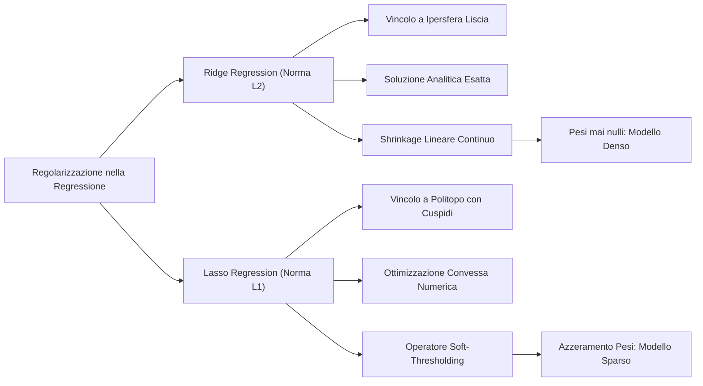

# 8. Regressione Ridge e Lasso

Nella regressione lineare stimata mediante i minimi quadrati ordinari (OLS/MLE), la matrice di covarianza delle stime dei parametri $\mathrm{Var}[\mathbf{w}_{\text{ML}}] = \sigma_\epsilon^2 (\mathbf{X}^T \mathbf{X})^{-1}$ e la varianza della predizione $\mathrm{Var}[h(\mathbf{x}_0)] \approx \sigma_\epsilon^2 \frac{D}{N}$ dipendono in modo critico dall'invertibilità e dal condizionamento spettrale della matrice $\mathbf{X}^T \mathbf{X}$. Quando le feature presentano forte multicollinearità o quando la dimensionalità $D$ si avvicina o supera la numerosità campionaria $N$, la varianza esplode e i coefficienti assumono valori arbitrariamente grandi e instabili.

Le tecniche di __regolarizzazione vincolata__ per la regressione risolvono questa vulnerabilità: la __Ridge Regression__ (penalità $L_2$) introduce una contrazione matriciale (_shrinkage_) che garantisce l'invertibilità incondizionata della matrice regolarizzata e riduce sistematicamente la varianza rispetto a OLS; la regressione __Lasso__ (penalità $L_1$) impiega un profilo di contrazione _soft-thresholding_ a cuspidi, conferendo alla soluzione una proprietà strutturale di sparsità per la selezione automatica delle feature.

## Multicollinearità e Vulnerabilità di OLS

Nei minimi quadrati ordinari, la matrice di dispersione campionaria $\mathbf{X}^T \mathbf{X}$ governa direttamente la precisione delle stime parametriche e la stabilità delle previsioni su nuovi campioni:

$$
\mathrm{Var}[\mathbf{w}_{\text{ML}}] = \sigma_\epsilon^2 (\mathbf{X}^T \mathbf{X})^{-1}
$$

$$
\mathrm{Var}[h_{\mathbf{w}_{\text{ML}}}(\mathbf{x}_0)] = \sigma_\epsilon^2 \, \mathbf{x}_0^T (\mathbf{X}^T \mathbf{X})^{-1} \mathbf{x}_0 \approx \sigma_\epsilon^2 \frac{D}{N}
$$

L'incertezza sui parametri cresce al diminuire della dispersione campionaria. Quando la matrice simmetrica $\mathbf{X}^T \mathbf{X} \in \mathbb{R}^{D \times D}$ è singolare o mal condizionata, la sua inversa presenta elementi arbitrariamente grandi che amplificano incontrollabilmente il rumore statistico.

Ricordiamo che una generica matrice quadrata $\mathbf{U} \in \mathbb{R}^{D \times D}$ è singolare (e dunque non invertibile) quando si verifica una delle seguenti condizioni equivalenti:
- Il suo determinante è nullo: $\det(\mathbf{U}) = |\mathbf{U}| = 0$;
- Almeno un suo autovalore è nullo;
- La matrice presenta rango deficitario ($\mathrm{rank}(\mathbf{U}) < D$), ovvero una o più colonne (o righe) sono esprimibili come combinazione lineare delle rimanenti.

Nel contesto della regressione, la matrice dei dati $\mathbf{X} \in \mathbb{R}^{N \times D}$ presenta rango deficitario sulle colonne se una feature è perfettamente esprimibile come combinazione lineare esatta di altre feature.

Negli scenari empirici reali la dipendenza lineare esatta è rara; è invece comunissima la presenza di una correlazione elevata tra variabili predittive (__multicollinearità__). In tale circostanza, le colonne di $\mathbf{X}$ risultano quasi linearmente dipendenti: la matrice $\mathbf{X}^T \mathbf{X}$ diventa mal condizionata, sviluppa autovalori prossimi a zero e la sua inversa produce elementi con ordini di grandezza ingestibili.

La catena logica della degenerazione statistica si sviluppa nella seguente traiettoria:

Dal punto di vista dell'ottimizzazione, quando due feature sono collineari i contorni di livello della funzione di costo quadratica assumono la conformazione di valli paraboloidi piatte ed estremamente allungate.

Lungo la direzione di fondo valle la pendenza è pressoché nulla: variazioni gigantesche nei coefficienti associati alle variabili collineari si compensano reciprocamente purché di segno opposto ($w_i \approx -w_j$ con $|w_i|, |w_j| \gg 0$). Il modello produce predizioni numericamente comparabili sul training set ma con coefficienti privi di significato fisico, rendendo la funzione di regressione ipersensibile a qualsiasi minima perturbazione dei dati di test.

Sebbene sia possibile diagnosticare la collinearità mediante il fattore di inflazione della varianza (_Variance Inflation Factor_, VIF), questo strumento diagnostico richiede l'addestramento di $D$ modelli ausiliari ed è basato su soglie di taglio euristiche.

Per sanare l'instabilità all'origine senza rimuovere arbitrariamente informazioni dal dataset, modifichiamo la formulazione del problema imponendo un vincolo esplicito sull'energia complessiva dei pesi: questa strategia costituisce il fondamento della __regolarizzazione__.

## Formulazione Vincolata di Ridge Regression

La tecnica di __Ridge Regression__ impone un vincolo quadratico sulla norma euclidea ($L_2$) del vettore dei parametri addestrabili.

Formalizziamo il problema di ottimizzazione vincolata primale:

$$
\mathbf{w}_{\text{Ridge}} = \arg\min_{\mathbf{w} \in \mathbb{R}^D} \sum_{i=0}^{N-1} (t^{(i)} - \mathbf{w}^T \mathbf{x}^{(i)})^2 \quad \text{sotto il vincolo} \quad \sum_{j=1}^{D-1} w_j^2 \le l
$$

dove lo scalare $l > 0$ definisce il raggio massimo ammissibile per la sfera nello spazio dei pesi.

> [!IMPORTANT] Due Condizioni Strutturali Tassative
> 1. __Esclusione del termine di bias__: la sommatoria del vincolo parte da $j=1$ ed esclude deliberatamente il parametro di intercetta $w_0$. Se vincolassimo $w_0$, la contrazione del modello dipenderebbe da traslazioni arbitrarie dell'origine dell'asse dei target $t$;
> 2. __Centratura e standardizzazione delle feature__: le coordinate del vettore $\mathbf{x}$ devono essere preliminarmente centrate a media nulla e scalate a varianza unitaria. Poiché la penalità $L_2$ somma indistintamente i quadrati dei coefficienti, una scala eterogenea penalizzerebbe ingiustamente le feature con unità di misura numericamente inferiori.

Sfruttando il metodo dei moltiplicatori di Lagrange per problemi di ottimizzazione convessa con vincoli di disuguaglianza (condizioni KKT), convertiamo il problema vincolato nella minimizzazione di una funzione Lagrangiana non vincolata:

$$
\mathbf{w}_{\text{Ridge}} = \arg\min_{\mathbf{w} \in \mathbb{R}^D} \sum_{i=0}^{N-1} (t^{(i)} - \mathbf{w}^T \mathbf{x}^{(i)})^2 + \lambda \sum_{j=1}^{D-1} w_j^2
$$

A ciascun raggio ammissibile $l > 0$ corrisponde biunivocamente un coefficiente di penalizzazione $\lambda \ge 0$ che individua il medesimo punto di ottimo globale.

## Derivazione Analitica della Soluzione Ridge

Sviluppiamo la soluzione esatta in forma chiusa operando direttamente in notazione matriciale compatta.

Definiamo la matrice dei dati $\mathbf{X} \in \mathbb{R}^{N \times D}$, il vettore colonna dei target $\mathbf{t} \in \mathbb{R}^{N \times 1}$ e il vettore dei pesi $\mathbf{w} \in \mathbb{R}^{D \times 1}$:

$$
\mathbf{X} = \begin{bmatrix} (\mathbf{x}^{(0)})^T \\ (\mathbf{x}^{(1)})^T \\ \vdots \\ (\mathbf{x}^{(N-1)})^T \end{bmatrix}, \qquad \mathbf{t} = \begin{bmatrix} t^{(0)} \\ t^{(1)} \\ \vdots \\ t^{(N-1)} \end{bmatrix}, \qquad \mathbf{w} = \begin{bmatrix} w_0 \\ w_1 \\ \vdots \\ w_{D-1} \end{bmatrix}
$$

Il vettore dei residui di stima corrisponde a $\mathbf{e} = \mathbf{t} - \mathbf{X}\mathbf{w}$. Introducendo il fattore convenzionale $1/2$ per semplificare le derivate successive, la funzione di costo regolarizzata assume la forma:

$$
L(\mathbf{w}) = \frac{1}{2} (\mathbf{t} - \mathbf{X}\mathbf{w})^T (\mathbf{t} - \mathbf{X}\mathbf{w}) + \frac{1}{2} \lambda \mathbf{w}^T \mathbf{w}
$$

Sviluppiamo il prodotto trasposto all'interno del termine di errore quadratico:

$$
L(\mathbf{w}) = \frac{1}{2} \left( \mathbf{t}^T \mathbf{t} - \mathbf{t}^T \mathbf{X} \mathbf{w} - \mathbf{w}^T \mathbf{X}^T \mathbf{t} + \mathbf{w}^T \mathbf{X}^T \mathbf{X} \mathbf{w} \right) + \frac{1}{2} \lambda \mathbf{w}^T \mathbf{w}
$$

Poiché lo scalare $\mathbf{t}^T \mathbf{X} \mathbf{w}$ coincide con il suo trasposto $(\mathbf{t}^T \mathbf{X} \mathbf{w})^T = \mathbf{w}^T \mathbf{X}^T \mathbf{t}$, raggruppiamo i termini misti:

$$
L(\mathbf{w}) = \frac{1}{2} \mathbf{t}^T \mathbf{t} - \mathbf{w}^T \mathbf{X}^T \mathbf{t} + \frac{1}{2} \mathbf{w}^T \mathbf{X}^T \mathbf{X} \mathbf{w} + \frac{1}{2} \lambda \mathbf{w}^T \mathbf{w}
$$

Calcoliamo il gradiente della funzione di costo $L(\mathbf{w})$ rispetto al vettore dei parametri $\mathbf{w}$:

$$
\nabla_{\mathbf{w}} L(\mathbf{w}) = -\mathbf{X}^T \mathbf{t} + \mathbf{X}^T \mathbf{X} \mathbf{w} + \lambda \mathbf{w}
$$

Imponiamo la condizione di stazionarietà $\nabla_{\mathbf{w}} L(\mathbf{w}) = \mathbf{0}$:

$$
\mathbf{X}^T \mathbf{X} \mathbf{w} + \lambda \mathbf{w} = \mathbf{X}^T \mathbf{t}
$$

Raccogliamo il vettore $\mathbf{w}$ introducendo la matrice identità $\mathbf{I} \in \mathbb{R}^{D \times D}$:

$$
(\mathbf{X}^T \mathbf{X} + \lambda \mathbf{I}) \mathbf{w} = \mathbf{X}^T \mathbf{t}
$$

Poiché per ogni $\lambda > 0$ la matrice $(\mathbf{X}^T \mathbf{X} + \lambda \mathbf{I})$ è strettamente definita positiva e pertanto invertibile, isoliamo $\mathbf{w}$ ottenendo la __soluzione esatta di Ridge Regression__:

$$
\mathbf{w}_{\text{Ridge}} = (\mathbf{X}^T \mathbf{X} + \lambda \mathbf{I})^{-1} \mathbf{X}^T \mathbf{t}
$$

### Invertibilità Garantita della Matrice Regolarizzata

Esaminiamo perché la presenza del termine $\lambda \mathbf{I}$ elimina per via algebrica qualsiasi potenziale singolarità, anche nelle condizioni più critiche.

La matrice empirica dei dati $\mathbf{X}^T \mathbf{X} \in \mathbb{R}^{D \times D}$ è simmetrica e semi-definita positiva: per qualunque vettore non nullo $\mathbf{v} \in \mathbb{R}^D \setminus \{\mathbf{0}\}$, vale:

$$
\mathbf{v}^T \mathbf{X}^T \mathbf{X} \mathbf{v} = (\mathbf{X}\mathbf{v})^T (\mathbf{X}\mathbf{v}) = \|\mathbf{X}\mathbf{v}\|_2^2 \ge 0
$$

I suoi autovalori sono dunque tutti non negativi: $d_j^2 \ge 0$. Se $\mathbf{X}$ non è a rango pieno sulle colonne, almeno un autovalore è nullo ($d_j^2 = 0$).

Valutiamo ora la forma quadratica associata alla matrice regolarizzata $(\mathbf{X}^T \mathbf{X} + \lambda \mathbf{I})$ con $\lambda > 0$:

$$
\mathbf{v}^T (\mathbf{X}^T \mathbf{X} + \lambda \mathbf{I}) \mathbf{v} = \mathbf{v}^T \mathbf{X}^T \mathbf{X} \mathbf{v} + \lambda \mathbf{v}^T \mathbf{v} = \|\mathbf{X}\mathbf{v}\|_2^2 + \lambda \|\mathbf{v}\|_2^2
$$

Poiché $\mathbf{v} \neq \mathbf{0}$, la norma euclidea $\|\mathbf{v}\|_2^2 > 0$. Essendo $\|\mathbf{X}\mathbf{v}\|_2^2 \ge 0$ e $\lambda > 0$, concludiamo che:

$$
\mathbf{v}^T (\mathbf{X}^T \mathbf{X} + \lambda \mathbf{I}) \mathbf{v} \ge \lambda \|\mathbf{v}\|_2^2 > 0 \quad \forall \mathbf{v} \neq \mathbf{0}
$$

La matrice $(\mathbf{X}^T \mathbf{X} + \lambda \mathbf{I})$ è __strettamente definita positiva__.

I suoi autovalori risultano traslati rigidamente verso l'alto di una quantità pari a $\lambda$:

$$
\gamma_j = d_j^2 + \lambda \ge \lambda > 0 \quad \forall j \in \{0, \dots, D-1\}
$$

Di conseguenza, il determinante è strettamente positivo:

$$
\det(\mathbf{X}^T \mathbf{X} + \lambda \mathbf{I}) = \prod_{j=0}^{D-1} (d_j^2 + \lambda) \ge \lambda^D > 0
$$

e il numero di condizionamento spettrale risulta limitato superiormente da una quantità finita:

$$
\kappa(\mathbf{X}^T \mathbf{X} + \lambda \mathbf{I}) = \frac{d_{\max}^2 + \lambda}{d_{\min}^2 + \lambda} \le \frac{d_{\max}^2 + \lambda}{\lambda} < \infty
$$

> [!IMPORTANT] Takeaway d'Esame: Invertibilità nel Regime $D > N$
> Nella regressione lineare OLS, quando il numero di feature supera la numerosità campionaria ($D > N$), la matrice $\mathbf{X} \in \mathbb{R}^{N \times D}$ possiede rango al più pari a $N < D$. La matrice quadrata $\mathbf{X}^T \mathbf{X} \in \mathbb{R}^{D \times D}$ ha rango deficitario con almeno $D - N$ autovalori identicamente nulli, rendendo impossibile l'inversione ordinaria.
> Ridge Regression supera questo scoglio: la traslazione di $+\lambda$ sposta gli autovalori degeneri a $\lambda > 0$. Lo stimatore Ridge esiste sempre unico, ben condizionato e invertibile per qualunque $D$ e $N$.

## Numero Effettivo di Parametri e Analisi Spettrale SVD

Per valutare la capacità rappresentativa del modello regolarizzato dobbiamo quantificarne i gradi di libertà effettivi.

A tal fine esaminiamo la matrice cappello (_Hat Matrix_) $\mathbf{H}$, definita come l'operatore di proiezione che trasforma il vettore dei target campionari $\mathbf{t}$ nel vettore delle predizioni sul training set $\hat{\mathbf{t}} = \mathbf{H}\mathbf{t}$.

### Hat Matrix nei Minimi Quadrati Ordinari

Nel modello lineare standard non regolarizzato, la predizione si esprime come $\hat{\mathbf{t}} = \mathbf{X}\mathbf{w}_{\text{ML}} = \mathbf{X}(\mathbf{X}^T\mathbf{X})^{-1}\mathbf{X}^T\mathbf{t}$. La matrice cappello è:

$$
\mathbf{H} = \mathbf{X} (\mathbf{X}^T \mathbf{X})^{-1} \mathbf{X}^T
$$

Questa matrice gode di due proprietà algebriche essenziali:
- __Simmetria__: $\mathbf{H}^T = (\mathbf{X} (\mathbf{X}^T \mathbf{X})^{-1} \mathbf{X}^T)^T = \mathbf{X} (\mathbf{X}^T \mathbf{X})^{-1} \mathbf{X}^T = \mathbf{H}$;
- __Idempotenza__: $\mathbf{H}^2 = \mathbf{H}\mathbf{H} = \mathbf{X} (\mathbf{X}^T \mathbf{X})^{-1} \mathbf{X}^T \mathbf{X} (\mathbf{X}^T \mathbf{X})^{-1} \mathbf{X}^T = \mathbf{X} (\mathbf{X}^T \mathbf{X})^{-1} \mathbf{X}^T = \mathbf{H}$.

Essendo idempotente e simmetrica, $\mathbf{H}$ agisce come una proiezione ortogonale pura sullo spazio generato dalle colonne di $\mathbf{X}$. Calcolandone la traccia mediante la proprietà ciclica $\mathrm{Tr}(\mathbf{A}\mathbf{B}) = \mathrm{Tr}(\mathbf{B}\mathbf{A})$, ricaviamo i gradi di libertà:

$$
\mathrm{Tr}(\mathbf{H}) = \mathrm{Tr}\left( \mathbf{X} (\mathbf{X}^T \mathbf{X})^{-1} \mathbf{X}^T \right) = \mathrm{Tr}\left( \mathbf{X}^T \mathbf{X} (\mathbf{X}^T \mathbf{X})^{-1} \right) = \mathrm{Tr}(\mathbf{I}_D) = D
$$

Nei minimi quadrati ordinari, il numero effettivo di parametri coincide esattamente con il numero nominale di feature $D$.

### Hat Matrix e Gradi di Libertà Effettivi in Ridge

In Ridge Regression, la predizione sui dati di addestramento assume la forma:

$$
\hat{\mathbf{t}} = \mathbf{X} \mathbf{w}_{\text{Ridge}} = \mathbf{X} (\mathbf{X}^T \mathbf{X} + \lambda \mathbf{I})^{-1} \mathbf{X}^T \mathbf{t} = \mathbf{H}_\lambda \mathbf{t}
$$

dove la matrice cappello regolarizzata è data da:

$$
\mathbf{H}_\lambda = \mathbf{X} (\mathbf{X}^T \mathbf{X} + \lambda \mathbf{I})^{-1} \mathbf{X}^T
$$

A causa del termine $\lambda \mathbf{I}$, la matrice $\mathbf{H}_\lambda$ perde l'idempotenza ($\mathbf{H}_\lambda^2 \neq \mathbf{H}_\lambda$): essa non opera più come una proiezione ortogonale, bensì come un operatore di contrazione continua (_Shrinkage_).

Per determinarne gli autovalori e calcolarne la traccia, applichiamo la __Decomposizione a Valori Singolari__ (_Singular Value Decomposition_, SVD) alla matrice dei dati $\mathbf{X} \in \mathbb{R}^{N \times D}$:

$$
\mathbf{X} = \mathbf{U} \mathbf{D} \mathbf{V}^T
$$

dove:
- $\mathbf{U} \in \mathbb{R}^{N \times D}$ è una matrice a colonne ortonormali contenente gli autovettori di $\mathbf{X}\mathbf{X}^T$ ($\mathbf{U}^T\mathbf{U} = \mathbf{I}_D$);
- $\mathbf{V} \in \mathbb{R}^{D \times D}$ è una matrice ortogonale contenente gli autovettori di $\mathbf{X}^T\mathbf{X}$ ($\mathbf{V}^T\mathbf{V} = \mathbf{V}\mathbf{V}^T = \mathbf{I}_D$);
- $\mathbf{D} \in \mathbb{R}^{D \times D}$ è una matrice diagonale i cui elementi $d_j \ge 0$ sono i valori singolari di $\mathbf{X}$, pari alla radice quadrata degli autovalori di $\mathbf{X}^T\mathbf{X}$.

Sostituiamo la decomposizione SVD nel prodotto $\mathbf{X}^T\mathbf{X}$:

$$
\mathbf{X}^T \mathbf{X} = (\mathbf{U} \mathbf{D} \mathbf{V}^T)^T (\mathbf{U} \mathbf{D} \mathbf{V}^T) = \mathbf{V} \mathbf{D} \mathbf{U}^T \mathbf{U} \mathbf{D} \mathbf{V}^T = \mathbf{V} \mathbf{D}^2 \mathbf{V}^T
$$

Riscriviamo la matrice identità come $\mathbf{I}_D = \mathbf{V}\mathbf{V}^T$ e raccogliamo $\mathbf{V}$ a sinistra e a destra nella matrice regolarizzata:

$$
\mathbf{X}^T \mathbf{X} + \lambda \mathbf{I}_D = \mathbf{V} \mathbf{D}^2 \mathbf{V}^T + \lambda \mathbf{V} \mathbf{V}^T = \mathbf{V} (\mathbf{D}^2 + \lambda \mathbf{I}_D) \mathbf{V}^T
$$

Invertiamo il prodotto sfruttando l'identità $(\mathbf{A}\mathbf{B}\mathbf{C})^{-1} = \mathbf{C}^{-1}\mathbf{B}^{-1}\mathbf{A}^{-1}$ e l'ortogonalità $\mathbf{V}^{-1} = \mathbf{V}^T$:

$$
(\mathbf{X}^T \mathbf{X} + \lambda \mathbf{I}_D)^{-1} = (\mathbf{V}^T)^{-1} (\mathbf{D}^2 + \lambda \mathbf{I}_D)^{-1} \mathbf{V}^{-1} = \mathbf{V} (\mathbf{D}^2 + \lambda \mathbf{I}_D)^{-1} \mathbf{V}^T
$$

Sostituiamo l'espressione così ricavata nella definizione della matrice cappello $\mathbf{H}_\lambda$:

$$
\mathbf{H}_\lambda = (\mathbf{U} \mathbf{D} \mathbf{V}^T) \left[ \mathbf{V} (\mathbf{D}^2 + \lambda \mathbf{I}_D)^{-1} \mathbf{V}^T \right] (\mathbf{V} \mathbf{D} \mathbf{U}^T)
$$

Poiché le matrici interne si semplificano grazie all'ortonormalità $\mathbf{V}^T\mathbf{V} = \mathbf{I}_D$, otteniamo la __diagonalizzazione spettrale di $\mathbf{H}_\lambda$__:

$$
\mathbf{H}_\lambda = \mathbf{U} \mathbf{D} (\mathbf{D}^2 + \lambda \mathbf{I}_D)^{-1} \mathbf{D} \mathbf{U}^T = \mathbf{U} \left( \frac{\mathbf{D}^2}{\mathbf{D}^2 + \lambda \mathbf{I}_D} \right) \mathbf{U}^T
$$

La matrice diagonale centrale racchiude gli autovalori di $\mathbf{H}_\lambda$, ciascuno dei quali vale:

$$
\gamma_j = \frac{d_j^2}{d_j^2 + \lambda}
$$

Il __numero effettivo di parametri__ (_Effective Degrees of Freedom_, $\text{df}(\lambda)$) corrisponde alla traccia di $\mathbf{H}_\lambda$. Applicando la proprietà ciclica della traccia e sfruttando l'ortonormalità $\mathbf{U}^T\mathbf{U} = \mathbf{I}_D$:

$$
\text{df}(\lambda) = \mathrm{Tr}(\mathbf{H}_\lambda) = \mathrm{Tr}\left( \mathbf{U} \frac{\mathbf{D}^2}{\mathbf{D}^2 + \lambda\mathbf{I}_D} \mathbf{U}^T \right) = \mathrm{Tr}\left( \mathbf{U}^T\mathbf{U} \frac{\mathbf{D}^2}{\mathbf{D}^2 + \lambda\mathbf{I}_D} \right) = \sum_{j=0}^{D-1} \frac{d_j^2}{d_j^2 + \lambda}
$$

![[fig_ex_8_gradi_di_liberta_svd_shrinkage.png|center big]]

Questa legge algebrica rivela il funzionamento microscopico di Ridge:
- Se $\lambda \to 0$: $\frac{d_j^2}{d_j^2 + 0} = 1 \implies \text{df}(\lambda) \to \sum_{j=0}^{D-1} 1 = D$, ripristinando la complessità massima OLS;
- Se $\lambda \to \infty$: $\frac{d_j^2}{d_j^2 + \lambda} \to 0 \implies \text{df}(\lambda) \to 0$, annullando la capacità descrittiva del modello;
- __Filtraggio selettivo__: per le componenti ad alta varianza ($d_j^2 \gg \lambda$), il fattore di attenuazione vale circa 1 e la proiezione rimane inalterata; per le direzioni con autovalori piccoli ($d_j^2 \ll \lambda$), il fattore crolla verso zero. Ridge comprime selettivamente le direzioni con scarso segnale, tipicamente dominate dal rumore campionario.

## Bias e Varianza dello Stimatore Ridge

Valutiamo il valore atteso e la matrice di covarianza dei coefficienti $\mathbf{w}_{\text{Ridge}}$ condizionatamente alla matrice dei dati $\mathbf{X}$.

Assumiamo che il processo generativo reale sia descritto dal modello lineare $\mathbf{t} = \mathbf{X}\mathbf{w}^* + \boldsymbol{\epsilon}$, dove il rumore soddisfa $\mathbb{E}[\boldsymbol{\epsilon} \mid \mathbf{X}] = \mathbf{0}$ e $\mathrm{Var}[\boldsymbol{\epsilon} \mid \mathbf{X}] = \sigma_\epsilon^2 \mathbf{I}$, da cui segue $\mathbb{E}[\mathbf{t} \mid \mathbf{X}] = \mathbf{X}\mathbf{w}^*$.

### Calcolo del Bias dello Stimatore Ridge

Calcoliamo il valore atteso dei pesi stimati applicando la linearità dell'operatore aspettazione:

$$
\mathbb{E}[\mathbf{w}_{\text{Ridge}} \mid \mathbf{X}] = \mathbb{E}\left[ (\mathbf{X}^T \mathbf{X} + \lambda \mathbf{I})^{-1} \mathbf{X}^T \mathbf{t} \mid \mathbf{X} \right] = (\mathbf{X}^T \mathbf{X} + \lambda \mathbf{I})^{-1} \mathbf{X}^T \mathbb{E}[\mathbf{t} \mid \mathbf{X}]
$$

Sostituendo $\mathbb{E}[\mathbf{t} \mid \mathbf{X}] = \mathbf{X}\mathbf{w}^*$:

$$
\mathbb{E}[\mathbf{w}_{\text{Ridge}} \mid \mathbf{X}] = (\mathbf{X}^T \mathbf{X} + \lambda \mathbf{I})^{-1} \mathbf{X}^T \mathbf{X} \mathbf{w}^*
$$

Per semplificare l'espressione, ricorriamo a un artificio algebrico: sommiamo e sottraiamo $\lambda \mathbf{I}$ al prodotto centrale:

$$
\mathbf{X}^T \mathbf{X} = (\mathbf{X}^T \mathbf{X} + \lambda \mathbf{I}) - \lambda \mathbf{I}
$$

Distribuendo il prodotto matriciale:

$$
\mathbb{E}[\mathbf{w}_{\text{Ridge}} \mid \mathbf{X}] = (\mathbf{X}^T \mathbf{X} + \lambda \mathbf{I})^{-1} \left[ (\mathbf{X}^T \mathbf{X} + \lambda \mathbf{I}) - \lambda \mathbf{I} \right] \mathbf{w}^* = \left[ \mathbf{I} - \lambda (\mathbf{X}^T \mathbf{X} + \lambda \mathbf{I})^{-1} \right] \mathbf{w}^*
$$

Riscrivendo i termini:

$$
\mathbb{E}[\mathbf{w}_{\text{Ridge}} \mid \mathbf{X}] = \mathbf{w}^* - \lambda (\mathbf{X}^T \mathbf{X} + \lambda \mathbf{I})^{-1} \mathbf{w}^*
$$

Il vettore di bias dello stimatore Ridge risulta:

$$
\text{Bias}(\mathbf{w}_{\text{Ridge}}) = \mathbb{E}[\mathbf{w}_{\text{Ridge}} \mid \mathbf{X}] - \mathbf{w}^* = -\lambda (\mathbf{X}^T \mathbf{X} + \lambda \mathbf{I})^{-1} \mathbf{w}^*
$$

Lo stimatore Ridge è __strutturalmente distorto__ (_biased_):
- Per $\lambda = 0$ il bias è nullo ($\text{Bias} = \mathbf{0}$), ricadendo nella correttezza asintotica di OLS;
- Per ogni $\lambda > 0$ la distorsione cresce monotonicamente, contraendo la stima attesa verso l'origine.

### Calcolo della Varianza e Abbattimento dell'Errore

Calcoliamo la matrice di covarianza di $\mathbf{w}_{\text{Ridge}}$ condizionatamente a $\mathbf{X}$:

$$
\mathrm{Var}[\mathbf{w}_{\text{Ridge}} \mid \mathbf{X}] = \mathrm{Var}\left[ (\mathbf{X}^T \mathbf{X} + \lambda \mathbf{I})^{-1} \mathbf{X}^T \mathbf{t} \mid \mathbf{X} \right]
$$

Applicando la proprietà di propagazione della covarianza per trasformazioni lineari $\mathrm{Var}[\mathbf{A}\mathbf{t}] = \mathbf{A} \mathrm{Var}[\mathbf{t}] \mathbf{A}^T$ con $\mathrm{Var}[\mathbf{t} \mid \mathbf{X}] = \sigma_\epsilon^2 \mathbf{I}$:

$$
\mathrm{Var}[\mathbf{w}_{\text{Ridge}} \mid \mathbf{X}] = \sigma_\epsilon^2 (\mathbf{X}^T \mathbf{X} + \lambda \mathbf{I})^{-1} \mathbf{X}^T \mathbf{X} (\mathbf{X}^T \mathbf{X} + \lambda \mathbf{I})^{-1}
$$

Sostituendo la decomposizione SVD $\mathbf{X}^T\mathbf{X} = \mathbf{V}\mathbf{D}^2\mathbf{V}^T$ e $(\mathbf{X}^T\mathbf{X} + \lambda\mathbf{I})^{-1} = \mathbf{V}(\mathbf{D}^2 + \lambda\mathbf{I})^{-1}\mathbf{V}^T$:

$$
\mathrm{Var}[\mathbf{w}_{\text{Ridge}} \mid \mathbf{X}] = \sigma_\epsilon^2 \, \mathbf{V} (\mathbf{D}^2 + \lambda \mathbf{I})^{-1} \mathbf{V}^T \mathbf{V} \mathbf{D}^2 \mathbf{V}^T \mathbf{V} (\mathbf{D}^2 + \lambda \mathbf{I})^{-1} \mathbf{V}^T = \sigma_\epsilon^2 \, \mathbf{V} \frac{\mathbf{D}^2}{(\mathbf{D}^2 + \lambda \mathbf{I})^2} \mathbf{V}^T
$$

La traccia della covarianza quantifica la dispersione scalare complessiva dei parametri:

$$
\mathrm{Tr}\left( \mathrm{Var}[\mathbf{w}_{\text{Ridge}} \mid \mathbf{X}] \right) = \sigma_\epsilon^2 \sum_{j=0}^{D-1} \frac{d_j^2}{(d_j^2 + \lambda)^2}
$$

Confrontiamo questa grandezza con la varianza corrispondente dei minimi quadrati ordinari ($\lambda = 0$):

$$
\mathrm{Tr}\left( \mathrm{Var}[\mathbf{w}_{\text{OLS}} \mid \mathbf{X}] \right) = \sigma_\epsilon^2 \sum_{j=0}^{D-1} \frac{1}{d_j^2}
$$

Poiché per qualsiasi $\lambda > 0$ e per qualunque autovalore strettamente positivo $d_j > 0$ vale la disuguaglianza:

$$
\frac{d_j^2}{(d_j^2 + \lambda)^2} < \frac{d_j^2}{(d_j^2)^2} = \frac{1}{d_j^2}
$$

otteniamo la relazione fondamentale d'ordine stretto:

$$
\mathrm{Tr}\left( \mathrm{Var}[\mathbf{w}_{\text{Ridge}} \mid \mathbf{X}] \right) < \mathrm{Tr}\left( \mathrm{Var}[\mathbf{w}_{\text{OLS}} \mid \mathbf{X}] \right) \quad \forall \lambda > 0
$$

Ridge comprime sistematicamente l'incertezza sui parametri per qualsiasi valore di penalizzazione.

> [!TIP] Takeaway d'Esame: Superamento del Limite di Gauss-Markov
> Il Teorema di Gauss-Markov certifica che OLS è il miglior stimatore lineare corretto (BLUE, _Best Linear Unbiased Estimator_), possedendo la minima varianza possibile nella classe ristretta degli stimatori non distorti ($\text{Bias} = \mathbf{0}$).
> 
> Ridge Regression infrange deliberatamente il vincolo di imparzialità. Poiché la derivata del bias quadratico $\|\text{Bias}\|_2^2$ rispetto a $\lambda$ valutata in $\lambda = 0$ è nulla, mentre la derivata della varianza è strettamente negativa, esiste sempre un valore $\lambda^* > 0$ tale che:
> 
> $$
> \mathrm{MSE}(\mathbf{w}_{\text{Ridge}}) = \|\text{Bias}(\mathbf{w}_{\text{Ridge}})\|_2^2 + \mathrm{Tr}\left(\mathrm{Var}[\mathbf{w}_{\text{Ridge}}]\right) < \mathrm{MSE}(\mathbf{w}_{\text{OLS}})
> $$
> 
> Accettando una quota controllata di bias, Ridge consegue un abbattimento della varianza di entità superiore, riducendo l'errore quadratico medio globale al di sotto del minimo teorico consentito a OLS.

## Lasso Regression e la Proprietà di Sparsità

Sebbene Ridge contragga i coefficienti verso lo zero, non ne annulla mai nessuno per valori finiti di $\lambda < \infty$. Tutte le $D$ feature rimangono incluse nella funzione di decisione, producendo una soluzione densa che non semplifica l'architettura del modello.

Quando l'obiettivo ingegneristico richiede di azzerare selettivamente le variabili ridondanti o irrilevanti per eseguire __selezione automatica delle feature__ (_Feature Selection_), adottiamo il modello __Lasso__ (_Least Absolute Shrinkage and Selection Operator_).

Lasso sostituisce la penalità quadratica $L_2$ con la __norma $L_1$__, corrispondente alla somma dei valori assoluti dei parametri:

$$
\mathbf{w}_{\text{Lasso}} = \arg\min_{\mathbf{w} \in \mathbb{R}^D} \sum_{i=0}^{N-1} (t^{(i)} - \mathbf{w}^T \mathbf{x}^{(i)})^2 \quad \text{sotto il vincolo} \quad \sum_{j=1}^{D-1} |w_j| \le l
$$

dove il termine di bias $w_0$ viene escluso dal vincolo e le feature sono preliminarmente standardizzate.

Convertendo il vincolo in forma Lagrangiana:

$$
\mathbf{w}_{\text{Lasso}} = \arg\min_{\mathbf{w} \in \mathbb{R}^D} \sum_{i=0}^{N-1} (t^{(i)} - \mathbf{w}^T \mathbf{x}^{(i)})^2 + \lambda \sum_{j=1}^{D-1} |w_j|
$$

A differenza della norma euclidea differenziabile, la funzione valore assoluto presenta un punto angoloso non derivabile nell'origine ($|w_j|$ ha una cuspide in $w_j = 0$). Di conseguenza, il gradiente ordinario non è definito su tutto il dominio e Lasso non ammette una soluzione analitica in forma chiusa. La soluzione viene calcolata numericamente mediante algoritmi di ottimizzazione convessa, quali la discesa a coordinate (_Coordinate Descent_) o la programmazione quadratica vincolata.

### Interpretazione Geometrica della Sparsità

La genesi della sparsità in Lasso e la sua assenza in Ridge si comprendono analizzando la geometria differenziale delle rispettive regioni ammissibili nello spazio dei parametri.

![[fig_ex_8_ridge_vs_lasso_geometria_sparsita.png|center big]]

Esaminiamo lo spazio bidimensionale dei coefficienti $(w_1, w_2)$:
- __Contorni di livello OLS__: la funzione di perdita quadratica genera ellissi concentriche centrate attorno alla stima non vincolata $\mathbf{w}_{\text{ML}}$. Il costo cresce monotonicamente allontanandosi dal centro;
- __Regione ammissibile $L_2$ (Ridge)__: il vincolo $w_1^2 + w_2^2 \le l$ definisce un disco circolare perfetto, privo di spigoli e dotato di frontiera differenziabile ovunque. L'ellisse di errore, espandendosi, tocca la sfera in un punto di tangenza liscia che cade quasi certamente all'interno di un quadrante aperto ($w_1 \neq 0$ e $w_2 \neq 0$). I coefficienti vengono ridotti, ma nessuno viene annullato;
- __Regione ammissibile $L_1$ (Lasso)__: il vincolo $|w_1| + |w_2| \le l$ definisce un politopo a rombo (iperottaedro in dimensione superiore) dotato di vertici cuspidali posizionati esattamente lungo gli assi coordinati. Espandendosi, le ellissi incontrano con probabilità quasi unitaria una delle cuspidi sporgenti prima di toccare i lati inclinati. Nel punto di contatto su un asse coordinato, la coordinata ortogonale è rigorosamente pari a zero ($w_1 = 0$ con $w_2 = l$).

Questo meccanismo di contatto sulle cuspidi azzera esattamente i coefficienti delle variabili deboli, rendendo il vettore dei pesi __sparso__ ed eliminando le feature superflue dal modello finale.

### Profili di Contrazione: Shrinkage Lineare vs Soft-Thresholding

La divergenza operativa tra le due regolarizzazioni emerge con rigore analitico esaminando il caso ideale di feature ortonormali ($\mathbf{X}^T\mathbf{X} = \mathbf{I}$). In questa configurazione il problema matriciale si disaccoppia in $D$ sottoproblemi scalari indipendenti per ciascun parametro $w_j$, la cui stima OLS vale $\hat{w}_j^{\text{OLS}} = \mathbf{x}_j^T \mathbf{t}$.

Analizziamo il comportamento delle due funzioni obiettivo scalari:

Per __Ridge Regression ($L_2$)__, minimizziamo la perdita scalare:

$$
\min_{w_j} \frac{1}{2} (w_j - w_j^{\text{OLS}})^2 + \frac{1}{2} \lambda w_j^2
$$

Annullando la derivata prima:

$$
(w_j - w_j^{\text{OLS}}) + \lambda w_j = 0 \implies (1 + \lambda) w_j = w_j^{\text{OLS}} \implies \hat{w}_j^{\text{Ridge}} = \frac{1}{1 + \lambda} w_j^{\text{OLS}}
$$

Ridge applica una contrazione lineare continua (_linear shrinkage_) che riduce proporzionalmente il peso ma non lo annulla mai finché $w_j^{\text{OLS}} \neq 0$.

Per __Lasso Regression ($L_1$)__, minimizziamo la perdita con penalità non differenziabile:

$$
\min_{w_j} \frac{1}{2} (w_j - w_j^{\text{OLS}})^2 + \lambda |w_j|
$$

Applichiamo il calcolo del subgradiente $\partial |w_j|$:

$$
\partial |w_j| = \begin{cases} \{+1\} & \text{se } w_j > 0 \\ [-1, +1] & \text{se } w_j = 0 \\ \{-1\} & \text{se } w_j < 0 \end{cases}
$$

La condizione di stazionarietà $0 \in (w_j - w_j^{\text{OLS}}) + \lambda \partial |w_j|$ individua tre regimi:
- Se $w_j > 0$: $w_j - w_j^{\text{OLS}} + \lambda = 0 \implies w_j = w_j^{\text{OLS}} - \lambda$, valido solo per $w_j^{\text{OLS}} > \lambda$;
- Se $w_j < 0$: $w_j - w_j^{\text{OLS}} - \lambda = 0 \implies w_j = w_j^{\text{OLS}} + \lambda$, valido solo per $w_j^{\text{OLS}} < -\lambda$;
- Se $|w_j^{\text{OLS}}| \le \lambda$: l'intervallo del subgradiente include lo zero, imponendo la soluzione identicamente nulla $w_j = 0$.

Raggruppiamo i tre regimi nell'__operatore di sogliatura morbida__ (_Soft-Thresholding Operator_ $\mathcal{S}_\lambda$):

$$
\hat{w}_j^{\text{Lasso}} = \mathrm{sign}(w_j^{\text{OLS}}) \max(|w_j^{\text{OLS}}| - \lambda, 0)
$$

I pesi la cui stima OLS cade nell'intervallo $[-\lambda, \lambda]$ vengono azzerati all'istante, mentre i pesi eccedenti la soglia vengono traslati verso lo zero di una quantità fissa pari a $\lambda$.

## Quadro Sinottico e Confronto Metodologico

Sintetizziamo la tassonomia dei modelli lineari regolarizzati e le loro proprietà operative:

Confrontiamo in dettaglio le caratteristiche distintive delle tre metodologie studiate:

| Proprietà Analitica | Minimi Quadrati Ordinari (OLS) | Ridge Regression ($L_2$) | Lasso Regression ($L_1$) |
| :--- | :--- | :--- | :--- |
| __Termine di Penalità__ | Nessuno ($\lambda = 0$) | $\lambda \sum_{j=1}^{D-1} w_j^2$ | $\lambda \sum_{j=1}^{D-1} \|w_j\|$ |
| __Geometria del Vincolo__ | Spazio aperto non vincolato $\mathbb{R}^D$ | Ipersfera liscia $\sum w_j^2 \le l$ | Iperottaedro a cuspidi $\sum \|w_j\| \le l$ |
| __Soluzione Formale__ | $(\mathbf{X}^T\mathbf{X})^{-1}\mathbf{X}^T\mathbf{t}$ | $(\mathbf{X}^T\mathbf{X} + \lambda\mathbf{I})^{-1}\mathbf{X}^T\mathbf{t}$ | Nessuna forma chiusa (Coordinate Descent / QP) |
| __Gradi di Libertà Effettivi__ | $\text{df} = D$ | $\text{df}(\lambda) = \sum_{j=0}^{D-1} \frac{d_j^2}{d_j^2 + \lambda} < D$ | $\text{df} \approx$ numero di coefficienti non nulli |
| __Profilo di Contrazione__ | Nessuna contrazione | Contrazione lineare: $\frac{1}{1+\lambda} w_j^{\text{OLS}}$ | Soft-thresholding: $\mathrm{sign}(w) \max(\|w\|-\lambda, 0)$ |
| __Proprietà di Sparsità__ | No (tutti i coefficienti attivi) | No (coefficienti attenuati ma mai nulli) | Sì (azzeramento esatto dei coefficienti) |
| __Selezione delle Feature__ | Assente | Assente (tutte le feature permangono) | Automatica ed intrinseca al modello |
| __Comportamento con $D > N$__ | Rango deficitario (non invertibile) | Sempre invertibile ($\gamma_j \ge \lambda > 0$) | Seleziona al più $N$ feature attive |
| __Gestione Multicollinearità__ | Varianza divergente e pesi esplosi | Ripartisce stabilmente i pesi collineari | Tende a selezionare una feature scartando le altre |

> [!TIP] Principio di Applicazione Universale
> Le logiche di regolarizzazione basate su penalità $L_2$ ed $L_1$ costituiscono paradigmi universali nell'apprendimento automatico. La penalità $L_2$ si applica alla regressione logistica e alle reti neurali profonde con la denominazione di _Weight Decay_, mentre la penalità $L_1$ consente di comprimere architetture complesse producendo matrici di pesi a connettività sparsa.
