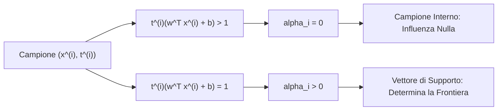
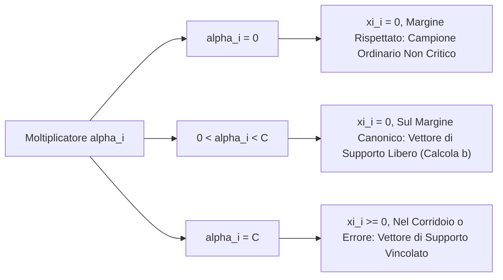
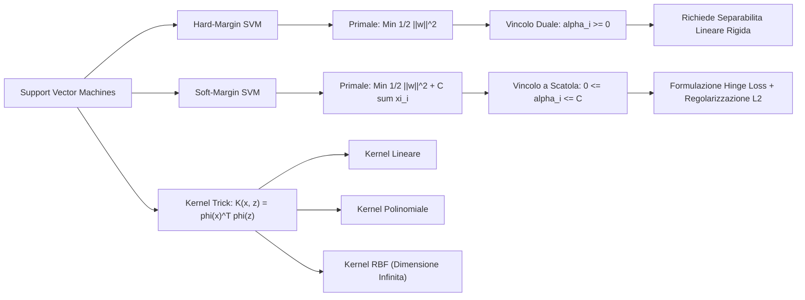

# 9. Support Vector Machines

Nei modelli lineari di classificazione, quali la regressione logistica e il percettrone di Rosenblatt, la superficie di decisione è un iperpiano che separa le classi nello spazio delle feature. Quando un dataset è linearmente separabile, esistono infiniti iperpiani in grado di azzerare l'errore di addestramento: ciascun algoritmo euristico converge a una soluzione diversa guidata dall'inizializzazione dei pesi o dall'ordine di presentazione dei dati, senza alcuna garanzia di robustezza statistica.

Le __Support Vector Machines__ (SVM) risolvono questa indeterminazione fondandosi sul principio di massimizzazione del margine geometrico di separazione. La classificazione a margine rigido (__Hard-Margin SVM__) si formula come un problema di ottimizzazione convessa quadratica vincolata la cui soluzione duale, derivata mediante moltiplicatori di Lagrange e condizioni di Karush-Kuhn-Tucker (KKT), prova la natura sparsa dei coefficienti duali associati ai soli __vettori di supporto__. La metodologia si estende a spazi di feature ad alta o infinita dimensionalità tramite il __Kernel Trick__ e il teorema di Mercer, approdando infine al modello a margine morbido (__Soft-Margin SVM__) variazionalmente equivalente alla regolarizzazione $L_2$ applicata alla funzione di costo __Hinge Loss__.

## Dai Limiti della Regressione Logistica al Concetto di Margine

Nella regressione logistica binaria con etichette $t \in \{0, 1\}$, la funzione di ipotesi modella la probabilità a posteriori della classe positiva mediante la funzione sigmoide applicata alla combinazione lineare delle feature:

$$
p(t = 1 \mid \mathbf{x}, \mathbf{w}) = h_{\mathbf{w}}(\mathbf{x}) = \sigma(\mathbf{w}^T \mathbf{x} + b) = \frac{1}{1 + e^{-(\mathbf{w}^T \mathbf{x} + b)}}
$$

![[fig_11_1_ipotesi_regressione_logistica.png|center mid]]

La curva sigmoide satura asintoticamente verso 1 quando $\mathbf{w}^T \mathbf{x} + b \gg 0$, e decade verso 0 quando $\mathbf{w}^T \mathbf{x} + b \ll 0$. Di conseguenza:
- Se $\mathbf{w}^T \mathbf{x} + b \gg 0$, il modello predice con confidenza quasi certa che il campione appartiene alla classe positiva ($t = 1$);
- Se $\mathbf{w}^T \mathbf{x} + b \ll 0$, il modello predice con confidenza quasi certa che il campione appartiene alla classe negativa ($t = 0$);
- Se $\mathbf{w}^T \mathbf{x} + b \approx 0$, la probabilità stimata è prossima a $0.5$, configurando la massima incertezza decisionale.

La quantità scalare $|\mathbf{w}^T \mathbf{x} + b|$ governa il grado di confidenza della stima: quanto più un punto campionario si allontana dalla superficie di separazione $\mathbf{w}^T \mathbf{x} + b = 0$, tanto più la decisione risulta netta e immune a piccole perturbazioni dei dati.

![[fig_11_2_confidenza_distanza_iperpiano.png|center mid]]

Consideriamo la distribuzione spaziale dei campioni rispetto all'iperpiano. Il punto $A$, situato a notevole distanza dalla retta di separazione, riceve una predizione stabile ad altissima confidenza. Al contrario, il punto $B$, posizionato nelle immediate adiacenze del confine, riceve una classificazione marginale ed estremamente sensibile al rumore di misura.

Se l'insieme dei dati è linearmente separabile, possiamo tracciare una molteplicità infinita di iperpiani che separano perfettamente le classi sul training set, ciascuno caratterizzato da una diversa orientazione nello spazio.

![[fig_11_3_molteplici_iperpiani_separatori.png|center mid]]

Un iperpiano che passa troppo vicino ai campioni di addestramento è intrinsecamente fragile: pur azzerando l'errore empirico, presenta un elevato rischio di overfitting poiché un campione di test leggermente perturbato verrebbe facilmente collocato sul semispazio errato.

L'obiettivo fondamentale consiste dunque nell'individuare l'__iperpiano ottimale__ che massimizza la distanza minima tra la superficie di decisione e i punti più vicini appartenenti a entrambe le classi. Per formulare analiticamente questo principio dobbiamo quantificare rigorosamente la nozione di distanza mediante il __margine funzionale__ e il __margine geometrico__.

> [!IMPORTANT] Obiettivo Fondamentale del Massimo Margine
> Vogliamo determinare la superficie di separazione che massimizza la "fascia di sicurezza" tra le due classi. Massimizzare la distanza minima rispetto ai campioni più vicini garantisce la massima tolleranza al rumore e la minima varianza di generalizzazione sui campioni non visti.

## Margine Funzionale e Margine Geometrico

Per rendere simmetrica e compatta la trattazione algebrica, adottiamo convenzionalmente la codifica binaria con target $t \in \{-1, +1\}$ e separiamo esplicitamente il parametro di bias scalare $b \in \mathbb{R}$ dal vettore dei pesi $\mathbf{w} \in \mathbb{R}^D$. La regola decisionale opera mediante la funzione segno:

$$
h_{\mathbf{w}, b}(\mathbf{x}) = \mathrm{sign}(\mathbf{w}^T \mathbf{x} + b)
$$

### Margine Funzionale

Definiamo il __margine funzionale__ dell'$i$-esimo campione di addestramento $(\mathbf{x}^{(i)}, t^{(i)})$ rispetto ai parametri $(\mathbf{w}, b)$ come la quantità:

$$
\hat{\gamma}^{(i)} = t^{(i)} (\mathbf{w}^T \mathbf{x}^{(i)} + b)
$$

Esaminiamo le proprietà del margine funzionale:
- Se $t^{(i)} = +1$, una classificazione corretta richiede $\mathbf{w}^T \mathbf{x}^{(i)} + b > 0$, da cui segue $\hat{\gamma}^{(i)} > 0$;
- Se $t^{(i)} = -1$, una classificazione corretta richiede $\mathbf{w}^T \mathbf{x}^{(i)} + b < 0$, da cui segue $(-1) \cdot (\mathbf{w}^T \mathbf{x}^{(i)} + b) > 0 \implies \hat{\gamma}^{(i)} > 0$;
- Se il punto è misclassificato, il segno della predizione è discorde dal target e il margine funzionale risulta negativo: $\hat{\gamma}^{(i)} < 0$.

Un margine funzionale positivo ed elevato indica una classificazione corretta accompagnata da un alto grado di confidenza algebrica. Il margine funzionale complessivo dell'intero training set corrisponde al valore minimo riscontrato tra tutti gli $N$ campioni:

$$
\hat{\gamma} = \min_{i \in \{0, \dots, N-1\}} \hat{\gamma}^{(i)}
$$

Tuttavia, il margine funzionale soffre di un'__ambiguità di scala intrinseca__: se moltiplichiamo arbitrariamente i parametri per un fattore costante positivo $c > 0$, sostituendo $(\mathbf{w}, b)$ con $(c\mathbf{w}, cb)$, l'iperpiano decisionale non subisce alcuna alterazione geometrica poiché $c\mathbf{w}^T\mathbf{x} + cb = 0 \iff \mathbf{w}^T\mathbf{x} + b = 0$. Ciononostante, il margine funzionale risulterebbe scalato di $c$:

$$
\hat{\gamma}_{\text{nuovo}}^{(i)} = t^{(i)} (c\mathbf{w}^T \mathbf{x}^{(i)} + cb) = c \, \hat{\gamma}^{(i)}
$$

Possiamo rendere $\hat{\gamma}$ arbitrariamente grande semplicemente aumentando la norma dei coefficienti senza modificare la frontiera di separazione. Per ottenere una metrica fisica invariante dobbiamo normalizzare la grandezza rispetto alla norma euclidea dei pesi.

### Margine Geometrico

Il __margine geometrico__ esprime la distanza euclidea ortogonale effettiva tra il punto $\mathbf{x}^{(i)}$ e l'iperpiano decisionale $\mathcal{H} = \{\mathbf{x} \in \mathbb{R}^D \mid \mathbf{w}^T \mathbf{x} + b = 0\}$.

Ricordiamo che il vettore dei coefficienti $\mathbf{w}$ è ortogonale all'iperpiano. Infatti, presi due generici punti $\mathbf{x}_A, \mathbf{x}_B \in \mathcal{H}$, vale $\mathbf{w}^T \mathbf{x}_A + b = 0$ e $\mathbf{w}^T \mathbf{x}_B + b = 0$. Sottraendo membro a membro otteniamo:

$$
\mathbf{w}^T (\mathbf{x}_A - \mathbf{x}_B) = 0
$$

Il versore normale unitario associato all'iperpiano corrisponde a $\frac{\mathbf{w}}{\|\mathbf{w}\|_2}$.

Sia $\mathbf{x}^{(i)}$ un punto appartenente alla classe positiva ($t^{(i)} = +1$) e sia $\mathbf{x}_{\text{proj}}$ la sua proiezione ortogonale sull'iperpiano decisionale. Possiamo esprimere il vettore $\mathbf{x}^{(i)}$ traslando la sua proiezione lungo la direzione del versore normale di una distanza scalare pari a $\gamma^{(i)}$:

$$
\mathbf{x}^{(i)} = \mathbf{x}_{\text{proj}} + \gamma^{(i)} \frac{\mathbf{w}}{\|\mathbf{w}\|_2}
$$

Poiché $\mathbf{x}_{\text{proj}}$ appartiene per costruzione all'iperpiano, soddisfa l'equazione caratteristica $\mathbf{w}^T \mathbf{x}_{\text{proj}} + b = 0$. Moltiplichiamo entrambi i membri della scomposizione vettoriale per $\mathbf{w}^T$ e sommiamo il termine di bias $b$:

$$
\mathbf{w}^T \mathbf{x}^{(i)} + b = \mathbf{w}^T \left( \mathbf{x}_{\text{proj}} + \gamma^{(i)} \frac{\mathbf{w}}{\|\mathbf{w}\|_2} \right) + b = \underbrace{\mathbf{w}^T \mathbf{x}_{\text{proj}} + b}_{= 0} + \gamma^{(i)} \frac{\mathbf{w}^T \mathbf{w}}{\|\mathbf{w}\|_2}
$$

Essendo $\mathbf{w}^T \mathbf{w} = \|\mathbf{w}\|_2^2$, ricaviamo:

$$
\mathbf{w}^T \mathbf{x}^{(i)} + b = \gamma^{(i)} \frac{\|\mathbf{w}\|_2^2}{\|\mathbf{w}\|_2} = \gamma^{(i)} \|\mathbf{w}\|_2 \implies \gamma^{(i)} = \frac{\mathbf{w}^T \mathbf{x}^{(i)} + b}{\|\mathbf{w}\|_2}
$$

Generalizzando la relazione a entrambe le classi mediante il target $t^{(i)} \in \{-1, +1\}$, otteniamo la definizione universale del __margine geometrico__:

$$
\gamma^{(i)} = t^{(i)} \left( \left(\frac{\mathbf{w}}{\|\mathbf{w}\|_2}\right)^T \mathbf{x}^{(i)} + \frac{b}{\|\mathbf{w}\|_2} \right) = \frac{\hat{\gamma}^{(i)}}{\|\mathbf{w}\|_2}
$$

Il margine geometrico corrisponde al margine funzionale normalizzato mediante la norma $L_2$ del vettore dei pesi. Valutando la trasformazione di scala $(\mathbf{w}, b) \to (c\mathbf{w}, cb)$ con $c > 0$:

$$
\gamma_{\text{nuovo}}^{(i)} = \frac{c \, \hat{\gamma}^{(i)}}{\|c\mathbf{w}\|_2} = \frac{c \, \hat{\gamma}^{(i)}}{c \|\mathbf{w}\|_2} = \gamma^{(i)}
$$

Il margine geometrico è __rigorosamente invariante__ rispetto a qualunque riscalamento dei coefficienti. Il margine geometrico globale del training set è definito come:

$$
\gamma = \min_{i \in \{0, \dots, N-1\}} \gamma^{(i)}
$$

## Formulazione del Problema Primale Hard-Margin

Il principio del massimo margine stabilisce che l'iperpiano separatore ottimale è quello che massimizza il margine geometrico $\gamma$, garantendo che tutti i campioni del dataset si trovino ad una distanza geometrica non inferiore a $\gamma$:

$$
\max_{\gamma, \mathbf{w}, b} \gamma \quad \text{sotto i vincoli} \quad t^{(i)} \left( \left(\frac{\mathbf{w}}{\|\mathbf{w}\|_2}\right)^T \mathbf{x}^{(i)} + \frac{b}{\|\mathbf{w}\|_2} \right) \ge \gamma, \quad \forall i \in \{0, \dots, N-1\}
$$

Poiché $\gamma = \frac{\hat{\gamma}}{\|\mathbf{w}\|_2}$, possiamo riformulare il problema in termini di margine funzionale:

$$
\max_{\hat{\gamma}, \mathbf{w}, b} \frac{\hat{\gamma}}{\|\mathbf{w}\|_2} \quad \text{sotto i vincoli} \quad t^{(i)} (\mathbf{w}^T \mathbf{x}^{(i)} + b) \ge \hat{\gamma}, \quad \forall i \in \{0, \dots, N-1\}
$$

Questo problema presenta una non-linearità complessa nella funzione obiettivo a causa del rapporto $\frac{\hat{\gamma}}{\|\mathbf{w}\|_2}$ e dell'invarianza di scala. Possiamo tuttavia fissare arbitrariamente la scala del margine funzionale imponendo:

$$
\hat{\gamma} = 1
$$

Fissare $\hat{\gamma} = 1$ non introduce alcuna perdita di generalità. Infatti, consideriamo una generica soluzione ammissibile $(\mathbf{w}^*, b^*)$ con margine funzionale $\hat{\gamma}^* > 0$. Riscalando i parametri con la costante $c = \frac{1}{\hat{\gamma}^*}$, definiamo $(\tilde{\mathbf{w}}, \tilde{b}) = (\frac{\mathbf{w}^*}{\hat{\gamma}^*}, \frac{b^*}{\hat{\gamma}^*})$. L'iperpiano decisionale rimane identico, il margine geometrico $\gamma = \frac{\hat{\gamma}^*}{\|\mathbf{w}^*\|_2} = \frac{1}{\|\tilde{\mathbf{w}}\|_2}$ rimane inalterato, e il margine funzionale del punto più vicino diventa esattamente 1:

$$
t^{(i)} (\tilde{\mathbf{w}}^T \mathbf{x}^{(i)} + \tilde{b}) \ge 1
$$

Sostituendo $\hat{\gamma} = 1$, il problema si riduce a massimizzare $\frac{1}{\|\mathbf{w}\|_2}$. Massimizzare il reciproco della norma euclidea equivale a minimizzare la norma $\|\mathbf{w}\|_2$ stessa. Poiché $\|\mathbf{w}\|_2 \ge 0$ e la trasformazione $u \mapsto \frac{1}{2}u^2$ è strettamente monotona crescente per valori non negativi, minimizzare $\|\mathbf{w}\|_2$ equivale esattamente a minimizzare la norma quadra ponderata con il fattore convenzionale $1/2$:

$$
\max_{\mathbf{w}, b} \frac{1}{\|\mathbf{w}\|_2} \iff \min_{\mathbf{w}, b} \|\mathbf{w}\|_2 \iff \min_{\mathbf{w}, b} \frac{1}{2} \|\mathbf{w}\|_2^2
$$

Il fattore moltiplicativo $1/2$ è scelto per pura comodità algebrica: durante il calcolo del gradiente, semplifica l'esponente 2 evitando coefficienti frazionari ($\nabla_{\mathbf{w}} \frac{1}{2} \|\mathbf{w}\|_2^2 = \mathbf{w}$).

Perveniamo così alla __formulazione canonica del problema primale di Hard-Margin SVM__:

$$
\min_{\mathbf{w}, b} \frac{1}{2} \|\mathbf{w}\|_2^2 \quad \text{sotto i vincoli} \quad t^{(i)} (\mathbf{w}^T \mathbf{x}^{(i)} + b) \ge 1, \quad \forall i \in \{0, \dots, N-1\}
$$

![[fig_ex_9_geometria_svm_margine_support_vectors.png|center big]]

La regione di sicurezza tra le due classi è delimitata dai due iperpiani marginali canonici:
- Margine positivo: $\mathbf{w}^T \mathbf{x} + b = +1$;
- Margine negativo: $\mathbf{w}^T \mathbf{x} + b = -1$.

La distanza ortogonale tra ciascun margine canonico e l'iperpiano decisionale vale $\frac{1}{\|\mathbf{w}\|_2}$, rendendo la larghezza complessiva dell'intervallo di separazione (la fascia di sicurezza) pari a:

$$
\gamma_{\text{tot}} = \frac{2}{\|\mathbf{w}\|_2}
$$

> [!TIP] Spiegazione Rapida d'Esame: Perché $\min \frac{1}{2}\|\mathbf{w}\|^2$
> Fissare $\hat{\gamma} = 1$ sfrutta l'invarianza di scala per eliminare un grado di libertà ridondante senza alterare la geometria. Minimizzare $\frac{1}{2}\|\mathbf{w}\|^2$ massimizza il margine geometrico $\frac{1}{\|\mathbf{w}\|}$, convertendo un problema frazionario non convesso in un problema quadratico convesso standard.

## Fondamenti di Ottimizzazione Convessa

Per comprendere le garanzie teoriche della soluzione SVM, dobbiamo analizzare la struttura convessa del problema formulato.

### Insiemi Convessi

Un sottoinsieme $\mathcal{C} \subseteq \mathbb{R}^D$ si definisce __convesso__ se, per ogni coppia di punti $\mathbf{x}_1, \mathbf{x}_2 \in \mathcal{C}$, il segmento che li congiunge è interamente contenuto all'interno di $\mathcal{C}$:

$$
\theta \mathbf{x}_1 + (1 - \theta) \mathbf{x}_2 \in \mathcal{C}, \quad \forall \theta \in [0, 1]
$$

![[fig_11_4_insiemi_convessi_vs_non_convessi.png|center mid]]

Se un insieme presenta rientranze, fori o concavità, è possibile individuare due punti interni il cui segmento di congiunzione attraversa lo spazio esterno all'insieme, violando la condizione di convessità.

### Funzioni Convesse

Una funzione $f: \mathcal{C} \to \mathbb{R}$ definita su un insieme convesso $\mathcal{C}$ è __convessa__ se, presi comunque due punti $\mathbf{x}_1, \mathbf{x}_2 \in \mathcal{C}$ e uno scalare $\theta \in [0, 1]$, la corda secante che unisce i punti sulla superficie del grafico giace interamente al di sopra della funzione:

$$
f(\theta \mathbf{x}_1 + (1 - \theta) \mathbf{x}_2) \le \theta f(\mathbf{x}_1) + (1 - \theta) f(\mathbf{x}_2)
$$

![[fig_11_5_funzione_convessa.png|center small]] ![[fig_11_6_funzione_non_convessa.png|center small]]

Se la funzione è differenziabile fino al secondo ordine ($C^2$), la convessità equivale a richiedere che la matrice Hessiana $\nabla^2 f(\mathbf{x})$ sia semi-definita positiva su tutto il dominio:

$$
\nabla^2 f(\mathbf{x}) \succeq 0 \iff \mathbf{v}^T \nabla^2 f(\mathbf{x}) \mathbf{v} \ge 0, \quad \forall \mathbf{v} \in \mathbb{R}^D
$$

Se la disuguaglianza vale in forma stretta per qualunque vettore non nullo $\mathbf{v} \neq \mathbf{0}$, la matrice Hessiana è strettamente definita positiva ($\nabla^2 f(\mathbf{x}) \succ 0$) e la funzione è __strettamente convessa__.

### Struttura Convessa di Hard-Margin SVM

Dimostriamo analiticamente la convessità della formulazione primale di SVM esaminando separatamente la funzione obiettivo e i vincoli.

La funzione obiettivo di SVM corrisponde alla forma quadratica:

$$
f(\mathbf{w}) = \frac{1}{2} \|\mathbf{w}\|_2^2 = \frac{1}{2} \mathbf{w}^T \mathbf{w}
$$

Calcoliamo il gradiente e la matrice Hessiana rispetto al vettore dei pesi:

$$
\nabla_{\mathbf{w}} f(\mathbf{w}) = \mathbf{w}, \qquad \nabla_{\mathbf{w}}^2 f(\mathbf{w}) = \mathbf{I}_D
$$

Dato un qualunque vettore non nullo $\mathbf{v} \in \mathbb{R}^D \setminus \{\mathbf{0}\}$, valutiamo la forma quadratica associata all'Hessiana:

$$
\mathbf{v}^T \nabla_{\mathbf{w}}^2 f(\mathbf{w}) \mathbf{v} = \mathbf{v}^T \mathbf{I}_D \mathbf{v} = \|\mathbf{v}\|_2^2 > 0
$$

Tutti gli autovalori della matrice identità $\mathbf{I}_D$ sono pari a $1 > 0$. L'Hessiana è strettamente definita positiva ($\mathbf{I}_D \succ 0$), il che dimostra in modo rigoroso che la funzione obiettivo $f(\mathbf{w})$ è __strettamente convessa__.

Esaminiamo ora i vincoli primali, riscritti nella forma canonica $g_i(\mathbf{w}, b) \le 0$:

$$
g_i(\mathbf{w}, b) = 1 - t^{(i)} (\mathbf{w}^T \mathbf{x}^{(i)} + b) \le 0, \quad \forall i \in \{0, \dots, N-1\}
$$

Ciascuna funzione $g_i(\mathbf{w}, b)$ è una funzione affine nelle variabili decisionali $(\mathbf{w}, b) \in \mathbb{R}^{D+1}$. Poiché la derivata seconda di qualunque funzione affine è identicamente nulla, la matrice Hessiana vale:

$$
\nabla^2 g_i(\mathbf{w}, b) = \mathbf{0} \succeq 0
$$

I vincoli primali sono dunque convessi (in quanto affini). Ciascun vincolo $g_i(\mathbf{w}, b) \le 0$ individua geometricamente un semispazio chiuso convesso in $\mathbb{R}^{D+1}$. L'intersezione di $N$ semispazi convessi chiusi genera una regione ammissibile che costituisce un __politopo convesso__.

La minimizzazione di una funzione strettamente convessa su una regione ammissibile convessa definisce un __problema di Programmazione Quadratica Convessa__ (QP). Questo assetto teorico offre una proprietà fondamentale per l'ingegneria dei modelli: qualunque minimo locale coincide tassativamente con l'__ottimo globale unico__.

![[fig_11_7_sfera_unitaria_palla_convessa.png|center mid]]

Se invece di minimizzare $\frac{1}{2}\|\mathbf{w}\|_2^2$ avessimo mantenuto la massimizzazione diretta del margine geometrico $\frac{1}{\|\mathbf{w}\|_2}$, avremmo dovuto ottimizzare una funzione non convessa (analoga a $\frac{1}{\sqrt{x}}$) su domini non convessi quali la superficie sferica $\|\mathbf{w}\|_2 = 1$, incorrendo in minimi locali spuri e instabilità numerica.

![[fig_11_8_funzione_inversa_radice.png|center mid]]

La trasformazione variazionale $(\max \frac{1}{\|\mathbf{w}\|} \to \min \frac{1}{2}\|\mathbf{w}\|^2)$ è dunque indispensabile per rendere il problema rigorosamente convesso e computazionalmente trattabile tramite solutori QP standard.

## Dualità di Lagrange e Formulazione Duale di Wolfe

Sebbere il problema primale di SVM possa essere risolto mediante solutori generici di programmazione quadratica, il passaggio alla sua __formulazione duale di Wolfe__ offre due vantaggi determinanti:
1. Riduce la complessità computazionale trasferendo la dipendenza dalla dimensionalità dello spazio delle feature $D$ al numero di campioni $N$;
2. Esprime la funzione obiettivo e la regola decisionale esclusivamente mediante prodotti scalari tra campioni, aprendo la strada all'estensione non lineare tramite il Kernel Trick.

### Teoria Generale della Dualità di Lagrange

Consideriamo un generico problema di ottimizzazione primale vincolato:

$$
\min_{\mathbf{w}} f(\mathbf{w}) \quad \text{sotto} \quad g_i(\mathbf{w}) \le 0 \; (i=0, \dots, K-1), \quad h_j(\mathbf{w}) = 0 \; (j=0, \dots, M-1)
$$

Definiamo la __funzione Lagrangiana generalizzata__:

$$
\mathcal{L}(\mathbf{w}, \boldsymbol{\alpha}, \boldsymbol{\beta}) = f(\mathbf{w}) + \sum_{i=0}^{K-1} \alpha_i g_i(\mathbf{w}) + \sum_{j=0}^{M-1} \beta_j h_j(\mathbf{w})
$$

dove $\alpha_i \ge 0$ sono i moltiplicatori di Lagrange associati ai vincoli di disuguaglianza e $\beta_j \in \mathbb{R}$ sono i moltiplicatori associati ai vincoli di uguaglianza.

Definiamo l'__obiettivo primale__:

$$
\theta_P(\mathbf{w}) = \max_{\boldsymbol{\alpha} \ge \mathbf{0}, \boldsymbol{\beta}} \mathcal{L}(\mathbf{w}, \boldsymbol{\alpha}, \boldsymbol{\beta})
$$

Esaminiamo il valore di $\theta_P(\mathbf{w})$:
- Se $\mathbf{w}$ viola uno o più vincoli primali (ovvero $g_i(\mathbf{w}) > 0$ oppure $h_j(\mathbf{w}) \neq 0$), massimizzando rispetto a $\alpha_i \ge 0$ o $\beta_j$ possiamo rendere la sommatoria arbitrariamente grande, ottenendo $\theta_P(\mathbf{w}) = +\infty$;
- Se $\mathbf{w}$ soddisfa tutti i vincoli primali ($g_i(\mathbf{w}) \le 0$ e $h_j(\mathbf{w}) = 0$), il massimo della sommatoria si consegue scegliendo $\alpha_i = 0$ per tutti i vincoli non attivi ($g_i(\mathbf{w}) < 0$), ottenendo esattamente $\theta_P(\mathbf{w}) = f(\mathbf{w})$.

Di conseguenza, il problema di minimizzazione non vincolata di $\theta_P(\mathbf{w})$ coincide perfettamente con il problema vincolato originario:

$$
\min_{\mathbf{w}} \theta_P(\mathbf{w}) = \min_{\mathbf{w}} \max_{\boldsymbol{\alpha} \ge \mathbf{0}, \boldsymbol{\beta}} \mathcal{L}(\mathbf{w}, \boldsymbol{\alpha}, \boldsymbol{\beta}) = p^*
$$

Invertendo l'ordine degli operatori di estremo definiamo l'__obiettivo duale__:

$$
\theta_D(\boldsymbol{\alpha}, \boldsymbol{\beta}) = \min_{\mathbf{w}} \mathcal{L}(\mathbf{w}, \boldsymbol{\alpha}, \boldsymbol{\beta})
$$

Il __problema duale__ consiste nel massimizzare $\theta_D$ rispetto ai moltiplicatori:

$$
\max_{\boldsymbol{\alpha} \ge \mathbf{0}, \boldsymbol{\beta}} \theta_D(\boldsymbol{\alpha}, \boldsymbol{\beta}) = \max_{\boldsymbol{\alpha} \ge \mathbf{0}, \boldsymbol{\beta}} \min_{\mathbf{w}} \mathcal{L}(\mathbf{w}, \boldsymbol{\alpha}, \boldsymbol{\beta}) = d^*
$$

Per la disuguaglianza di min-max, vale sempre la relazione di __dualità debole__:

$$
d^* = \max_{\boldsymbol{\alpha} \ge \mathbf{0}, \boldsymbol{\beta}} \min_{\mathbf{w}} \mathcal{L} \le \min_{\mathbf{w}} \max_{\boldsymbol{\alpha} \ge \mathbf{0}, \boldsymbol{\beta}} \mathcal{L} = p^*
$$

La differenza scalare $p^* - d^* \ge 0$ è detta _duality gap_. Quando $p^* = d^*$, vale la __dualità forte__ e la soluzione del problema duale fornisce l'esatto valore ottimo del problema primale.

Nel caso di problemi convessi (obiettivo convesso e vincoli affini), la condizione di qualificazione dei vincoli di Slater (esistenza di almeno un punto strettamente ammissibile $g_i(\mathbf{w}) < 0$) garantisce la sussistenza della dualità forte. In questo regime, il punto di ottimo primale $\mathbf{w}^*$ e i moltiplicatori ottimi $(\boldsymbol{\alpha}^*, \boldsymbol{\beta}^*)$ soddisfano in modo necessario e sufficiente le __condizioni di Karush-Kuhn-Tucker (KKT)__:

1. __Stazionarietà__: $\nabla_{\mathbf{w}} \mathcal{L}(\mathbf{w}^*, \boldsymbol{\alpha}^*, \boldsymbol{\beta}^*) = \mathbf{0}$;
2. __Ammissibilità Primale__: $g_i(\mathbf{w}^*) \le 0 \quad \forall i, \quad h_j(\mathbf{w}^*) = 0 \quad \forall j$;
3. __Ammissibilità Duale__: $\alpha_i^* \ge 0 \quad \forall i$;
4. __Slackness Complementare__: $\alpha_i^* g_i(\mathbf{w}^*) = 0 \quad \forall i$.

### Derivazione del Duale di Wolfe per Hard-Margin SVM

Applichiamo la teoria della dualità alla formulazione primale di SVM. I vincoli primali hanno la forma:

$$
g_i(\mathbf{w}, b) = 1 - t^{(i)} (\mathbf{w}^T \mathbf{x}^{(i)} + b) \le 0, \quad \forall i \in \{0, \dots, N-1\}
$$

Costruiamo la funzione Lagrangiana associando un moltiplicatore $\alpha_i \ge 0$ a ciascun vincolo:

$$
\mathcal{L}(\mathbf{w}, b, \boldsymbol{\alpha}) = \frac{1}{2} \|\mathbf{w}\|_2^2 - \sum_{i=0}^{N-1} \alpha_i \left[ t^{(i)} (\mathbf{w}^T \mathbf{x}^{(i)} + b) - 1 \right]
$$

Per determinare l'obiettivo duale $\theta_D(\boldsymbol{\alpha}) = \min_{\mathbf{w}, b} \mathcal{L}(\mathbf{w}, b, \boldsymbol{\alpha})$, annulliamo le derivate parziali di $\mathcal{L}$ rispetto alle variabili primali $\mathbf{w}$ e $b$.

Calcoliamo il gradiente rispetto a $\mathbf{w}$:

$$
\nabla_{\mathbf{w}} \mathcal{L}(\mathbf{w}, b, \boldsymbol{\alpha}) = \mathbf{w} - \sum_{i=0}^{N-1} \alpha_i t^{(i)} \mathbf{x}^{(i)} = \mathbf{0} \implies \mathbf{w} = \sum_{i=0}^{N-1} \alpha_i t^{(i)} \mathbf{x}^{(i)}
$$

Questa relazione stabilisce che il vettore dei pesi ottimo $\mathbf{w}$ è esprimibile come combinazione lineare dei campioni di addestramento ponderati dai loro target e dai moltiplicatori duali.

Calcoliamo la derivata parziale rispetto al parametro di bias $b$:

$$
\frac{\partial \mathcal{L}}{\partial b} = -\sum_{i=0}^{N-1} \alpha_i t^{(i)} = 0 \implies \sum_{i=0}^{N-1} \alpha_i t^{(i)} = 0
$$

Questa condizione impone che la somma pesata dei moltiplicatori duali moltiplicati per le rispettive etichette debba bilanciarsi perfettamente a zero.

Riorganizziamo ora la Lagrangiana isolando i termini primali per sostituirvi le relazioni di stazionarietà appena ottenute:

$$
\mathcal{L} = \frac{1}{2} \mathbf{w}^T \mathbf{w} - \mathbf{w}^T \left( \sum_{i=0}^{N-1} \alpha_i t^{(i)} \mathbf{x}^{(i)} \right) - b \left( \sum_{i=0}^{N-1} \alpha_i t^{(i)} \right) + \sum_{i=0}^{N-1} \alpha_i
$$

Analizziamo il destino di ciascun blocco dell'espressione.

Nel blocco contenente il parametro di bias scalare $b$, la condizione di stazionarietà $\sum_{i=0}^{N-1} \alpha_i t^{(i)} = 0$ azzera il prodotto:

$$
-b \left( \sum_{i=0}^{N-1} \alpha_i t^{(i)} \right) = -b \cdot 0 = 0
$$

Il parametro di bias $b$ scompare identicamente dall'obiettivo duale.

Nel termine lineare di accoppiamento, la sostituzione della combinazione lineare restituisce la norma quadra:

$$
-\mathbf{w}^T \left( \sum_{i=0}^{N-1} \alpha_i t^{(i)} \mathbf{x}^{(i)} \right) = -\mathbf{w}^T \mathbf{w} = -\|\mathbf{w}\|_2^2
$$

Combinando ora il termine quadratico primale $\frac{1}{2}\mathbf{w}^T\mathbf{w}$ con il termine lineare appena calcolato:

$$
\frac{1}{2} \mathbf{w}^T \mathbf{w} - \mathbf{w}^T \mathbf{w} = -\frac{1}{2} \|\mathbf{w}\|_2^2
$$

Espandiamo infine il termine $-\frac{1}{2}\|\mathbf{w}\|_2^2$ sostituendo l'espressione di $\mathbf{w} = \sum_{i=0}^{N-1} \alpha_i t^{(i)} \mathbf{x}^{(i)}$:

$$
-\frac{1}{2} \left( \sum_{i=0}^{N-1} \alpha_i t^{(i)} \mathbf{x}^{(i)} \right)^T \left( \sum_{j=0}^{N-1} \alpha_j t^{(j)} \mathbf{x}^{(j)} \right) = -\frac{1}{2} \sum_{i=0}^{N-1} \sum_{j=0}^{N-1} \alpha_i \alpha_j t^{(i)} t^{(j)} (\mathbf{x}^{(i)})^T \mathbf{x}^{(j)}
$$

Perveniamo così alla formulazione analitica del __problema duale di Wolfe per Hard-Margin SVM__:

$$
\max_{\boldsymbol{\alpha}} W(\boldsymbol{\alpha}) = \sum_{i=0}^{N-1} \alpha_i - \frac{1}{2} \sum_{i=0}^{N-1} \sum_{j=0}^{N-1} \alpha_i \alpha_j t^{(i)} t^{(j)} (\mathbf{x}^{(i)})^T \mathbf{x}^{(j)}
$$

sotto i vincoli:

$$
\alpha_i \ge 0, \quad \forall i \in \{0, \dots, N-1\}
$$

$$
\sum_{i=0}^{N-1} \alpha_i t^{(i)} = 0
$$

La funzione obiettivo duale $W(\boldsymbol{\alpha})$ è una forma quadratica concava definita su vincoli lineari semplici: il suo massimo globale è unico ed è calcolabile con estrema efficienza numerica.

### Vettori di Supporto e Sparsità della Soluzione

Esaminiamo la condizione di __slackness complementare__ di Karush-Kuhn-Tucker:

$$
\alpha_i \left[ t^{(i)} (\mathbf{w}^T \mathbf{x}^{(i)} + b) - 1 \right] = 0, \quad \forall i \in \{0, \dots, N-1\}
$$

Affinché il prodotto sia nullo, per ciascun punto del dataset deve verificarsi tassativamente una delle seguenti due circostanze:

1. __Punti Interni alle Classi__: se il punto si trova ad una distanza strettamente superiore al margine ($t^{(i)}(\mathbf{w}^T \mathbf{x}^{(i)} + b) > 1$), affinché la condizione KKT sia rispettata deve necessariamente valere $\alpha_i = 0$;
2. __Punti sul Margine__: se $\alpha_i > 0$, il termine tra parentesi quadre deve annullarsi identicamente, imponendo $t^{(i)}(\mathbf{w}^T \mathbf{x}^{(i)} + b) = 1$.

I campioni per i quali $\alpha_i > 0$ prendono il nome di __vettori di supporto__ (_Support Vectors_). Essi risiedono esattamente sui margini canonici di separazione.

![[fig_11_9_vettori_di_supporto_margine.png|center mid]]

La totalità dei campioni interni alle classi possiede moltiplicatore duale nullo ($\alpha_i = 0$). Riconsideriamo l'espressione del vettore dei pesi primali ottimi:

$$
\mathbf{w}^* = \sum_{i=0}^{N-1} \alpha_i t^{(i)} \mathbf{x}^{(i)} = \sum_{i \in \text{SV}} \alpha_i t^{(i)} \mathbf{x}^{(i)}
$$

La sommatoria si riduce ai soli vettori di supporto. La soluzione SVM è __strutturalmente sparsa__: rimuovere dal training set o spostare arbitrariamente qualsiasi campione non appartenente all'insieme dei vettori di supporto (purché non oltrepassi il margine canonico) non produce alcuna variazione sull'iperpiano ottimale.

### Calcolo del Parametro di Bias e Funzione di Ipotesi

Una volta determinati i moltiplicatori ottimi $\boldsymbol{\alpha}^*$ mediante ottimizzazione quadratica, possiamo ricavare il valore dell'intercetta di bias $b$. Selezionando un qualunque vettore di supporto $\mathbf{x}^{(k)}$ con $\alpha_k > 0$, vale la condizione esatta:

$$
t^{(k)} (\mathbf{w}^T \mathbf{x}^{(k)} + b) = 1
$$

Moltiplichiamo ambo i membri per $t^{(k)}$ (notando che $(t^{(k)})^2 = 1$ per etichette $\pm 1$):

$$
\mathbf{w}^T \mathbf{x}^{(k)} + b = t^{(k)} \implies b = t^{(k)} - \mathbf{w}^T \mathbf{x}^{(k)}
$$

Sostituendo l'espressione di $\mathbf{w}$:

$$
b = t^{(k)} - \sum_{i \in \text{SV}} \alpha_i t^{(i)} (\mathbf{x}^{(i)})^T \mathbf{x}^{(k)}
$$

Per garantire maggiore stabilità numerica contro le imprecisioni di arrotondamento floating-point dell'algoritmo QP, calcoliamo il valore finale di $b$ mediando la stima su tutti gli $N_{\text{SV}}$ vettori di supporto attivi:

$$
b = \frac{1}{N_{\text{SV}}} \sum_{k \in \text{SV}} \left( t^{(k)} - \sum_{i \in \text{SV}} \alpha_i t^{(i)} (\mathbf{x}^{(i)})^T \mathbf{x}^{(k)} \right)
$$

Infine, la __funzione di classificazione su un nuovo campione di test $\mathbf{x}$__ assume la forma:

$$
h(\mathbf{x}) = \mathrm{sign}(\mathbf{w}^T \mathbf{x} + b) = \mathrm{sign}\left( \sum_{i \in \text{SV}} \alpha_i t^{(i)} (\mathbf{x}^{(i)})^T \mathbf{x} + b \right)
$$

> [!IMPORTANT] Takeaway Fondamentale: Dipendenza Esclusiva dal Prodotto Scalare
> Sia durante la risoluzione del problema duale $W(\boldsymbol{\alpha})$, sia durante il calcolo dell'intercetta $b$, sia infine nella classificazione dei campioni di test $h(\mathbf{x})$, i dati compaiono unicamente sotto forma di __prodotto scalare interno__ $(\mathbf{x}^{(i)})^T \mathbf{x}^{(j)}$. Non è mai richiesta la conoscenza isolata delle coordinate assolute dei vettori.

## Kernel e Trasformazioni di Feature in Spazi ad Alta Dimensione

Quando le classi non sono linearmente separabili nello spazio originario delle feature $\mathbb{R}^D$, la formulazione Hard-Margin fallisce poiché l'insieme dei vincoli ammissibili risulta vuoto.

![[fig_11_10_dataset_linearmente_separabile.png|center mid]]

Per separare distribuzioni a geometria complessa ricorriamo al paradigma della mappatura non lineare: trasformiamo i vettori di input $\mathbf{x} \in \mathbb{R}^D$ in un vettore di feature $\boldsymbol{\phi}(\mathbf{x})$ appartenente a uno spazio a dimensionalità superiore $\mathbb{R}^M$ (con $M \gg D$):

$$
\mathbf{x} \mapsto \boldsymbol{\phi}(\mathbf{x})
$$

![[fig_11_11_trasformazione_feature_non_lineare.png|center big]]

Secondo il teorema di Cover sulla separabilità dei pattern, una distribuzione non linearmente separabile in una bassa dimensione acquisisce con elevata probabilità separabilità lineare se proiettata non linearmente in uno spazio a dimensione sufficientemente elevata.

### Il Kernel Trick

Sostituendo la mappa $\boldsymbol{\phi}(\mathbf{x})$ all'interno del problema duale, il prodotto scalare originario $(\mathbf{x}^{(i)})^T \mathbf{x}^{(j)}$ viene rimpiazzato dal prodotto scalare nello spazio trasformato:

$$
\boldsymbol{\phi}(\mathbf{x}^{(i)})^T \boldsymbol{\phi}(\mathbf{x}^{(j)})
$$

Calcolare esplicitamente la proiezione $\boldsymbol{\phi}(\mathbf{x})$ presenta costi computazionali proibitivi: se lo spazio delle feature ha dimensione $M = 10^6$ o infinita, calcolare e memorizzare i vettori trasformati diventa impraticabile.

Il __Kernel Trick__ supera questo ostacolo: definiamo una funzione nucleo (_Kernel function_) $K: \mathbb{R}^D \times \mathbb{R}^D \to \mathbb{R}$ che calcola il prodotto scalare nello spazio di arrivo operando direttamente sulle coordinate nello spazio di partenza a bassa dimensione:

$$
K(\mathbf{x}, \mathbf{z}) = \boldsymbol{\phi}(\mathbf{x})^T \boldsymbol{\phi}(\mathbf{z})
$$

Questo stratagemma abbatte la complessità computazionale del calcolo del prodotto scalare da $O(M)$ a $O(D)$, rendendo trattabili spazi di proiezione a dimensione arbitrariamente grande o infinita.

### Esempio Analitico: Kernel Polinomiale Quadratico

Consideriamo campioni bidimensionali $\mathbf{x} = [x_1, x_2]^T, \mathbf{z} = [z_1, z_2]^T \in \mathbb{R}^2$ e definiamo la funzione kernel omogenea $K(\mathbf{x}, \mathbf{z}) = (\mathbf{x}^T \mathbf{z})^2$.

Sviluppiamo l'algebra della funzione:

$$
K(\mathbf{x}, \mathbf{z}) = (x_1 z_1 + x_2 z_2)^2 = x_1^2 z_1^2 + 2 x_1 x_2 z_1 z_2 + x_2^2 z_2^2
$$

Riscriviamo la sommatoria come prodotto scalare tra due vettori in $\mathbb{R}^3$:

$$
K(\mathbf{x}, \mathbf{z}) = \begin{bmatrix} x_1^2 \\ \sqrt{2} x_1 x_2 \\ x_2^2 \end{bmatrix}^T \begin{bmatrix} z_1^2 \\ \sqrt{2} z_1 z_2 \\ z_2^2 \end{bmatrix} = \boldsymbol{\phi}(\mathbf{x})^T \boldsymbol{\phi}(\mathbf{z})
$$

dove la funzione di mappatura implicita è:

$$
\boldsymbol{\phi}(\mathbf{x}) = \begin{bmatrix} x_1^2 \\ \sqrt{2} x_1 x_2 \\ x_2^2 \end{bmatrix} \in \mathbb{R}^3
$$

Se invece consideriamo il kernel quadratico disomogeneo $K(\mathbf{x}, \mathbf{z}) = (\mathbf{x}^T \mathbf{z} + 1)^2$, espandendo il quadrato otteniamo:

$$
K(\mathbf{x}, \mathbf{z}) = (\mathbf{x}^T \mathbf{z})^2 + 2 (\mathbf{x}^T \mathbf{z}) + 1 = x_1^2 z_1^2 + 2 x_1 x_2 z_1 z_2 + x_2^2 z_2^2 + 2 x_1 z_1 + 2 x_2 z_2 + 1
$$

Tale espressione corrisponde al prodotto scalare nello spazio a dimensione $M = 6$:

$$
\boldsymbol{\phi}(\mathbf{x}) = \begin{bmatrix} x_1^2 \\ \sqrt{2} x_1 x_2 \\ x_2^2 \\ \sqrt{2} x_1 \\ \sqrt{2} x_2 \\ 1 \end{bmatrix} \in \mathbb{R}^6
$$

Valutare il prodotto scalare calcolando esplicitamente $\boldsymbol{\phi}(\mathbf{x})$ richiede la trasformazione dei dati in vettori a 6 coordinate e una moltiplicazione a 6 operazioni. Con il Kernel Trick, calcoliamo direttamente $(\mathbf{x}^T \mathbf{z} + 1)^2$ operando sui vettori bidimensionali originari in $O(D)$ operazioni elementari.

### Famiglie Fondamentali di Kernel

Ingegnerizzando la funzione di nucleo $K$, possiamo proiettare i dati in spazi di complessità arbitraria.

#### Kernel Lineare

È la funzione identità che preserva lo spazio originario delle feature senza alcuna trasformazione non lineare ($\boldsymbol{\phi}(\mathbf{x}) = \mathbf{x}$):

$$
K(\mathbf{x}, \mathbf{z}) = \mathbf{x}^T \mathbf{z}
$$

Risulta la scelta d'elezione per dataset ad altissima dimensionalità originaria (quali text categorization con Bag-of-Words, filtraggio spam e profilazione genomica), dove il numero elevato di attributi garantisce già la separabilità lineare senza espansioni aggiuntive.

#### Kernel Polinomiale

Genera tutte le combinazioni di monomi fino al grado $d \in \mathbb{N}$, nella variante omogenea ($c = 0$) o disomogenea ($c > 0$):

$$
K(\mathbf{x}, \mathbf{z}) = (\mathbf{x}^T \mathbf{z} + c)^d
$$

Lo spazio di Hilbert associato possiede dimensione combinatoria pari a $M = \binom{D + d}{d}$. Il parametro costante $c > 0$ governa il peso relativo dei termini di grado inferiore rispetto ai monomi di grado massimo $d$.

#### Kernel Gaussiano a Base Radiale (RBF)

Costituisce il kernel universale più diffuso per separare superfici di decisione a geometria non lineare complessa:

$$
K(\mathbf{x}, \mathbf{z}) = \exp\left( -\frac{\|\mathbf{x} - \mathbf{z}\|_2^2}{2\sigma^2} \right) = \exp\left( -\gamma \|\mathbf{x} - \mathbf{z}\|_2^2 \right)
$$

con parametro di dispersione $\gamma = \frac{1}{2\sigma^2} > 0$. Mostriamo analiticamente che il Kernel RBF mappa i dati in uno __spazio di feature a dimensionalità infinita__ ($M = \infty$). Espandiamo la norma quadra della differenza:

$$
\|\mathbf{x} - \mathbf{z}\|_2^2 = \|\mathbf{x}\|_2^2 + \|\mathbf{z}\|_2^2 - 2 \mathbf{x}^T \mathbf{z}
$$

Sostituendo nell'esponenziale:

$$
K(\mathbf{x}, \mathbf{z}) = \exp(-\gamma \|\mathbf{x}\|_2^2) \, \exp(-\gamma \|\mathbf{z}\|_2^2) \, \exp(2\gamma \mathbf{x}^T \mathbf{z})
$$

Sviluppando il termine $\exp(2\gamma \mathbf{x}^T \mathbf{z})$ mediante la serie di Taylor:

$$
\exp(2\gamma \mathbf{x}^T \mathbf{z}) = \sum_{k=0}^{\infty} \frac{(2\gamma)^k}{k!} (\mathbf{x}^T \mathbf{z})^k
$$

Poiché la sommatoria include potenze intere $k \to \infty$, il kernel RBF racchiude prodotti scalari polinomiali di grado arbitrariamente elevato, corrispondenti a uno spazio di Hilbert $\mathbb{R}^{\infty}$.

Il parametro $\gamma$ controlla direttamente l'ampiezza delle campane gaussiane e la complessità del modello:
- Valori piccoli di $\gamma$ (ampia varianza $\sigma$) producono gaussiane larghe e sovrapposte, inducendo una frontiera decisionale liscia e regolare (rischio underfitting);
- Valori elevati di $\gamma$ (piccola varianza $\sigma$) restringono la campana gaussiana, creando isole decisionali isolate attorno ai singoli campioni (rischio severo di overfitting).

### Teorema di Mercer

Per garantire che una funzione candidata $K(\mathbf{x}, \mathbf{z})$ corrisponda effettivamente a un prodotto scalare $\boldsymbol{\phi}(\mathbf{x})^T \boldsymbol{\phi}(\mathbf{z})$ in un qualche spazio vettoriale di Hilbert, dobbiamo verificarne l'ammissibilità algebrica.

Dato un insieme arbitrario di $N$ campioni $\{\mathbf{x}^{(0)}, \dots, \mathbf{x}^{(N-1)}\}$, definiamo la __matrice di Gram o Kernel Matrix__ $\mathbf{K} \in \mathbb{R}^{N \times N}$ i cui elementi sono $K_{ij} = K(\mathbf{x}^{(i)}, \mathbf{x}^{(j)})$.

Se $K$ è un kernel valido, per qualunque vettore non nullo $\mathbf{v} \in \mathbb{R}^N$ valutiamo la forma quadratica:

$$
\mathbf{v}^T \mathbf{K} \mathbf{v} = \sum_{i=0}^{N-1} \sum_{j=0}^{N-1} v_i v_j K(\mathbf{x}^{(i)}, \mathbf{x}^{(j)}) = \sum_{i=0}^{N-1} \sum_{j=0}^{N-1} v_i v_j \boldsymbol{\phi}(\mathbf{x}^{(i)})^T \boldsymbol{\phi}(\mathbf{x}^{(j)})
$$

Riorganizzando i termini:

$$
\mathbf{v}^T \mathbf{K} \mathbf{v} = \left( \sum_{i=0}^{N-1} v_i \boldsymbol{\phi}(\mathbf{x}^{(i)}) \right)^T \left( \sum_{j=0}^{N-1} v_j \boldsymbol{\phi}(\mathbf{x}^{(j)}) \right) = \left\| \sum_{i=0}^{N-1} v_i \boldsymbol{\phi}(\mathbf{x}^{(i)}) \right\|_2^2 \ge 0
$$

La matrice $\mathbf{K}$ deve risultare semi-definita positiva.

> [!NOTE] Teorema di Mercer
> Una funzione simmetrica continua $K: \mathbb{R}^D \times \mathbb{R}^D \to \mathbb{R}$ è un kernel ammissibile se e solo se, per qualunque insieme finito di punti $\{\mathbf{x}^{(0)}, \dots, \mathbf{x}^{(N-1)}\}$, la corrispondente matrice di Kernel $\mathbf{K} \in \mathbb{R}^{N \times N}$ è simmetrica e semi-definita positiva ($\mathbf{K} \succeq 0$, con tutti gli autovalori non negativi).

## Soft-Margin Support Vector Machine e Variabili di Slack

Nonostante l'impiego dei kernel non lineari, negli scenari applicativi reali i dati presentano inevitabilmente rumore di misura, sovrapposizione probabilistica delle classi o presenza di __outlier__.

![[fig_11_12_non_separabile_difficile_kernel.png|center small]] ![[fig_11_13_separabile_con_outlier.png|center small]]

In tali condizioni, pretendere la separabilità lineare rigida conduce a due gravi patologie:
1. Se le classi si sovrappongono fisicamente nello spazio delle feature, l'insieme dei vincoli del problema Hard-Margin è vuoto e il solutore non trova alcuna soluzione ammissibile;
2. Se un singolo outlier si trova isolato in prossimità della classe opposta, il modello primale per includerlo deforma vistosamente l'orientazione dell'iperpiano, contraendo drammaticamente il margine complessivo e provocando un overfitting severo.

Per conferire robustezza al rumore introduciamo la formulazione a margine morbido (__Soft-Margin SVM__).

### Rilassamento dei Vincoli Mediante Variabili di Slack

Allentiamo i vincoli di separazione introducendo un vettore di __variabili di slack__ $\boldsymbol{\xi} = [\xi_0, \dots, \xi_{N-1}]^T$ con vincolo di non negatività $\xi_i \ge 0$:

$$
t^{(i)} (\mathbf{w}^T \mathbf{x}^{(i)} + b) \ge 1 - \xi_i, \quad \forall i \in \{0, \dots, N-1\}
$$

![[fig_11_14_ruolo_variabili_slack.png|center mid]]

La variabile di slack quantifica l'entità della violazione del margine canonico da parte dell'$i$-esimo punto. Si distinguono quattro scenari geometrici fondamentali:
- $\xi_i = 0$: il punto rispetta integralmente il margine canonico, posizionandosi esattamente sul margine ($t^{(i)}(\mathbf{w}^T \mathbf{x}^{(i)} + b) = 1$) o all'esterno di esso nella regione corretta ($t^{(i)}(\mathbf{w}^T \mathbf{x}^{(i)} + b) > 1$);
- $0 < \xi_i < 1$: il punto vìola il margine ideale di sicurezza penetrando all'interno del corridoio inter-classe, ma si trova ancora sul lato corretto dell'iperpiano decisionale ($t^{(i)}(\mathbf{w}^T \mathbf{x}^{(i)} + b) > 0$). La predizione è corretta, seppure a confidenza ridotta;
- $\xi_i = 1$: il punto giace esattamente sulla superficie di decisione $\mathbf{w}^T \mathbf{x}^{(i)} + b = 0$;
- $\xi_i > 1$: il punto attraversa la superficie decisionale e invade il semispazio opposto ($t^{(i)}(\mathbf{w}^T \mathbf{x}^{(i)} + b) < 0$), configurando un effettivo __errore di classificazione__ (_misclassification_).

### Problema Primale di Soft-Margin SVM

Per bilanciare l'ampiezza del margine con il contenimento delle violazioni ammissibili, penalizziamo la somma delle variabili di slack introducendo l'iperparametro di compromesso $C > 0$:

$$
\min_{\mathbf{w}, b, \boldsymbol{\xi}} \frac{1}{2} \|\mathbf{w}\|_2^2 + C \sum_{i=0}^{N-1} \xi_i \quad \text{sotto i vincoli} \quad t^{(i)} (\mathbf{w}^T \mathbf{x}^{(i)} + b) \ge 1 - \xi_i, \quad \xi_i \ge 0, \quad \forall i
$$

Il parametro di costo $C$ governa il trade-off fondamentale tra bias e varianza:
- __Regime $C \to \infty$__: la penalità sulle violazioni domina la perdita. L'ottimizzatore è costretto ad azzerare le variabili di slack ($\xi_i \to 0$), ricadendo esattamente nel modello Hard-Margin. Il modello non tollera violazioni ed è esposto ad alta varianza (overfitting);
- __Regime $C \to 0$__: il termine regolarizzante $\frac{1}{2}\|\mathbf{w}\|_2^2$ domina l'obiettivo. L'ottimizzatore massimizza la larghezza del margine consentendo alle variabili $\xi_i$ di assumere valori positivi. Il modello applica una forte tolleranza ed è esposto ad alto bias (underfitting).

![[fig_ex_9_soft_margin_slack_hinge_loss.png|center big]]

### Riformulazione Variazionale e Hinge Loss

Possiamo isolare analiticamente la variabile di slack dal vincolo primale. Poiché $\xi_i \ge 1 - t^{(i)} (\mathbf{w}^T \mathbf{x}^{(i)} + b)$ e contemporaneamente $\xi_i \ge 0$, il valore minimo ottimale che $\xi_i$ può assumere si esprime in forma chiusa come:

$$
\xi_i = \max\left\{ 0, \, 1 - t^{(i)} (\mathbf{w}^T \mathbf{x}^{(i)} + b) \right\}
$$

Sostituendo questa espressione nell'obiettivo primale, convertiamo il problema vincolato in un problema di minimizzazione non vincolato:

$$
\min_{\mathbf{w}, b} \frac{1}{2} \|\mathbf{w}\|_2^2 + C \sum_{i=0}^{N-1} \max\left\{ 0, \, 1 - t^{(i)} (\mathbf{w}^T \mathbf{x}^{(i)} + b) \right\}
$$

La funzione obiettivo si scompone nella somma canonica di due termini:

$$
\min_{\mathbf{w}, b} \underbrace{\frac{1}{2} \|\mathbf{w}\|_2^2}_{\text{Termine di Regolarizzazione } L_2} + \; C \sum_{i=0}^{N-1} \underbrace{L_{\text{hinge}}\left( t^{(i)}, \mathbf{w}^T \mathbf{x}^{(i)} + b \right)}_{\text{Termine di Errore Empirico}}
$$

La funzione di perdita $L_{\text{hinge}}(t, y) = \max(0, 1 - ty)$ prende il nome di __Hinge Loss__ (_perdita a cerniera_).

Confrontiamo le proprietà della Hinge Loss con le perdite convenzionali:
- __Perdita 0-1__: $L_{0-1}(t, y) = \mathbb{I}(ty < 0)$, non convessa, discontinua con gradiente nullo quasi ovunque (NP-hard da ottimizzare);
- __Hinge Loss__: maggiorante convesso continuo della perdita 0-1. Presenta un punto angoloso non differenziabile in $ty = 1$. Per $ty \ge 1$ la perdita è rigorosamente nulla; per $ty < 1$ la perdita cresce linearmente con pendenza unitaria, penalizzando non solo gli errori ($ty < 0$), ma anche i campioni corretti che cadono all'interno del margine di sicurezza ($0 < ty < 1$);
- __Perdita Logistica__: $\ln(1 + e^{-ty})$, funzione liscia e convessa che assegna una penalità asintotica non nulla anche a campioni posizionati a grande distanza dal margine nel semispazio corretto.

Riconosciamo l'immediato parallelismo strutturale tra Soft-Margin SVM e la regressione Ridge:

$$
\min_{\mathbf{w}} \sum_{i=0}^{N-1} (t^{(i)} - \mathbf{w}^T \mathbf{x}^{(i)})^2 + \lambda \|\mathbf{w}\|_2^2
$$

Dividendo l'obiettivo primale di SVM per la costante $C$:

$$
\min_{\mathbf{w}, b} \sum_{i=0}^{N-1} L_{\text{hinge}}\left( t^{(i)}, \mathbf{w}^T \mathbf{x}^{(i)} + b \right) + \frac{1}{2C} \|\mathbf{w}\|_2^2
$$

La costante di regolarizzazione $\lambda$ e l'iperparametro $C$ risultano legati da una relazione di __proporzionalità inversa__:

$$
\lambda = \frac{1}{2C} \iff C \propto \frac{1}{\lambda}
$$

Aumentare $C$ equivale a ridurre la penalizzazione regolarizzante $\lambda$ (minore regolarizzazione, margine stretto, priorità all'accuratezza sul training set). Al contrario, ridurre $C$ equivale a incrementare $\lambda$ (maggiore regolarizzazione, margine ampio, priorità alla semplicità geometrica).

### Formulazione Duale di Soft-Margin SVM

Costruiamo la funzione Lagrangiana introducendo i moltiplicatori $\alpha_i \ge 0$ per i vincoli di margine rilassati e i moltiplicatori $\mu_i \ge 0$ per i vincoli di non negatività $\xi_i \ge 0$:

$$
\mathcal{L}(\mathbf{w}, b, \boldsymbol{\xi}, \boldsymbol{\alpha}, \boldsymbol{\mu}) = \frac{1}{2} \|\mathbf{w}\|_2^2 + C \sum_{i=0}^{N-1} \xi_i - \sum_{i=0}^{N-1} \alpha_i \left[ t^{(i)} (\mathbf{w}^T \mathbf{x}^{(i)} + b) - 1 + \xi_i \right] - \sum_{i=0}^{N-1} \mu_i \xi_i
$$

Calcoliamo le condizioni di stazionarietà rispetto alle variabili primali $\mathbf{w}, b, \xi_i$:

$$
\nabla_{\mathbf{w}} \mathcal{L} = \mathbf{w} - \sum_{i=0}^{N-1} \alpha_i t^{(i)} \mathbf{x}^{(i)} = \mathbf{0} \implies \mathbf{w} = \sum_{i=0}^{N-1} \alpha_i t^{(i)} \mathbf{x}^{(i)}
$$

$$
\frac{\partial \mathcal{L}}{\partial b} = -\sum_{i=0}^{N-1} \alpha_i t^{(i)} = 0 \implies \sum_{i=0}^{N-1} \alpha_i t^{(i)} = 0
$$

$$
\frac{\partial \mathcal{L}}{\partial \xi_i} = C - \alpha_i - \mu_i = 0 \implies C = \alpha_i + \mu_i
$$

Dato che i moltiplicatori $\mu_i$ devono soddisfare la condizione di ammissibilità duale $\mu_i \ge 0$, la relazione $C = \alpha_i + \mu_i$ impone che $\alpha_i = C - \mu_i \le C$. Raggruppando le condizioni duali otteniamo i cosiddetti __vincoli a scatola__ (_box constraints_):

$$
0 \le \alpha_i \le C, \quad \forall i \in \{0, \dots, N-1\}
$$

Sostituendo le relazioni di stazionarietà nella Lagrangiana, raggruppiamo i termini che dipendono dalle variabili di slack $\xi_i$:

$$
\sum_{i=0}^{N-1} C \xi_i - \sum_{i=0}^{N-1} \alpha_i \xi_i - \sum_{i=0}^{N-1} \mu_i \xi_i = \sum_{i=0}^{N-1} \underbrace{(C - \alpha_i - \mu_i)}_{= 0} \xi_i = 0
$$

I termini contenenti $\xi_i$ e $\mu_i$ si annullano reciprocamente. La funzione obiettivo duale coincide formalmente con quella di Hard-Margin, integrando il Kernel $K(\mathbf{x}^{(i)}, \mathbf{x}^{(j)})$:

$$
\max_{\boldsymbol{\alpha}} W(\boldsymbol{\alpha}) = \sum_{i=0}^{N-1} \alpha_i - \frac{1}{2} \sum_{i=0}^{N-1} \sum_{j=0}^{N-1} \alpha_i \alpha_j t^{(i)} t^{(j)} K(\mathbf{x}^{(i)}, \mathbf{x}^{(j)})
$$

sotto i vincoli:

$$
0 \le \alpha_i \le C, \quad \forall i \in \{0, \dots, N-1\}
$$

$$
\sum_{i=0}^{N-1} \alpha_i t^{(i)} = 0
$$

L'unica differenza rispetto al modello Hard-Margin risiede nella limitazione superiore dei moltiplicatori duali: nessun singolo campione può esercitare un'influenza superiore a $C$, impedendo agli outlier di deformare arbitrariamente la frontiera decisionale.

### Tassonomia dei Campioni in Soft-Margin SVM

Le condizioni KKT di slackness complementare determinano in modo univoco la collocazione fisica dei campioni nello spazio:

1. $\alpha_i \left[ t^{(i)}(\mathbf{w}^T \mathbf{x}^{(i)} + b) - 1 + \xi_i \right] = 0$;
2. $\mu_i \xi_i = 0 \iff (C - \alpha_i) \xi_i = 0$.

Esaminiamo i tre regimi operativi che emergono:

1. __Campioni Interni / Non Critici__ ($\alpha_i = 0$):
   Poiché $\alpha_i = 0$, il coefficiente $(C - \alpha_i) = C > 0$. Affinché valga $(C - \alpha_i)\xi_i = 0$, deve necessariamente risultare $\xi_i = 0$. Il vincolo primale diventa $t^{(i)}(\mathbf{w}^T \mathbf{x}^{(i)} + b) \ge 1 - 0 = 1$ (generalmente $> 1$). Il punto è posizionato correttamente al di fuori del margine di sicurezza. Avendo $\alpha_i = 0$, non contribuisce alla determinazione del vettore dei pesi $\mathbf{w}$;
2. __Vettori di Supporto Liberi__ ($0 < \alpha_i < C$):
   Poiché $\alpha_i < C$, vale $(C - \alpha_i) > 0$, imponendo $\xi_i = 0$. Contemporaneamente, essendo $\alpha_i > 0$, la prima condizione impone $[t^{(i)}(\mathbf{w}^T \mathbf{x}^{(i)} + b) - 1 + \xi_i] = 0$. Sostituendo $\xi_i = 0$, otteniamo la condizione esatta $t^{(i)}(\mathbf{w}^T \mathbf{x}^{(i)} + b) = 1$. Il punto giace esattamente sul margine canonico di sicurezza. Questi campioni prendono il nome di __vettori di supporto liberi__ (_free support vectors_). Poiché $\xi_i = 0$ in modo rigoroso, __sono gli unici punti utilizzabili per calcolare il bias $b$__;
3. __Vettori di Supporto Vincolati__ ($\alpha_i = C$):
   Essendo $\alpha_i = C$, abbiamo $(C - \alpha_i) = 0$, il che soddisfa la complementarietà consentendo alla variabile di slack di assumere un valore positivo $\xi_i \ge 0$. Poiché $\alpha_i > 0$, vale la relazione primale $t^{(i)}(\mathbf{w}^T \mathbf{x}^{(i)} + b) = 1 - \xi_i$. Questi campioni prendono il nome di __vettori di supporto vincolati__ (_bounded support vectors_). A seconda dell'entità della violazione:
   - Se $0 < \xi_i < 1$: il punto è all'interno del corridoio marginale ma sul semispazio corretto;
   - Se $\xi_i = 1$: il punto risiede esattamente sulla frontiera decisionale;
   - Se $\xi_i > 1$: il punto si trova sul lato opposto dell'iperpiano ed è misclassificato.
   I vettori di supporto vincolati __non possono essere impiegati per calcolare il bias $b$__, in quanto l'entità esatta della loro violazione $\xi_i$ non è nota a priori senza conoscere $b$.

| Valore del Moltiplicatore Duale | Condizione di Slack $\xi_i$ | Posizione Geometrica del Punto | Ruolo nel Modello |
| :--- | :--- | :--- | :--- |
| $\alpha_i = 0$ | $\xi_i = 0$ | Esterno al margine ($t^{(i)} y^{(i)} > 1$) | Campione corretto non critico, influenza nulla |
| $0 < \alpha_i < C$ | $\xi_i = 0$ | Esattamente sul margine ($t^{(i)} y^{(i)} = 1$) | __Vettore di supporto libero__, determina la soglia $b$ |
| $\alpha_i = C$ | $\xi_i \ge 0$ | Interno al margine o misclassificato ($t^{(i)} y^{(i)} \le 1$) | __Vettore di supporto vincolato__, violazione o anomalia |

Per calcolare l'intercetta $b$ utilizziamo la media ristretta all'insieme dei vettori di supporto liberi $\mathcal{S}_{\text{free}} = \{k \mid 0 < \alpha_k < C\}$:

$$
b = \frac{1}{|\mathcal{S}_{\text{free}}|} \sum_{k \in \mathcal{S}_{\text{free}}} \left( t^{(k)} - \sum_{i \in \text{SV}} \alpha_i t^{(i)} K(\mathbf{x}^{(i)}, \mathbf{x}^{(k)}) \right)
$$

## Quadro Sinottico delle Architetture SVM

Sintetizziamo la tassonomia strutturale e i passaggi operativi delle Support Vector Machines:

Confrontiamo in dettaglio le caratteristiche distintive delle formulazioni analitiche studiate:

| Proprietà Analitica | Hard-Margin SVM | Soft-Margin SVM (Lineare) | Kernel SVM (Non Lineare) |
| :--- | :--- | :--- | :--- |
| __Condizione sui Dati__ | Perfettamente separabili linearmente | Dati con outlier o rumore moderato | Dati con frontiere decisionali non lineari complesse |
| __Funzione Obiettivo Primale__ | $\frac{1}{2}\|\mathbf{w}\|_2^2$ | $\frac{1}{2}\|\mathbf{w}\|_2^2 + C \sum_{i} \xi_i$ | $\frac{1}{2}\|\mathbf{w}\|_2^2 + C \sum_{i} \xi_i$ in $\mathbb{R}^M$ |
| __Formulazione di Errore__ | Vincolo rigido $\xi_i = 0$ | Hinge Loss: $\max(0, 1 - ty)$ | Hinge Loss su feature $\boldsymbol{\phi}(\mathbf{x})$ |
| __Dominio dei Moltiplicatori__ | $\alpha_i \ge 0$ | $0 \le \alpha_i \le C$ (vincolo a scatola) | $0 \le \alpha_i \le C$ |
| __Complessità Computazionale__ | Dipende da $N$ (numero campioni) | Dipende da $N$ | Indipendente da $M$, dipende da $N$ e dal Kernel |
| __Funzione di Predizione__ | $\mathrm{sign}(\mathbf{w}^T\mathbf{x} + b)$ | $\mathrm{sign}(\mathbf{w}^T\mathbf{x} + b)$ | $\mathrm{sign}\left(\sum_{i \in \text{SV}} \alpha_i t^{(i)} K(\mathbf{x}^{(i)}, \mathbf{x}) + b\right)$ |
| __Iperparametri Chiave__ | Nessuno | Costo di violazione $C \propto 1/\lambda$ | Costo $C$ e parametri del Kernel ($d$ o $\gamma = \frac{1}{2\sigma^2}$) |
| __Sensibilità all'Overfitting__ | Elevata in presenza di rumore | Controllata dall'iperparametro $C$ | Controllata congiuntamente da $C$ e dalla banda del Kernel $\gamma$ |

Le Support Vector Machines costituiscono uno dei pilastri più solidi e teoricamente fondati dell'apprendimento automatico: la combinazione tra massimizzazione del margine, convessità globale, sparsità duale e potenza espressiva degli spazi di Hilbert a nucleo riproducibile fornisce un modello predittivo con eccellenti capacità di generalizzazione statistica.
