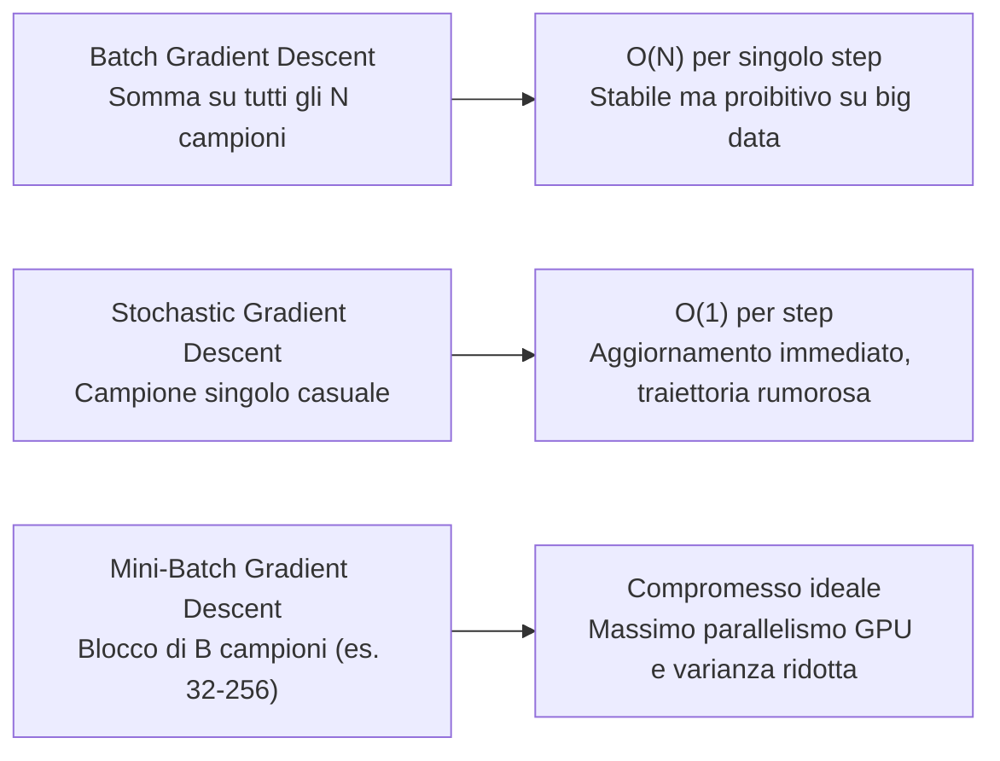
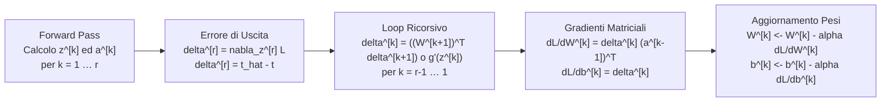
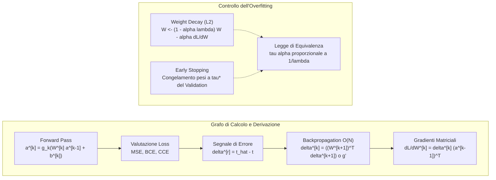

# A. Reti Neurali

Nei capitoli precedenti abbiamo studiato modelli di apprendimento supervisionato fondati su combinazioni lineari dei parametri o su trasformazioni dello spazio delle feature governate da funzioni kernel predeterminate. Sebbene il Kernel Trick consenta di mappare i dati in spazi a dimensionalità arbitrariamente elevata, la trasformazione di base rimane statica durante l'addestramento: il modello apprende unicamente i coefficienti lineari associati a ciascun vettore di supporto. Quando affrontiamo distribuzioni empiriche complesse ad alta dimensionalità (immagini, segnali audio, testi), progettare a priori la funzione di trasformazione ideale diventa impraticabile.

Con le __Reti Neurali Artificiali__ (_Artificial Neural Networks_, ANN) operiamo un cambio di paradigma: apprendiamo end-to-end sia la rappresentazione interna delle feature, sia il predittore finale direttamente dai dati. Partendo dall'analisi del percettrone singolo, formalizziamo l'architettura dei percettroni multistrato (__Multi-Layer Perceptron__, MLP) e la propagazione diretta (__Forward Pass__). Dimostriamo la derivazione analitica rigorosa dell'algoritmo di retropropagazione dell'errore (__Backpropagation__) fondato sulla regola della catena multivariata, provando la proprietà di cancellazione esatta del gradiente all'uscita per le principali funzioni di costo (regressione quadratica, entropia incrociata binaria con sigmoide ed entropia incrociata multiclasse con softmax). Analizziamo infine le strategie di regolarizzazione specifiche per le reti profonde: la contrazione dei pesi (__Weight Decay__) e l'arresto anticipato (__Early Stopping__), provando l'equivalenza asintotica tra passi di discesa del gradiente e coefficiente di penalità quadratica.

## Dal Percettrone Singolo alle Reti Multistrato

Per comprendere la transizione verso le architetture profonde, riconsideriamo il modello classico del __Percettrone di Rosenblatt__:

$$
h_{\mathbf{w}}(\mathbf{x}) = f(\mathbf{w}^T \mathbf{x} + b) = f\left( \sum_{i=1}^D w_i x_i + b \right)
$$

dove $\mathbf{x} \in \mathbb{R}^D$ raccoglie le feature di ingresso, $\mathbf{w} \in \mathbb{R}^D$ rappresenta il vettore dei pesi sinaptici, $b \in \mathbb{R}$ è il parametro di bias (intercetta), e $f(\cdot)$ è una funzione di attivazione a gradino (o funzione segno).

![[fig_12_1_rappresentazione_percettrone.png|center mid]]

Il percettrone elementare calcola una combinazione affine delle variabili di ingresso e produce una decisione binaria netta. Tuttavia, come dimostrato storicamente dal celebre controesempio della funzione logica XOR formulato da Minsky e Papert (1969), un singolo iperpiano di decisione lineare non può separare classi che non siano linearmente separabili nello spazio di partenza.

Per superare questo vincolo strutturale, colleghiamo molteplici neuroni disposti su strati sequenziali in cascata e sostituiamo la discontinua funzione a gradino con funzioni di attivazione non lineari, continue e differenziabili.

### Funzioni di Attivazione Non Lineari

Consideriamo un problema di regressione mirato a stimare il prezzo di un immobile a partire dalla sua superficie abitabile. Se adottassimo una regressione lineare pura, il modello produrrebbe estrapolazioni con valori negativi per metrature prossime allo zero, violando il vincolo fisico fondamentale di non negatività del prezzo.

Risolviamo questa criticità vincolando la combinazione affine mediante una semplice trasformazione non lineare che annulla l'uscita quando l'argomento è negativo:

$$
h_{\mathbf{w}}(x) = \max\{wx + b, \, 0\}
$$

Questa trasformazione definisce la __Rectified Linear Unit__ (__ReLU__):

$$
\mathrm{ReLU}(z) = \max\{0, z\} = \begin{cases} z & \text{se } z \ge 0 \\ 0 & \text{se } z < 0 \end{cases}
$$

![[fig_12_2_funzione_attivazione_relu.png|center small]] ![[fig_12_3_neurone_singolo_rete_neurale.png|center small]]

In generale, una funzione scalare $g: \mathbb{R} \to \mathbb{R}$ che introduce una distorsione non lineare prende il nome di __funzione di attivazione__. L'unità computazionale elementare che riceve il vettore di ingresso, ne calcola la combinazione lineare con i pesi e vi applica la funzione di attivazione costituisce il __neurone artificiale__.

Le funzioni di attivazione standard impiegate nelle reti neurali includono:
- __ReLU__: $\mathrm{ReLU}(z) = \max(0, z)$. Rappresenta la scelta predefinita per gli strati nascosti. La sua derivata unitaria nel semiasse positivo ($z > 0 \implies g'(z) = 1$) evita la saturazione del gradiente, accelera la discesa stocastica e induce sparsità nelle attivazioni interne;
- __Sigmoide Logistica__: $\sigma(z) = \frac{1}{1 + e^{-z}}$. Mappa l'intero asse reale nell'intervallo continuo $(0, 1)$, ideale per modellare probabilità a posteriori nella classificazione binaria;
- __Tangente Iperbolica__: $\tanh(z) = \frac{e^z - e^{-z}}{e^z + e^{-z}} = 2\sigma(2z) - 1$. Mappa i valori nell'intervallo $(-1, 1)$, offrendo il vantaggio di un segnale di uscita a media nulla.

> [!IMPORTANT] Collasso Lineare delle Reti senza Attivazioni
> L'introduzione di attivazioni non lineari è una condizione necessaria e imprescindibile per l'espressività delle reti neurali profonde.
> 
> Se impostassimo funzioni di attivazione lineari (la funzione identità $g(z) = z$), una rete a $r$ strati collasserebbe matematicamente in una banale regressione lineare a strato singolo. Sviluppiamo infatti la composizione a cascata di $r$ trasformazioni affini:
> 
> $$
> \mathbf{a}^{[r]} = \mathbf{W}^{[r]} \left( \mathbf{W}^{[r-1]} \cdots (\mathbf{W}^{[1]} \mathbf{x} + \mathbf{b}^{[1]}) \cdots + \mathbf{b}^{[r-1]} \right) + \mathbf{b}^{[r]} = \mathbf{W}_{\text{eq}} \mathbf{x} + \mathbf{b}_{\text{eq}}
> $$
> 
> dove la matrice dei pesi equivalente è il semplice prodotto matriciale $\mathbf{W}_{\text{eq}} = \mathbf{W}^{[r]} \mathbf{W}^{[r-1]} \cdots \mathbf{W}^{[1]} \in \mathbb{R}^{m_r \times D}$.
> 
> Poiché il prodotto di matrici è ancora una matrice, comporre $100$ strati lineari non estende minimamente lo spazio delle ipotesi rispetto a un singolo strato. Soltanto l'alternanza sistematica tra combinazioni affini e non-linearità consente di piegare lo spazio geometrico e garantisce il Teorema di Approssimazione Universale.

### Reti Multistrato e Rappresentazione Gerarchica

Interconnettendo molteplici neuroni in una struttura a strati, la rete sintetizza autonomamente una gerarchia di concetti astratti non lineari a partire dai dati grezzi.

Consideriamo un modello predittivo immobiliare basato su 4 feature di ingresso: superficie, numero di stanze, codice postale e reddito medio del quartiere.

![[fig_12_4_architettura_rete_neurale_complessa.png|center mid]]

I neuroni intermedi dello strato nascosto non operano su variabili definite a priori dall'ingegnere, bensì estraggono automaticamente fattori latenti ad alto livello di astrazione:
- Il primo neurone correla superficie e numero di stanze per quantificare la capacità abitativa complessiva della famiglia;
- Il secondo neurone elabora il codice postale per stimare la pedonabilità e la concentrazione dei servizi urbani;
- Il terzo neurone incrocia codice postale e reddito medio per inferire il livello di qualità delle scuole locali.

Lo strato di uscita combina linearmente questi fattori sintetici per calcolare la stima finale del valore dell'immobile.

Poiché in problemi complessi non sappiamo a priori quali combinazioni di feature risultino decisive, colleghiamo ogni nodo di ingresso a tutti i neuroni dello strato nascosto, e ogni neurone nascosto a tutti i neuroni del livello successivo. Questi livelli computazionali prendono il nome di __strati densi o completamente connessi__ (_Fully Connected Layers_).

## Architettura del Multi-Layer Perceptron

Analizziamo la formalizzazione algebrica di un __percettrone bistrato__ (avente uno strato nascosto e uno strato di uscita; per convenzione universale lo strato di ingresso non viene conteggiato poiché si limita a distribuire il segnale senza elaborazioni).

![[fig_12_5_rete_due_strati_feedforward.png|center mid]]

Sia $\mathbf{x} \in \mathbb{R}^D$ il vettore delle feature di ingresso e sia $m$ il numero di neuroni dello strato nascosto. Ciascun neurone nascosto $j \in \{1, \dots, m\}$ calcola il potenziale pre-attivazione e la relativa attivazione non lineare:

$$
z_j^{[1]} = (\mathbf{w}_j^{[1]})^T \mathbf{x} + b_j^{[1]}
$$

$$
a_j = \mathrm{ReLU}(z_j^{[1]})
$$

dove $\mathbf{w}_j^{[1]} \in \mathbb{R}^D$ raccoglie i pesi sinaptici afferenti al neurone $j$, $b_j^{[1]} \in \mathbb{R}$ è il suo termine di bias, $z_j^{[1]}$ è il potenziale affine e $a_j$ è l'attivazione non lineare prodotta.

Raccogliendo le attivazioni nello strato nascosto nel vettore $\mathbf{a} = [a_1, \dots, a_m]^T \in \mathbb{R}^m$, lo strato di uscita (avente un singolo neurone per compiti di regressione scalare) combina linearmente le feature latenti estratte:

$$
\hat{t} = h_{\mathbf{w}}(\mathbf{x}) = (\mathbf{w}^{[2]})^T \mathbf{a} + b^{[2]}
$$

dove $\mathbf{w}^{[2]} \in \mathbb{R}^m$ raccoglie i pesi dello strato di uscita e $b^{[2]} \in \mathbb{R}$ rappresenta il bias finale.

### Formulazione Vettoriale per Strati Arbitrari

Generalizziamo la notazione algebrica a una rete neurale profonda avente $r$ strati computazionali ($r-1$ strati nascosti e 1 strato di uscita).

Definiamo per ogni strato $k \in \{1, \dots, r\}$ le matrici dei parametri dei pesi e i vettori di bias:
- $\mathbf{W}^{[k]} \in \mathbb{R}^{m_k \times m_{k-1}}$: matrice dei pesi dello strato $k$, dove $m_k$ indica il numero di neuroni del livello corrente e $m_{k-1}$ il numero di neuroni del livello precedente (fissando $m_0 = D$ per lo strato di ingresso);
- $\mathbf{b}^{[k]} \in \mathbb{R}^{m_k}$: vettore dei bias dello strato $k$.

La sequenza di calcolo della propagazione in avanti (__Forward Pass__) per un generico vettore di ingresso $\mathbf{x}$ si esprime mediante la seguente catena matriciale:

$$
\begin{aligned}
\mathbf{z}^{[1]} &= \mathbf{W}^{[1]} \mathbf{x} + \mathbf{b}^{[1]} \in \mathbb{R}^{m_1}, \qquad &\mathbf{a}^{[1]} &= g_1(\mathbf{z}^{[1]}) \in \mathbb{R}^{m_1} \\
\mathbf{z}^{[2]} &= \mathbf{W}^{[2]} \mathbf{a}^{[1]} + \mathbf{b}^{[2]} \in \mathbb{R}^{m_2}, \qquad &\mathbf{a}^{[2]} &= g_2(\mathbf{z}^{[2]}) \in \mathbb{R}^{m_2} \\
&\;\;\vdots &\;\;\vdots \\
\mathbf{z}^{[r-1]} &= \mathbf{W}^{[r-1]} \mathbf{a}^{[r-2]} + \mathbf{b}^{[r-1]} \in \mathbb{R}^{m_{r-1}}, \qquad &\mathbf{a}^{[r-1]} &= g_{r-1}(\mathbf{z}^{[r-1]}) \in \mathbb{R}^{m_{r-1}} \\
\mathbf{z}^{[r]} &= \mathbf{W}^{[r]} \mathbf{a}^{[r-1]} + \mathbf{b}^{[r]} \in \mathbb{R}^{m_r}, \qquad &\hat{\mathbf{t}} &= g_r(\mathbf{z}^{[r]}) \in \mathbb{R}^{m_r}
\end{aligned}
$$

dove $g_k(\cdot)$ rappresenta la funzione di attivazione applicata elemento per elemento allo strato $k$ (ad esempio ReLU per gli strati intermedi e identità, sigmoide o softmax per lo strato finale).

### Conteggio dei Neuroni e dei Parametri Addestrabili

Per quantificare i gradi di libertà e la complessità spaziale dell'architettura:
- Il __numero totale di neuroni computazionali__ corrisponde alla somma delle dimensioni di tutti gli strati escluso l'input: $N_{\text{neuroni}} = \sum_{k=1}^r m_k$;
- Il __numero totale di parametri liberi addestrabili__ include tutti i coefficienti delle matrici di peso e tutti i bias: $N_{\text{parametri}} = \sum_{k=1}^r (m_{k-1} + 1) m_k = \sum_{k=1}^r (m_k \times m_{k-1} + m_k)$.

> [!EXAMPLE] Calcolo Parametrico di una Rete per Visione
> Consideriamo un MLP per la classificazione di cifre scritte a mano con input $\mathbf{x} \in \mathbb{R}^{784}$ (immagini raster $28 \times 28$), due strati nascosti con $m_1 = 128$ e $m_2 = 64$ neuroni, e uno strato di uscita con $m_3 = 10$ classi:
> - Strato 1: $(784 + 1) \times 128 = 100\,480$ parametri;
> - Strato 2: $(128 + 1) \times 64 = 8\,256$ parametri;
> - Strato 3: $(64 + 1) \times 10 = 650$ parametri;
> - Totale parametri liberi: $100\,480 + 8\,256 + 650 = 109\,386$ pesi da ottimizzare.

## Funzione di Costo e Discesa Stocastica del Gradiente

Dato un dataset supervisionato $\mathcal{D} = \{(\mathbf{x}^{(i)}, \mathbf{t}^{(i)})\}_{i=0}^{N-1}$, l'obiettivo dell'addestramento consiste nell'individuare la configurazione dei pesi $\mathbf{w}$ che minimizza una funzione di costo empirica derivabile $L(\mathbf{w})$:

$$
L(\mathbf{w}) = \frac{1}{N} \sum_{i=0}^{N-1} L^{(i)}(\mathbf{w})
$$

Nel caso della regressione lineare con scarto quadratico, la perdita sul singolo campione assume la forma:

$$
L^{(i)}(\mathbf{w}) = \frac{1}{2} \|h_{\mathbf{w}}(\mathbf{x}^{(i)}) - \mathbf{t}^{(i)}\|_2^2
$$

A causa delle molteplici composizioni non lineari, la funzione di costo $L(\mathbf{w})$ delle reti neurali è fortemente __non convessa__: la superficie di errore presenta una complessa topologia caratterizzata da minimi locali multipli, simmetrie di permutazione tra neuroni, punti di sella e ampi plateaux a gradiente debole. Non esiste alcuna soluzione analitica in forma chiusa (a differenza dei minimi quadrati ordinari o di Ridge Regression).

Dobbiamo quindi ricorrere ad algoritmi iterativi basati sulla discesa lungo il gradiente:



Nella variante della __Discesa Stocastica del Gradiente__ (__SGD__), a ogni iterazione estraiamo casualmente un singolo campione $(\mathbf{x}^{(i)}, \mathbf{t}^{(i)})$ e aggiorniamo il vettore globale dei parametri $\mathbf{w}$ lungo la direzione di massima discesa locale:

$$
\mathbf{w} \leftarrow \mathbf{w} - \alpha \nabla_{\mathbf{w}} L^{(i)}(\mathbf{w})
$$

dove $\alpha > 0$ è il tasso di apprendimento (_learning rate_).

L'intero impianto algoritmico dipende dalla nostra capacità di calcolare il gradiente $\nabla_{\mathbf{w}} L^{(i)}(\mathbf{w})$ in modo esatto ed estremamente rapido. Questo calcolo è svolto dall'algoritmo di __Backpropagation__.

## Teoria e Derivazione Analitica di Backpropagation

L'algoritmo di Backpropagation costituisce un'applicazione sistematica e ricorsiva della regola di derivazione delle funzioni composte (__Chain Rule__) operante all'indietro sul grafo computazionale aciclico della rete.

### Teorema di Complessità della Differenziazione Automatica

La scalabilità delle reti neurali profonde poggia su un pilastro fondamentale della complessità computazionale:

> [!IMPORTANT] Teorema di Complessità della Differenziazione Automatica
> Sia dato un grafo computazionale differenziabile di dimensione $N$ operazioni aritmetiche elementari che calcola una funzione scalare a valori reali. Il gradiente esatto di tale funzione rispetto a tutte le sue variabili di ingresso o parametri può essere calcolato con un costo temporale pari a $O(N)$, impiegando un grafo di retropropagazione avente dimensione $O(N)$.

Il calcolo delle derivate tramite Backpropagation possiede lo stesso identico ordine di complessità asintotica del Forward Pass ($O(N)$).

Confrontiamo questo risultato con l'approssimazione numerica tramite __differenze finite__:

$$
\frac{\partial L}{\partial w_j} \approx \frac{L(\mathbf{w} + \epsilon \mathbf{e}_j) - L(\mathbf{w})}{\epsilon}
$$

Per valutare il gradiente su $P$ parametri liberi, le differenze finite richiedono $P + 1$ valutazioni complete della rete, con un costo complessivo pari a $O(P \cdot N)$. Poiché nelle reti neurali il numero di parametri $P$ è dello stesso ordine di grandezza delle operazioni del forward pass ($P \sim N$), il costo esploderebbe a $O(N^2)$. Su una rete con $10^6$ parametri, le differenze finite impiegherebbero un milione di volte più tempo rispetto a Backpropagation, oltre a introdurre disastrosi errori di cancellazione numerica in virgola mobile.

### Regola della Catena Multivariata

Sia $L$ una funzione scalare differenziabile che dipende da una variabile primaria $w_j$ attraverso un insieme intermedio di $m$ funzioni $g_1(\mathbf{w}), \dots, g_m(\mathbf{w})$:

$$
g_k = g_k(w_1, \dots, w_P), \quad \forall k \in \{1, \dots, m\}
$$

$$
L = L(g_1(\mathbf{w}), \dots, g_m(\mathbf{w}))
$$

La derivata parziale totale di $L$ rispetto a $w_j$ corrisponde alla somma pesata delle derivate lungo tutti i percorsi computazionali indipendenti che collegano $w_j$ alla perdita scalare $L$:

$$
\frac{\partial L}{\partial w_j} = \sum_{k=1}^m \frac{\partial L}{\partial g_k} \frac{\partial g_k}{\partial w_j}
$$

### Derivazione Analitica per Singolo Neurone

Consideriamo il modello elementare di un singolo neurone con attivazione ReLU e funzione di perdita quadratica calcolata sul campione $(\mathbf{x}, t)$ con $\mathbf{x} \in \mathbb{R}^D$:

$$
\begin{aligned}
z &= \mathbf{w}^T \mathbf{x} + b = \sum_{i=0}^{D-1} w_i x_i + b \\
\hat{t} &= \mathrm{ReLU}(z) = \max(0, z) \\
L(\mathbf{w}) &= \frac{1}{2} (\hat{t} - t)^2
\end{aligned}
$$

Vogliamo calcolare analiticamente il gradiente rispetto al generico peso $w_i$. Applichiamo la regola della catena multivariata:

$$
\frac{\partial L}{\partial w_i} = \frac{\partial L}{\partial \hat{t}} \frac{\partial \hat{t}}{\partial z} \frac{\partial z}{\partial w_i}
$$

Calcoliamo separatamente i tre fattori differenziali:
1. Derivata della perdita rispetto alla stima $\hat{t}$: $\frac{\partial L}{\partial \hat{t}} = \frac{\partial}{\partial \hat{t}} \left[ \frac{1}{2}(\hat{t} - t)^2 \right] = \hat{t} - t$;
2. Derivata dell'attivazione ReLU rispetto al potenziale $z$: $\frac{\partial \hat{t}}{\partial z} = \frac{\mathrm{d}}{\mathrm{d}z}\mathrm{ReLU}(z) = \mathbb{I}(z \ge 0)$;
3. Derivata del potenziale pre-attivazione rispetto al peso $w_i$: $\frac{\partial z}{\partial w_i} = \frac{\partial}{\partial w_i} \left( \sum_{j=0}^{D-1} w_j x_j + b \right) = x_i$.

Moltiplicando i tre termini otteniamo il gradiente esatto rispetto al peso:

$$
\frac{\partial L}{\partial w_i} = (\hat{t} - t) \cdot \mathbb{I}(z \ge 0) \cdot x_i
$$

Per il bias $b$, essendo $\frac{\partial z}{\partial b} = 1$:

$$
\frac{\partial L}{\partial b} = \frac{\partial L}{\partial \hat{t}} \frac{\partial \hat{t}}{\partial z} \frac{\partial z}{\partial b} = (\hat{t} - t) \cdot \mathbb{I}(z \ge 0)
$$

### Derivazione Analitica per Rete Bistrato

Estendiamo l'analisi alla rete bistrato con $m$ neuroni nascosti e uscita scalare:

$$
\begin{aligned}
z_j^{[1]} &= (\mathbf{w}_j^{[1]})^T \mathbf{x} + b_j^{[1]}, \quad \forall j \in \{1, \dots, m\} \\
a_j &= \mathrm{ReLU}(z_j^{[1]}) \\
\mathbf{a} &= [a_1, \dots, a_m]^T \in \mathbb{R}^m \\
\hat{t} &= (\mathbf{w}^{[2]})^T \mathbf{a} + b^{[2]} \\
L &= \frac{1}{2} (\hat{t} - t)^2
\end{aligned}
$$

Deriviamo dapprima i gradienti per lo __strato di uscita (layer 2)__.

Rispetto al peso $w_j^{[2]}$ associato all'attivazione nascosta $a_j$:

$$
\frac{\partial L}{\partial w_j^{[2]}} = \frac{\partial L}{\partial \hat{t}} \frac{\partial \hat{t}}{\partial w_j^{[2]}} = (\hat{t} - t) a_j
$$

Rispetto al bias di uscita $b^{[2]}$:

$$
\frac{\partial L}{\partial b^{[2]}} = \frac{\partial L}{\partial \hat{t}} \frac{\partial \hat{t}}{\partial b^{[2]}} = (\hat{t} - t) \cdot 1 = \hat{t} - t
$$

Deriviamo ora i parametri dello __strato nascosto (layer 1)__.

Consideriamo il peso $w_{ji}^{[1]}$, che connette la feature di ingresso $x_i$ al neurone nascosto $j$. La derivata si propaga a ritroso lungo il cammino $L \to \hat{t} \to a_j \to z_j^{[1]} \to w_{ji}^{[1]}$:

$$
\frac{\partial L}{\partial w_{ji}^{[1]}} = \frac{\partial L}{\partial \hat{t}} \frac{\partial \hat{t}}{\partial a_j} \frac{\partial a_j}{\partial z_j^{[1]}} \frac{\partial z_j^{[1]}}{\partial w_{ji}^{[1]}}
$$

Valutiamo i singoli contributi:
- $\frac{\partial L}{\partial \hat{t}} = \hat{t} - t$;
- $\frac{\partial \hat{t}}{\partial a_j} = \frac{\partial}{\partial a_j}\left( \sum_{k=1}^m w_k^{[2]} a_k + b^{[2]} \right) = w_j^{[2]}$;
- $\frac{\partial a_j}{\partial z_j^{[1]}} = \mathbb{I}(z_j^{[1]} \ge 0)$;
- $\frac{\partial z_j^{[1]}}{\partial w_{ji}^{[1]}} = x_i$.

Moltiplicando i fattori otteniamo:

$$
\frac{\partial L}{\partial w_{ji}^{[1]}} = (\hat{t} - t) \cdot w_j^{[2]} \cdot \mathbb{I}(z_j^{[1]} \ge 0) \cdot x_i
$$

Per il bias nascosto $b_j^{[1]}$, essendo $\frac{\partial z_j^{[1]}}{\partial b_j^{[1]}} = 1$:

$$
\frac{\partial L}{\partial b_j^{[1]}} = (\hat{t} - t) \cdot w_j^{[2]} \cdot \mathbb{I}(z_j^{[1]} \ge 0)
$$

Definiamo ora il concetto cardine di __segnale di errore locale__ (o termine delta) del neurone $j$ al livello 1:

$$
\delta_j^{[1]} \triangleq \frac{\partial L}{\partial z_j^{[1]}} = (\hat{t} - t) \cdot w_j^{[2]} \cdot \mathbb{I}(z_j^{[1]} \ge 0)
$$

Grazie alla definizione di $\delta_j^{[1]}$, i gradienti rispetto ai parametri dello strato nascosto si comprimono nella forma:

$$
\frac{\partial L}{\partial w_{ji}^{[1]}} = \delta_j^{[1]} x_i, \qquad \frac{\partial L}{\partial b_j^{[1]}} = \delta_j^{[1]}
$$

Il gradiente di un peso è semplicemente il prodotto tra il segnale di errore del neurone di arrivo e il segnale di attivazione del neurone di partenza.

## Algoritmo Generale di Backpropagation

Generalizziamo la derivazione matriciale a una rete profonda con $r$ strati e dimensioni arbitrarie.

![[fig_ex_A_forward_backward_backpropagation.png|center big]]

Definiamo formalmente il vettore di errore dello strato generico $k$ come la derivata parziale della perdita rispetto al potenziale pre-attivazione $\mathbf{z}^{[k]}$:

$$
\boldsymbol{\delta}^{[k]} \triangleq \frac{\partial L}{\partial \mathbf{z}^{[k]}} \in \mathbb{R}^{m_k}
$$

### Propagazione Ricorsiva del Segnale di Errore

Per lo strato finale $r$, assumendo regressione con perdita quadratica su vettore $\hat{\mathbf{t}} \in \mathbb{R}^{m_r}$:

$$
\boldsymbol{\delta}^{[r]} = \frac{\partial L}{\partial \mathbf{z}^{[r]}} = \frac{\partial L}{\partial \hat{\mathbf{t}}} \frac{\partial \hat{\mathbf{t}}}{\partial \mathbf{z}^{[r]}} = \hat{\mathbf{t}} - \mathbf{t}
$$

Per un generico strato interno $k \in \{r-1, \dots, 1\}$, calcoliamo la derivata rispetto a $\mathbf{z}^{[k]}$ retropropagando l'errore del livello successivo $\boldsymbol{\delta}^{[k+1]}$ tramite la regola della catena vettoriale:

$$
\boldsymbol{\delta}^{[k]} = \frac{\partial L}{\partial \mathbf{z}^{[k]}} = \left( \frac{\partial \mathbf{z}^{[k+1]}}{\partial \mathbf{a}^{[k]}} \right)^T \frac{\partial L}{\partial \mathbf{z}^{[k+1]}} \odot \frac{\partial \mathbf{a}^{[k]}}{\partial \mathbf{z}^{[k]}}
$$

Poiché $\mathbf{z}^{[k+1]} = \mathbf{W}^{[k+1]} \mathbf{a}^{[k]} + \mathbf{b}^{[k+1]}$, la matrice Jacobiana $\frac{\partial \mathbf{z}^{[k+1]}}{\partial \mathbf{a}^{[k]}}$ è esattamente la matrice dei pesi $\mathbf{W}^{[k+1]}$. Otteniamo la fondamentale formula ricorsiva di retropropagazione:

$$
\boldsymbol{\delta}^{[k]} = \left( (\mathbf{W}^{[k+1]})^T \boldsymbol{\delta}^{[k+1]} \right) \odot g'_k(\mathbf{z}^{[k]})
$$

dove $\odot$ denota il prodotto di Hadamard (elemento per elemento) e $g'_k(\mathbf{z}^{[k]})$ è la derivata della funzione di attivazione valutata sui singoli potenziali (per la funzione ReLU, $g'_k(\mathbf{z}^{[k]}) = \mathbb{I}(\mathbf{z}^{[k]} \ge 0)$).

### Calcolo dei Gradienti Matriciali tramite Prodotto Esterno

Una volta determinati i vettori di errore $\boldsymbol{\delta}^{[k]}$, calcoliamo le derivate della funzione di perdita rispetto ai parametri dello strato $k$.

Essendo $\mathbf{z}^{[k]} = \mathbf{W}^{[k]} \mathbf{a}^{[k-1]} + \mathbf{b}^{[k]}$, la derivata parziale rispetto al generico elemento $W_{ij}^{[k]}$ corrisponde a $\delta_i^{[k]} a_j^{[k-1]}$. In forma matriciale compatta, questo coincide con il __prodotto esterno__ tra il vettore di errore locale $\boldsymbol{\delta}^{[k]}$ e il vettore delle attivazioni uscenti dallo strato precedente $(\mathbf{a}^{[k-1]})^T$:

$$
\frac{\partial L}{\partial \mathbf{W}^{[k]}} = \boldsymbol{\delta}^{[k]} (\mathbf{a}^{[k-1]})^T \in \mathbb{R}^{m_k \times m_{k-1}}
$$

$$
\frac{\partial L}{\partial \mathbf{b}^{[k]}} = \boldsymbol{\delta}^{[k]} \in \mathbb{R}^{m_k}
$$

avendo posto per consistenza notazionale $\mathbf{a}^{[0]} = \mathbf{x}$.

### Schema Operativo dell'Algoritmo di Retropropagazione

Sintetizziamo la sequenza computazionale dell'algoritmo di Backpropagation:



I passaggi operativi si articolano in sequenza rigorosa:
1. __Inizializzazione__: presentiamo il campione di ingresso $\mathbf{x}$ e poniamo $\mathbf{a}^{[0]} = \mathbf{x}$;
2. __Forward Pass__: calcoliamo e memorizziamo nella cache computazionale i potenziali $\mathbf{z}^{[k]} = \mathbf{W}^{[k]}\mathbf{a}^{[k-1]} + \mathbf{b}^{[k]}$ e le attivazioni $\mathbf{a}^{[k]} = g_k(\mathbf{z}^{[k]})$ per tutti gli strati $k = 1, \dots, r$;
3. __Calcolo del Segnale di Errore all'Output__: valutiamo il vettore $\boldsymbol{\delta}^{[r]} = \nabla_{\mathbf{z}^{[r]}} L$;
4. __Backward Pass Ricorsivo__: per ogni livello a ritroso $k = r-1, \dots, 1$, retropropagiamo l'errore calcolando $\boldsymbol{\delta}^{[k]} = \left( (\mathbf{W}^{[k+1]})^T \boldsymbol{\delta}^{[k+1]} \right) \odot g'_k(\mathbf{z}^{[k]})$;
5. __Accumulo dei Gradienti__: ricaviamo i gradienti per ogni strato mediante $\frac{\partial L}{\partial \mathbf{W}^{[k]}} = \boldsymbol{\delta}^{[k]} (\mathbf{a}^{[k-1]})^T$ e $\frac{\partial L}{\partial \mathbf{b}^{[k]}} = \boldsymbol{\delta}^{[k]}$;
6. __Aggiornamento Parametrico__: applichiamo la correzione di discesa del gradiente a pesi e bias.

```pseudo
\begin{algorithm}
\caption{Retropropagazione dell'Errore per Multi-Layer Perceptron (Backpropagation per MLP a $r$ Strati)}
\begin{algorithmic}
\REQUIRE Campione di ingresso $\mathbf{x} \in \mathbb{R}^D$, target $\mathbf{t}$, tasso di apprendimento $\alpha > 0$, pesi correnti $\{\mathbf{W}^{[k]}, \mathbf{b}^{[k]}\}_{k=1}^r$
\ENSURE Pesi e bias aggiornati $\{\mathbf{W}^{[k]}, \mathbf{b}^{[k]}\}_{k=1}^r$
\STATE $\mathbf{a}^{[0]} \leftarrow \mathbf{x}$
\FOR{$k = 1$ \TO $r-1$}
    \STATE $\mathbf{z}^{[k]} \leftarrow \mathbf{W}^{[k]} \mathbf{a}^{[k-1]} + \mathbf{b}^{[k]}$
    \STATE $\mathbf{a}^{[k]} \leftarrow \mathrm{ReLU}(\mathbf{z}^{[k]})$
\ENDFOR
\STATE $\mathbf{z}^{[r]} \leftarrow \mathbf{W}^{[r]} \mathbf{a}^{[r-1]} + \mathbf{b}^{[r]}$
\STATE $\hat{\mathbf{t}} \leftarrow g_r(\mathbf{z}^{[r]})$
\STATE $\boldsymbol{\delta}^{[r]} \leftarrow \hat{\mathbf{t}} - \mathbf{t}$
\FOR{$k = r-1$ \TO $1$ \STEP $-1$}
    \STATE $\boldsymbol{\delta}^{[k]} \leftarrow \left( (\mathbf{W}^{[k+1]})^T \boldsymbol{\delta}^{[k+1]} \right) \odot \mathbb{I}(\mathbf{z}^{[k]} \ge 0)$
    \STATE $\frac{\partial L}{\partial \mathbf{W}^{[k+1]}} \leftarrow \boldsymbol{\delta}^{[k+1]} (\mathbf{a}^{[k]})^T$
    \STATE $\frac{\partial L}{\partial \mathbf{b}^{[k+1]}} \leftarrow \boldsymbol{\delta}^{[k+1]}$
\ENDFOR
\STATE $\frac{\partial L}{\partial \mathbf{W}^{[1]}} \leftarrow \boldsymbol{\delta}^{[1]} \mathbf{x}^T$
\STATE $\frac{\partial L}{\partial \mathbf{b}^{[1]}} \leftarrow \boldsymbol{\delta}^{[1]}$
\FOR{$k = 1$ \TO $r$}
    \STATE $\mathbf{W}^{[k]} \leftarrow \mathbf{W}^{[k]} - \alpha \frac{\partial L}{\partial \mathbf{W}^{[k]}}$
    \STATE $\mathbf{b}^{[k]} \leftarrow \mathbf{b}^{[k]} - \alpha \frac{\partial L}{\partial \mathbf{b}^{[k]}}$
\ENDFOR
\RETURN $\{\mathbf{W}^{[k]}, \mathbf{b}^{[k]}\}_{k=1}^r$
\end{algorithmic}
\end{algorithm}
```

## Funzioni di Costo e Segnali di Errore all'Output

L'algoritmo di Backpropagation retropropaga l'errore a ritroso a partire dal termine di uscita $\boldsymbol{\delta}^{[r]} = \frac{\partial L}{\partial \mathbf{z}^{[r]}}$. Dimostriamo analiticamente che, abbinando correttamente ciascuna funzione di costo alla corrispondente funzione di attivazione canonica, si verifica un'identica proprietà algebrica di cancellazione esatta.

### Regressione Lineare ed Errore Quadratico Medio

Nel problema di regressione scalare o vettoriale continuo adottiamo l'attivazione finale identità $\hat{\mathbf{t}} = g_r(\mathbf{z}^{[r]}) = \mathbf{z}^{[r]}$ e la funzione di costo Mean Squared Error:

$$
L = \frac{1}{2} \|\hat{\mathbf{t}} - \mathbf{t}\|_2^2
$$

Calcoliamo il segnale di errore applicando la regola della catena:

$$
\boldsymbol{\delta}^{[r]} = \frac{\partial L}{\partial \mathbf{z}^{[r]}} = \frac{\partial L}{\partial \hat{\mathbf{t}}} \frac{\partial \hat{\mathbf{t}}}{\partial \mathbf{z}^{[r]}} = (\hat{\mathbf{t}} - \mathbf{t}) \cdot \mathbf{I} = \hat{\mathbf{t}} - \mathbf{t}
$$

### Classificazione Binaria ed Entropia Incrociata con Sigmoide

Nel problema di classificazione binaria con etichetta target $t \in \{0, 1\}$, adottiamo l'attivazione finale sigmoidea $\hat{t} = \sigma(\tilde{t}) = \frac{1}{1 + e^{-\tilde{t}}}$ (avendo posto per brevità $\tilde{t} = z^{[r]}$) e la funzione di costo Binary Cross-Entropy (negativa della log-verosimiglianza di Bernoulli):

$$
L = - \left[ t \ln \hat{t} + (1 - t) \ln(1 - \hat{t}) \right]
$$

Applichiamo la regola della catena per calcolare la derivata parziale rispetto a $\tilde{t}$:

$$
\delta^{[r]} = \frac{\partial L}{\partial \tilde{t}} = \frac{\partial L}{\partial \hat{t}} \frac{\partial \hat{t}}{\partial \tilde{t}}
$$

Valutiamo il primo termine, la derivata della Binary Cross-Entropy rispetto a $\hat{t}$:

$$
\frac{\partial L}{\partial \hat{t}} = -\frac{t}{\hat{t}} + \frac{1 - t}{1 - \hat{t}} = \frac{-t(1 - \hat{t}) + (1 - t)\hat{t}}{\hat{t}(1 - \hat{t})} = \frac{-t + t\hat{t} + \hat{t} - t\hat{t}}{\hat{t}(1 - \hat{t})} = \frac{\hat{t} - t}{\hat{t}(1 - \hat{t})}
$$

Valutiamo il secondo termine, la derivata della funzione sigmoide rispetto all'argomento $\tilde{t}$:

$$
\frac{\mathrm{d}\sigma(\tilde{t})}{\mathrm{d}\tilde{t}} = \frac{\mathrm{d}}{\mathrm{d}\tilde{t}}\left( (1 + e^{-\tilde{t}})^{-1} \right) = -(1 + e^{-\tilde{t}})^{-2} (-e^{-\tilde{t}}) = \frac{1}{1 + e^{-\tilde{t}}} \frac{e^{-\tilde{t}}}{1 + e^{-\tilde{t}}} = \hat{t}(1 - \hat{t})
$$

Moltiplichiamo i due contributi osservando la cancellazione algebrica esatta del denominatore:

$$
\delta^{[r]} = \left( \frac{\hat{t} - t}{\hat{t}(1 - \hat{t})} \right) \cdot \left[ \hat{t}(1 - \hat{t}) \right] = \hat{t} - t
$$

Il termine al denominatore proveniente dalla derivata del logaritmo della loss elide il fattore quadratico della derivata sigmoidea, lasciando come segnale di errore la pura differenza algebrica tra predizione e target.

### Classificazione Multiclasse ed Entropia Incrociata con Softmax

Nel problema di classificazione su $K$ classi mutualmente esclusive con target in codifica one-hot $\mathbf{t} = [t_1, \dots, t_K]^T \in \{0, 1\}^K$ (con vincolo $\sum_{l=1}^K t_l = 1$), adottiamo l'attivazione Softmax sui potenziali di uscita $\tilde{\mathbf{t}} = \mathbf{z}^{[r]} \in \mathbb{R}^K$:

$$
\hat{t}_l = \frac{e^{\tilde{t}_l}}{\sum_{k=1}^K e^{\tilde{t}_k}}, \quad \forall l \in \{1, \dots, K\}
$$

La corrispondente funzione di costo è la Categorical Cross-Entropy:

$$
L = - \sum_{l=1}^K t_l \ln \hat{t}_l
$$

Calcoliamo dapprima la derivata parziale dell'attivazione Softmax $\frac{\partial \hat{t}_l}{\partial \tilde{t}_j}$, distinguendo i due casi possibili:

Nel caso in cui gli indici coincidano ($l = j$):

$$
\frac{\partial \hat{t}_j}{\partial \tilde{t}_j} = \frac{e^{\tilde{t}_j} \left( \sum_k e^{\tilde{t}_k} \right) - e^{\tilde{t}_j} e^{\tilde{t}_j}}{\left( \sum_k e^{\tilde{t}_k} \right)^2} = \hat{t}_j - \hat{t}_j^2 = \hat{t}_j(1 - \hat{t}_j)
$$

Nel caso in cui gli indici differiscano ($l \neq j$):

$$
\frac{\partial \hat{t}_l}{\partial \tilde{t}_j} = \frac{0 \cdot \sum_k e^{\tilde{t}_k} - e^{\tilde{t}_l} e^{\tilde{t}_j}}{\left( \sum_k e^{\tilde{t}_k} \right)^2} = -\hat{t}_l \hat{t}_j
$$

Unifichiamo i due casi tramite il delta di Kronecker $\delta_{lj}$ (pari a $1$ se $l=j$ e $0$ se $l \neq j$):

$$
\frac{\partial \hat{t}_l}{\partial \tilde{t}_j} = \hat{t}_l (\delta_{lj} - \hat{t}_j)
$$

Calcoliamo ora la derivata della perdita totale rispetto al potenziale $\tilde{t}_j$:

$$
\frac{\partial L}{\partial \tilde{t}_j} = \sum_{l=1}^K \frac{\partial L}{\partial \hat{t}_l} \frac{\partial \hat{t}_l}{\partial \tilde{t}_j} = \sum_{l=1}^K \left( -\frac{t_l}{\hat{t}_l} \right) \left[ \hat{t}_l (\delta_{lj} - \hat{t}_j) \right]
$$

I termini $\hat{t}_l$ a numeratore e denominatore si elidono esattamente per ogni classe $l$:

$$
\frac{\partial L}{\partial \tilde{t}_j} = -\sum_{l=1}^K t_l (\delta_{lj} - \hat{t}_j) = -\sum_{l=1}^K t_l \delta_{lj} + \hat{t}_j \sum_{l=1}^K t_l
$$

Sfruttiamo le proprietà del vettore one-hot: la sommatoria $\sum_{l=1}^K t_l \delta_{lj}$ collassa sull'unico termine non nullo $t_j$, mentre la somma di tutte le componenti vale identicamente $\sum_{l=1}^K t_l = 1$:

$$
\frac{\partial L}{\partial \tilde{t}_j} = -t_j + \hat{t}_j \cdot 1 = \hat{t}_j - t_j
$$

Esprimendo il risultato in notazione vettoriale:

$$
\boldsymbol{\delta}^{[r]} = \hat{\mathbf{t}} - \mathbf{t}
$$

> [!TIP] Takeaway Fondamentale d'Esame: Invarianza del Gradiente di Output
> In tutti e tre i compiti standard (regressione con MSE, classificazione binaria con BCE e multiclasse con CCE), il gradiente della funzione di costo rispetto al potenziale pre-attivazione dell'ultimo strato assume la medesima espressione algebrica:
> 
> $$
> \boldsymbol{\delta}^{[r]} = \hat{\mathbf{t}} - \mathbf{t}
> $$
> 
> Questo risultato teorico non è una coincidenza, ma discende dall'accoppiamento canonico tra la funzione di verosimiglianza della famiglia esponenziale e la relativa funzione di collegamento (_link function_).
> 
> Se accoppiassimo impropriamente l'errore quadratico medio (MSE) con la sigmoide o la softmax, il gradiente conterrebbe il termine moltiplicativo di derivata $\hat{t}(1-\hat{t})$. In presenza di un errore macroscopico ma sicuro ($\hat{t} \to 0$ con target $t=1$), la derivata tenderebbe a zero, bloccando l'apprendimento per saturazione del gradiente. L'entropia incrociata compensa la saturazione grazie al polo del logaritmo al denominatore, producendo un segnale di correzione massimale quando l'errore è massimo.

## Model Selection e Regolarizzazione nelle Reti Neurali

La capacità espressiva di un Multi-Layer Perceptron dipende da un numero cospicuo di iperparametri architetturali:
- Numero di strati nascosti (profondità della rete);
- Numero di neuroni per ciascun livello (larghezza della rete);
- Tipologia delle funzioni di attivazione (ReLU, Tanh, Sigmoide).

La taratura sistematica di questi iperparametri tramite K-Fold Cross-Validation esaustiva risulta computazionalmente proibitiva sui modelli profondi a causa dei tempi di addestramento. La prassi dell'ingegneria del machine learning prevede quindi l'impiego di architetture ad elevata capacità (sovraparametrizzate), introducendo mirate tecniche di __regolarizzazione__.

### Regolarizzazione $L_2$ e Decadimento dei Pesi

La prima tecnica estende il principio di Ridge Regression penalizzando la norma euclidea dei parametri della rete. Poiché i diversi strati operano a scale computazionali eterogenee, associamo un coefficiente di penalità $\lambda_k \ge 0$ indipendente a ciascun layer:

$$
L_{\text{WD}}(\mathbf{w}) = L(\mathbf{w}) + \sum_{k=1}^r \frac{\lambda_k}{2} \|\mathbf{W}^{[k]}\|_F^2 = L(\mathbf{w}) + \sum_{k=1}^r \frac{\lambda_k}{2} \mathrm{Tr}\left( (\mathbf{W}^{[k]})^T \mathbf{W}^{[k]} \right)
$$

dove $\|\cdot\|_F$ indica la norma di Frobenius della matrice dei pesi. I vettori di bias $\mathbf{b}^{[k]}$ vengono deliberatamente esclusi dalla penalizzazione: il bias definisce la traslazione spaziale delle ipersuperfici di decisione e penalizzarlo non ridurrebbe la curvatura o la varianza del modello, ma vincolerebbe artificialmente le attivazioni a transitare per l'origine.

Deriviamo la regola di aggiornamento dei pesi durante un passo di discesa del gradiente:

$$
\mathbf{W}^{[k]} \leftarrow \mathbf{W}^{[k]} - \alpha \nabla_{\mathbf{W}^{[k]}} L_{\text{WD}}(\mathbf{w})
$$

Calcoliamo il gradiente della funzione di perdita regolarizzata:

$$
\nabla_{\mathbf{W}^{[k]}} L_{\text{WD}}(\mathbf{w}) = \frac{\partial L}{\partial \mathbf{W}^{[k]}} + \lambda_k \mathbf{W}^{[k]}
$$

Sostituendo nell'equazione di aggiornamento:

$$
\mathbf{W}^{[k]} \leftarrow \mathbf{W}^{[k]} - \alpha \left( \frac{\partial L}{\partial \mathbf{W}^{[k]}} + \lambda_k \mathbf{W}^{[k]} \right) = (1 - \alpha \lambda_k) \mathbf{W}^{[k]} - \alpha \frac{\partial L}{\partial \mathbf{W}^{[k]}}
$$

Questa derivazione motiva la denominazione __Weight Decay__ (_decadimento dei pesi_): prima di applicare la correzione lungo il gradiente dell'errore empirico, la matrice dei pesi subisce una contrazione geometrica per il fattore moltiplicativo $(1 - \alpha \lambda_k) < 1$. I pesi che non ricevono un gradiente utile e persistente vengono progressivamente erosi a ogni epoca, sopprimendo le connessioni sproporzionate responsabili dell'overfitting.

![[fig_ex_A_weight_decay_vs_early_stopping.png|center big]]

### Dinamica dell'Errore e Arresto Anticipato

Una strategia complementare, che non richiede modifiche alla funzione di costo, sfrutta la dinamica temporale dell'ottimizzazione iterativa.

All'aumentare delle epoche di addestramento $\tau$ tramite discesa stocastica del gradiente:
- L'errore sul training set $E_{\text{train}}$ decresce in modo strettamente monotono, tendendo asintoticamente a zero per effetto della sovraparametrizzazione;
- L'errore misurato su un validation set indipendente $E_{\text{val}}$ traccia una tipica curva convessa a U: nella prima fase decresce man mano che la rete apprende i pattern distribuzionali generali, raggiunge un punto di minimo globale all'epoca ottima $\tau^*$, e successivamente risale a causa della memorizzazione opportunistica del rumore specifico del training set.

![[fig_12_6_early_stopping_curve_errore.png|center mid]]

La tecnica di __Early Stopping__ consiste nel monitorare l'errore di validazione durante l'addestramento e interrompere l'ottimizzazione esattamente al punto di minimo $\tau^*$, preservando lo stato dei pesi $\mathbf{w}(\tau^*)$.

### Dimostrazione dell'Equivalenza tra Early Stopping e Weight Decay

Esiste un legame analitico profondo tra il numero di iterazioni di discesa del gradiente e l'intensità della regolarizzazione quadratica $L_2$.

Consideriamo un'approssimazione quadratica locale della funzione di costo attorno al punto di minimo dei dati di addestramento $\mathbf{w}^*$:

$$
L(\mathbf{w}) \approx L(\mathbf{w}^*) + \frac{1}{2} (\mathbf{w} - \mathbf{w}^*)^T \mathbf{H} (\mathbf{w} - \mathbf{w}^*)
$$

dove $\mathbf{H} = \nabla^2 L(\mathbf{w}^*)$ è la matrice Hessiana della perdita, simmetrica e semidefinita positiva, avente autovalori $\sigma_i \ge 0$.

Esaminiamo dapprima la traiettoria della __Discesa del Gradiente__ con learning rate $\alpha$, partendo dall'origine $\mathbf{w}^{(0)} = \mathbf{0}$. L'aggiornamento a ogni epoca è $\mathbf{w}^{(\tau)} = \mathbf{w}^{(\tau-1)} - \alpha \mathbf{H}(\mathbf{w}^{(\tau-1)} - \mathbf{w}^*)$. Proiettando lungo l'autovettore $i$-esimo dell'Hessiana con autovalore $\sigma_i$, l'evoluzione analitica dopo $\tau$ iterazioni vale:

$$
w_i^{(\tau)} = \left[ 1 - (1 - \alpha \sigma_i)^\tau \right] w_i^*
$$

Per passi di apprendimento sufficientemente piccoli ($\alpha \sigma_i \ll 1$), approssimiamo il termine esponenziale $(1 - \alpha \sigma_i)^\tau \approx \exp(-\tau \alpha \sigma_i)$, ottenendo:

$$
w_i^{(\tau)} \approx \left[ 1 - \exp(-\tau \alpha \sigma_i) \right] w_i^*
$$

Esaminiamo ora la soluzione sotto __Weight Decay__ ($L_2$ con coefficiente $\lambda$). Il punto di minimo della perdita regolarizzata soddisfa la condizione di stazionarietà $(\mathbf{H} + \lambda \mathbf{I})\mathbf{w} = \mathbf{H}\mathbf{w}^*$. Proiettando lungo il medesimo autovettore $i$-esimo:

$$
w_i^{(\lambda)} = \left( \frac{\sigma_i}{\sigma_i + \lambda} \right) w_i^* = \left( 1 - \frac{\lambda}{\sigma_i + \lambda} \right) w_i^*
$$

Sviluppando il termine frazionario come $\frac{\lambda}{\sigma_i + \lambda} = \frac{1}{1 + \frac{\sigma_i}{\lambda}} \approx \exp\left( -\frac{\sigma_i}{\lambda} \right)$ per piccoli rapporti $\frac{\sigma_i}{\lambda}$, perveniamo alla forma:

$$
w_i^{(\lambda)} \approx \left[ 1 - \exp\left( -\frac{\sigma_i}{\lambda} \right) \right] w_i^*
$$

Uguagliando gli esponenti dei fattori di contrazione delle due formulazioni:

$$
\tau \alpha \sigma_i \approx \frac{\sigma_i}{\lambda} \implies \tau \alpha \approx \frac{1}{\lambda}
$$

Otteniamo la celebre relazione asintotica fondamentale:

$$
\tau \alpha \propto \frac{1}{\lambda}
$$

> [!IMPORTANT] Significato Operativo dell'Equivalenza $\tau \alpha \propto 1/\lambda$
> Questa equivalenza analitica stabilisce che la durata temporale dell'ottimizzazione svolge esattamente la medesima funzione restrittiva della penalità di norma $L_2$:
> - Arrestare l'addestramento dopo poche epoche ($\tau$ piccolo) corrisponde a imporre una penalità quadratica elevata ($\lambda$ grande), confinando i parametri in un intorno compatto dell'origine;
> - Addestrare la rete a oltranza ($\tau \to \infty$) equivale a rimuovere ogni penalizzazione ($\lambda \to 0$), consentendo ai pesi di espandersi liberamente fino a memorizzare il rumore del training set.
> 
> L'Early Stopping costituisce pertanto una forma di regolarizzazione implicita continua che controlla il volume effettivo dello spazio delle ipotesi a costo computazionale nullo.

## Quadro Sinottico delle Architetture e dei Metodi di Ottimizzazione

Sintetizziamo la concatenazione computazionale tra propagazione diretta, retropropagazione del gradiente e meccanismi di regolarizzazione:



Confrontiamo le proprietà algebriche e computazionali dei regimi di funzionamento esaminati:

| Proprietà Funzionale | Regressione Continua | Classificazione Binaria | Classificazione Multiclasse |
| :--- | :--- | :--- | :--- |
| __Dimensione Uscita $m_r$__ | $m_r = 1$ (o dimensione del target continuo) | $m_r = 1$ | $m_r = K$ (numero di classi) |
| __Attivazione Finale $g_r(z)$__ | Identità: $g(z) = z$ | Sigmoide: $\sigma(z) = \frac{1}{1 + e^{-z}}$ | Softmax: $\frac{e^{z_l}}{\sum_k e^{z_k}}$ |
| __Funzione di Costo Empirica__ | Errore quadratico medio (MSE) | Binary Cross-Entropy (BCE) | Categorical Cross-Entropy (CCE) |
| __Vettore di Errore $\boldsymbol{\delta}^{[r]}$__ | $\hat{\mathbf{t}} - \mathbf{t}$ | $\hat{t} - t$ | $\hat{\mathbf{t}} - \mathbf{t}$ |
| __Cancellazione Algebrica__ | Derivata identità unitaria | $\sigma'(z) = \hat{t}(1-\hat{t})$ elide il denominatore | Jacobiana Softmax elide il denominatore CCE |
| __Regolarizzazione Primaria__ | Weight Decay ($L_2$) + Early Stopping | Weight Decay ($L_2$) + Early Stopping | Weight Decay ($L_2$) + Early Stopping |
| __Complessità Temporale__ | $O(N)$ Forward, $O(N)$ Backward | $O(N)$ Forward, $O(N)$ Backward | $O(N)$ Forward, $O(N)$ Backward |
| __Equivalenza Regolarizzante__ | $\tau\alpha \propto 1/\lambda$ | $\tau\alpha \propto 1/\lambda$ | $\tau\alpha \propto 1/\lambda$ |

Grazie all'efficienza della differenziazione automatica in tempo lineare $O(N)$ e alla robustezza dell'accoppiamento canonico tra perdite e attivazioni, le reti neurali artificiali forniscono un framework universale e rigoroso per l'apprendimento di rappresentazioni ad alta complessità.
