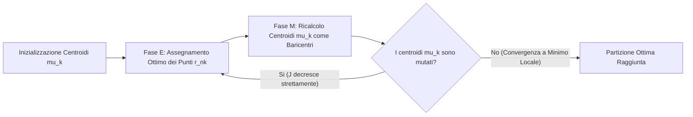
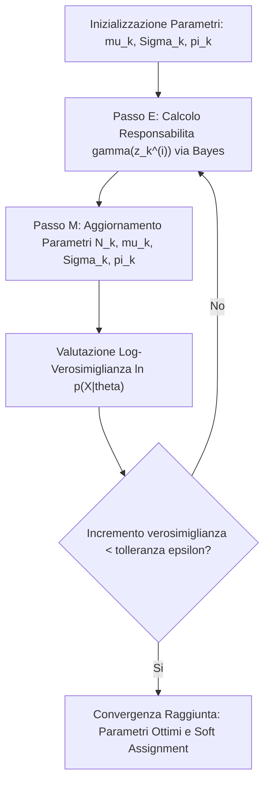

# B. Apprendimento Non Supervisionato

In innumerevoli scenari ingegneristici reali, etichettare le osservazioni $(\mathbf{x}^{(i)}, t^{(i)})$ risulta proibitivo in termini di costi, tempi o pura fattibilità sperimentale. Si dispone spesso di enormi volumi di dati descritti da vettori di feature, privi di indicazioni a priori sulle categorie o sulle strutture latenti sottostanti.

L'__Apprendimento Non Supervisionato__ (_Unsupervised Learning_) opera su dataset composti unicamente da campioni non etichettati $\mathcal{D} = \{\mathbf{x}^{(0)}, \dots, \mathbf{x}^{(N-1)}\} \subset \mathbb{R}^D$, con l'obiettivo di ricavare autonomamente la struttura geometrica intrinseca, individuare raggruppamenti naturali o stimare la densità di probabilità generativa dello spazio delle feature.

L'algoritmo cardine di partizione spaziale è il __K-Means__, fondato sulla minimizzazione della funzione di distorsione quadratica $J$ mediante un ciclo a due fasi a convergenza monotona, affiancato da strategie di inizializzazione robusta (__K-Means++__) e selezione del numero di gruppi (__Metodo del Gomito__). La variante __K-Medoids__ estende il clustering a metriche non euclidee arbitrarie garantendo immunità agli outlier. Il clustering probabilistico morbido si realizza infine mediante i __Modelli a Mistura di Gaussiane__ (__Gaussian Mixture Models__, GMM), la cui stima tramite l'algoritmo di __Expectation-Maximization__ (EM) riconduce rigorosamente K-Means come caso limite a varianza isotropa nulla.

## Fondamenti dell'Apprendimento Non Supervisionato

Nel paradigma non supervisionato scompare la variabile supervisiva $t^{(i)}$. Organizziamo il dataset di addestramento nell'insieme delle sole osservazioni continue o discrete:

$$
\mathcal{D} = \left\{ \mathbf{x}^{(0)}, \mathbf{x}^{(1)}, \dots, \mathbf{x}^{(N-1)} \right\}, \qquad \mathbf{x}^{(i)} \in \mathbb{R}^D
$$

In assenza di una verità fondamentale nota (_ground truth_) con cui confrontare le stime, non possiamo calcolare parametri di errore supervisionati convenzionali quali l'errore quadratico medio o la cross-entropy. Il modello deve estrarre l'informazione latente analizzando unicamente le relazioni spaziali e statistiche tra i dati.

Articoliamo i compiti principali dell'apprendimento non supervisionato in due filoni operativi:
- __Clustering (Raggruppamento Spaziale)__: partizionare le $N$ osservazioni in $K$ insiemi omogenei (detti _cluster_), tali per cui campioni assegnati allo stesso gruppo presentino un'elevata somiglianza reciproca, mentre campioni di gruppi distinti risultino marcatamente separati;
- __Stima di Densità e Variabili Latenti__: modellare la densità di probabilità continua $p(\mathbf{x})$ assumendo che ogni osservazione sia generata da uno stato interno non osservabile (variabile nascosta o _latente_).

In entrambi i casi, l'algoritmo individua regolarità matematiche oggettive senza attribuire loro un'etichetta semantica: spetta all'ingegnere interpretare il significato applicativo dei pattern identificati.

## Algoritmo K-Means e Funzione di Distorsione

L'algoritmo __K-Means__ rappresenta la tecnica di partizione più celebre ed efficiente per effettuare clustering di campioni continui nello spazio euclideo $\mathbb{R}^D$.

Fissiamo a priori il numero di raggruppamenti desiderati tramite l'iperparametro intero $K$. Rappresentiamo geometricamente ciascun cluster $k \in \{1, \dots, K\}$ mediante un vettore continuo $\boldsymbol{\mu}_k \in \mathbb{R}^D$, denominato __centroide__ o centro del cluster.

Per formalizzare l'assegnazione esclusiva di ciascun campione introduciamo per ogni osservazione $\mathbf{x}^{(n)}$ un vettore binario indicatore con codifica _1-of-K_:

$$
\mathbf{r}_n = [r_{n1}, r_{n2}, \dots, r_{nK}]^T \in \{0, 1\}^K, \qquad \sum_{k=1}^K r_{nk} = 1
$$

Le componenti binarie assumono il significato:
- $r_{nk} = 1$: il campione $\mathbf{x}^{(n)}$ appartiene al cluster $k$;
- $r_{nk} = 0$: il campione non appartiene al cluster $k$.

Poiché il vincolo impone che un solo elemento del vettore $\mathbf{r}_n$ sia pari a 1 e tutti gli altri siano nulli, ogni osservazione è vincolata a un unico cluster. Definiamo questa configurazione deterministica come __assegnamento rigido__ (_Hard Assignment_).

### Funzione di Distorsione Quadratica

Quantifichiamo la qualità della partizione introducendo la __funzione di costo di distorsione__ (o _inerzia intraclasse_):

$$
J(\mathbf{R}, \mathbf{M}) = \sum_{n=0}^{N-1} \sum_{k=1}^K r_{nk} \|\mathbf{x}^{(n)} - \boldsymbol{\mu}_k\|_2^2
$$

dove $\mathbf{R} \in \{0, 1\}^{N \times K}$ raccoglie gli assegnamenti binari e $\mathbf{M} = [\boldsymbol{\mu}_1, \dots, \boldsymbol{\mu}_K] \in \mathbb{R}^{D \times K}$ raccoglie le coordinate dei $K$ centroidi.

La funzione $J$ calcola la somma complessiva delle distanze euclidee al quadrato tra ciascun punto $\mathbf{x}^{(n)}$ e il centroide $\boldsymbol{\mu}_k$ del gruppo a cui è assegnato. L'obiettivo consiste nel determinare congiuntamente l'assegnamento $\mathbf{R}$ e la matrice dei centroidi $\mathbf{M}$ che minimizzano la distorsione globale:

$$
\min_{\mathbf{R}, \mathbf{M}} J(\mathbf{R}, \mathbf{M}) \quad \text{sotto i vincoli} \quad r_{nk} \in \{0, 1\}, \quad \sum_{k=1}^K r_{nk} = 1, \; \forall n
$$

> [!IMPORTANT] Complessità Combinatoria dell'Ottimizzazione Globale
> Minimizzare simultaneamente $J$ rispetto a $\mathbf{R}$ e $\mathbf{M}$ è un problema combinatorio NP-hard. Esistono infatti $K^N / K!$ possibili partizioni distinte di $N$ punti in $K$ insiemi disgiunti. Una ricerca esaustiva richiederebbe tempi di calcolo proibitivi già con poche decine di osservazioni.

### Ottimizzazione a Blocchi Coordinati

Risolviamo il problema formulando uno schema di __discesa a blocchi coordinati__ (noto come algoritmo di Lloyd): decomponiamo il problema globale in due semipassi alternati, ciascuno dei quali ammette una soluzione analitica esatta in forma chiusa.

![[fig_13_1_iterazione_kmeans_centroidi.svg|center big]]

Visualizziamo la dinamica iterativa del processo:



#### Fase di Assegnamento dei Campioni

Nella prima fase (indicata concettualmente come semipasso E o di assegnamento) manteniamo congelata la posizione dei centroidi $\{\boldsymbol{\mu}_k\}$ e ottimizziamo $J$ rispetto alla matrice delle variabili binarie $\{r_{nk}\}$.

Osserviamo che la sommatoria su $n$ in $J(\mathbf{R}, \mathbf{M})$ è a termini additivi disaccoppiati: la scelta dell'assegnamento per il campione $n$ non influenza in alcun modo la funzione di costo relativa agli altri $N-1$ campioni. Possiamo quindi risolvere $N$ problemi di ottimizzazione indipendenti:

$$
\min_{\mathbf{r}_n} \sum_{k=1}^K r_{nk} \|\mathbf{x}^{(n)} - \boldsymbol{\mu}_k\|_2^2 \quad \text{sotto i vincoli} \quad r_{nk} \in \{0, 1\}, \quad \sum_{k=1}^K r_{nk} = 1
$$

Poiché il vincolo impone la selezione di un singolo termine nella somma su $k$, la distorsione minima si realizza assegnando il peso unitario al centroide geometricamente più vicino a $\mathbf{x}^{(n)}$:

$$
r_{nk} = \begin{cases} 1 & \text{se } k = \arg\min_{j \in \{1, \dots, K\}} \|\mathbf{x}^{(n)} - \boldsymbol{\mu}_j\|_2^2 \\ 0 & \text{altrimenti} \end{cases}
$$

In caso di perfetta equiripartizione di distanza tra più centroidi, risolviamo la parità assegnando arbitrariamente l'indice minore. Geometricamente, questo semipasso suddivide lo spazio continuo $\mathbb{R}^D$ in $K$ __celle di Voronoi__, le cui frontiere di separazione sono iperpiani ortogonali ai segmenti congiungenti coppie adiacenti di centroidi.

#### Fase di Aggiornamento dei Centroidi

Nella seconda fase (semipasso M o di aggiornamento) manteniamo congelata la matrice degli assegnamenti $\{r_{nk}\}$ e ottimizziamo $J$ rispetto alle coordinate dei centroidi $\{\boldsymbol{\mu}_k\}$.

La funzione obiettivo $J$ si separa nella somma di $K$ contributi quadratici indipendenti rispetto a ciascun vettore $\boldsymbol{\mu}_k$:

$$
J(\mathbf{R}, \mathbf{M}) = \sum_{k=1}^K J_k(\boldsymbol{\mu}_k), \qquad J_k(\boldsymbol{\mu}_k) = \sum_{n=0}^{N-1} r_{nk} \|\mathbf{x}^{(n)} - \boldsymbol{\mu}_k\|_2^2
$$

Ciascun sottoproblema $J_k(\boldsymbol{\mu}_k)$ è una forma quadratica convessa, differenziabile e limitata inferiormente da zero. Calcoliamo il gradiente di $J$ rispetto al generico vettore $\boldsymbol{\mu}_k$:

$$
\nabla_{\boldsymbol{\mu}_k} J = \sum_{n=0}^{N-1} r_{nk} \nabla_{\boldsymbol{\mu}_k} (\mathbf{x}^{(n)} - \boldsymbol{\mu}_k)^T (\mathbf{x}^{(n)} - \boldsymbol{\mu}_k) = -2 \sum_{n=0}^{N-1} r_{nk} (\mathbf{x}^{(n)} - \boldsymbol{\mu}_k)
$$

Imponiamo la condizione di stazionarietà uguagliando il gradiente al vettore nullo:

$$
-2 \sum_{n=0}^{N-1} r_{nk} (\mathbf{x}^{(n)} - \boldsymbol{\mu}_k) = \mathbf{0} \implies \sum_{n=0}^{N-1} r_{nk} \mathbf{x}^{(n)} = \left( \sum_{n=0}^{N-1} r_{nk} \right) \boldsymbol{\mu}_k
$$

Definiamo $N_k \triangleq \sum_{n=0}^{N-1} r_{nk}$ il numero totale di campioni correntemente assegnati al cluster $k$. Esplicitiamo l'espressione ottimale di $\boldsymbol{\mu}_k$:

$$
\boldsymbol{\mu}_k^* = \frac{\sum_{n=0}^{N-1} r_{nk} \mathbf{x}^{(n)}}{\sum_{n=0}^{N-1} r_{nk}} = \frac{1}{N_k} \sum_{n \in \mathcal{C}_k} \mathbf{x}^{(n)}
$$

dove $\mathcal{C}_k = \{n \in \{0, \dots, N-1\} : r_{nk} = 1\}$.

> [!TIP] Baricentro Aritmetico come Minimo Globale della Varianza
> La media campionaria è l'unico punto dello spazio che minimizza la somma delle distanze euclidee al quadrato da un insieme di punti assegnati. Il centroide ottimale $\boldsymbol{\mu}_k^*$ coincide dunque per costruzione con il __baricentro aritmetico__ dei soli campioni appartenenti al cluster $\mathcal{C}_k$.

### Dimostrazione della Convergenza Monotona

L'alternanza dei due semipassi conferisce all'algoritmo K-Means una proprietà teorica fondamentale di stabilità numerica.

> [!IMPORTANT] Teorema di Convergenza in Tempo Finito
> A ogni semipasso dell'algoritmo la funzione di distorsione $J(\mathbf{R}, \mathbf{M})$ è non crescente:
> 
> $$
> J(\mathbf{R}^{(t+1)}, \mathbf{M}^{(t)}) \le J(\mathbf{R}^{(t)}, \mathbf{M}^{(t)})
> $$
> 
> $$
> J(\mathbf{R}^{(t+1)}, \mathbf{M}^{(t+1)}) \le J(\mathbf{R}^{(t+1)}, \mathbf{M}^{(t)})
> $$
> 
> Ne consegue che la sequenza temporale dei valori di distorsione $J^{(t)} = J(\mathbf{R}^{(t)}, \mathbf{M}^{(t)})$ decresce monotonicamente:
> 
> $$
> J^{(t+1)} \le J^{(t)}
> $$
> 
> Poiché il numero complessivo di partizioni distinte di $N$ punti in $K$ insiemi è strettamente finito (limitato superiormente da $K^N$), e poiché la funzione di distorsione è limitata inferiormente da zero ($J \ge 0$), l'algoritmo converge tassativamente in un numero finito di iterazioni a un __minimo locale__ o punto stazionario.

Dimostriamo formalmente la convergenza analizzando separatamente i due semipassi:
1. Nel semipasso di assegnamento, calcoliamo $\mathbf{R}^{(t+1)} = \arg\min_{\mathbf{R} \in \mathcal{S}_R} J(\mathbf{R}, \mathbf{M}^{(t)})$, dove $\mathcal{S}_R$ è l'insieme finito di tutte le matrici binarie con vincolo _1-of-K_. Poiché minimizziamo esattamente su tutto lo spazio ammissibile mantenendo $\mathbf{M}^{(t)}$ congelato, otteniamo necessariamente $J(\mathbf{R}^{(t+1)}, \mathbf{M}^{(t)}) \le J(\mathbf{R}^{(t)}, \mathbf{M}^{(t)})$;
2. Nel semipasso di aggiornamento, calcoliamo $\mathbf{M}^{(t+1)} = \arg\min_{\mathbf{M} \in \mathbb{R}^{D \times K}} J(\mathbf{R}^{(t+1)}, \mathbf{M})$. Poiché $J$ è strettamente convessa rispetto a $\mathbf{M}$ con matrice Hessiana definita positiva ($2 N_k \mathbf{I} \succ 0$), il baricentro $\mathbf{M}^{(t+1)}$ rappresenta l'unico minimo globale non vincolato per gli assegnamenti correnti. Vale dunque $J(\mathbf{R}^{(t+1)}, \mathbf{M}^{(t+1)}) \le J(\mathbf{R}^{(t+1)}, \mathbf{M}^{(t)})$;
3. Se tra due iterazioni consecutive gli assegnamenti rimangono invariati ($\mathbf{R}^{(t+1)} = \mathbf{R}^{(t)}$), anche i centroidi calcolati risultano identici ($\mathbf{M}^{(t+1)} = \mathbf{M}^{(t)}$): l'algoritmo raggiunge la convergenza e si arresta. Poiché a ogni iterazione attiva la funzione $J$ decresce strettamente, una partizione $\mathbf{R}$ già visitata non può mai ripresentarsi: l'algoritmo termina in al più $K^N$ iterazioni.

```pseudo
\begin{algorithm}
\caption{Algoritmo K-Means (Lloyd's Algorithm)}
\begin{algorithmic}
\REQUIRE Dataset di addestramento $\mathcal{D} = \{\mathbf{x}^{(0)}, \dots, \mathbf{x}^{(N-1)}\} \subset \mathbb{R}^D$, numero di cluster $K$
\ENSURE Centroidi ottimali $\{\boldsymbol{\mu}_k\}_{k=1}^K$, matrice degli assegnamenti $\mathbf{R} \in \{0, 1\}^{N \times K}$
\STATE Inizializzazione casuale o intelligente (K-Means++) dei centroidi $\boldsymbol{\mu}_1, \dots, \boldsymbol{\mu}_K \in \mathbb{R}^D$
\REPEAT
    \STATE \COMMENT{Fase E: Assegnamento ottimo a distanza minima}
    \FOR{$n = 0$ \TO $N-1$}
        \FOR{$k = 1$ \TO $K$}
            \IF{$k = \arg\min_{j \in \{1, \dots, K\}} \|\mathbf{x}^{(n)} - \boldsymbol{\mu}_j\|_2^2$}
                \STATE $r_{nk} \leftarrow 1$
            \ELSE
                \STATE $r_{nk} \leftarrow 0$
            \ENDIF
        \ENDFOR
    \ENDFOR
    \STATE \COMMENT{Fase M: Aggiornamento dei centroidi come baricentri}
    \FOR{$k = 1$ \TO $K$}
        \STATE $N_k \leftarrow \sum_{n=0}^{N-1} r_{nk}$
        \STATE $\boldsymbol{\mu}_k \leftarrow \frac{1}{N_k} \sum_{n=0}^{N-1} r_{nk} \mathbf{x}^{(n)}$
    \ENDFOR
\UNTIL{i centroidi $\{\boldsymbol{\mu}_k\}$ non variano più}
\RETURN $\{\boldsymbol{\mu}_k\}_{k=1}^K, \mathbf{R}$
\end{algorithmic}
\end{algorithm}
```

![[fig_ex_B_kmeans_distortion_elbow_method.png|center big]]

### Inizializzazione Geometrica con K-Means++

Nonostante la convergenza sia garantita in un numero finito di passi, la superficie di costo $J(\mathbf{R}, \mathbf{M})$ è altamente non convessa e densa di minimi locali sub-ottimali. L'esito finale dell'ottimizzazione dipende in modo critico dalle posizioni iniziali assegnate ai centroidi:
- Un'inizializzazione casuale standard può posizionare più centroidi all'interno della medesima concentrazione densa di dati, frammentandola e lasciando scoperti cluster remoti;
- Centroidi collocati in zone a densità quasi nulla possono rimanere privi di campioni ($N_k = 0$), rendendo indefinito il calcolo del baricentro.

Per mitigare la vulnerabilità ai minimi locali sub-ottimali adottiamo due protocolli:
- __Riavvii Multipli Casuali (Random Restarts)__: eseguiamo l'algoritmo per $R$ volte indipendenti ($R \in [10, 50]$), selezionando a posteriori la partizione che consegue la distorsione minima $J^*$;
- __Inizializzazione Probabilistica K-Means++__: distribuiamo preliminarmente i centroidi nello spazio massimizzando la distanza reciproca.

Formalizziamo l'algoritmo K-Means++:
1. Selezioniamo il primo centroide $\boldsymbol{\mu}_1$ estraendolo uniformemente a caso tra i punti del dataset $\mathcal{D}$;
2. Per ciascun punto rimanente $\mathbf{x}^{(n)}$, calcoliamo la distanza euclidea minima rispetto a tutti i centroidi già allocati:

$$
D(\mathbf{x}^{(n)}) = \min_{j \in \{1, \dots, k-1\}} \|\mathbf{x}^{(n)} - \boldsymbol{\mu}_j\|_2
$$

3. Estraiamo il centroide successivo $\boldsymbol{\mu}_k$ dal dataset campionando con probabilità proporzionale al quadrato della distanza minima:

$$
p(\mathbf{x}^{(n)}) = \frac{D(\mathbf{x}^{(n)})^2}{\sum_{i=0}^{N-1} D(\mathbf{x}^{(i)})^2}
$$

4. Ripetiamo i passi 2 e 3 fino all'allocazione completa dei $K$ centroidi iniziali.

> [!TIP] Giustificazione Teorica del Campionamento con $D^2$
> La funzione di distorsione $J$ penalizza le distanze con esponente quadratico. Campionare con probabilità proporzionale a $D(\mathbf{x})^2$ favorisce l'esplorazione di regioni periferiche scarsamente coperte, riducendo drasticamente la comparsa di centroidi ridondanti. Arthur e Vassilvitskii hanno dimostrato che K-Means++ garantisce un limite teorico formale $O(\log K)$ rispetto alla distorsione ottima globale:
> 
> $$
> \mathbb{E}[J] \le 8(\ln K + 2) J_{\text{opt}}
> $$

### Selezione di K e Metodo del Gomito

La determinazione del numero ideale di cluster $K$ costituisce una classica problematica di model selection non supervisionata.

Non possiamo minimizzare direttamente la distorsione $J$ rispetto a $K$: al crescere di $K$, il valore minimo finale $J^*(K)$ decresce in modo strettamente monotono. Nel caso limite $K = N$, ciascun punto coincide con il proprio centroide ($\boldsymbol{\mu}_n = \mathbf{x}^{(n)}$), annullando completamente la distorsione ($J = 0$). Questa condizione corrisponde al massimo grado di overfitting geometrico, privando il clustering di qualsiasi utilità sintetica.

Per individuare il valore ottimale applichiamo il __Metodo del Gomito__ (_Elbow Method_):
1. Eseguiamo K-Means su un intervallo di valori crescenti dell'iperparametro $K \in \{1, 2, \dots, K_{\max}\}$;
2. Grafichiamo la curva della distorsione minima finale $J^*(K)$ in funzione di $K$;
3. Per $K$ inferiore al numero intrinseco di raggruppamenti naturali, l'aggiunta di un centroide assorbe grandi volumi di dispersione spaziale, determinando una ripida caduta del valore di $J^*$;
4. Oltre il numero naturale di cluster, aggiungere ulteriori centri produce un rendimento marginale decrescente ($\Delta J = J^*(K) - J^*(K+1)$ si riduce vistosamente), poiché l'algoritmo si limita a frammentare partizioni già compatte;
5. Individuiamo il "punto di gomito" (_elbow point_), definito come il punto di flesso oltre il quale la curva si appiattisce. Tale valore rappresenta il miglior compromesso tra compattezza geometrica e parsimonia parametrica del modello.

## Variante Robusta K-Medoids

L'algoritmo K-Means convenzionale manifesta un'elevata sensibilità alla presenza di __outlier__ e rumore a code pesanti. Poiché la distorsione impiega la norma euclidea quadratica, un singolo punto anomalo $\mathbf{x}_{\text{out}}$ collocato a grande distanza $R \gg 1$ esercita una forza di attrazione proporzionale a $R$, trascinando sensibilmente il baricentro $\boldsymbol{\mu}_k$ lontano dalla reale concentrazione dei dati.

Per garantire robustezza statistica introduciamo l'algoritmo __K-Medoids__ (implementato tipicamente nella procedura PAM, _Partitioning Around Medoids_):
- Sostituiamo i centroidi continui astratti $\boldsymbol{\mu}_k \in \mathbb{R}^D$ con i __medoidi__ $\mathbf{m}_k \in \mathcal{D}$, vincolando i centri dei cluster a coincidere tassativamente con osservazioni reali del dataset;
- Definiamo una funzione di costo basata su una metrica di dissimilarità arbitraria $\mathcal{V}(\mathbf{x}^{(i)}, \mathbf{x}^{(j)})$, quale ad esempio la norma $L_1$ (distanza di Manhattan $\|\mathbf{x} - \mathbf{y}\|_1$), la dissimilarità del coseno o distanze su grafi;
- Il medoide del cluster $k$ è il campione interno al gruppo che minimizza la somma delle dissimilarità verso tutti gli altri punti assegnati:

$$
\mathbf{m}_k = \arg\min_{\mathbf{x} \in \mathcal{C}_k} \sum_{\mathbf{x}^{(i)} \in \mathcal{C}_k} \mathcal{V}(\mathbf{x}^{(i)}, \mathbf{x})
$$

- Nel semipasso di aggiornamento, valutiamo se scambiare un medoide corrente con un punto non medoide riduca il costo totale, accettando la sostituzione che massimizza il decremento di dissimilarità.

> [!NOTE] Mediana vs Media: Perché K-Medoids è Immune agli Outlier
> Nel calcolo della media $L_2$, l'influenza di un punto cresce linearmente con la sua deviazione: il suo punto di rottura (_breakdown point_) è pari a 0, poiché un singolo valore anomalo arbitrariamente grande può corrompere l'intera stima. K-Medoids con metrica $L_1$ realizza l'equivalente multidimensionale della __mediana campionaria__, che vanta un breakdown point del 50%: la posizione del medoide rimane inalterata finché la maggioranza dei campioni locali preserva la propria configurazione. Lo svantaggio risiede nella complessità computazionale, che scala quadraticamente con la cardinalità dei singoli cluster.

## Modelli a Mistura di Gaussiane

Nonostante la loro efficienza, K-Means e K-Medoids soffrono di due stringenti limitazioni geometriche:
- __Incertezza Oscurata dall'Hard Assignment__: un'osservazione posta esattamente sul confine di decisione tra due cluster riceve un'assegnazione deterministica al 100% verso uno e allo 0% verso l'altro, azzerando l'informazione sul grado di incertezza della classificazione;
- __Isotropia Circolare dello Spazio__: l'uso della distanza euclidea implica l'ipotesi implicita che tutti i cluster abbiano forma sferica e medesima varianza spaziale, fallendo nell'identificare concentrazioni naturali ellissoidali con orientazioni arbitrarie nello spazio delle feature.

Per superare tali vincoli formuliamo un modello probabilistico continuo a densità mista: i __Modelli a Mistura di Gaussiane__ (__Gaussian Mixture Models__, GMM).

![[fig_13_2_mistura_gaussiane_unidimensionale.svg|center mid]]

### Assegnamento Morbido e Limiti Geometrici di K-Means

In un GMM, la distribuzione marginale generatrice dei dati è espressa come la combinazione lineare convessa di $K$ densità normali multivariate, ciascuna caratterizzata da un proprio vettore medio $\boldsymbol{\mu}_k \in \mathbb{R}^D$ e da una propria matrice di covarianza $\boldsymbol{\Sigma}_k \in \mathbb{R}^{D \times D}$:

$$
p(\mathbf{x}) = \sum_{k=1}^K \pi_k \mathcal{N}(\mathbf{x} \mid \boldsymbol{\mu}_k, \boldsymbol{\Sigma}_k)
$$

dove la densità normale multivariata $D$-dimensionale è definita da:

$$
\mathcal{N}(\mathbf{x} \mid \boldsymbol{\mu}_k, \boldsymbol{\Sigma}_k) = \frac{1}{(2\pi)^{D/2} |\boldsymbol{\Sigma}_k|^{1/2}} \exp\left( -\frac{1}{2} (\mathbf{x} - \boldsymbol{\mu}_k)^T \boldsymbol{\Sigma}_k^{-1} (\mathbf{x} - \boldsymbol{\mu}_k) \right)
$$

I coefficienti scalari $\pi_k$ rappresentano i __pesi di mistura__ (o probabilità a priori delle componenti) e soddisfano i vincoli assiomatici di probabilità:

$$
0 \le \pi_k \le 1, \qquad \sum_{k=1}^K \pi_k = 1
$$

Poiché ciascuna campana gaussiana possiede supporto non nullo su tutto $\mathbb{R}^D$, ogni campione possiede una probabilità quantificabile di appartenere a ciascuno dei $K$ gruppi. Sostituiamo così la partizione netta con un __assegnamento morbido__ (_Soft Assignment_).

![[fig_ex_B_hard_vs_soft_clustering_gmm.png|center big]]

### Modello Generativo e Variabili Latenti

Per derivare la struttura statistica di un GMM stabiliamo un collegamento diretto con i modelli generativi supervisionati (quali LDA e QDA).

Nel contesto supervisionato, ogni osservazione è affiancata da una classe $t \in \{1, \dots, K\}$ nota. Nel paradigma non supervisionato, l'informazione su quale componente abbia emesso il campione $\mathbf{x}^{(i)}$ non è accessibile: la trattiamo formalmente come una __variabile casuale latente__ (non osservata).

Introduciamo per ogni osservazione un vettore latente binario $\mathbf{z} \in \{0, 1\}^K$ avente codifica _1-of-K_:

$$
z_k \in \{0, 1\}, \qquad \sum_{k=1}^K z_k = 1
$$

La condizione $z_k = 1$ indica l'evento in cui il dato è stato generato dalla $k$-esima componente Gaussiana.

Definiamo la distribuzione a priori su $\mathbf{z}$ mediante una distribuzione categorica governata dai pesi $\pi_k$:

$$
p(z_k = 1) = \pi_k \iff p(\mathbf{z}) = \prod_{k=1}^K \pi_k^{z_k}
$$

Definiamo la distribuzione condizionata dell'osservazione $\mathbf{x}$ dato il vettore latente $\mathbf{z}$:

$$
p(\mathbf{x} \mid z_k = 1) = \mathcal{N}(\mathbf{x} \mid \boldsymbol{\mu}_k, \boldsymbol{\Sigma}_k) \iff p(\mathbf{x} \mid \mathbf{z}) = \prod_{k=1}^K \left[ \mathcal{N}(\mathbf{x} \mid \boldsymbol{\mu}_k, \boldsymbol{\Sigma}_k) \right]^{z_k}
$$

Esprimiamo la distribuzione congiunta $p(\mathbf{x}, \mathbf{z})$ applicando la regola del prodotto:

$$
p(\mathbf{x}, \mathbf{z}) = p(\mathbf{z}) p(\mathbf{x} \mid \mathbf{z}) = \prod_{k=1}^K \left[ \pi_k \mathcal{N}(\mathbf{x} \mid \boldsymbol{\mu}_k, \boldsymbol{\Sigma}_k) \right]^{z_k}
$$

Ricaviamo la distribuzione marginale dell'osservabile $\mathbf{x}$ sommando rispetto a tutte le $K$ possibili configurazioni ammissibili del vettore latente $\mathbf{z}$:

$$
p(\mathbf{x}) = \sum_{\mathbf{z}} p(\mathbf{x}, \mathbf{z}) = \sum_{k=1}^K p(z_k = 1) p(\mathbf{x} \mid z_k = 1) = \sum_{k=1}^K \pi_k \mathcal{N}(\mathbf{x} \mid \boldsymbol{\mu}_k, \boldsymbol{\Sigma}_k)
$$

> [!NOTE] Natura Marginale del GMM
> La densità di un GMM non è altro che la __distribuzione marginale__ di un modello probabilistico congiunto a variabili nascoste discrete. Poiché osserviamo unicamente $\mathbf{X}$ e non disponiamo dei vettori latenti $\mathbf{z}$, la stima dei parametri deve massimizzare la verosimiglianza marginale delle sole osservazioni visibili.

### Responsabilità a Posteriori e Inversione Bayesiana

Una grandezza cardine nella teoria delle misture è la probabilità a posteriori che il campione $\mathbf{x}^{(i)}$ sia stato originato dalla $k$-esima componente, denominata __responsabilità__ (_Responsibility_):

$$
\gamma(z_k^{(i)}) \triangleq p(z_k^{(i)} = 1 \mid \mathbf{x}^{(i)})
$$

Deriviamo analiticamente l'espressione della responsabilità applicando il Teorema di Bayes:

$$
\gamma(z_k^{(i)}) = \frac{p(z_k^{(i)} = 1) p(\mathbf{x}^{(i)} \mid z_k^{(i)} = 1)}{p(\mathbf{x}^{(i)})} = \frac{p(z_k^{(i)} = 1) p(\mathbf{x}^{(i)} \mid z_k^{(i)} = 1)}{\sum_{j=1}^K p(z_j^{(i)} = 1) p(\mathbf{x}^{(i)} \mid z_j^{(i)} = 1)}
$$

Sostituendo il prior categorico $\pi_k$ e la verosimiglianza gaussiana $\mathcal{N}(\mathbf{x}^{(i)} \mid \boldsymbol{\mu}_k, \boldsymbol{\Sigma}_k)$:

$$
\gamma(z_k^{(i)}) = \frac{\pi_k \mathcal{N}(\mathbf{x}^{(i)} \mid \boldsymbol{\mu}_k, \boldsymbol{\Sigma}_k)}{\sum_{j=1}^K \pi_j \mathcal{N}(\mathbf{x}^{(i)} \mid \boldsymbol{\mu}_j, \boldsymbol{\Sigma}_j)}
$$

Per costruzione, le responsabilità soddisfano le proprietà fondamentali di una distribuzione di probabilità:

$$
0 \le \gamma(z_k^{(i)}) \le 1, \qquad \sum_{k=1}^K \gamma(z_k^{(i)}) = 1, \quad \forall i \in \{0, \dots, N-1\}
$$

La quantità scalare $\gamma(z_k^{(i)})$ esprime la quota frazionaria di appartenenza con cui la componente $k$ partecipa alla spiegazione della genesi dell'osservazione $\mathbf{x}^{(i)}$.

### Log-Verosimiglianza Marginale e Dipendenza Circolare

Per stimare il set complessivo dei parametri del modello $\boldsymbol{\theta} = \{\boldsymbol{\mu}_k, \boldsymbol{\Sigma}_k, \pi_k\}_{k=1}^K$ a partire da $N$ campioni i.i.d., formuliamo la funzione di log-verosimiglianza marginale:

$$
\ln p(\mathbf{X} \mid \boldsymbol{\theta}) = \sum_{i=0}^{N-1} \ln p(\mathbf{x}^{(i)} \mid \boldsymbol{\theta}) = \sum_{i=0}^{N-1} \ln \left( \sum_{k=1}^K \pi_k \mathcal{N}(\mathbf{x}^{(i)} \mid \boldsymbol{\mu}_k, \boldsymbol{\Sigma}_k) \right)
$$

> [!WARNING] Il Blocco Analitico della Somma Interna al Logaritmo
> A differenza dei modelli gaussiani supervisionati, in cui il logaritmo agisce direttamente sul singolo esponenziale trasformandolo in una forma quadratica, nella log-verosimiglianza marginale del GMM la sommatoria sui $K$ cluster si trova __all'interno del logaritmo__. Questa struttura non lineare accoppia tutti i parametri, impedendo la risoluzione diretta del sistema di annullamento del gradiente in forma chiusa.

Analizziamo cosa accade differenziando formalmente $\ln p(\mathbf{X} \mid \boldsymbol{\theta})$ rispetto al vettore delle medie $\boldsymbol{\mu}_k$. Applicando la regola della catena:

$$
\nabla_{\boldsymbol{\mu}_k} \ln p(\mathbf{X} \mid \boldsymbol{\theta}) = \sum_{i=0}^{N-1} \frac{\pi_k \nabla_{\boldsymbol{\mu}_k} \mathcal{N}(\mathbf{x}^{(i)} \mid \boldsymbol{\mu}_k, \boldsymbol{\Sigma}_k)}{\sum_{j=1}^K \pi_j \mathcal{N}(\mathbf{x}^{(i)} \mid \boldsymbol{\mu}_j, \boldsymbol{\Sigma}_j)} = \mathbf{0}
$$

Ricordiamo la derivata del nucleo gaussiano multivariato rispetto alla media:

$$
\nabla_{\boldsymbol{\mu}_k} \mathcal{N}(\mathbf{x} \mid \boldsymbol{\mu}_k, \boldsymbol{\Sigma}_k) = \mathcal{N}(\mathbf{x} \mid \boldsymbol{\mu}_k, \boldsymbol{\Sigma}_k) \boldsymbol{\Sigma}_k^{-1} (\mathbf{x} - \boldsymbol{\mu}_k)
$$

Sostituendo tale espressione nell'equazione del gradiente:

$$
\sum_{i=0}^{N-1} \underbrace{\left[ \frac{\pi_k \mathcal{N}(\mathbf{x}^{(i)} \mid \boldsymbol{\mu}_k, \boldsymbol{\Sigma}_k)}{\sum_{j=1}^K \pi_j \mathcal{N}(\mathbf{x}^{(i)} \mid \boldsymbol{\mu}_j, \boldsymbol{\Sigma}_j)} \right]}_{= \gamma(z_k^{(i)})} \boldsymbol{\Sigma}_k^{-1} (\mathbf{x}^{(i)} - \boldsymbol{\mu}_k) = \mathbf{0}
$$

Riconosciamo al denominatore e al numeratore l'esatta espressione della responsabilità $\gamma(z_k^{(i)})$. Moltiplicando entrambi i membri a sinistra per la matrice di covarianza $\boldsymbol{\Sigma}_k$:

$$
\sum_{i=0}^{N-1} \gamma(z_k^{(i)}) (\mathbf{x}^{(i)} - \boldsymbol{\mu}_k) = \mathbf{0} \implies \sum_{i=0}^{N-1} \gamma(z_k^{(i)}) \mathbf{x}^{(i)} = \boldsymbol{\mu}_k \sum_{i=0}^{N-1} \gamma(z_k^{(i)})
$$

Definiamo la somma complessiva delle responsabilità associate alla componente $k$:

$$
N_k \triangleq \sum_{i=0}^{N-1} \gamma(z_k^{(i)})
$$

La grandezza $N_k$ rappresenta il __numero effettivo di campioni assegnati al cluster $k$__. Isoliamo l'espressione della media ottimale:

$$
\boldsymbol{\mu}_k^* = \frac{1}{N_k} \sum_{i=0}^{N-1} \gamma(z_k^{(i)}) \mathbf{x}^{(i)}
$$

Procedendo in modo analogo per la matrice di covarianza $\boldsymbol{\Sigma}_k$:

$$
\boldsymbol{\Sigma}_k^* = \frac{1}{N_k} \sum_{i=0}^{N-1} \gamma(z_k^{(i)}) (\mathbf{x}^{(i)} - \boldsymbol{\mu}_k^*)(\mathbf{x}^{(i)} - \boldsymbol{\mu}_k^*)^T
$$

Per ricavare la condizione di ottimalità per i pesi di mistura $\pi_k$, dobbiamo incorporare il vincolo di normalizzazione $\sum_{k=1}^K \pi_k = 1$ mediante un moltiplicatore di Lagrange $\lambda$:

$$
\mathcal{L}(\boldsymbol{\pi}, \lambda) = \sum_{i=0}^{N-1} \ln \left( \sum_{k=1}^K \pi_k \mathcal{N}(\mathbf{x}^{(i)} \mid \boldsymbol{\mu}_k, \boldsymbol{\Sigma}_k) \right) + \lambda \left( \sum_{k=1}^K \pi_k - 1 \right)
$$

Differenziamo rispetto al singolo coefficiente $\pi_k$:

$$
\frac{\partial \mathcal{L}}{\partial \pi_k} = \sum_{i=0}^{N-1} \frac{\mathcal{N}(\mathbf{x}^{(i)} \mid \boldsymbol{\mu}_k, \boldsymbol{\Sigma}_k)}{\sum_{j=1}^K \pi_j \mathcal{N}(\mathbf{x}^{(i)} \mid \boldsymbol{\mu}_j, \boldsymbol{\Sigma}_j)} + \lambda = \sum_{i=0}^{N-1} \frac{\gamma(z_k^{(i)})}{\pi_k} + \lambda = 0
$$

Moltiplichiamo per $\pi_k$ ed esplicitiamo la sommatoria:

$$
\sum_{i=0}^{N-1} \gamma(z_k^{(i)}) + \lambda \pi_k = 0 \implies N_k + \lambda \pi_k = 0
$$

Sommiamo tale equazione su tutte le $K$ componenti:

$$
\sum_{k=1}^K N_k + \lambda \sum_{k=1}^K \pi_k = 0 \implies N + \lambda(1) = 0 \implies \lambda = -N
$$

Sostituendo il valore del moltiplicatore $\lambda = -N$ ricaviamo il valore ottimo dei pesi a priori:

$$
\pi_k^* = \frac{N_k}{N}
$$

> [!IMPORTANT] L'Origine della Dipendenza Circolare
> Le equazioni per $\boldsymbol{\mu}_k^*$, $\boldsymbol{\Sigma}_k^*$ e $\pi_k^*$ __non costituiscono una soluzione in forma chiusa__:
> - Per calcolare i parametri ottimi $(\boldsymbol{\mu}_k^*, \boldsymbol{\Sigma}_k^*, \pi_k^*)$ dobbiamo conoscere le responsabilità a posteriori $\gamma(z_k^{(i)})$;
> - Per calcolare le responsabilità a posteriori $\gamma(z_k^{(i)})$ dobbiamo conoscere i parametri $(\boldsymbol{\mu}_k, \boldsymbol{\Sigma}_k, \pi_k)$ delle Gaussiane.
> 
> La presenza di questa reciproca dipendenza circolare impone l'impiego di una procedura iterativa alternata di punto fisso.

## Algoritmo Expectation-Maximization per GMM

L'algoritmo __Expectation-Maximization__ (EM) supera la dipendenza circolare alternando iterativamente due fasi distinte: calcolo delle aspettative delle variabili latenti e aggiornamento dei parametri di massima verosimiglianza.

Visualizziamo l'architettura operativa del ciclo EM:



### Derivazione Analitica del Ciclo di Aggiornamento

Formalizziamo la procedura dell'algoritmo Expectation-Maximization per la stima dei GMM:

1. __Inizializzazione dei Parametri__:
   - Inizializziamo i vettori medi $\boldsymbol{\mu}_k$ eseguendo preliminarmente alcune iterazioni di K-Means sul dataset;
   - Inizializziamo le matrici di covarianza $\boldsymbol{\Sigma}_k$ impostandole pari alla covarianza campionaria globale o a matrici diagonali isotrope;
   - Inizializziamo uniformemente i pesi di mistura: $\pi_k = \frac{1}{K}$;
   - Valutiamo la log-verosimiglianza iniziale $\ln p(\mathbf{X} \mid \boldsymbol{\theta}^{(0)})$;

2. __Passo E (Expectation)__:
   - Manteniamo congelati i parametri correnti $\boldsymbol{\theta}^{(t)} = \{\boldsymbol{\mu}_k, \boldsymbol{\Sigma}_k, \pi_k\}$;
   - Calcoliamo le responsabilità a posteriori per ogni campione $i \in \{0, \dots, N-1\}$ e per ciascuna componente $k \in \{1, \dots, K\}$:

$$
\gamma(z_k^{(i)}) = \frac{\pi_k \mathcal{N}(\mathbf{x}^{(i)} \mid \boldsymbol{\mu}_k, \boldsymbol{\Sigma}_k)}{\sum_{j=1}^K \pi_j \mathcal{N}(\mathbf{x}^{(i)} \mid \boldsymbol{\mu}_j, \boldsymbol{\Sigma}_j)}
$$

3. __Passo M (Maximization)__:
   - Manteniamo congelate le responsabilità $\gamma(z_k^{(i)})$ calcolate al passo E;
   - Ricalcoliamo il volume di occupazione effettivo di ciascun cluster:

$$
N_k = \sum_{i=0}^{N-1} \gamma(z_k^{(i)})
$$

   - Aggiorniamo i parametri delle componenti Gaussiane secondo le formule chiuse ricavate:

$$
\boldsymbol{\mu}_k^{\text{nuovo}} = \frac{1}{N_k} \sum_{i=0}^{N-1} \gamma(z_k^{(i)}) \mathbf{x}^{(i)}
$$

$$
\boldsymbol{\Sigma}_k^{\text{nuovo}} = \frac{1}{N_k} \sum_{i=0}^{N-1} \gamma(z_k^{(i)}) (\mathbf{x}^{(i)} - \boldsymbol{\mu}_k^{\text{nuovo}})(\mathbf{x}^{(i)} - \boldsymbol{\mu}_k^{\text{nuovo}})^T
$$

$$
\pi_k^{\text{nuovo}} = \frac{N_k}{N}
$$

4. __Verifica della Convergenza__:
   - Calcoliamo la nuova log-verosimiglianza marginale:

$$
\ln p(\mathbf{X} \mid \boldsymbol{\theta}^{\text{nuovo}}) = \sum_{i=0}^{N-1} \ln \left( \sum_{k=1}^K \pi_k^{\text{nuovo}} \mathcal{N}(\mathbf{x}^{(i)} \mid \boldsymbol{\mu}_k^{\text{nuovo}}, \boldsymbol{\Sigma}_k^{\text{nuovo}}) \right)
$$

   - Verifichiamo il criterio di arresto sulla variazione scalare:

$$
|\ln p(\mathbf{X} \mid \boldsymbol{\theta}^{\text{nuovo}}) - \ln p(\mathbf{X} \mid \boldsymbol{\theta})| < \epsilon
$$

   - Se la condizione non è soddisfatta, poniamo $\boldsymbol{\theta} \leftarrow \boldsymbol{\theta}^{\text{nuovo}}$ e reiteriamo a partire dal passo E.

```pseudo
\begin{algorithm}
\caption{Expectation-Maximization per Modelli a Mistura di Gaussiane (EM per GMM)}
\begin{algorithmic}
\REQUIRE Dataset $\mathcal{D} = \{\mathbf{x}^{(0)}, \dots, \mathbf{x}^{(N-1)}\} \subset \mathbb{R}^D$, numero di componenti $K$, tolleranza $\epsilon$
\ENSURE Parametri ottimi $\{\boldsymbol{\mu}_k, \boldsymbol{\Sigma}_k, \pi_k\}_{k=1}^K$, responsabilità a posteriori $\{\gamma(z_k^{(i)})\}$
\STATE Inizializzazione di $\boldsymbol{\mu}_k$ (es. con K-Means), $\boldsymbol{\Sigma}_k$ e $\pi_k = \frac{1}{K}$ per $k = 1, \dots, K$
\STATE Valutazione log-verosimiglianza iniziale: $\ell \leftarrow \sum_{i=0}^{N-1} \ln \left( \sum_{k=1}^K \pi_k \mathcal{N}(\mathbf{x}^{(i)} \mid \boldsymbol{\mu}_k, \boldsymbol{\Sigma}_k) \right)$
\REPEAT
    \STATE \COMMENT{Passo E: Calcolo delle responsabilità a parametri congelati}
    \FOR{$i = 0$ \TO $N-1$}
        \FOR{$k = 1$ \TO $K$}
            \STATE $\gamma(z_k^{(i)}) \leftarrow \frac{\pi_k \mathcal{N}(\mathbf{x}^{(i)} \mid \boldsymbol{\mu}_k, \boldsymbol{\Sigma}_k)}{\sum_{j=1}^K \pi_j \mathcal{N}(\mathbf{x}^{(i)} \mid \boldsymbol{\mu}_j, \boldsymbol{\Sigma}_j)}$
        \ENDFOR
    \ENDFOR
    \STATE \COMMENT{Passo M: Aggiornamento dei parametri a responsabilità congelate}
    \FOR{$k = 1$ \TO $K$}
        \STATE $N_k \leftarrow \sum_{i=0}^{N-1} \gamma(z_k^{(i)})$
        \STATE $\boldsymbol{\mu}_k \leftarrow \frac{1}{N_k} \sum_{i=0}^{N-1} \gamma(z_k^{(i)}) \mathbf{x}^{(i)}$
        \STATE $\boldsymbol{\Sigma}_k \leftarrow \frac{1}{N_k} \sum_{i=0}^{N-1} \gamma(z_k^{(i)}) (\mathbf{x}^{(i)} - \boldsymbol{\mu}_k)(\mathbf{x}^{(i)} - \boldsymbol{\mu}_k)^T$
        \STATE $\pi_k \leftarrow \frac{N_k}{N}$
    \ENDFOR
    \STATE $\ell_{\text{nuovo}} \leftarrow \sum_{i=0}^{N-1} \ln \left( \sum_{k=1}^K \pi_k \mathcal{N}(\mathbf{x}^{(i)} \mid \boldsymbol{\mu}_k, \boldsymbol{\Sigma}_k) \right)$
    \STATE $\Delta \leftarrow |\ell_{\text{nuovo}} - \ell|$
    \STATE $\ell \leftarrow \ell_{\text{nuovo}}$
\UNTIL{$\Delta < \epsilon$}
\RETURN $\{\boldsymbol{\mu}_k, \boldsymbol{\Sigma}_k, \pi_k\}_{k=1}^K, \{\gamma(z_k^{(i)})\}$
\end{algorithmic}
\end{algorithm}
```

> [!TIP] Monotonia Globale di EM
> Dempster, Laird e Rubin hanno provato che l'algoritmo Expectation-Maximization garantisce a ogni ciclo un miglioramento monotono della verosimiglianza marginale:
> 
> $$
> \ln p(\mathbf{X} \mid \boldsymbol{\theta}^{(t+1)}) \ge \ln p(\mathbf{X} \mid \boldsymbol{\theta}^{(t)})
> $$
> 
> L'uguaglianza si verifica esclusivamente quando l'algoritmo approda a un punto stazionario (minimo locale, punto di sella o massimo locale della superficie di verosimiglianza).

### K-Means come Caso Limite a Varianza Nulla

Esiste una precisa connessione formale che lega GMM a K-Means: quest'ultimo costituisce la versione deterministica e non stocastica del primo.

Ipotizziamo un GMM con le seguenti restrizioni:
1. Le matrici di covarianza di tutte le $K$ componenti sono sferiche, isotrope e identiche, parametrizzate da un unico scalare di varianza $\sigma^2$:

$$
\boldsymbol{\Sigma}_k = \sigma^2 \mathbf{I}, \quad \forall k \in \{1, \dots, K\}
$$

2. I coefficienti di mistura sono equiprobabili a priori:

$$
\pi_k = \frac{1}{K}, \quad \forall k \in \{1, \dots, K\}
$$

Sotto queste ipotesi, la densità della singola componente $k$ diventa:

$$
\mathcal{N}(\mathbf{x}^{(i)} \mid \boldsymbol{\mu}_k, \sigma^2 \mathbf{I}) = \frac{1}{(2\pi \sigma^2)^{D/2}} \exp\left( -\frac{\|\mathbf{x}^{(i)} - \boldsymbol{\mu}_k\|_2^2}{2\sigma^2} \right)
$$

Sostituiamo tale espressione nella formula della responsabilità $\gamma(z_k^{(i)})$:

$$
\gamma(z_k^{(i)}) = \frac{\frac{1}{K (2\pi \sigma^2)^{D/2}} \exp\left( -\frac{\|\mathbf{x}^{(i)} - \boldsymbol{\mu}_k\|_2^2}{2\sigma^2} \right)}{\sum_{j=1}^K \frac{1}{K (2\pi \sigma^2)^{D/2}} \exp\left( -\frac{\|\mathbf{x}^{(i)} - \boldsymbol{\mu}_j\|_2^2}{2\sigma^2} \right)} = \frac{\exp\left( -\frac{\|\mathbf{x}^{(i)} - \boldsymbol{\mu}_k\|_2^2}{2\sigma^2} \right)}{\sum_{j=1}^K \exp\left( -\frac{\|\mathbf{x}^{(i)} - \boldsymbol{\mu}_j\|_2^2}{2\sigma^2} \right)}
$$

Riconosciamo l'operatore Softmax applicato alla metrica delle distanze con fattore di scala inversamente proporzionale alla varianza $\beta = \frac{1}{2\sigma^2}$.

Sia $k^* = \arg\min_{j} \|\mathbf{x}^{(i)} - \boldsymbol{\mu}_j\|_2^2$ l'indice del centroide avente la minima distanza euclidea da $\mathbf{x}^{(i)}$. Dividiamo numeratore e denominatore per il termine dominante $\exp\left( -\frac{\|\mathbf{x}^{(i)} - \boldsymbol{\mu}_{k^*}\|_2^2}{2\sigma^2} \right)$:

$$
\gamma(z_k^{(i)}) = \frac{\exp\left( -\frac{\|\mathbf{x}^{(i)} - \boldsymbol{\mu}_k\|_2^2 - \|\mathbf{x}^{(i)} - \boldsymbol{\mu}_{k^*}\|_2^2}{2\sigma^2} \right)}{1 + \sum_{j \ne k^*} \exp\left( -\frac{\|\mathbf{x}^{(i)} - \boldsymbol{\mu}_j\|_2^2 - \|\mathbf{x}^{(i)} - \boldsymbol{\mu}_{k^*}\|_2^2}{2\sigma^2} \right)}
$$

Poiché per ogni $j \ne k^*$ si ha la disuguaglianza stretta $\|\mathbf{x}^{(i)} - \boldsymbol{\mu}_j\|_2^2 - \|\mathbf{x}^{(i)} - \boldsymbol{\mu}_{k^*}\|_2^2 > 0$, quando la varianza tende asintoticamente a zero ($\sigma^2 \to 0^+$, ovvero $\beta \to +\infty$):

$$
\lim_{\sigma^2 \to 0^+} \exp\left( -\frac{\|\mathbf{x}^{(i)} - \boldsymbol{\mu}_j\|_2^2 - \|\mathbf{x}^{(i)} - \boldsymbol{\mu}_{k^*}\|_2^2}{2\sigma^2} \right) = 0, \quad \forall j \ne k^*
$$

Valutiamo il limite della responsabilità:
- Per $k = k^*$: il numeratore vale $\exp(0) = 1$, mentre a denominatore ogni termine della somma svanisce, fornendo $\gamma(z_{k^*}^{(i)}) \to 1$;
- Per $k \ne k^*$: il numeratore collassa a 0, fornendo $\gamma(z_k^{(i)}) \to 0$.

Otteniamo analiticamente:

$$
\lim_{\sigma^2 \to 0} \gamma(z_k^{(i)}) = \begin{cases} 1 & \text{se } k = \arg\min_{j \in \{1, \dots, K\}} \|\mathbf{x}^{(i)} - \boldsymbol{\mu}_j\|_2^2 \\ 0 & \text{altrimenti} \end{cases} \equiv r_{ik}
$$

> [!IMPORTANT] K-Means come Degenerazione Rigida di EM
> Nel limite di varianza nulla ($\sigma^2 \to 0$):
> 1. Le responsabilità morbide $\gamma(z_k^{(i)})$ convergono esattamente agli assegnamenti rigidi binari $r_{ik}$ del passo E di K-Means;
> 2. Le formule di aggiornamento delle medie nel passo M di GMM collassano sui baricentri aritmetici di K-Means:
>    
>    $$
>    \boldsymbol{\mu}_k = \frac{\sum_i \gamma(z_k^{(i)}) \mathbf{x}^{(i)}}{\sum_i \gamma(z_k^{(i)})} \xrightarrow[\sigma^2 \to 0]{} \frac{1}{N_k} \sum_{i \in \mathcal{C}_k} \mathbf{x}^{(i)}
>    $$
>    
> 3. La log-verosimiglianza marginale riscalata converge alla funzione di distorsione:
>    
>    $$
>    \lim_{\sigma^2 \to 0} \left[ -2\sigma^2 \ln p(\mathbf{X} \mid \boldsymbol{\theta}) \right] = \sum_{i=0}^{N-1} \min_k \|\mathbf{x}^{(i)} - \boldsymbol{\mu}_k\|_2^2 = J(\mathbf{R}, \mathbf{M})
>    $$
>    
> 
> K-Means è formalmente il __caso limite deterministico a varianza isotropa nulla__ dell'algoritmo Expectation-Maximization applicato a una mistura gaussiana.

## Quadro Sinottico delle Metodologie Non Supervisionate

Confrontiamo in modo sistematico le caratteristiche teoriche e computazionali delle metodologie di clustering studiate:

| Criterio di Confronto | K-Means | K-Medoids (PAM) | Gaussian Mixture Models (GMM) |
| :--- | :--- | :--- | :--- |
| __Tipo di Assegnamento__ | Rigido (_Hard_: $r_{nk} \in \{0, 1\}$) | Rigido (_Hard_: $r_{nk} \in \{0, 1\}$) | Morbido (_Soft_: $\gamma(z_k^{(n)}) \in [0, 1]$) |
| __Rappresentante del Gruppo__ | Baricentro continuo $\boldsymbol{\mu}_k \in \mathbb{R}^D$ | Punto reale del dataset $\mathbf{m}_k \in \mathcal{D}$ | Parametri statistici $(\boldsymbol{\mu}_k, \boldsymbol{\Sigma}_k, \pi_k)$ |
| __Metrica di Dissimilarità__ | Distanza Euclidea al quadrato | Metrica arbitraria ($L_1$, $L_2$, Mahalanobis) | Distanza statistica di Mahalanobis |
| __Geometria del Cluster__ | Sferica isotropa a raggio costante | Sferica rispetto alla metrica prescelta | Iperellissoidale con orientazione libera |
| __Forma della Frontiera__ | Partizione a celle di Voronoi lineari | Partizione a tasselli Voronoi generalizzati | Superfici di separazione quadriche |
| __Resistenza agli Outlier__ | Molto bassa (la media $L_2$ ne risente) | Massima (la mediana $L_1$ è immune) | Moderata (la covarianza può risentire) |
| __Funzione Obiettivo__ | Distorsione quadratica $J$ | Dissimilarità assoluta complessiva | Log-verosimiglianza marginale $\ln p(\mathbf{X})$ |
| __Algoritmo Risolutivo__ | Discesa a blocchi coordinati (Lloyd) | Partitioning Around Medoids (PAM) | Expectation-Maximization (EM) |
| __Complessità per Iterazione__ | $O(N \cdot K \cdot D)$ | $O(K \cdot (N - K)^2)$ | $O(N \cdot K \cdot D^3)$ (inversione di $\boldsymbol{\Sigma}_k$) |
| __Numero Parametri Modello__ | $K \cdot D$ | $K$ indici discreti | $K \cdot \left[ 1 + D + \frac{D(D+1)}{2} \right] - 1$ |
| __Garanzia di Convergenza__ | Minimo locale in tempo finito | Minimo locale in tempo finito | Punto stazionario monotono asintotico |

L'apprendimento non supervisionato struttura dati grezzi privi di etichetta estraendone le relazioni spaziali e statistiche dominanti: K-Means massimizza l'efficienza computazionale su partizioni sferiche compatte, K-Medoids preserva la robustezza in presenza di disturbi impulsivi su metriche generiche, mentre i Modelli a Mistura di Gaussiane offrono la massima espressività probabilistica, governando cluster anisotropi, orientazioni spaziali arbitrarie e quantificazione rigorosa dell'incertezza.
