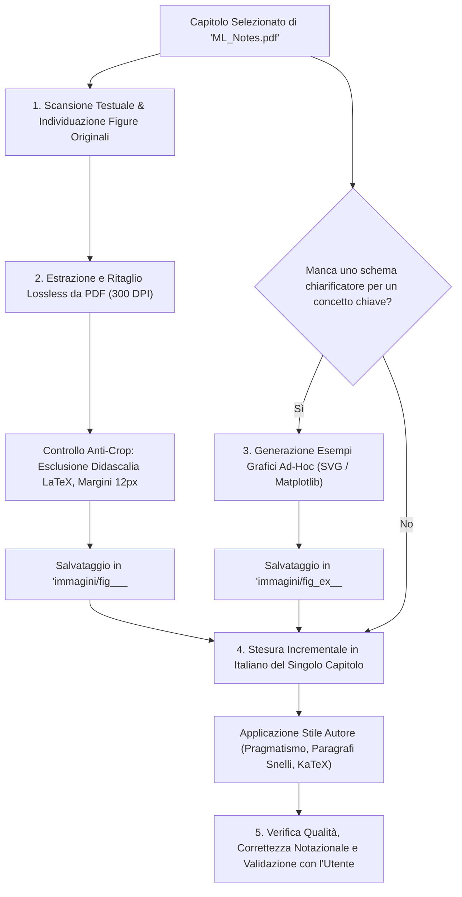

# Guida alla Redazione degli Appunti di Machine Learning
> Corso di Laurea Magistrale in Ingegneria Informatica e Robotica — Anno 1
> Docente: Prof. Gabriele Costante | Riferimento Ufficiale: Dispense `ML_Notes.pdf`

## 1. Perimetro del Corso e Vincoli sui Contenuti

Questo documento definisce le linee guida operative, metodologiche e tipografiche per la redazione degli appunti della materia **Machine Learning** (Anno 1).

A differenza di altre materie del corso di laurea in cui il materiale d'esame è frammentato tra slide di presentazione, registrazioni orali e testi esterni di consultazione, Machine Learning dispone di un testo unico, autorevole e autosufficiente: le dispense del docente intitolate **_Machine Learning and Data Analysis Notes_** (`ML_Notes.pdf`, 225 pagine).

>[!IMPORTANT] Vincolo Tassativo: Esclusione di Contenuti Superflui ed Esterni
>Il docente d'esame valuterà gli studenti **esclusivamente sui temi, sulle dimostrazioni e sulle convenzioni notazionali presenti in `ML_Notes.pdf`**.
>1. **Zero Fuffa Esterna**: È severamente vietato introdurre formalismi, algoritmi collaterali, framework moderni o dimostrazioni alternative desunti da altre fonti (manuali esterni come Bishop, Murphy, Hastie o documentazione web) che non compaiano nel testo del professor Costante.
>2. **Fedeltà al Perimetro Ufficiale**: Tutto ciò che è richiesto all'esame si trova dentro `ML_Notes.pdf`. L'obiettivo degli appunti è rendere quel materiale chiaro, intuitivo, rigorosamente formalizzato in italiano e immediatamente fruibile per lo studio.

### Esclusione dei Contenuti Non d'Esame (Contrassegnati da Asterisco `*`)
Nelle dispense del corso, i capitoli o le sezioni contrassegnati da un asterisco (`*`) rappresentano approfondimenti teorici facoltativi che **non formano oggetto di verifica d'esame**:
- **Capitolo 6: Generalized Linear Models (GLMs)\***: Quadro teorico unificato tramite la famiglia esponenziale. Non è propedeutico ai capitoli successivi (Modelli Generativi, SVM, Reti Neurali) ed è **completamente escluso dalla stesura**.
- **Sezione 7.2.1: Naive Bayes for Multinomial Features\***: Trattazione estesa del Naive Bayes con feature multinomiali. Viene **omessa**, concentrando la stesura unicamente su Gaussian LDA/QDA e Naive Bayes bernoulliano standard.
- **Sezione 13.3: Expectation Maximization (EM-Algorithm)\***: Derivazione analitica dell'algoritmo EM con disuguaglianza di Jensen e divergenza KL. Viene **omessa**, limitando la trattazione dell'apprendimento non supervisionato a K-Means, K-Medoids e Mixture di Gaussiane (GMM) ad alto livello.

Di conseguenza, per Machine Learning **non si fa uso del file `zz. Argomenti extra.md`** per teorie esterne: tutti i contenuti d'esame sono contenuti nei file primari numerati.

## 2. Architettura dei File e Mappatura dei Capitoli d'Esame

La cartella della materia è organizzata in modo atomico, associando a ciascun capitolo d'esame un singolo file `.md`.

Seguendo lo standard del vault per liste con oltre 9 file, la progressione dei capitoli adotta l'ordinamento decimale `0..9` seguito da lettere maiuscole `A..C`, producendo **13 file d'esame sequenziali e continui**:

```text
Anno 1/Machine Learning/
├── 0. Notazione e Concetti Fondamentali.md
├── 1. Introduzione al Supervised Learning.md
├── 2. Teoria della Probabilita.md
├── 3. Regressione Lineare.md
├── 4. Algoritmi di Classificazione.md
├── 5. Modelli Generativi per la Classificazione.md
├── 6. Metodo dei Moltiplicatori di Lagrange.md
├── 7. Model Selection e Model Assessment.md
├── 8. Regressione Ridge e Lasso.md
├── 9. Support Vector Machines.md
├── A. Reti Neurali.md
├── B. Apprendimento Non Supervisionato.md
├── C. PCA e ICA.md
├── GUIDA_APPUNTI_MACHINE_LEARNING.md
├── dispense/
│   └── ML_Notes.pdf
└── immagini/
    ├── fig_...png
    └── fig_ex_...png
```

### Tabella di Corrispondenza Capitoli

| File Markdown | Capitolo Dispensa Originale | Pagine `ML_Notes.pdf` | Contenuti Fondamentali d'Esame |
| :--- | :--- | :---: | :--- |
| `0. Notazione e Concetti Fondamentali.md` | Chapter 1 (Notation) | 8–11 | Vettori colonna $\mathbf{x} \in \mathbb{R}^{D \times 1}$, matrice dei dati $\mathbf{X} \in \mathbb{R}^{N \times D}$, target reale $y$ vs misurato $t$, stima $\hat{y}$, tassonomia delle variabili (continue, discrete, ordinali, nominali), nozione di campione $(\mathbf{x}^{(i)}, y^{(i)})$ e dataset $\mathcal{D}$. |
| `1. Introduzione al Supervised Learning.md` | Chapter 2 | 12–24 | Paradigma data-driven vs model-based, classificazione vs regressione, Polynomial Curve Fitting con errore quadratico, overfitting e grado del polinomio $M$, regolarizzazione $L_2$ con iperparametro $\lambda$, model selection con validation set e cross-validation. |
| `2. Teoria della Probabilita.md` | Chapter 3 | 25–44 | Probabilità congiunta, marginale e condizionata, Teorema di Bayes (prior, likelihood, posterior, evidence), problema di Monty Hall, indipendenza stocastica, variabili continue (PDF, cambio di variabile), media e varianza, formulazione probabilistica del Curve Fitting: Maximum Likelihood Estimation (MLE) e Maximum a Posteriori (MAP). |
| `3. Regressione Lineare.md` | Chapter 4 | 45–71 | Modelli lineari nei parametri con funzioni base $\phi_j(\mathbf{x})$, derivazione analitica MLE, Hat Matrix $\mathbf{H}$ e interpretazione geometrica (proiezione ortogonale nello spazio dei campioni), Gradient Descent (learning rate $\alpha$, convergenza), standard error dei parametri, coefficiente $R^2$, non-idealità dei dati (eteroschedasticità, outlier, High-Leverage Points) e collinearità. |
| `4. Algoritmi di Classificazione.md` | Chapter 5 | 72–93 | Funzioni di perdita (0-1 loss) e Bayesian Error Rate (limite inferiore teorico), K-NN Classifier e scelta di $k$, Regressione Logistica (funzione sigmoide, derivazione della likelihood e funzione di decisione), Perceptron di Rosenblatt, classificazione multi-classe (One-vs-One e One-vs-All), metriche di valutazione (Accuracy, Precision, Recall, F1-Score, Matrice di Confusione, curva ROC e AUC). |
| `5. Modelli Generativi per la Classificazione.md` | Chapter 7 (no 7.2.1\*) | 103–123 | Modelli discriminativi vs generativi, densità condizionate gaussiane, Linear Discriminant Analysis (LDA con covarianza condivisa) e derivazione decision boundary lineare, Quadratic Discriminant Analysis (QDA), stima MLE dei parametri per LDA, Naive Bayes discreto (ipotesi di indipendenza condizionale), correzione di Laplace smoothing, modello Bag of Words (BoW). |
| `6. Metodo dei Moltiplicatori di Lagrange.md` | Chapter 8 | 124–130 | Ottimizzazione con vincoli di uguaglianza, ortogonalità dei gradienti $\nabla f$ e $\nabla h$, formulazione del Lagrangiano $\mathcal{L}(\mathbf{x}, \lambda)$, estensione a vincoli di disuguaglianza $g(\mathbf{x}) \le 0$, significato geometrico delle condizioni KKT. |
| `7. Model Selection e Model Assessment.md` | Chapter 9 | 131–144 | Decomposizione analitica del Mean Squared Error: Bias quadratico, Varianza ed Errore Irriducibile ($\sigma^2$), comportamento asintotico per K-NN e Linear Regression, curve empiriche dell'errore al variare dei gradi di libertà, protocolli di validazione (Hold-out, K-Fold Cross-Validation, Leave-One-Out) e curve di apprendimento al variare di $N$. |
| `8. Regressione Ridge e Lasso.md` | Chapter 10 | 145–155 | Vincolo di regolarizzazione quadratica ($L_2$) nella regressione lineare (Ridge), risoluzione analitica con matrice di covarianza regolarizzata, numero effettivo di parametri $\text{df}(\lambda)$, analisi di bias e varianza in Ridge, regolarizzazione $L_1$ (Lasso) e proprietà di sparsità dei coefficienti (interpretazione geometrica tra contorni di livello ellittici e politopo a rombo). |
| `9. Support Vector Machines.md` | Chapter 11 | 156–180 | Iperpiano separatore ottimo a massimo margine, margine funzionale vs margine geometrico, Hard-Margin SVM come problema di ottimizzazione convessa quadratica (QP), dualità di Lagrange e individuazione dei vettori di supporto ($\alpha_i > 0$), Kernel Trick (teorema di Mercer, kernel lineare, polinomiale, RBF gaussiano), Soft-Margin SVM con variabili di slack $\xi_i$ e parametro di penalità $C$. |
| `A. Reti Neurali.md` | Chapter 12 | 181–201 | Limiti dei modelli lineari e introduzione al Multi-Layer Perceptron (MLP), funzioni di attivazione non lineari (ReLU, Sigmoide), algoritmo di Backpropagation con applicazione ricorsiva della Chain Rule (caso 1 neurone, 2 layer e formulazione matriciale MLP), funzioni di perdita (BCE e Cross-Entropy con Softmax), tecniche di regolarizzazione: Weight Decay ($L_2$) ed Early Stopping sul validation set. |
| `B. Apprendimento Non Supervisionato.md` | Chapter 13 (no 13.3\*) | 202–211 | Tassonomia dell'apprendimento non supervisionato, clustering partizionale, algoritmo K-Means (funzione di distorsione, ciclo di ottimizzazione a coordinate alternate, sensibilità all'inizializzazione e minimi locali), variante K-Medoids per robustezza a outlier e distanze arbitrarie, Gaussian Mixture Models (GMM) e concetto intuitivo di probabilità di appartenenza soft (responsabilità). |
| `C. PCA e ICA.md` | Chapter 14 | 217–224 | Riduzione della dimensionalità non supervisionata, Principal Component Analysis (PCA: massimizzazione della varianza proiettata, minimizzazione dell'errore di ricostruzione quadratico, autovalori e autovettori della matrice di covarianza empirica $\mathbf{X}^T\mathbf{X}$), Independent Component Analysis (ICA: separazione cieca di sorgenti statisticamente indipendenti e non gaussiane, ambiguità intrinseche di scala e permutazione). |

## 3. Pipeline Operativa Adattata per Dispensa e Apprendimento Visivo

La pipeline di Machine Learning differisce radicalmente da quella delle materie basate su presentazioni a slide (come Autonomous Robotics o DSP).



### 3.1 Flusso Incrementale: Un Capitolo per Volta
Per massimizzare l'efficacia dello studio e consentire una revisione puntuale:
1. **Divieto di Stesura Massiva Simultanea**: È fatto divieto di redigere l'intero programma o blocchi di più capitoli in una singola sessione.
2. **Ciclo Singolo Capitolo**:
   - Si seleziona un capitolo (es. `0. Notazione e Concetti Fondamentali.md`).
   - Si estraggono le relative figure e si creano gli eventuali grafici didattici integrativi.
   - Si redige il testo completo in italiano, verificando la coerenza delle formule.
   - Si conclude la sessione presentando il lavoro all'utente per la revisione, prima di passare al capitolo successivo.

### 3.2 Estrazione e Pulizia delle Figure della Dispensa
Le figure presenti nel PDF del professor Costante (grafici vettoriali, curve di errore, matrici di confusione) sono il riferimento visivo primario:

1. **Rendering ad Alta Risoluzione**:
   - Si renderizza la pagina PDF interessata a 300 DPI tramite `pdftoppm`:
     ```bash
     pdftoppm -png -r 300 -f <pagina> -l <pagina> "Anno 1/Machine Learning/dispense/ML_Notes.pdf" scratch/page
     ```
   - In alternativa, per immagini bitmap incorporate (es. campioni MNIST), si estraggono direttamente tramite `pdfimages -png`.
2. **Ritaglio e Rimozione Tassativa della Didascalia LaTeX**:
   - È **obbligatorio escludere dal ritaglio la riga di didascalia LaTeX sottostante** (es. _"Figure 4.1: Geometric interpretation of the Linear Regression algorithm"_).
   - *Motivazione*: La didascalia in inglese duplica inutilmente il testo, appesantisce la grafica e introduce testo non tradotto. La spiegazione della figura va riscritta in italiano direttamente nel testo dell'appunto o in un callout dedicato.
   - *Inclusione Obbligatoria*: Devono invece essere mantenute integre tutte le etichette degli assi ($x$, $y$), le legende interne ai grafici e le formule inserite dentro l'area del grafico.
3. **Margini di Respiro e Anti-Crop**:
   - Mantenere sempre un padding pulito di 10–15 pixel bianchi attorno al grafico.
   - Verificare l'assenza di righe di testo adiacenti tagliate a metà.
4. **Naming Univoco**:
   - Le immagini originali estratte vanno salvate in `Anno 1/Machine Learning/immagini/` con il formato:
     ```text
     fig_<capitolo_originale>_<num_originale>_<descrizione_breve>.png
     ```
   - Esempi: `fig_2_1_mnist_digit.png`, `fig_4_1_interpretazione_geometrica.png`, `fig_11_9_support_vectors.png`.

### 3.3 Generazione di Immagini ed Esempi Grafici Ad-Hoc
La dispensa del professore è rigorosa ma in alcuni passaggi teorici manca di supporti visivi che rendano intuitivo il concetto. In questi casi è **buona norma e caldamente consigliato integrare immagini ed esempi grafici dedicati**:

1. **Quando Creare un'Immagine Didattica**:
   - *Forma e dimensioni di vettori e matrici*: visualizzare chiaramente la moltiplicazione tra $\mathbf{X}$ ($N \times D$) e $\mathbf{w}$ ($D \times 1$).
   - *Iperpiani e separatori*: mostrare graficamente la differenza tra decision boundary lineari e non lineari in 2D/3D.
   - *Confronto geometrico di vincoli*: visualizzare i contorni di livello ellittici della loss a confronto con il rombo $L_1$ (spigoli $\to$ sparsità) e il cerchio $L_2$.
   - *Pipeline e grafi computazionali*: mostrare il flusso in avanti (forward) e all'indietro (backpropagation) del gradiente nelle reti neurali.
2. **Strumenti di Generazione**:
   - Schemi vettoriali in **SVG** puliti, con etichette chiare e colori armoniosi.
   - Grafici generati tramite script **Python (Matplotlib/Seaborn)** salvati a 300 DPI con sfondo bianco puro.
3. **Naming dei Grafici di Esempio**:
   - Salvare in `Anno 1/Machine Learning/immagini/` con il prefisso `fig_ex_` oppure `schema_`:
     ```text
     fig_ex_<capitolo>_<descrizione>.png
     schema_<capitolo>_<descrizione>.svg
     ```
   - Esempio: `fig_ex_4_geometria_hat_matrix.png`, `schema_12_backprop_flusso.svg`, `fig_ex_10_lasso_vs_ridge_vincoli.png`.

## 4. Convenzioni Notazionali del Docente (Capitolo 1)

Per evitare discrepanze matematiche durante lo studio, ogni formula negli appunti deve aderire strettamente al formalismo stabilito nel Capitolo 1 di `ML_Notes.pdf`:

1. **Variabili Scalari**:
   - Indicate con lettere minuscole in corsivo: $x, y, w, \theta \in \mathbb{R}$.
2. **Vettori (Sempre Vettori Colonna)**:
   - Indicati in grassetto corsivo $\mathbf{x} \in \mathbb{R}^{D \times 1}$.
   - Le componenti sono indicizzate a partire da $0$ fino a $D-1$:
     $$
     \mathbf{x} = \begin{bmatrix} x_0 \\ x_1 \\ \vdots \\ x_{D-1} \end{bmatrix} \in \mathbb{R}^{D \times 1}
     $$
   - Se occorre un vettore riga, si usa tassativamente il trasposto: $\mathbf{x}^T = \begin{bmatrix} x_0 & x_1 & \dots & x_{D-1} \end{bmatrix} \in \mathbb{R}^{1 \times D}$.
3. **Matrici (Dataset e Trasformazioni)**:
   - Indicate con lettere maiuscole in grassetto: $\mathbf{X} \in \mathbb{R}^{N \times D}$.
   - $N$ rappresenta sempre il numero di campioni (righe).
   - $D$ rappresenta sempre il numero di feature (colonne).
4. **Parametri del Modello**:
   - Vengono indicati con $\mathbf{w}$ oppure $\boldsymbol{\theta}$ (in grassetto minuscolo se vettoriali, maiuscolo se matriciali).
5. **Variabili di Input (Feature) e Output (Target/Label)**:
   - $\mathbf{x} \in \mathbb{R}^{D \times 1}$: vettore delle feature di ingresso.
   - $y \in \mathbb{R}$ (o $y \in \mathcal{S}$ discreto): valore target reale e ideale (inaccessibile nella realtà).
   - $t \in \mathbb{R}$: misura rumorosa osservata associata a $y$ disponibile nel dataset ($t = y + \epsilon$).
   - $\hat{y}$: predizione o stima calcolata dal modello di machine learning ($\hat{y} = f(\mathbf{x}; \mathbf{w})$).
6. **Campione e Dataset**:
   - Singolo campione supervisionato: coppia $(\mathbf{x}^{(i)}, y^{(i)})$ oppure $(\mathbf{x}^{(i)}, t^{(i)})$.
   - L'indice del campione è posizionato all'apice tra parentesi tonde: $\mathbf{x}^{(i)}$ indica l'$i$-esimo campione ($i = 0, \dots, N-1$).
   - Dataset di addestramento: $\mathcal{D}_{\text{train}} = \{(\mathbf{x}^{(0)}, t^{(0)}), \dots, (\mathbf{x}^{(N-1)}, t^{(N-1)})\}$.
7. **Tassonomia dei Dati**:
   - *Continue*: a valori in $\mathbb{R}$.
   - *Discrete*: a valori in un sottoinsieme finito $\mathcal{S} \subset \mathbb{N}$ o $\mathbb{Z}$.
   - *Nominali*: categorie non numeriche prive di ordinamento intrinseco (es. `{Ingegnere, Medico, Avvocato}`).
   - *Ordinali*: categorie non numeriche ma dotate di ordinamento concettuale (es. `{Basso Rischio, Medio Rischio, Alto Rischio}`).

## 5. Regole Tipografiche e Stile di Scrittura del Vault

Tutti i documenti `.md` di Machine Learning devono uniformarsi senza eccezioni agli standard tipografici del vault:

### 5.1 Numerazione dei Titoli (Regola Assoluta: Solo H1 è Numerato)
- **Heading H1 (Titolo del Documento)**: È l'unico e solo livello con numero di capitolo e deve corrispondere esattamente al nome del file (senza estensione `.md`):
  ```markdown
  # 3. Regressione Lineare
  ```
- **Tutti gli altri Heading (da H2 a H6)**: Devono essere **puramente descrittivi, senza numeri, lettere o prefissi ordinali**:
  - Corretto: `## Interpretazione Geometrica della Hat Matrix`, `### Derivazione del Gradiente`.
  - Vietato: `## 3.1 Interpretazione`, `### Sezione 2`, `### 1. Primo Passo`.
- **Title Case**: I titoli principali devono adottare la capitalizzazione Title Case.

### 5.2 Sintassi Tipografica e Linter
- **Grassetto**: usare tassativamente il doppio underscore `__termine importante__`.
- **Corsivo**: usare il singolo underscore `_termine_`.
- **Puntini di sospensione**: carattere Unicode ellissi `…` (non tre punti `...`).
- **Divieto delle Linee Orizzontali (`---`)**: non inserire mai righe divisorie `---` all'interno dei file di appunto. La scansione visiva è affidata unicamente agli heading e alle righe vuote di respiro.

### 5.3 Gestione delle Immagini e Snippet CSS `titoli.css`
- **Nessuna immagine nuda**: ogni immagine deve includere `center` e la classe di scala appropriata.
- **Classi supportate**:
  - `small` (45%): taglia di default prioritaria per grafici semplici, diagrammi e schemi compatti.
  - `mid` (70%): per grafici ricchi di etichette, curve multiple o assi con numeri dettagliati.
  - `big` (90%): per pipeline composite a più stadi o confronti multi-pannello.
- **Affiancamento Obbligatorio per Immagini `small` Consecutive**:
  Quando due immagini `small` compaiono in sequenza, **devono essere inserite sulla stessa riga di testo separate da un singolo spazio**:
  ```markdown
  ![[fig_ex_10_ridge_cerchio.png|center small]] ![[fig_ex_10_lasso_rombo.png|center small]]
  ```
  Lo snippet CSS `titoli.css` le posizionerà automaticamente affiancate in orizzontale al 45% ciascuna, eliminando spazi vuoti verticali.

### 5.4 Integrità degli Elenchi Puntati e Numerati
- Un elenco puntato o numerato **deve essere completato integralmente prima di inserire callout, immagini o blocchi matematici estesi**.
- È severamente vietato interrompere una lista a metà (es. punto 1, poi un'immagine o callout, poi punto 2). Eventuali figure di commento vanno posizionate immediatamente al termine della lista completa.

### 5.5 Stile dell'Autore e Comprensibilità
- **Lingua Italiana**: Testo redatto interamente in italiano, traducendo e rielaborando ogni paragrafo della dispensa originale (mantenendo in inglese solo termini tecnici universali come *overfitting*, *bias-variance tradeoff*, *feature*, *early stopping*, *regularization*).
- **Voce in Prima Persona Naturale**: Alternare prima persona singolare (*"ho un dataset"*, *"se calcolo la derivata ottengo"*) e plurale (*"abbiamo visto"*, *"possiamo interpretare"*).
- **Pragmatismo Ingegneristico e Zero Fuffa**:
  - Evitare aperture pompose o cerimoniali accademici.
  - Spiegare il *perché* geometrico e concettuale prima di buttare giù la formula analitica.
  - Paragrafi agili e snelli (da 1 a 4 righe al massimo).
- **Callout Mirati**:
  - `>[!NOTE]`: chiarimenti operativi, convenzioni o dettagli implementativi.
  - `>[!IMPORTANT]`: condizioni matematiche cruciali, limiti teorici, proprietà d'esame.
  - `>[!EXAMPLE]`: esempi numerici o geometrici applicati.

## 6. Checklist di Controllo Qualità per Machine Learning

Prima di ritenere completato un capitolo della materia:
- [ ] **Fedeltà al Perimetro Ufficiale**: I contenuti provengono unicamente da `ML_Notes.pdf`, senza aggiunte di nozioni superflue esterne.
- [ ] **Esclusione Contenuti con Asterisco (`*`)**: Non sono state inserite sezioni facoltative contrassegnate da `*` (Capitolo 6 GLMs, Sezione 7.2.1, Sezione 13.3).
- [ ] **Nome File e H1 Allineati**: Il titolo `# N. Titolo` corrisponde esattamente al nome del file `.md`.
- [ ] **Solo H1 Numerato**: Nessun heading da H2 in giù contiene numeri decimali o prefissi numerati.
- [ ] **Immagini della Dispensa Pulite**: Tutte le figure estratte dal PDF sono ad alta risoluzione (300 DPI), hanno la didascalia LaTeX rimossa, includono etichette e assi, e presentano margini bianchi puliti.
- [ ] **Supporto Visivo Integrativo**: Concetti astratti o geometrici privi di figure nel PDF sono stati arricchiti con grafici didattici ad-hoc (`fig_ex_...png` o `schema_...svg`).
- [ ] **Centratura e Dimensionamento Immagini**: Tutte le immagini hanno `|center small`, `|center mid` o `|center big`.
- [ ] **Affiancamento Immagini Small Consecutive**: Le immagini `small` consecutive sono posizionate sulla stessa riga separate da uno spazio.
- [ ] **Notazione Rigorosa del Docente**: Rispetto puntuale delle convenzioni di `0. Notazione e Concetti Fondamentali` ($\mathbf{x}$ vettore colonna, $\mathbf{X} \in \mathbb{R}^{N \times D}$, $y$ vs $t$, $\hat{y}$, $\mathbf{w}$ / $\boldsymbol{\theta}$).
- [ ] **Sintassi Tipografica Linter**: Utilizzo di `__grassetto__`, `_corsivo_` e `…`.
- [ ] **Assenza di Linee Orizzontali**: Nessun separatore `---` presente nel corpo del testo.
- [ ] **Integrità degli Elenchi**: Nessun elenco interrotto a metà da blocchi grafici o callout.
- [ ] **Ritmo e Comprensibilità**: Testo scorrevole, paragrafi brevi (1-4 righe), prima persona ingegneristica, spiegazione intuitiva prima delle formule analitiche.
- [ ] **Revisione con l'Utente**: Il capitolo è stato concluso e presentato all'utente per la validazione prima di passare al capitolo successivo.
