# 0. Fondamenti Di Stima Classica E Limite Di Cramer-Rao

Nell'elaborazione statistica dei segnali e dei sistemi di telecomunicazione, il problema fondamentale della __stima dei parametri__ consiste nel determinare il valore numerico di grandezze fisiche non direttamente accessibili partendo da un insieme finito di misure corrotte da rumore. Pensiamo alla localizzazione radar di un bersaglio, alla stima del canale trasmissivo in un collegamento 5G o alla ricostruzione tomografica: in tutti questi scenari captiamo una forma d'onda disturbata e vogliamo estrarre i parametri incogniti con la massima accuratezza e affidabilità possibile.

Il paradigma della __stima classica__ (o deterministica) assume che i parametri da stimare siano costanti deterministiche ignote, prive di una distribuzione di probabilità a priori. A partire dalle metriche fondamentali di prestazione statistica e dall'analisi del compromesso tra polarizzazione e dispersione, il criterio di ottimalità a minima varianza (__MVU__) trova il proprio limite prestazionale invalicabile nel __limite inferiore di Cramer-Rao__ (__CRLB__, _Cramer-Rao Lower Bound_).

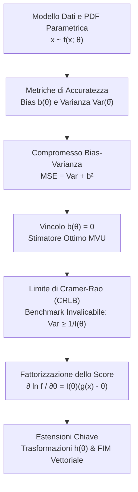

## Il Problema Della Stima E Modello Dei Dati

Supponiamo di acquisire una sequenza di $N$ campioni discreti nel tempo o nello spazio, che raccogliamo ordinatamente in un vettore colonna delle osservazioni $\mathbf{x} \in \mathbb{R}^{N}$:

$$
\mathbf{x} = \begin{bmatrix} x[0] \\ x[1] \\ \vdots \\ x[N-1] \end{bmatrix}
$$

I dati osservati dipendono da un parametro continuo incognito $\theta \in \mathbb{R}$ (oppure da un vettore di parametri $\boldsymbol{\theta} \in \mathbb{R}^{P}$). Descriviamo l'incertezza statistica delle misure mediante la funzione di densità di probabilità (__PDF__) congiunta parametrica $f_{\mathbf{x}}(\mathbf{x}; \theta)$.

La notazione con il punto e virgola racchiude il cardine epistemologico della stima classica: $\theta$ non è una variabile aleatoria su cui stiamo condizionando, ma un parametro deterministico fisso e ignoto che modella e governa la forma della distribuzione dei dati.

Uno __stimatore__ $\hat{\theta}$ è una funzione matematica o algoritmo deterministico che mappa il vettore delle osservazioni $\mathbf{x}$ in una stima numerica plausibile del parametro:

$$
\hat{\theta} = g(\mathbf{x}) = g(x[0], x[1], \dots, x[N-1])
$$

Poiché le misure $\mathbf{x}$ fluttuano casualmente per effetto del disturbo additivo, anche lo stimatore $\hat{\theta} = g(\mathbf{x})$ è a tutti gli effetti una __variabile aleatoria__, provvista di una propria densità di probabilità $f_{\hat{\theta}}(\hat{\theta}; \theta)$, con un proprio valore atteso e una propria dispersione attorno alla media.

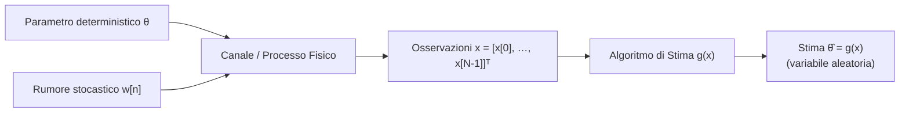

> [!NOTE] Stima Classica vs Stima Bayesiana
> - Nella __stima classica__, il parametro $\theta$ è una costante deterministica ignota. Non possiamo attribuirgli alcuna distribuzione a priori: l'incertezza risiede unicamente nel rumore che corrompe le misure attraverso la PDF parametrica $f_{\mathbf{x}}(\mathbf{x}; \theta)$.
> - Nella __stima bayesiana__, il parametro $\theta$ è modellato esplicitamente come una variabile aleatoria descritta da una PDF a priori $f_{\theta}(\theta)$, che formalizza la nostra conoscenza prima ancora di acquisire i dati.

## Errore Di Stima, Polarizzazione E Varianza

Definiamo l'__errore di stima__ $e$ come lo scarto algebrico tra il valore fornito dal nostro algoritmo e il valore vero del parametro:

$$
e = \hat{\theta} - \theta
$$

Essendo $\hat{\theta}$ una quantità stocastica, anche l'errore $e$ è una variabile aleatoria. Per giudicare la bontà di uno stimatore dobbiamo analizzare la distribuzione dell'errore attraverso i suoi momenti statistici fondamentali: la media e la varianza.

### Polarizzazione (Bias)

Il __bias__ (o polarizzazione) rappresenta il valore atteso dell'errore di stima e quantifica l'eventuale tendenza dell'algoritmo a deviare sistematicamente dal valore reale:

$$
b(\theta) = \mathbb{E}[\hat{\theta}] - \theta = \mathbb{E}[e] = \int_{\mathbb{R}^N} g(\mathbf{x}) f_{\mathbf{x}}(\mathbf{x}; \theta) \mathrm{d}\mathbf{x} - \theta
$$

Uno stimatore si dice __non polarizzato__ (o corretto, _unbiased_) se il suo baricentro coincide esattamente con il valore vero per qualsiasi configurazione possibile del parametro:

$$
b(\theta) = 0 \iff \mathbb{E}[\hat{\theta}] = \theta \quad \forall \theta
$$

Se esiste anche un solo valore ammissibile di $\theta$ per cui $b(\theta) \neq 0$, lo stimatore è classificato come __polarizzato__ (_biased_).

### Varianza Dello Stimatore

La __varianza__ misura l'ampiezza dell'errore casuale, quantificando quanto le stime si disperdono attorno al loro valor medio $\mathbb{E}[\hat{\theta}]$ al variare delle realizzazioni del rumore:

$$
\text{Var}\{\hat{\theta}\} = \mathbb{E}\left[ (\hat{\theta} - \mathbb{E}[\hat{\theta}])^2 \right] = \int_{\mathbb{R}^N} (g(\mathbf{x}) - \mathbb{E}[\hat{\theta}])^2 f_{\mathbf{x}}(\mathbf{x}; \theta) \mathrm{d}\mathbf{x}
$$

Quando lo stimatore è non polarizzato ($\mathbb{E}[\hat{\theta}] = \theta$), la varianza coincide direttamente con il valore atteso dell'errore quadratico:

$$
\text{Var}\{\hat{\theta}\} = \mathbb{E}\left[ (\hat{\theta} - \theta)^2 \right]
$$

Uno stimatore ideale deve concentrare la propria massa di probabilità il più vicino possibile al parametro reale: deve possedere bias nullo e varianza minima.

> [!EXAMPLE] Stima del Livello DC in Rumore Bianco
> Immaginiamo di voler misurare una tensione continua costante immersa in un disturbo additivo:
>
> $$
> x[n] = \theta + w[n], \quad n = 0, 1, \dots, N-1
> $$
>
> dove $w[n]$ è rumore bianco a media nulla e varianza $\sigma^2$, incorrelato nel tempo ($\mathbb{E}[w[n]w[k]] = \sigma^2 \delta[n-k]$).
> Mettiamo a confronto tre possibili strategie di stima:
>
> 1. __Media campionaria__: $\hat{\theta}_1 = \frac{1}{N}\sum_{n=0}^{N-1} x[n] = \bar{x}$.
>    - Media: $\mathbb{E}[\hat{\theta}_1] = \frac{1}{N}\sum_{n=0}^{N-1} (\theta + \mathbb{E}[w[n]]) = \theta \implies b_1(\theta) = 0$ (non polarizzato).
>    - Varianza: $\text{Var}\{\hat{\theta}_1\} = \frac{1}{N^2}\sum_{n=0}^{N-1} \text{Var}\{w[n]\} = \frac{\sigma^2}{N}$. All'aumentare dei campioni ($N \to \infty$) la varianza collassa a zero (lo stimatore è consistente).
> 2. __Singola osservazione__: $\hat{\theta}_2 = x[0]$.
>    - Media: $\mathbb{E}[\hat{\theta}_2] = \theta \implies b_2(\theta) = 0$ (non polarizzato).
>    - Varianza: $\text{Var}\{\hat{\theta}_2\} = \sigma^2$. La dispersione resta costante e ignora completamente gli altri $N-1$ dati utili.
> 3. __Media campionaria dimezzata__: $\hat{\theta}_3 = \frac{1}{2N}\sum_{n=0}^{N-1} x[n] = \frac{1}{2}\hat{\theta}_1$.
>    - Media: $\mathbb{E}[\hat{\theta}_3] = \frac{\theta}{2} \implies b_3(\theta) = -\frac{\theta}{2} \neq 0$ (polarizzato).
>    - Varianza: $\text{Var}\{\hat{\theta}_3\} = \frac{1}{4}\text{Var}\{\hat{\theta}_1\} = \frac{\sigma^2}{4N}$. La dispersione è quattro volte inferiore a quella della media campionaria, ma al prezzo inaccettabile di sottostimare sistematicamente la grandezza del 50%.

## Compromesso Tra Bias E Varianza E l'Errore Quadratico Medio (MSE)

Per quantificare l'errore globale combinando errore sistematico ed errore casuale in un'unica metrica scalare, adottiamo il __Mean Squared Error__ (__MSE__), o errore quadratico medio:

$$
\text{MSE}\{\hat{\theta}\} = \mathbb{E}\left[ (\hat{\theta} - \theta)^2 \right]
$$

Scomponiamo lo scarto sommando e sottraendo il baricentro dello stimatore $\mathbb{E}[\hat{\theta}]$ all'interno del quadrato:

$$
\hat{\theta} - \theta = (\hat{\theta} - \mathbb{E}[\hat{\theta}]) + (\mathbb{E}[\hat{\theta}] - \theta) = (\hat{\theta} - \mathbb{E}[\hat{\theta}]) + b(\theta)
$$

Elevando al quadrato e applicando l'operatore di valore atteso:

$$
\begin{aligned}
\text{MSE}\{\hat{\theta}\} &= \mathbb{E}\left[ \left( (\hat{\theta} - \mathbb{E}[\hat{\theta}]) + b(\theta) \right)^2 \right] \\
&= \mathbb{E}\left[ (\hat{\theta} - \mathbb{E}[\hat{\theta}])^2 \right] + 2 b(\theta) \mathbb{E}\left[ \hat{\theta} - \mathbb{E}[\hat{\theta}] \right] + b^2(\theta)
\end{aligned}
$$

Esaminiamo il termine misto di doppio prodotto: per linearità del valore atteso abbiamo $\mathbb{E}[\hat{\theta} - \mathbb{E}[\hat{\theta}]] = \mathbb{E}[\hat{\theta}] - \mathbb{E}[\hat{\theta}] = 0$. Il termine si annulla identicamente, portandoci alla fondamentale __decomposizione del Mean Squared Error__:

$$
\text{MSE}\{\hat{\theta}\} = \text{Var}\{\hat{\theta}\} + b^2(\theta)
$$

L'MSE è la somma algebrica esatta di due contributi tra loro ortogonali: la dispersione casuale delle misure attorno al proprio valor medio e l'offset sistematico rispetto alla verità.

![[slide_17_bias_variance_targets.png|center mid]]

La classica metafora dei tiri al bersaglio rende intuitivo il significato geometrico delle quattro combinazioni:
- __Basso bias e bassa varianza__ (in alto a sinistra): le stime sono concentrate densamente sul centro del bersaglio. È la condizione di massima accuratezza cercata in ogni progetto.
- __Basso bias ed elevata varianza__ (in basso a sinistra): il baricentro dei colpi è perfettamente centrato sul bersaglio, ma i singoli tiri sono ampiamente dispersi per via del forte rumore casuale.
- __Alto bias e bassa varianza__ (in alto a destra): i tiri sono compatti e altamente ripetibili, ma raggruppati lontano dal bersaglio a causa di un errore sistematico di taratura.
- __Alto bias ed elevata varianza__ (in basso a destra): dispersione caotica priva sia di accuratezza che di precisione.

### Il Dilemma Della Minimizzazione Diretta dell'MSE

Se il nostro traguardo naturale è minimizzare l'errore quadratico totale, per quale motivo nella stima classica non cerchiamo direttamente la funzione $g(\mathbf{x})$ che minimizza l'$\text{MSE}\{\hat{\theta}\}$?

Consideriamo lo stimatore banale costante $\hat{\theta}_0 = c$ (ad esempio $\hat{\theta}_0 = 5$), che ignora del tutto i dati osservati. La sua varianza è identicamente nulla ($\text{Var}\{\hat{\theta}_0\} = 0$) e il suo bias vale $b(\theta) = 5 - \theta$. Il suo errore quadratico medio è dunque:

$$
\text{MSE}\{\hat{\theta}_0\} = (5 - \theta)^2
$$

Se per puro caso il parametro reale vale $\theta = 5$, questo stimatore registra $\text{MSE} = 0$, battendo qualsiasi algoritmo sofisticato basato sull'elaborazione dei dati. Se però il parametro reale vale $\theta = 100$, l'errore diventa catastrofico.

Se impostiamo formalmente la minimizzazione libera di $\text{MSE}\{\hat{\theta}\} = \text{Var}\{\hat{\theta}\} + b^2(\theta)$ rispetto alla regola $g(\mathbf{x})$, lo stimatore matematicamente ottimo risultante finisce per __dipendere esplicitamente dal parametro incognito $\theta$__. Uno stimatore che per essere calcolato richiede di conoscere a priori il valore vero che si intende stimare è concettualmente circolare e fisicamente irrealizzabile.

> [!IMPORTANT] Il Trabocchetto dell'MSE Diretto all'Esame
> All'orale viene spesso chiesto: _"Perché non minimizziamo direttamente l'MSE nella stima classica?"_
> La risposta chiave è duplice:
> 1. La minimizzazione non vincolata genera stimatori ottimi che dipendono dal parametro incognito $\theta$, rendendoli non calcolabili a partire dai soli dati $\mathbf{x}$.
> 2. Senza vincoli, stimatori costanti banali registrerebbero MSE pari a zero in singoli punti isolati di $\theta$, impedendo di definire una nozione coerente di ottimalità globale.

## Lo Stimatore a Minima Varianza Non Polarizzato (MVU)

Per sciogliere questo paradosso, nella teoria della stima classica si impone a priori il vincolo di __non polarizzazione__:

$$
b(\theta) = 0 \quad \forall \theta \implies \text{MSE}\{\hat{\theta}\} = \text{Var}\{\hat{\theta}\}
$$

Azzerando il bias su tutto lo spazio dei parametri ammissibili, l'MSE collassa sulla varianza. Il problema di ottimizzazione diventa matematicamente ben posto: cerchiamo uno stimatore $\hat{\theta} = g(\mathbf{x})$ che soddisfi due condizioni congiunte:
1. Sia non polarizzato su tutto il dominio: $\mathbb{E}[\hat{\theta}] = \theta, \; \forall \theta$.
2. Abbia varianza inferiore o uguale a quella di qualunque altro stimatore corretto concorrente $\tilde{\theta}$, per ogni possibile valore di $\theta$:

$$
\text{Var}\{\hat{\theta}\} \le \text{Var}\{\tilde{\theta}\} \quad \forall \theta
$$

Uno stimatore che soddisfa questo duplice criterio prende il nome di __stimatore MVU__ (__Minimum Variance Unbiased Estimator__).

> [!NOTE] Superiorità Uniforme dell'MVU
> La condizione di dominanza $\text{Var}\{\hat{\theta}\} \le \text{Var}\{\tilde{\theta}\}$ deve valere per qualsiasi valore del parametro $\theta$ (__uniformemente__). Non è ammissibile che uno stimatore sia migliore per un sottoinsieme di valori e peggiore per un altro: l'MVU deve dominare l'intero dominio parametrico.

La ricerca dell'MVU si scontra però con due ostacoli operativi:
- Lo stimatore MVU potrebbe non esistere: due stimatori non polarizzati distinti potrebbero incrociare le proprie curve di varianza al variare di $\theta$, senza che nessuno domini uniformemente l'altro.
- Anche qualora esista, non disponiamo in generale di un metodo di derivazione diretta per ricavare la funzione $g(\mathbf{x})$ ottima a partire dalla sola definizione.

Per queste ragioni, prima di ricercare lo stimatore ottimo, occorre stabilire un __limite teorico invalicabile__ contro cui misurare le prestazioni di qualsiasi algoritmo candidato. Tale benchmark universale è il limite inferiore di Cramer-Rao.

## Il Limite Inferiore Di Cramer-Rao (CRLB)

Il __Cramer-Rao Lower Bound__ (__CRLB__) stabilisce il limite inferiore assoluto per la varianza di qualsiasi stimatore non polarizzato. Se individuiamo uno stimatore corretto la cui varianza eguaglia il CRLB, abbiamo la certezza matematica immediata che si tratta dell'MVU, senza dover esaminare alcun altro algoritmo concorrente.

### Condizione Di Regolarità

Il CRLB è valido sotto l'ipotesi che la funzione di densità di probabilità parametrica $f_{\mathbf{x}}(\mathbf{x}; \theta)$ soddisfi la __condizione di regolarità__:

$$
\mathbb{E}\left[ \frac{\partial \ln f_{\mathbf{x}}(\mathbf{x}; \theta)}{\partial \theta} \right] = 0 \quad \forall \theta
$$

La derivata logaritmica della verosimiglianza rispetto al parametro prende il nome di __funzione di score__ $S(\mathbf{x}; \theta)$:

$$
S(\mathbf{x}; \theta) = \frac{\partial \ln f_{\mathbf{x}}(\mathbf{x}; \theta)}{\partial \theta}
$$

La condizione di regolarità esprime semplicemente che il valor medio della funzione di score deve essere identicamente nullo per ogni configurazione di $\theta$.

> [!NOTE] Quando Vale la Condizione di Regolarità?
> Esplicitiamo il valore atteso della derivata logaritmica ricordando che $\frac{\partial \ln f}{\partial \theta} = \frac{1}{f} \frac{\partial f}{\partial \theta}$:
>
> $$
> \mathbb{E}\left[ \frac{\partial \ln f_{\mathbf{x}}(\mathbf{x}; \theta)}{\partial \theta} \right] = \int_{\mathcal{X}} \frac{1}{f_{\mathbf{x}}(\mathbf{x}; \theta)} \frac{\partial f_{\mathbf{x}}(\mathbf{x}; \theta)}{\partial \theta} f_{\mathbf{x}}(\mathbf{x}; \theta) \mathrm{d}\mathbf{x} = \int_{\mathcal{X}} \frac{\partial f_{\mathbf{x}}(\mathbf{x}; \theta)}{\partial \theta} \mathrm{d}\mathbf{x}
> $$
>
> Se è lecito invertire l'ordine tra integrazione e derivazione (regola di Leibniz per la derivazione sotto il segno di integrale), troviamo:
>
> $$
> \int_{\mathcal{X}} \frac{\partial f_{\mathbf{x}}(\mathbf{x}; \theta)}{\partial \theta} \mathrm{d}\mathbf{x} = \frac{\partial}{\partial \theta} \int_{\mathcal{X}} f_{\mathbf{x}}(\mathbf{x}; \theta) \mathrm{d}\mathbf{x} = \frac{\partial}{\partial \theta} (1) = 0
> $$
>
> L'inversione è valida a patto che il supporto $\mathcal{X} = \{\mathbf{x} : f_{\mathbf{x}}(\mathbf{x}; \theta) > 0\}$ __non dipenda dal parametro incognito $\theta$__.
> - In una distribuzione uniforme $x[n] \sim \mathcal{U}[0, \theta]$, il supporto $[0, \theta]$ varia con $\theta$: la regolarità cade e il CRLB classico non è applicabile (in questi casi la varianza può decadere come $1/N^2$).
> - Nei modelli a rumore gaussiano con media o varianza incognita, il supporto coincide con tutto $\mathbb{R}^N$: la regolarità è pienamente soddisfatta.

### Informazione Di Fisher

L'__Informazione di Fisher__ $I(\theta)$ quantifica la quantità di informazione statistica che le osservazioni $\mathbf{x}$ trasportano sul parametro incognito $\theta$. È definita come la varianza (o secondo momento) della funzione di score:

$$
I(\theta) = \mathbb{E}\left[ \left( \frac{\partial \ln f_{\mathbf{x}}(\mathbf{x}; \theta)}{\partial \theta} \right)^2 \right] = \int_{\mathcal{X}} \left( \frac{\partial \ln f_{\mathbf{x}}(\mathbf{x}; \theta)}{\partial \theta} \right)^2 f_{\mathbf{x}}(\mathbf{x}; \theta) \mathrm{d}\mathbf{x}
$$

Sotto la condizione di regolarità, vale una forma alternativa operativa di gran lunga più semplice da calcolare:

$$
I(\theta) = -\mathbb{E}\left[ \frac{\partial^2 \ln f_{\mathbf{x}}(\mathbf{x}; \theta)}{\partial \theta^2} \right]
$$

La dimostrazione analitica dell'equivalenza tra il valore atteso del quadrato della derivata prima e l'opposto del valore atteso della derivata seconda è consultabile in [[Anno 1/Information and Estimation Theory/zz. Argomenti extra#Identità tra la Prima e la Seconda Derivata dell'Informazione di Fisher|zz. Argomenti extra: Identità tra la Prima e la Seconda Derivata dell'Informazione di Fisher]].

Geometricamente, l'Informazione di Fisher esprime la __curvatura media__ della funzione di log-verosimiglianza $\ln f_{\mathbf{x}}(\mathbf{x}; \theta)$ nell'intorno del punto di massimo.

![[fisher_information_curvature.svg|center mid]]

La figura evidenzia la stretta connessione tra la forma della log-verosimiglianza e la precisione ottenibile:
- __Picco aguzzo (alta informazione)__: la curva scende ripidamente non appena ci si allontana dal punto di massimo (forte curvatura negativa, derivata seconda grande in valore assoluto). I dati discriminano con nettezza valori di $\theta$ contigui: $I(\theta)$ è elevata e l'errore di stima è minimo.
- __Profilo piatto (bassa informazione)__: la log-verosimiglianza varia molto lentamente attorno al vertice (curvatura debole, derivata seconda quasi nulla). Valori distinti di $\theta$ producono verosimiglianze quasi identiche: l'informazione $I(\theta)$ è modesta e la stima è affetta da grande incertezza.

> [!TIP] Scorciatoia di Calcolo all'Esame: Derivata Prima vs Derivata Seconda
> Negli esercizi d'esame conviene quasi sempre calcolare $I(\theta)$ tramite la derivata seconda $-\mathbb{E}\left[\frac{\partial^2 \ln f}{\partial \theta^2}\right]$.
> Calcolare il quadrato della derivata prima $\mathbb{E}\left[(\frac{\partial \ln f}{\partial \theta})^2\right]$ richiede di espandere quadrati di sommatorie e calcolare momenti del quarto ordine. La derivata seconda, al contrario, riduce il grado dei polinomi e molto spesso produce direttamente una costante deterministica, rendendo superfluo il calcolo di integrali o valori attesi complessi.

### Teorema Del Limite Di Cramer-Rao (Caso Scalare)

Sia $\mathbf{x}$ un vettore di dati con PDF parametrica $f_{\mathbf{x}}(\mathbf{x}; \theta)$ che soddisfa la condizione di regolarità. Allora la varianza di qualsiasi stimatore non polarizzato $\hat{\theta}$ è vincolata inferiormente dal reciproco dell'Informazione di Fisher:

$$
\text{Var}\{\hat{\theta}\} \ge \frac{1}{I(\theta)} = \frac{1}{-\mathbb{E}\left[ \frac{\partial^2 \ln f_{\mathbf{x}}(\mathbf{x}; \theta)}{\partial \theta^2} \right]}
$$

La dimostrazione formale si basa sull'applicazione della disuguaglianza di Cauchy-Schwarz alla covarianza statistica tra l'errore dello stimatore $(\hat{\theta} - \theta)$ e la funzione di score $\frac{\partial \ln f}{\partial \theta}$, ed è consultabile passo dopo passo in [[Anno 1/Information and Estimation Theory/zz. Argomenti extra#Dimostrazione del Limite Inferiore di Cramer-Rao (CRLB)|zz. Argomenti extra: Dimostrazione del Limite Inferiore di Cramer-Rao (CRLB)]].

### Efficienza E Condizione Di Raggiungibilità Del CRLB

Uno stimatore non polarizzato $\hat{\theta}$ la cui varianza eguaglia esattamente il limite inferiore su tutto il dominio parametrico:

$$
\text{Var}\{\hat{\theta}\} = \frac{1}{I(\theta)} \quad \forall \theta
$$

è definito __stimatore efficiente__.

> [!IMPORTANT] Efficienza come Garanzia di MVU
> Uno stimatore efficiente è __automaticamente l'unico stimatore MVU__, poiché nessun altro algoritmo non polarizzato può oltrepassare la barriera di $\frac{1}{I(\theta)}$. Dimostrare l'efficienza rappresenta quindi il percorso più rapido e definitivo per certificare l'ottimalità assoluta di uno stimatore.

Il teorema di Cramer-Rao fornisce inoltre una condizione operativa costruttiva per determinare se esiste uno stimatore capace di raggiungere il bound:

> [!NOTE] Condizione Necessaria e Sufficiente di Efficienza (Fattorizzazione dello Score)
> Esiste uno stimatore non polarizzato $\hat{\theta}$ che raggiunge il CRLB se e solo se la funzione di score può essere fattorizzata nella forma separabile:
>
> $$
> \frac{\partial \ln f_{\mathbf{x}}(\mathbf{x}; \theta)}{\partial \theta} = I(\theta) \left( g(\mathbf{x}) - \theta \right)
> $$
>
> dove la funzione $g(\mathbf{x})$ dipende esclusivamente dai dati osservati $\mathbf{x}$ e non contiene il parametro $\theta$, mentre $I(\theta)$ dipende unicamente da $\theta$ (o è una costante).
> Quando questa scomposizione è possibile:
> - Lo stimatore MVU efficiente è identificato direttamente da: $\hat{\theta} = g(\mathbf{x})$.
> - La sua varianza minima vale esattamente: $\text{Var}\{\hat{\theta}\} = \frac{1}{I(\theta)}$.

Questa identità è la tecnica più potente per gli esercizi d'esame: calcolata la derivata prima della log-verosimiglianza, se riusciamo a isolare il termine $(g(\mathbf{x}) - \theta)$, abbiamo ricavato simultaneamente l'Informazione di Fisher, estratto la formula dello stimatore ottimo ed esplicitato la sua varianza minima, senza dover svolgere derivate seconde né verificare laboriosi integrali.

## Esempio Completo: Livello DC in Rumore Gaussiano Bianco (AWGN)

Applichiamo la metodologia completa alla stima di un livello costante DC immerso in rumore additivo gaussiano bianco (AWGN):

$$
x[n] = \theta + w[n], \quad n = 0, 1, \dots, N-1, \quad w[n] \sim \mathcal{N}(0, \sigma^2) \text{ i.i.d.}
$$

Seguiamo passo dopo passo la procedura analitica standard in sette stadi.

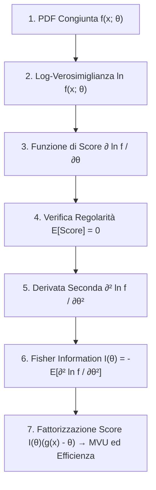

### Determinazione Della Funzione Di Verosimiglianza

I campioni di disturbo $w[n]$ sono gaussiani e indipendenti, per cui le singole misure $x[n] \sim \mathcal{N}(\theta, \sigma^2)$ sono mutuamente indipendenti. La densità congiunta è data dal prodotto delle marginali:

$$
f_{\mathbf{x}}(\mathbf{x}; \theta) = \prod_{n=0}^{N-1} \frac{1}{\sqrt{2\pi\sigma^2}} \exp\left( -\frac{1}{2\sigma^2} (x[n] - \theta)^2 \right) = \frac{1}{(2\pi\sigma^2)^{N/2}} \exp\left( -\frac{1}{2\sigma^2} \sum_{n=0}^{N-1} (x[n] - \theta)^2 \right)
$$

### Calcolo Della Log-Verosimiglianza

Applichiamo il logaritmo naturale per semplificare i calcoli, convertendo la produttoria in una sommatoria:

$$
\ln f_{\mathbf{x}}(\mathbf{x}; \theta) = -\frac{N}{2} \ln(2\pi\sigma^2) - \frac{1}{2\sigma^2} \sum_{n=0}^{N-1} (x[n] - \theta)^2
$$

### Derivata Prima E Funzione Di Score

Deriviamo la log-verosimiglianza rispetto al parametro incognito $\theta$:

$$
\frac{\partial \ln f_{\mathbf{x}}(\mathbf{x}; \theta)}{\partial \theta} = -\frac{1}{2\sigma^2} \sum_{n=0}^{N-1} 2(x[n] - \theta)(-1) = \frac{1}{\sigma^2} \sum_{n=0}^{N-1} (x[n] - \theta)
$$

Espandiamo la sommatoria separando i dati dal parametro deterministico:

$$
\frac{\partial \ln f_{\mathbf{x}}(\mathbf{x}; \theta)}{\partial \theta} = \frac{1}{\sigma^2} \left( \sum_{n=0}^{N-1} x[n] - N\theta \right) = \frac{N}{\sigma^2} \left( \frac{1}{N}\sum_{n=0}^{N-1} x[n] - \theta \right)
$$

### Verifica Della Condizione Di Regolarità

Valutiamo il valore atteso della derivata prima sfruttando la linearità dell'operatore $\mathbb{E}[\cdot]$ e ricordando che $\mathbb{E}[x[n]] = \theta$:

$$
\mathbb{E}\left[ \frac{\partial \ln f_{\mathbf{x}}(\mathbf{x}; \theta)}{\partial \theta} \right] = \frac{1}{\sigma^2} \sum_{n=0}^{N-1} (\mathbb{E}[x[n]] - \theta) = \frac{1}{\sigma^2} \sum_{n=0}^{N-1} (\theta - \theta) = 0
$$

La condizione di regolarità è pienamente verificata su tutto il dominio reale $\theta \in \mathbb{R}$.

### Calcolo Della Derivata Seconda

Deriviamo nuovamente la funzione di score rispetto a $\theta$:

$$
\frac{\partial^2 \ln f_{\mathbf{x}}(\mathbf{x}; \theta)}{\partial \theta^2} = \frac{\partial}{\partial \theta} \left[ \frac{1}{\sigma^2} \sum_{n=0}^{N-1} x[n] - \frac{N\theta}{\sigma^2} \right] = -\frac{N}{\sigma^2}
$$

### Calcolo dell'Informazione Di Fisher

Poiché la derivata seconda risulta una costante deterministica indipendente dai dati $\mathbf{x}$, il suo valore atteso coincide con la costante stessa:

$$
I(\theta) = -\mathbb{E}\left[ \frac{\partial^2 \ln f_{\mathbf{x}}(\mathbf{x}; \theta)}{\partial \theta^2} \right] = -\left( -\frac{N}{\sigma^2} \right) = \frac{N}{\sigma^2}
$$

L'informazione cresce linearmente con il numero di campioni $N$ e diminuisce all'aumentare della potenza del rumore $\sigma^2$.

### Verifica dell'Efficienza Ed Estrazione dell'MVU

Confrontiamo la derivata prima ottenuta in precedenza con l'equazione di fattorizzazione $I(\theta)(g(\mathbf{x}) - \theta)$:

$$
\frac{\partial \ln f_{\mathbf{x}}(\mathbf{x}; \theta)}{\partial \theta} = \underbrace{\frac{N}{\sigma^2}}_{I(\theta)} \left( \underbrace{\frac{1}{N}\sum_{n=0}^{N-1} x[n]}_{g(\mathbf{x})} - \theta \right)
$$

La corrispondenza algebrica è perfetta:
- Lo stimatore $\hat{\theta} = \frac{1}{N}\sum_{n=0}^{N-1} x[n] = \bar{x}$ (la media campionaria) è __strettamente efficiente__.
- La sua varianza raggiunge esattamente il CRLB:

$$
\text{Var}\{\hat{\theta}\} = \frac{1}{I(\theta)} = \frac{\sigma^2}{N}
$$

Abbiamo così dimostrato con rigore matematico assoluto che la media campionaria è l'unico stimatore MVU per il livello continuo in presenza di rumore gaussiano bianco.

## Trasformazione Di Parametri

Nelle applicazioni pratiche capita di frequente di non voler stimare direttamente il parametro nativo $\theta$, bensì una sua funzione deterministica nota a priori:

$$
\alpha = h(\theta)
$$

Pensiamo alla misura del livello di tensione continua $\theta$ quando il reale obiettivo è stimare la potenza dissipata su una resistenza unitaria $\alpha = \theta^2$, oppure alla stima della frequenza angolare a partire dal periodo di oscillazione.

Sotto la condizione di regolarità, il limite inferiore di Cramer-Rao per la stima del parametro trasformato $\alpha = h(\theta)$ assume la forma:

$$
\text{Var}\{\hat{\alpha}\} \ge \frac{\left( \frac{\partial h(\theta)}{\partial \theta} \right)^2}{I(\theta)}
$$

dove $I(\theta)$ rappresenta l'Informazione di Fisher calcolata rispetto al parametro originale $\theta$.

### Trasformazione Lineare (O Affine)

Supponiamo che la legge di trasformazione sia una funzione affine:

$$
\alpha = k\theta + c
$$

La derivata prima è costante: $\frac{\partial h}{\partial \theta} = k$. Il CRLB trasformato diventa:

$$
\text{Var}\{\hat{\alpha}\} \ge \frac{k^2}{I(\theta)}
$$

Se per il parametro originario $\theta$ disponiamo di uno stimatore efficiente $\hat{\theta}$ con varianza $\text{Var}\{\hat{\theta}\} = \frac{1}{I(\theta)}$, allora lo stimatore naturale per sostituzione:

$$
\hat{\alpha} = k\hat{\theta} + c
$$

preserva integralmente le proprietà statistiche ideali: è __rigorosamente non polarizzato ed efficiente per $\alpha$__:

$$
\mathbb{E}[\hat{\alpha}] = k\mathbb{E}[\hat{\theta}] + c = k\theta + c = \alpha, \quad \text{Var}\{\hat{\alpha}\} = k^2 \text{Var}\{\hat{\theta}\} = \frac{k^2}{I(\theta)}
$$

### Trasformazione Non Lineare

Quando la funzione $h(\theta)$ è non lineare, il quadro statistico muta radicalmente per effetto della curvatura:
1. Anche qualora $\hat{\theta}$ sia non polarizzato per $\theta$, lo stimatore naturale plug-in $\hat{\alpha} = h(\hat{\theta})$ risulta __polarizzato a campioni finiti__ per effetto della disuguaglianza di Jensen: $\mathbb{E}[h(\hat{\theta})] \neq h(\mathbb{E}[\hat{\theta}])$.
2. A campioni finiti $N$, __non esiste in generale alcuno stimatore in grado di raggiungere il CRLB__ per una trasformazione non lineare.
3. Al divergere del numero di osservazioni ($N \to \infty$), se lo stimatore base $\hat{\theta}$ è consistente ed efficiente, lo stimatore trasformato diventa __asintoticamente non polarizzato ed asintoticamente efficiente__.

> [!EXAMPLE] Stima della Potenza del Livello DC ($\alpha = \theta^2$)
> Consideriamo il segnale $x[n] = \theta + w[n]$ in AWGN e supponiamo di voler stimare la potenza $\alpha = h(\theta) = \theta^2$.
> Adottiamo come stimatore plug-in il quadrato della media campionaria $\bar{x}$:
>
> $$
> \hat{\alpha} = \bar{x}^2 = \left( \frac{1}{N}\sum_{n=0}^{N-1} x[n] \right)^2
> $$
>
> Sviluppiamo l'analisi in tre passaggi:
>
> 1. __Analisi del Bias a Campioni Finiti__:
> Dalla statistica della media campionaria sappiamo che $\bar{x} \sim \mathcal{N}\left(\theta, \frac{\sigma^2}{N}\right)$. Sfruttando la relazione fondamentale tra i momenti $\mathbb{E}[\bar{x}^2] = \text{Var}\{\bar{x}\} + (\mathbb{E}[\bar{x}])^2$:
>
>    $$
>    \mathbb{E}[\hat{\alpha}] = \mathbb{E}[\bar{x}^2] = \frac{\sigma^2}{N} + \theta^2 = \alpha + \frac{\sigma^2}{N}
>    $$
>
>    Il bias vale $b(\alpha) = \mathbb{E}[\hat{\alpha}] - \alpha = \frac{\sigma^2}{N} > 0$. Lo stimatore introduce una sovrastima sistematica a campioni finiti. Tuttavia, per $N \to \infty$, il bias tende a zero: $\hat{\alpha}$ è __asintoticamente non polarizzato__.
>
> 2. __Calcolo del CRLB Trasformato__:
> Essendo $\frac{\partial h(\theta)}{\partial \theta} = 2\theta$ e $I(\theta) = \frac{N}{\sigma^2}$:
>
>    $$
>    \text{CRLB}(\alpha) = \frac{\left( \frac{\partial h}{\partial \theta} \right)^2}{I(\theta)} = \frac{(2\theta)^2}{\frac{N}{\sigma^2}} = \frac{4\theta^2\sigma^2}{N} = \frac{4\alpha\sigma^2}{N}
>    $$
>
> 3. __Calcolo della Varianza Effettiva ed Efficienza Asintotica__:
> Rappresentiamo la media campionaria come $\bar{x} = \theta + u$, dove $u \sim \mathcal{N}\left(0, \frac{\sigma^2}{N}\right)$. Elevando al quadrato troviamo $\bar{x}^2 = \theta^2 + 2\theta u + u^2$.
> La varianza dello stimatore coincide con:
>
>    $$
>    \text{Var}\{\hat{\alpha}\} = \mathbb{E}\left[ (\bar{x}^2 - \mathbb{E}[\bar{x}^2])^2 \right] = \mathbb{E}\left[ \left( 2\theta u + u^2 - \frac{\sigma^2}{N} \right)^2 \right]
>    $$
>
>    Espandiamo il quadrato del binomio:
>
>    $$
>    \text{Var}\{\hat{\alpha}\} = 4\theta^2 \mathbb{E}[u^2] + \mathbb{E}\left[ \left(u^2 - \frac{\sigma^2}{N}\right)^2 \right] + 4\theta \mathbb{E}\left[ u \left(u^2 - \frac{\sigma^2}{N}\right) \right]
>    $$
>
>    Sfruttando le proprietà dei momenti della variabile gaussiana a media nulla $u$:
>    - $\mathbb{E}[u] = 0$ ed $\mathbb{E}[u^3] = 0$ (tutti i momenti di ordine dispari sono nulli). Il termine incrociato $4\theta(\mathbb{E}[u^3] - \frac{\sigma^2}{N}\mathbb{E}[u])$ svanisce identicamente.
>    - $\mathbb{E}[u^2] = \frac{\sigma^2}{N}$.
>    - $\mathbb{E}[u^4] = 3\left(\frac{\sigma^2}{N}\right)^2 = \frac{3\sigma^4}{N^2}$. Il secondo momento centrale vale dunque $\mathbb{E}[(u^2 - \frac{\sigma^2}{N})^2] = \mathbb{E}[u^4] - (\mathbb{E}[u^2])^2 = \frac{3\sigma^4}{N^2} - \frac{\sigma^4}{N^2} = \frac{2\sigma^4}{N^2}$.
>
>    Sostituendo questi contributi:
>
>    $$
>    \text{Var}\{\hat{\alpha}\} = \frac{4\theta^2\sigma^2}{N} + \frac{2\sigma^4}{N^2} = \frac{4\alpha\sigma^2}{N} + \frac{2\sigma^4}{N^2}
>    $$
>
>    A campioni finiti la varianza eccede il CRLB a causa del termine aggiuntivo $\frac{2\sigma^4}{N^2}$. Tuttavia, al crescere di $N$, questo termine residuo decade con velocità quadratica $O(1/N^2)$, mentre il termine principale decade come $O(1/N)$:
>
>    $$
>    \lim_{N \to \infty} \frac{\text{Var}\{\hat{\alpha}\}}{\text{CRLB}(\alpha)} = \lim_{N \to \infty} \left( 1 + \frac{\sigma^2}{2\alpha N} \right) = 1
>    $$
>
>    La varianza converge asintoticamente alla soglia inferiore: lo stimatore $\hat{\alpha}$ è __asintoticamente efficiente__.

## Estensione Vettoriale Del CRLB

Generalizziamo ora l'intera teoria al caso in cui dobbiamo stimare simultaneamente un insieme di $P$ parametri deterministici incogniti, organizzati in un vettore $\boldsymbol{\theta} \in \mathbb{R}^P$:

$$
\boldsymbol{\theta} = \begin{bmatrix} \theta_1 \\ \theta_2 \\ \vdots \\ \theta_P \end{bmatrix}
$$

### Matrice Di Informazione Di Fisher (FIM)

Definiamo il gradiente della funzione di log-verosimiglianza come il vettore colonna delle derivate parziali prime (vettore di score):

$$
\nabla_{\boldsymbol{\theta}} \ln f_{\mathbf{x}}(\mathbf{x}; \boldsymbol{\theta}) = \begin{bmatrix} \frac{\partial \ln f}{\partial \theta_1} \\ \frac{\partial \ln f}{\partial \theta_2} \\ \vdots \\ \frac{\partial \ln f}{\partial \theta_P} \end{bmatrix}
$$

La condizione di regolarità vettoriale impone che il valore atteso del vettore di score sia nullo: $\mathbb{E}[\nabla_{\boldsymbol{\theta}} \ln f_{\mathbf{x}}(\mathbf{x}; \boldsymbol{\theta})] = \mathbf{0}$.

L'informazione congiunta estratta dai dati è descritta dalla __Matrice di Informazione di Fisher__ (__FIM__, _Fisher Information Matrix_), indicata con $\mathbf{I}(\boldsymbol{\theta}) \in \mathbb{R}^{P \times P}$, le cui entrate valgono:

$$
[\mathbf{I}(\boldsymbol{\theta})]_{i, j} = \mathbb{E}\left[ \frac{\partial \ln f_{\mathbf{x}}(\mathbf{x}; \boldsymbol{\theta})}{\partial \theta_i} \frac{\partial \ln f_{\mathbf{x}}(\mathbf{x}; \boldsymbol{\theta})}{\partial \theta_j} \right] = -\mathbb{E}\left[ \frac{\partial^2 \ln f_{\mathbf{x}}(\mathbf{x}; \boldsymbol{\theta})}{\partial \theta_i \partial \theta_j} \right]
$$

La FIM è una matrice simmetrica e, a patto che i parametri siano reciprocamente identificabili e non ridondanti, strettamente definita positiva.

### Teorema Del CRLB Vettoriale

Sia $\hat{\boldsymbol{\theta}}$ uno stimatore vettoriale non polarizzato ($\mathbb{E}[\hat{\boldsymbol{\theta}}] = \boldsymbol{\theta}$). Definiamo la matrice di covarianza dell'errore di stima $\mathbf{C}_{\hat{\boldsymbol{\theta}}} \in \mathbb{R}^{P \times P}$:

$$
\mathbf{C}_{\hat{\boldsymbol{\theta}}} = \mathbb{E}\left[ (\hat{\boldsymbol{\theta}} - \boldsymbol{\theta})(\hat{\boldsymbol{\theta}} - \boldsymbol{\theta})^T \right]
$$

Il teorema del CRLB vettoriale stabilisce che la matrice differenza tra la matrice di covarianza dello stimatore e l'inversa della FIM è __semidefinita positiva__:

$$
\mathbf{C}_{\hat{\boldsymbol{\theta}}} - \mathbf{I}^{-1}(\boldsymbol{\theta}) \ge \mathbf{0}
$$

Ciò significa che per qualunque vettore non nullo $\mathbf{u} \in \mathbb{R}^P$ vale la disuguaglianza $\mathbf{u}^T (\mathbf{C}_{\hat{\boldsymbol{\theta}}} - \mathbf{I}^{-1}(\boldsymbol{\theta})) \mathbf{u} \ge 0$.

Scegliendo il vettore canonico $\mathbf{u} = \mathbf{e}_i$, isoliamo l'$i$-esimo elemento lungo la diagonale principale: la varianza della stima del singolo parametro $\theta_i$ è vincolata dall'$i$-esimo elemento diagonale dell'__inversa__ della FIM:

$$
\text{Var}\{\hat{\theta}_i\} = [\mathbf{C}_{\hat{\boldsymbol{\theta}}}]_{i, i} \ge [\mathbf{I}^{-1}(\boldsymbol{\theta})]_{i, i}
$$

> [!WARNING] Errore Notazionale Comune: Diagonale dell'Inversa vs Inverso della Diagonale
> All'esame si commette spessissimo l'errore grave di invertire il singolo elemento scalare della matrice anziché invertire prima l'intera matrice e poi leggerne la diagonale:
>
> $$
> [\mathbf{I}^{-1}(\boldsymbol{\theta})]_{i, i} \ge \frac{1}{[\mathbf{I}(\boldsymbol{\theta})]_{i, i}}
> $$
>
> L'uguaglianza si verifica se e solo se la FIM è diagonale, ossia quando i parametri sono statisticamente disaccoppiati. In tutti gli altri casi, l'incertezza sui parametri concorrenti ($\theta_j$ con $j \neq i$) __degrada strettamente la precisione con cui possiamo stimare $\theta_i$__ rispetto allo scenario ideale in cui gli altri parametri fossero noti a priori. La dimostrazione algebrica basata sul complemento di Schur è consultabile in [[Anno 1/Information and Estimation Theory/zz. Argomenti extra#Disuguaglianza tra Elementi della FIM Inversa e Complemento di Schur|zz. Argomenti extra: Dimostrazione Algebrica con Complemento di Schur]].

### Condizione Di Efficienza Vettoriale

Uno stimatore vettoriale non polarizzato $\hat{\boldsymbol{\theta}}$ raggiunge il limite inferiore con matrice di covarianza $\mathbf{C}_{\hat{\boldsymbol{\theta}}} = \mathbf{I}^{-1}(\boldsymbol{\theta})$ se e solo se il gradiente della log-verosimiglianza si decompone nella forma lineare matriciale:

$$
\nabla_{\boldsymbol{\theta}} \ln f_{\mathbf{x}}(\mathbf{x}; \boldsymbol{\theta}) = \mathbf{I}(\boldsymbol{\theta}) \left( \mathbf{g}(\mathbf{x}) - \boldsymbol{\theta} \right)
$$

In presenza di tale fattorizzazione, lo stimatore MVU efficiente è unico ed è fornito dal vettore $\hat{\boldsymbol{\theta}} = \mathbf{g}(\mathbf{x})$.

## Esempio Vettoriale: Line Fitting (Regressione Lineare Semplice)

Analizziamo il problema fondamentale dell'adattamento di una retta su un insieme di misure discrete corrotte da rumore AWGN:

$$
x[n] = \theta_1 + \theta_2 n + w[n], \quad n = 0, 1, \dots, N-1, \quad w[n] \sim \mathcal{N}(0, \sigma^2) \text{ i.i.d.}
$$

dove $\theta_1$ rappresenta l'intercetta all'origine ($n = 0$) e $\theta_2$ è il coefficiente angolare (pendenza) della retta.

![[slide_36_line_fitting_example.png|center mid]]

Riscriviamo il sistema in forma matriciale compatta:

$$
\mathbf{x} = \mathbf{H}\boldsymbol{\theta} + \mathbf{w}
$$

dove $\boldsymbol{\theta} = [\theta_1, \theta_2]^T \in \mathbb{R}^2$, il vettore di rumore è $\mathbf{w} \sim \mathcal{N}(\mathbf{0}, \sigma^2 \mathbf{I}_N)$ e la __matrice di osservazione__ $\mathbf{H} \in \mathbb{R}^{N \times 2}$ è strutturata come:

$$
\mathbf{H} = \begin{bmatrix} 1 & 0 \\ 1 & 1 \\ 1 & 2 \\ \vdots & \vdots \\ 1 & N-1 \end{bmatrix}
$$

### Calcolo Della Matrice Di Informazione Di Fisher

La log-verosimiglianza del modello vettoriale gaussiano lineare è data dalla forma quadratica:

$$
\ln f_{\mathbf{x}}(\mathbf{x}; \boldsymbol{\theta}) = -\frac{N}{2} \ln(2\pi\sigma^2) - \frac{1}{2\sigma^2} (\mathbf{x} - \mathbf{H}\boldsymbol{\theta})^T (\mathbf{x} - \mathbf{H}\boldsymbol{\theta})
$$

Calcoliamo il gradiente rispetto al vettore dei parametri $\boldsymbol{\theta}$:

$$
\nabla_{\boldsymbol{\theta}} \ln f_{\mathbf{x}}(\mathbf{x}; \boldsymbol{\theta}) = \frac{1}{\sigma^2} \mathbf{H}^T (\mathbf{x} - \mathbf{H}\boldsymbol{\theta})
$$

Raccogliamo la matrice $\frac{\mathbf{H}^T\mathbf{H}}{\sigma^2}$:

$$
\nabla_{\boldsymbol{\theta}} \ln f_{\mathbf{x}}(\mathbf{x}; \boldsymbol{\theta}) = \frac{\mathbf{H}^T\mathbf{H}}{\sigma^2} \left( (\mathbf{H}^T\mathbf{H})^{-1}\mathbf{H}^T\mathbf{x} - \boldsymbol{\theta} \right)
$$

Riconosciamo immediatamente la condizione di efficienza vettoriale $\mathbf{I}(\boldsymbol{\theta})(\mathbf{g}(\mathbf{x}) - \boldsymbol{\theta})$. La FIM coincide direttamente con:

$$
\mathbf{I}(\boldsymbol{\theta}) = \frac{\mathbf{H}^T\mathbf{H}}{\sigma^2}
$$

Calcoliamo esplicitamente le componenti interne della matrice simmetrica $\mathbf{H}^T\mathbf{H} \in \mathbb{R}^{2 \times 2}$:

$$
\mathbf{H}^T\mathbf{H} = \begin{bmatrix} \sum_{n=0}^{N-1} 1 & \sum_{n=0}^{N-1} n \\ \sum_{n=0}^{N-1} n & \sum_{n=0}^{N-1} n^2 \end{bmatrix} = \begin{bmatrix} N & \frac{N(N-1)}{2} \\ \frac{N(N-1)}{2} & \frac{N(N-1)(2N-1)}{6} \end{bmatrix}
$$

Calcoliamo il determinante di $\mathbf{H}^T\mathbf{H}$:

$$
\begin{aligned}
\det(\mathbf{H}^T\mathbf{H}) &= N \cdot \frac{N(N-1)(2N-1)}{6} - \left( \frac{N(N-1)}{2} \right)^2 \\
&= \frac{N^2(N-1)}{12} \left[ 2(2N-1) - 3(N-1) \right] \\
&= \frac{N^2(N-1)(N+1)}{12} = \frac{N^2(N^2-1)}{12}
\end{aligned}
$$

Ricordando la regola analitica per l'inversa di una matrice $2 \times 2$:

$$
\begin{bmatrix} a & b \\ c & d \end{bmatrix}^{-1} = \frac{1}{ad - bc} \begin{bmatrix} d & -b \\ -c & a \end{bmatrix}
$$

calcoliamo l'inversa $(\mathbf{H}^T\mathbf{H})^{-1}$:

$$
(\mathbf{H}^T\mathbf{H})^{-1} = \frac{12}{N^2(N^2-1)} \begin{bmatrix} \frac{N(N-1)(2N-1)}{6} & -\frac{N(N-1)}{2} \\ -\frac{N(N-1)}{2} & N \end{bmatrix} = \begin{bmatrix} \frac{2(2N-1)}{N(N+1)} & -\frac{6}{N(N+1)} \\ -\frac{6}{N(N+1)} & \frac{12}{N(N^2-1)} \end{bmatrix}
$$

La matrice inversa di Fisher $\mathbf{I}^{-1}(\boldsymbol{\theta}) = \sigma^2 (\mathbf{H}^T\mathbf{H})^{-1}$ assume la forma analitica chiusa:

$$
\mathbf{I}^{-1}(\boldsymbol{\theta}) = \sigma^2 \begin{bmatrix} \frac{2(2N-1)}{N(N+1)} & -\frac{6}{N(N+1)} \\ -\frac{6}{N(N+1)} & \frac{12}{N(N^2-1)} \end{bmatrix}
$$

I limiti minimi di varianza per l'intercetta $\theta_1$ e la pendenza $\theta_2$ sono dati dai rispettivi elementi diagonali:

$$
\begin{aligned}
\text{Var}\{\hat{\theta}_1\} &\ge [\mathbf{I}^{-1}(\boldsymbol{\theta})]_{1, 1} = \frac{2(2N-1)\sigma^2}{N(N+1)} \\
\text{Var}\{\hat{\theta}_2\} &\ge [\mathbf{I}^{-1}(\boldsymbol{\theta})]_{2, 2} = \frac{12\sigma^2}{N(N^2-1)}
\end{aligned}
$$

### Proprietà Dello Stimatore Lineare Ottimo

Poiché la condizione di efficienza vettoriale è verificata, lo stimatore:

$$
\hat{\boldsymbol{\theta}} = \begin{bmatrix} \hat{\theta}_1 \\ \hat{\theta}_2 \end{bmatrix} = (\mathbf{H}^T\mathbf{H})^{-1}\mathbf{H}^T\mathbf{x}
$$

è l'__MVU estimator efficiente__.

Sviluppando il prodotto con il vettore $\mathbf{H}^T\mathbf{x} = \begin{bmatrix} \sum_{n=0}^{N-1} x[n] \\ \sum_{n=0}^{N-1} n x[n] \end{bmatrix}$, otteniamo le formule operative esplicite:

$$
\begin{aligned}
\hat{\theta}_1 &= \frac{2(2N-1)}{N(N+1)} \sum_{n=0}^{N-1} x[n] - \frac{6}{N(N+1)} \sum_{n=0}^{N-1} n x[n] \\
\hat{\theta}_2 &= -\frac{6}{N(N+1)} \sum_{n=0}^{N-1} x[n] + \frac{12}{N(N^2-1)} \sum_{n=0}^{N-1} n x[n]
\end{aligned}
$$

Esaminiamo l'andamento asintotico delle varianze per un numero elevato di campioni $N \gg 1$:
- La varianza dell'intercetta $\theta_1$ decade proporzionalmente a $O\left(\frac{1}{N}\right)$:

$$
\text{Var}\{\hat{\theta}_1\} \approx \frac{4\sigma^2}{N} \quad \text{per } N \gg 1
$$

- La varianza della pendenza $\theta_2$ decade con straordinaria rapidità come $O\left(\frac{1}{N^3}\right)$:

$$
\text{Var}\{\hat{\theta}_2\} \approx \frac{12\sigma^2}{N^3} \quad \text{per } N \gg 1
$$

![[line_fitting_lever_arm.svg|center mid]]

La convergenza cubica $\sim 1/N^3$ trova una spiegazione fisica immediata nel __braccio di leva temporale__: man mano che l'indice temporale avanza verso $n = N-1$, la distanza dall'origine funge da leva geometrica $L \approx N$. Un piccolo errore di misura $\Delta x$ produce una rotazione angolare della retta inversamente proporzionale alla leva:

$$
\Delta \theta_2 \approx \frac{\Delta x}{N} \implies \text{Var}\{\Delta \theta_2\} \propto \frac{\sigma^2}{N^2}
$$

Integrando questo effetto su tutti gli $N$ campioni, la sommatoria dei quadrati delle posizioni $\sum_{n=0}^{N-1} n^2 \sim \frac{N^3}{3}$ comprime la dispersione angolare con una potenza cubica rispetto all'orizzonte temporale di osservazione.

> [!NOTE] Riscontro Numerico del Degrado da Parametri Concorrenti
> L'esempio del line fitting offre una verifica empirica immediata del costo statistico dovuto all'accoppiamento tra parametri ignoti:
> - Supponiamo che la pendenza sia nota con certezza ($\theta_2 = 0$): dobbiamo stimare solo il livello costante $\theta_1$. L'Informazione di Fisher scalare vale $[\mathbf{I}]_{1,1} = \frac{N}{\sigma^2}$, con varianza pari a $\frac{\sigma^2}{N}$. Se invece la pendenza $\theta_2$ è ignota e stimata congiuntamente, la varianza sale a $[\mathbf{I}^{-1}]_{1,1} \approx \frac{4\sigma^2}{N}$, risultando esattamente __quattro volte superiore__.
> - Supponiamo viceversa che l'intercetta sia nota ($\theta_1 = 0$, retta vincolata all'origine). L'Informazione di Fisher scalare per la sola pendenza vale $[\mathbf{I}]_{2,2} = \frac{\sum n^2}{\sigma^2} \approx \frac{N^3}{3\sigma^2}$, con varianza pari a $\frac{3\sigma^2}{N^3}$. Con l'intercetta ignota, la varianza minima sale a $[\mathbf{I}^{-1}]_{2,2} \approx \frac{12\sigma^2}{N^3}$, anche in questo caso esattamente __quattro volte superiore__.
> Questo fattore quadruplo deriva dalla forte correlazione statistica negativa tra le stime dell'intercetta e della pendenza ($\rho = -\frac{\sqrt{3}}{2} \approx -0.866$): un aumento accidentale della pendenza stimata spinge verso il basso la stima dell'intercetta per mantenere la retta vincolata ai dati centrali.


# 1. Stimatori Classici - BLUE, MLE E LSE

Nella teoria della stima classica, l'obiettivo primario consiste nell'individuare lo stimatore non polarizzato a minima varianza (__MVU__, _Minimum Variance Unbiased_). Sebbene il limite inferiore di Cramer-Rao (__CRLB__) e il Teorema di Lehmann-Scheffé tramite statistiche sufficienti complete costituiscano i criteri canonici per identificare l'MVU, nella realtà ingegneristica e sperimentale emergono frequentemente ostacoli invalicabili:
1. La funzione di densità di probabilità (__PDF__) congiunta dei dati osservati è del tutto ignota o analiticamente intrattabile, impedendo il calcolo dell'informazione di Fisher o della verosimiglianza.
2. Lo stimatore efficiente a campioni finiti non esiste, poiché la derivata logaritmica della verosimiglianza non assume la forma fattorizzata richiesta dal CRLB.
3. Il legame cinematico o fisico tra parametri e osservazioni è fortemente non lineare, oppure non disponiamo di alcuna descrizione probabilistica affidabile per il rumore di misura.

Per superare queste limitazioni strutturali introduciamo tre strategie fondamentali, ciascuna tarata sul livello di informazione a priori disponibile:

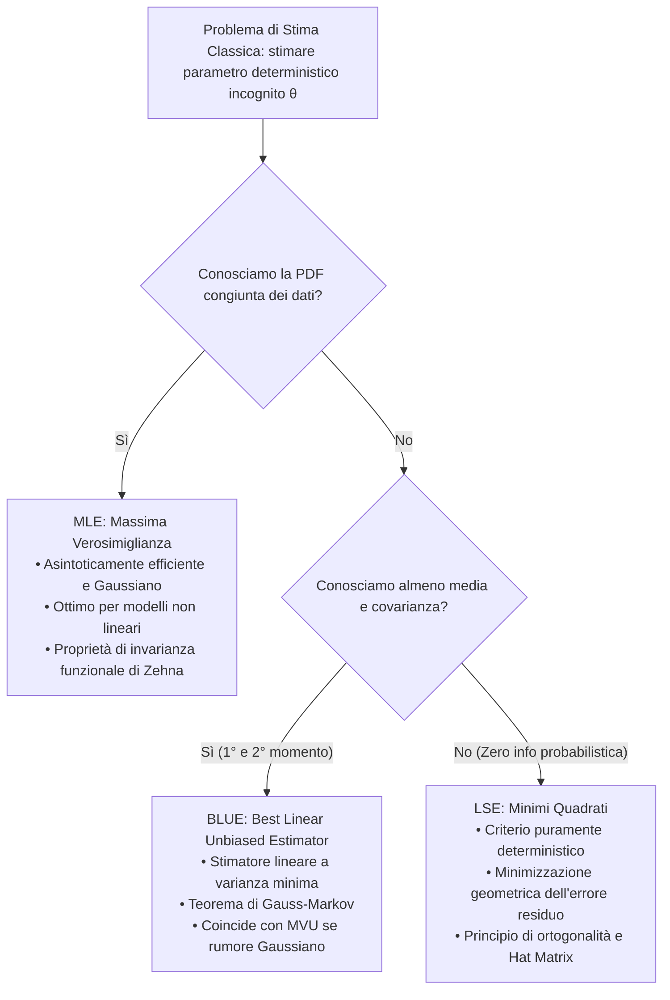

## Stimatore Lineare Non Polarizzato a Minima Varianza (BLUE)

Quando non conosciamo la forma analitica della PDF congiunta $f_{\mathbf{x}}(\mathbf{x}; \theta)$, non possiamo calcolare l'informazione di Fisher né ricercare l'MVU generale. Tuttavia, se siamo in grado di misurare o modellare i soli momenti statistici del primo e del secondo ordine dei dati (il valor medio $\mathbb{E}[\mathbf{x}]$ e la matrice di covarianza $\mathbf{C}_{\mathbf{x}\mathbf{x}}$), possiamo progettare uno stimatore ottimale restringendo a priori la ricerca alla classe degli stimatori lineari.

### Formulazione E Vincolo Di Non Polarizzazione

Definiamo lo stimatore come combinazione lineare ponderata degli $N$ campioni osservati:

$$
\hat{\theta} = \sum_{n=0}^{N-1} a_n x[n] = \mathbf{a}^T \mathbf{x}
$$

dove $\mathbf{x} = [x[0], x[1], \dots, x[N-1]]^T \in \mathbb{R}^N$ è il vettore dei dati acquisiti e $\mathbf{a} = [a_0, a_1, \dots, a_{N-1}]^T \in \mathbb{R}^N$ è il vettore dei coefficienti di peso che dobbiamo determinare.

Imponiamo che lo stimatore sia rigorosamente non polarizzato per qualsiasi valore reale assunto dal parametro incognito $\theta$:

$$
\mathbb{E}[\hat{\theta}] = \theta \iff \mathbb{E}[\mathbf{a}^T \mathbf{x}] = \mathbf{a}^T \mathbb{E}[\mathbf{x}] = \theta \quad \forall \theta
$$

Affinché la proiezione scalare $\mathbf{a}^T \mathbb{E}[\mathbf{x}]$ eguagli identicamente $\theta$ per ogni possibile $\theta$, il valor medio delle osservazioni deve dipendere linearmente dal parametro stesso:

$$
\mathbb{E}[\mathbf{x}] = \theta \mathbf{s}
$$

dove $\mathbf{s} = [s[0], s[1], \dots, s[N-1]]^T$ è un vettore deterministico noto a priori e non nullo. Il modello delle osservazioni deve pertanto assumere la struttura additiva:

$$
\mathbf{x} = \theta \mathbf{s} + \mathbf{w}
$$

in cui $\mathbf{w}$ è il vettore del disturbo aleatorio a media nulla $\mathbb{E}[\mathbf{w}] = \mathbf{0}$ e matrice di covarianza nota $\text{Cov}\{\mathbf{w}\} = \mathbf{C}_{\mathbf{w}\mathbf{w}} = \mathbf{C}_{\mathbf{x}\mathbf{x}}$.

Sostituendo il modello dei dati nella condizione di non polarizzazione:

$$
\mathbf{a}^T \mathbb{E}[\mathbf{x}] = \mathbf{a}^T (\theta \mathbf{s}) = \theta (\mathbf{a}^T \mathbf{s}) = \theta \iff \mathbf{a}^T \mathbf{s} = 1
$$

L'identità $\mathbf{a}^T \mathbf{s} = \sum_{n=0}^{N-1} a_n s[n] = 1$ rappresenta il __vincolo lineare di non polarizzazione__. Geometricamente impone che la risposta del filtro pesato $\mathbf{a}$ al segnale nominale $\mathbf{s}$ abbia guadagno unitario.

### Minimizzazione Della Varianza E Moltiplicatori Di Lagrange

La varianza di uno stimatore lineare non polarizzato coincide esattamente con il suo errore quadratico medio (__MSE__) ed è espressa dalla forma quadratica:

$$
\text{Var}\{\hat{\theta}\} = \mathbb{E}\left[ (\hat{\theta} - \theta)^2 \right] = \mathbb{E}\left[ (\mathbf{a}^T (\mathbf{x} - \mathbb{E}[\mathbf{x}]))^2 \right] = \mathbf{a}^T \mathbb{E}\left[ (\mathbf{x} - \mathbb{E}[\mathbf{x}])(\mathbf{x} - \mathbb{E}[\mathbf{x}])^T \right] \mathbf{a} = \mathbf{a}^T \mathbf{C}_{\mathbf{x}\mathbf{x}} \mathbf{a}
$$

Il nostro problema di progetto consiste nel trovare il vettore $\mathbf{a}$ che minimizza questa forma quadratica sotto il vincolo lineare:

$$
\min_{\mathbf{a} \in \mathbb{R}^N} \mathbf{a}^T \mathbf{C}_{\mathbf{x}\mathbf{x}} \mathbf{a} \quad \text{sotto il vincolo} \quad \mathbf{a}^T \mathbf{s} = 1
$$

Risolviamo il problema vincolato introducendo la funzione Lagrangiana con moltiplicatore scalare $\lambda$:

$$
J(\mathbf{a}, \lambda) = \mathbf{a}^T \mathbf{C}_{\mathbf{x}\mathbf{x}} \mathbf{a} + \lambda (\mathbf{a}^T \mathbf{s} - 1)
$$

Calcoliamo il gradiente rispetto al vettore dei pesi $\mathbf{a}$ e imponiamo l'annullamento per individuare il punto di sella stazionario:

$$
\frac{\partial J(\mathbf{a}, \lambda)}{\partial \mathbf{a}} = 2 \mathbf{C}_{\mathbf{x}\mathbf{x}} \mathbf{a} + \lambda \mathbf{s} = \mathbf{0}
$$

Poiché la matrice di covarianza $\mathbf{C}_{\mathbf{x}\mathbf{x}}$ è simmetrica e definita positiva (nessuna combinazione lineare non banale dei dati ha varianza nulla), essa ammette inversa $\mathbf{C}_{\mathbf{x}\mathbf{x}}^{-1}$. Esplicitiamo $\mathbf{a}$ in funzione di $\lambda$:

$$
\mathbf{a} = -\frac{\lambda}{2} \mathbf{C}_{\mathbf{x}\mathbf{x}}^{-1} \mathbf{s}
$$

Determiniamo il moltiplicatore $\lambda$ sostituendo l'espressione di $\mathbf{a}$ nel vincolo $\mathbf{s}^T \mathbf{a} = 1$:

$$
\mathbf{s}^T \left( -\frac{\lambda}{2} \mathbf{C}_{\mathbf{x}\mathbf{x}}^{-1} \mathbf{s} \right) = 1 \implies -\frac{\lambda}{2} (\mathbf{s}^T \mathbf{C}_{\mathbf{x}\mathbf{x}}^{-1} \mathbf{s}) = 1 \implies \lambda = -\frac{2}{\mathbf{s}^T \mathbf{C}_{\mathbf{x}\mathbf{x}}^{-1} \mathbf{s}}
$$

Sostituendo il valore ricavato di $\lambda$, notiamo che il fattore $-2$ al numeratore elide esattamente il denominatore $-2$:

$$
\mathbf{a} = \frac{\mathbf{C}_{\mathbf{x}\mathbf{x}}^{-1} \mathbf{s}}{\mathbf{s}^T \mathbf{C}_{\mathbf{x}\mathbf{x}}^{-1} \mathbf{s}}
$$

Lo stimatore BLUE scalare assume la celebre forma analitica chiusa:

$$
\hat{\theta}_{\text{BLUE}} = \mathbf{a}^T \mathbf{x} = \frac{\mathbf{s}^T \mathbf{C}_{\mathbf{x}\mathbf{x}}^{-1} \mathbf{x}}{\mathbf{s}^T \mathbf{C}_{\mathbf{x}\mathbf{x}}^{-1} \mathbf{s}}
$$

Valutiamo la varianza minima sostituendo il vettore di pesi ottimo nell'espressione quadratica della varianza:

$$
\text{Var}\{\hat{\theta}_{\text{BLUE}}\} = \mathbf{a}^T \mathbf{C}_{\mathbf{x}\mathbf{x}} \mathbf{a} = \frac{\mathbf{s}^T \mathbf{C}_{\mathbf{x}\mathbf{x}}^{-1} \mathbf{C}_{\mathbf{x}\mathbf{x}} \mathbf{C}_{\mathbf{x}\mathbf{x}}^{-1} \mathbf{s}}{\left( \mathbf{s}^T \mathbf{C}_{\mathbf{x}\mathbf{x}}^{-1} \mathbf{s} \right)^2} = \frac{\mathbf{s}^T \mathbf{C}_{\mathbf{x}\mathbf{x}}^{-1} \mathbf{s}}{\left( \mathbf{s}^T \mathbf{C}_{\mathbf{x}\mathbf{x}}^{-1} \mathbf{s} \right)^2} = \frac{1}{\mathbf{s}^T \mathbf{C}_{\mathbf{x}\mathbf{x}}^{-1} \mathbf{s}}
$$

Nel passaggio centrale il prodotto intermedio $\mathbf{C}_{\mathbf{x}\mathbf{x}}^{-1} \mathbf{C}_{\mathbf{x}\mathbf{x}}$ collassa nella matrice identità $\mathbf{I}$, semplificando la forma quadratica al numeratore con uno dei due fattori al denominatore.

### Caso Eteroschedastico: Media Ponderata E Precision Weights

Consideriamo la stima di un livello costante deterministico $\theta$ immerso in un disturbo additivo non stazionario a campioni incorrelati ma con varianza variabile nel tempo:

$$
x[n] = \theta + w[n], \quad n = 0, 1, \dots, N-1
$$

I disturbi $\{w[n]\}$ hanno media nulla e varianze disuguali $\sigma_w^2[n] = \text{Var}\{w[n]\}$. In notazione vettoriale:
- Il segnale nominale è costante: $\mathbf{s} = [1, 1, \dots, 1]^T = \mathbf{1}_N$, imponendo il vincolo sui pesi $\sum_{n=0}^{N-1} a_n = 1$.
- La matrice di covarianza è puramente diagonale: $\mathbf{C}_{\mathbf{x}\mathbf{x}} = \text{diag}(\sigma_w^2[0], \sigma_w^2[1], \dots, \sigma_w^2[N-1])$.
- L'inversa di una matrice diagonale si calcola invertendo singolarmente ciascun elemento diagonale: $\mathbf{C}_{\mathbf{x}\mathbf{x}}^{-1} = \text{diag}\left( \frac{1}{\sigma_w^2[0]}, \dots, \frac{1}{\sigma_w^2[N-1]} \right)$.

Sostituendo nelle formule generali del BLUE, i prodotti matrice-vettore si trasformano in sommatorie algebriche:

$$
\mathbf{1}_N^T \mathbf{C}_{\mathbf{x}\mathbf{x}}^{-1} \mathbf{x} = \sum_{n=0}^{N-1} \frac{x[n]}{\sigma_w^2[n]}, \quad \mathbf{1}_N^T \mathbf{C}_{\mathbf{x}\mathbf{x}}^{-1} \mathbf{1}_N = \sum_{n=0}^{N-1} \frac{1}{\sigma_w^2[n]}
$$

Otteniamo lo stimatore BLUE e la corrispondente varianza minima:

$$
\hat{\theta}_{\text{BLUE}} = \frac{\sum_{n=0}^{N-1} \frac{x[n]}{\sigma_w^2[n]}}{\sum_{n=0}^{N-1} \frac{1}{\sigma_w^2[n]}}, \quad \text{Var}\{\hat{\theta}_{\text{BLUE}}\} = \frac{1}{\sum_{n=0}^{N-1} \frac{1}{\sigma_w^2[n]}}
$$

![[blue_heteroscedastic_weights.svg|center mid]]

> [!TIP] Principio di Ponderazione Ottima (Precision Weighting)
> Il BLUE assegna a ciascun campione un peso $a_n$ proporzionale alla __precisione__ della misura, ovvero all'inverso della sua varianza ($1/\sigma_w^2[n]$).
> Un sensore con rumore molto basso ($\sigma^2 = 0.5$) ottiene un peso dominante; un sensore degradato da forte rumore ($\sigma^2 = 8.0$) viene quasi azzerato ($a_n \approx 0$).
> Se il rumore è omoschedastico ($\sigma_w^2[n] = \sigma^2 \ \forall n$), tutti i pesi diventano identici $a_n = 1/N$, e il BLUE collassa sulla media campionaria aritmetica $\bar{x}$ con varianza $\sigma^2/N$.

### BLUE Vettoriale E Teorema Di Gauss-Markov

Estendiamo il problema alla stima congiunta di un vettore di $P$ parametri incogniti $\boldsymbol{\theta} = [\theta_0, \theta_1, \dots, \theta_{P-1}]^T \in \mathbb{R}^P$ a partire da $N$ osservazioni $\mathbf{x} \in \mathbb{R}^N$, con $N \ge P$.

Ciascuna componente $\hat{\theta}_i$ è ottenuta mediante combinazione lineare dei campioni, configurando un'operazione matriciale:

$$
\hat{\boldsymbol{\theta}} = \mathbf{A}\mathbf{x}
$$

dove $\mathbf{A} \in \mathbb{R}^{P \times N}$ è la matrice dei coefficienti lineari da determinare.

Il vincolo di non polarizzazione vettoriale richiede:

$$
\mathbb{E}[\hat{\boldsymbol{\theta}}] = \mathbf{A} \mathbb{E}[\mathbf{x}] = \boldsymbol{\theta} \quad \forall \boldsymbol{\theta}
$$

Questa condizione può sussistere per qualunque vettore $\boldsymbol{\theta}$ soltanto se la media dei dati è una trasformazione lineare dei parametri:

$$
\mathbf{x} = \mathbf{H}\boldsymbol{\theta} + \mathbf{w}
$$

dove $\mathbf{H} \in \mathbb{R}^{N \times P}$ è la __matrice di osservazione__ deterministica, che deve avere rango pieno per colonne ($\text{rk}(\mathbf{H}) = P$), mentre $\mathbf{w}$ è il vettore di rumore con $\mathbb{E}[\mathbf{w}] = \mathbf{0}$ e $\text{Cov}\{\mathbf{w}\} = \mathbf{C}_{\mathbf{x}\mathbf{x}}$.

Sostituendo il modello lineare nel vincolo di non polarizzazione:

$$
\mathbf{A}\mathbb{E}[\mathbf{x}] = \mathbf{A}\mathbf{H}\boldsymbol{\theta} = \boldsymbol{\theta} \iff \mathbf{A}\mathbf{H} = \mathbf{I}_P
$$

La matrice di covarianza dell'errore di stima è:

$$
\mathbf{C}_{\hat{\boldsymbol{\theta}}} = \text{Cov}\{\hat{\boldsymbol{\theta}}\} = \mathbf{A} \mathbf{C}_{\mathbf{x}\mathbf{x}} \mathbf{A}^T
$$

Il __Teorema di Gauss-Markov__ sancisce che la matrice ottima $\mathbf{A}$ che minimizza la varianza di ogni singolo parametro $\hat{\theta}_i$ (e di qualsiasi combinazione lineare $\mathbf{c}^T \boldsymbol{\theta}$) è data da:

$$
\mathbf{A} = (\mathbf{H}^T \mathbf{C}_{\mathbf{x}\mathbf{x}}^{-1} \mathbf{H})^{-1} \mathbf{H}^T \mathbf{C}_{\mathbf{x}\mathbf{x}}^{-1}
$$

Lo stimatore BLUE vettoriale e la sua matrice di covarianza minima assumono le espressioni fondamentali:

$$
\hat{\boldsymbol{\theta}}_{\text{BLUE}} = (\mathbf{H}^T \mathbf{C}_{\mathbf{x}\mathbf{x}}^{-1} \mathbf{H})^{-1} \mathbf{H}^T \mathbf{C}_{\mathbf{x}\mathbf{x}}^{-1} \mathbf{x}
$$

$$
\mathbf{C}_{\hat{\boldsymbol{\theta}}_{\text{BLUE}}} = (\mathbf{H}^T \mathbf{C}_{\mathbf{x}\mathbf{x}}^{-1} \mathbf{H})^{-1}
$$

La dimostrazione formale del Teorema di Gauss-Markov, basata sulla decomposizione matriciale $\mathbf{A} = \mathbf{A}_{\text{BLUE}} + \mathbf{D}$ e sull'annullamento identico dei termini incrociati $\mathbf{D} \mathbf{C}_{\mathbf{x}\mathbf{x}} \mathbf{A}_{\text{BLUE}}^T = \mathbf{0}$, è consultabile in [[Anno 1/Information and Estimation Theory/zz. Argomenti extra#Dimostrazione del Teorema di Gauss-Markov per il BLUE Vettoriale|zz. Argomenti extra]].

### Proprietà Fondamentali E Confronto Con l'MVU

1. __Ottimalità confinata alla sola classe lineare__: Il BLUE è il miglior stimatore non polarizzato unicamente all'interno della famiglia degli operatori lineari $\mathbf{A}\mathbf{x}$. Se l'MVU assoluto è una funzione non lineare dei dati, il BLUE presenterà una varianza strettamente maggiore rispetto al limite teorico.
2. __Coincidenza con l'MVU sotto rumore Gaussiano__: Se il disturbo $\mathbf{w}$ è congiuntamente Gaussiano, lo stimatore BLUE __coincide con l'MVU assoluto__ e raggiunge con uguaglianza il CRLB per qualsiasi dimensione campionaria $N$:

   $$
   \mathbf{I}(\boldsymbol{\theta}) = \mathbf{H}^T \mathbf{C}_{\mathbf{x}\mathbf{x}}^{-1} \mathbf{H} = \mathbf{C}_{\hat{\boldsymbol{\theta}}_{\text{BLUE}}}^{-1}
   $$

3. __Collasso sui minimi quadrati per rumore bianco__: Se il rumore è bianco con varianza omogenea $\mathbf{C}_{\mathbf{x}\mathbf{x}} = \sigma_w^2 \mathbf{I}_N$, la costante $\sigma_w^2$ si semplifica tra numeratore e denominatore:

   $$
   \hat{\boldsymbol{\theta}}_{\text{BLUE}} = (\mathbf{H}^T \mathbf{H})^{-1} \mathbf{H}^T \mathbf{x}, \quad \mathbf{C}_{\hat{\boldsymbol{\theta}}_{\text{BLUE}}} = \sigma_w^2 (\mathbf{H}^T \mathbf{H})^{-1}
   $$

   Lo stimatore statistico coincide algebricamente con la soluzione deterministica ai minimi quadrati lineari (__LSE__).

## Stimatore Di Massima Verosimiglianza (MLE)

Quando la PDF congiunta dei dati $f_{\mathbf{x}}(\mathbf{x}; \boldsymbol{\theta})$ è nota, ma il modello del segnale è non lineare nei parametri o non esiste uno stimatore efficiente a campioni finiti, il BLUE non è applicabile. In questo scenario, la tecnica d'elezione della statistica classica è lo __Stimatore di Massima Verosimiglianza__ (__MLE__, _Maximum Likelihood Estimator_).

![[slide_51_mle_principle_curve.png|center mid]]

### Principio Della Massima Verosimiglianza E Log-Likelihood

Il principio di massima verosimiglianza risponde a una domanda intuitiva: tra tutti i valori ammissibili del parametro incognito nello spazio $\Theta$, quale parametro rende __massimamente probabile__ l'osservazione del campione $\mathbf{x}$ che abbiamo effettivamente registrato?

Trattiamo la PDF congiunta non più come funzione delle osservazioni $\mathbf{x}$ con parametro fisso, bensì come funzione del parametro $\boldsymbol{\theta}$ condizionata al dato rilevato:

$$
L(\boldsymbol{\theta}; \mathbf{x}) = f_{\mathbf{x}}(\mathbf{x}; \boldsymbol{\theta})
$$

La stima MLE è definita come il punto di massimo globale della funzione di verosimiglianza:

$$
\hat{\boldsymbol{\theta}}_{\text{MLE}} = \arg \max_{\boldsymbol{\theta} \in \Theta} f_{\mathbf{x}}(\mathbf{x}; \boldsymbol{\theta})
$$

Poiché il logaritmo naturale $\ln(\cdot)$ è una funzione strettamente monotona crescente, massimizzare la verosimiglianza equivale a massimizzare la __Log-Likelihood Function__ (__LLF__):

$$
\ln L(\boldsymbol{\theta}) = \ln f_{\mathbf{x}}(\mathbf{x}; \boldsymbol{\theta}) \implies \hat{\boldsymbol{\theta}}_{\text{MLE}} = \arg \max_{\boldsymbol{\theta} \in \Theta} \ln f_{\mathbf{x}}(\mathbf{x}; \boldsymbol{\theta})
$$

L'impiego della LLF offre un vantaggio computazionale decisivo: converte i prodotti di densità di probabilità (dovuti a campioni indipendenti) in sommatorie ed elimina gli esponenziali tipici delle distribuzioni della famiglia esponenziale.

### Equazioni Di Score E Condizioni Del Secondo Ordine

Se la funzione di log-verosimiglianza è differenziabile rispetto a $\boldsymbol{\theta}$ e il punto di massimo appartiene all'interno dello spazio parametrico aperto $\Theta$, la stima MLE si ottiene annullando il vettore di derivate prime (__equazioni di score__):

$$
\left. \frac{\partial \ln f_{\mathbf{x}}(\mathbf{x}; \boldsymbol{\theta})}{\partial \boldsymbol{\theta}} \right|_{\boldsymbol{\theta} = \hat{\boldsymbol{\theta}}_{\text{MLE}}} = \mathbf{0}
$$

La procedura operativa standard si articola in quattro passaggi consequenziali:

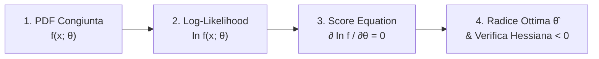

> [!WARNING] Trabocchetti d'Esame: Massimi Locali e Supporti Dipendenti dal Parametro
> 1. __Verifica della derivata seconda__: L'annullamento del gradiente individua solo i punti stazionari. Dobbiamo sempre assicurarci che la matrice Hessiana sia definita negativa:
>
>    $$
>    \left. \frac{\partial^2 \ln f_{\mathbf{x}}(\mathbf{x}; \boldsymbol{\theta})}{\partial \boldsymbol{\theta} \partial \boldsymbol{\theta}^T} \right|_{\boldsymbol{\theta} = \hat{\boldsymbol{\theta}}_{\text{MLE}}} < \mathbf{0}
>    $$
>
> 2. __Supporti dipendenti dal parametro__: Se il supporto dei dati dipende da $\theta$ (ad esempio campioni uniformi $x[n] \sim \mathcal{U}[0, \theta]$), la verosimiglianza è discontinua. In tal caso le derivate non si annullano e il massimo cade sul bordo del supporto ammissibile ($\hat{\theta}_{\text{MLE}} = \max_n x[n]$).

### Esempio Notevole: Livello DC Pari Alla Varianza Del Rumore

Analizziamo un problema in cui un unico parametro incognito $\theta > 0$ governa simultaneamente sia il valor medio che la varianza del disturbo additivo Gaussiano:

$$
x[n] = \theta + w[n], \quad n = 0, \dots, N-1, \quad w[n] \sim \mathcal{N}(0, \theta)
$$

Applichiamo la sequenza operativa dei quattro passi:

1. __Costruzione della PDF congiunta__:
   Essendo i campioni indipendenti e identicamente distribuiti come $\mathcal{N}(\theta, \theta)$:

   $$
   f_{\mathbf{x}}(\mathbf{x}; \theta) = \prod_{n=0}^{N-1} \frac{1}{\sqrt{2\pi \theta}} \exp\left( -\frac{(x[n] - \theta)^2}{2\theta} \right) = \frac{1}{(2\pi \theta)^{N/2}} \exp\left( -\frac{1}{2\theta} \sum_{n=0}^{N-1} (x[n] - \theta)^2 \right)
   $$

2. __Calcolo della Log-Likelihood Function__:

   $$
   \ln f_{\mathbf{x}}(\mathbf{x}; \theta) = -\frac{N}{2}\ln(2\pi) - \frac{N}{2}\ln(\theta) - \frac{1}{2\theta}\sum_{n=0}^{N-1} (x[n] - \theta)^2
   $$

3. __Derivata rispetto a $\theta$ (Score)__:
   Derivando applicando la regola del prodotto per l'ultimo termine:

   $$
   \frac{\partial \ln f_{\mathbf{x}}(\mathbf{x}; \theta)}{\partial \theta} = -\frac{N}{2\theta} + \frac{1}{2\theta^2}\sum_{n=0}^{N-1} (x[n] - \theta)^2 + \frac{1}{\theta}\sum_{n=0}^{N-1} (x[n] - \theta)
   $$

   Sviluppiamo il quadrato del binomio $\sum (x[n] - \theta)^2 = \sum x^2[n] - 2\theta \sum x[n] + N\theta^2$ nel secondo termine:

   $$
   \frac{1}{2\theta^2} \sum_{n=0}^{N-1} (x[n] - \theta)^2 = \frac{1}{2\theta^2}\sum_{n=0}^{N-1} x^2[n] - \frac{1}{\theta}\sum_{n=0}^{N-1} x[n] + \frac{N}{2}
   $$

   Espandiamo anche il terzo termine: $\frac{1}{\theta}\sum x[n] - \frac{N\theta}{\theta} = \frac{1}{\theta}\sum x[n] - N$.
   Sommando tutti i contributi, i termini lineari $\mp \frac{1}{\theta}\sum x[n]$ si cancellano a vicenda:

   $$
   \frac{\partial \ln f_{\mathbf{x}}(\mathbf{x}; \theta)}{\partial \theta} = -\frac{N}{2\theta} + \left( \frac{N}{2} - N \right) + \frac{1}{2\theta^2}\sum_{n=0}^{N-1} x^2[n] = -\frac{N}{2\theta} - \frac{N}{2} + \frac{1}{2\theta^2}\sum_{n=0}^{N-1} x^2[n]
   $$

   Raccogliendo il fattore comune $\frac{1}{2\theta^2}$:

   $$
   \frac{\partial \ln f_{\mathbf{x}}(\mathbf{x}; \theta)}{\partial \theta} = \frac{1}{2\theta^2} \left[ -N\theta^2 - N\theta + \sum_{n=0}^{N-1} x^2[n] \right]
   $$

4. __Risoluzione dell'equazione di score__:
   Imponiamo l'annullamento della derivata:

   $$
   -N\theta^2 - N\theta + \sum_{n=0}^{N-1} x^2[n] = 0 \iff \theta^2 + \theta - \frac{1}{N}\sum_{n=0}^{N-1} x^2[n] = 0
   $$

   Risolviamo l'equazione algebrica di secondo grado. Poiché il discriminante è maggiore di 1 e il parametro rappresenta una varianza fisica ($\theta > 0$), scartiamo la radice negativa e conserviamo l'unica radice ammissibile:

   $$
   \hat{\theta}_{\text{MLE}} = -\frac{1}{2} + \sqrt{\frac{1}{4} + \frac{1}{N}\sum_{n=0}^{N-1} x^2[n]}
   $$

#### Informazione Di Fisher E Limite Di Cramer-Rao

Calcoliamo la derivata seconda della log-verosimiglianza:

$$
\frac{\partial^2 \ln f_{\mathbf{x}}(\mathbf{x}; \theta)}{\partial \theta^2} = \frac{N}{2\theta^2} - \frac{1}{\theta^3}\sum_{n=0}^{N-1} x^2[n]
$$

Ricordando che per ciascun campione $\mathbb{E}[x^2[n]] = \text{Var}\{x[n]\} + (\mathbb{E}[x[n]])^2 = \theta + \theta^2$:

$$
\mathbb{E}\left[ \frac{\partial^2 \ln f_{\mathbf{x}}(\mathbf{x}; \theta)}{\partial \theta^2} \right] = \frac{N}{2\theta^2} - \frac{N(\theta + \theta^2)}{\theta^3} = \frac{N}{2\theta^2} - \frac{N}{\theta^2} - \frac{N}{\theta} = -\frac{N(2\theta + 1)}{2\theta^2}
$$

L'Informazione di Fisher vale quindi:

$$
I(\theta) = -\mathbb{E}\left[ \frac{\partial^2 \ln f_{\mathbf{x}}(\mathbf{x}; \theta)}{\partial \theta^2} \right] = \frac{N(2\theta + 1)}{2\theta^2}
$$

da cui otteniamo il limite inferiore di Cramer-Rao:

$$
\text{Var}\{\hat{\theta}\} \ge \frac{1}{I(\theta)} = \frac{2\theta^2}{(2\theta + 1)N}
$$

Lo stimatore $\hat{\theta}_{\text{MLE}}$ risulta asintoticamente non polarizzato e asintoticamente efficiente, raggiungendo con uguaglianza il CRLB quando il numero di campioni $N$ tende a infinito.

### Proprietà Asintotiche: Consistenza, Efficienza E Normalità

Mentre il BLUE garantisce ottimalità a campioni finiti ma limitatamente agli stimatori lineari, il MLE fonda la sua superiorità su proprietà asintotiche universali: al crescere di $N \to \infty$, sotto condizioni di regolarità, il MLE raggiunge prestazioni ottimali.

1. __Consistenza e Asintotica Non Polarizzazione__:
   Lo stimatore converge in probabilità al vero valore incognito del parametro e il suo valor medio tende al parametro al crescere del numero di dati:

   $$
   \hat{\boldsymbol{\theta}}_{\text{MLE}} \xrightarrow{p} \boldsymbol{\theta} \quad \text{e} \quad \lim_{N \to \infty} \mathbb{E}[\hat{\boldsymbol{\theta}}_{\text{MLE}}] = \boldsymbol{\theta}
   $$

2. __Efficienza Asintotica__:
   All'aumentare dei campioni, la matrice di covarianza del MLE converge all'inversa della matrice di Informazione di Fisher (__FIM__), raggiungendo il CRLB con uguaglianza:

   $$
   \lim_{N \to \infty} \mathbf{C}_{\hat{\boldsymbol{\theta}}_{\text{MLE}}} \mathbf{I}(\boldsymbol{\theta}) = \mathbf{I}_P
   $$

   Inoltre, se a campioni finiti esiste uno stimatore efficiente che soddisfa il CRLB con uguaglianza, l'equazione di verosimiglianza individua esattamente quell'MVU.
3. __Normalità Asintotica__:
   La distribuzione dello stimatore converge in legge a una distribuzione Gaussiana centrata nel valore vero del parametro:

   $$
   \hat{\boldsymbol{\theta}}_{\text{MLE}} \xrightarrow{a} \mathcal{N}\left( \boldsymbol{\theta}, \mathbf{I}^{-1}(\boldsymbol{\theta}) \right)
   $$

   Questo risultato consente di costruire intervalli di confidenza analitici ed eseguire test di ipotesi anche quando la distribuzione esatta a campioni finiti è sconosciuta o intrattabile.

### Principio Di Invarianza Funzionale E Teorema Di Zehna

Una proprietà esclusiva del MLE è l'__invarianza per trasformazioni continue arbitrarie__.

Sia $\hat{\boldsymbol{\theta}}_{\text{MLE}}$ lo stimatore di massima verosimiglianza di $\boldsymbol{\theta} \in \Theta$. Se siamo interessati alla stima di una funzione arbitraria del parametro:

$$
\boldsymbol{\alpha} = \mathbf{g}(\boldsymbol{\theta})
$$

dove $\mathbf{g}: \Theta \to \Omega$ è una funzione continua (non necessariamente lineare né biunivoca), allora lo stimatore MLE di $\boldsymbol{\alpha}$ è semplicemente la trasformazione della stima originaria:

$$
\hat{\boldsymbol{\alpha}}_{\text{MLE}} = \mathbf{g}\left( \hat{\boldsymbol{\theta}}_{\text{MLE}} \right)
$$

> [!IMPORTANT] Il Divario Concettuale tra MLE e MVU
> Il Teorema di Zehna (1966) stabilisce una superiorità operativa del MLE rispetto all'MVU.
> L'operatore valore atteso non commuta con funzioni non lineari: $\mathbb{E}[g(\hat{\theta})] \ne g(\mathbb{E}[\hat{\theta}])$. Di conseguenza, se $\hat{\theta}_{\text{MVU}}$ è l'MVU di $\theta$, $g(\hat{\theta}_{\text{MVU}})$ __non è l'MVU__ di $g(\theta)$, richiedendo una nuova ricerca analitica complessa.
> Il MLE risolve il problema all'istante: basta applicare la funzione $g(\cdot)$ alla stima già trovata.
> La dimostrazione formale tramite la funzione di verosimiglianza indotta è riportata in [[Anno 1/Information and Estimation Theory/zz. Argomenti extra#Teorema di Zehna e Invarianza del MLE per Funzioni Non Biunivoche|zz. Argomenti extra]].

### Modello Bivariato: Livello DC E Varianza Incogniti

Consideriamo $N$ campioni indipendenti e identicamente distribuiti provenienti da un processo Gaussiano in cui sia il livello medio $\theta_1$ sia la varianza del disturbo $\theta_2 = \sigma_w^2$ sono incogniti:

$$
x[n] = \theta_1 + w[n], \quad w[n] \sim \mathcal{N}(0, \theta_2), \quad n = 0, \dots, N-1
$$

Il vettore dei parametri da identificare è $\boldsymbol{\theta} = [\theta_1, \theta_2]^T$ con $\theta_2 > 0$.

La funzione di verosimiglianza è il prodotto delle $N$ gaussiane marginali:

$$
f_{\mathbf{x}}(\mathbf{x}; \boldsymbol{\theta}) = \frac{1}{(2\pi \theta_2)^{N/2}} \exp\left( -\frac{1}{2\theta_2} \sum_{n=0}^{N-1} (x[n] - \theta_1)^2 \right)
$$

La Log-Likelihood vale:

$$
\ln f_{\mathbf{x}}(\mathbf{x}; \boldsymbol{\theta}) = -\frac{N}{2} \ln(2\pi) - \frac{N}{2} \ln(\theta_2) - \frac{1}{2\theta_2} \sum_{n=0}^{N-1} (x[n] - \theta_1)^2
$$

Calcoliamo le derivate parziali del gradiente rispetto ai due parametri:

$$
\frac{\partial \ln f_{\mathbf{x}}(\mathbf{x}; \boldsymbol{\theta})}{\partial \theta_1} = \frac{1}{\theta_2} \sum_{n=0}^{N-1} (x[n] - \theta_1)
$$

$$
\frac{\partial \ln f_{\mathbf{x}}(\mathbf{x}; \boldsymbol{\theta})}{\partial \theta_2} = -\frac{N}{2\theta_2} + \frac{1}{2\theta_2^2} \sum_{n=0}^{N-1} (x[n] - \theta_1)^2
$$

Annullando simultaneamente le equazioni di score:
1. Dalla prima derivata ricaviamo la stima della media:

   $$
   \sum_{n=0}^{N-1} (x[n] - \theta_1) = 0 \implies \hat{\theta}_1 = \frac{1}{N}\sum_{n=0}^{N-1} x[n] = \bar{x}
   $$

2. Sostituendo $\hat{\theta}_1 = \bar{x}$ nella seconda derivata ricaviamo la stima della varianza:

   $$
   -\frac{N}{2\theta_2} + \frac{1}{2\theta_2^2}\sum_{n=0}^{N-1} (x[n] - \bar{x})^2 = 0 \implies \hat{\theta}_2 = \frac{1}{N}\sum_{n=0}^{N-1} (x[n] - \bar{x})^2
   $$

#### Analisi Della Polarizzazione E Della Covarianza

Analizziamo il comportamento statistico delle due stime ottenute:
- Per il livello DC: $\mathbb{E}[\hat{\theta}_1] = \frac{1}{N}\sum \mathbb{E}[x[n]] = \theta_1$. La stima della media è __esattamente non polarizzata__ per qualunque dimensione $N$.
- Per la varianza: in virtù del Teorema di Cochran per campioni gaussiani, la variabile $\frac{1}{\theta_2}\sum_{n=0}^{N-1}(x[n] - \bar{x})^2$ segue una distribuzione Chi-quadro con $N-1$ gradi di libertà ($\chi^2_{N-1}$), il cui valore atteso vale $N-1$:

  $$
  \mathbb{E}[\hat{\theta}_2] = \frac{\theta_2}{N} \mathbb{E}\left[ \chi^2_{N-1} \right] = \frac{N-1}{N} \theta_2
  $$

A campioni finiti lo stimatore MLE della varianza è __polarizzato per difetto__:

$$
b(\hat{\theta}_2) = \mathbb{E}[\hat{\theta}_2] - \theta_2 = -\frac{\theta_2}{N}
$$

Tuttavia, quando $N \to \infty$:

$$
\lim_{N \to \infty} \mathbb{E}[\hat{\theta}_2] = \lim_{N \to \infty} \frac{N-1}{N}\theta_2 = \theta_2
$$

Il bias decade come $1/N$, confermando l'asintotica non polarizzazione del MLE.

La matrice di covarianza esatta a campioni finiti è diagonale (poiché per variabili normali media campionaria e varianza campionaria sono statisticamente indipendenti):

$$
\mathbf{C}_{\hat{\boldsymbol{\theta}}} = \begin{bmatrix} \frac{\theta_2}{N} & 0 \\ 0 & \frac{2(N-1)\theta_2^2}{N^2} \end{bmatrix}
$$

Al tendere di $N \to \infty$:

$$
\mathbf{C}_{\hat{\boldsymbol{\theta}}} \xrightarrow{N \to \infty} \begin{bmatrix} \frac{\theta_2}{N} & 0 \\ 0 & \frac{2\theta_2^2}{N} \end{bmatrix} = \mathbf{I}^{-1}(\boldsymbol{\theta})
$$

dove $\mathbf{I}(\boldsymbol{\theta}) = \text{diag}\left( \frac{N}{\theta_2}, \frac{N}{2\theta_2^2} \right)$ è l'esatta matrice di informazione di Fisher, dimostrando la convergenza all'efficienza asintotica.

### MLE per Il Modello Lineare Gaussiano Ed Equivalenza Con BLUE E MVU

Consideriamo il modello lineare vettoriale in presenza di rumore Gaussiano colorato:

$$
\mathbf{x} = \mathbf{H}\boldsymbol{\theta} + \mathbf{w}, \quad \mathbf{w} \sim \mathcal{N}(\mathbf{0}, \mathbf{C}_{\mathbf{x}\mathbf{x}})
$$

con $\mathbf{H} \in \mathbb{R}^{N \times P}$ di rango pieno $P$ e $\mathbf{C}_{\mathbf{x}\mathbf{x}}$ matrice di covarianza nota e definita positiva.

La PDF congiunta è la normale multivariata:

$$
f_{\mathbf{x}}(\mathbf{x}; \boldsymbol{\theta}) = \frac{1}{(2\pi)^{N/2} \det(\mathbf{C}_{\mathbf{x}\mathbf{x}})^{1/2}} \exp\left( -\frac{1}{2} (\mathbf{x} - \mathbf{H}\boldsymbol{\theta})^T \mathbf{C}_{\mathbf{x}\mathbf{x}}^{-1} (\mathbf{x} - \mathbf{H}\boldsymbol{\theta}) \right)
$$

La Log-Likelihood vale:

$$
\ln f_{\mathbf{x}}(\mathbf{x}; \boldsymbol{\theta}) = -\frac{1}{2}\ln\left[ (2\pi)^N \det(\mathbf{C}_{\mathbf{x}\mathbf{x}}) \right] - \frac{1}{2} (\mathbf{x} - \mathbf{H}\boldsymbol{\theta})^T \mathbf{C}_{\mathbf{x}\mathbf{x}}^{-1} (\mathbf{x} - \mathbf{H}\boldsymbol{\theta})
$$

Calcoliamo il gradiente rispetto al vettore dei parametri $\boldsymbol{\theta}$:

$$
\frac{\partial \ln f_{\mathbf{x}}(\mathbf{x}; \boldsymbol{\theta})}{\partial \boldsymbol{\theta}} = \mathbf{H}^T \mathbf{C}_{\mathbf{x}\mathbf{x}}^{-1} (\mathbf{x} - \mathbf{H}\boldsymbol{\theta})
$$

Annullando il gradiente otteniamo:

$$
\mathbf{H}^T \mathbf{C}_{\mathbf{x}\mathbf{x}}^{-1} (\mathbf{x} - \mathbf{H}\hat{\boldsymbol{\theta}}) = \mathbf{0} \implies \mathbf{H}^T \mathbf{C}_{\mathbf{x}\mathbf{x}}^{-1} \mathbf{H} \hat{\boldsymbol{\theta}} = \mathbf{H}^T \mathbf{C}_{\mathbf{x}\mathbf{x}}^{-1} \mathbf{x}
$$

Essendo $\mathbf{H}^T \mathbf{C}_{\mathbf{x}\mathbf{x}}^{-1} \mathbf{H}$ non singolare, ricaviamo la stima MLE:

$$
\hat{\boldsymbol{\theta}}_{\text{MLE}} = (\mathbf{H}^T \mathbf{C}_{\mathbf{x}\mathbf{x}}^{-1} \mathbf{H})^{-1} \mathbf{H}^T \mathbf{C}_{\mathbf{x}\mathbf{x}}^{-1} \mathbf{x}
$$

con matrice di covarianza:

$$
\mathbf{C}_{\hat{\boldsymbol{\theta}}_{\text{MLE}}} = (\mathbf{H}^T \mathbf{C}_{\mathbf{x}\mathbf{x}}^{-1} \mathbf{H})^{-1} = \mathbf{I}^{-1}(\boldsymbol{\theta})
$$

> [!NOTE] Teorema di Equivalenza per Modelli Lineari Gaussiani
> Per un modello di osservazione lineare con rumore additivo Gaussiano, le tre grandi teorie della stima classica convergono sulla medesima soluzione algebrica:
>
> $$
> \hat{\boldsymbol{\theta}}_{\text{MVU}} \equiv \hat{\boldsymbol{\theta}}_{\text{BLUE}} \equiv \hat{\boldsymbol{\theta}}_{\text{MLE}} = (\mathbf{H}^T \mathbf{C}_{\mathbf{x}\mathbf{x}}^{-1} \mathbf{H})^{-1} \mathbf{H}^T \mathbf{C}_{\mathbf{x}\mathbf{x}}^{-1} \mathbf{x}
> $$
>
> Tale stimatore è rigorosamente non polarizzato a campioni finiti e raggiunge esattamente il CRLB.

## Stimatore Ai Minimi Quadrati (LSE)

Nelle applicazioni sperimentali capita di frequente di non possedere alcuna informazione statistica sulla sorgente di rumore: non conosciamo la forma funzionale della PDF (escludendo il MLE) né possediamo una matrice di covarianza attendibile (escludendo il BLUE).

Lo __stimatore ai minimi quadrati__ (__LSE__, _Least Squares Estimator_) supera questa assenza di modelli probabilistici adottando un approccio puramente deterministico e geometrico: cerca il parametro che minimizza l'energia dello scarto quadratico tra le misure reali e il segnale nominale atteso.

### Filosofia Deterministica E Funzione Di Costo Dei Residui

Scriviamo il modello dei dati separando il segnale teorico dal residuo di misura:

$$
x[n] = s[n; \boldsymbol{\theta}] + e[n], \quad n = 0, 1, \dots, N-1
$$

dove $s[n; \boldsymbol{\theta}]$ è la traiettoria deterministica nominale dipendente dal parametro incognito $\boldsymbol{\theta}$, ed $e[n]$ è l'errore residuo di approssimazione (senza alcuna attribuzione di variabile aleatoria).

L'approccio dei minimi quadrati definisce la funzione di costo come la somma delle discrepanze quadratiche:

$$
J(\boldsymbol{\theta}) = \sum_{n=0}^{N-1} e^2[n] = \sum_{n=0}^{N-1} (x[n] - s[n; \boldsymbol{\theta}])^2
$$

La stima LSE corrisponde all'argomento che minimizza globalmente $J(\boldsymbol{\theta})$.

### Esempi Notabili Scalari: Livello Costante E Forma d'Onda Scalata

#### Livello DC Costante

Se il segnale nominale è una costante scalare, $s[n; \theta] = \theta$:

$$
J(\theta) = \sum_{n=0}^{N-1} (x[n] - \theta)^2
$$

Minimizziamo derivando rispetto a $\theta$:

$$
\frac{\partial J(\theta)}{\partial \theta} = -2 \sum_{n=0}^{N-1} (x[n] - \theta) = 0 \implies \sum_{n=0}^{N-1} x[n] = N \theta \implies \hat{\theta}_{\text{LSE}} = \frac{1}{N} \sum_{n=0}^{N-1} x[n] = \bar{x}
$$

La stima ai minimi quadrati di un livello continuo coincide con la media aritmetica delle osservazioni.

#### Forma d'Onda Nota Scalata in Ampiezza

Se il segnale target è la replica scalata di una sequenza deterministica nota $h[n]$, $s[n; \theta] = \theta h[n]$:

$$
J(\theta) = \sum_{n=0}^{N-1} (x[n] - \theta h[n])^2
$$

Calcoliamo la derivata e la poniamo a zero:

$$
\frac{\partial J(\theta)}{\partial \theta} = -2 \sum_{n=0}^{N-1} (x[n] - \theta h[n]) h[n] = 0 \implies \sum_{n=0}^{N-1} x[n] h[n] = \theta \sum_{n=0}^{N-1} h^2[n]
$$

da cui ricaviamo la stima:

$$
\hat{\theta}_{\text{LSE}} = \frac{\sum_{n=0}^{N-1} x[n] h[n]}{\sum_{n=0}^{N-1} h^2[n]}
$$

La stima LSE coincide con la correlazione incrociata tra il segnale registrato e la forma d'onda nominale, normalizzata per l'energia totale della forma d'onda.

### Formulazione Vettoriale Ed Equazioni Normali

Nel caso vettoriale, consideriamo un segnale legato linearmente a $P$ parametri $\boldsymbol{\theta} \in \mathbb{R}^P$:

$$
\mathbf{s} = \mathbf{H}\boldsymbol{\theta}
$$

dove $\mathbf{H} \in \mathbb{R}^{N \times P}$ è la matrice di osservazione deterministica a rango pieno colonna $\text{rk}(\mathbf{H}) = P \le N$.

Il modello vettoriale delle osservazioni è:

$$
\mathbf{x} = \mathbf{s} + \mathbf{e} = \mathbf{H}\boldsymbol{\theta} + \mathbf{e}
$$

La funzione di costo ai minimi quadrati corrisponde alla norma euclidea al quadrato del vettore residuo $\mathbf{e} = \mathbf{x} - \mathbf{H}\boldsymbol{\theta}$:

$$
J(\boldsymbol{\theta}) = \|\mathbf{x} - \mathbf{H}\boldsymbol{\theta}\|^2 = (\mathbf{x} - \mathbf{H}\boldsymbol{\theta})^T (\mathbf{x} - \mathbf{H}\boldsymbol{\theta})
$$

Espandiamo la forma quadratica:

$$
J(\boldsymbol{\theta}) = \mathbf{x}^T \mathbf{x} - \mathbf{x}^T \mathbf{H}\boldsymbol{\theta} - \boldsymbol{\theta}^T \mathbf{H}^T \mathbf{x} + \boldsymbol{\theta}^T \mathbf{H}^T \mathbf{H} \boldsymbol{\theta} = \mathbf{x}^T \mathbf{x} - 2 \boldsymbol{\theta}^T \mathbf{H}^T \mathbf{x} + \boldsymbol{\theta}^T \mathbf{H}^T \mathbf{H} \boldsymbol{\theta}
$$

Calcoliamo il gradiente rispetto al vettore dei parametri $\boldsymbol{\theta}$:

$$
\frac{\partial J(\boldsymbol{\theta})}{\partial \boldsymbol{\theta}} = -2 \mathbf{H}^T \mathbf{x} + 2 \mathbf{H}^T \mathbf{H}\boldsymbol{\theta}
$$

Annullando il gradiente:

$$
-2 \mathbf{H}^T \mathbf{x} + 2 \mathbf{H}^T \mathbf{H}\hat{\boldsymbol{\theta}}_{\text{LSE}} = \mathbf{0} \implies \mathbf{H}^T \mathbf{H} \hat{\boldsymbol{\theta}}_{\text{LSE}} = \mathbf{H}^T \mathbf{x}
$$

Il sistema lineare $\mathbf{H}^T \mathbf{H} \hat{\boldsymbol{\theta}} = \mathbf{H}^T \mathbf{x}$ è noto come __Equazioni Normali__. Poiché le colonne di $\mathbf{H}$ sono linearmente indipendenti, la matrice simmetrica di Gram $\mathbf{H}^T \mathbf{H} \in \mathbb{R}^{P \times P}$ è strettamente definita positiva ed invertibile.

Otteniamo la stima LSE in forma chiusa:

$$
\hat{\boldsymbol{\theta}}_{\text{LSE}} = (\mathbf{H}^T \mathbf{H})^{-1} \mathbf{H}^T \mathbf{x}
$$

### Principio Di Ortogonalità E Geometria Della Proiezione (Hat Matrix)

Riscriviamo le equazioni normali mettendo in evidenza il vettore dei residui ottimali $\hat{\mathbf{e}} = \mathbf{x} - \hat{\mathbf{s}} = \mathbf{x} - \mathbf{H}\hat{\boldsymbol{\theta}}_{\text{LSE}}$:

$$
\mathbf{H}^T (\mathbf{x} - \mathbf{H}\hat{\boldsymbol{\theta}}_{\text{LSE}}) = \mathbf{0} \iff \mathbf{H}^T \hat{\mathbf{e}} = \mathbf{0}
$$

Esprimendo il prodotto matrice-vettore attraverso le $P$ colonne $\mathbf{h}_0, \mathbf{h}_1, \dots, \mathbf{h}_{P-1}$ della matrice $\mathbf{H}$:

$$
\mathbf{h}_i^T \hat{\mathbf{e}} = 0 \quad \forall i = 0, 1, \dots, P-1
$$

Questo risultato costituisce il __Principio di Ortogonalità__: il vettore residuo ottimo $\hat{\mathbf{e}}$ è perpendicolare a ciascuna colonna di $\mathbf{H}$, e risulta quindi ortogonale all'intero sottospazio delle colonne $\mathcal{R}(\mathbf{H}) \subset \mathbb{R}^N$.

![[slide_68_geometrical_interpretation_lse.png|center mid]]

La stima del segnale nominale $\hat{\mathbf{s}}$ appartiene al sottospazio $\mathcal{R}(\mathbf{H})$ ed è ottenuta mediante proiezione ortogonale:

$$
\hat{\mathbf{s}} = \mathbf{H}\hat{\boldsymbol{\theta}}_{\text{LSE}} = \mathbf{H}(\mathbf{H}^T \mathbf{H})^{-1}\mathbf{H}^T \mathbf{x} = \mathbf{P}_{\mathbf{H}} \mathbf{x}
$$

dove la matrice $\mathbf{P}_{\mathbf{H}} \in \mathbb{R}^{N \times N}$:

$$
\mathbf{P}_{\mathbf{H}} = \mathbf{H}(\mathbf{H}^T \mathbf{H})^{-1}\mathbf{H}^T
$$

è la __matrice di proiezione ortogonale__ (o _Hat Matrix_, poiché mette il cappello $\hat{\mathbf{s}}$ al dato grezzo $\mathbf{x}$).

Il vettore residuo è la proiezione sul sottospazio complemento ortogonale $\mathcal{R}(\mathbf{H})^\perp$:

$$
\hat{\mathbf{e}} = \mathbf{x} - \hat{\mathbf{s}} = (\mathbf{I}_N - \mathbf{P}_{\mathbf{H}}) \mathbf{x} = \mathbf{P}_{\mathbf{H}}^\perp \mathbf{x}
$$

> [!TIP] Proprietà Geometriche della Hat Matrix da Ricordare per l'Esame
> 1. __Simmetria__: $\mathbf{P}_{\mathbf{H}}^T = \mathbf{P}_{\mathbf{H}}$ e $(\mathbf{P}_{\mathbf{H}}^\perp)^T = \mathbf{P}_{\mathbf{H}}^\perp$.
> 2. __Idempotenza__: $\mathbf{P}_{\mathbf{H}}^2 = \mathbf{P}_{\mathbf{H}}$ (proiettare due volte su uno stesso sottospazio non altera il vettore già proiettato).
> 3. __Traccia e Rango__: $\text{tr}(\mathbf{P}_{\mathbf{H}}) = \text{rk}(\mathbf{H}) = P$ e $\text{tr}(\mathbf{P}_{\mathbf{H}}^\perp) = N - P$.
> 4. __Teorema di Pitagora Energetico__: Poiché $\hat{\mathbf{s}} \perp \hat{\mathbf{e}}$, le energie si scompongono esattamente:
>
>    $$
>    \|\mathbf{x}\|^2 = \|\hat{\mathbf{s}}\|^2 + \|\hat{\mathbf{e}}\|^2
>    $$
>
> Le dimostrazioni dettagliate delle proprietà algebriche della Hat Matrix sono riportate in [[Anno 1/Information and Estimation Theory/zz. Argomenti extra#Proprietà Geometriche della Matrice di Proiezione Ortogonale nei Minimi Quadrati|zz. Argomenti extra]].

### Regressione Polinomiale, Matrice Di Vandermonde E Sovradattamento

Il modello LSE vettoriale permette di approssimare andamenti temporali continui o campionati tramite polinomi di grado $P-1$:

$$
s[n; \boldsymbol{\theta}] = \sum_{k=0}^{P-1} \theta_k n^k
$$

In questo caso la matrice di osservazione $\mathbf{H}$ assume la caratteristica struttura di una __matrice di Vandermonde__:

$$
\mathbf{H} = \begin{bmatrix} 1 & 0 & 0 & \dots & 0 \\ 1 & 1 & 1 & \dots & 1 \\ 1 & 2 & 4 & \dots & 2^{P-1} \\ \vdots & \vdots & \vdots & \ddots & \vdots \\ 1 & N-1 & (N-1)^2 & \dots & (N-1)^{P-1} \end{bmatrix}
$$

Nell'analisi dei prezzi del mercato elettrico italiano (dati ufficiali GME da gennaio 2020 a settembre 2021), possiamo confrontare modelli polinomiali di complessità crescente: lineare ($P=2$), quadratico ($P=3$) e polinomiale di quarto grado ($P=5$):

![[slide_65_linear_lse_electricity_market.png|center mid]]

> [!WARNING] Il Compromesso del Grado Polinomiale: Overfitting
> All'aumentare del grado del polinomio $P$, la dimensione del sottospazio $\mathcal{R}(\mathbf{H})$ cresce e l'energia del residuo d'errore $\|\hat{\mathbf{e}}\|^2$ diminuisce monotonicamente fino ad azzerarsi quando $P=N$.
> Tuttavia, un grado eccessivo innesca fenomeni di __sovradattamento__ (_overfitting_): il polinomio interpola il rumore puntuale e sviluppa oscillazioni incontrollate tra i campioni, degradando drasticamente la capacità predittiva su nuove misure.

### Confronto Operativo: Line Fitting Deterministico Vs Line Fitting Statistico

Nel problema cardine dell'adattamento di una retta a campioni rumorosi:

$$
x[n] = \theta_1 + \theta_2 n + e[n], \quad n = 0, \dots, N-1
$$

la matrice di osservazione $N \times 2$ e il vettore dei parametri $\boldsymbol{\theta} = [\theta_1, \theta_2]^T$ assumono la forma:

$$
\mathbf{H} = \begin{bmatrix} 1 & 0 \\ 1 & 1 \\ \vdots & \vdots \\ 1 & N-1 \end{bmatrix}
$$

![[slide_69_line_fitting_lse_data.png|center small]] ![[line_fitting_lever_arm.svg|center small]]

Possiamo inquadrare il problema secondo due paradigmi complementari:
1. __Approccio Deterministico (LSE)__: Consideriamo i residui $e[n]$ come semplici scarti geometrici verticali. La retta ottima è calcolata tramite la proiezione algebrica $\hat{\boldsymbol{\theta}}_{\text{LSE}} = (\mathbf{H}^T\mathbf{H})^{-1}\mathbf{H}^T\mathbf{x}$. Non facciamo alcuna ipotesi statistica e non possiamo assegnare un'incertezza o varianza alla stima trovata.
2. __Approccio Statistico (BLUE / MLE)__: Modelliamo il disturbo come processo stocastico $w[n]$ con matrice di covarianza nota $\mathbf{C}_{\mathbf{x}\mathbf{x}}$. La stima ottima $\hat{\boldsymbol{\theta}} = (\mathbf{H}^T\mathbf{C}_{\mathbf{x}\mathbf{x}}^{-1}\mathbf{H})^{-1}\mathbf{H}^T\mathbf{C}_{\mathbf{x}\mathbf{x}}^{-1}\mathbf{x}$ possiede una matrice di covarianza teorica esatta. Come evidenziato dal grafico del braccio di leva temporale $L \approx N$, i campioni alle estremità temporali ($n=0$ e $n=N-1$) esercitano il massimo momento torcente sulla stima della pendenza $\theta_2$, determinando una varianza che decade come $O(1/N^3)$, a fronte del decadimento $O(1/N)$ dell'intercetta $\theta_1$.

## Quadro Comparativo Degli Stimatori Classici

Sintetizziamo requisiti informativi, proprietà statistiche e complessità computazionale dei tre stimatori classici esaminati:

| Proprietà Fondamentale | BLUE (Best Linear Unbiased) | MLE (Maximum Likelihood) | LSE (Least Squares) |
| :--- | :--- | :--- | :--- |
| __Prerequisito sui Dati__ | Media $\mathbb{E}[\mathbf{x}] = \mathbf{H}\boldsymbol{\theta}$ e covarianza $\mathbf{C}_{\mathbf{x}\mathbf{x}}$ | PDF congiunta $f_{\mathbf{x}}(\mathbf{x}; \boldsymbol{\theta})$ completamente nota | Nessun modello probabilistico per $e[n]$ (solo modello deterministico) |
| __Classe dello Stimatore__ | Ristretta agli operatori lineari $\mathbf{A}\mathbf{x}$ | Illimitata (qualsiasi operatore non lineare) | Proiezione lineare sulle colonne di $\mathbf{H}$ (se segnale lineare) |
| __Ottimalità a Campioni Finiti__ | Ottimo (minima varianza) entro la classe lineare | Non garantita (spesso polarizzato per $N$ piccolo) | Minimizza l'energia geometrica dei residui $\|\mathbf{e}\|^2$ |
| __Prestazioni Asintotiche__ | Rimane il migliore stimatore lineare | Asintoticamente non polarizzato, efficiente (raggiunge il CRLB) e Gaussiano | Deterministico (nessuna nozione asintotica probabilistica) |
| __Invarianza a Trasformazioni__ | Non preservata ($\mathbf{g}(\hat{\boldsymbol{\theta}})$ non è BLUE di $\mathbf{g}(\boldsymbol{\theta})$) | Perfetta invarianza per qualsiasi trasformazione continua (Teorema di Zehna) | Non invariante |
| __Complessità di Calcolo__ | Risoluzione di un sistema lineare (inversione matriciale $P \times P$) | Massimizzazione numerica (potenzialmente non convessa e multimodale) | Inversione matriciale $\mathbf{H}^T\mathbf{H}$ (minimi quadrati lineari) |
| __Robustezza del Modello__ | Robusto a errori di forma della PDF (dipende solo dai primi 2 momenti) | Sensibile a discrepanze o assunzioni errate sulla PDF ipotizzata | Massima robustezza (non assume alcuna distribuzione) |

### Criteri Operativi per la Selezione Dello Stimatore all'Esame

1. __Adottare il BLUE quando__:
   - Il legame tra il segnale utile e i parametri è strettamente lineare ($\mathbf{s} = \mathbf{H}\boldsymbol{\theta}$).
   - Conosciamo la funzione di autocorrelazione o la covarianza del rumore, ma la PDF è ignota, non Gaussiana o complessa.
   - Esigiamo uno stimatore sicuramente non polarizzato a campioni finiti con complessità analitica fissa (inversione di una matrice $P \times P$).
2. __Adottare il MLE quando__:
   - Conosciamo la PDF congiunta dei dati osservati (modelli Gaussiani, Poissoniani, Esponenziali, ecc.).
   - Il legame tra osservazioni e parametri è non lineare, precludendo a priori l'impiego del BLUE.
   - Disponiamo di un numero di campioni $N$ sufficientemente elevato da beneficiare dell'efficienza asintotica e della normalità asintotica per il calcolo di intervalli di confidenza.
   - Dobbiamo stimare una funzione complessa o non invertibile di parametri (sfruttando l'invarianza del Teorema di Zehna).
3. __Adottare il LSE quando__:
   - Non disponiamo di alcuna descrizione probabilistica affidabile sul rumore di misura.
   - Desideriamo eseguire un fitting geometrico deterministico rapido (regressione polinomiale, filtraggio spaziale) riducendo al minimo l'energia degli scarti tra modello e misure.


# 2. Stima Bayesiana - MMSE E LMMSE

La teoria della stima __classica__ (o frequentista) considera il parametro incognito $\theta$ come una costante deterministica priva di distribuzione di probabilità. In tale contesto, l'errore quadratico medio dipende inesorabilmente dal valore vero del parametro, e individuare stimatori non polarizzati a varianza minima uniformemente ottimi (__MVU__) richiede requisiti analitici stringenti, quali il raggiungimento del CRLB a campioni finiti o l'esistenza di statistiche sufficienti complete.

Negli scenari ingegneristici reali, tuttavia, disponiamo quasi sempre di __informazione a priori__ sul fenomeno fisico prima ancora di raccogliere i campioni sperimentali:
- Limiti fisici sui range di escursione di grandezze cinematiche, termiche o robotiche.
- Conoscenza statistica consolidata da campagne di misura storiche o modelli fenomenologici.
- Incertezza strutturale quantificabile mediante una densità di probabilità nota.

La __Stima Bayesiana__ incorpora esplicitamente questa conoscenza modellando il parametro incognito non più come una costante, ma come una __variabile aleatoria__ $\theta$. Questa transizione concettuale ridefinisce la metrica di errore quadratico medio e conduce a stimatori sempre calcolabili, esenti dalle problematiche di non esistenza tipiche della stima classica.

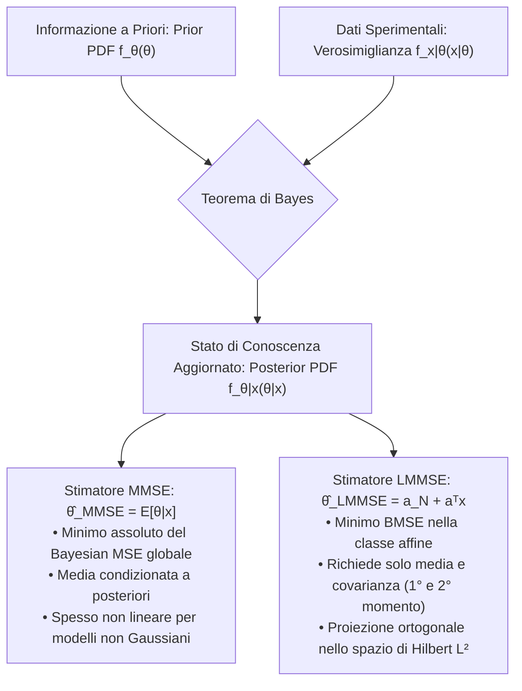

## Fondamenti Della Stima Bayesiana

### Cambio Di Paradigma: Parametri Deterministici Vs Variabili Aleatorie

Nel paradigma classico, l'unica sorgente di aleatorietà risiede nel rumore di misura $\mathbf{w}$ che corrompe le osservazioni: la PDF dei dati $f_{\mathbf{x}}(\mathbf{x}; \theta)$ è parametrizzata da un valore costante deterministico $\theta \in \Theta$.

Nel paradigma bayesiano, consideriamo $\theta$ come una variabile aleatoria descritta da una __funzione di densità di probabilità a priori__ (_prior PDF_) $f_\theta(\theta)$, che quantifica il nostro stato di conoscenza sul parametro prima di acquisire i campioni.
Lo spazio probabilistico congiunto modella la coppia di grandezze aleatorie $(\mathbf{x}, \theta)$ attraverso la __PDF congiunta__:

$$
f_{\mathbf{x}, \theta}(\mathbf{x}, \theta) = f_{\mathbf{x} \mid \theta}(\mathbf{x} \mid \theta) f_\theta(\theta)
$$

dove:
- $f_\theta(\theta)$ è la PDF a priori del parametro.
- $f_{\mathbf{x} \mid \theta}(\mathbf{x} \mid \theta)$ è la PDF condizionata dei dati dato il parametro (formalmente coincidente con la funzione di verosimiglianza classica).
- $f_{\mathbf{x}, \theta}(\mathbf{x}, \theta)$ governa la generazione stocastica congiunta di parametro e misure.

Dopo aver acquisito il vettore delle osservazioni campionarie $\mathbf{x} = [x[0], x[1], \dots, x[N-1]]^T$, aggiorniamo il nostro stato di conoscenza applicando il __Teorema di Bayes__, ricavando la __funzione di densità di probabilità a posteriori__ (_posterior PDF_):

$$
f_{\theta \mid \mathbf{x}}(\theta \mid \mathbf{x}) = \frac{f_{\mathbf{x}, \theta}(\mathbf{x}, \theta)}{f_{\mathbf{x}}(\mathbf{x})} = \frac{f_{\mathbf{x} \mid \theta}(\mathbf{x} \mid \theta) f_\theta(\theta)}{\int_{\Theta} f_{\mathbf{x} \mid \theta}(\mathbf{x} \mid \theta) f_\theta(\theta) \mathrm{d}\theta}
$$

Il denominatore $f_{\mathbf{x}}(\mathbf{x}) = \int_{\Theta} f_{\mathbf{x}, \theta}(\mathbf{x}, \theta) \mathrm{d}\theta$ rappresenta la densità marginale dei dati (spesso denominata _evidenza_ o fattore di normalizzazione) ed è calcolata per saturazione rispetto a tutte le configurazioni ammissibili del parametro $\theta$.
Notiamo che, in generale, parametri e osservazioni sono statisticamente dipendenti: $f_{\mathbf{x}, \theta}(\mathbf{x}, \theta) \ne f_{\mathbf{x}}(\mathbf{x}) f_\theta(\theta)$.

### Errore Quadratico Medio Bayesiano (BMSE) Vs MSE Classico

La divergenza operativa tra approccio classico e bayesiano emerge nella definizione della metrica di accuratezza:

1. __MSE Classico__:
   Calcoliamo il valore atteso unicamente rispetto alla distribuzione dei dati $\mathbf{x}$, mantenendo $\theta$ congelato:

   $$
   \text{MSE}\{\hat{\theta}\} = \mathbb{E}_{\mathbf{x}}\left[ (\hat{\theta}(\mathbf{x}) - \theta)^2 \right] = \int_{\mathcal{X}} (\hat{\theta}(\mathbf{x}) - \theta)^2 f_{\mathbf{x}}(\mathbf{x}; \theta) \mathrm{d}\mathbf{x} = \text{Var}\{\hat{\theta}\} + b^2(\theta)
   $$

   L'MSE classico dipende dal valore incognito $\theta$. Minimizzarlo punto per punto per qualsiasi $\theta$ simultaneamente è impossibile, a meno di non imporre vincoli restrittivi (come la perfetta non polarizzazione $b(\theta) = 0$).

2. __Bayesian MSE (BMSE)__:
   Nella formulazione bayesiana, mediamo l'errore quadratico congiuntamente rispetto a tutte le possibili realizzazioni campionarie $\mathbf{x}$ e a tutti i valori ammissibili del parametro $\theta$:

   $$
   B_{\text{MSE}}(\hat{\theta}) = \mathbb{E}_{\mathbf{x}, \theta}\left[ (\theta - \hat{\theta}(\mathbf{x}))^2 \right] = \int_{\mathcal{X}} \int_{\Theta} (\theta - \hat{\theta}(\mathbf{x}))^2 f_{\mathbf{x}, \theta}(\mathbf{x}, \theta) \mathrm{d}\theta \mathrm{d}\mathbf{x}
   $$

   Applicando la legge delle aspettative iterate e condizionando rispetto a $\theta$:

   $$
   B_{\text{MSE}}(\hat{\theta}) = \int_{\Theta} \left[ \int_{\mathcal{X}} (\theta - \hat{\theta}(\mathbf{x}))^2 f_{\mathbf{x} \mid \theta}(\mathbf{x} \mid \theta) \mathrm{d}\mathbf{x} \right] f_\theta(\theta) \mathrm{d}\theta = \mathbb{E}_\theta\left[ \text{MSE}\{\hat{\theta}\} \right]
   $$

   Il BMSE corrisponde al valor medio dell'MSE classico pesato dalla densità a priori $f_\theta(\theta)$. Di conseguenza, il $B_{\text{MSE}}$ è uno __scalare deterministico globale__ indipendente da $\theta$. La sua minimizzazione è un problema di ottimizzazione incondizionato e ben posto su tutto lo spazio di ricerca.

Scomponendo l'MSE classico in varianza e quadrato del bias, otteniamo la decomposizione bayesiana fondamentale:

$$
B_{\text{MSE}}(\hat{\theta}) = \mathbb{E}_\theta\left[ \text{Var}\{\hat{\theta}\} \right] + \mathbb{E}_\theta\left[ b^2(\theta) \right]
$$

## Stimatore a Minimo Errore Quadratico Medio (MMSE)

Lo stimatore a minimo errore quadratico medio (__MMSE__, _Minimum Mean Square Error_) è la regola di decisione ottima che minimizza incondizionatamente il BMSE globale su qualsiasi classe di funzioni ammissibili dei dati $\hat{\theta}(\mathbf{x})$.

### Derivazione dell'Ottimalità Della Media a Posteriori

Per ricavare la struttura ottima dello stimatore, fattorizziamo la PDF congiunta condizionando rispetto alle osservazioni sperimentali $\mathbf{x}$:

$$
B_{\text{MSE}}(\hat{\theta}) = \int_{\mathcal{X}} \left[ \int_{\Theta} (\theta - \hat{\theta}(\mathbf{x}))^2 f_{\theta \mid \mathbf{x}}(\theta \mid \mathbf{x}) \mathrm{d}\theta \right] f_{\mathbf{x}}(\mathbf{x}) \mathrm{d}\mathbf{x}
$$

Poiché la densità marginale dei dati è non negativa ovunque ($f_{\mathbf{x}}(\mathbf{x}) \ge 0$), minimizzare l'integrale complessivo equivale a minimizzare l'integrale interno rispetto alla stima scalare $\hat{\theta}$ per ogni singolo vettore osservato $\mathbf{x}$:

$$
\min_{\hat{\theta}} \int_{\Theta} (\theta - \hat{\theta})^2 f_{\theta \mid \mathbf{x}}(\theta \mid \mathbf{x}) \mathrm{d}\theta
$$

Differenziamo sotto il segno di integrale applicando la regola di Leibniz rispetto alla variabile di decisione $\hat{\theta}$:

$$
\frac{\partial}{\partial \hat{\theta}} \int_{\Theta} (\theta - \hat{\theta})^2 f_{\theta \mid \mathbf{x}}(\theta \mid \mathbf{x}) \mathrm{d}\theta = \int_{\Theta} \frac{\partial}{\partial \hat{\theta}} (\theta - \hat{\theta})^2 f_{\theta \mid \mathbf{x}}(\theta \mid \mathbf{x}) \mathrm{d}\theta = 0
$$

Sviluppando la derivata interna:

$$
-2 \int_{\Theta} (\theta - \hat{\theta}) f_{\theta \mid \mathbf{x}}(\theta \mid \mathbf{x}) \mathrm{d}\theta = 0
$$

Separiamo i due contributi integrali:

$$
\hat{\theta} \int_{\Theta} f_{\theta \mid \mathbf{x}}(\theta \mid \mathbf{x}) \mathrm{d}\theta = \int_{\Theta} \theta f_{\theta \mid \mathbf{x}}(\theta \mid \mathbf{x}) \mathrm{d}\theta
$$

Poiché $f_{\theta \mid \mathbf{x}}(\theta \mid \mathbf{x})$ è una densità di probabilità valida, il suo integrale sul dominio di supporto $\Theta$ vale identicamente $1$:

$$
\int_{\Theta} f_{\theta \mid \mathbf{x}}(\theta \mid \mathbf{x}) \mathrm{d}\theta = 1
$$

Il coefficiente che moltiplica $\hat{\theta}$ collassa a $1$, isolando direttamente la soluzione ottima:

$$
\hat{\theta}_{\text{MMSE}} = \int_{\Theta} \theta f_{\theta \mid \mathbf{x}}(\theta \mid \mathbf{x}) \mathrm{d}\theta = \mathbb{E}_{\theta \mid \mathbf{x}}[\theta \mid \mathbf{x}] = \mu_{\theta \mid \mathbf{x}}
$$

Lo stimatore MMSE coincide con la __media della distribuzione a posteriori__ (_conditional mean_).
Esplicitando il rapporto tra densità congiunta e marginale, otteniamo la formulazione integrale diretta:

$$
\hat{\theta}_{\text{MMSE}} = \frac{\int_{\Theta} \theta f_{\mathbf{x}, \theta}(\mathbf{x}, \theta) \mathrm{d}\theta}{f_{\mathbf{x}}(\mathbf{x})} = \frac{\int_{\Theta} \theta f_{\mathbf{x} \mid \theta}(\mathbf{x} \mid \theta) f_\theta(\theta) \mathrm{d}\theta}{\int_{\Theta} f_{\mathbf{x} \mid \theta}(\mathbf{x} \mid \theta) f_\theta(\theta) \mathrm{d}\theta}
$$

> [!tip] Esistenza e Unicità dello Stimatore MMSE
> A differenza dello stimatore MVU classico (che può non esistere se non vi sono stimatori non polarizzati a varianza minima), lo stimatore bayesiano MMSE __esiste sempre__, purché il primo momento della distribuzione congiunta sia finito ($\mathbb{E}[|\theta|] < \infty$). La dimostrazione geometrica alternativa basata sull'annullamento del doppio prodotto è approfondita in [[Anno 1/Information and Estimation Theory/zz. Argomenti extra#Ottimalità della Media a Posteriori per il Criterio MMSE|zz. Argomenti extra]].

### Procedura Operativa per la Determinazione Del MMSE

Nella pratica d'esame e progettuale, ricaviamo lo stimatore MMSE eseguendo in sequenza quattro passaggi metodici:

1. __Costruzione della PDF Congiunta__: Moltiplichiamo la verosimiglianza condizionata per la prior:

   $$
   f_{\mathbf{x}, \theta}(\mathbf{x}, \theta) = f_{\mathbf{x} \mid \theta}(\mathbf{x} \mid \theta) f_\theta(\theta)
   $$

2. __Calcolo della Marginale dei Dati (Saturazione)__: Integriamo la densità congiunta rispetto a $\theta$:

   $$
   f_{\mathbf{x}}(\mathbf{x}) = \int_{\Theta} f_{\mathbf{x}, \theta}(\mathbf{x}, \theta) \mathrm{d}\theta
   $$

3. __Valutazione della Posterior PDF__: Applichiamo la formula di Bayes dividendo la congiunta per la marginale:

   $$
   f_{\theta \mid \mathbf{x}}(\theta \mid \mathbf{x}) = \frac{f_{\mathbf{x}, \theta}(\mathbf{x}, \theta)}{f_{\mathbf{x}}(\mathbf{x})}
   $$

4. __Integrazione per la Media Condizionata__: Integriamo il parametro pesato dalla posterior per ottenere la stima finale:

   $$
   \hat{\theta}_{\text{MMSE}} = \int_{\Theta} \theta f_{\theta \mid \mathbf{x}}(\theta \mid \mathbf{x}) \mathrm{d}\theta
   $$

### Esempio: Livello DC Con Distribuzione a Priori Gaussiana

Consideriamo il problema fondamentale di stima di un livello costante immerso in rumore bianco Gaussiano:

$$
x[n] = \theta + w[n], \quad n = 0, \dots, N-1, \quad w[n] \sim \mathcal{N}(0, \sigma^2) \quad \text{i.i.d.}
$$

Il parametro incognito $\theta$ è una variabile aleatoria Gaussiana con media $\mu_\theta$ e varianza $\sigma_\theta^2$:

$$
\theta \sim \mathcal{N}(\mu_\theta, \sigma_\theta^2)
$$

Poiché sia la verosimiglianza sia la prior appartengono alla famiglia esponenziale Gaussiana (proprietà di coniugazione), la densità a posteriori $f_{\theta \mid \mathbf{x}}(\theta \mid \mathbf{x})$ è anch'essa esattamente una Gaussiana univariata:

$$
f_{\theta \mid \mathbf{x}}(\theta \mid \mathbf{x}) = \frac{1}{\sqrt{2\pi \sigma_{\theta \mid \mathbf{x}}^2}} \exp\left( -\frac{(\theta - \mu_{\theta \mid \mathbf{x}})^2}{2\sigma_{\theta \mid \mathbf{x}}^2} \right)
$$

Completando il quadrato all'esponente (passaggio derivato nei dettagli in [[Anno 1/Information and Estimation Theory/zz. Argomenti extra#Aggiornamento Gaussiano e Completamento del Quadrato per la Stima Bayesiana DC|zz. Argomenti extra]]), ricaviamo i parametri analitici della posterior:

$$
\mu_{\theta \mid \mathbf{x}} = \frac{\frac{\sigma^2}{N}}{\sigma_\theta^2 + \frac{\sigma^2}{N}} \mu_\theta + \frac{\sigma_\theta^2}{\sigma_\theta^2 + \frac{\sigma^2}{N}} \bar{x}
$$

$$
\sigma_{\theta \mid \mathbf{x}}^2 = \frac{\sigma_\theta^2 \frac{\sigma^2}{N}}{\sigma_\theta^2 + \frac{\sigma^2}{N}}
$$

dove $\bar{x} = \frac{1}{N}\sum_{n=0}^{N-1} x[n]$ è la media campionaria delle osservazioni.
Lo stimatore MMSE coincide con la media a posteriori:

$$
\hat{\theta}_{\text{MMSE}} = \mu_{\theta \mid \mathbf{x}} = \frac{\frac{\sigma^2}{N}}{\sigma_\theta^2 + \frac{\sigma^2}{N}} \mu_\theta + \frac{\sigma_\theta^2}{\sigma_\theta^2 + \frac{\sigma^2}{N}} \bar{x}
$$

![[gaussian_shrinkage_posterior.svg|center mid]]

> [!note] Interpretazione di Bilanciamento Ottimo, Precisione e Shrinkage
> Riscriviamo la varianza a posteriori in termini di __precisioni statistiche__ (l'inverso della varianza $\lambda = 1/\sigma^2$):
>
> $$
> \frac{1}{\sigma_{\theta \mid \mathbf{x}}^2} = \frac{1}{\sigma_\theta^2} + \frac{N}{\sigma^2} = \lambda_\theta + \lambda_{\text{data}}
> $$
>
> Le precisioni si sommano algebricamente: l'informazione complessiva è data dall'informazione a priori più l'informazione apportata dai dati.
> Riorganizzando la stima nella forma canonica del __filtro di Kalman scalare__:
>
> $$
> \hat{\theta}_{\text{MMSE}} = \mu_\theta + K (\bar{x} - \mu_\theta), \quad K = \frac{\sigma_\theta^2}{\sigma_\theta^2 + \frac{\sigma^2}{N}}
> $$
>
> dove $K \in [0, 1]$ rappresenta il guadagno di Kalman e $(\bar{x} - \mu_\theta)$ è l'__innovazione__ (la discrepanza tra dato misurato e aspettativa a priori):
> - Se il numero di campioni è scarso ($N \to 0$) o il rumore è fortissimo ($\sigma^2 \gg \sigma_\theta^2$), il guadagno collassa ($K \to 0$): la misura è inaffidabile e lo stimatore si affida interamente alla prior, $\hat{\theta}_{\text{MMSE}} \to \mu_\theta$.
> - Se raccogliamo molti campioni ($N \to \infty$) o il rumore è trascurabile ($\sigma^2 \to 0$), il guadagno tende all'unità ($K \to 1$): il dato sperimentale prevale sulla credenza a priori e $\hat{\theta}_{\text{MMSE}} \to \bar{x}$.
> Questa contrazione della stima campionaria verso la media a priori prende il nome di __shrinkage effect__.

### Prestazioni E Confronto Con l'Approccio Classico

Valutiamo il Bayesian MSE conseguito dallo stimatore MMSE. Dimostriamo analiticamente che il BMSE equivale al valor medio della varianza a posteriori:

$$
B_{\text{MSE}}(\hat{\theta}_{\text{MMSE}}) = \mathbb{E}_{\mathbf{x}, \theta}\left[ (\theta - \hat{\theta}_{\text{MMSE}})^2 \right] = \int_{\mathcal{X}} \left[ \int_{\Theta} (\theta - \mu_{\theta \mid \mathbf{x}})^2 f_{\theta \mid \mathbf{x}}(\theta \mid \mathbf{x}) \mathrm{d}\theta \right] f_{\mathbf{x}}(\mathbf{x}) \mathrm{d}\mathbf{x}
$$

L'integrale tra parentesi quadre è per definizione la varianza della distribuzione condizionata $\text{Var}\{\theta \mid \mathbf{x}\} = \sigma_{\theta \mid \mathbf{x}}^2$:

$$
B_{\text{MSE}}(\hat{\theta}_{\text{MMSE}}) = \int_{\mathcal{X}} \sigma_{\theta \mid \mathbf{x}}^2 f_{\mathbf{x}}(\mathbf{x}) \mathrm{d}\mathbf{x}
$$

Nel modello Gaussiano, la varianza a posteriori $\sigma_{\theta \mid \mathbf{x}}^2$ dipende unicamente dai parametri strutturali $(\sigma_\theta^2, \sigma^2, N)$ ed è indipendente dai valori numerici assunti dai dati $\mathbf{x}$. Essa può essere estratta dall'integrale:

$$
B_{\text{MSE}}(\hat{\theta}_{\text{MMSE}}) = \sigma_{\theta \mid \mathbf{x}}^2 \int_{\mathcal{X}} f_{\mathbf{x}}(\mathbf{x}) \mathrm{d}\mathbf{x} = \sigma_{\theta \mid \mathbf{x}}^2 = \frac{\sigma_\theta^2 \frac{\sigma^2}{N}}{\sigma_\theta^2 + \frac{\sigma^2}{N}}
$$

Confrontiamo il BMSE ottenuto con i riferimenti della stima:

1. __Rispetto all'incertezza a priori $\sigma_\theta^2$__:

   $$
   B_{\text{MSE}}(\hat{\theta}_{\text{MMSE}}) = \sigma_\theta^2 \left( \frac{\frac{\sigma^2}{N}}{\sigma_\theta^2 + \frac{\sigma^2}{N}} \right) < \sigma_\theta^2
   $$

   Il fattore tra parentesi è strettamente minore di $1$: osservare i campioni riduce incondizionatamente l'incertezza rispetto allo stato iniziale.

2. __Rispetto allo stimatore classico MVU (media campionaria $\bar{x}$)__:
   Lo stimatore ottimo classico presenta un errore quadratico pari a $\text{MSE}\{\hat{\theta}_{\text{MVU}}\} = \text{Var}\{\bar{x}\} = \frac{\sigma^2}{N}$. Nel quadro bayesiano:

   $$
   B_{\text{MSE}}(\hat{\theta}_{\text{MMSE}}) = \frac{\sigma^2}{N} \left( \frac{\sigma_\theta^2}{\sigma_\theta^2 + \frac{\sigma^2}{N}} \right) < \frac{\sigma^2}{N} = \text{MSE}\{\hat{\theta}_{\text{MVU}}\}
   $$

   Il BMSE dello stimatore MMSE è __strettamente inferiore__ all'MSE del migliore stimatore non polarizzato classico. L'iniezione dell'informazione a priori agisce da regolarizzatore, comprimendo l'errore quadratico medio al di sotto della soglia classica.

### La Questione Della Polarizzazione: Bias Bayesiano Vs Bias Classico

Chiedersi se lo stimatore MMSE sia polarizzato richiede di specificare la definizione di valore atteso adottata:

1. __Non Polarizzazione Bayesiana Globale__:
   Se valutiamo la polarizzazione mediando congiuntamente rispetto a tutte le realizzazioni campionarie e ai possibili valori del parametro, lo stimatore MMSE è __rigorosamente non polarizzato__:

   $$
   \mathbb{E}_{\mathbf{x}, \theta}[\theta - \hat{\theta}_{\text{MMSE}}] = \mathbb{E}_{\mathbf{x}}\left[ \mathbb{E}_{\theta \mid \mathbf{x}}[\theta \mid \mathbf{x}] \right] - \mathbb{E}_{\mathbf{x}}[\hat{\theta}_{\text{MMSE}}(\mathbf{x})] = \mathbb{E}_{\mathbf{x}}[\mu_{\theta \mid \mathbf{x}}] - \mathbb{E}_{\mathbf{x}}[\mu_{\theta \mid \mathbf{x}}] = 0
   $$

   La proprietà discende direttamente dal teorema del valore atteso iterato (torre dei condizionamenti).

2. __Polarizzazione Classica Condizionata__:
   Se valutiamo il valor medio in senso classico, condizionando a un valore fissato deterministico $\theta$, lo stimatore MMSE risulta __intrinsecamente polarizzato__:

   $$
   \mathbb{E}_{\mathbf{x} \mid \theta}[\hat{\theta}_{\text{MMSE}}] = \frac{\frac{\sigma^2}{N}}{\sigma_\theta^2 + \frac{\sigma^2}{N}} \mu_\theta + \frac{\sigma_\theta^2}{\sigma_\theta^2 + \frac{\sigma^2}{N}} \mathbb{E}_{\mathbf{x} \mid \theta}[\bar{x}] = \frac{\frac{\sigma^2}{N}}{\sigma_\theta^2 + \frac{\sigma^2}{N}} \mu_\theta + \frac{\sigma_\theta^2}{\sigma_\theta^2 + \frac{\sigma^2}{N}} \theta \ne \theta
   $$

   Il bias condizionato classico non è nullo e vale:

   $$
   b(\theta) = \mathbb{E}_{\mathbf{x} \mid \theta}[\hat{\theta}_{\text{MMSE}}] - \theta = \frac{\frac{\sigma^2}{N}}{\sigma_\theta^2 + \frac{\sigma^2}{N}} (\mu_\theta - \theta)
   $$

   Questo bias classico non è un difetto, ma il meccanismo deliberato tramite cui il MMSE contrae la stima verso $\mu_\theta$: accettando un modesto bias deterministico, abbatte drasticamente la varianza e ottiene un BMSE globale imbattibile.

### Estensione Al Caso Vettoriale E Modello Lineare Gaussiano

Consideriamo la stima di un vettore di parametri $\boldsymbol{\theta} = [\theta_0, \theta_1, \dots, \theta_{P-1}]^T \in \mathbb{R}^P$ a partire da $N$ osservazioni $\mathbf{x} \in \mathbb{R}^N$.
Lo stimatore MMSE vettoriale minimizza la traccia della matrice di BMSE ed è pari al vettore delle medie condizionate a posteriori:

$$
\hat{\boldsymbol{\theta}}_{\text{MMSE}} = \mathbb{E}[\boldsymbol{\theta} \mid \mathbf{x}] = \int_{\Theta} \boldsymbol{\theta} f_{\boldsymbol{\theta} \mid \mathbf{x}}(\boldsymbol{\theta} \mid \mathbf{x}) \mathrm{d}\boldsymbol{\theta}
$$

Per la singola componente $\theta_i$, l'errore quadratico medio bayesiano corrisponde all'integrale del relativo elemento diagonale della matrice di covarianza a posteriori:

$$
B_{\text{MSE}}(\hat{\theta}_{i, \text{MMSE}}) = \int_{\mathcal{X}} [\mathbf{C}_{\boldsymbol{\theta} \mid \mathbf{x}}]_{i, i} f_{\mathbf{x}}(\mathbf{x}) \mathrm{d}\mathbf{x}
$$

Nel __modello lineare Gaussiano generale__:

$$
\mathbf{x} = \mathbf{H}\boldsymbol{\theta} + \mathbf{w}
$$

dove:
- $\boldsymbol{\theta} \sim \mathcal{N}(\boldsymbol{\mu}_{\boldsymbol{\theta}}, \mathbf{C}_{\boldsymbol{\theta}\boldsymbol{\theta}})$ è il vettore dei parametri aleatori.
- $\mathbf{w} \sim \mathcal{N}(\mathbf{0}, \mathbf{C}_{\mathbf{w}\mathbf{w}})$ è il rumore congiuntamente Gaussiano, indipendente da $\boldsymbol{\theta}$.
- $\mathbf{H} \in \mathbb{R}^{N \times P}$ è la matrice di osservazione nota a priori.

Poiché la trasformazione è lineare e le distribuzioni congiunte sono Gaussiane, la posterior PDF $f_{\boldsymbol{\theta} \mid \mathbf{x}}(\boldsymbol{\theta} \mid \mathbf{x})$ è una Gaussiana multivariata $\mathcal{N}(\boldsymbol{\mu}_{\boldsymbol{\theta} \mid \mathbf{x}}, \mathbf{C}_{\boldsymbol{\theta} \mid \mathbf{x}})$.
La media a posteriori e la matrice di covarianza a posteriori assumono la forma esatta:

$$
\hat{\boldsymbol{\theta}}_{\text{MMSE}} = \boldsymbol{\mu}_{\boldsymbol{\theta} \mid \mathbf{x}} = \boldsymbol{\mu}_{\boldsymbol{\theta}} + \mathbf{C}_{\boldsymbol{\theta}\boldsymbol{\theta}} \mathbf{H}^T (\mathbf{H}\mathbf{C}_{\boldsymbol{\theta}\boldsymbol{\theta}}\mathbf{H}^T + \mathbf{C}_{\mathbf{w}\mathbf{w}})^{-1} (\mathbf{x} - \mathbf{H}\boldsymbol{\mu}_{\boldsymbol{\theta}})
$$

$$
\mathbf{C}_{\boldsymbol{\theta} \mid \mathbf{x}} = \mathbf{C}_{\boldsymbol{\theta}\boldsymbol{\theta}} - \mathbf{C}_{\boldsymbol{\theta}\boldsymbol{\theta}} \mathbf{H}^T (\mathbf{H}\mathbf{C}_{\boldsymbol{\theta}\boldsymbol{\theta}}\mathbf{H}^T + \mathbf{C}_{\mathbf{w}\mathbf{w}})^{-1} \mathbf{H}\mathbf{C}_{\boldsymbol{\theta}\boldsymbol{\theta}}
$$

La matrice $\mathbf{K} = \mathbf{C}_{\boldsymbol{\theta}\boldsymbol{\theta}} \mathbf{H}^T (\mathbf{H}\mathbf{C}_{\boldsymbol{\theta}\boldsymbol{\theta}}\mathbf{H}^T + \mathbf{C}_{\mathbf{w}\mathbf{w}})^{-1}$ rappresenta la matrice di guadagno di Kalman, mentre $(\mathbf{x} - \mathbf{H}\boldsymbol{\mu}_{\boldsymbol{\theta}})$ è il vettore di innovazione multivariata.
La covarianza dell'errore bayesiano è indipendente da $\mathbf{x}$, per cui $\mathbf{C}_{\boldsymbol{\epsilon}} = \mathbb{E}_{\mathbf{x}}[\mathbf{C}_{\boldsymbol{\theta} \mid \mathbf{x}}] = \mathbf{C}_{\boldsymbol{\theta} \mid \mathbf{x}}$, e per ogni parametro il BMSE coincide con $[\mathbf{C}_{\boldsymbol{\theta} \mid \mathbf{x}}]_{i, i}$.

## Stimatore Lineare a Minimo Errore Quadratico Medio (LMMSE)

Sebbene lo stimatore MMSE sia ottimale rispetto all'errore quadratico, la sua applicazione pratica incontra spesso due ostacoli invalicabili:
1. Richiede la conoscenza completa delle PDF congiunte $f_{\mathbf{x}, \theta}(\mathbf{x}, \theta)$, raramente disponibili nei sistemi complessi.
2. Richiede il calcolo di integrali multidimensionali per valutare la media condizionata, i quali raramente ammettono una soluzione analitica chiusa al di fuori dei modelli congiuntamente Gaussiani.

Lo __stimatore lineare a minimo errore quadratico medio__ (__LMMSE__, _Linear Minimum Mean Square Error_) aggira questi vincoli imponendo a priori una struttura __affine__ alle osservazioni, richiedendo unicamente la conoscenza dei momenti del primo e del secondo ordine.

### Motivazione E Vincolo Affine

Imponiamo che lo stimatore dello scalare $\theta$ sia una funzione lineare affine dei campioni osservati:

$$
\hat{\theta} = a_N + \sum_{n=0}^{N-1} a_n x[n] = a_N + \mathbf{a}^T \mathbf{x}
$$

dove $a_N \in \mathbb{R}$ è il termine costante di offset e $\mathbf{a} = [a_0, \dots, a_{N-1}]^T \in \mathbb{R}^N$ è il vettore dei pesi lineari.
Il problema di progetto consiste nell'individuare la coppia $(a_N, \mathbf{a})$ che minimizza incondizionatamente il BMSE:

$$
\min_{a_N, \mathbf{a}} B_{\text{MSE}}(\hat{\theta}) = \mathbb{E}_{\mathbf{x}, \theta}\left[ (\theta - a_N - \mathbf{a}^T \mathbf{x})^2 \right]
$$

### Derivazione Analitica Tramite Ortogonalità Stocastica

Iniziamo calcolando la derivata parziale rispetto al termine costante $a_N$ e imponendo l'annullamento:

$$
\frac{\partial B_{\text{MSE}}}{\partial a_N} = \mathbb{E}_{\mathbf{x}, \theta}\left[ -2(\theta - a_N - \mathbf{a}^T \mathbf{x}) \right] = 0
$$

Portando l'operatore di valore atteso all'interno della parentesi:

$$
\mathbb{E}[\theta] - a_N - \mathbf{a}^T \mathbb{E}[\mathbf{x}] = 0 \implies a_N = \mu_\theta - \mathbf{a}^T \boldsymbol{\mu}_{\mathbf{x}}
$$

Sostituendo l'espressione di $a_N$ nella struttura dello stimatore:

$$
\hat{\theta} = (\mu_\theta - \mathbf{a}^T \boldsymbol{\mu}_{\mathbf{x}}) + \mathbf{a}^T \mathbf{x} = \mu_\theta + \mathbf{a}^T (\mathbf{x} - \boldsymbol{\mu}_{\mathbf{x}})
$$

Lo stimatore LMMSE opera naturalmente sui dati centrati rispetto ai rispettivi valori medi a priori.
Esprimiamo l'errore di stima $\epsilon = \theta - \hat{\theta}$:

$$
\epsilon = (\theta - \mu_\theta) - \mathbf{a}^T (\mathbf{x} - \boldsymbol{\mu}_{\mathbf{x}})
$$

Sviluppiamo il BMSE in funzione del vettore dei pesi $\mathbf{a}$:

$$
B_{\text{MSE}}(\mathbf{a}) = \mathbb{E}\left[ \left( (\theta - \mu_\theta) - \mathbf{a}^T (\mathbf{x} - \boldsymbol{\mu}_{\mathbf{x}}) \right)^2 \right]
$$

Espandendo il quadrato del binomio:

$$
B_{\text{MSE}}(\mathbf{a}) = \mathbb{E}[(\theta - \mu_\theta)^2] - 2 \mathbf{a}^T \mathbb{E}[(\mathbf{x} - \boldsymbol{\mu}_{\mathbf{x}})(\theta - \mu_\theta)] + \mathbf{a}^T \mathbb{E}[(\mathbf{x} - \boldsymbol{\mu}_{\mathbf{x}})(\mathbf{x} - \boldsymbol{\mu}_{\mathbf{x}})^T] \mathbf{a}
$$

$$
B_{\text{MSE}}(\mathbf{a}) = \sigma_\theta^2 - 2 \mathbf{a}^T \mathbf{c}_{\mathbf{x}\theta} + \mathbf{a}^T \mathbf{C}_{\mathbf{x}\mathbf{x}} \mathbf{a}
$$

dove identifichiamo i momenti del secondo ordine:
- $\sigma_\theta^2 = \text{Var}\{\theta\}$ è la varianza a priori del parametro.
- $\mathbf{c}_{\mathbf{x}\theta} = \text{Cov}\{\mathbf{x}, \theta\} = \mathbb{E}[(\mathbf{x} - \boldsymbol{\mu}_{\mathbf{x}})(\theta - \mu_\theta)] \in \mathbb{R}^N$ è il vettore delle covarianze incrociate tra dati e parametro.
- $\mathbf{C}_{\mathbf{x}\mathbf{x}} = \text{Cov}\{\mathbf{x}\} = \mathbb{E}[(\mathbf{x} - \boldsymbol{\mu}_{\mathbf{x}})(\mathbf{x} - \boldsymbol{\mu}_{\mathbf{x}})^T] \in \mathbb{R}^{N \times N}$ è la matrice di covarianza delle osservazioni.

Differenziamo rispetto al vettore $\mathbf{a}$ e imponiamo l'annullamento del gradiente:

$$
\frac{\partial B_{\text{MSE}}}{\partial \mathbf{a}} = -2 \mathbf{c}_{\mathbf{x}\theta} + 2 \mathbf{C}_{\mathbf{x}\mathbf{x}} \mathbf{a} = \mathbf{0} \implies \mathbf{C}_{\mathbf{x}\mathbf{x}} \mathbf{a} = \mathbf{c}_{\mathbf{x}\theta}
$$

L'identità $\mathbf{C}_{\mathbf{x}\mathbf{x}} \mathbf{a} = \mathbf{c}_{\mathbf{x}\theta}$ definisce le __equazioni normali stocastiche__. Poiché la matrice di covarianza $\mathbf{C}_{\mathbf{x}\mathbf{x}}$ è simmetrica e definita positiva:

$$
\mathbf{a} = \mathbf{C}_{\mathbf{x}\mathbf{x}}^{-1} \mathbf{c}_{\mathbf{x}\theta} \implies \mathbf{a}^T = \mathbf{c}_{\mathbf{x}\theta}^T \mathbf{C}_{\mathbf{x}\mathbf{x}}^{-1}
$$

Sostituendo il vettore ottimo nello stimatore, ricaviamo la formula canonica dell'LMMSE scalare:

$$
\hat{\theta}_{\text{LMMSE}} = \mu_\theta + \mathbf{c}_{\mathbf{x}\theta}^T \mathbf{C}_{\mathbf{x}\mathbf{x}}^{-1} (\mathbf{x} - \boldsymbol{\mu}_{\mathbf{x}})
$$

Sostituiamo il vettore $\mathbf{a}$ ottimale nell'espressione dell'errore quadratico per determinare il BMSE minimo:

$$
B_{\text{MSE}}(\hat{\theta}_{\text{LMMSE}}) = \sigma_\theta^2 - 2 (\mathbf{c}_{\mathbf{x}\theta}^T \mathbf{C}_{\mathbf{x}\mathbf{x}}^{-1}) \mathbf{c}_{\mathbf{x}\theta} + (\mathbf{c}_{\mathbf{x}\theta}^T \mathbf{C}_{\mathbf{x}\mathbf{x}}^{-1}) \mathbf{C}_{\mathbf{x}\mathbf{x}} (\mathbf{C}_{\mathbf{x}\mathbf{x}}^{-1} \mathbf{c}_{\mathbf{x}\theta})
$$

Nel terzo termine, il prodotto intermedio $\mathbf{C}_{\mathbf{x}\mathbf{x}}^{-1} \mathbf{C}_{\mathbf{x}\mathbf{x}}$ collassa nella matrice identità $\mathbf{I}$:

$$
B_{\text{MSE}}(\hat{\theta}_{\text{LMMSE}}) = \sigma_\theta^2 - 2 \mathbf{c}_{\mathbf{x}\theta}^T \mathbf{C}_{\mathbf{x}\mathbf{x}}^{-1} \mathbf{c}_{\mathbf{x}\theta} + \mathbf{c}_{\mathbf{x}\theta}^T \mathbf{C}_{\mathbf{x}\mathbf{x}}^{-1} \mathbf{c}_{\mathbf{x}\theta} = \sigma_\theta^2 - \mathbf{c}_{\mathbf{x}\theta}^T \mathbf{C}_{\mathbf{x}\mathbf{x}}^{-1} \mathbf{c}_{\mathbf{x}\theta}
$$

Poiché la forma quadratica $\mathbf{c}_{\mathbf{x}\theta}^T \mathbf{C}_{\mathbf{x}\mathbf{x}}^{-1} \mathbf{c}_{\mathbf{x}\theta} \ge 0$ è sempre non negativa, il BMSE dell'LMMSE è sempre minore o uguale alla varianza a priori $\sigma_\theta^2$.

### Principio Di Ortogonalità Nello Spazio Di Hilbert Delle Variabili Aleatorie

L'equazione di ottimalità $\mathbf{C}_{\mathbf{x}\mathbf{x}} \mathbf{a} - \mathbf{c}_{\mathbf{x}\theta} = \mathbf{0}$ ammette una profonda interpretazione geometrica:

$$
\mathbb{E}\left[ (\mathbf{x} - \boldsymbol{\mu}_{\mathbf{x}}) ((\theta - \mu_\theta) - \mathbf{a}^T (\mathbf{x} - \boldsymbol{\mu}_{\mathbf{x}})) \right] = \mathbf{0} \implies \mathbb{E}\left[ (\mathbf{x} - \boldsymbol{\mu}_{\mathbf{x}}) (\theta - \hat{\theta}_{\text{LMMSE}}) \right] = \mathbf{0}
$$

L'errore di stima $\epsilon = \theta - \hat{\theta}_{\text{LMMSE}}$ è __statisticamente ortogonale (scorrelato)__ a ciascuna delle osservazioni campionarie centrate:

$$
\langle \epsilon, x[n] - \mu_{x[n]} \rangle = \mathbb{E}[\epsilon \cdot (x[n] - \mu_{x[n]})] = 0 \quad \forall n = 0, \dots, N-1
$$

Nello spazio di Hilbert $L^2$ delle variabili aleatorie a quadrato integrabile dotato di prodotto scalare $\langle X, Y \rangle = \mathbb{E}[XY]$, lo stimatore LMMSE corrisponde alla __proiezione ortogonale__ della variabile incognita $\theta - \mu_\theta$ sul sottospazio lineare $\mathcal{S}(\mathbf{x})$ generato dai dati centrati.

![[hilbert_space_orthogonality_lmmse.svg|center mid]]

Per il Teorema di Pitagora applicato nello spazio di Hilbert:

$$
\|\theta - \mu_\theta\|^2 = \|\hat{\theta}_{\text{LMMSE}} - \mu_\theta\|^2 + \|\epsilon\|^2
$$

$$
\sigma_\theta^2 = \mathbf{c}_{\mathbf{x}\theta}^T \mathbf{C}_{\mathbf{x}\mathbf{x}}^{-1} \mathbf{c}_{\mathbf{x}\theta} + B_{\text{MSE}} \implies B_{\text{MSE}}(\hat{\theta}_{\text{LMMSE}}) = \sigma_\theta^2 - \mathbf{c}_{\mathbf{x}\theta}^T \mathbf{C}_{\mathbf{x}\mathbf{x}}^{-1} \mathbf{c}_{\mathbf{x}\theta}
$$

Qualsiasi altro stimatore lineare $\hat{\theta}'$ definirebbe un errore con ipotenusa più lunga, confermando l'unicità e l'assoluta ottimalità geometrica della proiezione ortogonale.

### Caso Vettoriale E Modello Lineare Generale

Consideriamo un vettore di parametri aleatori $\boldsymbol{\theta} = [\theta_0, \theta_1, \dots, \theta_{P-1}]^T \in \mathbb{R}^P$.
Applicando il criterio LMMSE a ogni singola componente scalare $\theta_i$:

$$
\hat{\theta}_{i, \text{LMMSE}} = \mu_{\theta_i} + \mathbf{c}_{\mathbf{x}\theta_i}^T \mathbf{C}_{\mathbf{x}\mathbf{x}}^{-1} (\mathbf{x} - \boldsymbol{\mu}_{\mathbf{x}})
$$

Impilando le equazioni su tutte le componenti, definiamo la matrice di covarianza incrociata $\mathbf{C}_{\mathbf{x}\boldsymbol{\theta}} = [\mathbf{c}_{\mathbf{x}\theta_0}, \dots, \mathbf{c}_{\mathbf{x}\theta_{P-1}}] \in \mathbb{R}^{N \times P}$ e $\mathbf{C}_{\boldsymbol{\theta}\mathbf{x}} = \mathbf{C}_{\mathbf{x}\boldsymbol{\theta}}^T = \text{Cov}\{\boldsymbol{\theta}, \mathbf{x}\} \in \mathbb{R}^{P \times N}$. Lo stimatore vettoriale LMMSE assume l'espressione compatta:

$$
\hat{\boldsymbol{\theta}}_{\text{LMMSE}} = \boldsymbol{\mu}_{\boldsymbol{\theta}} + \mathbf{C}_{\boldsymbol{\theta}\mathbf{x}} \mathbf{C}_{\mathbf{x}\mathbf{x}}^{-1} (\mathbf{x} - \boldsymbol{\mu}_{\mathbf{x}})
$$

La corrispondente matrice di errore quadratico medio bayesiano $\mathbf{C}_{\boldsymbol{\epsilon}} = \mathbb{E}[(\boldsymbol{\theta} - \hat{\boldsymbol{\theta}})(\boldsymbol{\theta} - \hat{\boldsymbol{\theta}})^T] \in \mathbb{R}^{P \times P}$ è pari a:

$$
\mathbf{C}_{\boldsymbol{\epsilon}} = \mathbf{C}_{\boldsymbol{\theta}\boldsymbol{\theta}} - \mathbf{C}_{\boldsymbol{\theta}\mathbf{x}} \mathbf{C}_{\mathbf{x}\mathbf{x}}^{-1} \mathbf{C}_{\mathbf{x}\boldsymbol{\theta}}
$$

Il BMSE del generico parametro $\theta_i$ corrisponde all'elemento diagonale $[\mathbf{C}_{\boldsymbol{\epsilon}}]_{i, i}$.

Nel caso in cui le osservazioni seguano il modello vettoriale lineare:

$$
\mathbf{x} = \mathbf{H}\boldsymbol{\theta} + \mathbf{w}
$$

con $\boldsymbol{\theta}$ e $\mathbf{w}$ incorrelati, aventi momenti $(\boldsymbol{\mu}_{\boldsymbol{\theta}}, \mathbf{C}_{\boldsymbol{\theta}\boldsymbol{\theta}})$ e $(\mathbf{0}, \mathbf{C}_{\mathbf{w}\mathbf{w}})$:
- $\boldsymbol{\mu}_{\mathbf{x}} = \mathbb{E}[\mathbf{H}\boldsymbol{\theta} + \mathbf{w}] = \mathbf{H}\boldsymbol{\mu}_{\boldsymbol{\theta}}$.
- $\mathbf{C}_{\boldsymbol{\theta}\mathbf{x}} = \mathbb{E}[(\boldsymbol{\theta} - \boldsymbol{\mu}_{\boldsymbol{\theta}})(\mathbf{H}(\boldsymbol{\theta} - \boldsymbol{\mu}_{\boldsymbol{\theta}}) + \mathbf{w})^T] = \mathbf{C}_{\boldsymbol{\theta}\boldsymbol{\theta}} \mathbf{H}^T$.
- $\mathbf{C}_{\mathbf{x}\mathbf{x}} = \mathbf{H}\mathbf{C}_{\boldsymbol{\theta}\boldsymbol{\theta}}\mathbf{H}^T + \mathbf{C}_{\mathbf{w}\mathbf{w}}$.

### Le Due Forme Equivalenti dell'LMMSE E Lemma Di Woodbury

Sostituendo le covarianze del modello lineare otteniamo la __prima forma__ dello stimatore LMMSE (detta _data-space form_):

$$
\hat{\boldsymbol{\theta}}_{\text{LMMSE}} = \boldsymbol{\mu}_{\boldsymbol{\theta}} + \mathbf{C}_{\boldsymbol{\theta}\boldsymbol{\theta}}\mathbf{H}^T (\mathbf{H}\mathbf{C}_{\boldsymbol{\theta}\boldsymbol{\theta}}\mathbf{H}^T + \mathbf{C}_{\mathbf{w}\mathbf{w}})^{-1} (\mathbf{x} - \mathbf{H}\boldsymbol{\mu}_{\boldsymbol{\theta}})
$$

$$
\mathbf{C}_{\boldsymbol{\epsilon}} = \mathbf{C}_{\boldsymbol{\theta}\boldsymbol{\theta}} - \mathbf{C}_{\boldsymbol{\theta}\boldsymbol{\theta}}\mathbf{H}^T (\mathbf{H}\mathbf{C}_{\boldsymbol{\theta}\boldsymbol{\theta}}\mathbf{H}^T + \mathbf{C}_{\mathbf{w}\mathbf{w}})^{-1} \mathbf{H}\mathbf{C}_{\boldsymbol{\theta}\boldsymbol{\theta}}
$$

Questa formulazione richiede l'inversione della matrice $(\mathbf{H}\mathbf{C}_{\boldsymbol{\theta}\boldsymbol{\theta}}\mathbf{H}^T + \mathbf{C}_{\mathbf{w}\mathbf{w}})$, di dimensioni $N \times N$.

Applicando il __Lemma di Inversione Matriciale di Woodbury__ (dimostrato algebricamente in [[Anno 1/Information and Estimation Theory/zz. Argomenti extra#Lemma di Inversione Matriciale di Woodbury e Forme Duali dell'LMMSE|zz. Argomenti extra]]), manipoliamo l'inversa per trasferire l'operazione nello spazio dei parametri, ricavando la __seconda forma duale__ (detta _parameter-space form_):

$$
\hat{\boldsymbol{\theta}}_{\text{LMMSE}} = \boldsymbol{\mu}_{\boldsymbol{\theta}} + (\mathbf{C}_{\boldsymbol{\theta}\boldsymbol{\theta}}^{-1} + \mathbf{H}^T \mathbf{C}_{\mathbf{w}\mathbf{w}}^{-1} \mathbf{H})^{-1} \mathbf{H}^T \mathbf{C}_{\mathbf{w}\mathbf{w}}^{-1} (\mathbf{x} - \mathbf{H}\boldsymbol{\mu}_{\boldsymbol{\theta}})
$$

$$
\mathbf{C}_{\boldsymbol{\epsilon}} = (\mathbf{C}_{\boldsymbol{\theta}\boldsymbol{\theta}}^{-1} + \mathbf{H}^T \mathbf{C}_{\mathbf{w}\mathbf{w}}^{-1} \mathbf{H})^{-1}
$$

| Proprietà di Confronto | Prima Forma (Data-Space) | Seconda Forma (Parameter-Space) |
| :--- | :--- | :--- |
| __Dimensione Matrice Inversa__ | $N \times N$ (numero di campioni) | $P \times P$ (numero di parametri) |
| __Costo Computazionale__ | $O(N^3)$ | $O(P^3) + O(N P^2)$ |
| __Regime di Convenienza__ | Ideale quando $N < P$ (poche misure, molti parametri) | Altamente efficiente quando $N \gg P$ (serie storiche lunghe) |
| __Comportamento per Prior Vaga__ | Richiede limiti singolari complessi | Tende immediatamente al BLUE classico: $\mathbf{C}_{\boldsymbol{\theta}\boldsymbol{\theta}}^{-1} \to \mathbf{0}$ |

Notiamo la connessione strutturale offerta dalla Seconda Forma: se l'informazione a priori diventa infinitamente incerta (prior vaga o diffusa, $\mathbf{C}_{\boldsymbol{\theta}\boldsymbol{\theta}}^{-1} \to \mathbf{0}$), lo stimatore LMMSE collassa esattamente nel __BLUE classico__:

$$
\lim_{\mathbf{C}_{\boldsymbol{\theta}\boldsymbol{\theta}}^{-1} \to \mathbf{0}} \hat{\boldsymbol{\theta}}_{\text{LMMSE}} = (\mathbf{H}^T \mathbf{C}_{\mathbf{w}\mathbf{w}}^{-1} \mathbf{H})^{-1} \mathbf{H}^T \mathbf{C}_{\mathbf{w}\mathbf{w}}^{-1} \mathbf{x} = \hat{\boldsymbol{\theta}}_{\text{BLUE}}
$$

### Esempio: Livello DC Con Distribuzione a Priori Uniforme

Consideriamo il problema di stima di un livello costante:

$$
x[n] = \theta + w[n], \quad n = 0, \dots, N-1, \quad w[n] \sim \mathcal{N}(0, \sigma_w^2) \quad \text{i.i.d.}
$$

in cui il parametro $\theta$ è uniformemente distribuito su un intervallo limitato e centrato:

$$
\theta \sim \mathcal{U}[-A_0, A_0]
$$

I momenti statistici del parametro a priori sono:
- Valor medio nullo: $\mu_\theta = \mathbb{E}[\theta] = 0$.
- Varianza finita: $\sigma_\theta^2 = \mathbb{E}[\theta^2] = \frac{(2 A_0)^2}{12} = \frac{A_0^2}{3}$.

In notazione vettoriale: $\mathbf{x} = \theta \mathbf{1}_N + \mathbf{w}$, con $\mathbf{1}_N = [1, 1, \dots, 1]^T$.
Valutiamo i momenti necessari per applicare la formula LMMSE:
- $\boldsymbol{\mu}_{\mathbf{x}} = \mathbb{E}[\theta]\mathbf{1}_N + \mathbb{E}[\mathbf{w}] = \mathbf{0}_N$.
- $\mathbf{c}_{\mathbf{x}\theta} = \mathbb{E}[\mathbf{x}\theta] = \mathbb{E}[(\theta \mathbf{1}_N + \mathbf{w})\theta] = \mathbb{E}[\theta^2]\mathbf{1}_N + \mathbb{E}[\mathbf{w}]\mathbb{E}[\theta] = \sigma_\theta^2 \mathbf{1}_N$.
- $\mathbf{C}_{\mathbf{x}\mathbf{x}} = \mathbb{E}[\mathbf{x}\mathbf{x}^T] = \mathbb{E}[(\theta \mathbf{1}_N + \mathbf{w})(\theta \mathbf{1}_N + \mathbf{w})^T] = \sigma_\theta^2 \mathbf{1}_N \mathbf{1}_N^T + \sigma_w^2 \mathbf{I}_N = \sigma_w^2 \left( \mathbf{I}_N + \frac{\sigma_\theta^2}{\sigma_w^2} \mathbf{1}_N \mathbf{1}_N^T \right)$.

Per invertire $\mathbf{C}_{\mathbf{x}\mathbf{x}}$ senza calcolare l'inversa diretta $N \times N$, applichiamo la formula di Sherman-Morrison $(\mathbf{I}_N + \mathbf{u}\mathbf{v}^T)^{-1} = \mathbf{I}_N - \frac{\mathbf{u}\mathbf{v}^T}{1 + \mathbf{v}^T\mathbf{u}}$ ponendo $\mathbf{u} = \frac{\sigma_\theta^2}{\sigma_w^2}\mathbf{1}_N$ e $\mathbf{v} = \mathbf{1}_N$:

$$
\mathbf{C}_{\mathbf{x}\mathbf{x}}^{-1} = \sigma_w^{-2} \left[ \mathbf{I}_N - \frac{\frac{\sigma_\theta^2}{\sigma_w^2} \mathbf{1}_N \mathbf{1}_N^T}{1 + \mathbf{1}_N^T \left( \frac{\sigma_\theta^2}{\sigma_w^2} \mathbf{1}_N \right)} \right] = \sigma_w^{-2} \left[ \mathbf{I}_N - \frac{\sigma_\theta^2}{\sigma_w^2 + N\sigma_\theta^2} \mathbf{1}_N \mathbf{1}_N^T \right]
$$

Calcoliamo lo stimatore LMMSE sostituendo l'inversa:

$$
\hat{\theta}_{\text{LMMSE}} = \mathbf{c}_{\mathbf{x}\theta}^T \mathbf{C}_{\mathbf{x}\mathbf{x}}^{-1} \mathbf{x} = \sigma_\theta^2 \mathbf{1}_N^T \left( \sigma_w^{-2} \mathbf{I}_N - \frac{\sigma_w^{-2}\sigma_\theta^2}{\sigma_w^2 + N\sigma_\theta^2} \mathbf{1}_N \mathbf{1}_N^T \right) \mathbf{x}
$$

Raccogliamo il prodotto vettoriale a sinistra notando che $\mathbf{1}_N^T \mathbf{1}_N = N$:

$$
\hat{\theta}_{\text{LMMSE}} = \left( \frac{\sigma_\theta^2}{\sigma_w^2} \mathbf{1}_N^T - \frac{\sigma_w^{-2}\sigma_\theta^4 N}{\sigma_w^2 + N\sigma_\theta^2} \mathbf{1}_N^T \right) \mathbf{x} = \left( \frac{\sigma_\theta^2 (\sigma_w^2 + N\sigma_\theta^2) - N\sigma_\theta^4}{\sigma_w^2 (\sigma_w^2 + N\sigma_\theta^2)} \right) \mathbf{1}_N^T \mathbf{x}
$$

Nel numeratore il termine quadratico $N\sigma_\theta^4$ si cancella esattamente:

$$
\hat{\theta}_{\text{LMMSE}} = \frac{\sigma_\theta^2 \sigma_w^2}{\sigma_w^2 (\sigma_w^2 + N\sigma_\theta^2)} \mathbf{1}_N^T \mathbf{x} = \frac{\sigma_\theta^2}{\sigma_w^2 + N\sigma_\theta^2} \sum_{n=0}^{N-1} x[n]
$$

Dividendo numeratore e denominatore per $N$, ed esprimendo la sommatoria tramite la media campionaria $\bar{x} = \frac{1}{N}\sum x[n]$:

$$
\hat{\theta}_{\text{LMMSE}} = \frac{\sigma_\theta^2}{\sigma_\theta^2 + \frac{\sigma_w^2}{N}} \bar{x}
$$

### Il Contrasto Con Lo Stimatore MMSE

Nello stesso scenario a prior uniforme, determiniamo lo stimatore MMSE calcolando la media condizionata a posteriori:

$$
\hat{\theta}_{\text{MMSE}} = \mathbb{E}[\theta \mid \mathbf{x}] = \frac{\int_{-A_0}^{A_0} \theta \exp\left( -\frac{1}{2\sigma_w^2} \sum_{n=0}^{N-1} (x[n] - \theta)^2 \right) \mathrm{d}\theta}{\int_{-A_0}^{A_0} \exp\left( -\frac{1}{2\sigma_w^2} \sum_{n=0}^{N-1} (x[n] - \theta)^2 \right) \mathrm{d}\theta}
$$

Riconducendo la sommatoria all'esponente alla forma quadratica incentrata sulla media campionaria $\bar{x}$:

$$
\hat{\theta}_{\text{MMSE}} = \frac{\int_{-A_0}^{A_0} \theta \exp\left( -\frac{N}{2\sigma_w^2}(\theta - \bar{x})^2 \right) \mathrm{d}\theta}{\int_{-A_0}^{A_0} \exp\left( -\frac{N}{2\sigma_w^2}(\theta - \bar{x})^2 \right) \mathrm{d}\theta}
$$

Tale rapporto di integrali Gaussiani troncati definisce una funzione __fortemente non lineare__ della media campionaria $\bar{x}$, esprimibile solo attraverso funzioni d'errore ($\text{erf}$) o funzioni $Q$.
Questo confronto evidenzia il pregio applicativo dell'LMMSE: pur sacrificando una frazione marginale di accuratezza rispetto all'MMSE non lineare, l'LMMSE produce una stima lineare elegante, immediata da implementare ed eseguibile in tempo reale su architetture embedded e DSP senza ricorrere a costose integrazioni numeriche.

### Confronto Computazionale E Prestazionale: MMSE Vs LMMSE

1. __Modelli Congiuntamente Gaussiani__:
   Quando i vettori $\boldsymbol{\theta}$ e $\mathbf{x}$ sono congiuntamente Gaussiani, la media condizionata $\mathbb{E}[\boldsymbol{\theta} \mid \mathbf{x}]$ è rigorosamente lineare nelle osservazioni. In tale circostanza fondamentale, lo stimatore MMSE e lo stimatore LMMSE __coincidono identicamente__:

   $$
   \hat{\boldsymbol{\theta}}_{\text{MMSE}} \equiv \hat{\boldsymbol{\theta}}_{\text{LMMSE}}
   $$

   ed entrambi conseguono il medesimo BMSE minimo assoluto.
2. __Modelli Non Gaussiani__:
   Se la distribuzione a priori o il rumore deviano dalla Gaussianità, lo stimatore MMSE generale è non lineare e ottiene un BMSE inferiore a qualsiasi combinazione lineare. L'LMMSE rappresenta comunque la __scelta ingegneristica d'elezione__:
   - È il miglior stimatore possibile all'interno della classe degli stimatori affini.
   - Dipende esclusivamente da media e matrice di covarianza, risultando robusto contro errori di modellazione della forma esatta della PDF.
   - Esclude integrali numerici, convergenze instabili o ottimizzazioni iterative non convesse.

## Quadro Sinottico E Tassonomia Generale Della Teoria Della Stima

A conclusione della Parte I (Teoria della Stima), riassumiamo l'intera gerarchia degli stimatori analizzati (classici deterministici e bayesiani) attraverso un diagramma decisionale e una matrice comparativa di sintesi:

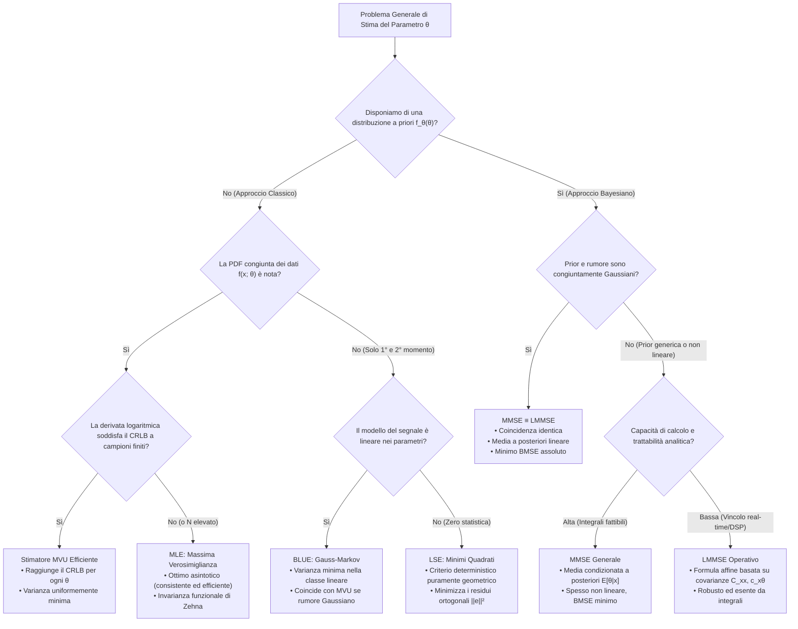

| Criterio / Stimatore | Paradigma | Requisiti Informativi | Struttura Matematica | Criterio di Ottimalità | Prestazioni Asintotiche |
| :--- | :--- | :--- | :--- | :--- | :--- |
| __CRLB / MVU__ | Classico (frequentista) | PDF $f(\mathbf{x}; \theta)$ nota con condizioni di regolarità | Qualsiasi (lineare o non lineare) | Varianza minima tra gli stimatori non polarizzati per ogni $\theta$ | Raggiunge il limite inferiore $1/I(\theta)$ se efficiente |
| __BLUE__ | Classico (frequentista) | Solo media lineare $\mathbf{H}\boldsymbol{\theta}$ e covarianza $\mathbf{C}_{\mathbf{w}\mathbf{w}}$ | Ristretta agli operatori lineari $\mathbf{A}\mathbf{x}$ | Minima varianza nella sola classe lineare (Gauss-Markov) | Coincide con MVU sotto rumore Gaussiano |
| __MLE__ | Classico (frequentista) | PDF congiunta $f(\mathbf{x}; \boldsymbol{\theta})$ nota | Massimizzazione $\arg\max_{\boldsymbol{\theta}} \ln f$ | Massimizza la probabilità del dato osservato | Asintoticamente non polarizzato, efficiente e Gaussiano |
| __LSE__ | Deterministico (nessuna PDF) | Nessun modello statistico per l'errore | Minimi quadrati / Proiezione ortogonale $\mathbf{P}_{\mathbf{H}}\mathbf{x}$ | Minimizza l'energia dei residui geometrici $\|\mathbf{e}\|^2$ | Deterministico (nessuna interpretazione probabilistica) |
| __MMSE__ | Bayesiano (parametro aleatorio) | Prior $f(\theta)$ e verosimiglianza $f(\mathbf{x} \mid \theta)$ | Media a posteriori $\mathbb{E}[\theta \mid \mathbf{x}]$ (spesso non lineare) | Minimo assoluto del Bayesian MSE globale | Converge alla media campionaria per $N \to \infty$ |
| __LMMSE__ | Bayesiano (parametro aleatorio) | Solo primi 2 momenti $(\boldsymbol{\mu}, \mathbf{C})$ di parametri e dati | Struttura affine $\boldsymbol{\mu}_{\boldsymbol{\theta}} + \mathbf{C}_{\boldsymbol{\theta}\mathbf{x}}\mathbf{C}_{\mathbf{x}\mathbf{x}}^{-1}(\mathbf{x} - \boldsymbol{\mu}_{\mathbf{x}})$ | Minimo BMSE nella classe degli stimatori affini | Coincide con MMSE se congiuntamente Gaussiano |

### Guida Alla Scelta Dello Stimatore

1. __Se NON si dispone di una distribuzione a priori per il parametro $\theta$ (approccio classico)__:
   - Verificare in prima battuta se esiste uno stimatore efficiente tramite la condizione di uguaglianza nel limite di Cramer-Rao (__CRLB__).
   - Se la PDF è ignota o non Gaussiana ma il modello del segnale è lineare e si conoscono media e covarianza del disturbo $\implies$ Adottare il __BLUE__.
   - Se la PDF è completamente nota e si dispone di un elevato numero di campioni ($N \gg 1$) $\implies$ Adottare il __MLE__ (garantisce consistenza ed efficienza asintotica).
   - Se non si conosce alcuna descrizione statistica del rumore e si desidera un semplice adattamento di curva $\implies$ Adottare il __LSE__ (minimi quadrati deterministici).
2. __Se SI dispone di informazione a priori su $\theta$ (approccio bayesiano)__:
   - Se si richiede la massima accuratezza assoluta e le integrazioni a posteriori sono analiticamente trattabili (o per modelli Gaussiani) $\implies$ Adottare il __MMSE__ (media a posteriori).
   - Se le distribuzioni a priori non sono Gaussiane, la forma analitica della PDF è incerta, oppure la capacità di calcolo del processore di bordo è limitata $\implies$ Adottare l'__LMMSE__ (garantisce calcolo immediato tramite inversione matriciale ed esclude integrali numerici).


# 3. Teoria Della Decisione E Criterio Di Neyman-Pearson

A differenza della stima di parametri continui incogniti su uno spazio $\Theta \subseteq \mathbb{R}^P$, la __Teoria della Rilevazione__ (o _Teoria della Decisione Statistica_) risolve il problema duale discreto: a partire da un vettore di osservazioni sperimentali corrotte da disturbo casuale, dobbiamo stabilire quale tra un numero finito di configurazioni alternative (__ipotesi__) abbia generato i dati.

Negli scenari reali dell'ingegneria dell'informazione, la decisione è irreversibile e governa sistemi critici:
- Nei sistemi __Radar e Sonar__: decidiamo se l'eco ricevuto contenga un bersaglio riflettente immerso nel disturbo oppure sia composto unicamente da rumore termico e riflessioni del terreno (_clutter_).
- Nelle __Telecomunicazioni Digitali__: discriminiamo quale simbolo di costellazione (es. bit `0` o bit `1`, simboli QAM) sia stato trasmesso lungo un canale rumoroso e dispersivo.
- Nell'__Elaborazione Biomedica delle Immagini__: stabiliamo la presenza di microcalcificazioni tumorali o patologie cellulari rispetto al tessuto biologico sano.
- Nella __Sismologia e Monitoraggio Strutturale__: distinguiamo l'innesco di una faglia sismica o una microfrattura meccanica dal rumore antropico di fondo.

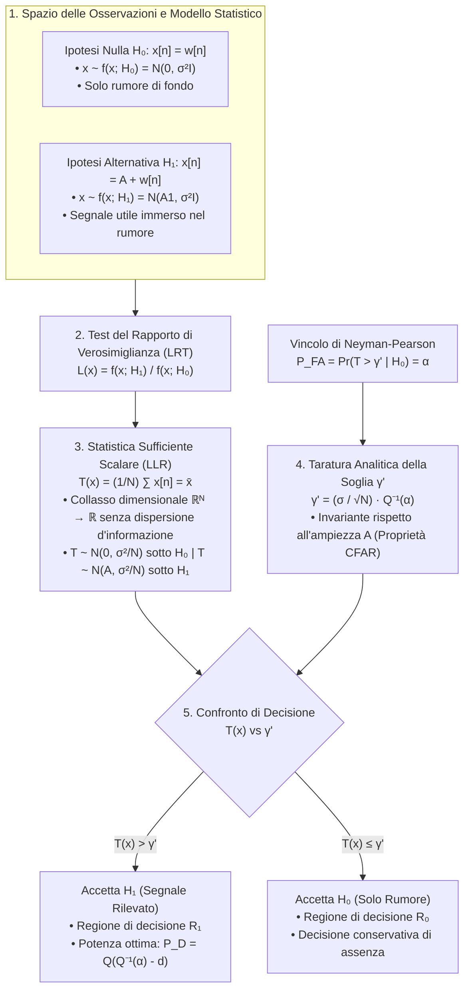

## Fondamenti Della Rilevazione E Decisione Statistica

### Spazio Delle Osservazioni E Regola Decisionale

Un __rilevatore__ (o _decision rule_) è un'applicazione deterministica che mappa il vettore delle $N$ osservazioni campionarie $\mathbf{x} = [x[0], x[1], \dots, x[N-1]]^T \in \mathcal{X} \subseteq \mathbb{R}^N$ in una decisione discreta $\hat{H}$ scelta all'interno dell'insieme delle ipotesi ammissibili.

Nel caso cardinale della __verifica di ipotesi binaria__ (_Binary Hypothesis Testing_), mettiamo a confronto due sole configurazioni d'interesse:
- L'__ipotesi nulla__ $H_0$: associata per convenzione all'assenza del segnale d'interesse (scenario di solo rumore).
- L'__ipotesi alternativa__ $H_1$: associata alla presenza del segnale d'interesse sovrapposto al disturbo.

Il comportamento statistico del vettore acquisito $\mathbf{x}$ sotto ciascuna ipotesi è governato da due distinte funzioni di densità di probabilità (PDF) congiunte:

$$
\mathbf{x} \sim f_{\mathbf{x}}(\mathbf{x}; H_0) \quad \text{sotto } H_0
$$

$$
\mathbf{x} \sim f_{\mathbf{x}}(\mathbf{x}; H_1) \quad \text{sotto } H_1
$$

Progettare il rilevatore equivale a partizionare lo spazio campionario multidimensionale $\mathcal{X}$ in due regioni congiuntamente esaustive e mutuamente esclusive:
- La __regione di decisione__ $\mathcal{R}_0$: se $\mathbf{x} \in \mathcal{R}_0$, decidiamo a favore dell'ipotesi nulla ($\hat{H} = H_0$).
- La __regione di decisione__ $\mathcal{R}_1$: se $\mathbf{x} \in \mathcal{R}_1$, decidiamo a favore dell'ipotesi alternativa ($\hat{H} = H_1$), con $\mathcal{R}_0 \cap \mathcal{R}_1 = \emptyset$ e $\mathcal{R}_0 \cup \mathcal{R}_1 = \mathcal{X}$.

![[slide_22_binary_hypothesis_regions.png|center mid]]

Nella pratica ingegneristica, non gestiamo direttamente partizioni geometriche complesse in $\mathbb{R}^N$: sintetizziamo l'intero vettore dei dati attraverso il calcolo di una __statistica di test scalare__ $T(\mathbf{x}): \mathbb{R}^N \to \mathbb{R}$, confrontando il valore estratto con una __soglia decisionale__ $\gamma$:

$$
T(\mathbf{x}) \underset{H_0}{\overset{H_1}{\gtrless}} \gamma
$$

Se la statistica scalare supera la soglia ($T(\mathbf{x}) > \gamma$), assegniamo l'osservazione alla regione $\mathcal{R}_1$ e dichiariamo la presenza del segnale; in caso contrario ($T(\mathbf{x}) \le \gamma$), rimaniamo nella regione $\mathcal{R}_0$ decidendo per la sua assenza.

### Tassonomia Dei Problemi Di Decisione Statistica

La struttura ottimale del test dipende dalle caratteristiche fisiche e statistiche del modello, categorizzate secondo quattro assi indipendenti:

1. __Molteplicità delle Ipotesi (Binarie vs Multiple)__:
   - _Binarie ($M = 2$)_: confronto tra due soli stati mutualmente esclusivi ($H_0$ contro $H_1$).
   - _Multiple ($M > 2$)_: scelta discreta tra $M$ scenari alternativi (es. simboli in una modulazione 16-QAM o classificazione di bersagli eterogenei).
2. __Forma Funzionale delle Densità (Parametriche vs Non Parametriche)__:
   - _Parametriche_: le densità $f_{\mathbf{x}}(\mathbf{x}; H_0)$ e $f_{\mathbf{x}}(\mathbf{x}; H_1)$ appartengono alla medesima famiglia analitica (es. entrambe Gaussiane) e divergono unicamente per il valore di uno o più parametri (es. media traslata da zero ad $A$).
   - _Non Parametriche_: le distribuzioni differiscono nella loro natura funzionale intrinseca (es. rumore Gaussiano sotto $H_0$ contro disturbo Laplaciano impulsivo sotto $H_1$).
3. __Completezza del Modello (Semplici vs Composte)__:
   - _Semplici_: le PDF sotto entrambe le ipotesi sono determinate univocamente in ogni loro parametro (es. ampiezza del segnale nota e potenza del rumore nota).
   - _Composte_: almeno una delle due densità dipende da parametri incogniti o di disturbo (es. ampiezza $A > 0$ sconosciuta, fase casuale o varianza del rumore non specificata).
4. __Paradigma Informativo (Deterministico vs Bayesiano)__:
   - _Deterministico (Classico)_: non disponiamo di probabilità a priori sul verificarsi di $H_0$ o $H_1$ (non ha senso fisico assegnare una probabilità a priori alla presenza di un velivolo nemico). Ottimizziamo probabilità d'errore condizionate.
   - _Bayesiano_: conosciamo a priori le probabilità di accadimento $\text{Pr}\{H_0\}$ e $\text{Pr}\{H_1\} = 1 - \text{Pr}\{H_0\}$ (es. bit equiprobabili trasmessi su canale binario simmetrico), consentendo la minimizzazione della probabilità d'errore totale o del rischio medio di Bayes.

## Verifica Di Ipotesi Binaria E Metriche d'Errore

### Matrice Delle Decisioni E Definizione Degli Errori

Nel problema binario, l'incrocio tra la realtà fisica sottostante e la decisione espressa dal nostro algoritmo produce quattro esiti distinti, schematizzati nella matrice di confusione:

| Stato Reale del Sistema | Decisione $\hat{H}_0$ (Assenza) | Decisione $\hat{H}_1$ (Presenza) |
| :--- | :--- | :--- |
| __$H_0$ Reale (Solo Rumore)__ | Decisione Corretta di Assenza ($1 - P_{\text{FA}}$) | __Falso Allarme__ ($P_{\text{FA}}$, Errore di Tipo I) |
| __$H_1$ Reale (Presenza Segnale)__ | __Mancata Rilevazione__ ($P_{\text{M}}$, Errore di Tipo II) | __Rilevazione Corretta__ ($P_{\text{D}}$, Potenza del Test) |

![[slide_23_binary_hypothesis_testing_errors.png|center mid]]

Due combinazioni corrispondono a esiti corretti, mentre le restanti due rappresentano errori statistici con ripercussioni operative profondamente disomogenee.

### Formulazione Analitica Delle Probabilità Operative

Quantifichiamo le prestazioni del rilevatore integrando le PDF congiunte sulle rispettive regioni di decisione $\mathcal{R}_0$ ed $\mathcal{R}_1$:

1. __Probabilità di Falso Allarme__ ($P_{\text{FA}}$, _Type I Error_):
   Probabilità di decidere per la presenza del segnale ($\hat{H} = H_1$) quando i campioni contengono unicamente rumore ($H_0$):

   $$
   P_{\text{FA}} = \text{Pr}\{\hat{H}_1 \mid H_0\} = \text{Pr}\{\mathbf{x} \in \mathcal{R}_1 \mid H_0\} = \int_{\mathcal{R}_1} f_{\mathbf{x}}(\mathbf{x}; H_0) \mathrm{d}\mathbf{x}
   $$

2. __Probabilità di Mancata Rilevazione__ ($P_{\text{M}}$, _Miss Detection_, _Type II Error_):
   Probabilità di dichiarare assente il segnale ($\hat{H} = H_0$) quando esso è effettivamente presente nei dati ($H_1$):

   $$
   P_{\text{M}} = \text{Pr}\{\hat{H}_0 \mid H_1\} = \text{Pr}\{\mathbf{x} \in \mathcal{R}_0 \mid H_1\} = \int_{\mathcal{R}_0} f_{\mathbf{x}}(\mathbf{x}; H_1) \mathrm{d}\mathbf{x}
   $$

3. __Probabilità di Rilevazione__ ($P_{\text{D}}$, _Probability of Detection_, _Power of the Test_):
   Probabilità di decidere correttamente a favore di $H_1$ quando il segnale è presente:

   $$
   P_{\text{D}} = \text{Pr}\{\hat{H}_1 \mid H_1\} = \int_{\mathcal{R}_1} f_{\mathbf{x}}(\mathbf{x}; H_1) \mathrm{d}\mathbf{x} = 1 - P_{\text{M}}
   $$

L'identità di conservazione $P_{\text{D}} + P_{\text{M}} = 1$ deriva dal fatto che $\mathcal{R}_0$ ed $\mathcal{R}_1$ partizionano l'intero spazio dei campioni $\mathcal{X}$: sotto l'ipotesi $H_1$, il ricevitore deve necessariamente cadere in $\mathcal{R}_1$ oppure in $\mathcal{R}_0$.

### Compromesso Geometrico Della Soglia Decisionale

Per comprendere l'interazione tra le metriche di prestazione, osserviamo cosa accade regolando la soglia di decisione $\gamma$ nello spazio campionario scalare, dove la regione di allarme coincide con la semiretta destra $\mathcal{R}_1 = \{x : x > \gamma\}$.

![[slide_24_threshold_tradeoff_curves.png|center mid]]

L'escursione della soglia $\gamma$ evidenzia un trade-off intrinseco e ineludibile:
- __Innalzamento della soglia__ ($\gamma \to +\infty$): restringiamo la regione $\mathcal{R}_1$. L'area di coda della PDF del rumore $f(x; H_0)$ si contrae, abbattendo il falso allarme ($P_{\text{FA}} \to 0$). Contestualmente, però, escludiamo gran parte della PDF del segnale $f(x; H_1)$, provocando il crollo della rilevazione ($P_{\text{D}} \to 0$) e la conseguente esplosione delle mancate rilevazioni ($P_{\text{M}} \to 1$).
- __Abbassamento della soglia__ ($\gamma \to -\infty$): espandiamo la regione $\mathcal{R}_1$ fino a inglobare l'intero supporto. Catturiamo la totalità del segnale utile ($P_{\text{D}} \to 1$), ma lasciamo passare indiscriminatamente le oscillazioni spurie del rumore, rendendo il falso allarme totale ($P_{\text{FA}} \to 1$).

> [!important] Impossibilità del Compromesso Perfetto a Risorse Finite
> Poiché le distribuzioni statistiche $f_{\mathbf{x}}(\mathbf{x}; H_0)$ ed $f_{\mathbf{x}}(\mathbf{x}; H_1)$ presentano un'area di sovrapposizione finita dovuta al rumore, __non è possibile minimizzare contemporaneamente $P_{\text{FA}}$ e $P_{\text{M}}$ agendo unicamente sulla soglia decisionale $\gamma$__.
> L'unico modo per abbattere simultaneamente entrambi i tassi d'errore consiste nell'aumentare la separabilità fisica delle distribuzioni: incrementare il rapporto segnale-rumore (SNR) oppure estendere la finestra di osservazione temporale $N$.

## Il Criterio Ottimale Di Neyman-Pearson

Nel paradigma classico, l'assenza di probabilità a priori impedisce di definire una probabilità totale d'errore pesata. Inoltre, nella quasi totalità dei contesti applicativi, i due errori possiedono una gravità fortemente asimmetrica:
- Un falso allarme comporta un costo di reazione o verifica (un'intercettazione radar non necessaria, una biopsia di approfondimento).
- Una mancata rilevazione comporta un fallimento catastrofico e irreparabile (un missile balistico non intercettato, una neoplasia maligna non diagnosticata).

La logica ingegneristica impone quindi una separazione operativa: fissiamo un limite massimo accettabile sul falso allarme e, all'interno di questa barriera di sicurezza, massimizziamo la probabilità di rilevare il bersaglio.

![[slide_26_neyman_pearson_pd_pfa.png|center mid]]

### Vincolo Operativo E Formulazione Del Problema Ottimo

Il __criterio di Neyman-Pearson__ traduce questo principio in un problema matematico di ottimizzazione vincolata:

$$
\max_{\mathcal{R}_1 \subseteq \mathcal{X}} P_{\text{D}} \quad \text{sotto il vincolo} \quad P_{\text{FA}} = \alpha
$$

La costante $\alpha \in (0, 1)$ rappresenta la taglia del test (_size of the test_ o _false alarm constraint_), tipicamente compresa tra $10^{-2}$ e $10^{-8}$ nei sistemi radar e nelle telecomunicazioni.

### Il Teorema Fondamentale Di Neyman-Pearson E Il Test Del Rapporto Di Verosimiglianza

Il __Teorema di Neyman-Pearson__ sancisce che la regola decisionale ottima che massimizza la potenza di rilevazione per qualsiasi vincolo prefissato $P_{\text{FA}} = \alpha$ è il __Likelihood Ratio Test__ (__LRT__, _Test del Rapporto di Verosimiglianza_):

$$
L(\mathbf{x}) = \frac{f_{\mathbf{x}}(\mathbf{x}; H_1)}{f_{\mathbf{x}}(\mathbf{x}; H_0)} \underset{H_0}{\overset{H_1}{\gtrless}} \gamma
$$

dove la soglia scalare $\gamma > 0$ è determinata univocamente risolvendo l'equazione integrale del vincolo:

$$
P_{\text{FA}} = \int_{\{\mathbf{x} : L(\mathbf{x}) > \gamma\}} f_{\mathbf{x}}(\mathbf{x}; H_0) \mathrm{d}\mathbf{x} = \alpha
$$

### Derivazione Variazionale Tramite Moltiplicatore Di Lagrange

Dimostriamo costruttivamente l'ottimalità dell'LRT impostando la lagrangiana del problema variazionale vincolato. Introduciamo il moltiplicatore scalare $\lambda$:

$$
F(\mathcal{R}_1) = P_{\text{D}} - \lambda (P_{\text{FA}} - \alpha)
$$

Esplicitiamo le probabilità operative tramite le rispettive definizioni integrali estese alla regione incognita $\mathcal{R}_1$:

$$
F(\mathcal{R}_1) = \int_{\mathcal{R}_1} f_{\mathbf{x}}(\mathbf{x}; H_1) \mathrm{d}\mathbf{x} - \lambda \left[ \int_{\mathcal{R}_1} f_{\mathbf{x}}(\mathbf{x}; H_0) \mathrm{d}\mathbf{x} - \alpha \right]
$$

Raggruppiamo i due integrali sotto un unico operatore di integrazione esteso a $\mathcal{R}_1$:

$$
F(\mathcal{R}_1) = \int_{\mathcal{R}_1} \left[ f_{\mathbf{x}}(\mathbf{x}; H_1) - \lambda f_{\mathbf{x}}(\mathbf{x}; H_0) \right] \mathrm{d}\mathbf{x} + \lambda \alpha
$$

Osserviamo che il termine $\lambda \alpha$ è una costante deterministica indipendente dalla geometria della regione $\mathcal{R}_1$. Per massimizzare il valore complessivo del funzionale $F(\mathcal{R}_1)$, dobbiamo esaminare il contributo puntuale dell'integrando per ciascun punto dello spazio dei campioni $\mathbf{x} \in \mathcal{X}$:
- Se in un punto $\mathbf{x}$ l'integrando è strettamente positivo, includere quel punto nella regione $\mathcal{R}_1$ apporta un incremento positivo al valore dell'integrale.
- Se in un punto $\mathbf{x}$ l'integrando è negativo, includerlo in $\mathcal{R}_1$ ridurrebbe il valore complessivo dell'integrale; dobbiamo quindi escluderlo assegnandolo a $\mathcal{R}_0$.

Di conseguenza, la regione di decisione ottima deve contenere tutti e soli i vettori $\mathbf{x}$ in cui l'integrando risulta strettamente positivo:

$$
f_{\mathbf{x}}(\mathbf{x}; H_1) - \lambda f_{\mathbf{x}}(\mathbf{x}; H_0) > 0
$$

Poiché la funzione di densità $f_{\mathbf{x}}(\mathbf{x}; H_0)$ è non negativa e strettamente positiva quasi ovunque, dividiamo ambo i membri per $f_{\mathbf{x}}(\mathbf{x}; H_0)$:

$$
\frac{f_{\mathbf{x}}(\mathbf{x}; H_1)}{f_{\mathbf{x}}(\mathbf{x}; H_0)} > \lambda
$$

Identificando il moltiplicatore lagrangiano con la soglia decisionale $\gamma = \lambda$, otteniamo esattamente la struttura del Likelihood Ratio Test:

$$
\mathcal{R}_1 = \left\{ \mathbf{x} \in \mathcal{X} : L(\mathbf{x}) = \frac{f_{\mathbf{x}}(\mathbf{x}; H_1)}{f_{\mathbf{x}}(\mathbf{x}; H_0)} > \gamma \right\}
$$

La dimostrazione universale basata sul Lemma di Neyman-Pearson e su funzioni indicatrici, che certifica come nessun test alternativo concorrente possa superare la potenza dell'LRT per una data taglia $\alpha$, è sviluppata in [[Anno 1/Information and Estimation Theory/zz. Argomenti extra#Dimostrazione Rigorosa del Teorema Fondamentale di Neyman-Pearson|zz. Argomenti extra]].

## Rilevazione Di Un Livello DC in Rumore Bianco Gaussiano (AWGN)

### Formulazione Del Modello Di Segnale

Applichiamo la teoria di Neyman-Pearson al benchmark fondamentale del signal processing: rilevare la presenza di un livello continuo noto $A > 0$ immerso in rumore bianco Gaussiano a campioni indipendenti e identicamente distribuiti.

Il modello di verifica d'ipotesi per gli $N$ campioni acquisiti si formula come:

$$
H_0: x[n] = w[n], \quad n = 0, 1, \dots, N-1 \iff \mathbf{x} \sim \mathcal{N}(\mathbf{0}, \sigma_w^2 \mathbf{I}_N)
$$

$$
H_1: x[n] = A + w[n], \quad n = 0, 1, \dots, N-1 \iff \mathbf{x} \sim \mathcal{N}(A\mathbf{1}_N, \sigma_w^2 \mathbf{I}_N)
$$

dove $w[n] \sim \text{i.i.d. } \mathcal{N}(0, \sigma_w^2)$, $\mathbf{0} = [0, \dots, 0]^T$ e $\mathbf{1}_N = [1, \dots, 1]^T$.

### Calcolo Analitico Del Rapporto Di Verosimiglianza E Cancellazione Dei Termini Quadratici

Esplicitiamo le due PDF multivariate Gaussiane nello spazio $N$-dimensionale:

$$
f_{\mathbf{x}}(\mathbf{x}; H_0) = \frac{1}{(2\pi \sigma_w^2)^{N/2}} \exp\left( -\frac{1}{2\sigma_w^2} \sum_{n=0}^{N-1} x^2[n] \right)
$$

$$
f_{\mathbf{x}}(\mathbf{x}; H_1) = \frac{1}{(2\pi \sigma_w^2)^{N/2}} \exp\left( -\frac{1}{2\sigma_w^2} \sum_{n=0}^{N-1} (x[n] - A)^2 \right)
$$

Costruiamo il rapporto di verosimiglianza $L(\mathbf{x})$:

$$
L(\mathbf{x}) = \frac{f_{\mathbf{x}}(\mathbf{x}; H_1)}{f_{\mathbf{x}}(\mathbf{x}; H_0)} = \frac{\exp\left( -\frac{1}{2\sigma_w^2} \sum_{n=0}^{N-1} (x[n] - A)^2 \right)}{\exp\left( -\frac{1}{2\sigma_w^2} \sum_{n=0}^{N-1} x^2[n] \right)} = \exp\left( -\frac{1}{2\sigma_w^2} \left[ \sum_{n=0}^{N-1} (x[n] - A)^2 - \sum_{n=0}^{N-1} x^2[n] \right] \right)
$$

Sviluppiamo il quadrato del binomio nell'esponente:

$$
\sum_{n=0}^{N-1} (x[n] - A)^2 = \sum_{n=0}^{N-1} \left( x^2[n] - 2 A x[n] + A^2 \right) = \sum_{n=0}^{N-1} x^2[n] - 2 A \sum_{n=0}^{N-1} x[n] + N A^2
$$

Sottraendo la sommatoria quadratica $\sum_{n=0}^{N-1} x^2[n]$, notiamo un passaggio algebrico cruciale:

$$
\sum_{n=0}^{N-1} (x[n] - A)^2 - \sum_{n=0}^{N-1} x^2[n] = -2 A \sum_{n=0}^{N-1} x[n] + N A^2
$$

Il termine di energia campionaria $\|\mathbf{x}\|^2 = \sum_{n=0}^{N-1} x^2[n]$ si cancella in modo esatto algebricamente. Poiché la varianza del rumore è identica sotto entrambe le ipotesi, la potenza grezza delle misure non apporta alcun potere discriminante: l'unica informazione utile risiede nella proiezione lineare dei dati.

Sostituendo l'espressione semplificata all'interno dell'esponenziale:

$$
L(\mathbf{x}) = \exp\left( -\frac{1}{2\sigma_w^2} \left[ -2 A \sum_{n=0}^{N-1} x[n] + N A^2 \right] \right) = \exp\left( \frac{A}{\sigma_w^2} \sum_{n=0}^{N-1} x[n] - \frac{N A^2}{2\sigma_w^2} \right)
$$

Imponiamo la regola di decisione del test di Neyman-Pearson:

$$
\exp\left( \frac{A}{\sigma_w^2} \sum_{n=0}^{N-1} x[n] - \frac{N A^2}{2\sigma_w^2} \right) \underset{H_0}{\overset{H_1}{\gtrless}} \gamma
$$

Poiché la funzione logaritmo naturale $\ln(\cdot)$ è strettamente crescente e monotona su $(0, +\infty)$, possiamo applicarla ad ambo i membri preservando rigorosamente il verso delle disuguaglianze decisionali:

$$
\frac{A}{\sigma_w^2} \sum_{n=0}^{N-1} x[n] - \frac{N A^2}{2\sigma_w^2} \underset{H_0}{\overset{H_1}{\gtrless}} \ln \gamma
$$

Isoliamo il blocco contenente le osservazioni campionarie portando a secondo membro la costante deterministica:

$$
\frac{A}{\sigma_w^2} \sum_{n=0}^{N-1} x[n] \underset{H_0}{\overset{H_1}{\gtrless}} \ln \gamma + \frac{N A^2}{2\sigma_w^2}
$$

Moltiplichiamo ambo i membri per lo scalare positivo $\frac{\sigma_w^2}{A}$ (operazione lecita poiché abbiamo assunto $A > 0$):

$$
\sum_{n=0}^{N-1} x[n] \underset{H_0}{\overset{H_1}{\gtrless}} \frac{\sigma_w^2}{A} \ln \gamma + \frac{N A}{2}
$$

Dividendo infine per la dimensione del campione $N$:

$$
\frac{1}{N} \sum_{n=0}^{N-1} x[n] \underset{H_0}{\overset{H_1}{\gtrless}} \frac{\sigma_w^2}{N A} \ln \gamma + \frac{A}{2}
$$

### La Media Campionaria come Statistica Sufficiente

La manipolazione algebrica ha ridotto il test vettoriale $N$-dimensionale a un confronto elementare su una statistica scalare. Definiamo la __statistica di test__ $T(\mathbf{x})$ e la __soglia modificata__ $\gamma'$:

$$
T(\mathbf{x}) = \frac{1}{N} \sum_{n=0}^{N-1} x[n] = \bar{x}
$$

$$
\gamma' = \frac{\sigma_w^2}{N A} \ln \gamma + \frac{A}{2}
$$

La regola decisionale operativa assume la forma snella:

$$
T(\mathbf{x}) = \bar{x} \underset{H_0}{\overset{H_1}{\gtrless}} \gamma'
$$

> [!tip] Riduzione dei Dati e Statistica Sufficiente
> Il Likelihood Ratio Test collassa sull'integrazione coerente dei campioni: la __media campionaria__ $\bar{x}$ funge da __statistica sufficiente__ per la decisione binaria.
> Tutta l'informazione statistica utile contenuta nel vettore $\mathbf{x} \in \mathbb{R}^N$ è condensata nello scalare $\bar{x} \in \mathbb{R}$ senza alcuna dispersione di potenza discriminante.

### Distribuzioni Statistiche Esatte Sotto Le Due Ipotesi

Poiché i campioni $x[n]$ sono variabili aleatorie congiuntamente Gaussiane e statisticamente indipendenti, qualsiasi loro combinazione lineare è ancora rigorosamente Gaussiana.

Calcoliamo media e varianza della statistica di test sotto le due ipotesi:
- Sotto $H_0$: $\mathbb{E}[x[n]] = 0$, dunque $\mathbb{E}[T \mid H_0] = 0$.
- Sotto $H_1$: $\mathbb{E}[x[n]] = A$, dunque $\mathbb{E}[T \mid H_1] = A$.
- La varianza è identica sotto entrambe le configurazioni:

  $$
  \text{Var}\{T\} = \text{Var}\left\{ \frac{1}{N} \sum_{n=0}^{N-1} x[n] \right\} = \frac{1}{N^2} \sum_{n=0}^{N-1} \text{Var}\{x[n]\} = \frac{N \sigma_w^2}{N^2} = \frac{\sigma_w^2}{N}
  $$

Le densità di probabilità univariate della statistica di test risultano quindi:

$$
T \sim \mathcal{N}\left( 0, \frac{\sigma_w^2}{N} \right) \quad \text{sotto } H_0
$$

$$
T \sim \mathcal{N}\left( A, \frac{\sigma_w^2}{N} \right) \quad \text{sotto } H_1
$$

Definendo la deviazione standard della media campionaria come $\sigma_T = \sqrt{\frac{\sigma_w^2}{N}} = \frac{\sigma_w}{\sqrt{N}}$, possiamo visualizzare l'interazione geometrica tra le densità, la soglia decisionale $\gamma'$ e le aree d'errore.

![[neyman_pearson_test_distributions.svg|center mid]]

La figura evidenzia come la regione $\mathcal{R}_1 = \{T > \gamma'\}$ tagli contemporaneamente la coda destra di $f(T; H_0)$ (originando il falso allarme $P_{\text{FA}}$) e la massa principale di $f(T; H_1)$ (definendo la potenza di rilevazione $P_{\text{D}}$).

### Inversione Analitica Della Soglia E Calcolo Di Falso Allarme E Rilevazione

Per quantificare le probabilità d'errore, standardizziamo le distribuzioni Gaussiane riconducendoci alla __funzione Q__ (la cui derivazione analitica e proprietà sono approfondite in [[Anno 1/Information and Estimation Theory/zz. Argomenti extra#Derivazione Analitica della Funzione Q e Proprietà per il Calcolo delle Probabilità d'Errore|zz. Argomenti extra]]):

$$
Q(z) = \frac{1}{\sqrt{2\pi}} \int_z^{+\infty} \exp\left( -\frac{u^2}{2} \right) \mathrm{d}u
$$

Calcoliamo innanzitutto la probabilità di falso allarme condizionata all'ipotesi nulla $H_0$:

$$
P_{\text{FA}} = \text{Pr}\{T > \gamma' \mid H_0\} = \text{Pr}\left\{ \frac{T - 0}{\sigma_T} > \frac{\gamma' - 0}{\sigma_T} \;\middle|\; H_0 \right\} = Q\left( \frac{\gamma'}{\sqrt{\sigma_w^2 / N}} \right)
$$

Poiché nel criterio di Neyman-Pearson imponiamo il vincolo $P_{\text{FA}} = \alpha$, invertiamo analiticamente la relazione sfruttando la funzione inversa $Q^{-1}$:

$$
Q^{-1}(P_{\text{FA}}) = \frac{\gamma'}{\sqrt{\sigma_w^2 / N}}
$$

Isolando la soglia decisionale modificata:

$$
\gamma' = \sqrt{\frac{\sigma_w^2}{N}} Q^{-1}(P_{\text{FA}})
$$

> [!important] Proprietà CFAR (Constant False Alarm Rate)
> Notiamo che la soglia $\gamma'$ dipende __esclusivamente__ dalla varianza del disturbo $\sigma_w^2$, dal numero di campioni $N$ e dal tasso di falso allarme imposto $P_{\text{FA}}$, mentre è __completamente indipendente dall'ampiezza del segnale utile $A$__.
> Possiamo pertanto tarare il ricevitore per garantire la taglia d'allarme prefissata anche qualora l'ampiezza del bersaglio non sia nota a priori.

Calcoliamo ora la probabilità di rilevazione corretta $P_{\text{D}}$ sotto l'ipotesi alternativa $H_1$, dove la variabile $T$ possiede valore atteso $A$:

$$
P_{\text{D}} = \text{Pr}\{T > \gamma' \mid H_1\} = \text{Pr}\left\{ \frac{T - A}{\sigma_T} > \frac{\gamma' - A}{\sigma_T} \;\middle|\; H_1 \right\} = Q\left( \frac{\gamma' - A}{\sqrt{\sigma_w^2 / N}} \right)
$$

Sostituiamo nella formula l'espressione analitica di $\gamma'$ appena ottenuta dal vincolo di falso allarme:

$$
P_{\text{D}} = Q\left( \frac{\sqrt{\frac{\sigma_w^2}{N}} Q^{-1}(P_{\text{FA}}) - A}{\sqrt{\frac{\sigma_w^2}{N}}} \right) = Q\left( Q^{-1}(P_{\text{FA}}) - \frac{A}{\sqrt{\sigma_w^2 / N}} \right)
$$

Portando il fattore $N$ all'interno del radicando al numeratore:

$$
P_{\text{D}} = Q\left( Q^{-1}(P_{\text{FA}}) - \sqrt{\frac{N A^2}{\sigma_w^2}} \right)
$$

## Prestazioni Del Ricevitore E Guadagno Di Integrazione Coerente

### Il Coefficiente Di Deflessione come SNR Di Rilevazione

L'argomento della funzione $Q$ nella formula di $P_{\text{D}}$ contiene una quantità adimensionale fondamentale, denominata __coefficiente di deflessione__ (_deflection coefficient_) $d^2$:

$$
d^2 = \frac{(\mathbb{E}[T \mid H_1] - \mathbb{E}[T \mid H_0])^2}{\text{Var}\{T \mid H_0\}} = \frac{(A - 0)^2}{\sigma_w^2 / N} = \frac{N A^2}{\sigma_w^2}
$$

Estraendo la radice quadrata, definiamo la deflessione normalizzata $d$:

$$
d = \sqrt{d^2} = \frac{A}{\sigma_w / \sqrt{N}} = \sqrt{N} \frac{A}{\sigma_w}
$$

Geometricamente, $d$ misura la distanza euclidea tra i valori medi delle due distribuzioni standardizzata rispetto alla dispersione del rumore. La probabilità di rilevazione ottima si esprime in funzione di $d$:

$$
P_{\text{D}} = Q\left( Q^{-1}(P_{\text{FA}}) - d \right)
$$

Poiché $d > 0$, l'argomento $Q^{-1}(P_{\text{FA}}) - d$ è strettamente inferiore a $Q^{-1}(P_{\text{FA}})$. Ricordando che la funzione $Q(z)$ è strettamente decrescente rispetto al suo argomento, ne consegue matematicamente che:

$$
P_{\text{D}} = Q(Q^{-1}(P_{\text{FA}}) - d) > Q(Q^{-1}(P_{\text{FA}})) = P_{\text{FA}}
$$

Il rilevatore opera quindi sempre in condizioni di superiorità rispetto al lancio di una moneta casuale.

### Analisi Delle Curve Di Prestazione E Comportamento Asintotico

Esprimendo il coefficiente di deflessione in termini di Rapporto Segnale-Rumore (SNR) su scala logaritmica decibel, $\text{SNR}_{\text{dB}} = 10 \log_{10} \left( \frac{N A^2}{\sigma_w^2} \right)$, tracciamo le curve di $P_{\text{D}}$ in funzione dell'SNR al variare del parametro $P_{\text{FA}}$.

![[slide_32_pd_vs_snr_curves.png|center mid]]

Dall'analisi delle curve emergono tre cardini operativi:

1. __Comportamento Asintotico ad Alto SNR__:
   Quando la potenza del segnale o la dimensione campionaria crescono ($N A^2 / \sigma_w^2 \to +\infty$), la deflessione diverge ($d \to +\infty$). L'argomento della funzione $Q$ tende a $-\infty$, per cui:

   $$
   \lim_{d \to +\infty} P_{\text{D}} = Q(-\infty) = 1 \quad \forall P_{\text{FA}} > 0
   $$

   La rilevazione converge all'affidabilità assoluta per qualsiasi vincolo di falso allarme imposto.

2. __Penalizzazione per Vincoli Stringenti di Falso Allarme__:
   Se imponiamo un vincolo di falso allarme molto restrittivo (es. passando da $P_{\text{FA}} = 10^{-1}$ a $P_{\text{FA}} = 10^{-7}$), la soglia $Q^{-1}(P_{\text{FA}})$ si innalza sensibilmente. Di conseguenza, la curva di prestazione slitta rigidamente verso destra: per preservare la medesima probabilità di rilevazione (ad esempio $P_{\text{D}} = 0.9$), il sistema richiede un surplus di potenza di circa $10\text{–}12\text{ dB}$.

3. __Guadagno di Integrazione Coerente__:
   La deflessione $d^2$ è linearmente proporzionale al numero di campioni $N$:

   $$
   d^2 = N \cdot \text{SNR}_{\text{singolo campione}} = N \cdot \frac{A^2}{\sigma_w^2}
   $$

   Ogni raddoppio della finestra di osservazione temporale ($N \to 2N$) raddoppia l'energia statistica accumulata, conferendo un __guadagno di processamento coerente di $+3\text{ dB}$__. Raccogliere campioni nel tempo equivale a potenziare proporzionalmente la potenza del trasmettitore.

### Quadro Sinottico Operativo E Trabocchetti d'Esame

Sintetizziamo i risultati analitici fondamentali del test di Neyman-Pearson:

| Grandezza Operativa | Simbolo | Espressione Analitica per Livello DC in AWGN |
| :--- | :--- | :--- |
| __Statistica di Test__ | $T(\mathbf{x})$ | $\bar{x} = \frac{1}{N} \sum_{n=0}^{N-1} x[n]$ (Media Campionaria) |
| __Distribuzione sotto $H_0$__ | $f(T; H_0)$ | $\mathcal{N}\left(0, \frac{\sigma_w^2}{N}\right)$ |
| __Distribuzione sotto $H_1$__ | $f(T; H_1)$ | $\mathcal{N}\left(A, \frac{\sigma_w^2}{N}\right)$ |
| __Soglia Decisionale Ottima__ | $\gamma'$ | $\sqrt{\frac{\sigma_w^2}{N}} Q^{-1}(P_{\text{FA}})$ |
| __Probabilità di Falso Allarme__ | $P_{\text{FA}}$ | $Q\left( \frac{\gamma'}{\sqrt{\sigma_w^2 / N}} \right)$ |
| __Probabilità di Rilevazione__ | $P_{\text{D}}$ | $Q\left( Q^{-1}(P_{\text{FA}}) - \sqrt{\frac{N A^2}{\sigma_w^2}} \right) = Q(Q^{-1}(P_{\text{FA}}) - d)$ |
| __Coefficiente di Deflessione__ | $d^2$ | $\frac{N A^2}{\sigma_w^2} = N \cdot \text{SNR}_{\text{singolo}}$ |

> [!warning] Trabocchetti Concettuali Tipici in Sede d'Esame
> 1. __Confusione tra le Soglie $\gamma$ e $\gamma'$__: La soglia astratta $\gamma$ si applica al rapporto di verosimiglianza $L(\mathbf{x}) \gtrless \gamma$, mentre la soglia operativa $\gamma'$ si applica alla statistica scalare $\bar{x} \gtrless \gamma'$. Confondere le due espressioni compromette il calcolo numerico delle probabilità d'errore.
> 2. __Segno dell'Argomento della Funzione Q__: Nella formula $P_{\text{D}} = Q(Q^{-1}(P_{\text{FA}}) - d)$, il segno meno davanti a $d$ è obbligatorio. Poiché $Q(z)$ è decrescente, sottrarre $d > 0$ fa salire il valore della funzione garantendo $P_{\text{D}} > P_{\text{FA}}$.
> 3. __Fattore $\sqrt{N}$ nella Deflessione__: All'esame è comune dimenticare che la media campionaria abbatte la varianza a $\sigma^2 / N$: la deviazione standard a denominatore è $\sigma / \sqrt{N}$, il che fa risalire $\sqrt{N}$ al numeratore moltiplicando $A$.
> 4. __Indipendenza di $\gamma'$ da $A$__: Ricorda che per determinare la soglia del test di Neyman-Pearson non serve conoscere l'ampiezza del segnale $A$: la soglia dipende unicamente da $\sigma_w$, $N$ e $P_{\text{FA}}$.


# 4. Prestazioni Del Ricevitore E Rilevatori Bayesiani

Il test del rapporto di verosimiglianza con vincolo frequenziale di Neyman-Pearson a falso allarme costante $P_{\text{FA}} = \alpha$ fissa una singola soglia operativa contingente. Negli scenari reali dell'ingegneria dei sistemi di rilevazione, tuttavia, emerge l'esigenza di mappare le prestazioni globali del ricevitore al variare continuo del punto di lavoro lungo l'intero intervallo di soglie ammissibili.

Quando inoltre conosciamo la probabilità con cui la natura estrae le ipotesi o possiamo quantificare le penalità economiche e operative associate a ciascun tipo di errore, l'approccio frequentista cede il passo al paradigma bayesiano. In questa cornice formuliamo i criteri a __minima probabilità d'errore__ e del __rischio di Bayes__.

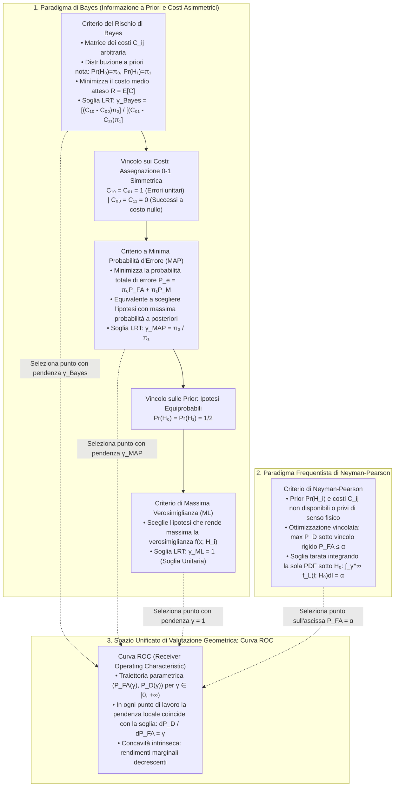

## Curva ROC (Receiver Operating Characteristic)

La curva ROC è la traiettoria bidimensionale parametrica che traccia la probabilità di corretta rilevazione $P_{\text{D}}$ sull'asse delle ordinate in funzione della probabilità di falso allarme $P_{\text{FA}}$ sull'asse delle ascisse, al variare della soglia decisionale $\gamma \in [0, +\infty)$:

$$
\text{ROC} = \left\{ \big(P_{\text{FA}}(\gamma),\, P_{\text{D}}(\gamma)\big) \in [0, 1]^2 \;\Big|\; \gamma \in [0, +\infty) \right\}
$$

Questa curva isola l'efficacia discriminante intrinseca del test statistico dalle scelte operative di soglia. Nel quadrato unitario $[0, 1] \times [0, 1]$ osserviamo tre regimi fondamentali:
- Quando la soglia tende a infinito ($\gamma \to +\infty$), la regione di decisione favorevole ad $H_1$ si contrae all'insieme vuoto ($R_1 = \emptyset$). Il rilevatore non dichiara mai la presenza del segnale, ottenendo $P_{\text{D}} = 0$ e $P_{\text{FA}} = 0$, corrispondente all'origine $(0, 0)$. In questo punto la retta tangente alla curva è verticale.
- Quando la soglia degenera verso zero ($\gamma \to 0$), la regione $R_1$ si estende all'intero spazio campionario ($R_1 = \mathbb{R}^N$). Il sistema decide sempre $H_1$, ottenendo $P_{\text{D}} = 1$ e $P_{\text{FA}} = 1$, corrispondente all'estremo superiore destro $(1, 1)$. In questo punto la retta tangente alla curva è orizzontale.
- Per valori intermedi $\gamma \in (0, +\infty)$, la curva unisce con continuità e regolarità l'origine $(0, 0)$ con il vertice $(1, 1)$.

![[slide_35_roc_properties_curve.png|center mid]]

L'analisi geometrica e analitica della curva ROC rivela le proprietà strutturali che governano qualsiasi ricevitore ottimale basato sul rapporto di verosimiglianza.

![[roc_geometry_tangent_curvature.svg|center mid]]

## Proprietà Analitiche E Geometriche Fondamentali

Le curve operative del ricevitore originate da un test del rapporto di verosimiglianza (LRT) soddisfano precise proprietà matematiche.

### Monotonia Non Decrescente

La probabilità di rilevazione $P_{\text{D}}$ è una funzione debolmente crescente di $P_{\text{FA}}$.

Se abbassiamo la soglia da $\gamma_1$ a un valore più permissivo $\gamma_2 < \gamma_1$, la regione critica si amplia per inclusione insiemistica:

$$
R_1(\gamma_1) = \{\mathbf{x} : L(\mathbf{x}) > \gamma_1\} \subset \{\mathbf{x} : L(\mathbf{x}) > \gamma_2\} = R_1(\gamma_2)
$$

Integrando le densità non negative $f(\mathbf{x}; H_1)$ e $f(\mathbf{x}; H_0)$ su un dominio più esteso, entrambe le grandezze aumentano simultaneamente: all'aumentare di $P_{\text{FA}}$ corrisponde sempre un aumento di $P_{\text{D}}$.

### Diagonale Di Casualità E Sub-Casualità

La retta bisettrice $P_{\text{D}} = P_{\text{FA}}$ descrive le prestazioni del rilevatore puramente casuale ("test della moneta truccata").

Un sistema che ignora completamente i dati osservati $\mathbf{x}$ e decide $H_1$ estraendo una variabile di Bernoulli con probabilità costante $p \in [0, 1]$ ottiene:

$$
P_{\text{D}} = \text{Pr}\{\text{decidere } H_1 \mid H_1\} = p, \qquad P_{\text{FA}} = \text{Pr}\{\text{decidere } H_1 \mid H_0\} = p \implies P_{\text{D}} = P_{\text{FA}}
$$

Se un rilevatore reale si posiziona al di sotto della diagonale ($P_{\text{D}} < P_{\text{FA}}$), le sue prestazioni sono peggiori del caso. Invertendo sistematicamente la regola decisionale ($\hat{H}' = 1 - \hat{H}$), il punto di lavoro viene riflesso rispetto al baricentro $(1/2, 1/2)$:

$$
P_{\text{D}}' = \text{Pr}\{\hat{H}' = 1 \mid H_1\} = \text{Pr}\{\hat{H} = 0 \mid H_1\} = 1 - P_{\text{D}}
$$

$$
P_{\text{FA}}' = \text{Pr}\{\hat{H}' = 1 \mid H_0\} = \text{Pr}\{\hat{H} = 0 \mid H_0\} = 1 - P_{\text{FA}}
$$

Poiché per ipotesi $P_{\text{D}} < P_{\text{FA}}$, moltiplicando per $-1$ e sommando $1$ ad ambo i membri si ottiene:

$$
P_{\text{D}}' = 1 - P_{\text{D}} > 1 - P_{\text{FA}} = P_{\text{FA}}'
$$

Il nuovo punto di lavoro $(P_{\text{FA}}', P_{\text{D}}') = (1 - P_{\text{FA}}, 1 - P_{\text{D}})$ rappresenta la riflessione centrale del punto originario rispetto al baricentro $(1/2, 1/2)$ e si colloca rigorosamente al di sopra della diagonale di casualità.

### Frontiera Di Pareto E Ottimalità Di Neyman-Pearson

In virtù del Lemma di Neyman-Pearson, fissato un qualsiasi livello di falso allarme $P_{\text{FA}} = \alpha$, il test LRT garantisce la massima probabilità di rilevazione $P_{\text{D}}$ rispetto a qualunque altro test ammissibile.

La curva ROC dell'LRT costituisce la frontiera di Pareto superiore dell'intero spazio delle decisioni: nessun dispositivo fisico o algoritmo statistico può operare in un punto al di sopra di tale curva.

### Pendenza Locale Pari Alla Soglia Decisionale

In ogni punto regolare della curva ROC generata da un test LRT, la pendenza della retta tangente locale è esattamente uguale alla soglia decisionale $\gamma$:

$$
\frac{\mathrm{d}P_{\text{D}}}{\mathrm{d}P_{\text{FA}}} = \gamma
$$

Per dimostrare questa identità, esprimiamo le probabilità operative integrando le funzioni di densità di probabilità della statistica scalare $L(\mathbf{x})$, denotate con $f_L(l; H_1)$ e $f_L(l; H_0)$, sull'intervallo seminfinito $[\gamma, +\infty)$:

$$
P_{\text{D}}(\gamma) = \int_\gamma^{+\infty} f_L(l; H_1) \, \mathrm{d}l, \qquad P_{\text{FA}}(\gamma) = \int_\gamma^{+\infty} f_L(l; H_0) \, \mathrm{d}l
$$

Differenziamo i due integrali rispetto all'estremo inferiore variabile $\gamma$ applicando il teorema fondamentale del calcolo integrale:

$$
\frac{\mathrm{d}P_{\text{D}}}{\mathrm{d}\gamma} = -f_L(\gamma; H_1), \qquad \frac{\mathrm{d}P_{\text{FA}}}{\mathrm{d}\gamma} = -f_L(\gamma; H_0)
$$

Il segno negativo deriva dal fatto che incrementare la soglia restringe il dominio di integrazione verso destra.

Stabiliamo ora il legame analitico tra le due densità di probabilità. Per definizione, il rapporto di verosimiglianza assegna a ciascun vettore $\mathbf{x}$ il valore scalare $l = f(\mathbf{x}; H_1) / f(\mathbf{x}; H_0)$. Sulla varietà di livello $\mathcal{M}_l = \{\mathbf{x} : L(\mathbf{x}) = l\}$, la densità sotto $H_1$ è proporzionale a quella sotto $H_0$ mediante la costante $l$:

$$
f(\mathbf{x}; H_1) = l \, f(\mathbf{x}; H_0) \quad \forall \mathbf{x} \in \mathcal{M}_l
$$

Integrando questa relazione su tutto il sottoinsieme $\mathcal{M}_l$, otteniamo l'identità fondamentale tra le densità unidimensionali della statistica di test:

$$
f_L(l; H_1) = l \, f_L(l; H_0)
$$

Sostituendo questa identità nella derivata di $P_{\text{D}}$ calcolata in $\gamma$:

$$
\frac{\mathrm{d}P_{\text{D}}}{\mathrm{d}\gamma} = -\gamma \, f_L(\gamma; H_0)
$$

Calcoliamo ora la pendenza della curva ROC applicando la regola della catena differenziale:

$$
\frac{\mathrm{d}P_{\text{D}}}{\mathrm{d}P_{\text{FA}}} = \frac{\frac{\mathrm{d}P_{\text{D}}}{\mathrm{d}\gamma}}{\frac{\mathrm{d}P_{\text{FA}}}{\mathrm{d}\gamma}} = \frac{-\gamma \, f_L(\gamma; H_0)}{-f_L(\gamma; H_0)} = \gamma
$$

Il termine negativo della densità di rumore $-f_L(\gamma; H_0)$ si cancella identicamente tra numeratore e denominatore. Rimane unicamente il valore assunto dalla soglia $\gamma$.

L'equazione cartesiana della retta tangente alla curva ROC nel generico punto di lavoro $(P_{\text{FA}}(\gamma), P_{\text{D}}(\gamma))$ è:

$$
P_{\text{D}} - P_{\text{D}}(\gamma) = \gamma \left( P_{\text{FA}} - P_{\text{FA}}(\gamma) \right)
$$

Questo risultato giustifica il comportamento agli estremi: all'origine $(\gamma \to +\infty)$ la pendenza diverge determinando una tangente verticale, mentre al punto $(1, 1)$ $(\gamma \to 0)$ la pendenza si azzera producendo una tangente orizzontale.

La trattazione dettagliata con passaggi integrali estesi è consultabile in [[Anno 1/Information and Estimation Theory/zz. Argomenti extra#Dimostrazione Analitica della Pendenza e Concavità della Curva ROC|Dimostrazione Analitica della Pendenza e Concavità della Curva ROC]].

### Concavità Verso Il Basso E Rendimenti Marginali Decrescenti

La curva ROC di qualsiasi test del rapporto di verosimiglianza è concava verso il basso:

$$
\frac{\mathrm{d}^2 P_{\text{D}}}{\mathrm{d}P_{\text{FA}}^2} \le 0
$$

Per verificare la concavità, calcoliamo la derivata seconda differenziando la pendenza prima $\frac{\mathrm{d}P_{\text{D}}}{\mathrm{d}P_{\text{FA}}} = \gamma$ rispetto a $P_{\text{FA}}$ mediante la regola della derivata della funzione inversa:

$$
\frac{\mathrm{d}^2 P_{\text{D}}}{\mathrm{d}P_{\text{FA}}^2} = \frac{\mathrm{d}}{\mathrm{d}P_{\text{FA}}}\left( \frac{\mathrm{d}P_{\text{D}}}{\mathrm{d}P_{\text{FA}}} \right) = \frac{\mathrm{d}\gamma}{\mathrm{d}P_{\text{FA}}} = \frac{1}{\frac{\mathrm{d}P_{\text{FA}}}{\mathrm{d}\gamma}} = \frac{1}{-f_L(\gamma; H_0)} = -\frac{1}{f_L(\gamma; H_0)}
$$

Poiché $f_L(\gamma; H_0)$ è una densità di probabilità, essa assume valori strettamente non negativi ($f_L \ge 0$). Il suo reciproco preceduto dal segno meno impone una derivata seconda non positiva in ogni punto.

Dal punto di vista concettuale, la concavità esprime la legge dei __rendimenti marginali decrescenti__. Quando operiamo a basso falso allarme (regione sinistra della ROC, $\gamma \gg 1$), la pendenza elevata ci consente di ottenere cospicui incrementi di rilevazione $\mathrm{d}P_{\text{D}}$ pagando frazioni modeste di falso allarme $\mathrm{d}P_{\text{FA}}$.

Man mano che ci spostiamo verso destra riducendo la soglia $\gamma$, la pendenza si appiattisce: per guadagnare quote minime aggiuntive di $P_{\text{D}}$ siamo costretti a tollerare incrementi esponenzialmente più ampi di $P_{\text{FA}}$.

### Area Sotto la Curva (AUC)

L'integrale dell'area sottesa alla curva ROC (__AUC__, _Area Under the Curve_) sintetizza la capacità discriminante del ricevitore in un unico indice scalare:

$$
\text{AUC} = \int_0^1 P_{\text{D}}(P_{\text{FA}}) \, \mathrm{d}P_{\text{FA}} \in [0.5, \, 1.0]
$$

L'AUC ammette una diretta interpretazione probabilistica: corrisponde alla probabilità che la statistica di test calcolata su un'osservazione estratta casualmente sotto $H_1$ superi la statistica calcolata su un'osservazione indipendente estratta sotto $H_0$:

$$
\text{AUC} = \text{Pr}\left\{ L(\mathbf{x}_1) > L(\mathbf{x}_0) \right\}, \qquad \mathbf{x}_1 \sim f(\mathbf{x}; H_1), \quad \mathbf{x}_0 \sim f(\mathbf{x}; H_0)
$$

Per il test puramente casuale abbiamo $\text{AUC} = 0.5$ (area del triangolo inferiore), mentre per il rilevatore ideale senza sovrapposizione di rumore otteniamo $\text{AUC} = 1.0$.

## Curva ROC per Segnale DC in Rumore Bianco Gaussiano (AWGN)

Consideriamo il problema fondamentale di rilevazione di un livello costante $A > 0$ su $N$ campioni immersi in disturbo bianco gaussiano $w[n] \sim \mathcal{N}(0, \sigma_w^2)$:

$$
H_0: x[n] = w[n], \qquad H_1: x[n] = A + w[n], \qquad n = 0, \dots, N-1
$$

Come stabilito dall'analisi del test LRT, la statistica sufficiente scalare è la media campionaria:

$$
T(\mathbf{x}) = \bar{x} = \frac{1}{N} \sum_{n=0}^{N-1} x[n] \underset{H_0}{\overset{H_1}{\gtrless}} \gamma'
$$

La media campionaria possiede varianza ridotta $\sigma_w^2 / N$ e medie condizionate pari a $0$ sotto $H_0$ e ad $A$ sotto $H_1$. Le probabilità di falso allarme e di rilevazione assumono la forma:

$$
P_{\text{FA}} = Q\left( \frac{\gamma'}{\sigma_w / \sqrt{N}} \right), \qquad P_{\text{D}} = Q\left( \frac{\gamma' - A}{\sigma_w / \sqrt{N}} \right)
$$

Per ricavare la relazione cartesiana esplicita $P_{\text{D}} = g(P_{\text{FA}})$, invertiamo l'equazione di falso allarme isolando la soglia normalizzata tramite la funzione quantile inversa $Q^{-1}$:

$$
\frac{\gamma'}{\sigma_w / \sqrt{N}} = Q^{-1}(P_{\text{FA}}) \implies \gamma' = \frac{\sigma_w}{\sqrt{N}} Q^{-1}(P_{\text{FA}})
$$

Sostituendo questa espressione nella formula della probabilità di rilevazione:

$$
P_{\text{D}} = Q\left( \frac{\frac{\sigma_w}{\sqrt{N}} Q^{-1}(P_{\text{FA}}) - A}{\sigma_w / \sqrt{N}} \right) = Q\left( Q^{-1}(P_{\text{FA}}) - \frac{A \sqrt{N}}{\sigma_w} \right)
$$

Definiamo il __coefficiente di deflessione__ (_deflection coefficient_) $d$, che quantifica il rapporto segnale-rumore effettivo a valle dell'accumulazione coerente degli $N$ campioni:

$$
d = \frac{\mathbb{E}[T; H_1] - \mathbb{E}[T; H_0]}{\sqrt{\text{Var}(T; H_0)}} = \frac{A - 0}{\sigma_w / \sqrt{N}} = \frac{A \sqrt{N}}{\sigma_w} = \sqrt{\frac{N A^2}{\sigma_w^2}} = \sqrt{\text{SNR}}
$$

L'equazione analitica chiusa della curva ROC per segnali gaussiani traslati in media assume la forma canonica:

$$
P_{\text{D}} = Q\left( Q^{-1}(P_{\text{FA}}) - d \right)
$$

![[slide_36_roc_curves_deflection_d.png|center mid]]

Questa equazione evidenzia il ruolo discriminante del coefficiente di deflessione $d$:
- Per $d = 0$ (ampiezza nulla $A = 0$ o assenza di campioni $N = 0$), l'equazione collassa su $P_{\text{D}} = Q(Q^{-1}(P_{\text{FA}})) = P_{\text{FA}}$: la curva coincide con la diagonale di casualità.
- All'aumentare dell'energia del segnale o del numero di osservazioni $N$, $d$ cresce proporzionalmente a $\sqrt{N}$. La curva ROC viene inflessa verso l'angolo superiore sinistro $(0, 1)$, offrendo elevata potenza di rilevazione $P_{\text{D}} \approx 1$ con falsi allarmi trascurabili.
- Per $d \to +\infty$, l'argomento della funzione $Q$ tende a $-\infty$, per cui $P_{\text{D}} \to 1$ per qualunque $P_{\text{FA}} > 0$: il sistema tende al ricevitore perfetto.

## Criterio a Minima Probabilità d'Errore

Nel criterio di Neyman-Pearson consideriamo le ipotesi come stati deterministici del mondo fisico privi di descrizione probabilistica a priori.

Nel __paradigma bayesiano__ modelliamo invece l'accadimento delle ipotesi come eventi aleatori governati da una distribuzione di probabilità a priori nota:

$$
\text{Pr}\{H_0\} = \pi_0, \qquad \text{Pr}\{H_1\} = \pi_1 = 1 - \pi_0
$$

con $\pi_0, \pi_1 > 0$. Il nostro obiettivo consiste nel progettare il ricevitore che rende minima la probabilità complessiva di commettere un errore di classificazione.

Un errore si verifica in due situazioni disgiunte:
1. Dichiarare $H_1$ quando è vera $H_0$ (falso allarme, probabilità condizionata $P_{\text{FA}}$).
2. Dichiarare $H_0$ quando è vera $H_1$ (mancata rilevazione, probabilità condizionata $P_{\text{M}} = 1 - P_{\text{D}}$).

Applicando il teorema della probabilità totale, la __probabilità totale di errore__ $P_e$ è data dalla somma pesata:

$$
P_e = \pi_0 P_{\text{FA}} + \pi_1 P_{\text{M}} = \pi_0 P_{\text{FA}} + \pi_1 (1 - P_{\text{D}})
$$

Espandendo i prodotti raccogliamo i termini:

$$
P_e = \pi_1 + \pi_0 P_{\text{FA}} - \pi_1 P_{\text{D}}
$$

### Derivazione Della Regola MAP

La scelta del rilevatore si traduce nella partizione dello spazio campionario $\mathbb{R}^N$ nella regione di decisione critica $R_1$ (in cui decidiamo per $H_1$) e nella regione complementare $R_0 = \mathbb{R}^N \setminus R_1$.

Esprimiamo $P_{\text{FA}}$ e $P_{\text{D}}$ sotto forma di integrali definiti sulla regione $R_1$:

$$
P_{\text{FA}} = \int_{R_1} f(\mathbf{x}; H_0) \, \mathrm{d}\mathbf{x}, \qquad P_{\text{D}} = \int_{R_1} f(\mathbf{x}; H_1) \, \mathrm{d}\mathbf{x}
$$

Sostituendo queste rappresentazioni nell'espressione dell'errore totale:

$$
P_e = \pi_1 + \int_{R_1} \left[ \pi_0 f(\mathbf{x}; H_0) - \pi_1 f(\mathbf{x}; H_1) \right] \mathrm{d}\mathbf{x}
$$

La probabilità a priori $\pi_1$ rappresenta una quantità costante non negoziabile, determinata a priori dalla natura e non manipolabile dal nostro ricevitore.

Minimizzare $P_e$ equivale dunque a rendere il termine integrale il più negativo possibile. Per ottenere il valore minimo assoluto, dobbiamo includere nella regione di integrazione $R_1$ tutti e soli i vettori $\mathbf{x} \in \mathbb{R}^N$ per cui la funzione integranda assume valore strettamente negativo:

$$
\pi_0 f(\mathbf{x}; H_0) - \pi_1 f(\mathbf{x}; H_1) < 0
$$

Portando il secondo termine a destra della disuguaglianza:

$$
\pi_1 f(\mathbf{x}; H_1) > \pi_0 f(\mathbf{x}; H_0)
$$

Poiché per ipotesi $\pi_1 > 0$ e la densità $f(\mathbf{x}; H_0) > 0$, dividiamo ambo i membri isolando il rapporto di verosimiglianza:

$$
\frac{f(\mathbf{x}; H_1)}{f(\mathbf{x}; H_0)} > \frac{\pi_0}{\pi_1}
$$

La regola ottima che minimizza la probabilità totale di errore è un test LRT in cui la soglia decisionale $\gamma$ è fissata dal rapporto tra le probabilità a priori:

$$
L(\mathbf{x}) = \frac{f(\mathbf{x}; H_1)}{f(\mathbf{x}; H_0)} \underset{H_0}{\overset{H_1}{\gtrless}} \gamma_{\text{MAP}}, \qquad \gamma_{\text{MAP}} = \frac{\pi_0}{\pi_1}
$$

### Equivalenza Con Il Massimo a Posteriori

Questa regola coincide esattamente con il criterio decisionale del __Massimo a Posteriori__ (MAP).

In base al teorema di Bayes, la probabilità a posteriori dell'ipotesi $H_i$ condizionata all'osservazione del vettore $\mathbf{x}$ è:

$$
\text{Pr}\{H_i \mid \mathbf{x}\} = \frac{f(\mathbf{x}; H_i) \, \pi_i}{f(\mathbf{x})}
$$

dove la densità marginale comune dei dati è definita da:

$$
f(\mathbf{x}) = \pi_0 f(\mathbf{x}; H_0) + \pi_1 f(\mathbf{x}; H_1)
$$

Il criterio MAP stabilisce di scegliere l'ipotesi che possiede la massima probabilità a posteriori, ossia di decidere $H_1$ quando $\text{Pr}\{H_1 \mid \mathbf{x}\} > \text{Pr}\{H_0 \mid \mathbf{x}\}$. Valutando il rapporto a posteriori:

$$
\frac{\text{Pr}\{H_1 \mid \mathbf{x}\}}{\text{Pr}\{H_0 \mid \mathbf{x}\}} = \frac{\frac{f(\mathbf{x}; H_1) \, \pi_1}{f(\mathbf{x})}}{\frac{f(\mathbf{x}; H_0) \, \pi_0}{f(\mathbf{x})}} = \frac{f(\mathbf{x}; H_1) \, \pi_1}{f(\mathbf{x}; H_0) \, \pi_0}
$$

La densità marginale comune $f(\mathbf{x})$ si cancella esattamente tra numeratore e denominatore perché identica per entrambe le ipotesi e strettamente positiva. Confrontando con la soglia unitaria:

$$
\frac{f(\mathbf{x}; H_1) \, \pi_1}{f(\mathbf{x}; H_0) \, \pi_0} > 1 \iff \frac{f(\mathbf{x}; H_1)}{f(\mathbf{x}; H_0)} > \frac{\pi_0}{\pi_1}
$$

Il rilevatore a minima probabilità d'errore sceglie sempre l'ipotesi più probabile dopo aver processato l'informazione portata dai dati osservati.

### Collasso Sul Rilevatore Di Massima Verosimiglianza

Nel caso notevole in cui le due ipotesi alternative siano equiprobabili a priori:

$$
\pi_0 = \pi_1 = \frac{1}{2} \implies \gamma_{\text{MAP}} = \frac{1/2}{1/2} = 1
$$

La soglia del test di verosimiglianza diventa unitaria e il rilevatore MAP collassa sul criterio di __Massima Verosimiglianza__ (ML, _Maximum Likelihood_):

$$
L(\mathbf{x}) \underset{H_0}{\overset{H_1}{\gtrless}} 1 \iff f(\mathbf{x}; H_1) \underset{H_0}{\overset{H_1}{\gtrless}} f(\mathbf{x}; H_0)
$$

Quando non abbiamo asimmetrie a priori, la decisione dipende puramente da quale modello statistico assegna densità di probabilità più elevata ai campioni acquisiti.

## Rilevazione Di Livello DC in AWGN Con Ipotesi Equiprobabili

Applichiamo il criterio di minima probabilità d'errore al segnale costante $A > 0$ immerso in disturbo bianco gaussiano con ipotesi equiprobabili $\pi_0 = \pi_1 = 1/2$:

$$
H_0: x[n] = w[n], \qquad H_1: x[n] = A + w[n], \qquad w[n] \sim \mathcal{N}(0, \sigma_w^2)
$$

Per il segnale costante in rumore bianco gaussiano, il rapporto di verosimiglianza si riduce al confronto tra la media campionaria e la soglia scalare $\gamma'$:

$$
T(\mathbf{x}) = \bar{x} = \frac{1}{N} \sum_{n=0}^{N-1} x[n] \underset{H_0}{\overset{H_1}{\gtrless}} \gamma'
$$

con la relazione di conversione analitica:

$$
\gamma' = \frac{\sigma_w^2}{N A} \ln \gamma + \frac{A}{2}
$$

Poiché nel caso a minima probabilità d'errore con prior bilanciate la soglia di verosimiglianza è unitaria ($\gamma = 1$), il termine logaritmico si annulla identicamente:

$$
\ln(\gamma) = \ln(1) = 0 \implies \gamma' = \frac{\sigma_w^2}{N A} \cdot 0 + \frac{A}{2} = \frac{A}{2}
$$

La soglia ottimale $\gamma' = A/2$ cade esattamente a metà strada tra le medie delle distribuzioni sotto le due ipotesi: $\mathbb{E}[\bar{x}; H_0] = 0$ ed $\mathbb{E}[\bar{x}; H_1] = A$.

Valutiamo ora le due probabilità condizionate d'errore generate da questa scelta simmetrica:

$$
P_{\text{FA}} = Q\left( \frac{\gamma' - 0}{\sigma_w / \sqrt{N}} \right) = Q\left( \frac{A/2}{\sigma_w / \sqrt{N}} \right) = Q\left( \frac{A \sqrt{N}}{2 \sigma_w} \right) = Q\left( \frac{d}{2} \right)
$$

$$
P_{\text{M}} = 1 - P_{\text{D}} = 1 - Q\left( \frac{\gamma' - A}{\sigma_w / \sqrt{N}} \right) = 1 - Q\left( \frac{A/2 - A}{\sigma_w / \sqrt{N}} \right) = 1 - Q\left( -\frac{A \sqrt{N}}{2 \sigma_w} \right)
$$

Sfruttando la proprietà di simmetria della funzione gaussiana complementare $Q(-z) = 1 - Q(z)$:

$$
P_{\text{M}} = 1 - \left[ 1 - Q\left( \frac{d}{2} \right) \right] = Q\left( \frac{d}{2} \right)
$$

Le due aree d'errore sono identiche ($P_{\text{FA}} = P_{\text{M}}$). La probabilità totale di errore coincide con il valore di ciascuna coda:

$$
P_e = \frac{1}{2} P_{\text{FA}} + \frac{1}{2} P_{\text{M}} = \frac{1}{2} Q\left( \frac{d}{2} \right) + \frac{1}{2} Q\left( \frac{d}{2} \right) = Q\left( \frac{d}{2} \right)
$$

![[slide_43_minimum_pe_threshold_comparison.png|center mid]]

La figura evidenzia la natura variazionale della soglia:
- Con $\gamma' = A/2$, le due aree di coda rossa e arancione si bilanciano simmetricamente, garantendo il minimo assoluto globale di $P_e$.
- Se spostiamo arbitrariamente la soglia (ad esempio aumentando a $\gamma' = 3A/2$, come illustrato nel grafico a destra), il falso allarme si riduce a $P_{\text{FA}} = Q(3d/2)$, ma la mancata rilevazione cresce drasticamente a $P_{\text{M}} = 1 - Q(d/2)$. Poiché le code gaussiane decadono esponenzialmente con la distanza dalla media ($Q(z) \sim \frac{1}{z\sqrt{2\pi}} e^{-z^2/2}$), l'aumento di $P_{\text{M}}$ supera ampiamente la riduzione di $P_{\text{FA}}$, determinando un incremento netto dell'errore totale $P_e > Q(d/2)$.

## Criterio Del Rischio Di Bayes

Nei sistemi applicativi critici, i due tipi di errore raramente provocano conseguenze paragonabili.

Nella diagnostica oncologica, non rilevare una lesione maligna ($H_1$) presente nel paziente ($H_1$) compromette la vita della persona, mentre un falso allarme su un paziente sano ($H_0$) comporta soltanto l'esecuzione di un esame istologico di verifica. Nei sistemi radar di difesa missilistica, una mancata rilevazione è disastrosa, mentre un falso allarme consuma una modesta quota di energia del trasmettitore.

Il __criterio del rischio di Bayes__ formalizza questo sbilanciamento associando una matrice dei costi quantitativa alle quattro combinazioni decisionali possibili.

Definiamo $C_{ij}$ come la perdita economica o operativa subita dal sistema quando viene decisa l'ipotesi $H_i$ essendo in realtà veritiera l'ipotesi $H_j$, per $i, j \in \{0, 1\}$:
- $C_{00}$: costo subito quando decidiamo $H_0$ ed è vera $H_0$ (corretto scarto).
- $C_{11}$: costo subito quando decidiamo $H_1$ ed è vera $H_1$ (corretta rilevazione).
- $C_{10}$: costo subito quando decidiamo $H_1$ ed è vera $H_0$ (falso allarme, errore di Tipo I).
- $C_{01}$: costo subito quando decidiamo $H_0$ ed è vera $H_1$ (mancata rilevazione, errore di Tipo II).

Imponiamo le condizioni di consistenza razionale:

$$
C_{10} > C_{00}, \qquad C_{01} > C_{11}
$$

ovvero decidere in modo errato comporta sempre una penalità strettamente maggiore rispetto a decidere correttamente. Nelle formulazioni a costo relativo si assume spesso $C_{00} = C_{11} = 0$.

Il __Rischio di Bayes__ $R$ è il costo medio statistico atteso sostenuto dal decisore:

$$
R = \mathbb{E}[C] = \sum_{i=0}^1 \sum_{j=0}^1 C_{ij} \, \text{Pr}\{\hat{H} = H_i, H_j\} = \sum_{i=0}^1 \sum_{j=0}^1 C_{ij} \, \text{Pr}\{\hat{H} = H_i \mid H_j\} \, \pi_j
$$

Esplicitiamo i quattro addendi utilizzando le definizioni di probabilità del ricevitore:
- $\text{Pr}\{\hat{H} = H_0 \mid H_0\} = 1 - P_{\text{FA}}$
- $\text{Pr}\{\hat{H} = H_1 \mid H_0\} = P_{\text{FA}}$
- $\text{Pr}\{\hat{H} = H_0 \mid H_1\} = P_{\text{M}} = 1 - P_{\text{D}}$
- $\text{Pr}\{\hat{H} = H_1 \mid H_1\} = P_{\text{D}}$

Il rischio complessivo assume la forma:

$$
R = C_{00}(1 - P_{\text{FA}})\pi_0 + C_{10} P_{\text{FA}} \pi_0 + C_{01}(1 - P_{\text{D}})\pi_1 + C_{11} P_{\text{D}} \pi_1
$$

### Isolamento Della Costante Incondizionata E Soglia Ottima

Espandiamo i termini raccogliendo le componenti incondizionate indipendenti dalla soglia:

$$
R = \big( C_{00}\pi_0 + C_{01}\pi_1 \big) + (C_{10} - C_{00})\pi_0 P_{\text{FA}} - (C_{01} - C_{11})\pi_1 P_{\text{D}}
$$

Isoliamo la costante incondizionata:

$$
K = C_{00}\pi_0 + C_{01}\pi_1
$$

Esprimendo nuovamente $P_{\text{FA}}$ e $P_{\text{D}}$ mediante integrali sulla regione critica $R_1$:

$$
R = K + \int_{R_1} \left[ (C_{10} - C_{00})\pi_0 f(\mathbf{x}; H_0) - (C_{01} - C_{11})\pi_1 f(\mathbf{x}; H_1) \right] \mathrm{d}\mathbf{x}
$$

Poiché $K$ rappresenta una costante fissa, minimizzare il rischio di Bayes $R$ equivale a includere nella regione $R_1$ tutti e soli i punti dello spazio $\mathbf{x} \in \mathbb{R}^N$ che rendono l'integrando strettamente negativo:

$$
(C_{10} - C_{00})\pi_0 f(\mathbf{x}; H_0) - (C_{01} - C_{11})\pi_1 f(\mathbf{x}; H_1) < 0
$$

Riorganizzando i termini:

$$
(C_{01} - C_{11})\pi_1 f(\mathbf{x}; H_1) > (C_{10} - C_{00})\pi_0 f(\mathbf{x}; H_0)
$$

Poiché per l'ipotesi di penalità razionale $C_{01} - C_{11} > 0$ e la prior $\pi_1 > 0$, dividiamo ambo i membri:

$$
\frac{f(\mathbf{x}; H_1)}{f(\mathbf{x}; H_0)} > \frac{(C_{10} - C_{00})\pi_0}{(C_{01} - C_{11})\pi_1}
$$

La regola ottima che minimizza il rischio di Bayes è ancora una volta un Likelihood Ratio Test, con soglia modificata dai costi e dalle priorità a priori:

$$
L(\mathbf{x}) = \frac{f(\mathbf{x}; H_1)}{f(\mathbf{x}; H_0)} \underset{H_0}{\overset{H_1}{\gtrless}} \gamma_{\text{Bayes}}
$$

con:

$$
\gamma_{\text{Bayes}} = \frac{(C_{10} - C_{00})\pi_0}{(C_{01} - C_{11})\pi_1}
$$

I dettagli completi sulla derivazione e il confronto con matrici di costo non simmetriche sono disponibili in [[Anno 1/Information and Estimation Theory/zz. Argomenti extra#Derivazione Completa del Rischio di Bayes e Struttura a Costo Minimo|Derivazione Completa del Rischio di Bayes e Struttura a Costo Minimo]].

### Formulazione Tramite Posterior Odds

Possiamo esprimere il test di Bayes mettendo a confronto diretto le probabilità a posteriori mediante il rapporto denominato _posterior odds_:

$$
\frac{\text{Pr}\{H_1 \mid \mathbf{x}\}}{\text{Pr}\{H_0 \mid \mathbf{x}\}} \underset{H_0}{\overset{H_1}{\gtrless}} \frac{C_{10} - C_{00}}{C_{01} - C_{11}}
$$

Il rilevatore confronta il rapporto tra le probabilità a posteriori con il rapporto tra i costi incrementali netti dei due errori:
- Se la mancata rilevazione è enormemente più costosa del falso allarme ($C_{01} - C_{11} \gg C_{10} - C_{00}$), la soglia crolla verso lo zero, inducendo il sistema a dichiarare $H_1$ anche a fronte di un'evidenza statistica a posteriori contenuta.
- Se al contrario il falso allarme è intollerabile ($C_{10} - C_{00} \gg C_{01} - C_{11}$), la soglia cresce vertiginosamente, richiedendo una quasi certezza empirica per decidere $H_1$.

Dalla struttura generale del rischio di Bayes deriviamo immediatamente i criteri precedenti:
- Assegnando costi nulli ai successi ($C_{00} = C_{11} = 0$) e costi unitari identici agli errori ($C_{10} = C_{01} = 1$), la soglia si specializza nella regola MAP:

$$
\gamma_{\text{Bayes}} = \frac{(1 - 0)\pi_0}{(1 - 0)\pi_1} = \frac{\pi_0}{\pi_1} = \gamma_{\text{MAP}}
$$

- Aggiungendo l'equiprobabilità delle ipotesi ($\pi_0 = \pi_1 = 1/2$), ricadiamo nel rilevatore di Massima Verosimiglianza:

$$
\gamma_{\text{Bayes}} = \frac{1/2}{1/2} = 1 = \gamma_{\text{ML}}
$$

## Quadro Sinottico Comparativo Dei Rilevatori

La tabella riassume i quattro criteri di decisione binaria, mettendone a fuoco i vincoli informativi, gli obiettivi analitici e le formule di soglia nel test del rapporto di verosimiglianza.

| Criterio di Decisione | Informazioni Richieste | Obiettivo di Ottimizzazione | Soglia Ottima $\gamma$ nel Test LRT | Ambito Applicativo Tipico |
| :--- | :--- | :--- | :--- | :--- |
| __Neyman-Pearson__ | Nessuna informazione su $\pi_i$ né costi $C_{ij}$; note solo le PDF | Massimizzare $P_{\text{D}}$ sotto il vincolo rigido $P_{\text{FA}} \le \alpha$ | Risolve $\int_{\gamma}^{+\infty} f_L(l; H_0) \, \mathrm{d}l = \alpha$ | Radar, sonar, telecomunicazioni ad accesso multiplo |
| __Rischio di Bayes__ | Note prior $\pi_0, \pi_1$ e matrice completa dei costi $C_{ij}$ | Minimizzare il costo medio atteso $R = \mathbb{E}[C]$ | $\gamma = \frac{(C_{10} - C_{00})\pi_0}{(C_{01} - C_{11})\pi_1}$ | Diagnostica medica, finanza, sistemi d'allarme critici |
| __Minima Probabilità d'Errore (MAP)__ | Note prior $\pi_0, \pi_1$; costi simmetrici 0-1 ($C_{10}=C_{01}=1, C_{00}=C_{11}=0$) | Minimizzare la probabilità totale d'errore $P_e$ | $\gamma = \frac{\pi_0}{\pi_1}$ | Riconoscimento di pattern, classificazione statistica |
| __Massima Verosimiglianza (ML)__ | Ipotesi equiprobabili $\pi_0 = \pi_1 = 1/2$; costi simmetrici 0-1 | Minimizzare $P_e$ sotto perfetta simmetria a priori | $\gamma = 1$ | Demodulazione e decodifica digitale su canali simmetrici |

## Takeaway d'Esame E Trabocchetti Operativi

>[!tip] Pendenza della Curva ROC ed Errori Assiali
>Un trabocchetto frequente consiste nello scambiare la pendenza della retta tangente alla ROC: la derivata corretta è $\frac{\mathrm{d}P_{\text{D}}}{\mathrm{d}P_{\text{FA}}} = \gamma$ (e non $1/\gamma$).
>Il motivo risiede nella convenzione standard degli assi cartesiani: $P_{\text{D}}$ sulle ordinate e $P_{\text{FA}}$ sulle ascisse. Poiché $\frac{\mathrm{d}P_{\text{D}}}{\mathrm{d}\gamma} = -\gamma f_L(\gamma; H_0)$ e $\frac{\mathrm{d}P_{\text{FA}}}{\mathrm{d}\gamma} = -f_L(\gamma; H_0)$, il rapporto differenziale isola direttamente $\gamma$.

>[!warning] Il Ruolo del Logaritmo nella Soglia Scalare per Ipotesi Non Equiprobabili
>Nella rilevazione di livello DC in AWGN con rumore a varianza $\sigma_w^2$, la soglia scalare applicata alla media campionaria è $\gamma' = \frac{\sigma_w^2}{N A} \ln \gamma + \frac{A}{2}$.
>Solo quando le ipotesi sono equiprobabili ($\gamma = 1$) abbiamo $\ln(1) = 0$ e la soglia si colloca a metà strada ($\gamma' = A/2$).
>Se $\pi_1 > \pi_0$ (l'ipotesi con segnale è più probabile a priori), il rapporto $\gamma = \pi_0 / \pi_1 < 1$ produce un termine logaritmico negativo: la soglia $\gamma'$ si sposta verso sinistra al di sotto di $A/2$, agevolando la decisione a favore di $H_1$.

>[!danger] Invarianza della Soglia di Bayes per Trasformazioni Affini dei Costi
>La soglia ottima di Bayes dipende esclusivamente dal rapporto dei costi incrementali netti:
>
>$$
>\frac{C_{10} - C_{00}}{C_{01} - C_{11}}
>$$
>
>Se trasliamo tutti i costi aggiungendo una costante scalare ($C_{ij}' = C_{ij} + k$) o li moltiplichiamo per un fattore positivo ($C_{ij}' = c \, C_{ij}$ con $c > 0$), la differenza a numeratore e a denominatore preserva inalterato il rapporto, lasciando invariata la soglia decisionale del ricevitore.

>[!note] Differenza Concettuale tra Neyman-Pearson e Criteri Bayesiani
>Mentre Neyman-Pearson impone un vincolo deterministico rigido sul peggior caso di falso allarme garantito ($P_{\text{FA}} = \alpha$) indipendentemente da quante volte il segnale si manifesti, i metodi bayesiani (MAP e Rischio di Bayes) ottimizzano una media ponderata. Se la probabilità a priori del segnale è infinitesima ($\pi_1 \to 0$), il ricevitore MAP posiziona la soglia a infinito decidendo sempre per l'assenza del segnale pur di azzerare il tasso di errore totale, un comportamento che risulterebbe inaccettabile in un radar di allarme precoce.


# 5. Rilevazione Multipla E Test Di Ipotesi Composte (GLRT)

Nella realtà applicativa dei sistemi di telecomunicazione digitale, dei radar di sorveglianza e dell'elaborazione di segnali complessi, i problemi di decisione statistica superano il paradigma binario a parametri noti affrontando due complicazioni strutturali:
1. La selezione non avviene tra due soli stati, ma tra una pluralità finita $M > 2$ di ipotesi alternative (trasmissione di costellazioni digitali $M$-arie, classificazione multi-classe).
2. I modelli statistici dei dati contengono parametri fisici incogniti o di disturbo (_nuisance parameters_), quali ampiezze, frequenze, fasi casuali o varianze del rumore, trasformando il problema in un test di __ipotesi composte__.

La formulazione della decisione multi-ipotesi secondo la teoria bayesiana determina la partizione ottima dello spazio delle osservazioni e caratterizza l'asimmetria delle regioni d'errore (evidente già nel caso ternario). Per le ipotesi composte, il __Generalized Likelihood Ratio Test__ (GLRT) e l'approccio bayesiano a marginalizzazione forniscono i due strumenti cardine per discriminare gli stati del sistema in presenza di incertezza parametrica.

## Rilevazione per Ipotesi Multiple

Quando il numero di stati possibili del sistema supera due ($M > 2$), lo spazio campionario $\mathbb{R}^N$ delle osservazioni $\mathbf{x} = [x[0], x[1], \dots, x[N-1]]^T$ deve essere partizionato in $M$ regioni decisionali mutuamente esclusive e congiuntamente esaustive $R_0, R_1, \dots, R_{M-1}$:

$$
R_i \cap R_j = \emptyset \quad \forall i \neq j, \qquad \bigcup_{i=0}^{M-1} R_i = \mathbb{R}^N
$$

La regola operativa consiste nel dichiarare l'ipotesi $\hat{H} = H_i$ se e solo se il vettore campionario cade all'interno della corrispondente regione decisionale $R_i$ ($\mathbf{x} \in R_i$).

La natura seleziona l'ipotesi $H_j$ secondo una distribuzione di probabilità a priori nota:

$$
\text{Pr}\{H_j\} = \pi_j > 0, \qquad \sum_{j=0}^{M-1} \pi_j = 1
$$

Per quantificare la severità economica o operativa delle diverse conseguenze decisionali, associamo a ogni coppia $(H_i, H_j)$ un elemento della matrice dei costi $C_{ij}$, che rappresenta la penalità sostenuta decidendo $H_i$ quando l'ipotesi vera è $H_j$. In conformità con la razionalità fisica, imponiamo che ogni decisione errata costi strettamente più di una decisione corretta:

$$
C_{ij} > C_{jj} \quad \forall i \neq j
$$

### Criterio a Minimo Rischio Di Bayes

Il __Rischio di Bayes__ $R$ rappresenta il valore atteso complessivo delle perdite sostenute dal sistema decisionale:

$$
R = \mathbb{E}[C] = \sum_{i=0}^{M-1} \sum_{j=0}^{M-1} C_{ij} \, \text{Pr}\{\hat{H} = H_i \mid H_j\} \, \pi_j
$$

Esprimendo la probabilità di decisione condizionata come integrale della densità $f(\mathbf{x} \mid H_j)$ sulla regione $R_i$:

$$
R = \sum_{i=0}^{M-1} \int_{R_i} \left[ \sum_{j=0}^{M-1} C_{ij} \, \pi_j \, f(\mathbf{x} \mid H_j) \right] \mathrm{d}\mathbf{x}
$$

Poiché le regioni $\{R_i\}$ formano una partizione disgiunta dell'intero spazio campionario $\mathbb{R}^N$, minimizziamo l'integrale complessivo assegnando ciascun punto $\mathbf{x}$ all'indice $k$ che rende minima la perdita attesa condizionata locale:

$$
\mathbf{x} \in R_k \iff \sum_{j=0}^{M-1} C_{kj} \, \pi_j \, f(\mathbf{x} \mid H_j) < \sum_{j=0}^{M-1} C_{ij} \, \pi_j \, f(\mathbf{x} \mid H_j) \quad \forall i \neq k
$$

### Criterio a Minima Probabilità d'Errore E Regola MAP

Nel caso fondamentale in cui le decisioni corrette abbiano costo nullo e tutti gli errori di classificazione siano penalizzati in modo uniforme con costo unitario:

$$
C_{jj} = 0, \qquad C_{ij} = 1 \quad \forall i \neq j
$$

il rischio di Bayes collassa esattamente sulla __probabilità totale di errore__ $P_e$:

$$
P_e = R = \sum_{j=0}^{M-1} \text{Pr}\{\hat{H} \neq H_j \mid H_j\} \, \pi_j = 1 - \sum_{i=0}^{M-1} \int_{R_i} \pi_i \, f(\mathbf{x} \mid H_i) \, \mathrm{d}\mathbf{x}
$$

Minimizzare la probabilità d'errore $P_e$ equivale a massimizzare la probabilità di decisione corretta $P_c = 1 - P_e$:

$$
P_c = \sum_{i=0}^{M-1} \int_{R_i} \pi_i \, f(\mathbf{x} \mid H_i) \, \mathrm{d}\mathbf{x}
$$

Essendo le regioni $\{R_i\}$ disgiunte e a copertura totale di $\mathbb{R}^N$, massimizziamo la somma integrando punto per punto dove la densità congiunta locale è massima. Assegniamo dunque l'osservazione $\mathbf{x}$ alla regione $R_k$ se:

$$
\mathbf{x} \in R_k \iff \pi_k \, f(\mathbf{x} \mid H_k) > \pi_i \, f(\mathbf{x} \mid H_i) \quad \forall i \neq k
$$

Dividendo ambo i membri per la densità marginale dei dati $f(\mathbf{x}) = \sum_{j=0}^{M-1} \pi_j f(\mathbf{x} \mid H_j)$, la regola operativa coincide con il criterio del __Massimo a Posteriori__ (MAP):

$$
\text{decidi } \hat{H} = H_k \iff \text{Pr}\{H_k \mid \mathbf{x}\} > \text{Pr}\{H_i \mid \mathbf{x}\} \quad \forall i \neq k
$$

La dimostrazione formale della partizione ottima a costo minimo è riportata in [[Anno 1/Information and Estimation Theory/zz. Argomenti extra#Ottimalità del Criterio MAP per Ipotesi Multiple e Partizione dello Spazio|Ottimalità del Criterio MAP per Ipotesi Multiple]].

### Criterio Di Massima Verosimiglianza per Ipotesi Equiprobabili

Nel caso particolare in cui le $M$ ipotesi risultino __equiprobabili__:

$$
\text{Pr}\{H_i\} = \pi_i = \frac{1}{M} \quad \forall i \in \{0, \dots, M-1\}
$$

le probabilità a priori non influenzano il confronto locale e si elidono. Il rilevatore MAP si riduce al rilevatore di __Massima Verosimiglianza__ (ML, _Maximum Likelihood_):

$$
\text{decidi } \hat{H} = H_k \iff f(\mathbf{x} \mid H_k) > f(\mathbf{x} \mid H_i) \quad \forall i \neq k
$$

## Modulazione Ternaria in Rumore Gaussiano (3-PAM)

Per comprendere la geometria delle decisioni multiple, consideriamo un sistema di trasmissione digitale ternario ($M = 3$, modulazione 3-PAM) in cui un segnale assume tre possibili livelli costanti immersi in rumore bianco gaussiano additivo (AWGN) a media nulla e varianza $\sigma_w^2$:

$$
H_0: x[n] = -A + w[n] \implies \boldsymbol{\mu}_0 = -A \mathbf{1}_N
$$

$$
H_1: x[n] = w[n] \implies \boldsymbol{\mu}_1 = \mathbf{0}_N
$$

$$
H_2: x[n] = A + w[n] \implies \boldsymbol{\mu}_2 = A \mathbf{1}_N
$$

con ampiezza nominale $A > 0$ nota e campioni indipendenti $n = 0, \dots, N-1$. Assumiamo le tre ipotesi equiprobabili ($\text{Pr}\{H_i\} = 1/3$).

### Modello Di Segnale E Statistica Sufficiente

Essendo le ipotesi equiprobabili, il ricevitore ottimo applica il criterio ML, massimizzando la verosimiglianza condizionata $f(\mathbf{x} \mid H_i)$:

$$
\max_{i \in \{0, 1, 2\}} f(\mathbf{x} \mid H_i) = \max_{i \in \{0, 1, 2\}} \frac{1}{(2\pi\sigma_w^2)^{N/2}} \exp\left( -\frac{1}{2\sigma_w^2} \sum_{n=0}^{N-1} (x[n] - A_i)^2 \right)
$$

dove abbiamo posto $A_0 = -A$, $A_1 = 0$, $A_2 = A$. Poiché la funzione esponenziale è strettamente crescente e compare con segno negativo, massimizzare la verosimiglianza equivale a minimizzare la sommatoria degli scarti quadratici:

$$
\min_{i \in \{0, 1, 2\}} \sum_{n=0}^{N-1} (x[n] - A_i)^2 = \min_{i \in \{0, 1, 2\}} \left[ \sum_{n=0}^{N-1} x^2[n] - 2 A_i \sum_{n=0}^{N-1} x[n] + N A_i^2 \right]
$$

Il termine $\sum_{n=0}^{N-1} x^2[n]$ rappresenta l'energia dei campioni osservati: esso è identico per qualsiasi ipotesi $H_i$ e non dipende dal valore ipotizzato $A_i$. Di conseguenza, non altera l'argomento minimizzante e si cancella dal confronto. Dividendo per la costante positiva $N$:

$$
\min_{i \in \{0, 1, 2\}} \left[ -2 A_i \left( \frac{1}{N} \sum_{n=0}^{N-1} x[n] \right) + A_i^2 \right] = \min_{i \in \{0, 1, 2\}} \left[ -2 A_i \bar{x} + A_i^2 \right]
$$

dove $\bar{x} = \frac{1}{N} \sum_{n=0}^{N-1} x[n]$ è la media campionaria. Aggiungiamo ora all'argomento il termine $\bar{x}^2$. Poiché $\bar{x}^2$ dipende unicamente dai campioni osservati $\mathbf{x}$ ed è del tutto invariante rispetto all'indice di ipotesi $i$, la sua aggiunta non modifica la minimizzazione e consente di completare il quadrato di binomio:

$$
\min_{i \in \{0, 1, 2\}} \left[ \bar{x}^2 - 2 A_i \bar{x} + A_i^2 \right] = \min_{i \in \{0, 1, 2\}} (\bar{x} - A_i)^2 = \min_{i \in \{0, 1, 2\}} |\bar{x} - A_i|
$$

L'informazione contenuta nell'intero vettore campionario $\mathbf{x} \in \mathbb{R}^N$ collassa nella sola media campionaria:

$$
T(\mathbf{x}) = \bar{x} = \frac{1}{N} \sum_{n=0}^{N-1} x[n]
$$

che costituisce la statistica sufficiente scalare del problema. Il rilevatore ottimo implementa la __regola del vicino più prossimo__ (_Nearest Neighbor Rule_): decide per l'ipotesi $H_i$ il cui valore nominale $A_i$ presenta la minima distanza euclidea dalla media campionaria $\bar{x}$.

### Regola Del Vicino Più Prossimo E Regioni Di Decisione

I punti di indifferenza (soglie ottime) tra le ipotesi adiacenti si collocano esattamente a metà strada tra i livelli nominali:
- Soglia tra $H_0$ (livello $-A$) e $H_1$ (livello $0$): $\gamma_1' = \frac{-A + 0}{2} = -\frac{A}{2}$.
- Soglia tra $H_1$ (livello $0$) e $H_2$ (livello $A$): $\gamma_2' = \frac{0 + A}{2} = \frac{A}{2}$.

Le tre regioni decisionali nello spazio della statistica di test sono:

$$
R_0 = \left\{ \mathbf{x} \in \mathbb{R}^N : \bar{x} < -\frac{A}{2} \right\}
$$

$$
R_1 = \left\{ \mathbf{x} \in \mathbb{R}^N : -\frac{A}{2} < \bar{x} < \frac{A}{2} \right\}
$$

$$
R_2 = \left\{ \mathbf{x} \in \mathbb{R}^N : \bar{x} > \frac{A}{2} \right\}
$$

![[slide_58_ternary_detection_regions.png|center mid]]

### Calcolo Analitico Della Probabilità d'Errore

Sotto l'ipotesi generica $H_j$, la media campionaria è una variabile aleatoria gaussiana con valore atteso pari ad $A_j$ e varianza ridotta dal fattore $N$:

$$
T(\mathbf{x}) = \bar{x} \sim \mathcal{N}\left( A_j, \, \frac{\sigma_w^2}{N} \right)
$$

Definiamo il coefficiente di deflessione normalizzato tra due livelli contigui:

$$
d = \frac{A}{\sigma_w / \sqrt{N}} = \frac{A \sqrt{N}}{\sigma_w}
$$

Esaminiamo le probabilità di errore condizionate per ciascuna delle tre ipotesi:

1. __Ipotesi $H_0$ (simbolo esterno sinistro, livello $-A$)__:
   L'errore si verifica solo se la media campionaria devia verso destra oltre la soglia $-A/2$. Poiché $H_0$ è una classe di bordo, l'errore è unilaterale:

$$
\text{Pr}\{\hat{H} \neq H_0 \mid H_0\} = \text{Pr}\left\{ \bar{x} > -\frac{A}{2} \;\middle|\; H_0 \right\} = Q\left( \frac{-\frac{A}{2} - (-A)}{\sigma_w / \sqrt{N}} \right) = Q\left( \frac{A \sqrt{N}}{2 \sigma_w} \right) = Q\left( \frac{d}{2} \right)
$$

2. __Ipotesi $H_1$ (simbolo interno centrale, livello $0$)__:
   L'errore si verifica se la media campionaria fuoriesce dall'intervallo protetto, deviando a sinistra oltre $-A/2$ oppure a destra oltre $A/2$. L'errore è bilaterale:

$$
\text{Pr}\{\hat{H} \neq H_1 \mid H_1\} = \text{Pr}\left\{ \bar{x} < -\frac{A}{2} \;\middle|\; H_1 \right\} + \text{Pr}\left\{ \bar{x} > \frac{A}{2} \;\middle|\; H_1 \right\} = 2 Q\left( \frac{A/2}{\sigma_w / \sqrt{N}} \right) = 2 Q\left( \frac{d}{2} \right)
$$

3. __Ipotesi $H_2$ (simbolo esterno destro, livello $A$)__:
   Simmetricamente a $H_0$, l'errore è unilaterale e si verifica se la media campionaria scende sotto la soglia $A/2$:

$$
\text{Pr}\{\hat{H} \neq H_2 \mid H_2\} = \text{Pr}\left\{ \bar{x} < \frac{A}{2} \;\middle|\; H_2 \right\} = Q\left( \frac{A - \frac{A}{2}}{\sigma_w / \sqrt{N}} \right) = Q\left( \frac{d}{2} \right)
$$

Applicando il teorema della probabilità totale con pesi a priori equiprobabili $\text{Pr}\{H_i\} = 1/3$:

$$
P_e = \frac{1}{3} \left[ \text{Pr}\{\hat{H} \neq H_0 \mid H_0\} + \text{Pr}\{\hat{H} \neq H_1 \mid H_1\} + \text{Pr}\{\hat{H} \neq H_2 \mid H_2\} \right]
$$

Sostituendo i singoli contributi:

$$
P_e = \frac{1}{3} \left[ Q\left( \frac{d}{2} \right) + 2 Q\left( \frac{d}{2} \right) + Q\left( \frac{d}{2} \right) \right] = \frac{4}{3} Q\left( \frac{d}{2} \right) = \frac{4}{3} Q\left( \frac{A \sqrt{N}}{2 \sigma_w} \right)
$$

### Asimmetria Delle Regioni d'Errore E Generalizzazione per Costellazioni M-arie

Il coefficiente moltiplicativo $4/3$ riflette l'asimmetria geometrica della costellazione: i due simboli periferici subiscono errore solo su una semiretta, mentre il simbolo centrale è esposto su entrambi i lati.

Possiamo estendere direttamente questo principio a una generica costellazione unidimensionale $M$-PAM con $M$ livelli nominali equidistanti separati da un passo $A$. Nella partizione dello spazio:
- Esistono esattamente $2$ simboli di bordo (estremi), ciascuno caratterizzato da errore unilaterale $Q(d/2)$.
- Esistono esattamente $M - 2$ simboli interni, ciascuno racchiuso tra due soglie e soggetto a errore bilaterale $2 Q(d/2)$.

La probabilità totale di errore per simboli equiprobabili ($\pi_i = 1/M$) assume la forma generale:

$$
P_e = \frac{1}{M} \left[ 2 \cdot Q\left(\frac{d}{2}\right) + (M - 2) \cdot 2 Q\left(\frac{d}{2}\right) \right] = \frac{2(M - 1)}{M} Q\left(\frac{d}{2}\right)
$$

Verifichiamo la formula nei casi notevoli: per $M = 2$ ritroviamo il caso binario $P_e = Q(d/2)$; per $M = 3$ riotteniamo $P_e = \frac{4}{3} Q(d/2)$; per $M = 4$ (4-PAM) ricaviamo $P_e = \frac{3}{2} Q(d/2)$.

> [!warning] Trabocchetto d'Esame: Ipotesi Non Equiprobabili
> Se le probabilità a priori $\pi_j$ non sono identiche, le soglie ottime MAP non coincidono con i punti medi geometrici $\pm A/2$. La soglia ottima tra due livelli adiacenti $A_i$ e $A_{i+1}$ include un termine correttivo logaritmico pari a $\frac{\sigma_w^2}{N(A_{i+1} - A_i)} \ln \frac{\pi_i}{\pi_{i+1}}$, che sposta la soglia verso l'ipotesi meno probabile per allargare la regione di decisione a vantaggio del simbolo dominante.

## Test Di Ipotesi Composte

Nel test di ipotesi binario convenzionale ad ipotesi semplici, le densità $f(\mathbf{x}; H_0)$ e $f(\mathbf{x}; H_1)$ sono perfettamente specificate. Nella maggioranza degli scenari ingegneristici reali, tuttavia, le densità dipendono da parametri fisici incogniti:

$$
H_0: \mathbf{x} \sim f(\mathbf{x}; \boldsymbol{\theta}_0, H_0), \qquad H_1: \mathbf{x} \sim f(\mathbf{x}; \boldsymbol{\theta}_1, H_1)
$$

dove $\boldsymbol{\theta}_0 \in \boldsymbol{\Theta}_0$ e $\boldsymbol{\theta}_1 \in \boldsymbol{\Theta}_1$ sono vettori di parametri incogniti. Tale scenario costituisce un test di __ipotesi composte__ (_composite hypothesis testing_).

In base alla natura e alla disponibilità di informazioni a priori sui parametri incogniti, si delineano tre strategie:

1. __Test Uniformemente Più Potente (UMP)__: Si valuta il test LRT in funzione dei parametri incogniti. Se la statistica di test e la soglia decisionale risultano del tutto indipendenti dal valore assunto dal parametro incognito, il test di Neyman-Pearson è uniformemente ottimo per qualsiasi valore del parametro. Tuttavia, i test UMP esistono solo per classi ristrette di distribuzioni monovariate appartenenti alla famiglia esponenziale a rapporto di verosimiglianza monotono (Teorema di Karlin-Rubin).
2. __Approccio Bayesiano__: Se si dispone di una distribuzione di probabilità a priori sui parametri incogniti $f(\boldsymbol{\theta}_0)$ e $f(\boldsymbol{\theta}_1)$, i parametri vengono rimossi integrando la densità congiunta (marginalizzazione integrale).
3. __Generalized Likelihood Ratio Test (GLRT)__: Se i parametri sono deterministici ma incogniti e non è disponibile alcuna distribuzione a priori, si stima ciascun parametro mediante massima verosimiglianza vincolata all'ipotesi considerata e si inserisce la stima al posto del valore vero nel rapporto di verosimiglianza.

## Generalized Likelihood Ratio Test

Il rilevatore GLRT affronta l'incertezza parametrica frequentista adottando una procedura modulare a due passi.

### Principio Operativo a Due Fasi

1. __Stima di Massima Verosimiglianza vincolata alle singole ipotesi__:
   Si calcolano separatamente gli stimatori MLE dei parametri incogniti ipotizzando valida ciascuna delle due ipotesi:

$$
\hat{\boldsymbol{\theta}}_0 = \arg\max_{\boldsymbol{\theta}_0 \in \boldsymbol{\Theta}_0} f(\mathbf{x}; \boldsymbol{\theta}_0, H_0), \qquad \hat{\boldsymbol{\theta}}_1 = \arg\max_{\boldsymbol{\theta}_1 \in \boldsymbol{\Theta}_1} f(\mathbf{x}; \boldsymbol{\theta}_1, H_1)
$$

2. __Sostituzione (_plug-in_) nel Rapporto di Verosimiglianza__:
   Si formula il rapporto di verosimiglianza generalizzato inserendo le stime di massima verosimiglianza al posto dei valori nominali:

$$
L_G(\mathbf{x}) = \frac{f(\mathbf{x}; \hat{\boldsymbol{\theta}}_1, H_1)}{f(\mathbf{x}; \hat{\boldsymbol{\theta}}_0, H_0)} \underset{H_0}{\overset{H_1}{\gtrless}} \gamma
$$

Quando una delle due ipotesi non contiene parametri incogniti (ad esempio $H_0$ è un'ipotesi semplice di solo rumore), la stima MLE si applica unicamente all'ipotesi composta rimanente.

### Proprietà Fondamentali Del Rilevatore GLRT

Il rilevatore GLRT non gode di una proprietà generale di ottimalità a campioni finiti (come invece garantito dal Lemma di Neyman-Pearson per ipotesi semplici), ma offre tre vantaggi decisivi:
- Garantisce prestazioni asintoticamente ottime e un comportamento operativo robusto nei sistemi pratici.
- Esegue congiuntamente la rivelazione della presenza del segnale e la stima quantitativa dei parametri fisici associati (_joint detection and estimation_).
- È computazionalmente efficiente ogniqualvolta gli stimatori MLE ammettono forme analitiche chiuse.

## Livello DC Con Ampiezza Incognita in Rumore Bianco Gaussiano

Esaminiamo l'applicazione fondamentale del GLRT alla rivelazione di una componente continua $A$ immersa in rumore bianco gaussiano, dove l'ampiezza $A \neq 0$ non è nota a priori (può assumere qualunque valore reale non nullo, sia positivo sia negativo):

$$
H_0: x[n] = w[n] \quad (A = 0), \qquad H_1: x[n] = A + w[n] \quad (A \neq 0 \text{ incognito})
$$

con $w[n] \sim \mathcal{N}(0, \sigma_w^2)$ e $n = 0, \dots, N-1$.

### Derivazione Del Rapporto GLRT E Rilevatore a Legge Quadratica

Sotto $H_0$, l'ipotesi è semplice: il parametro è noto e pari a zero ($A = 0$), pertanto la funzione di verosimiglianza coincide con la densità del solo rumore:

$$
f(\mathbf{x}; H_0) = \frac{1}{(2\pi\sigma_w^2)^{N/2}} \exp\left( -\frac{1}{2\sigma_w^2} \sum_{n=0}^{N-1} x^2[n] \right)
$$

Sotto $H_1$, il parametro $A$ è incognito. La sua stima di massima verosimiglianza coincide con la media campionaria:

$$
\hat{A}_{\text{MLE}} = \arg\max_A f(\mathbf{x}; A, H_1) = \frac{1}{N} \sum_{n=0}^{N-1} x[n] = \bar{x}
$$

Sostituendo la stima $\hat{A}_{\text{MLE}}$ nella funzione di verosimiglianza sotto $H_1$:

$$
f(\mathbf{x}; \hat{A}_{\text{MLE}}, H_1) = \frac{1}{(2\pi\sigma_w^2)^{N/2}} \exp\left( -\frac{1}{2\sigma_w^2} \sum_{n=0}^{N-1} (x[n] - \hat{A}_{\text{MLE}})^2 \right)
$$

Il rapporto GLRT assume la forma:

$$
L_G(\mathbf{x}) = \frac{f(\mathbf{x}; \hat{A}_{\text{MLE}}, H_1)}{f(\mathbf{x}; H_0)} = \exp\left( \frac{1}{2\sigma_w^2} \left[ \sum_{n=0}^{N-1} x^2[n] - \sum_{n=0}^{N-1} (x[n] - \hat{A}_{\text{MLE}})^2 \right] \right)
$$

Espandiamo il binomio algebrico all'esponente:

$$
\sum_{n=0}^{N-1} x^2[n] - \sum_{n=0}^{N-1} \left( x^2[n] - 2 \hat{A}_{\text{MLE}} x[n] + \hat{A}_{\text{MLE}}^2 \right) = 2 \hat{A}_{\text{MLE}} \sum_{n=0}^{N-1} x[n] - N \hat{A}_{\text{MLE}}^2
$$

Poiché per definizione di media campionaria $\sum_{n=0}^{N-1} x[n] = N \hat{A}_{\text{MLE}}$, il primo addendo diventa $2 \hat{A}_{\text{MLE}} (N \hat{A}_{\text{MLE}}) = 2 N \hat{A}_{\text{MLE}}^2$. Sottraendo il secondo addendo:

$$
2 N \hat{A}_{\text{MLE}}^2 - N \hat{A}_{\text{MLE}}^2 = N \hat{A}_{\text{MLE}}^2 = N \bar{x}^2
$$

Pertanto la statistica GLRT si semplifica nell'esponenziale compatto:

$$
L_G(\mathbf{x}) = \exp\left( \frac{N \bar{x}^2}{2 \sigma_w^2} \right) \underset{H_0}{\overset{H_1}{\gtrless}} \gamma
$$

Applicando la monotonicità del logaritmo naturale ad ambo i membri:

$$
\ln L_G(\mathbf{x}) = \frac{N \bar{x}^2}{2 \sigma_w^2} \underset{H_0}{\overset{H_1}{\gtrless}} \ln \gamma \iff \bar{x}^2 \underset{H_0}{\overset{H_1}{\gtrless}} \frac{2 \sigma_w^2 \ln \gamma}{N} = \gamma'
$$

Estraendo la radice quadrata:

$$
|\bar{x}| \underset{H_0}{\overset{H_1}{\gtrless}} \sqrt{\gamma'}
$$

La statistica decisionale è il quadrato della media campionaria: il rilevatore GLRT coincide con un __rilevatore a legge quadratica__ (_energy detector_ unidimensionale). Esso decide per la presenza del segnale ($H_1$) ogni qualvolta l'ampiezza stimata devia significativamente da zero in modulo, a prescindere dal fatto che il livello DC sia positivo o negativo (test simmetrico a due code).

### Distribuzioni Esatte Della Statistica E Taratura Delle Soglie

Per calcolare analiticamente le probabilità operative $P_{\text{FA}}$ e $P_{\text{D}}$, definiamo la statistica di test normalizzata adimensionale:

$$
T(\mathbf{x}) = \frac{N \bar{x}^2}{\sigma_w^2} = \left( \frac{\sqrt{N} \bar{x}}{\sigma_w} \right)^2 = Z^2
$$

dove abbiamo posto $Z = \frac{\sqrt{N}\bar{x}}{\sigma_w}$. Analizziamo la distribuzione di $T(\mathbf{x})$ sotto entrambe le ipotesi:

1. __Sotto $H_0$ ($A = 0$)__:
   La variabile $Z \sim \mathcal{N}(0, 1)$ è una gaussiana standard. Il quadrato di una variabile normale standard possiede per definizione una distribuzione __chi-quadro centrale con $1$ grado di libertà__:

$$
T(\mathbf{x}) \sim \chi_1^2 \quad \text{sotto } H_0
$$

Fissato il vincolo sul falso allarme $P_{\text{FA}} = \alpha$, il test a due code su $Z$ ripartisce equamente l'area d'errore sulle due code simmetriche:

$$
P_{\text{FA}} = \text{Pr}\{ T > \gamma_{\text{norm}} \mid H_0 \} = \text{Pr}\{ |Z| > \sqrt{\gamma_{\text{norm}}} \mid H_0 \} = 2 Q(\sqrt{\gamma_{\text{norm}}}) = \alpha
$$

da cui ricaviamo la soglia normalizzata ottima:

$$
\sqrt{\gamma_{\text{norm}}} = Q^{-1}\left( \frac{\alpha}{2} \right) \implies \gamma_{\text{norm}} = \left[ Q^{-1}\left( \frac{\alpha}{2} \right) \right]^2
$$

2. __Sotto $H_1$ ($A \neq 0$)__:
   La variabile $Z$ presenta varianza unitaria ma media non nulla pari al parametro di deflessione $d$:

$$
\mathbb{E}[Z \mid H_1] = \mathbb{E}\left[ \frac{\sqrt{N}\bar{x}}{\sigma_w} \;\middle|\; H_1 \right] = \frac{\sqrt{N} A}{\sigma_w} = d
$$

Il quadrato di una variabile normale a media non nulla e varianza unitaria segue una distribuzione __chi-quadro non centrale con $1$ grado di libertà__ $\chi_1'^2(\lambda)$, con parametro di non centralità $\lambda$:

$$
T(\mathbf{x}) \sim \chi_1'^2(\lambda) \quad \text{sotto } H_1, \qquad \lambda = d^2 = \frac{N A^2}{\sigma_w^2} = \text{SNR}
$$

La probabilità di rilevazione $P_{\text{D}}$ si calcola integrando la densità di $Z \sim \mathcal{N}(d, 1)$ sulle due regioni di rigetto esterne:

$$
P_{\text{D}} = \text{Pr}\{ |Z| > \sqrt{\gamma_{\text{norm}}} \mid H_1 \} = \text{Pr}\{ Z > \sqrt{\gamma_{\text{norm}}} \mid H_1 \} + \text{Pr}\{ Z < -\sqrt{\gamma_{\text{norm}}} \mid H_1 \}
$$

Standardizzando la variabile gaussiana:

$$
P_{\text{D}} = Q(\sqrt{\gamma_{\text{norm}}} - d) + Q(\sqrt{\gamma_{\text{norm}}} + d) = Q\left( Q^{-1}\left(\frac{\alpha}{2}\right) - \sqrt{\lambda} \right) + Q\left( Q^{-1}\left(\frac{\alpha}{2}\right) + \sqrt{\lambda} \right)
$$

Per valori realistici dell'SNR di rilevazione ($\lambda \ge 4$), il secondo termine ricade nella coda estrema ed è numericamente trascurabile ($Q(\sqrt{\gamma_{\text{norm}}} + \sqrt{\lambda}) \approx 0$), fornendo l'espressione operativa:

$$
P_{\text{D}} \approx Q\left( Q^{-1}\left(\frac{\alpha}{2}\right) - \sqrt{\lambda} \right)
$$

![[glrt_chi_square_distributions.svg|center mid]]

### Convergenza Asintotica E Teorema Di Wilks

La distribuzione esatta ottenuta per il livello DC in rumore AWGN riflette una legge asintotica universale, stabilita dal __Teorema di Wilks__ (1938). Sotto ampie condizioni di regolarità della verosimiglianza, per $N \to \infty$ la statistica del rapporto di verosimiglianza generalizzato converge in legge a:

$$
2 \ln L_G(\mathbf{x}) \xrightarrow{d} \chi_r^2 \quad \text{sotto } H_0
$$

$$
2 \ln L_G(\mathbf{x}) \xrightarrow{d} \chi_r'^2(\lambda) \quad \text{sotto } H_1
$$

dove il numero di gradi di libertà $r$ corrisponde alla differenza tra la dimensionalità dello spazio dei parametri liberi sotto $H_1$ e sotto $H_0$:

$$
r = \dim(\boldsymbol{\Theta}_1) - \dim(\boldsymbol{\Theta}_0)
$$

Nel nostro problema: sotto $H_1$ stimiamo $1$ parametro libero ($A \in \mathbb{R} \setminus \{0\} \implies \dim(\boldsymbol{\Theta}_1) = 1$), mentre sotto $H_0$ il parametro è fissato a zero ($\dim(\boldsymbol{\Theta}_0) = 0$). Di conseguenza $r = 1 - 0 = 1$. Essendo il modello di segnale lineare e immerso in rumore gaussiano, la distribuzione asintotica prevista da Wilks coincide con la distribuzione esatta per qualsiasi valore finito di $N$.

La derivazione rigorosa e la dimostrazione delle condizioni di regolarità del Teorema di Wilks sono trattate in [[Anno 1/Information and Estimation Theory/zz. Argomenti extra#Teorema di Wilks e Proprietà Asintotiche del GLRT|Teorema di Wilks e Proprietà Asintotiche del GLRT]].

## Approccio Bayesiano a Marginalizzazione Integrale

Quando sui parametri incogniti $\boldsymbol{\theta}_0$ e $\boldsymbol{\theta}_1$ sono disponibili distribuzioni di probabilità a priori $f_{\boldsymbol{\theta}_0}(\boldsymbol{\theta}_0 \mid H_0)$ e $f_{\boldsymbol{\theta}_1}(\boldsymbol{\theta}_1 \mid H_1)$, il paradigma bayesiano elimina l'incertezza parametrica mediante __marginalizzazione integrale__, evitando il ricorso a stime puntuali MLE:

$$
f(\mathbf{x} \mid H_i) = \int_{\boldsymbol{\Theta}_i} f(\mathbf{x} \mid \boldsymbol{\theta}_i, H_i) \, f_{\boldsymbol{\theta}_i}(\boldsymbol{\theta}_i \mid H_i) \, \mathrm{d}\boldsymbol{\theta}_i, \qquad i \in \{0, 1\}
$$

Il test del rapporto di verosimiglianza bayesiano (Bayesian LRT) confronta le verosimiglianze marginalizzate:

$$
L_B(\mathbf{x}) = \frac{f(\mathbf{x} \mid H_1)}{f(\mathbf{x} \mid H_0)} = \frac{\int_{\boldsymbol{\Theta}_1} f(\mathbf{x} \mid \boldsymbol{\theta}_1, H_1) \, f_{\boldsymbol{\theta}_1}(\boldsymbol{\theta}_1 \mid H_1) \, \mathrm{d}\boldsymbol{\theta}_1}{\int_{\boldsymbol{\Theta}_0} f(\mathbf{x} \mid \boldsymbol{\theta}_0, H_0) \, f_{\boldsymbol{\theta}_0}(\boldsymbol{\theta}_0 \mid H_0) \, \mathrm{d}\boldsymbol{\theta}_0} \underset{H_0}{\overset{H_1}{\gtrless}} \gamma
$$

Se sono note anche le probabilità a priori delle due ipotesi $\text{Pr}\{H_0\} = \pi_0$ e $\text{Pr}\{H_1\} = \pi_1$, il test a minima probabilità d'errore (MAP) adotta la soglia pesata dalle prior:

$$
L_B(\mathbf{x}) = \frac{\int_{\boldsymbol{\Theta}_1} f(\mathbf{x} \mid \boldsymbol{\theta}_1, H_1) \, f_{\boldsymbol{\theta}_1}(\boldsymbol{\theta}_1 \mid H_1) \, \mathrm{d}\boldsymbol{\theta}_1}{\int_{\boldsymbol{\Theta}_0} f(\mathbf{x} \mid \boldsymbol{\theta}_0, H_0) \, f_{\boldsymbol{\theta}_0}(\boldsymbol{\theta}_0 \mid H_0) \, \mathrm{d}\boldsymbol{\theta}_0} \underset{H_0}{\overset{H_1}{\gtrless}} \frac{\pi_0}{\pi_1}
$$

### Compromesso Informativo E Computazionale Tra GLRT E Bayes

La scelta tra GLRT e rilevatore bayesiano comporta un trade-off operativo tra requisiti conoscitivi ed efficienza computazionale:

1. __Requisiti Informativi__:
   - Il GLRT non richiede alcuna conoscenza probabilistica a priori sui parametri incogniti, trattandoli come grandezze deterministiche ignote.
   - L'approccio bayesiano esige l'assegnazione esplicita di una densità a priori $f(\boldsymbol{\theta})$. Se la prior ipotizzata è inesatta o mal condizionata, le prestazioni del ricevitore subiscono un forte degrado.
2. __Complessità Computazionale__:
   - Il GLRT richiede un'ottimizzazione puntuale (stima MLE), che per modelli lineari e gaussiani si riduce a un'operazione algebrica immediata (media campionaria, correlatore, filtro adattato).
   - L'approccio bayesiano richiede il calcolo di integrali definiti su spazi multivariati. Al di fuori del caso di distribuzioni a priori coniugate (es. parametri gaussiani con rumore gaussiano), l'integrale non ammette forma analitica chiusa e impone l'impiego di pesanti quadrature numeriche o metodi di campionamento Monte Carlo (MCMC).

## Tassonomia Completa E Quadro Comparativo Dei Rilevatori

L'intero percorso concettuale della Teoria della Rivelazione (Detection Theory) sviluppato nella prima parte del corso si sintetizza in una procedura ad albero che guida l'ingegnere verso il rilevatore ottimale in funzione delle informazioni statistiche disponibili a priori.

### Guida Strutturata Alla Scelta Del Rilevatore Ottimo

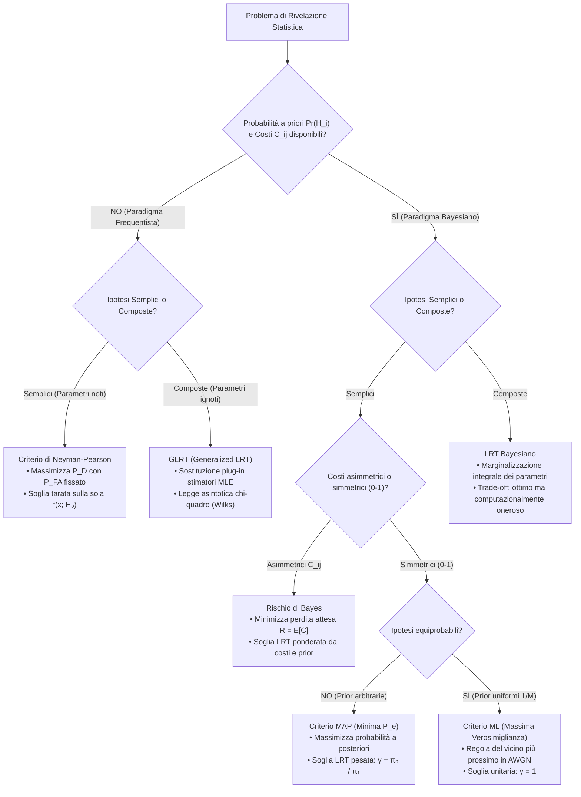

### Quadro Sinottico Comparativo Di Tutti I Rilevatori

La tabella seguente riassume e confronta in modo sistematico tutti i rilevatori statistici analizzati:

| Rilevatore | Paradigma | Informazioni Richieste a Priori | Statistica di Test e Regola Decisionale | Proprietà e Criterio di Ottimalità | Applicazione Tipica d'Esame |
| :--- | :--- | :--- | :--- | :--- | :--- |
| __Neyman-Pearson (NP)__ | Frequentista | Nessuna prior $\pi_i$, nessun costo $C_{ij}$; densità condizionate interamente note | $L(\mathbf{x}) = \frac{f(\mathbf{x}; H_1)}{f(\mathbf{x}; H_0)} \gtrless \gamma$ con $\int_\gamma^\infty f_L(l; H_0)\mathrm{d}l = \alpha$ | Ottimo assoluto: massimizza $P_{\text{D}}$ sotto vincolo rigido $P_{\text{FA}} \le \alpha$ (Lemma di NP) | Radar primario di sorveglianza, sonar, test di allarme |
| __Rischio di Bayes__ | Bayesiano | Note le prior $\pi_i$ e la matrice completa dei costi operativi $C_{ij}$ | $L(\mathbf{x}) \gtrless \frac{(C_{10} - C_{00})\pi_0}{(C_{01} - C_{11})\pi_1}$ | Minimizza il danno economico atteso $R = \mathbb{E}[C]$; include il MAP per costi unitari $0\text{-}1$ | Diagnostica clinica, controllo qualità industriale |
| __Minima Probabilità d'Errore (MAP)__ | Bayesiano | Note le prior $\pi_i$, costi uniformi simmetrici ($C_{jj}=0, C_{ij}=1$) | $\text{Pr}\{H_1 \mid \mathbf{x}\} \gtrless \text{Pr}\{H_0 \mid \mathbf{x}\} \iff L(\mathbf{x}) \gtrless \frac{\pi_0}{\pi_1}$ | Minimizza la probabilità totale di errore $P_e$; estendibile al caso $M$-ario $\arg\max_i \text{Pr}\{H_i \mid \mathbf{x}\}$ | Ricevitori per telecomunicazioni digitali con simboli asimmetrici |
| __Massima Verosimiglianza (ML)__ | Bayesiano / Frequentista | Ipotesi equiprobabili ($\pi_i = 1/M$), costi simmetrici $0\text{-}1$ | $f(\mathbf{x} \mid H_1) \gtrless f(\mathbf{x} \mid H_0) \iff L(\mathbf{x}) \gtrless 1$ | Regola del vicino più prossimo in rumore AWGN; minimizza $P_e$ per simboli equiprobabili | Decodifica di costellazioni digitali simmetriche (3-PAM, QAM, PSK) |
| __GLRT__ | Frequentista | Parametri incogniti deterministici, nessuna prior su parametri o ipotesi | $L_G(\mathbf{x}) = \frac{f(\mathbf{x}; \hat{\boldsymbol{\theta}}_1, H_1)}{f(\mathbf{x}; \hat{\boldsymbol{\theta}}_0, H_0)} \gtrless \gamma$ | Esegue rivelazione e stima congiunta; asintoticamente chi-quadro (Teorema di Wilks) | Rilevatore di energia per livello DC o segnale sinusoidale con ampiezza incognita |
| __LRT Bayesiano__ | Bayesiano | Note le prior delle ipotesi $\pi_i$ e le densità a priori dei parametri $f(\boldsymbol{\theta})$ | $L_B(\mathbf{x}) = \frac{\int f(\mathbf{x}\mid \boldsymbol{\theta}_1, H_1) f(\boldsymbol{\theta}_1)\mathrm{d}\boldsymbol{\theta}_1}{\int f(\mathbf{x}\mid \boldsymbol{\theta}_0, H_0) f(\boldsymbol{\theta}_0)\mathrm{d}\boldsymbol{\theta}_0} \gtrless \gamma$ | Elimina i parametri incogniti per marginalizzazione; ottimo bayesiano ma computazionalmente gravoso | Rivelazione di segnali aleatori con parametri distribuiti a priori (es. canali con fading) |


# 6. Introduzione Alla Teoria dell'Informazione Ed Entropia

Nel 1948 Claude Elwood Shannon pubblicò il saggio fondamentale _A Mathematical Theory of Communication_, fondando formalmente la __Teoria dell'Informazione__. Fino ad allora la trasmissione di segnali era considerata un problema prettamente elettrotecnico legato alla potenza analogica e alla propagazione elettromagnetica; Shannon trasformò la nozione intuitiva di informazione in una grandezza probabilistica quantificabile, dimostrando l'esistenza di limiti matematici universali e invalicabili.

L'intera disciplina risponde a due quesiti cardinali:
1. __Qual è il limite fondamentale della compressione dei dati?__ Ovvero, fino a quale livello di brevità possiamo comprimere un messaggio senza perdere informazione? La risposta risiede nell'__entropia__ $H$.
2. __Qual è il limite fondamentale della velocità di comunicazione affidabile?__ Ovvero, a quale ritmo massimo possiamo trasmettere dati attraverso un canale rumoroso garantendo una probabilità d'errore arbitrariamente piccola? La risposta risiede nella __capacità di canale__ $C$.

## Genesi Concettuale E Modello Di Comunicazione Di Shannon

La teoria dell'informazione si colloca al crocevia tra molteplici discipline scientifiche, stabilendo ponti concettuali tra la fisica statistica, la computer science, la probabilità pura, la teoria dei giochi e l'ingegneria delle telecomunicazioni:

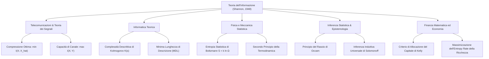

Il modello classico di Shannon formalizza qualsiasi catena di comunicazione come una sequenza di trasformazioni matematiche tra una sorgente d'informazione e una destinazione:

![[slide_02_communication_system_block.png|center mid]]

La sorgente genera un messaggio $W$, che l'encoder traduce in una sequenza di canale $X^n$. Il canale fisico introduce un'alterazione aleatoria regolata dalla legge di probabilità di transizione $p(y \mid x)$, restituendo la sequenza ricevuta $Y^n$. Il decodificatore analizza $Y^n$ per formulare una stima $\hat{W}$ del messaggio originale: la trasmissione è considerata affidabile se la probabilità che $\hat{W} \neq W$ può essere resa arbitrariamente piccola al crescere della lunghezza di blocco $n$.

### Complessità Di Kolmogorov Vs Entropia Di Shannon

Nel contesto dell'informatica teorica (Kolmogorov, Chaitin, Solomonoff), la complessità algoritmica o __complessità di Kolmogorov__ $K(s)$ di una sequenza di dati $s$ è definita come la lunghezza in bit del più breve programma per computer universale (es. Macchina di Turing) capace di generare la stringa $s$ come output e poi arrestarsi.

Mentre l'entropia di Shannon è un concetto statistico medio riferito a un insieme di eventi generati da un processo aleatorio, la complessità di Kolmogorov è una misura deterministica applicata a una specifica stringa individuale. Se una sequenza di simboli è generata in modo i.i.d. da una variabile aleatoria discreta $X$ con entropia $H(X)$, la complessità di Kolmogorov normalizzata per simbolo converge con probabilità $1$ all'entropia di Shannon:

$$
\lim_{n \to \infty} \frac{K(X_1, \dots, X_n)}{n} = H(X) \quad \text{con probabilità 1}
$$

Esiste una precisa dualità strutturale: mentre l'analisi degli algoritmi ottimizza la complessità computazionale temporale $O(\cdot)$ o spaziale, la teoria dell'informazione ottimizza la complessità descrittiva dei dati, identificando la minima rappresentazione binaria non comprimibile.

### Tassonomia Dei Problemi Di Elaborazione dell'Informazione

L'ambito applicativo della disciplina si articola in due macro-aree complementari:

1. __Compressione Dati (Codifica di Sorgente)__:
   - _Lossless (senza perdita)_: Ricostruzione esatta e perfetta del messaggio originario (es. algoritmi Deflate, ZIP, PNG, FLAC). Il limite invalicabile di bit medi per simbolo coincide con l'entropia della sorgente.
   - _Lossy (con perdita controllata)_: Tolleranza di una distorsione percettiva o quadratica per abbattere drasticamente la dimensione dei dati (es. JPEG, MPEG, MP3, WebP, JPEG AI). Il limite teorico è dettato dalla funzione Rate-Distortion $R(D)$.
2. __Comunicazione su Canale Rumoroso (Codifica di Canale)__:
   - _Affidabile priva di errori_: Aggiunta di ridondanza strutturata per contrastare il rumore fisico (codici a blocchi, convoluzionali, Turbo, LDPC, Polar) fino al raggiungimento della capacità di canale $C$.
   - _Comunicazione congiunta e semantica_: Trasmissione in cui si ottimizza la preservazione del significato semantico del messaggio sotto vincoli severi di banda e potenza, superando il paradigma della pura ricostruzione bit-a-bit.

## Misura dell'Informazione E Sorpresa Statistica

Nei sistemi fisici e di telecomunicazione, quantificare l'informazione richiede l'adozione di una misura algebricamente consistente. L'intuizione fondamentale di Shannon stabilisce che l'informazione generata da un evento non dipende dal suo significato semantico, bensì dalla sua rarità statistica (il cosiddetto grado di sorpresa):
- L'accadimento di un evento quasi certo ($p \approx 1$) fornisce una quantità di informazione pressoché nulla, poiché l'esito era già previsto con quasi certezza.
- L'accadimento di un evento altamente improbabile ($p \ll 1$) reca una quantità elevata di informazione, poiché dissipa una profonda incertezza pregressa.

Data una variabile aleatoria discreta $X$ che assume valori in un alfabeto finito $\mathcal{X}$ con funzione di massa di probabilità (PMF) $p(x) = \text{Pr}\{X = x\}$, l'__auto-informazione__ (_self-information_ o sorpresa) associata al verificarsi dell'evento $x$ è definita come:

$$
I(x) = \log_b\left( \frac{1}{p(x)} \right) = - \log_b p(x)
$$

### Proprietà Additiva E Motivazione Algebrica Del Logaritmo

Perché utilizziamo proprio il logaritmo per misurare l'informazione? La risposta risiede nella richiesta assiomatica di __additività per eventi statisticamente indipendenti__.

Supponiamo di avere due eventi indipendenti $x_1$ e $x_2$. Poiché gli eventi sono indipendenti, la probabilità congiunta del loro verificarsi simultaneo è data dal prodotto delle singole probabilità:

$$
p(x_1, x_2) = p(x_1) \, p(x_2)
$$

Richiediamo che l'informazione complessiva ottenuta osservando entrambi gli eventi indipendenti sia la somma delle informazioni apportate dai singoli eventi:

$$
I(x_1, x_2) = I(x_1) + I(x_2)
$$

Se esprimiamo l'informazione come funzione della probabilità dell'evento, $I(x) = f(p(x))$, la condizione di additività si traduce nell'equazione funzionale di Cauchy:

$$
f\big( p(x_1) \, p(x_2) \big) = f\big( p(x_1) \big) + f\big( p(x_2) \big)
$$

Sotto l'ipotesi naturale di continuità (o di monotonia decrescente, poiché a probabilità maggiore deve corrispondere sorpresa minore), l'unica famiglia di funzioni reali che trasforma un prodotto in una somma è la funzione logaritmica:

$$
f(p) = -k \log_b p, \quad \text{con } k > 0
$$

Ponendo convenzionalmente la costante di normalizzazione $k = 1$, otteniamo univocamente l'espressione $I(x) = -\log_b p(x)$.

![[self_information_surprise.svg|center mid]]

La curva evidenzia che:
- Per $p = 1$, l'informazione vale $I(1) = -\log_b(1) = 0$: sapere che si è verificato un evento certo non apporta alcuna informazione.
- Per $p \to 0^+$, l'informazione diverge: $I(p) \to +\infty$.
- La funzione è convessa e strettamente decrescente rispetto alla probabilità $p$.

### Basi Del Logaritmo E Unità Di Misura

La scelta della base $b > 1$ del logaritmo fissa la scala e l'unità di misura dell'informazione:
- __Base 2 ($b = 2$)__: L'unità è il __bit__ (contrazione di _binary digit_, detta anche Shannon). Corrisponde alla quantità di informazione generata risolvendo l'incertezza tra due alternative equiprobabili ($p = 1/2 \implies I(x) = -\log_2(1/2) = 1$ bit). Costituisce lo standard assoluto in ingegneria dell'informazione e nelle telecomunicazioni numeriche.
- __Base naturale ($b = e$)__: L'unità è il __nat__. Risulta particolarmente comoda nel calcolo differenziale, nei gradienti di machine learning e nelle formulazioni di meccanica statistica.
- __Base decimale ($b = 10$)__: L'unità è l'__hartley__ (detto anche dit o ban), introdotto da Ralph Hartley nel 1928, corrispondente all'incertezza associata a una scelta equiprobabile tra 10 stati.

Per convertire il valore numerico dell'informazione da una base $b$ a una base $a$, applichiamo la classica regola del cambiamento di base logaritmica:

$$
I_a(x) = \log_a(b) \, I_b(x) = \frac{I_b(x)}{\log_b(a)}
$$

In particolare, per convertire tra nat e bit:

$$
1 \text{ nat} = \log_2(e) \approx 1.442695 \text{ bit}, \qquad 1 \text{ bit} = \ln(2) \approx 0.693147 \text{ nat}
$$

## Entropia Di Shannon

L'auto-informazione $I(x)$ è una variabile aleatoria, poiché dipende dall'esito $x$ che si manifesta con probabilità $p(x)$. L'__entropia di Shannon__ $H(X)$ di una sorgente discreta $X$ è definita come il valore atteso della sorpresa statistica associata a tutte le sue possibili realizzazioni:

$$
H(X) = \mathbb{E}[I(X)] = \mathbb{E}\left[ \log_2 \frac{1}{p(X)} \right] = - \sum_{x \in \mathcal{X}} p(x) \log_2 p(x)
$$

### Proprietà Analitiche Fondamentali

L'entropia gode delle seguenti proprietà cardine, costantemente verificate in sede d'esame:

1. __Funzionale puro della distribuzione__: $H(X)$ non dipende affatto dai valori numerici concreti assunti dalla variabile aleatoria $X$ (che siano tensioni, caratteri alfanumerici o stati quantistici), ma unicamente dal vettore delle probabilità $\mathbf{p} = [p(x_1), \dots, p(x_M)]^T$. Pertanto, scriviamo indistintamente $H(X)$ o $H(\mathbf{p})$.
2. __Continuità sul bordo ($p \to 0^+$)__: Se un evento dell'alfabeto ha probabilità nulla ($p(x) = 0$), conveniamo analiticamente che $0 \log_2 0 = 0$. Questa convenzione non è una scelta arbitraria, ma discende dal calcolo rigoroso del limite mediante la regola di de l'Hôpital:

$$
\lim_{p \to 0^+} p \log_2 p = \lim_{p \to 0^+} \frac{\log_2 p}{\frac{1}{p}} = \lim_{p \to 0^+} \frac{\frac{\mathrm{d}}{\mathrm{d}p} \left( \frac{\ln p}{\ln 2} \right)}{\frac{\mathrm{d}}{\mathrm{d}p} \left( p^{-1} \right)}
$$

Eseguendo le derivate al numeratore e al denominatore:

$$
\lim_{p \to 0^+} \frac{\frac{1}{p \ln 2}}{-\frac{1}{p^2}} = \lim_{p \to 0^+} \left( - \frac{p^2}{p \ln 2} \right) = \lim_{p \to 0^+} \left( - \frac{p}{\ln 2} \right) = 0
$$

Gli eventi impossibili non apportano alcun contributo all'incertezza media del sistema.

3. __Non negatività__: Poiché $0 \le p(x) \le 1$ per ogni realizzazione $x$, si ha che $\log_2(1/p(x)) \ge 0$. Essendo l'entropia una combinazione lineare a pesi non negativi di quantità non negative, concludiamo che:

$$
H(X) \ge 0
$$

L'annullamento $H(X) = 0$ si verifica se e solo se la variabile $X$ è deterministica, ovvero se esiste un unico stato $x_0$ tale che $p(x_0) = 1$ e $p(x) = 0$ per ogni $x \neq x_0$. In tal caso non sussiste alcuna incertezza a priori sull'esito.

La dimostrazione dell'unicità funzionale dell'entropia a partire dai quattro postulati assiomatici di Khinchin è riportata in dettaglio in [[Anno 1/Information and Estimation Theory/zz. Argomenti extra#Dimostrazione Assiomatica dell'Unicità dell'Entropia di Shannon-Khinchin|Dimostrazione Assiomatica dell'Unicità dell'Entropia di Shannon-Khinchin]].

### Esempio Reale: Entropia Del Linguaggio Naturale

Consideriamo un testo scritto composto da un alfabeto discreto di $M$ simboli tipografici. L'entropia per simbolo quantifica il contenuto informativo intrinseco della lingua:

Analizzando la frequenza unigramma empirica dei circa 400.000 caratteri della _Divina Commedia_ di Dante Alighieri sull'alfabeto italiano (includendo lo spazio interlineare e la punteggiatura principale, per un totale di circa $M \approx 30$ simboli), otteniamo una stima dell'entropia di primo ordine pari a:

$$
H_{\text{Dante}} \approx 4.0126 \text{ bit/carattere}
$$

Se i caratteri fossero generati in modo uniforme ed equiprobabile, l'entropia teorica massima sarebbe:

$$
H_{\text{uniforme}} = \log_2(30) \approx 4.9069 \text{ bit/carattere}
$$

La differenza di quasi $0.9$ bit per carattere quantifica la marcata __ridondanza statistica__ della lingua italiana a livello unigramma (ad esempio l'elevatissima frequenza delle vocali 'e', 'a' contrapposta all'estrema rarità di consonanti come 'q' o 'z').

## Distribuzioni Notevoli Ed Esempi Di Calcolo

### Entropia Binaria Di Bernoulli

Consideriamo una sorgente dicotomica $X \in \{0, 1\}$ governata da una distribuzione di Bernoulli di parametro $p \in [0, 1]$:

$$
p(1) = p, \qquad p(0) = 1 - p
$$

L'entropia di $X$ è descritta dalla celebre __funzione di entropia binaria__ $H_B(p)$:

$$
H_B(p) = - p \log_2 p - (1 - p) \log_2(1 - p)
$$

![[slide_09_binary_entropy_curve.png|center mid]]

Analizziamo il comportamento analitico della funzione:
- __Simmetria rispetto a $p = 1/2$__: $H_B(p) = H_B(1 - p)$. Scambiare le etichette di "successo" e "insuccesso" non modifica l'incertezza intrinseca del processo.
- __Annullamento ai bordi__: Per $p \to 0^+$ e $p \to 1^-$, sfruttando il limite notevole ricavato in precedenza, abbiamo $H_B(0) = H_B(1) = 0$ bit. Quando il risultato della prova è certo a priori, non vi è alcuna incertezza da dissipare.
- __Ricerca del massimo globale__: Calcoliamo la derivata prima rispetto al parametro $p$, convertendo temporaneamente in logaritmi naturali ($\log_2 u = \frac{\ln u}{\ln 2}$):

$$
\frac{\mathrm{d}H_B}{\mathrm{d}p} = \frac{\mathrm{d}}{\mathrm{d}p} \left[ - \frac{p \ln p + (1 - p) \ln(1 - p)}{\ln 2} \right]
$$

Applicando la regola del prodotto di derivazione:

$$
\frac{\mathrm{d}H_B}{\mathrm{d}p} = - \frac{1}{\ln 2} \left[ \left(\ln p + p \cdot \frac{1}{p}\right) + \left((-1)\ln(1 - p) + (1 - p) \cdot \frac{-1}{1 - p}\right) \right]
$$

$$
\frac{\mathrm{d}H_B}{\mathrm{d}p} = - \frac{1}{\ln 2} \left[ \ln p + 1 - \ln(1 - p) - 1 \right]
$$

Notiamo con chiarezza che i termini costanti $+1$ e $-1$ si cancellano esattamente:

$$
\frac{\mathrm{d}H_B}{\mathrm{d}p} = - \frac{1}{\ln 2} \big[ \ln p - \ln(1 - p) \big] = \frac{1}{\ln 2} \ln\left( \frac{1 - p}{p} \right) = \log_2\left( \frac{1 - p}{p} \right)
$$

Imponiamo l'annullamento della derivata prima per determinare i punti stazionari:

$$
\log_2\left( \frac{1 - p}{p} \right) = 0 \iff \frac{1 - p}{p} = 1 \iff 1 - p = p \iff 2p = 1 \iff p = \frac{1}{2}
$$

Verifichiamo la natura del punto stazionario calcolando la derivata seconda:

$$
\frac{\mathrm{d}^2 H_B}{\mathrm{d}p^2} = \frac{\mathrm{d}}{\mathrm{d}p} \left[ \frac{\ln(1 - p) - \ln p}{\ln 2} \right] = \frac{1}{\ln 2} \left( - \frac{1}{1 - p} - \frac{1}{p} \right) = - \frac{1}{p(1 - p)\ln 2}
$$

Poiché $p \in (0, 1)$, il denominatore $p(1 - p)\ln 2$ è strettamente positivo, rendendo la derivata seconda strettamente negativa su tutto l'intervallo:

$$
\frac{\mathrm{d}^2 H_B}{\mathrm{d}p^2} < 0 \quad \forall p \in (0, 1)
$$

La funzione è quindi __strettamente concava__ e il punto $p = 1/2$ è il punto di massimo assoluto, in cui l'incertezza assume il valore di picco pari esattamente a:

$$
H_B\left(\frac{1}{2}\right) = - \frac{1}{2}\log_2\left(\frac{1}{2}\right) - \frac{1}{2}\log_2\left(\frac{1}{2}\right) = \frac{1}{2}(1) + \frac{1}{2}(1) = 1 \text{ bit}
$$

Il lancio di una moneta equa genera esattamente un bit di informazione pura.

### Distribuzione Uniforme Discreta

Consideriamo una variabile aleatoria discreta $X$ che assume $M$ valori distinti equiprobabili:

$$
p(x) = \frac{1}{M}, \quad \forall x \in \mathcal{X} = \{x_1, \dots, x_M\}
$$

Sviluppiamo direttamente la sommatoria dell'entropia:

$$
H(X) = - \sum_{i=1}^M p(x_i) \log_2 p(x_i) = - \sum_{i=1}^M \frac{1}{M} \log_2\left( \frac{1}{M} \right)
$$

Portando i termini costanti fuori dalla sommatoria:

$$
H(X) = - \left( \log_2 \frac{1}{M} \right) \sum_{i=1}^M \frac{1}{M} = - (-\log_2 M) \cdot 1 = \log_2 M \text{ bit}
$$

Questo risultato costituisce un cardine della teoria: per qualsiasi variabile aleatoria a supporto discreto con cardinalità $|\mathcal{X}| = M$, l'entropia è sempre superiormente limitata da $\log_2 M$:

$$
H(X) \le \log_2 M
$$

L'uguaglianza è raggiunta se e solo se la distribuzione è perfettamente uniforme. L'equiprobabilità rappresenta il regime di massima ignoranza o massima imprevedibilità a priori.

### Interpretazione Operativa Tramite Query Binarie: Il Gioco Delle Venti Domande

L'entropia quantifica in modo operativo il numero minimo medio di domande a risposta binaria (sì/no) necessarie per identificare con certezza lo stato assunto da una sorgente aleatoria.

Immaginiamo una variabile aleatoria $X \in \{a, b, c, d\}$ con distribuzione di probabilità non uniforme:

$$
p(a) = \frac{1}{2}, \quad p(b) = \frac{1}{4}, \quad p(c) = \frac{1}{8}, \quad p(d) = \frac{1}{8}
$$

Calcoliamo l'entropia della sorgente:

$$
H(X) = - \left( \frac{1}{2}\log_2 \frac{1}{2} + \frac{1}{4}\log_2 \frac{1}{4} + \frac{1}{8}\log_2 \frac{1}{8} + \frac{1}{8}\log_2 \frac{1}{8} \right)
$$

$$
H(X) = \frac{1}{2}(1) + \frac{1}{4}(2) + \frac{1}{8}(3) + \frac{1}{8}(3) = \frac{4 + 4 + 3 + 3}{8} = \frac{14}{8} = 1.75 \text{ bit}
$$

Costruiamo un albero di interrogazione binaria ottimale per indovinare l'oggetto estratto:
1. Prima domanda: _"La variabile estratta è $a$?"_
   - Se la risposta è sì (probabilità $1/2$), abbiamo identificato la variabile con $1$ sola domanda.
2. Se la risposta è no, poniamo la seconda domanda: _"La variabile estratta è $b$?"_
   - Se la risposta è sì (probabilità $1/4$), abbiamo identificato la variabile con $2$ domande.
3. Se la risposta è no, poniamo la terza domanda: _"La variabile estratta è $c$?"_
   - Se la risposta è sì (probabilità $1/8$), identifichiamo $c$ in $3$ domande.
   - Se la risposta è no (probabilità $1/8$), per esclusione la variabile deve essere $d$, identificata anch'essa con $3$ domande.

Calcoliamo il numero medio atteso di domande binarie necessarie:

$$
\mathbb{E}[\text{domande}] = 1 \cdot p(a) + 2 \cdot p(b) + 3 \cdot p(c) + 3 \cdot p(d)
$$

$$
\mathbb{E}[\text{domande}] = 1 \cdot \left(\frac{1}{2}\right) + 2 \cdot \left(\frac{1}{4}\right) + 3 \cdot \left(\frac{1}{8}\right) + 3 \cdot \left(\frac{1}{8}\right) = 0.5 + 0.5 + 0.375 + 0.375 = 1.75
$$

Il numero medio atteso di decisioni binarie ottimali coincide esattamente con l'entropia di Shannon: $\mathbb{E}[\text{domande}] = H(X) = 1.75$. Quando le probabilità degli eventi sono potenze intere negative di 2 ($p(x) = 2^{-l_x}$), il bound teorico è raggiunto con uguaglianza perfetta senza alcun sovradimensionamento.

### Distribuzioni Asintotiche: Binomiale E Poisson

#### Distribuzione Binomiale

Sia $X \sim \text{Binom}(n, q)$ il conteggio dei successi in $n$ prove bernoulliane indipendenti con probabilità di successo individuale $q$:

$$
p(k) = \binom{n}{k} q^k (1 - q)^{n - k}, \qquad k \in \{0, 1, \dots, n\}
$$

Al crescere di $n$, in virtù del Teorema del Limite Centrale di De Moivre-Laplace, la distribuzione binomiale converge a una densità gaussiana $\mathcal{N}(\mu, \sigma^2)$ con parametri:

$$
\mu = nq, \qquad \sigma^2 = nq(1 - q)
$$

Integrando l'entropia della corrispondente gaussiana discretizzata, otteniamo il comportamento asintotico per grandi campioni:

$$
H(X) \approx \frac{1}{2} \log_2\big( 2\pi e \, n q(1 - q) \big) \text{ bit}
$$

L'incertezza cresce in modo logaritmico rispetto al numero di prove $n$, scalando proporzionalmente alla larghezza della deviazione standard del processo $\sigma = \sqrt{nq(1-q)}$.

#### Distribuzione Di Poisson

Sia $X \sim \text{Pois}(\lambda)$ una variabile aleatoria di Poisson che modella il conteggio di eventi rari con intensità media $\lambda > 0$:

$$
p(k) = \frac{\lambda^k e^{-\lambda}}{k!}, \qquad k = 0, 1, 2, \dots
$$

Espandendo analiticamente il logaritmo di $p(k)$ ed applicando la formula di Stirling per il fattoriale $\ln(k!) \approx k \ln k - k + \frac{1}{2}\ln(2\pi k)$, quando il tasso di arrivo diventa elevato ($\lambda \to \infty$) l'entropia di Shannon manifesta l'andamento asintotico:

$$
H(X) = \frac{1}{2} \log_2(2\pi e \lambda) + O\left(\frac{1}{\lambda}\right) \text{ bit}
$$

La derivazione formale passo-passo basata sull'espansione di Taylor dei momenti centrali e sul controllo analitico del resto è consultabile in [[Anno 1/Information and Estimation Theory/zz. Argomenti extra#Calcolo Asintotico dell'Entropia di Poisson con Approssimazione di Stirling|Calcolo Asintotico dell'Entropia di Poisson con Approssimazione di Stirling]].

## Entropia Congiunta Ed Entropia Condizionata

Quando un sistema descrive l'interazione tra più variabili aleatorie, è necessario estendere i concetti informativi alle distribuzioni multidimensionali.

Siano $X$ e $Y$ due variabili aleatorie discrete definite rispettivamente sugli insiemi $\mathcal{X}$ e $\mathcal{Y}$, regolate dalla distribuzione di probabilità congiunta $p(x, y) = \text{Pr}\{X = x, Y = y\}$.

L'__Entropia Congiunta__ $H(X, Y)$ quantifica l'incertezza globale associata alla coppia di variabili aleatorie:

$$
H(X, Y) = - \sum_{x \in \mathcal{X}} \sum_{y \in \mathcal{Y}} p(x, y) \log_2 p(x, y) = \mathbb{E}\left[ \log_2 \frac{1}{p(X, Y)} \right]
$$

L'__Entropia Condizionata__ $H(Y \mid X)$ misura l'incertezza residua sulla variabile $Y$ supponendo di aver già osservato l'esito della variabile $X$.

Fissato un valore specifico $X = x$, l'incertezza condizionata a questo singolo evento è data da:

$$
H(Y \mid X = x) = - \sum_{y \in \mathcal{Y}} p(y \mid x) \log_2 p(y \mid x)
$$

L'entropia condizionata globale $H(Y \mid X)$ si ottiene mediando $H(Y \mid X = x)$ rispetto alla distribuzione marginale $p(x)$:

$$
H(Y \mid X) = \sum_{x \in \mathcal{X}} p(x) H(Y \mid X = x) = - \sum_{x \in \mathcal{X}} p(x) \sum_{y \in \mathcal{Y}} p(y \mid x) \log_2 p(y \mid x)
$$

Poiché $p(x) p(y \mid x) = p(x, y)$, ricaviamo la formulazione compatta:

$$
H(Y \mid X) = - \sum_{x \in \mathcal{X}} \sum_{y \in \mathcal{Y}} p(x, y) \log_2 p(y \mid x) = \mathbb{E}\left[ \log_2 \frac{1}{p(Y \mid X)} \right]
$$

### Derivazione Analitica Della Regola Della Catena

L'entropia congiunta e l'entropia condizionata sono collegate dal teorema fondamentale della __regola della catena__ (_chain rule_):

$$
H(X, Y) = H(X) + H(Y \mid X)
$$

e simmetricamente per scambio dei ruoli delle due variabili:

$$
H(X, Y) = H(Y) + H(X \mid Y)
$$

Sviluppiamo la dimostrazione analitica passo dopo passo. Partiamo dalla definizione di entropia congiunta:

$$
H(X, Y) = - \sum_{x \in \mathcal{X}} \sum_{y \in \mathcal{Y}} p(x, y) \log_2 p(x, y)
$$

Sfruttando la regola delle probabilità condizionate, fattorizziamo l'argomento del logaritmo come $p(x, y) = p(x) \, p(y \mid x)$:

$$
H(X, Y) = - \sum_{x \in \mathcal{X}} \sum_{y \in \mathcal{Y}} p(x, y) \log_2\big( p(x) \, p(y \mid x) \big)
$$

Poiché il logaritmo di un prodotto è la somma dei logaritmi, spezziamo la doppia sommatoria in due blocchi:

$$
H(X, Y) = - \sum_{x \in \mathcal{X}} \sum_{y \in \mathcal{Y}} p(x, y) \log_2 p(x) - \sum_{x \in \mathcal{X}} \sum_{y \in \mathcal{Y}} p(x, y) \log_2 p(y \mid x)
$$

Esaminiamo attentamente il primo termine. Il fattore $\log_2 p(x)$ non dipende dall'indice di sommatoria $y$, e può quindi essere raccolto a fattore comune fuori dalla sommatoria interna su $y$:

$$
- \sum_{x \in \mathcal{X}} \log_2 p(x) \left[ \sum_{y \in \mathcal{Y}} p(x, y) \right]
$$

Per la definizione di probabilità marginale, la sommatoria congiunta su tutti i possibili esiti di $y$ collassa esattamente a $p(x)$:

$$
\sum_{y \in \mathcal{Y}} p(x, y) = p(x)
$$

Sostituendo questa identità, il primo termine diventa:

$$
- \sum_{x \in \mathcal{X}} p(x) \log_2 p(x) = H(X)
$$

Il secondo blocco coincide esattamente con la definizione formale di $H(Y \mid X)$:

$$
- \sum_{x \in \mathcal{X}} \sum_{y \in \mathcal{Y}} p(x, y) \log_2 p(y \mid x) = H(Y \mid X)
$$

Sommando i due contributi otteniamo la tesi:

$$
H(X, Y) = H(X) + H(Y \mid X)
$$

L'incertezza globale generata da una coppia di variabili aleatorie è data dall'incertezza associata alla prima variabile più l'incertezza residua della seconda condizionata alla conoscenza della prima.

### Proprietà Del Condizionamento

Una delle proprietà più rilevanti della teoria dell'informazione sancisce che __il condizionamento in media non aumenta mai l'entropia__:

$$
H(Y \mid X) \le H(Y)
$$

con uguaglianza se e solo se le variabili $X$ e $Y$ sono statisticamente indipendenti. In media, acquisire un'osservazione $X$ può soltanto ridurre o lasciare invariata l'incertezza su $Y$, non può mai accrescerla.

> [!WARNING] Trabocchetto d'Esame: Condizionamento Globale vs Singola Realizzazione
> La proprietà di riduzione dell'incertezza vale tassativamente per l'entropia condizionata media $H(Y \mid X) = \sum_x p(x) H(Y \mid X = x)$. Per una singola specifica realizzazione $X = x$, l'entropia puntuale $H(Y \mid X = x)$ può essere sia maggiore sia minore dell'entropia marginale a priori $H(Y)$. Un'osservazione anomala o imprevista può momentaneamente disorientare l'osservatore aumentando l'incertezza locale, ma mediando su tutte le possibili osservazioni l'incertezza media diminuisce sempre.

## Divergenza Di Kullback-Leibler E Cross-Entropia

Nel confronto tra modelli probabilistici, o nella compressione di dati in cui si utilizzi un codice calibrato su un modello statistico errato, è indispensabile quantificare la discrepanza tra due distribuzioni di probabilità distinte $p$ e $q$ definite sul medesimo alfabeto campionario $\mathcal{X}$.

La __Divergenza di Kullback-Leibler__ (chiamata anche __Entropia Relativa__ o _Kullback-Leibler Divergence_, KLD) tra la distribuzione reale $p$ e la distribuzione approssimante $q$ è definita come:

$$
D(p \parallel q) = \sum_{x \in \mathcal{X}} p(x) \log_2\left( \frac{p(x)}{q(x)} \right) = \mathbb{E}_p\left[ \log_2 \frac{p(X)}{q(X)} \right]
$$

### Convenzioni Operative Sui Supporti

Per preservare la coerenza matematica della misura si adottano le convenzioni:
- Se $p(x) = 0$, il relativo termine $0 \log_2(0/q(x))$ vale analiticamente $0$.
- Se $p(x) > 0$ ma $q(x) = 0$, il termine $p(x) \log_2(p(x)/0)$ diverge a $+\infty$, producendo $D(p \parallel q) = +\infty$.

Se il nostro modello $q$ assume a priori che un evento sia categoricamente impossibile ($q(x) = 0$), e nella realtà quell'evento si manifesta ($p(x) > 0$), la penalità da modello errato esplode ad infinito.

### Teorema Di Non-Negatività (Disuguaglianza dell'Entropia Relativa)

La proprietà cardine della divergenza KL è sancita dalla __disuguaglianza di Gibbs__:

$$
D(p \parallel q) \ge 0
$$

con $D(p \parallel q) = 0$ se e solo se $p(x) = q(x)$ per ogni $x \in \mathcal{X}$.

La dimostrazione è immediata applicando la disuguaglianza fondamentale del logaritmo $\ln u \le u - 1$ per ogni $u > 0$ (con uguaglianza se e solo se $u = 1$). Esprimiamo l'opposto della divergenza in base naturale:

$$
- D_e(p \parallel q) = - \sum_{x \in \mathcal{X}} p(x) \ln \frac{p(x)}{q(x)} = \sum_{x \in \mathcal{X}} p(x) \ln\left( \frac{q(x)}{p(x)} \right)
$$

Applicando la disuguaglianza del logaritmo al termine $\ln(q/p)$:

$$
- D_e(p \parallel q) \le \sum_{x \in \mathcal{X}} p(x) \left( \frac{q(x)}{p(x)} - 1 \right) = \sum_{x \in \mathcal{X}} q(x) - \sum_{x \in \mathcal{X}} p(x) = 1 - 1 = 0
$$

Moltiplicando per $-1$ e invertendo il verso della disuguaglianza:

$$
D_e(p \parallel q) \ge 0 \implies D(p \parallel q) \ge 0
$$

L'uguaglianza si verifica se e solo se $q(x)/p(x) = 1$ ovunque sul supporto di $p$, ossia se e solo se le due distribuzioni coincidono perfettamente.

### Asimmetria E Mancanza Di Metrica

Sebbene sia spesso denominata "distanza informativa", la divergenza di Kullback-Leibler __non è una metrica topologica__:
1. __È strutturalmente asimmetrica__: In generale $D(p \parallel q) \neq D(q \parallel p)$.
2. __Viola la disuguaglianza triangolare__: Date tre distribuzioni distinte $p, q, r$, in generale $D(p \parallel r) \not\le D(p \parallel q) + D(q \parallel r)$.

#### Dimostrazione Numerica dell'Asimmetria

Consideriamo due distribuzioni bernoulliane su $\mathcal{X} = \{0, 1\}$:
- Modello equo: $p = (1/2, 1/2)$.
- Modello sbilanciato: $q = (3/4, 1/4)$.

Calcoliamo dapprima $D(p \parallel q)$:

$$
D(p \parallel q) = \frac{1}{2} \log_2\left( \frac{1/2}{3/4} \right) + \frac{1}{2} \log_2\left( \frac{1/2}{1/4} \right)
$$

$$
D(p \parallel q) = \frac{1}{2} \log_2\left(\frac{2}{3}\right) + \frac{1}{2} \log_2(2) = \frac{1}{2}(-0.58496) + \frac{1}{2}(1) = -0.29248 + 0.50000 = 0.20752 \text{ bit}
$$

Calcoliamo ora la divergenza invertendo i ruoli, $D(q \parallel p)$:

$$
D(q \parallel p) = \frac{3}{4} \log_2\left( \frac{3/4}{1/2} \right) + \frac{1}{4} \log_2\left( \frac{1/4}{1/2} \right)
$$

$$
D(q \parallel p) = \frac{3}{4} \log_2\left(\frac{3}{2}\right) + \frac{1}{4} \log_2\left(\frac{1}{2}\right) = \frac{3}{4}(0.58496) + \frac{1}{4}(-1) = 0.43872 - 0.25000 = 0.18872 \text{ bit}
$$

Poiché $0.20752 \neq 0.18872$, l'asimmetria è provata sul campo. L'ordine degli argomenti è determinante: $D(p \parallel q)$ misura il prezzo pagato supponendo $q$ quando la realtà è $p$, mentre $D(q \parallel p)$ misura il prezzo opposto.

### Cross-Entropia E Sovraccarico Di Bit

Strettamente legata alla divergenza KL è la __Cross-Entropia__ tra la distribuzione target $p$ e il modello di stima $q$:

$$
H(p, q) = - \sum_{x \in \mathcal{X}} p(x) \log_2 q(x) = \mathbb{E}_p\left[ \log_2 \frac{1}{q(X)} \right]
$$

Scomponiamo analiticamente l'argomento del logaritmo moltiplicando e dividendo per $p(x)$:

$$
H(p, q) = - \sum_{x \in \mathcal{X}} p(x) \log_2\left( \frac{q(x)}{p(x)} \cdot p(x) \right) = - \sum_{x \in \mathcal{X}} p(x) \log_2 p(x) - \sum_{x \in \mathcal{X}} p(x) \log_2\left( \frac{q(x)}{p(x)} \right)
$$

Riconoscendo le definizioni di entropia e di divergenza di Kullback-Leibler:

$$
H(p, q) = H(p) + \sum_{x \in \mathcal{X}} p(x) \log_2\left( \frac{p(x)}{q(x)} \right)
$$

$$
H(p, q) = H(p) + D(p \parallel q)
$$

Questa scomposizione possiede un'interpretazione fisica fondamentale:
- $H(p)$ è la lunghezza media minima teorica per simbolo ottenibile comprimendo la sorgente $p$ con il suo codice ottimale.
- $H(p, q)$ è la lunghezza media ottenuta codificando la sorgente $p$ con un codice che ritenevamo ottimo per $q$ (lunghezze di codice $\approx \log_2(1/q(x))$).
- $D(p \parallel q)$ rappresenta esattamente il __sovraccarico di bit sprecati per simbolo__ a causa dell'inesattezza del nostro modello statistico.

## Informazione Mutua E Diagrammi Di Venn Informativi

L'__Informazione Mutua__ $I(X; Y)$ tra due variabili aleatorie discrete $X$ e $Y$ quantifica la riduzione di incertezza su una variabile conseguente all'osservazione dell'altra.

Formalmente, l'informazione mutua è definita come la divergenza di Kullback-Leibler tra la distribuzione di probabilità congiunta $p(x, y)$ e il prodotto delle rispettive distribuzioni marginali $p(x)p(y)$:

$$
I(X; Y) = D\big( p(x, y) \parallel p(x)p(y) \big) = \sum_{x \in \mathcal{X}} \sum_{y \in \mathcal{Y}} p(x, y) \log_2\left( \frac{p(x, y)}{p(x)p(y)} \right)
$$

Dalla non-negatività della divergenza KL discende immediatamente che:

$$
I(X; Y) \ge 0
$$

con $I(X; Y) = 0$ se e solo se $p(x, y) = p(x)p(y)$ ovunque, ovvero se e solo se le variabili $X$ e $Y$ sono statisticamente indipendenti. Due variabili indipendenti non condividono alcuna informazione.

### Derivazione Delle Quattro Forme Analitiche Equivalenti

Scomponendo l'argomento del logaritmo mediante le probabilità condizionate, otteniamo quattro espressioni equivalenti dell'informazione mutua, tutte essenziali per la risoluzione dei problemi d'esame:

1. __Prima forma: Riduzione di incertezza su $X$ grazie a $Y$__:
Poiché $\frac{p(x, y)}{p(x)p(y)} = \frac{p(x \mid y)}{p(x)}$, abbiamo:

$$
I(X; Y) = \sum_{x, y} p(x, y) \log_2 p(x \mid y) - \sum_{x, y} p(x, y) \log_2 p(x)
$$

$$
I(X; Y) = - H(X \mid Y) + H(X) = H(X) - H(X \mid Y)
$$

2. __Seconda forma: Riduzione di incertezza su $Y$ grazie a $X$__:
Simmetricamente, poiché $\frac{p(x, y)}{p(x)p(y)} = \frac{p(y \mid x)}{p(y)}$:

$$
I(X; Y) = - H(Y \mid X) + H(Y) = H(Y) - H(Y \mid X)
$$

3. __Terza forma: Relazione con l'entropia congiunta__:
Sostituendo la regola della catena $H(X \mid Y) = H(X, Y) - H(Y)$ nella prima forma:

$$
I(X; Y) = H(X) - \big( H(X, Y) - H(Y) \big) = H(X) + H(Y) - H(X, Y)
$$

4. __Quarta forma: Isolamento della sovrapposizione informativa__:
Sottraendo le incertezze residue dall'unione congiunta:

$$
I(X; Y) = H(X, Y) - H(X \mid Y) - H(Y \mid X)
$$

### Proprietà Fondamentali dell'Informazione Mutua

Dalle formulazioni precedenti deduciamo le proprietà strutturali di $I(X; Y)$:
- __Simmetria__: $I(X; Y) = I(Y; X)$. La quantità di informazione che $X$ rivela su $Y$ è identica alla quantità che $Y$ rivela su $X$.
- __Auto-informazione__: L'informazione mutua che una variabile possiede con se stessa coincide con la sua entropia:

$$
I(X; X) = H(X) - H(X \mid X) = H(X) - 0 = H(X)
$$

Questo risultato chiarisce perché l'entropia di Shannon venga denominata _self-information media_: l'entropia misura l'informazione che una variabile ha su se stessa.
- __Limiti di escursione__: Poiché $H(X \mid Y) \ge 0$ e $H(Y \mid X) \ge 0$, l'informazione mutua è limitata inferiormente da zero e superiormente dalla più piccola delle due entropie marginali:

$$
0 \le I(X; Y) \le \min\big( H(X), H(Y) \big)
$$

### Rappresentazione Insiemistica Tramite Diagrammi Di Venn

Le relazioni algebriche tra le grandezze informative presentano un perfetto isomorfismo con la teoria della misura e con l'algebra degli insiemi:

![[information_venn_diagram.svg|center mid]]

Possiamo confrontare lo schema vettoriale con la rappresentazione canonica:

![[slide_26_mutual_information_venn.png|center mid]]

L'isomorfismo insiemistico si articola nelle seguenti equivalenze:
- La misura dell'insieme $X$ corrisponde all'entropia marginale $H(X)$.
- La misura dell'insieme $Y$ corrisponde all'entropia marginale $H(Y)$.
- L'intersezione insiemistica $X \cap Y$ corrisponde all'informazione mutua $I(X; Y)$.
- Le differenze insiemistiche $X \setminus Y$ e $Y \setminus X$ corrispondono alle entropie condizionate $H(X \mid Y)$ e $H(Y \mid X)$.
- L'unione insiemistica $X \cup Y$ corrisponde all'entropia congiunta:

$$
H(X, Y) = H(X \mid Y) + I(X; Y) + H(Y \mid X) = H(X) + H(Y) - I(X; Y)
$$

Questa formula ricalca fedelmente il principio di inclusione-esclusione $|A \cup B| = |A| + |B| - |A \cap B|$.

### Sviluppo Analitico Completo Di Un Esempio Matriciale

Consideriamo la distribuzione di probabilità congiunta $p(x, y)$ tra due variabili discrete $X, Y \in \{1, 2, 3, 4\}$, in cui le colonne individuano $X$ e le righe individuano $Y$:

| $p(x, y)$ | $X = 1$ | $X = 2$ | $X = 3$ | $X = 4$ | $p(y)$ |
| :---: | :---: | :---: | :---: | :---: | :---: |
| __$Y = 1$__ | $1/8$ | $1/16$ | $1/32$ | $1/32$ | __$1/4$__ |
| __$Y = 2$__ | $1/16$ | $1/8$ | $1/32$ | $1/32$ | __$1/4$__ |
| __$Y = 3$__ | $1/16$ | $1/16$ | $1/16$ | $1/16$ | __$1/4$__ |
| __$Y = 4$__ | $1/4$ | $0$ | $0$ | $0$ | __$1/4$__ |
| __$p(x)$__ | __$1/2$__ | __$1/4$__ | __$1/8$__ | __$1/8$__ | __$1$__ |

Calcoliamo passo-passo tutte le grandezze informative del sistema:

1. __Entropie marginali $H(X)$ e $H(Y)$__:
La distribuzione marginale di $X$ è $p(x) = [1/2, 1/4, 1/8, 1/8]$:

$$
H(X) = \frac{1}{2}\log_2(2) + \frac{1}{4}\log_2(4) + \frac{1}{8}\log_2(8) + \frac{1}{8}\log_2(8)
$$

$$
H(X) = \frac{1}{2}(1) + \frac{1}{4}(2) + \frac{1}{8}(3) + \frac{1}{8}(3) = \frac{4}{8} + \frac{4}{8} + \frac{3}{8} + \frac{3}{8} = \frac{14}{8} = 1.75 \text{ bit}
$$

La distribuzione marginale di $Y$ è uniforme con $p(y) = 1/4$ per $y \in \{1, 2, 3, 4\}$:

$$
H(Y) = \log_2(4) = 2 \text{ bit} = \frac{16}{8} \text{ bit}
$$

2. __Entropia congiunta $H(X, Y)$__:
Raggruppiamo i termini con ugual valore di probabilità nella tabella congiunta:
- $1$ cella con probabilità $1/4$: valore sorpresa $\log_2(4) = 2$
- $2$ celle con probabilità $1/8$: valore sorpresa $\log_2(8) = 3$
- $6$ celle con probabilità $1/16$: valore sorpresa $\log_2(16) = 4$
- $4$ celle con probabilità $1/32$: valore sorpresa $\log_2(32) = 5$
- $3$ celle con probabilità $0$: contributo nullo per limite notevole ($0 \log_2 0 = 0$)

Sviluppiamo la sommatoria:

$$
H(X, Y) = 1 \cdot \left(\frac{1}{4} \cdot 2\right) + 2 \cdot \left(\frac{1}{8} \cdot 3\right) + 6 \cdot \left(\frac{1}{16} \cdot 4\right) + 4 \cdot \left(\frac{1}{32} \cdot 5\right)
$$

$$
H(X, Y) = \frac{2}{4} + \frac{6}{8} + \frac{24}{16} + \frac{20}{32} = \frac{1}{2} + \frac{3}{4} + \frac{3}{2} + \frac{5}{8}
$$

Portando tutto al denominatore comune $8$:

$$
H(X, Y) = \frac{4 + 6 + 12 + 5}{8} = \frac{27}{8} = 3.375 \text{ bit}
$$

3. __Entropie condizionate $H(X \mid Y)$ e $H(Y \mid X)$__:
Applicando la regola della catena:

$$
H(X \mid Y) = H(X, Y) - H(Y) = \frac{27}{8} - \frac{16}{8} = \frac{11}{8} = 1.375 \text{ bit}
$$

$$
H(Y \mid X) = H(X, Y) - H(X) = \frac{27}{8} - \frac{14}{8} = \frac{13}{8} = 1.625 \text{ bit}
$$

Verifichiamo il calcolo di $H(X \mid Y)$ per via diretta mediando sulle singole righe:

$$
H(X \mid Y) = \sum_{y=1}^4 p(y) H(X \mid Y = y)
$$

- Per $y = 1$: le probabilità condizionate sono $[(1/8)/(1/4), (1/16)/(1/4), (1/32)/(1/4), (1/32)/(1/4)] = [1/2, 1/4, 1/8, 1/8] \implies H = 1.75$ bit.
- Per $y = 2$: probabilità condizionate $[1/4, 1/2, 1/8, 1/8] \implies H = 1.75$ bit.
- Per $y = 3$: probabilità condizionate $[1/4, 1/4, 1/4, 1/4] \implies H = \log_2(4) = 2$ bit.
- Per $y = 4$: probabilità condizionate $[1, 0, 0, 0] \implies H = 0$ bit.

Calcolando la media ponderata con pesi $p(y) = 1/4$:

$$
H(X \mid Y) = \frac{1}{4}(1.75) + \frac{1}{4}(1.75) + \frac{1}{4}(2) + \frac{1}{4}(0) = \frac{7/4 + 7/4 + 8/4 + 0}{4} = \frac{22/4}{4} = \frac{11}{8} = 1.375 \text{ bit}
$$

I due metodi concordano perfettamente.

4. __Informazione mutua $I(X; Y)$__:

$$
I(X; Y) = H(X) - H(X \mid Y) = \frac{14}{8} - \frac{11}{8} = \frac{3}{8} = 0.375 \text{ bit}
$$

Verifica mediante la seconda forma simmetrica:

$$
I(X; Y) = H(Y) - H(Y \mid X) = \frac{16}{8} - \frac{13}{8} = \frac{3}{8} = 0.375 \text{ bit}
$$

Verifica mediante la terza forma insiemistica:

$$
I(X; Y) = H(X) + H(Y) - H(X, Y) = \frac{14}{8} + \frac{16}{8} - \frac{27}{8} = \frac{3}{8} = 0.375 \text{ bit}
$$

L'osservazione di $Y$ riduce mediamente l'incertezza su $X$ di $0.375$ bit (e specularmente la conoscenza di $X$ abbatte l'incertezza su $Y$ della medesima quantità).

## Regole Della Catena Multivariate

Le relazioni additive tra entropie, informazioni mutue e divergenze si generalizzano a collezioni arbitrarie di $n$ variabili aleatorie $(X_1, X_2, \dots, X_n)$.

### Regola Della Catena per l'Entropia Generale

Per una sequenza di $n$ variabili aleatorie congiuntamente distribuite:

$$
H(X_1, X_2, \dots, X_n) = \sum_{i=1}^n H(X_i \mid X_{i-1}, X_{i-2}, \dots, X_1)
$$

con la convenzione fondamentale che per il primo termine $i=1$ la variabile è incondizionata: $H(X_1 \mid X_0) \equiv H(X_1)$.

Dimostriamo l'asserto applicando la regola delle probabilità condizionate all'argomento congiunto:

$$
p(x_1, \dots, x_n) = p(x_1) \, p(x_2 \mid x_1) \, p(x_3 \mid x_1, x_2) \cdots p(x_n \mid x_1, \dots, x_{n-1}) = \prod_{i=1}^n p(x_i \mid x^{i-1})
$$

dove abbiamo compattato la notazione vettoriale $x^{i-1} = (x_1, \dots, x_{i-1})$. Sostituendo nella definizione di entropia:

$$
H(X_1, \dots, X_n) = - \mathbb{E}\left[ \log_2 \prod_{i=1}^n p(X_i \mid X^{i-1}) \right] = - \mathbb{E}\left[ \sum_{i=1}^n \log_2 p(X_i \mid X^{i-1}) \right]
$$

Sfruttando la linearità del valore atteso, scambiamo l'operatore di sommatoria con l'aspettazione statistica:

$$
H(X_1, \dots, X_n) = \sum_{i=1}^n \mathbb{E}\left[ -\log_2 p(X_i \mid X^{i-1}) \right] = \sum_{i=1}^n H(X_i \mid X^{i-1})
$$

Nei processi aleatori temporali con memoria, l'incertezza globale della traiettoria è la somma delle incertezze di ciascun campione condizionato a tutta la sua storia passata.

### Informazione Mutua Condizionata

Siano $X, Y, Z$ tre variabili aleatorie. L'__Informazione Mutua Condizionata__ $I(X; Y \mid Z)$ quantifica la riduzione di incertezza su $X$ generata dall'osservazione di $Y$, sapendo che la variabile $Z$ è già nota all'osservatore:

$$
I(X; Y \mid Z) = H(X \mid Z) - H(X \mid Y, Z) = \mathbb{E}_{p(x, y, z)}\left[ \log_2 \frac{p(X, Y \mid Z)}{p(X \mid Z) \, p(Y \mid Z)} \right]
$$

Espandendo con la regola della catena a tre variabili:

$$
I(X; Y \mid Z) = H(X, Z) - H(Z) - \big( H(X, Y, Z) - H(Y, Z) \big) = H(X, Z) + H(Y, Z) - H(X, Y, Z) - H(Z)
$$

> [!NOTE] Comportamento Non Monotono del Condizionamento sull'Informazione Mutua
> A differenza dell'entropia (per cui vale rigorosamente $H(X \mid Z) \le H(X)$), l'informazione mutua condizionata $I(X; Y \mid Z)$ __non è vincolata__ a essere minore di $I(X; Y)$. A seconda della struttura di dipendenza probabilistica:
> - $I(X; Y \mid Z) < I(X; Y)$: quando $Z$ è una causa comune che spiega la correlazione tra $X$ e $Y$ (struttura a forchetta o catena markoviana $X \to Z \to Y$).
> - $I(X; Y \mid Z) > I(X; Y)$: quando $Z$ è un collisore non osservato ($X \to Z \leftarrow Y$, ad esempio un'operazione XOR in cui $X$ e $Y$ sono monete indipendenti e $Z = X \oplus Y$). In tal caso $I(X; Y) = 0$, ma condizionando su $Z$ si ottiene $I(X; Y \mid Z) = 1$ bit!

### Regola Della Catena per l'Informazione Mutua

L'informazione mutua tra un vettore di variabili $(X_1, \dots, X_n)$ e una variabile target $Y$ si scompone additivamente come:

$$
I(X_1, X_2, \dots, X_n; Y) = \sum_{i=1}^n I(X_i; Y \mid X_1, \dots, X_{i-1})
$$

Dimostriamo l'identità espandendo in differenze di entropia:

$$
I(X_1, \dots, X_n; Y) = H(X_1, \dots, X_n) - H(X_1, \dots, X_n \mid Y)
$$

Applichiamo la regola della catena dell'entropia ad ambedue i termini:

$$
H(X_1, \dots, X_n) = \sum_{i=1}^n H(X_i \mid X_1, \dots, X_{i-1})
$$

$$
H(X_1, \dots, X_n \mid Y) = \sum_{i=1}^n H(X_i \mid X_1, \dots, X_{i-1}, Y)
$$

Sottraendo membro a membro e raggruppando sotto la medesima sommatoria:

$$
I(X_1, \dots, X_n; Y) = \sum_{i=1}^n \left[ H(X_i \mid X_1, \dots, X_{i-1}) - H(X_i \mid X_1, \dots, X_{i-1}, Y) \right]
$$

Riconoscendo la definizione di informazione mutua condizionata entro le parentesi quadre:

$$
I(X_1, \dots, X_n; Y) = \sum_{i=1}^n I(X_i; Y \mid X_1, \dots, X_{i-1})
$$

L'informazione apportata congiuntamente da una collezione di variabili è la somma dei contributi informativi incrementali di ciascuna variabile, condizionata a tutte le variabili esaminate nei passaggi precedenti.

### Divergenza KL Condizionata E Regola Della Catena per l'Entropia Relativa

Date due distribuzioni congiunte $p(x, y)$ e $q(x, y)$, la __Divergenza di Kullback-Leibler Condizionata__ $D(p(y \mid x) \parallel q(y \mid x))$ è la media su $p(x)$ delle divergenze tra le leggi condizionate:

$$
D\big( p(y \mid x) \parallel q(y \mid x) \big) = \sum_{x \in \mathcal{X}} p(x) \sum_{y \in \mathcal{Y}} p(y \mid x) \log_2\left( \frac{p(y \mid x)}{q(y \mid x)} \right) = \mathbb{E}_{p(x, y)}\left[ \log_2 \frac{p(Y \mid X)}{q(Y \mid X)} \right]
$$

La __regola della catena per la divergenza KL__ stabilisce che:

$$
D\big( p(x, y) \parallel q(x, y) \big) = D\big( p(x) \parallel q(x) \big) + D\big( p(y \mid x) \parallel q(y \mid x) \big)
$$

Sviluppiamo la dimostrazione analitica partendo dalla divergenza congiunta:

$$
D\big( p(x, y) \parallel q(x, y) \big) = \sum_{x \in \mathcal{X}} \sum_{y \in \mathcal{Y}} p(x, y) \log_2\left( \frac{p(x, y)}{q(x, y)} \right)
$$

Fattorizzando numeratore e denominatore tramite le rispettive distribuzioni condizionate:

$$
\frac{p(x, y)}{q(x, y)} = \frac{p(x) \, p(y \mid x)}{q(x) \, q(y \mid x)} = \frac{p(x)}{q(x)} \cdot \frac{p(y \mid x)}{q(y \mid x)}
$$

Spezzando il logaritmo del prodotto nella somma di due logaritmi:

$$
D\big( p(x, y) \parallel q(x, y) \big) = \sum_{x \in \mathcal{X}} \sum_{y \in \mathcal{Y}} p(x, y) \log_2\left( \frac{p(x)}{q(x)} \right) + \sum_{x \in \mathcal{X}} \sum_{y \in \mathcal{Y}} p(x, y) \log_2\left( \frac{p(y \mid x)}{q(y \mid x)} \right)
$$

Nel primo addendo, il termine $\log_2(p(x)/q(x))$ non dipende da $y$. Raccogliendolo ed eseguendo la marginalizzazione interna su $y$:

$$
\sum_{x \in \mathcal{X}} \log_2\left( \frac{p(x)}{q(x)} \right) \left[ \sum_{y \in \mathcal{Y}} p(x, y) \right] = \sum_{x \in \mathcal{X}} p(x) \log_2\left( \frac{p(x)}{q(x)} \right) = D\big( p(x) \parallel q(x) \big)
$$

Il secondo addendo corrisponde per costruzione a $D(p(y \mid x) \parallel q(y \mid x))$, completando la dimostrazione.

## Quadro Sinottico Delle Misure Di Informazione

La seguente tabella riassume e confronta in modo sistematico le misure di informazione fondamentali, evidenziando definizioni matematiche, proprietà di simmetria, domini di ammissibilità e significati operativi.

| Misura di Informazione | Definizione KaTeX | Simmetria | Dominio Valori | Significato Fisico e Applicativo |
| :--- | :--- | :---: | :---: | :--- |
| __Auto-informazione__ | $I(x) = \log_2\left(\frac{1}{p(x)}\right)$ | — | $[0, +\infty)$ | Grado di sorpresa per il singolo evento $x$. Vale $0$ per eventi certi ($p=1$), diverge per eventi rari. |
| __Entropia di Shannon__ | $H(X) = -\sum_{x} p(x) \log_2 p(x)$ | — | $[0, \log_2\|\mathcal{X}\|]$ | Incertezza media della sorgente; limite insuperabile per la compressione di sorgente lossless. |
| __Entropia Congiunta__ | $H(X, Y) = -\sum_{x,y} p(x, y) \log_2 p(x, y)$ | Sì ($X \leftrightarrow Y$) | $[0, \log_2(\|\mathcal{X}\| \cdot \|\mathcal{Y}\|)]$ | Incertezza globale congiunta della coppia; vale la regola $H(X, Y) = H(X) + H(Y \mid X)$. |
| __Entropia Condizionata__ | $H(Y \mid X) = -\sum_{x,y} p(x, y) \log_2 p(y \mid x)$ | No | $[0, H(Y)]$ | Incertezza residua su $Y$ quando $X$ è nota; in media il condizionamento non aumenta l'entropia. |
| __Divergenza KL__ | $D(p \parallel q) = \sum_{x} p(x) \log_2 \frac{p(x)}{q(x)}$ | No ($p \not\leftrightarrow q$) | $[0, +\infty)$ | Inefficienza o penalità di codifica nell'usare $q$ anziché la vera $p$. Risulta $D(p \parallel q) \ge 0$. |
| __Cross-Entropia__ | $H(p, q) = -\sum_{x} p(x) \log_2 q(x)$ | No | $[H(p), +\infty)$ | Lunghezza media con codice tarato su $q$; $H(p, q) = H(p) + D(p \parallel q)$. Funzione di costo in ML. |
| __Informazione Mutua__ | $I(X; Y) = D(p(x, y) \parallel p(x)p(y))$ | Sì ($X \leftrightarrow Y$) | $[0, \min(H(X), H(Y))]$ | Riduzione di incertezza su $X$ grazie a $Y$; misura l'intersezione informativa condivisa. |
| __Informazione Mutua Condizionata__ | $I(X; Y \mid Z) = H(X \mid Z) - H(X \mid Y, Z)$ | Sì ($X \leftrightarrow Y$) | $[0, \min(H(X \mid Z), H(Y \mid Z))]$ | Riduzione di incertezza tra $X$ e $Y$ quando $Z$ è già nota; non vincolata a essere $\le I(X; Y)$. |

## Takeaway d'Esame E Trabocchetti Operativi

Per massimizzare la prontezza e la sicurezza nella risoluzione degli esercizi d'esame scritti e orali, sintetizziamo i principi e i trabocchetti più ricorrenti:

1. __Attenzione alle basi del logaritmo__:
   Nelle derivazioni algebriche analitiche (es. studio di funzioni, massimizzazione di lagrangiane) è sempre preferibile utilizzare i logaritmi naturali $\ln u$ per semplificare le derivate ($\frac{\mathrm{d}}{\mathrm{d}u} \ln u = \frac{1}{u}$). Ricordiamo sempre di riscalare il risultato finale dividendo per $\ln 2$ quando il problema richiede l'output espresso in __bit__.
2. __Massimizzatore di entropia discreta__:
   Su un alfabeto finito di cardinalità $M$, la distribuzione che massimizza l'entropia è univocamente la __distribuzione uniforme__, con valore $H_{\max} = \log_2 M$. Se in un esercizio si ottiene un'entropia superiore a $\log_2 M$, vi è un errore di calcolo.
3. __L'asimmetria letale della Divergenza KL__:
   All'orale non definire mai la divergenza di Kullback-Leibler come una "distanza metrica". Ricordare sempre che $D(p \parallel q) \neq D(q \parallel p)$ e che non vale la disuguaglianza triangolare. Il primo argomento $p$ è sempre la distribuzione che governa la generazione effettiva dei dati, mentre il secondo argomento $q$ è il modello approssimante.
4. __Condizionamento: media vs istanza puntuale__:
   Non affermare mai superficialmente che "l'entropia condizionata è sempre minore dell'entropia iniziale". L'affermazione corretta è: l'entropia condizionata _media_ $H(Y \mid X)$ è sempre minore o uguale all'entropia marginale $H(Y)$, ma per un singolo valore fissato $x$, $H(Y \mid X = x)$ può essere strettamente maggiore di $H(Y)$.
5. __Variabili indipendenti e informazione mutua__:
   Se due variabili sono indipendenti, $I(X; Y) = 0$, $H(X, Y) = H(X) + H(Y)$ e $H(X \mid Y) = H(X)$. Se invece $Y$ è una funzione deterministica invertibile di $X$ ($Y = g(X)$ biunivoca), allora $I(X; Y) = H(X) = H(Y)$ e $H(Y \mid X) = 0$.
6. __Regole della catena come telescopi informativi__:
   Sia per l'entropia sia per l'informazione mutua, le regole della catena funzionano come somme telescopiche condizionate alla storia passata. Negli esercizi con processi di Markov ($X_1 \to X_2 \to \dots \to X_n$), il condizionamento a tutti i simboli passati si riduce istantaneamente al solo simbolo precedente: $H(X_i \mid X_1, \dots, X_{i-1}) = H(X_i \mid X_{i-1})$.


# 7. Proprietà dell'Entropia E Disuguaglianze Fondamentali

L'impalcatura della teoria dell'informazione shannoniana poggia sulle proprietà geometriche e algebriche dell'analisi convessa. Le disuguaglianze informative non sono semplici esercizi matematici: esse stabiliscono i limiti fisici invalicabili per la compressione dei dati, la trasmissione su canale rumoroso, la stima statistica e l'inferenza probabilistica.

L'intero apparato delle disuguaglianze fondamentali si sviluppa a partire dalla radice geometrica della convessità, estendendosi ai teoremi cardine di elaborazione dell'informazione e ai limiti universali sull'errore di stima.

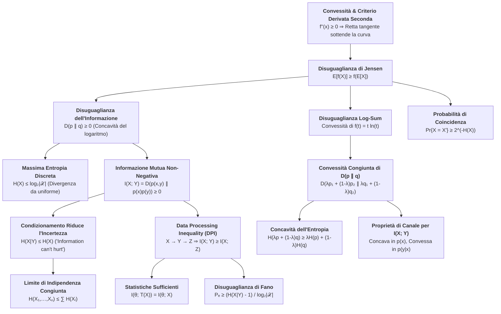

## Convessità, Concavità E Disuguaglianza Di Jensen

La quasi totalità delle proprietà fondamentali delle misure di informazione discende dalle caratteristiche di convessità e concavità delle funzioni logaritmiche e ponderate.

### Geometria Della Convessità E Definizioni

Sia dato un intervallo $(a, b) \subseteq \mathbb{R}$. Una funzione reale $f: (a, b) \to \mathbb{R}$ si definisce __convessa__ se per ogni coppia di punti $x_1, x_2 \in (a, b)$ e per qualunque scalare $\lambda \in [0, 1]$ soddisfa la disuguaglianza:

$$
f(\lambda x_1 + (1-\lambda) x_2) \le \lambda f(x_1) + (1-\lambda) f(x_2)
$$

Dal punto di vista geometrico, la funzione è convessa se il grafico della curva si trova costantemente al di sotto (o al più tocca) della corda secante che unisce i punti $(x_1, f(x_1))$ e $(x_2, f(x_2))$.

![[slide_33_convex_chord.png|center mid]]

La funzione si definisce __strettamente convessa__ se la disuguaglianza vale in forma stretta per ogni $x_1 \neq x_2$ e per ogni $\lambda \in (0, 1)$, ovvero se la curva tocca la corda secante esclusivamente nei due estremi $\lambda = 0$ e $\lambda = 1$.

Una funzione $f(x)$ si definisce __concava__ (rispettivamente __strettamente concava__) se l'opposto $-f(x)$ è convesso (strettamente convesso), il che equivale a richiedere che il grafico della funzione giaccia sempre al di sopra di qualunque corda secante:

$$
f(\lambda x_1 + (1-\lambda) x_2) \ge \lambda f(x_1) + (1-\lambda) f(x_2)
$$

Le funzioni affini lineari $f(x) = ax + b$ soddisfano simultaneamente entrambe le disuguaglianze con il segno di uguaglianza per qualsiasi $\lambda \in [0, 1]$, risultando pertanto sia convesse sia concave.

### Criterio Della Derivata Seconda E Teorema Di Convessità

Se una funzione $f(x)$ è derivabile due volte con continuità su un intervallo $(a, b)$, possiamo accertarne la convessità verificando il segno della derivata seconda.

__Teorema__: Se la funzione $f$ possiede derivata seconda non negativa $f''(x) \ge 0$ (rispettivamente strettamente positiva $f''(x) > 0$) su un intervallo $(a, b)$, allora $f$ è convessa (rispettivamente strettamente convessa) su tale intervallo.

### Dimostrazione Analitica Con Resto Di Lagrange

Consideriamo lo sviluppo in serie di Taylor di $f(x)$ centrato in un generico punto $x_0 \in (a, b)$ con resto di Lagrange del secondo ordine:

$$
f(x) = f(x_0) + f'(x_0)(x - x_0) + \frac{f''(x^*)}{2}(x - x_0)^2
$$

dove $x^*$ è un opportuno punto compreso tra $x_0$ e $x$. Poiché per ipotesi $f''(x^*) \ge 0$ su tutto l'intervallo, il termine quadratico $\frac{f''(x^*)}{2}(x - x_0)^2$ è non negativo per ogni $x$. Ne deriva che la retta tangente sottende sempre la funzione:

$$
f(x) \ge f(x_0) + f'(x_0)(x - x_0)
$$

Fissiamo ora due punti arbitrari $x_1, x_2 \in (a, b)$ e un peso $\lambda \in [0, 1]$, e scegliamo come punto di espansione $x_0$ la loro combinazione convessa:

$$
x_0 = \lambda x_1 + (1-\lambda) x_2
$$

Valutiamo la disuguaglianza della tangente nei due punti estremi $x_1$ e $x_2$.

Nel punto $x = x_1$, la distanza dal centro vale:

$$
x_1 - x_0 = x_1 - \left[ \lambda x_1 + (1-\lambda) x_2 \right] = (1-\lambda)(x_1 - x_2)
$$

Sostituendo nella relazione di tangenza otteniamo:

$$
f(x_1) \ge f(x_0) + f'(x_0)(1-\lambda)(x_1 - x_2)
$$

Nel punto $x = x_2$, la distanza dal centro vale:

$$
x_2 - x_0 = x_2 - \left[ \lambda x_1 + (1-\lambda) x_2 \right] = -\lambda(x_1 - x_2)
$$

Sostituendo nella relazione di tangenza otteniamo:

$$
f(x_2) \ge f(x_0) - f'(x_0)\lambda(x_1 - x_2)
$$

Moltiplichiamo ora la prima disuguaglianza per $\lambda \ge 0$, la seconda per $(1-\lambda) \ge 0$ e sommiamo membro a membro:

$$
\lambda f(x_1) + (1-\lambda) f(x_2) \ge \lambda f(x_0) + (1-\lambda) f(x_0) + f'(x_0)(x_1 - x_2) \left[ \lambda(1-\lambda) - (1-\lambda)\lambda \right]
$$

Osserviamo il termine differenziale del primo ordine: la parentesi quadra si annulla identicamente per cancellazione algebrica esatta:

$$
\lambda(1-\lambda) - (1-\lambda)\lambda = 0
$$

Di conseguenza, il contributo della derivata prima scompare completamente, lasciando:

$$
\lambda f(x_1) + (1-\lambda) f(x_2) \ge f(x_0) = f(\lambda x_1 + (1-\lambda) x_2)
$$

La relazione coincide esattamente con la definizione di funzione convessa. Se la derivata seconda è strettamente positiva $f''(x) > 0$ ovunque e $x_1 \neq x_2$ con $\lambda \in (0, 1)$, il resto di Lagrange è strettamente positivo e la disuguaglianza risulta stretta.

### Catalogo Delle Funzioni Fondamentali

Applicando il criterio della derivata seconda verifichiamo immediatamente le funzioni analitiche che costituiscono i mattoni fondamentali della teoria dell'informazione:
- $f(x) = x^2$: $f''(x) = 2 > 0$ per ogni $x \in \mathbb{R}$ (strettamente convessa).
- $f(x) = e^x$: $f''(x) = e^x > 0$ per ogni $x \in \mathbb{R}$ (strettamente convessa).
- $f(x) = x \ln x$ su $\mathbb{R}^+$: $f'(x) = 1 + \ln x$, $f''(x) = \frac{1}{x} > 0$ per ogni $x > 0$ (strettamente convessa).
- $f(x) = \ln x$ su $\mathbb{R}^+$: $f'(x) = \frac{1}{x}$, $f''(x) = -\frac{1}{x^2} < 0$ per ogni $x > 0$ (strettamente concava).
- $f(x) = \sqrt{x}$ su $\mathbb{R}^+$: $f'(x) = \frac{1}{2\sqrt{x}}$, $f''(x) = -\frac{1}{4 x^{3/2}} < 0$ per ogni $x > 0$ (strettamente concava).

### Teorema Della Disuguaglianza Di Jensen

La disuguaglianza di Jensen generalizza la nozione di convessità dal caso banale a due punti al valore atteso di una variabile aleatoria arbitraria.

__Teorema (Disuguaglianza di Jensen)__: Sia $f$ una funzione convessa definita su un intervallo contenente il supporto della variabile aleatoria $X$. Se i valori attesi $\mathbb{E}[X]$ ed $\mathbb{E}[f(X)]$ esistono e sono finiti, allora:

$$
\mathbb{E}[f(X)] \ge f(\mathbb{E}[X])
$$

Se la funzione $f$ è strettamente convessa, la condizione di uguaglianza $\mathbb{E}[f(X)] = f(\mathbb{E}[X])$ si verifica se e solo se la variabile aleatoria $X$ è degenere, ovvero costante quasi certamente: $X = \mathbb{E}[X]$ con probabilità $1$.

Per una funzione concava $g(x)$, invertendo i segni otteniamo la forma duale:

$$
\mathbb{E}[g(X)] \le g(\mathbb{E}[X])
$$

### Dimostrazione Induttiva Su Distribuzioni Discrete

Dimostriamo il teorema per distribuzioni discrete a supporto finito procedendo per induzione matematica sul numero di masse di probabilità $k$ della PMF $p(x_i) = \text{Pr}\{X = x_i\}$ con $i \in \{1, \dots, k\}$.

_Passo Base ($k=2$)_: Siano $x_1, x_2$ due realizzazioni con probabilità $p_1, p_2 \ge 0$ tali che $p_1 + p_2 = 1$. Ponendo $\lambda = p_1$ e $1-\lambda = p_2$, la definizione stessa di convessità fornisce direttamente:

$$
p_1 f(x_1) + p_2 f(x_2) \ge f(p_1 x_1 + p_2 x_2) \iff \mathbb{E}[f(X)] \ge f(\mathbb{E}[X])
$$

_Passo Induttivo_: Assumiamo che la disuguaglianza sia valida per qualunque distribuzione discreta su $k-1$ punti di massa. Consideriamo una distribuzione su $k$ punti $\{x_1, \dots, x_k\}$ con probabilità $\{p_1, \dots, p_k\}$.

Se $p_k = 1$, la variabile è concentrata su un solo punto e l'uguaglianza è banale. Se $p_k < 1$, definiamo la distribuzione riscalata sui primi $k-1$ punti:

$$
p'_i = \frac{p_i}{1 - p_k}, \quad i \in \{1, \dots, k-1\}, \qquad \sum_{i=1}^{k-1} p'_i = \frac{1}{1 - p_k} \sum_{i=1}^{k-1} p_i = \frac{1 - p_k}{1 - p_k} = 1
$$

Scomponiamo la media d'insieme isolando il $k$-esimo termine:

$$
\sum_{i=1}^k p_i f(x_i) = p_k f(x_k) + (1 - p_k) \sum_{i=1}^{k-1} p'_i f(x_i)
$$

Poiché $\{p'_1, \dots, p'_{k-1}\}$ è una PMF valida su $k-1$ masse, applichiamo l'ipotesi induttiva alla sommatoria interna:

$$
\sum_{i=1}^{k-1} p'_i f(x_i) \ge f\left( \sum_{i=1}^{k-1} p'_i x_i \right)
$$

Sostituendo questa maggiorazione:

$$
\sum_{i=1}^k p_i f(x_i) \ge p_k f(x_k) + (1 - p_k) f\left( \sum_{i=1}^{k-1} p'_i x_i \right)
$$

Il membro destro è ora una semplice combinazione convessa a due punti tra $x_k$ e la quantità $\sum_{i=1}^{k-1} p'_i x_i$, pesati rispettivamente con $p_k$ e $(1 - p_k)$. Applichiamo nuovamente il passo base $k=2$:

$$
p_k f(x_k) + (1 - p_k) f\left( \sum_{i=1}^{k-1} p'_i x_i \right) \ge f\left( p_k x_k + (1 - p_k) \sum_{i=1}^{k-1} p'_i x_i \right)
$$

Semplifichiamo l'argomento interno:

$$
p_k x_k + (1 - p_k) \sum_{i=1}^{k-1} \frac{p_i}{1 - p_k} x_i = p_k x_k + \sum_{i=1}^{k-1} p_i x_i = \sum_{i=1}^k p_i x_i = \mathbb{E}[X]
$$

Otteniamo quindi:

$$
\sum_{i=1}^k p_i f(x_i) \ge f\left( \sum_{i=1}^k p_i x_i \right) = f(\mathbb{E}[X])
$$

Il principio di induzione garantisce la validità della disuguaglianza per qualunque intero finito $k \ge 2$. L'estensione a variabili continue segue per densità mediante somme di Riemann o integrali di Lebesgue sfruttando la continuità delle funzioni convesse.

### Ruolo Della Stretta Convessità E Variabili Degeneri

Se la funzione $f$ è strettamente convessa, la corda secante giace strettamente al di sopra della curva in ogni punto interno. Ne consegue che l'uguaglianza $\mathbb{E}[f(X)] = f(\mathbb{E}[X])$ non può verificarsi se la variabile aleatoria assume due o più valori distinti con probabilità non nulla.

L'uguaglianza sussiste se e solo se la distribuzione collassa su una delta di Dirac discreta:

$$
\text{Pr}\{X = \mathbb{E}[X]\} = 1
$$

Questo vincolo algebrico costituisce il cardine per identificare le distribuzioni ottime nei problemi variazionali dell'ingegneria dell'informazione.

## Disuguaglianza dell'Informazione E Non-Negatività Della Divergenza KL

La divergenza di Kullback-Leibler (o entropia relativa) quantifica la distanza statistica non simmetrica tra due distribuzioni di probabilità definite sul medesimo supporto.

### Teorema Fondamentale dell'Informazione

__Teorema (Disuguaglianza dell'Informazione)__: Siano $p(x)$ e $q(x)$ due funzioni di massa di probabilità discrete con supporto $\mathcal{X}$. Allora:

$$
D(p \parallel q) \ge 0
$$

con uguaglianza se e solo se $p(x) = q(x)$ per ogni $x \in \mathcal{X}$.

### Dimostrazione Tramite Concavità Del Logaritmo

Sia $\mathcal{A} = \{x \in \mathcal{X} : p(x) > 0\}$ il supporto effettivo della distribuzione $p(x)$. Esprimiamo l'opposto della divergenza KL portando il segno meno dentro il logaritmo:

$$
-D(p \parallel q) = -\sum_{x \in \mathcal{A}} p(x) \log_2 \frac{p(x)}{q(x)} = \sum_{x \in \mathcal{A}} p(x) \log_2 \frac{q(x)}{p(x)}
$$

Il membro destro rappresenta il valore atteso della variabile aleatoria $Z = \frac{q(X)}{p(X)}$ sotto la distribuzione $p(x)$, ovvero $\mathbb{E}_p\left[\log_2 \frac{q(X)}{p(X)}\right]$.

Poiché la funzione $g(t) = \log_2 t$ è strettamente concava su tutto il semiasse positivo $\mathbb{R}^+$, applichiamo la disuguaglianza di Jensen per funzioni concave portando la media dentro il logaritmo:

$$
\sum_{x \in \mathcal{A}} p(x) \log_2 \frac{q(x)}{p(x)} \le \log_2 \left( \sum_{x \in \mathcal{A}} p(x) \frac{q(x)}{p(x)} \right) = \log_2 \left( \sum_{x \in \mathcal{A}} q(x) \right)
$$

I fattori $p(x)$ nell'argomento della sommatoria si semplificano. Esaminiamo ora la somma parziale delle probabilità $q(x)$ sul sottoinsieme $\mathcal{A}$: poiché $\mathcal{A} \subseteq \mathcal{X}$ e la distribuzione $q$ è non negativa ($q(x) \ge 0$), la somma ristretta è al più pari alla somma totale sull'intero alfabeto:

$$
\sum_{x \in \mathcal{A}} q(x) \le \sum_{x \in \mathcal{X}} q(x) \le 1
$$

La disuguaglianza sussiste anche nel caso generale in cui $q(x)$ sia una sotto-distribuzione (distribuzione difettiva con $\sum_{x \in \mathcal{X}} q(x) \le 1$). Essendo la funzione logaritmo monotona strettamente crescente:

$$
\log_2 \left( \sum_{x \in \mathcal{A}} q(x) \right) \le \log_2(1) = 0
$$

Abbiamo quindi stabilito la catena di relazioni:

$$
-D(p \parallel q) \le 0 \implies D(p \parallel q) \ge 0
$$

### Condizioni Di Uguaglianza Stretta E Pseudodistanza

Affinché la divergenza si annulli ($D(p \parallel q) = 0$), entrambe le disuguaglianze della derivazione devono valere simultaneamente come uguaglianze strette.

Nel passaggio di Jensen, la stretta concavità della funzione $\log_2 t$ impone che l'argomento sia costante quasi certamente su tutto il supporto $\mathcal{A}$:

$$
\frac{q(x)}{p(x)} = c \quad \forall x \in \mathcal{A}
$$

Nella maggiorazione del supporto deve valere l'uguaglianza piena:

$$
\sum_{x \in \mathcal{A}} q(x) = \sum_{x \in \mathcal{X}} q(x) = 1
$$

il che richiede che $q(x) = 0$ per ogni $x \notin \mathcal{A}$.

Sommando la condizione di proporzionalità su tutti i punti $x \in \mathcal{A}$:

$$
\sum_{x \in \mathcal{A}} q(x) = c \sum_{x \in \mathcal{A}} p(x) \implies 1 = c \cdot 1 \implies c = 1
$$

Otteniamo quindi $q(x) = p(x)$ per ogni $x \in \mathcal{A}$, e $q(x) = p(x) = 0$ per ogni $x \notin \mathcal{A}$. La divergenza di Kullback-Leibler si annulla se e solo se le due distribuzioni coincidono puntualmente ovunque.

Sebbene $D(p \parallel q) \ge 0$ e $D(p \parallel q) = 0 \iff p = q$, la divergenza di Kullback-Leibler non è una metrica euclidea: non è generalmente simmetrica ($D(p \parallel q) \neq D(q \parallel p)$) e non rispetta la disuguaglianza triangolare. Rappresenta tuttavia la pseudodistanza informativa canonica tra modelli probabilistici.

## Conseguenze Fondamentali per Le Misure Informative

Dalla disuguaglianza dell'informazione discendono direttamente tutte le proprietà di ordinamento tra entropia marginale, entropia congiunta ed informazione mutua.

### Non-Negatività dell'Informazione Mutua E Forma Condizionata

Esprimiamo l'informazione mutua come divergenza di Kullback-Leibler tra la distribuzione congiunta $p(x, y)$ e il prodotto delle distribuzioni marginali indipendenti $p(x)p(y)$:

$$
I(X; Y) = D(p(x, y) \parallel p(x)p(y)) \ge 0
$$

Per il teorema dell'informazione, $I(X; Y) \ge 0$ con uguaglianza se e solo se:

$$
p(x, y) = p(x)p(y) \quad \forall (x, y) \in \mathcal{X} \times \mathcal{Y}
$$

ovvero se e solo se le variabili aleatorie $X$ e $Y$ sono statisticamente indipendenti. L'informazione mutua non può mai assumere valori negativi.

Estendendo il risultato alla divergenza condizionata e all'informazione mutua condizionata rispetto a una terza variabile $Z$:

$$
D(p(y \mid x) \parallel q(y \mid x)) = \sum_{x \in \mathcal{X}} p(x) \sum_{y \in \mathcal{Y}} p(y \mid x) \log_2 \frac{p(y \mid x)}{q(y \mid x)} \ge 0
$$

$$
I(X; Y \mid Z) = D(p(x, y \mid z) \parallel p(x \mid z)p(y \mid z)) \ge 0
$$

con uguaglianza se e solo se $X$ e $Y$ risultano condizionatamente indipendenti dato $Z$.

### Teorema Di Massima Entropia Su Alfabeti Finiti

Sia $X$ una variabile aleatoria discreta a valori nell'alfabeto finito $\mathcal{X}$ con cardinalità $|\mathcal{X}| = M$. Sia $u(x) = \frac{1}{M}$ la distribuzione uniforme su $\mathcal{X}$.

Calcoliamo la divergenza di Kullback-Leibler tra la PMF arbitraria $p(x)$ e la distribuzione uniforme $u(x)$:

$$
D(p \parallel u) = \sum_{x \in \mathcal{X}} p(x) \log_2 \frac{p(x)}{u(x)} = \sum_{x \in \mathcal{X}} p(x) \log_2 p(x) - \sum_{x \in \mathcal{X}} p(x) \log_2 \left( \frac{1}{M} \right)
$$

Riconoscendo la definizione di entropia $H(X) = -\sum p(x) \log_2 p(x)$ e sfruttando la normalizzazione della probabilità $\sum_{x} p(x) = 1$:

$$
D(p \parallel u) = -H(X) + \log_2 M \sum_{x \in \mathcal{X}} p(x) = \log_2 M - H(X)
$$

Poiché per la disuguaglianza dell'informazione $D(p \parallel u) \ge 0$, otteniamo immediatamente:

$$
\log_2 M - H(X) \ge 0 \implies H(X) \le \log_2 M = \log_2 |\mathcal{X}|
$$

L'uguaglianza è raggiunta se e solo se $p(x) = u(x) = \frac{1}{|\mathcal{X}|}$ per ogni $x \in \mathcal{X}$.

La distribuzione uniforme è l'unica configurazione a massima entropia tra tutte le distribuzioni discrete definite su un alfabeto finito fissato, formalizzando il principio per cui l'equiprobabilità esprime il massimo disordine o incertezza a priori.

### Il Condizionamento Riduce l'Incertezza Media

Dalla scomposizione fondamentale dell'informazione mutua $I(X; Y) = H(X) - H(X \mid Y)$, la non-negatività $I(X; Y) \ge 0$ si traduce nella relazione:

$$
H(X \mid Y) \le H(X)
$$

con uguaglianza se e solo se $X$ e $Y$ sono stocasticamente indipendenti.

Questo risultato sancisce il principio operativo secondo cui l'osservazione di una variabile $Y$ non può mai aumentare, in media d'insieme, l'incertezza residua sul parametro $X$ ("_information can't hurt_").

### Trabocchetto d'Esame: Incertezza Puntuale Contro Incertezza Media

Sebbene l'entropia condizionata media rispetti rigorosamente la disuguaglianza $H(X \mid Y) \le H(X)$, la realizzazione specifica $Y = y$ può localmente incrementare oppure decrementare l'incertezza residua su $X$.

L'incertezza condizionata puntuale:

$$
H(X \mid Y = y) = -\sum_{x \in \mathcal{X}} p(x \mid y) \log_2 p(x \mid y)
$$

può risultare strettamente maggiore, uguale o strettamente minore di $H(X)$. La disuguaglianza opera esclusivamente sulla media ponderata:

$$
H(X \mid Y) = \mathbb{E}_Y [H(X \mid Y = y)] = \sum_{y \in \mathcal{Y}} p(y) H(X \mid Y = y) \le H(X)
$$

### Esempio Pratico: Monete Truccate Ed Incertezza Condizionata

Consideriamo un sacchetto contenente due tipologie di monete:
- Moneta truccata ($Y = 1$): produce invariabilmente Testa ($p = 1$).
- Moneta equa ($Y = 2$): produce Testa e Croce con probabilità $1/2$.

Sia $X \in \{0, 1\}$ l'esito del lancio ($0 = \text{Croce}$, $1 = \text{Testa}$). Nel sacchetto le monete truccate sono presenti con probabilità $3/4$ e le monete eque con probabilità $1/4$.

Costruiamo la tabella della distribuzione congiunta $p(x, y)$:

| | $X = 0$ (Croce) | $X = 1$ (Testa) | Marginale $p(y)$ |
| :--- | :---: | :---: | :---: |
| __$Y = 1$ (Truccata)__ | $0$ | $\frac{3}{4}$ | $\frac{3}{4}$ |
| __$Y = 2$ (Equa)__ | $\frac{1}{8}$ | $\frac{1}{8}$ | $\frac{1}{4}$ |
| __Marginale $p(x)$__ | $\frac{1}{8}$ | $\frac{7}{8}$ | $1$ |

Calcoliamo l'entropia a priori di $X$:

$$
H(X) = H_B\left(\frac{1}{8}\right) = -\frac{1}{8}\log_2 \frac{1}{8} - \frac{7}{8}\log_2 \frac{7}{8} \approx 0.544 \quad \text{bit}
$$

Valutiamo ora le incertezze puntuali condizionate alle singole realizzazioni di $Y$:
- Se osserviamo che la moneta estratta è truccata ($Y = 1$): la probabilità a posteriori di ottenere Testa è certa ($p(X = 1 \mid Y = 1) = 1$), per cui:

$$
  H(X \mid Y = 1) = 0 \quad \text{bit} < H(X)
$$

- Se osserviamo che la moneta estratta è equa ($Y = 2$): la distribuzione a posteriori diviene perfettamente bilanciata ($p(X = 0 \mid Y = 2) = p(X = 1 \mid Y = 2) = 1/2$), per cui:

$$
  H(X \mid Y = 2) = 1.000 \quad \text{bit} > H(X)
$$

In questa specifica realizzazione, l'osservazione ha fatto salire l'incertezza da $0.544$ bit a $1.000$ bit. Tuttavia, calcolando la media ponderata d'insieme:

$$
H(X \mid Y) = p(Y = 1) H(X \mid Y = 1) + p(Y = 2) H(X \mid Y = 2) = \frac{3}{4} \cdot 0 + \frac{1}{4} \cdot 1 = 0.250 \quad \text{bit}
$$

In media statistica, l'osservazione di $Y$ riduce l'incertezza residua su $X$ da $0.544$ bit a $0.250$ bit, confermando la disuguaglianza $H(X \mid Y) \le H(X)$.

### Limite Di Indipendenza per l'Entropia Congiunta

__Teorema__: Date $n$ variabili aleatorie discrete $X_1, X_2, \dots, X_n$ regolate dalla distribuzione congiunta $p(x_1, \dots, x_n)$:

$$
H(X_1, X_2, \dots, X_n) \le \sum_{i=1}^n H(X_i)
$$

con uguaglianza se e solo se le variabili $X_i$ sono mutuamente indipendenti.

#### Dimostrazione

Applichiamo la regola della catena per l'entropia congiunta:

$$
H(X_1, X_2, \dots, X_n) = \sum_{i=1}^n H(X_i \mid X_{i-1}, \dots, X_1)
$$

Poiché il condizionamento non incrementa l'entropia:

$$
H(X_i \mid X_{i-1}, \dots, X_1) \le H(X_i)
$$

Sommando termine a termine su tutti gli indici $i \in \{1, \dots, n\}$:

$$
H(X_1, X_2, \dots, X_n) \le \sum_{i=1}^n H(X_i)
$$

L'uguaglianza è raggiunta se e solo se $H(X_i \mid X_{i-1}, \dots, X_1) = H(X_i)$ per ogni $i$, condizione che coincide con l'indipendenza mutua delle $n$ variabili.

## Disuguaglianza Log-Sum E Analisi Convessa Delle Misure

La disuguaglianza log-sum costituisce lo strumento analitico principale per dimostrare la convessità della divergenza di Kullback-Leibler e la concavità dell'entropia di Shannon.

### Teorema Della Disuguaglianza Log-Sum

__Teorema (Log-Sum Inequality)__: Siano $a_1, \dots, a_n$ e $b_1, \dots, b_n$ numeri reali non negativi. Allora:

$$
\sum_{i=1}^n a_i \log_2 \frac{a_i}{b_i} \ge \left( \sum_{i=1}^n a_i \right) \log_2 \frac{\sum_{i=1}^n a_i}{\sum_{i=1}^n b_i}
$$

con uguaglianza se e solo se i rapporti $\frac{a_i}{b_i}$ sono costanti per tutti gli indici in cui $a_i > 0$.

### Dimostrazione Analitica Diretta via Funzione Convessa

Consideriamo la funzione $f(t) = t \ln t$ definita per $t > 0$. Calcoliamo le sue derivate:

$$
f'(t) = 1 + \ln t, \qquad f''(t) = \frac{1}{t} > 0 \quad \forall t > 0
$$

Essendo la derivata seconda strettamente positiva, $f(t)$ è strettamente convessa.

Applichiamo la disuguaglianza di Jensen in forma pesata. Definiamo i coefficienti normalizzati $\alpha_i$ e le coordinate $t_i$:

$$
\alpha_i = \frac{b_i}{\sum_{j=1}^n b_j}, \qquad t_i = \frac{a_i}{b_i}
$$

I coefficienti $\alpha_i \ge 0$ sommano a $1$:

$$
\sum_{i=1}^n \alpha_i = \sum_{i=1}^n \frac{b_i}{\sum_{j=1}^n b_j} = \frac{\sum_{i=1}^n b_i}{\sum_{j=1}^n b_j} = 1
$$

Per la disuguaglianza di Jensen:

$$
\sum_{i=1}^n \alpha_i f(t_i) \ge f\left( \sum_{i=1}^n \alpha_i t_i \right)
$$

Moltiplichiamo entrambi i membri per la costante positiva $\sum_{j=1}^n b_j$. Nel membro sinistro:

$$
\left( \sum_{j=1}^n b_j \right) \sum_{i=1}^n \frac{b_i}{\sum_{j=1}^n b_j} f\left( \frac{a_i}{b_i} \right) = \sum_{i=1}^n b_i \left( \frac{a_i}{b_i} \ln \frac{a_i}{b_i} \right) = \sum_{i=1}^n a_i \ln \frac{a_i}{b_i}
$$

Nel membro destro, calcoliamo prima l'argomento medio di $f$:

$$
\sum_{i=1}^n \alpha_i t_i = \sum_{i=1}^n \frac{b_i}{\sum_{j=1}^n b_j} \cdot \frac{a_i}{b_i} = \frac{\sum_{i=1}^n a_i}{\sum_{j=1}^n b_j}
$$

Applicando $f$ e riscalando per $\sum_{j=1}^n b_j$:

$$
\left( \sum_{j=1}^n b_j \right) f\left( \frac{\sum_{i=1}^n a_i}{\sum_{j=1}^n b_j} \right) = \left( \sum_{j=1}^n b_j \right) \left( \frac{\sum_{i=1}^n a_i}{\sum_{j=1}^n b_j} \ln \frac{\sum_{i=1}^n a_i}{\sum_{j=1}^n b_j} \right) = \left( \sum_{i=1}^n a_i \right) \ln \frac{\sum_{i=1}^n a_i}{\sum_{j=1}^n b_j}
$$

I fattori $\sum b_j$ si cancellano algebricamente, completando la dimostrazione della disuguaglianza in base naturale (e quindi in qualunque base per cambio di scala). Per approfondimenti formali su estensioni a cardinalità infinita o casi limite a denominatore nullo, si consulti la [[Anno 1/Information and Estimation Theory/zz. Argomenti extra#Dimostrazione Analitica della Disuguaglianza Log-Sum e Convessità Congiunta della Divergenza KL|dimostrazione analitica della disuguaglianza Log-Sum e convessità congiunta della divergenza KL]].

### Convessità Congiunta Della Divergenza Di Kullback-Leibler

__Teorema__: La divergenza di Kullback-Leibler $D(p \parallel q)$ è una funzione convessa congiuntamente nella coppia di distribuzioni $(p, q)$. Dati $\lambda \in [0, 1]$ e due coppie di PMF $(p_1, q_1)$ e $(p_2, q_2)$:

$$
D(\lambda p_1 + (1-\lambda) p_2 \parallel \lambda q_1 + (1-\lambda) q_2) \le \lambda D(p_1 \parallel q_1) + (1-\lambda) D(p_2 \parallel q_2)
$$

#### Dimostrazione

Fissiamo un generico elemento $x \in \mathcal{X}$ e applichiamo la disuguaglianza log-sum con $n = 2$ termini, ponendo:

$$
a_1 = \lambda p_1(x), \quad a_2 = (1-\lambda) p_2(x), \quad b_1 = \lambda q_1(x), \quad b_2 = (1-\lambda) q_2(x)
$$

Le somme delle coppie valgono:

$$
a_1 + a_2 = \lambda p_1(x) + (1-\lambda) p_2(x) = p_\lambda(x)
$$

$$
b_1 + b_2 = \lambda q_1(x) + (1-\lambda) q_2(x) = q_\lambda(x)
$$

Applicando la log-sum al punto $x$:

$$
p_\lambda(x) \log_2 \frac{p_\lambda(x)}{q_\lambda(x)} \le \lambda p_1(x) \log_2 \frac{\lambda p_1(x)}{\lambda q_1(x)} + (1-\lambda) p_2(x) \log_2 \frac{(1-\lambda) p_2(x)}{(1-\lambda) q_2(x)}
$$

I fattori positivi $\lambda$ e $(1-\lambda)$ all'interno dei logaritmi si elidono:

$$
p_\lambda(x) \log_2 \frac{p_\lambda(x)}{q_\lambda(x)} \le \lambda p_1(x) \log_2 \frac{p_1(x)}{q_1(x)} + (1-\lambda) p_2(x) \log_2 \frac{p_2(x)}{q_2(x)}
$$

Sommando membro a membro su tutti gli elementi $x \in \mathcal{X}$:

$$
\sum_{x \in \mathcal{X}} p_\lambda(x) \log_2 \frac{p_\lambda(x)}{q_\lambda(x)} \le \lambda \sum_{x \in \mathcal{X}} p_1(x) \log_2 \frac{p_1(x)}{q_1(x)} + (1-\lambda) \sum_{x \in \mathcal{X}} p_2(x) \log_2 \frac{p_2(x)}{q_2(x)}
$$

Riconoscendo le definizioni di divergenza KL otteniamo esattamente la convessità congiunta.

### Concavità dell'Entropia Di Shannon

__Teorema__: L'entropia di Shannon $H(p)$ è una funzione __strettamente concava__ della distribuzione di probabilità $p$. Per ogni coppia di PMF $p, q$ e per ogni $\lambda \in [0, 1]$:

$$
H(\lambda p + (1-\lambda) q) \ge \lambda H(p) + (1-\lambda) H(q)
$$

#### Dimostrazione

Esprimiamo l'entropia in termini della divergenza rispetto alla distribuzione uniforme $u(x) = \frac{1}{|\mathcal{X}|}$:

$$
H(p) = \log_2 |\mathcal{X}| - D(p \parallel u)
$$

Valutando la relazione sulla combinazione convessa $\lambda p + (1-\lambda) q$:

$$
H(\lambda p + (1-\lambda) q) = \log_2 |\mathcal{X}| - D(\lambda p + (1-\lambda) q \parallel u)
$$

Poiché possiamo decomporre la distribuzione uniforme come $u = \lambda u + (1-\lambda) u$, applichiamo la convessità della divergenza rispetto al primo argomento:

$$
D(\lambda p + (1-\lambda) q \parallel u) \le \lambda D(p \parallel u) + (1-\lambda) D(q \parallel u)
$$

Moltiplicando per $-1$ e sommando la costante identica $\log_2 |\mathcal{X}| = \lambda \log_2 |\mathcal{X}| + (1-\lambda)\log_2 |\mathcal{X}|$:

$$
\log_2 |\mathcal{X}| - D(\lambda p + (1-\lambda) q \parallel u) \ge \lambda \left[ \log_2 |\mathcal{X}| - D(p \parallel u) \right] + (1-\lambda) \left[ \log_2 |\mathcal{X}| - D(q \parallel u) \right]
$$

Riconoscendo le entropie nei singoli termini:

$$
H(\lambda p + (1-\lambda) q) \ge \lambda H(p) + (1-\lambda) H(q)
$$

### Significato Fisico E Termodinamico dell'Entropia Di Miscelamento

La concavità dell'entropia riflette il secondo principio della termodinamica e l'entropia di miscelamento nella fisica statistica.

Quando misceliamo due sorgenti informative indipendenti dotate di distribuzioni $p$ e $q$, l'entropia della miscela risultante $\lambda p + (1-\lambda) q$ è strettamente superiore alla media ponderata delle entropie originali. L'incremento netto quantifica l'incertezza microscopica addizionale generata dal non sapere da quale delle due sorgenti provenga ciascun campione estratto.

### Concavità E Convessità dell'Informazione Mutua Nei Canali

Sia $(X, Y) \sim p(x, y) = p(x) p(y \mid x)$ un sistema di trasmissione con ingresso $X$, canale $p(y \mid x)$ e uscita $Y$.

__Teorema__: L'informazione mutua $I(X; Y)$ è:
1. Una funzione __concava__ della distribuzione di ingresso $p(x)$ a canale di transizione $p(y \mid x)$ fissato.
2. Una funzione __convessa__ della distribuzione del canale $p(y \mid x)$ a distribuzione di ingresso $p(x)$ fissata.

#### Dimostrazione

Per dimostrare la prima proprietà, esprimiamo l'informazione mutua come:

$$
I(X; Y) = H(Y) - H(Y \mid X) = H(Y) - \sum_{x \in \mathcal{X}} p(x) H(Y \mid X = x)
$$

A canale $p(y \mid x)$ fissato, la distribuzione marginale di uscita $p(y) = \sum_x p(x) p(y \mid x)$ è una trasformazione lineare della distribuzione di ingresso $p(x)$. Poiché l'entropia $H(Y)$ è una funzione concava della sua distribuzione $p(y)$, essa risulta concava anche rispetto a $p(x)$.

Il secondo termine $\sum_x p(x) H(Y \mid X = x)$ è una combinazione lineare a coefficienti costanti in $p(x)$ (poiché le entropie condizionate $H(Y \mid X = x)$ dipendono unicamente dalle righe del canale $p(y \mid x)$), ed è quindi una funzione affine di $p(x)$. Poiché la differenza tra una funzione concava e una funzione affine preserva la concavità, $I(X; Y)$ è concava in $p(x)$.

Per dimostrare la seconda proprietà, fissiamo $p(x)$ e consideriamo due canali $p_1(y \mid x)$ e $p_2(y \mid x)$ e la loro combinazione convessa $p_\lambda(y \mid x) = \lambda p_1(y \mid x) + (1-\lambda) p_2(y \mid x)$. Le distribuzioni congiunte e i prodotti delle marginali corrispondenti soddisfano:

$$
p_\lambda(x, y) = \lambda p_1(x, y) + (1-\lambda) p_2(x, y)
$$

$$
q_\lambda(x, y) = p(x) p_\lambda(y) = \lambda p(x) p_1(y) + (1-\lambda) p(x) p_2(y) = \lambda q_1(x, y) + (1-\lambda) q_2(x, y)
$$

Poiché $I(X; Y) = D(p(x, y) \parallel q(x, y))$ e la divergenza KL è congiuntamente convessa nella coppia $(p, q)$:

$$
I_\lambda(X; Y) = D(p_\lambda \parallel q_\lambda) \le \lambda D(p_1 \parallel q_1) + (1-\lambda) D(p_2 \parallel q_2) = \lambda I_1(X; Y) + (1-\lambda) I_2(X; Y)
$$

Questo comportamento duale è di primaria importanza ingegneristica: la concavità rispetto a $p(x)$ garantisce l'esistenza e l'unicità del massimo globale nel calcolo della capacità di canale $C = \max_{p(x)} I(X; Y)$, mentre la convessità rispetto al canale garantisce la risolubilità convessa nei problemi di codifica di sorgente con perdita $R(D) = \min_{p(y \mid x)} I(X; Y)$.

## Data Processing Inequality per Catene Di Markov

La disuguaglianza di elaborazione dei dati (Data Processing Inequality, DPI) formalizza il principio fisico secondo cui nessuna manipolazione dei dati, deterministica o stocastica, può estrarre o generare informazione statistica non già presente nelle osservazioni originarie.

### Catene Di Markov Discrete E Indipendenza Condizionata

Tre variabili aleatorie $X, Y, Z$ formano una __catena di Markov__ nell'ordine $X \longrightarrow Y \longrightarrow Z$ se la distribuzione condizionata di $Z$ dipende unicamente da $Y$ ed è condizionatamente indipendente da $X$.

La distribuzione di probabilità congiunta fattorizza come:

$$
p(x, y, z) = p(x) p(y \mid x) p(z \mid y)
$$

La condizione di Markovità è equivalente all'indipendenza condizionata tra $X$ e $Z$ dato $Y$:

$$
p(x, z \mid y) = \frac{p(x, y, z)}{p(y)} = \frac{p(x) p(y \mid x) p(z \mid y)}{p(y)} = \frac{p(x, y) p(z \mid y)}{p(y)} = p(x \mid y) p(z \mid y)
$$

In termini informativi, ciò si traduce nell'annullamento dell'informazione mutua condizionata:

$$
X \longrightarrow Y \longrightarrow Z \iff I(X; Z \mid Y) = 0
$$

### Proprietà Strutturali Delle Catene Markoviane

1. __Reversibilità Temporale e Topologica__: La relazione $X \longrightarrow Y \longrightarrow Z$ implica $Z \longrightarrow Y \longrightarrow X$. Infatti, applicando la regola di Bayes alla fattorizzazione congiunta otteniamo $p(x, y, z) = p(z) p(y \mid z) p(x \mid y)$.
2. __Trasformazioni Post-Processing__: Se $Z = g(Y)$ è una funzione deterministica o randomizzata che opera esclusivamente sui campioni $Y$, la terna $X \longrightarrow Y \longrightarrow g(Y)$ costituisce invariabilmente una catena di Markov, poiché la legge di $Z$ dato $Y$ non dipende da $X$.

### Teorema Della Data Processing Inequality

__Teorema (DPI)__: Se tre variabili aleatorie formano la catena di Markov $X \longrightarrow Y \longrightarrow Z$, allora:

$$
I(X; Y) \ge I(X; Z)
$$

e per simmetria:

$$
I(Y; Z) \ge I(X; Z)
$$

La condizione di uguaglianza $I(X; Y) = I(X; Z)$ sussiste se e solo se $I(X; Y \mid Z) = 0$, il che equivale a dire che anche $X \longrightarrow Z \longrightarrow Y$ costituisce una valida catena di Markov (nessuna perdita informativa nel passaggio da $Y$ a $Z$).

### Dimostrazione Tramite Espansione a Catena

Consideriamo l'informazione mutua congiunta $I(X; Y, Z)$ ed espandiamola applicando la regola della catena in due ordini distinti:

$$
I(X; Y, Z) = I(X; Z) + I(X; Y \mid Z)
$$

$$
I(X; Y, Z) = I(X; Y) + I(X; Z \mid Y)
$$

Poiché $X \longrightarrow Y \longrightarrow Z$ è una catena di Markov, per la proprietà di indipendenza condizionata il secondo termine della seconda espansione si annulla:

$$
I(X; Z \mid Y) = 0
$$

Uguagliando le due espressioni:

$$
I(X; Z) + I(X; Y \mid Z) = I(X; Y)
$$

Dalla non-negatività fondamentale dell'informazione mutua condizionata, sappiamo che $I(X; Y \mid Z) \ge 0$. Sottraendo tale quantità non negativa:

$$
I(X; Y) - I(X; Z) = I(X; Y \mid Z) \ge 0 \implies I(X; Y) \ge I(X; Z)
$$

L'uguaglianza è verificata se e solo se $I(X; Y \mid Z) = 0$.

![[slide_52_dpi_venn.png|center mid]]

La disuguaglianza $I(Y; Z) \ge I(X; Z)$ segue in modo del tutto speculare sfruttando la reversibilità topologica della catena $Z \longrightarrow Y \longrightarrow X$.

### Conseguenze Operative E Invarianza Nel Post-Processing

1. __Degradazione sotto Elaborazione Dati__: Se $Z = g(Y)$, allora $I(X; Y) \ge I(X; g(Y))$. Nessun algoritmo software, filtro analogico o rete neurale applicata alle osservazioni $Y$ può incrementare l'informazione disponibile sul parametro originario $X$. L'informazione può soltanto essere preservata o irrimediabilmente dispersa.
2. __Effetto del Condizionamento a Valle__: Se $X \longrightarrow Y \longrightarrow Z$, allora:

$$
I(X; Y \mid Z) \le I(X; Y)
$$

L'osservazione di una variabile secondaria a valle $Z$ diminuisce (o lascia invariata) la dipendenza informativa tra $X$ e $Y$.

### Trabocchetto d'Esame: Il Paradosso Del Collider Fuori Dalla Catena

La disuguaglianza $I(X; Y \mid Z) \le I(X; Y)$ è valida esclusivamente se le tre variabili formano una catena di Markov. Se la struttura markoviana viene a mancare, condizionare su una terza variabile può generare dipendenza e far aumentare l'informazione mutua.

Siano $X$ e $Y$ due variabili binarie indipendenti ed equiprobabili in $\{0, 1\}$, per cui $I(X; Y) = 0$. Definiamo $Z = X + Y$ come somma algebrica ordinaria. Calcoliamo l'informazione condizionata:

$$
I(X; Y \mid Z) = H(X \mid Z) - H(X \mid Y, Z) = H(X \mid Z) - 0
$$

La distribuzione di $Z$ vale $p(Z = 0) = 1/4$, $p(Z = 1) = 1/2$, $p(Z = 2) = 1/4$.
- Se $Z = 0$ o $Z = 2$, il valore di $X$ è noto con certezza ($H(X \mid Z = 0) = 0$).
- Se $Z = 1$, sapendo che la somma è 1, $X$ è uniformemente distribuito su $\{0, 1\}$ con entropia pari a $1$ bit.

Calcolando la media ponderata:

$$
I(X; Y \mid Z) = \frac{1}{2} \cdot 1 = 0.500 \quad \text{bit} > I(X; Y) = 0 \quad \text{bit}
$$

Condizionare su un effetto comune (_collider_) crea correlazione spuria tra cause indipendenti, violando la disuguaglianza markoviana.

### Statistiche Sufficienti in Prospettiva Informativa

Nel contesto della teoria della stima parametrica e dell'inferenza statistica, sia $\{f_\theta(\mathbf{x})\}$ una famiglia di densità di probabilità indicizzata dal parametro $\theta$. Sia $\mathbf{X} = (X_1, \dots, X_n)$ il vettore delle osservazioni campionarie e sia $T(\mathbf{X})$ una statistica (funzione del campione).

Il processo di osservazione e calcolo genera naturalmente la catena di Markov:

$$
\theta \longrightarrow \mathbf{X} \longrightarrow T(\mathbf{X})
$$

Per la Data Processing Inequality, la statistica non può contenere più informazione del dato grezzo:

$$
I(\theta; T(\mathbf{X})) \le I(\theta; \mathbf{X})
$$

Una statistica $T(\mathbf{X})$ si definisce __sufficiente__ per il parametro $\theta$ se la distribuzione condizionata dei campioni dato $T(\mathbf{X})$ è completamente indipendente da $\theta$. In termini di catene di Markov, ciò equivale a richiedere che valga anche la catena inversa:

$$
\theta \longrightarrow T(\mathbf{X}) \longrightarrow \mathbf{X}
$$

Applicando la DPI a questa seconda catena otteniamo $I(\theta; \mathbf{X}) \le I(\theta; T(\mathbf{X}))$. Combinando le due disuguaglianze perveniamo all'identità fondamentale:

$$
I(\theta; T(\mathbf{X})) = I(\theta; \mathbf{X})
$$

Una statistica è sufficiente se e solo se __preserva integralmente l'informazione mutua shannoniana__ contenuta nell'intero dataset osservato rispetto al parametro $\theta$, per qualunque distribuzione a priori di $\theta$.

### Criterio Di Fattorizzazione Di Neyman-Fisher E Minimalità

Una statistica $T(\mathbf{X})$ è sufficiente se e solo se la funzione di verosimiglianza congiunta si fattorizza secondo il teorema di Neyman-Fisher:

$$
f(\mathbf{x} \mid \theta) = u(\mathbf{x}) \cdot v(T(\mathbf{x}), \theta)
$$

dove $u(\mathbf{x}) \ge 0$ dipende unicamente dai dati osservati e non dal parametro $\theta$, mentre $v \ge 0$ dipende da $\theta$ e dipende dai dati esclusivamente tramite il valore della statistica $T(\mathbf{x})$.

Una statistica sufficiente $T(\mathbf{X})$ si definisce __minimale__ se è funzione di qualunque altra statistica sufficiente $U(\mathbf{X})$, ovvero se $T(\mathbf{X}) = \psi(U(\mathbf{X}))$. In termini operativi, la statistica minimale realizza la massima compressione dimensionale possibile del dato campionario senza alcuna dispersione di informazione mutua:

$$
\theta \longrightarrow T(\mathbf{X}) \longrightarrow U(\mathbf{X}) \longrightarrow \mathbf{X}
$$

Esempi classici d'esame:
- __Campioni Bernoulli i.i.d.__ ($X_i \sim \text{Bern}(\theta)$): la statistica $T(\mathbf{X}) = \sum_{i=1}^n X_i$ è sufficiente e minimale.
- __Campioni Gaussiani i.i.d.__ ($X_i \sim \mathcal{N}(\theta, \sigma^2)$ con varianza nota): la media campionaria $\bar{X} = \frac{1}{n}\sum_{i=1}^n X_i$ è sufficiente e minimale. La coppia formata separatamente dalla media dei campioni pari e dalla media dei campioni dispari costituisce una statistica sufficiente ma non minimale.
- __Campioni Uniformi i.i.d.__ ($X_i \sim \mathcal{U}(\theta, \theta + 1)$): la statistica sufficiente minimale è costituita dalla coppia degli estremi campionari $T(\mathbf{X}) = (\min_i X_i, \, \max_i X_i)$.

## Disuguaglianza Di Fano E Limiti Universali sull'Errore Di Stima

Nei sistemi di comunicazione digitale, nel riconoscimento di pattern e nella classificazione statistica, un ricevitore riceve un segnale rumoroso $Y$ correlato a un messaggio discreto $X \in \mathcal{X}$ e costruisce uno stimatore o regola di decisione $\hat{X} = g(Y)$.

La __disuguaglianza di Fano__ stabilisce il limite inferiore universale sulla probabilità d'errore di decisione $P_e = \text{Pr}\{\hat{X} \neq X\}$ in funzione dell'entropia equivoca residua $H(X \mid Y)$.

### Modello Di Stima E Formulazione Del Problema

Sia data la catena di Markov generata dalla sorgente, dal canale e dal decisore:

$$
X \longrightarrow Y \longrightarrow \hat{X}
$$

dove $X$ assume valori nell'alfabeto finito $\mathcal{X}$ con cardinalità $|\mathcal{X}| = M$. Definiamo la probabilità d'errore di decisione:

$$
P_e = \text{Pr}\{\hat{X} \neq X\}
$$

### Teorema Fondamentale Di Fano

__Teorema (Disuguaglianza di Fano)__: Sotto la catena di Markov $X \longrightarrow Y \longrightarrow \hat{X}$, l'incertezza residua a posteriori soddisfa:

$$
H_B(P_e) + P_e \log_2(|\mathcal{X}| - 1) \ge H(X \mid \hat{X}) \ge H(X \mid Y)
$$

dove $H_B(P_e) = -P_e \log_2 P_e - (1 - P_e) \log_2(1 - P_e)$ indica l'entropia della variabile binaria d'errore.

### Dimostrazione Rigorosa Con Variabile Indicatrice d'Errore

Per collegare in modo rigoroso l'entropia residua alla probabilità d'errore, introduciamo la variabile aleatoria binaria indicatrice d'errore $E$:

$$
E = \begin{cases} 1 & \text{se } \hat{X} \neq X \\ 0 & \text{se } \hat{X} = X \end{cases}
$$

La variabile $E$ ha distribuzione bernoulliana con parametri $\text{Pr}\{E = 1\} = P_e$ e $\text{Pr}\{E = 0\} = 1 - P_e$, da cui $H(E) = H_B(P_e)$.

Consideriamo l'entropia congiunta condizionata $H(E, X \mid \hat{X})$ ed espandiamola con la regola della catena in due modalità distinte.

#### Primo Sviluppo Della Catena

Condizionando inizialmente rispetto a $X$ dato $\hat{X}$:

$$
H(E, X \mid \hat{X}) = H(X \mid \hat{X}) + H(E \mid X, \hat{X})
$$

Poiché l'indicatrice $E$ è una funzione deterministica della coppia $(X, \hat{X})$, noti sia il valore reale sia la stima non residua alcuna incertezza su $E$:

$$
H(E \mid X, \hat{X}) = 0
$$

Il primo sviluppo si riduce esattamente a:

$$
H(E, X \mid \hat{X}) = H(X \mid \hat{X})
$$

#### Secondo Sviluppo Della Catena

Condizionando inizialmente rispetto ad $E$ dato $\hat{X}$:

$$
H(E, X \mid \hat{X}) = H(E \mid \hat{X}) + H(X \mid E, \hat{X})
$$

Valutiamo i due addendi:
1. Poiché il condizionamento non incrementa l'entropia, maggioriamo il primo addendo:

$$
   H(E \mid \hat{X}) \le H(E) = H_B(P_e)
$$

2. Sviluppiamo il secondo addendo mediante la definizione esplicita di valore atteso condizionato:

$$
   H(X \mid E, \hat{X}) = (1 - P_e) H(X \mid E = 0, \hat{X}) + P_e H(X \mid E = 1, \hat{X})
$$

   - Se $E = 0$, per definizione non vi è errore: $\hat{X} = X$. Condizionatamente a $(E = 0, \hat{X} = \hat{x})$, la variabile $X$ assume l'unico valore $\hat{x}$ con probabilità $1$, per cui $H(X \mid E = 0, \hat{X}) = 0$.
   - Se $E = 1$, si è verificato un errore: $X \neq \hat{X}$. Condizionatamente a $(E = 1, \hat{X} = \hat{x})$, la variabile $X$ può assumere valori esclusivamente nel sottoinsieme complementare $\mathcal{X} \setminus \{\hat{x}\}$, la cui cardinalità è pari a $|\mathcal{X}| - 1$. L'entropia di una distribuzione discreta a supporto finito è massimizzata dalla distribuzione uniforme sulla cardinalità residua:

$$
     H(X \mid E = 1, \hat{X}) \le \log_2(|\mathcal{X}| - 1)
$$

Sostituendo queste due valutazioni otteniamo:

$$
H(X \mid E, \hat{X}) \le (1 - P_e) \cdot 0 + P_e \log_2(|\mathcal{X}| - 1) = P_e \log_2(|\mathcal{X}| - 1)
$$

Sommando i contributi, il secondo sviluppo fornisce:

$$
H(E, X \mid \hat{X}) \le H_B(P_e) + P_e \log_2(|\mathcal{X}| - 1)
$$

#### Uguaglianza Dei Due Sviluppi E Applicazione Della DPI

Uguagliando i risultati del primo e del secondo sviluppo:

$$
H(X \mid \hat{X}) \le H_B(P_e) + P_e \log_2(|\mathcal{X}| - 1)
$$

Applichiamo infine la Data Processing Inequality alla catena $X \longrightarrow Y \longrightarrow \hat{X}$:

$$
I(X; \hat{X}) \le I(X; Y) \iff H(X) - H(X \mid \hat{X}) \le H(X) - H(X \mid Y)
$$

Sottraendo $H(X)$ e invertendo il segno:

$$
H(X \mid Y) \le H(X \mid \hat{X})
$$

Concatenando le disuguaglianze otteniamo la forma rigorosa e completa della disuguaglianza di Fano:

$$
H(X \mid Y) \le H(X \mid \hat{X}) \le H_B(P_e) + P_e \log_2(|\mathcal{X}| - 1)
$$

Per la dimostrazione formale e ulteriori varianti parametriche, si rimanda alla [[Anno 1/Information and Estimation Theory/zz. Argomenti extra#Dimostrazione Rigorosa della Disuguaglianza di Fano|dimostrazione formale della disuguaglianza di Fano tramite variabile indicatrice d'errore]].

### Forma Indebolita E Limite Esplicito Sulla Probabilità d'Errore

Poiché la funzione di entropia binaria è limitata superiormente da $1$ bit ($H_B(P_e) \le 1$), possiamo maggiorare $H_B(P_e)$ con $1$ e maggiorare $|\mathcal{X}| - 1$ con $|\mathcal{X}|$:

$$
H(X \mid Y) \le 1 + P_e \log_2 |\mathcal{X}|
$$

Risolvendo algebricamente rispetto alla probabilità d'errore $P_e$, ricaviamo il bound inferiore esplicito:

$$
P_e \ge \frac{H(X \mid Y) - 1}{\log_2 |\mathcal{X}|}
$$

![[fano_inequality_bound_curve.svg|center mid]]

### Soglia Critica Di Errore Inevitabile

Il limite inferiore esplicito di Fano rivela una soglia fisica fondamentale: se l'entropia equivoca residua $H(X \mid Y)$ supera $1$ bit, la probabilità d'errore minima è strettamente positiva:

$$
H(X \mid Y) > 1 \implies P_e > 0
$$

In questo regime è teoricamente impossibile ottenere una stima a probabilità d'errore nulla, a prescindere dalla sofisticazione dell'algoritmo di stima, dalla profondità della rete neurale o dalla potenza di calcolo disponibile. L'incertezza residua supera la capacità del ricevitore di discriminare senza ambiguità il simbolo trasmesso.

### Distribuzione Avversa Peggiore E Raggiungibilità dell'Uguaglianza

In assenza di osservazioni ($Y = \emptyset$), la stima deve avvenire a priori sulla base della sola PMF $p(x)$ su $\mathcal{X} = \{1, \dots, m\}$ con probabilità ordinate in senso decrescente $p_1 \ge p_2 \ge \dots \ge p_m$. La stima ottima a minima probabilità d'errore seleziona la classe a massima verosimiglianza a priori $\hat{X} = 1$, ottenendo probabilità d'errore $P_e = 1 - p_1$.

In questo scenario, la disuguaglianza di Fano assume la forma:

$$
H(X) \le H_B(P_e) + P_e \log_2(m - 1)
$$

L'uguaglianza è raggiunta se e solo se tutte le restanti $m - 1$ classi d'errore sono rigorosamente equiprobabili:

$$
p(x) = \left( 1 - P_e, \, \frac{P_e}{m-1}, \, \frac{P_e}{m-1}, \, \dots, \, \frac{P_e}{m-1} \right)
$$

come verificato analiticamente in [[Anno 1/Information and Estimation Theory/zz. Argomenti extra#Condizione di Raggiungibilità dell'Uguaglianza|raggiungibilità dell'uguaglianza nel limite di Fano]].

### Esempio Operativo: Decodifica Su Canale Ternario

Consideriamo un canale digitale ternario in cui il trasmettitore invia simboli appartenenti all'alfabeto $\mathcal{X} = \{0, 1, 2\}$ ($|\mathcal{X}| = 3$). Il ricevitore produce una decisione $\hat{X} \in \{0, 1, 2\}$ con probabilità d'errore misurata $P_e = 0.1$.

Valutiamo il limite superiore sull'incertezza residua $H(X \mid \hat{X})$ fornito da Fano:

$$
H(X \mid \hat{X}) \le H_B(P_e) + P_e \log_2(|\mathcal{X}| - 1)
$$

Calcoliamo l'entropia binaria per $P_e = 0.1$:

$$
H_B(0.1) = -0.1 \log_2(0.1) - 0.9 \log_2(0.9) \approx 0.1 \times 3.3219 + 0.9 \times 0.1520 \approx 0.3322 + 0.1368 = 0.4690 \quad \text{bit}
$$

Calcoliamo il termine di dispersione sui simboli alternativi $|\mathcal{X}| - 1 = 2$:

$$
P_e \log_2(3 - 1) = 0.1 \log_2 2 = 0.1 \times 1 = 0.1000 \quad \text{bit}
$$

Sommando i due contributi:

$$
H(X \mid \hat{X}) \le 0.4690 + 0.1000 = 0.5690 \quad \text{bit}
$$

In unità naturali (nat), moltiplicando per $\ln 2 \approx 0.6931$:

$$
H_e(X \mid \hat{X}) \le -0.1 \ln 0.1 - 0.9 \ln 0.9 + 0.1 \ln 2 \approx 0.2303 + 0.0948 + 0.0693 = 0.3944 \quad \text{nat}
$$

L'incertezza residua sul simbolo trasmesso non può eccedere $0.569$ bit, delimitando quantitativamente la qualità della ricostruzione del canale.

## Probabilità Di Coincidenza per Sequenze Indipendenti

Nella crittografia, nell'apprendimento automatico e nella codifica di sorgente, una questione centrale riguarda la probabilità che due estrazioni indipendenti generino il medesimo esito simbolico.

### Lemma per Variabili Identicamente Distribuite

__Lemma__: Siano $X$ e $X'$ due variabili aleatorie indipendenti e identicamente distribuite (i.i.d.) secondo la PMF $p(x)$ su $\mathcal{X}$, con entropia $H(X)$. La probabilità che $X$ e $X'$ coincidano soddisfa:

$$
\text{Pr}\{X = X'\} = \sum_{x \in \mathcal{X}} p^2(x) \ge 2^{-H(X)}
$$

con uguaglianza se e solo se la distribuzione $p(x)$ è uniforme su $\mathcal{X}$.

### Dimostrazione via Convessità Esponenziale

Poiché $X$ e $X'$ sono i.i.d.:

$$
\text{Pr}\{X = X'\} = \sum_{x \in \mathcal{X}} \text{Pr}\{X = x, X' = x\} = \sum_{x \in \mathcal{X}} p(x) p(x) = \sum_{x \in \mathcal{X}} p^2(x) = \mathbb{E}_p [p(X)]
$$

Consideriamo la funzione esponenziale $f(t) = 2^t$. Poiché la sua derivata seconda è strettamente positiva:

$$
f''(t) = (\ln 2)^2 2^t > 0 \quad \forall t \in \mathbb{R}
$$

la funzione $f(t)$ è strettamente convessa. Applichiamo la disuguaglianza di Jensen alla variabile aleatoria $\log_2 p(X)$ sotto la distribuzione $p$:

$$
2^{\mathbb{E}[\log_2 p(X)]} \le \mathbb{E}\left[ 2^{\log_2 p(X)} \right]
$$

Sviluppiamo il primo membro riconoscendo l'entropia di Shannon:

$$
\mathbb{E}[\log_2 p(X)] = \sum_{x \in \mathcal{X}} p(x) \log_2 p(x) = -H(X) \implies 2^{\mathbb{E}[\log_2 p(X)]} = 2^{-H(X)}
$$

Sviluppiamo il secondo membro semplificando l'esponenziale con il logaritmo:

$$
\mathbb{E}\left[ 2^{\log_2 p(X)} \right] = \sum_{x \in \mathcal{X}} p(x) \cdot p(x) = \sum_{x \in \mathcal{X}} p^2(x)
$$

Uguagliando i risultati otteniamo:

$$
\sum_{x \in \mathcal{X}} p^2(x) \ge 2^{-H(X)}
$$

Per la stretta convessità della funzione esponenziale, l'uguaglianza vale se e solo se $\log_2 p(x)$ è costante quasi certamente, ovvero se $p(x) = \frac{1}{|\mathcal{X}|}$ per ogni $x \in \mathcal{X}$ (distribuzione uniforme).

### Estensione a Distribuzioni Eterogenee E Cross-Entropia

__Teorema__: Siano $X$ e $X'$ due variabili aleatorie indipendenti definite sullo stesso alfabeto $\mathcal{X}$, con distribuzioni $X \sim p(x)$ e $X' \sim r(x)$. Allora:

$$
\text{Pr}\{X = X'\} \ge 2^{-H(p) - D(p \parallel r)} = 2^{-H(p, r)}
$$

$$
\text{Pr}\{X = X'\} \ge 2^{-H(r) - D(r \parallel p)} = 2^{-H(r, p)}
$$

dove $H(p, r) = -\sum_{x} p(x) \log_2 r(x)$ indica la cross-entropia tra $p$ ed $r$.

#### Dimostrazione

La probabilità congiunta di coincidenza vale:

$$
\text{Pr}\{X = X'\} = \sum_{x \in \mathcal{X}} p(x) r(x) = \mathbb{E}_p [r(X)]
$$

Scomponiamo l'esponente della cross-entropia:

$$
-H(p, r) = \sum_{x \in \mathcal{X}} p(x) \log_2 r(x) = \sum_{x \in \mathcal{X}} p(x) \log_2 p(x) - \sum_{x \in \mathcal{X}} p(x) \log_2 \frac{p(x)}{r(x)} = -H(p) - D(p \parallel r)
$$

Applichiamo la disuguaglianza di Jensen alla funzione strettamente convessa $f(t) = 2^t$ applicata a $\log_2 r(X)$ sotto la misura $p$:

$$
2^{-H(p, r)} = 2^{\sum_{x} p(x) \log_2 r(x)} \le \sum_{x \in \mathcal{X}} p(x) 2^{\log_2 r(x)} = \sum_{x \in \mathcal{X}} p(x) r(x) = \text{Pr}\{X = X'\}
$$

La relazione simmetrica si ottiene scambiando i ruoli di $p$ ed $r$: $\text{Pr}\{X = X'\} = \sum_x r(x) p(x) = \mathbb{E}_r [p(X')]$.

### Connessione Fondamentale Con Le Funzioni Di Perdita Nel Machine Learning

Nel pattern recognition e nell'addestramento di reti neurali profonde per compiti di classificazione multiclasse, $p(x)$ rappresenta la distribuzione reale (ground truth) delle etichette (spesso one-hot), mentre $r(x)$ rappresenta la distribuzione di probabilità predetta dal modello tramite normalizzazione softmax.

Minimizzare la funzione di loss a cross-entropia $H(p, r)$ (o equivalentemente la divergenza KL $D(p \parallel r)$) corrisponde esattamente a __massimizzare il limite inferiore teorico sulla probabilità di corretta classificazione__ $\text{Pr}\{X = X'\}$. Questo legame fornisce la giustificazione informativa assiomatica all'adozione universale della cross-entropia nei moderni sistemi di intelligenza artificiale.

## Quadro Sinottico Delle Disuguaglianze Informative

La seguente tabella riassume organicamente le disuguaglianze e relazioni fondamentali della teoria dell'informazione:

| Denominazione | Espressione Matematica | Condizione di Uguaglianza | Significato Ingegneristico |
| :--- | :--- | :--- | :--- |
| __Disuguaglianza di Jensen__ | $\mathbb{E}[f(X)] \ge f(\mathbb{E}[X])$ ($f$ convessa) | $X = \mathbb{E}[X]$ q.c. (degenere) | Fondamento geometrico dell'analisi convessa |
| __Disuguaglianza dell'Informazione__ | $D(p \parallel q) \ge 0$ | $p(x) = q(x) \quad \forall x$ | La divergenza KL è una pseudodistanza non negativa |
| __Non-Negatività dell'Informazione Mutua__ | $I(X; Y) \ge 0$ | $X, Y$ indipendenti | La correlazione statistica non può generare informazione negativa |
| __Condizionamento Riduce l'Entropia__ | $H(X \mid Y) \le H(X)$ | $X, Y$ indipendenti | L'osservazione di una variabile non aumenta l'incertezza media |
| __Massima Entropia Discreta__ | $H(X) \le \log_2 \|\mathcal{X}\|$ | $p(x) = \frac{1}{\|\mathcal{X}\|}$ (uniforme) | Massima incertezza in condizioni di totale equiprobabilità |
| __Limite di Indipendenza__ | $H(X_1, \dots, X_n) \le \sum_{i=1}^n H(X_i)$ | $X_1, \dots, X_n$ indipendenti | L'entropia congiunta è subadditiva |
| __Disuguaglianza Log-Sum__ | $\sum a_i \log \frac{a_i}{b_i} \ge (\sum a_i) \log \frac{\sum a_i}{\sum b_i}$ | $\frac{a_i}{b_i} = c \quad \forall i$ | Convessità congiunta della divergenza KL |
| __Concavità dell'Entropia__ | $H(\lambda p + (1-\lambda)q) \ge \lambda H(p) + (1-\lambda)H(q)$ | $p = q$ | Il mescolamento di sorgenti incrementa l'entropia media |
| __Data Processing Inequality (DPI)__ | $I(X; Y) \ge I(X; Z)$ per $X \to Y \to Z$ | $I(X; Y \mid Z) = 0$ | Nessuna elaborazione dati può creare nuova informazione |
| __Sufficienza Statistica__ | $I(\theta; T(\mathbf{X})) = I(\theta; \mathbf{X})$ | $T(\mathbf{X})$ sufficiente per $\theta$ | Preservazione totale dell'informazione parametrica |
| __Disuguaglianza di Fano__ | $P_e \ge \frac{H(X \mid Y) - 1}{\log_2 \|\mathcal{X}\|}$ | Distribuzione peggiore a blocchi | Limite invalicabile alla probabilità d'errore di stima |
| __Probabilità di Coincidenza__ | $\sum p^2(x) \ge 2^{-H(X)}$ | $p(x)$ uniforme | Legame tra entropia shannoniana e collisione di sequenze |


# 8. Proprietà Di Equipartizione Asintotica (AEP)

La Proprietà di Equipartizione Asintotica (__Asymptotic Equipartition Property__, AEP) costituisce il fondamento matematico su cui poggia l'intera teoria dell'informazione e della compressione dei dati formulata da Claude Shannon nel 1948. L'AEP rappresenta la naturale estensione della Legge Debole dei Grandi Numeri (WLLN) allo spazio delle realizzazioni informative: all'aumentare della lunghezza delle sequenze generate da una sorgente stazionaria priva di memoria, lo spazio combinatorio si polarizza in modo netto.

La quasi totalità della misura di probabilità si concentra su un sottoinsieme compatto dello spazio delle configurazioni, denominato __insieme tipico__, i cui elementi condividono tutti la medesima densità di probabilità asintotica, scandita unicamente dall'entropia di Shannon della sorgente.

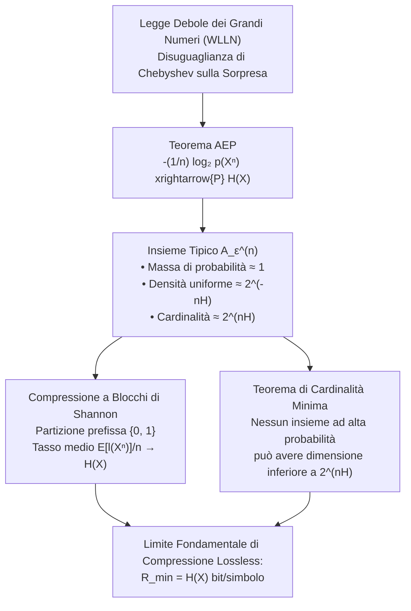

## Fondamenti Probabilistici: Dalla Legge Dei Grandi Numeri Alla Sorpresa Informativa

L'architettura concettuale dell'AEP nasce direttamente dall'applicazione dei teoremi limite della teoria della probabilità classica a una trasformazione non lineare delle variabili di sorgente: la funzione di sorpresa campionaria.

### Legge Debole Dei Grandi Numeri E Disuguaglianza Di Chebyshev

Consideriamo una successione di $n$ variabili aleatorie reali $X_1, X_2, \dots, X_n$ indipendenti e identicamente distribuite (i.i.d.), dotate di valore atteso comune $\mathbb{E}[X_i] = \mu$ e varianza finita $\text{Var}(X_i) = \sigma^2 < \infty$. Definiamo la variabile aleatoria media campionaria:

$$
\bar{X}_n = \frac{1}{n} \sum_{i=1}^n X_i
$$

Sfruttando la linearità dell'operatore valore atteso e la mutua indipendenza delle variabili, calcoliamo i momenti del primo e del secondo ordine centrato:

$$
\mathbb{E}[\bar{X}_n] = \frac{1}{n} \sum_{i=1}^n \mathbb{E}[X_i] = \frac{n \mu}{n} = \mu
$$

$$
\text{Var}(\bar{X}_n) = \mathbb{E}\left[ (\bar{X}_n - \mu)^2 \right] = \frac{1}{n^2} \sum_{i=1}^n \text{Var}(X_i) = \frac{n \sigma^2}{n^2} = \frac{\sigma^2}{n}
$$

Notiamo come la varianza della media campionaria decada come $1/n$: all'aumentare del numero di campioni, la dispersione attorno al valore atteso si contrae progressivamente. Applichiamo la disuguaglianza di Chebyshev per quantificare la probabilità che la media campionaria devii dal valor medio oltre una soglia arbitraria $\epsilon > 0$:

$$
\text{Pr}\left\{ |\bar{X}_n - \mu| \ge \epsilon \right\} \le \frac{\text{Var}(\bar{X}_n)}{\epsilon^2} = \frac{\sigma^2}{n \epsilon^2}
$$

Facendo tendere la dimensione campionaria $n$ all'infinito:

$$
\lim_{n \to \infty} \text{Pr}\left\{ |\bar{X}_n - \mu| \ge \epsilon \right\} \le \lim_{n \to \infty} \frac{\sigma^2}{n \epsilon^2} = 0 \iff \lim_{n \to \infty} \text{Pr}\left\{ |\bar{X}_n - \mu| < \epsilon \right\} = 1
$$

Questo risultato formalizza la __Legge Debole dei Grandi Numeri__ (Weak Law of Large Numbers, WLLN): la media campionaria converge in probabilità al valore atteso teorico, ossia $\bar{X}_n \xrightarrow{P} \mu$.

### Modalità Di Convergenza per Sequenze Stocastiche

Nel formalismo probabilistico avanzato distinguiamo tre nozioni fondamentali di convergenza per una sequenza di variabili aleatorie $\{Z_n\}$ verso una variabile limite $Z$:

1. __Convergenza in Probabilità__ ($Z_n \xrightarrow{P} Z$): per qualsiasi tolleranza prefissata $\epsilon > 0$, la massa di probabilità della discrepanza decade a zero:

$$
\lim_{n \to \infty} \text{Pr}\left\{ |Z_n - Z| > \epsilon \right\} = 0
$$

2. __Convergenza in Media Quadratica__ ($Z_n \xrightarrow{L^2} Z$): la potenza attesa dell'errore si annulla asintoticamente:

$$
\lim_{n \to \infty} \mathbb{E}\left[ (Z_n - Z)^2 \right] = 0
$$

3. __Convergenza Quasi Certa__ o con probabilità 1 ($Z_n \xrightarrow{\text{a.s.}} Z$): l'insieme delle traiettorie campionarie che non convergono ha misura di probabilità nulla:

$$
\text{Pr}\left\{ \lim_{n \to \infty} Z_n = Z \right\} = 1
$$

La Legge Debole dei Grandi Numeri assicura la convergenza in probabilità, mentre la Legge Forte (SLLN) governa la convergenza quasi certa. Nella derivazione analitica dell'AEP di Shannon è sufficiente invocare la convergenza in probabilità.

### Dal Valore Campionario Alla Sorpresa Informativa

Per trasporre questi principi probabilistici nell'alveo della teoria dell'informazione, consideriamo una sorgente discreta stazionaria e priva di memoria (DMS) che emette blocchi di lunghezza $n$:

$$
X^n = (X_1, X_2, \dots, X_n), \quad X_i \in \mathcal{X}
$$

I simboli sono i.i.d. con funzione di massa di probabilità marginale $p(x) = \text{Pr}\{X = x\}$ definita sull'alfabeto finito $\mathcal{X}$. Per l'indipendenza statistica, la probabilità congiunta della sequenza realizzata fattorizza esattamente nel prodotto delle probabilità dei singoli simboli costituenti:

$$
p(X^n) = p(X_1, X_2, \dots, X_n) = \prod_{i=1}^n p(X_i)
$$

Sebbene la probabilità $p(X^n)$ sia una variabile aleatoria (poiché funzione deterministica dei campioni aleatori $X_i$), operare direttamente sul prodotto risulta algebricamente ostico. Applichiamo quindi l'operatore logaritmico in base 2 e normalizziamo per la lunghezza del blocco $n$, introducendo la __densità di sorpresa campionaria normalizzata__ (o tasso empirico di auto-informazione):

$$
-\frac{1}{n} \log_2 p(X_1, \dots, X_n) = -\frac{1}{n} \log_2 \left( \prod_{i=1}^n p(X_i) \right) = \frac{1}{n} \sum_{i=1}^n \left( -\log_2 p(X_i) \right)
$$

Riconosciamo immediatamente che la densità di sorpresa non è altro che la media campionaria della variabile aleatoria trasformata $Y_i = -\log_2 p(X_i)$.

## Il Teorema AEP E la Convergenza dell'Entropia Empirica

Il Teorema della Proprietà di Equipartizione Asintotica sancisce che la sorpresa empirica normalizzata converge in probabilità all'entropia nominale della sorgente.

> [!NOTE] Teorema (AEP di Shannon)
> Siano $X_1, X_2, \dots, X_n$ variabili aleatorie discrete i.i.d. distribuite secondo la PMF $p(x)$ su alfabeto finito $\mathcal{X}$. Allora:
>
> $$
> -\frac{1}{n} \log_2 p(X_1, X_2, \dots, X_n) \xrightarrow{P} H(X) \quad \text{per } n \to \infty
> $$
>
> ovvero, per ogni $\epsilon > 0$ arbitrariamente piccolo:
>
> $$
> \lim_{n \to \infty} \text{Pr}\left\{ \left| -\frac{1}{n} \log_2 p(X_1, \dots, X_n) - H(X) \right| > \epsilon \right\} = 0
> $$

### Dimostrazione Analitica Tramite Chebyshev Sulla Varianza Della Sorpresa

Dimostriamo il teorema in modo costruttivo calcolando esplicitamente i momenti della variabile sorpresa e sfruttando la disuguaglianza di Chebyshev.

Poiché le variabili $X_i$ sono mutuamente indipendenti e identicamente distribuite, qualsiasi trasformazione deterministica scalare $g(X_i)$ preserva la proprietà i.i.d. Definiamo la variabile aleatoria sorpresa associata al singolo simbolo:

$$
Y_i = -\log_2 p(X_i)
$$

Valutiamo il valore atteso di $Y_i$ applicando la definizione statistica:

$$
\mathbb{E}[Y_i] = \mathbb{E}[-\log_2 p(X)] = \sum_{x \in \mathcal{X}} p(x) (-\log_2 p(x)) = -\sum_{x \in \mathcal{X}} p(x) \log_2 p(x) = H(X)
$$

Il valore atteso della sorpresa coincide esattamente con l'entropia di Shannon $H(X)$. Calcoliamo ora la varianza della sorpresa del singolo simbolo $\sigma_Y^2 = \text{Var}(Y_i)$:

$$
\sigma_Y^2 = \mathbb{E}\left[ (Y_i - \mathbb{E}[Y_i])^2 \right] = \sum_{x \in \mathcal{X}} p(x) \left( -\log_2 p(x) - H(X) \right)^2
$$

Poiché l'alfabeto di sorgente $\mathcal{X}$ è finito ($|\mathcal{X}| < \infty$) e per ogni simbolo con probabilità non nulla $p(x) > 0$ la quantità $\log_2 p(x)$ è finita, la sommatoria è una combinazione lineare finita di termini limitati. Di conseguenza la varianza è strettamente finita:

$$
\sigma_Y^2 < \infty
$$

Esprimiamo ora la densità di sorpresa della sequenza come media campionaria $\bar{Y}_n$:

$$
\bar{Y}_n = \frac{1}{n} \sum_{i=1}^n Y_i = -\frac{1}{n} \log_2 p(X_1, \dots, X_n)
$$

Calcoliamo i momenti della media campionaria della sorpresa:

$$
\mathbb{E}[\bar{Y}_n] = \frac{1}{n} \sum_{i=1}^n \mathbb{E}[Y_i] = \frac{n H(X)}{n} = H(X)
$$

$$
\text{Var}(\bar{Y}_n) = \frac{1}{n^2} \sum_{i=1}^n \text{Var}(Y_i) = \frac{n \sigma_Y^2}{n^2} = \frac{\sigma_Y^2}{n}
$$

Applichiamo la disuguaglianza di Chebyshev alla variabile $\bar{Y}_n$ rispetto alla soglia di tolleranza $\epsilon > 0$:

$$
\text{Pr}\left\{ |\bar{Y}_n - \mathbb{E}[\bar{Y}_n]| \ge \epsilon \right\} \le \frac{\text{Var}(\bar{Y}_n)}{\epsilon^2}
$$

Sostituendo la media e la varianza appena derivate:

$$
\text{Pr}\left\{ \left| -\frac{1}{n} \log_2 p(X_1, \dots, X_n) - H(X) \right| \ge \epsilon \right\} \le \frac{\sigma_Y^2}{n \epsilon^2}
$$

Prendiamo il limite per $n \to \infty$: con $\epsilon > 0$ e $\sigma_Y^2 < \infty$ costanti, il membro destro decade a zero come $O(1/n)$:

$$
\lim_{n \to \infty} \text{Pr}\left\{ \left| -\frac{1}{n} \log_2 p(X_1, \dots, X_n) - H(X) \right| \ge \epsilon \right\} \le \lim_{n \to \infty} \frac{\sigma_Y^2}{n \epsilon^2} = 0
$$

Poiché una misura di probabilità è intrinsecamente non negativa, per il teorema del confronto dei limiti otteniamo:

$$
\lim_{n \to \infty} \text{Pr}\left\{ \left| -\frac{1}{n} \log_2 p(X^n) - H(X) \right| \ge \epsilon \right\} = 0
$$

La disuguaglianza di Chebyshev non solo certifica la convergenza in probabilità, ma fornisce una delimitazione quantitativa rigorosa della velocità di convergenza asintotica. Per la trattazione analitica dettagliata, rimandiamo alla [[Anno 1/Information and Estimation Theory/zz. Argomenti extra#Dimostrazione Analitica del Teorema AEP tramite Disuguaglianza di Chebyshev sulla Varianza della Sorpresa|dimostrazione analitica del teorema AEP tramite disuguaglianza di Chebyshev sulla varianza della sorpresa]].

### Risoluzione Del Paradosso dell'AEP: Probabilità Individuale Vs Massa Collettiva

La convergenza stocastica espressa dall'AEP conduce alla fondamentale conseguenza per cui le sequenze effettivamente osservabili per $n$ elevato possiedono quasi tutte la medesima probabilità asintotica:

$$
p(X^n) \approx 2^{-n H(X)}
$$

Questo fenomeno riflette il celebre principio euristico: _"quasi tutti gli eventi che si verificano nella realtà possiedono approssimativamente lo stesso grado di sorpresa"_.

Qui emerge un apparente paradosso concettuale che costituisce uno dei più frequenti trabocchetti d'esame: __le sequenze a priori singolarmente più probabili NON sono sequenze tipiche!__

Per visualizzare il paradosso, consideriamo una sorgente binaria con $p(0) = 0.9$ e $p(1) = 0.1$.
1. La singola sequenza dotata della massima verosimiglianza assoluta in tutto lo spazio è la sequenza composta da soli zeri: $x^n = (0, 0, \dots, 0)$.
2. La sua probabilità vale $p(x^n) = 0.9^n$, che è esponenzialmente maggiore di $2^{-n H(X)}$ (essendo $H(X) \approx 0.469$ bit e $-\log_2(0.9) \approx 0.152$ bit).
3. Calcolando la densità di sorpresa normalizzata della sequenza di soli zeri:

$$
-\frac{1}{n} \log_2(0.9^n) = -\log_2(0.9) \approx 0.152 \quad \text{bit/simbolo} \ll H(X) \approx 0.469 \quad \text{bit/simbolo}
$$

La discrepanza $|0.152 - 0.469| \approx 0.317$ supera abbondantemente qualsiasi tolleranza $\epsilon$: la sequenza di soli zeri non appartiene all'insieme tipico!

Come si risolve il paradosso? Esaminando il ruolo della __molteplicità combinatoria__:
- Esiste __una sola__ sequenza formata da tutti zeri. La sua probabilità aggregata decade esponenzialmente a zero: $\lim_{n \to \infty} 0.9^n = 0$.
- Le sequenze tipiche contengono invece circa $0.9n$ zeri e $0.1n$ uni, rispecchiando fedelmente la PMF della sorgente. La probabilità di ciascuna sequenza tipica è singolarmente infinitesima ($p(x^n) \approx 2^{-n H(X)}$), ma il numero complessivo di tali sequenze è astronomico:

$$
\binom{n}{0.1n} \approx 2^{n H_B(0.1)} = 2^{n H(X)}
$$

Moltiplicando la probabilità individuale per il numero di sequenze tipiche otteniamo:

$$
\text{Massa Totale} \approx |A_\epsilon^{(n)}| \cdot p(x^n) \approx 2^{n H(X)} \cdot 2^{-n H(X)} = 1
$$

La massa di probabilità si concentra dove il prodotto tra probabilità individuale e molteplicità combinatoria raggiunge il proprio culmine asintotico.

### Esempio Didattico a Lunghezza Finita ($n=3$)

Per fissare le idee con un modello analitico immediato, consideriamo una sorgente di Bernoulli con $p(1) = p = 0.7$ e $p(0) = q = 0.3$. L'entropia nominale di Shannon vale:

$$
H(X) = H_B(0.7) = -0.7 \log_2(0.7) - 0.3 \log_2(0.3) \approx 0.3602 + 0.5211 \approx 0.8813 \quad \text{bit}
$$

A lunghezza finita $n = 3$, lo spazio campionario comprende $2^3 = 8$ sequenze binarie distinte. Raggruppiamo le sequenze in base al numero di uni:

| Sequenze $X^3$ | Numero di '1' | Probabilità del Singolo Evento $p(x^3)$ | Molteplicità $\binom{3}{k}$ | Probabilità Cumulata del Gruppo | Densità di Sorpresa $-\frac{1}{3}\log_2 p(x^3)$ |
| :---: | :---: | :---: | :---: | :---: | :---: |
| `000` | $0$ | $q^3 = 0.3^3 = 0.027$ | $1$ | $0.027$ | $-\frac{1}{3}\log_2(0.027) \approx 1.737$ bit |
| `001`, `010`, `100` | $1$ | $p q^2 = 0.7 \times 0.3^2 = 0.063$ | $3$ | $3 \times 0.063 = 0.189$ | $-\frac{1}{3}\log_2(0.063) \approx 1.329$ bit |
| `011`, `101`, `110` | $2$ | $p^2 q = 0.7^2 \times 0.3 = 0.147$ | $3$ | $3 \times 0.147 = 0.441$ | $-\frac{1}{3}\log_2(0.147) \approx 0.922$ bit |
| `111` | $3$ | $p^3 = 0.7^3 = 0.343$ | $1$ | $0.343$ | $-\frac{1}{3}\log_2(0.343) \approx 0.515$ bit |

Confrontiamo i risultati:
- La singola sequenza `111` è la più probabile in assoluto ($34.3\%$), ma la sua sorpresa normalizzata ($0.515$ bit) dista ben $0.366$ bit dall'entropia teorica ($0.8813$ bit).
- La classe delle sequenze con 2 uni (`011`, `101`, `110`), pur avendo una probabilità per elemento inferiore ($0.147$), cattura la frazione maggioritaria della massa totale ($44.1\%$). La sorpresa associata a ciascuna di esse è pari a $0.922$ bit, straordinariamente vicina all'entropia nominale $H(X) = 0.8813$ bit.

## L'Insieme Tipico E la Sua Geometria Iperdimensionale

Formalizziamo la nozione di traiettorie a sorpresa media introducendo l'oggetto geometrico cardine della teoria dell'informazione: l'insieme tipico.

### Definizione Analitica dell'Insieme Tipico

Fissata una tolleranza reale arbitraria $\epsilon > 0$, definiamo l'__insieme tipico__ $A_\epsilon^{(n)}$ rispetto alla distribuzione $p(x)$ come il sottoinsieme delle sequenze $x^n \in \mathcal{X}^n$ la cui densità di sorpresa campionaria dista da $H(X)$ non più di $\epsilon$:

$$
A_\epsilon^{(n)} = \left\{ x^n \in \mathcal{X}^n \;\middle|\; \left| -\frac{1}{n} \log_2 p(x^n) - H(X) \right| \le \epsilon \right\}
$$

Esplicitando il modulo della disuguaglianza:

$$
H(X) - \epsilon \le -\frac{1}{n} \log_2 p(x^n) \le H(X) + \epsilon
$$

Moltiplicando tutti i membri per $-n$ (invertendo il verso delle disuguaglianze) ed esponenzializzando in base 2, otteniamo la delimitazione a sandwich per la probabilità di ogni sequenza tipica:

$$
2^{-n(H(X) + \epsilon)} \le p(x^n) \le 2^{-n(H(X) - \epsilon)} \quad \forall x^n \in A_\epsilon^{(n)}
$$

![[slide_11_typical_set_partition.png|center mid]]

La rappresentazione geometrica iperdimensionale evidenzia la natura dell'insieme tipico come un guscio sferico sottile che racchiude la quasi totalità della probabilità dello spazio.

![[typical_set_hyperdimensional_concentration.svg|center big]]

### Teorema dell'Insieme Tipico E Proprietà Fondamentali

L'insieme tipico soddisfa quattro proprietà asintotiche fondamentali su cui poggia l'intera teoria della compressione dati:

> [!IMPORTANT] Proprietà Fondamentali dell'Insieme Tipico
> 1. __Equipartizione della Densità__: per ogni $x^n \in A_\epsilon^{(n)}$, la densità di probabilità è uniformemente vincolata da $2^{-n(H(X) + \epsilon)} \le p(x^n) \le 2^{-n(H(X) - \epsilon)}$.
> 2. __Quasi-Certezza Asintotica__: per qualunque $\epsilon > 0$, la probabilità totale dell'insieme tipico converge a 1, ossia $\text{Pr}\{A_\epsilon^{(n)}\} > 1 - \epsilon$ per $n$ sufficientemente grande.
> 3. __Delimitazione Superiore della Cardinalità__: la dimensione complessiva di $A_\epsilon^{(n)}$ è superiormente vincolata da $|A_\epsilon^{(n)}| \le 2^{n(H(X) + \epsilon)}$.
> 4. __Delimitazione Inferiore della Cardinalità__: per $n$ sufficientemente grande, la dimensione è inferiormente vincolata da $|A_\epsilon^{(n)}| \ge (1 - \epsilon) 2^{n(H(X) - \epsilon)}$.

#### Dimostrazione Delle Proprietà Cardinali

Dimostriamo le proprietà con passaggi algebrici diretti:

1. La prima proprietà coincide con la definizione esplicita dell'insieme tipico.
2. La seconda proprietà discende immediatamente dal Teorema AEP. Poiché $-\frac{1}{n}\log_2 p(X^n) \xrightarrow{P} H(X)$, per ogni coppia $(\epsilon, \delta)$ con $\delta > 0$ esiste un indice $n_0$ tale che per ogni $n \ge n_0$:

$$
\text{Pr}\left\{ \left| -\frac{1}{n} \log_2 p(X^n) - H(X) \right| \le \epsilon \right\} > 1 - \delta
$$

Ponendo $\delta = \epsilon$, otteniamo direttamente $\text{Pr}\{A_\epsilon^{(n)}\} > 1 - \epsilon$.
3. Per dimostrare il limite superiore sulla cardinalità, sfruttiamo l'assioma di normalizzazione della probabilità sull'intero spazio campionario $\mathcal{X}^n$:

$$
1 = \sum_{x^n \in \mathcal{X}^n} p(x^n) \ge \sum_{x^n \in A_\epsilon^{(n)}} p(x^n)
$$

Per definizione di $A_\epsilon^{(n)}$, per ogni elemento tipico sussiste la minorazione $p(x^n) \ge 2^{-n(H(X) + \epsilon)}$. Sostituendo tale limite inferiore nella sommatoria:

$$
1 \ge \sum_{x^n \in A_\epsilon^{(n)}} 2^{-n(H(X) + \epsilon)} = 2^{-n(H(X) + \epsilon)} \sum_{x^n \in A_\epsilon^{(n)}} 1 = 2^{-n(H(X) + \epsilon)} |A_\epsilon^{(n)}|
$$

Moltiplicando ambo i membri per il termine strettamente positivo $2^{n(H(X) + \epsilon)}$:

$$
|A_\epsilon^{(n)}| \le 2^{n(H(X) + \epsilon)}
$$

4. Per dimostrare il limite inferiore sulla cardinalità, consideriamo la probabilità totale dell'insieme tipico per $n \ge n_0$:

$$
1 - \epsilon < \text{Pr}\{A_\epsilon^{(n)}\} = \sum_{x^n \in A_\epsilon^{(n)}} p(x^n)
$$

Poiché per ogni sequenza tipica sussiste la maggiorazione $p(x^n) \le 2^{-n(H(X) - \epsilon)}$:

$$
1 - \epsilon < \sum_{x^n \in A_\epsilon^{(n)}} 2^{-n(H(X) - \epsilon)} = 2^{-n(H(X) - \epsilon)} |A_\epsilon^{(n)}|
$$

Moltiplicando per $2^{n(H(X) - \epsilon)}$:

$$
|A_\epsilon^{(n)}| \ge (1 - \epsilon) 2^{n(H(X) - \epsilon)}
$$

Abbiamo così isolato la cardinalità dell'insieme tipico all'interno di una morsa esponenziale: la sua dimensione scala asintoticamente come $|A_\epsilon^{(n)}| \approx 2^{n H(X)}$.

### Esempio Analitico Esaustivo a Lunghezza Finita ($n=4$)

Applichiamo la teoria dell'insieme tipico a una sorgente bernoulliana $X \sim \text{Bern}(p)$ con $p = 0.4$ su alfabeto $\mathcal{X} = \{0, 1\}$.
Fissiamo la tolleranza $\epsilon = 0.1$.
L'entropia nominale della sorgente vale:

$$
H(X) = -0.4 \log_2(0.4) - 0.6 \log_2(0.6) \approx 0.5288 + 0.4422 = 0.9710 \quad \text{bit}
$$

L'intervallo di ammissibilità per la sorpresa media $-\frac{1}{4}\log_2 p(x^4)$ associata alle sequenze tipiche risulta:

$$
[H(X) - \epsilon, \, H(X) + \epsilon] = [0.9710 - 0.1, \, 0.9710 + 0.1] = [0.8710, \, 1.0710] \quad \text{bit}
$$

Lo spazio campionario $\mathcal{X}^4$ comprende $2^4 = 16$ sequenze. Valutiamo l'ammissibilità classe per classe in base al numero di uni:

1. __0 uni (1 sequenza)__: $x^4 = (0, 0, 0, 0)$.
   - Probabilità: $p(x^4) = 0.4^0 \times 0.6^4 = 0.1296$.
   - Sorpresa media: $-\frac{1}{4}\log_2(0.1296) \approx 0.7370$ bit.
   - Deviazione da $H(X)$: $|0.7370 - 0.9710| = 0.2340 > 0.1000$.
   - Esito: __Non Tipica__ (la sequenza singolarmente più probabile di tutto lo spazio campionario resta esclusa da $A_\epsilon^{(n)}$).

2. __1 uno (4 sequenze)__: `0001`, `0010`, `0100`, `1000`.
   - Probabilità singola: $p(x^4) = 0.4^1 \times 0.6^3 = 0.0864$.
   - Sorpresa media: $-\frac{1}{4}\log_2(0.0864) \approx 0.8832$ bit.
   - Deviazione da $H(X)$: $|0.8832 - 0.9710| = 0.0878 \le 0.1000$.
   - Esito: __Tipica__ (tutte le 4 sequenze appartengono ad $A_{0.1}^{(4)}$).

3. __2 uni (6 sequenze)__: `0011`, `0101`, `0110`, `1001`, `1010`, `1100`.
   - Probabilità singola: $p(x^4) = 0.4^2 \times 0.6^2 = 0.0576$.
   - Sorpresa media: $-\frac{1}{4}\log_2(0.0576) \approx 1.0294$ bit.
   - Deviazione da $H(X)$: $|1.0294 - 0.9710| = 0.0584 \le 0.1000$.
   - Esito: __Tipica__ (tutte le 6 sequenze appartengono ad $A_{0.1}^{(4)}$).

4. __3 uni (4 sequenze)__: `0111`, `1011`, `1101`, `1110`.
   - Probabilità singola: $p(x^4) = 0.4^3 \times 0.6^1 = 0.0384$.
   - Sorpresa media: $-\frac{1}{4}\log_2(0.0384) \approx 1.1757$ bit.
   - Deviazione da $H(X)$: $|1.1757 - 0.9710| = 0.2047 > 0.1000$.
   - Esito: __Non Tipica__.

5. __4 uni (1 sequenza)__: `1111`.
   - Probabilità singola: $p(x^4) = 0.4^4 \times 0.6^0 = 0.0256$.
   - Sorpresa media: $-\frac{1}{4}\log_2(0.0256) \approx 1.3219$ bit.
   - Deviazione da $H(X)$: $|1.3219 - 0.9710| = 0.3509 > 0.1000$.
   - Esito: __Non Tipica__.

L'insieme tipico è costituito esattamente dall'unione delle 10 sequenze aventi 1 oppure 2 uni:

$$
A_{0.1}^{(4)} = \{0001, 0010, 0100, 1000, 0011, 0101, 0110, 1001, 1010, 1100\}
$$

La cardinalità effettiva è $|A_{0.1}^{(4)}| = 10$. Verifichiamo il limite superiore teorico:

$$
|A_{0.1}^{(4)}| = 10 \le 2^{4(0.9710 + 0.1)} = 2^{4 \times 1.0710} = 2^{4.284} \approx 19.48
$$

La disuguaglianza teorica è pienamente verificata.

## Codifica Di Sorgente a Blocchi Di Shannon (Compressione Lossless)

La delimitazione della cardinalità dell'insieme tipico fornisce lo strumento costruttivo per dimostrare il primo teorema fondamentale di Shannon: la comprimibilità asintotica senza perdita fino alla soglia invalicabile dell'entropia.

### Architettura Di Codifica a Partizione Binaria

Consideriamo il problema di codificare sequenze $x^n \in \mathcal{X}^n$ generate da una sorgente stazionaria e priva di memoria. Partizioniamo lo spazio campionario $\mathcal{X}^n$ nei due sottoinsiemi complementari e disgiunti: l'insieme tipico $A_\epsilon^{(n)}$ e l'insieme atipico $(A_\epsilon^{(n)})^c$.

Ordinando lessicograficamente gli elementi interni a ciascun blocco, costruiamo un codice binario istantaneamente decodificabile secondo il seguente schema strutturale:

1. __Sequenze Tipiche ($x^n \in A_\epsilon^{(n)}$)__:
   - Il numero di sequenze tipiche è al massimo $2^{n(H(X) + \epsilon)}$.
   - Ciascuna sequenza tipica può essere indicizzata univocamente mediante un numero intero che richiede al più $\lceil \log_2 |A_\epsilon^{(n)}| \rceil \le \lceil n(H(X) + \epsilon) \rceil \le n(H(X) + \epsilon) + 1$ bit.
   - Anteponiamo a tutte queste parole di codice un bit di flag prefisso pari a `0`.
   - La lunghezza complessiva della parola di codice per ogni elemento tipico è:

$$
l(x^n) \le n(H(X) + \epsilon) + 2 \quad \text{bit}
$$

2. __Sequenze Atipiche ($x^n \notin A_\epsilon^{(n)}$)__:
   - Il numero di sequenze atipiche è strettamente inferiore alla cardinalità totale $|\mathcal{X}|^n$.
   - L'indicizzazione di un elemento generico nello spazio campionario richiede al più $\lceil \log_2 |\mathcal{X}|^n \rceil \le n \log_2 |\mathcal{X}| + 1$ bit.
   - Anteponiamo a queste parole di codice un bit di flag prefisso pari a `1`.
   - La lunghezza complessiva della parola di codice per ogni elemento atipico è:

$$
l(x^n) \le n \log_2 |\mathcal{X}| + 2 \quad \text{bit}
$$

Il bit iniziale agisce da flag indicatore di lunghezza: alla ricezione di `0`, il decodificatore sa esattamente che seguiranno $\lceil n(H+\epsilon) \rceil$ bit; alla ricezione di `1`, sa che seguiranno $\lceil n\log_2|\mathcal{X}| \rceil$ bit. La decodifica è univoca, istantanea e a prefisso.

![[slide_12_typical_set_block_coding.png|center mid]]

### Derivazione Del Valore Atteso Della Lunghezza Del Codice

Sia $l(X^n)$ la variabile aleatoria che descrive la lunghezza della stringa binaria emessa dal codificatore. Calcoliamo il valore atteso della lunghezza del codice:

$$
\mathbb{E}[l(X^n)] = \sum_{x^n \in \mathcal{X}^n} p(x^n) l(x^n) = \sum_{x^n \in A_\epsilon^{(n)}} p(x^n) l(x^n) + \sum_{x^n \notin A_\epsilon^{(n)}} p(x^n) l(x^n)
$$

Sostituiamo le maggiorazioni sulle lunghezze derivate in precedenza:

$$
\mathbb{E}[l(X^n)] \le \sum_{x^n \in A_\epsilon^{(n)}} p(x^n) \left[ n(H(X) + \epsilon) + 2 \right] + \sum_{x^n \notin A_\epsilon^{(n)}} p(x^n) \left[ n \log_2 |\mathcal{X}| + 2 \right]
$$

Riorganizziamo i termini estraendo le somme e raccogliendo a fattor comune le costanti additive dei flag:

$$
\mathbb{E}[l(X^n)] \le n(H(X) + \epsilon) \sum_{x^n \in A_\epsilon^{(n)}} p(x^n) + n \log_2 |\mathcal{X}| \sum_{x^n \notin A_\epsilon^{(n)}} p(x^n) + 2 \left( \sum_{x^n \in A_\epsilon^{(n)}} p(x^n) + \sum_{x^n \notin A_\epsilon^{(n)}} p(x^n) \right)
$$

Riconosciamo le misure di probabilità degli eventi:

$$
\sum_{x^n \in A_\epsilon^{(n)}} p(x^n) = \text{Pr}\{A_\epsilon^{(n)}\}, \quad \sum_{x^n \notin A_\epsilon^{(n)}} p(x^n) = \text{Pr}\{(A_\epsilon^{(n)})^c\}
$$

Poiché $A_\epsilon^{(n)}$ e $(A_\epsilon^{(n)})^c$ costituiscono una partizione esaustiva dello spazio, la somma delle loro probabilità vale rigorosamente 1:

$$
\text{Pr}\{A_\epsilon^{(n)}\} + \text{Pr}\{(A_\epsilon^{(n)})^c\} = 1
$$

Il termine costante dovuto ai flag prefissi vale pertanto esattamente $2 \cdot 1 = 2$.
Inoltre, maggioriamo banalmente $\text{Pr}\{A_\epsilon^{(n)}\} \le 1$ e sfruttiamo la proprietà dell'AEP per cui, per $n$ sufficientemente grande, $\text{Pr}\{(A_\epsilon^{(n)})^c\} < \epsilon$:

$$
\mathbb{E}[l(X^n)] \le n(H(X) + \epsilon) + \epsilon n \log_2 |\mathcal{X}| + 2
$$

Raccogliamo la lunghezza $n$ a fattor comune:

$$
\mathbb{E}[l(X^n)] \le n \left[ H(X) + \epsilon + \epsilon \log_2 |\mathcal{X}| + \frac{2}{n} \right]
$$

Definendo la quantità residua $\epsilon'$:

$$
\epsilon' = \epsilon (1 + \log_2 |\mathcal{X}|) + \frac{2}{n}
$$

otteniamo la delimitazione compatta:

$$
\mathbb{E}[l(X^n)] \le n (H(X) + \epsilon')
$$

### Teorema Di Compressione Di Shannon E Limite Di Entropia

Dividendo la disuguaglianza per la lunghezza del blocco $n$, valutiamo il tasso medio di codifica per simbolo di sorgente $R = \frac{1}{n}\mathbb{E}[l(X^n)]$:

$$
\frac{1}{n} \mathbb{E}[l(X^n)] \le H(X) + \epsilon'
$$

Possiamo rendere la quantità residua $\epsilon'$ arbitrariamente piccola scegliendo dapprima una tolleranza $\epsilon$ sufficientemente vicina a zero e, successivamente, una dimensione di blocco $n$ sufficientemente elevata affinché il termine $2/n$ diventi trascurabile.

> [!NOTE] Teorema di Compressione di Shannon (Source Coding Theorem)
> Sia $X^n$ una sequenza di variabili aleatorie discrete i.i.d. tratte da una PMF $p(x)$ con entropia $H(X)$. Per qualsiasi $\epsilon > 0$, esiste un codice invertibile e privo di perdita da $\mathcal{X}^n$ in stringhe binarie tale che, per $n$ sufficientemente grande:
>
> $$
> \frac{1}{n} \mathbb{E}[l(X^n)] \le H(X) + \epsilon
> $$

Questo risultato sancisce il significato operativo primario dell'entropia di Shannon: $H(X)$ rappresenta la quantità minima assoluta di bit per simbolo necessaria e sufficiente per memorizzare o trasmettere la sorgente senza alcuna perdita di informazione.

## Insiemi Ad Alta Probabilità E Teorema Di Cardinalità Minima

A questo punto sorge un interrogativo fondamentale per la teoria dell'informazione: l'insieme tipico $A_\epsilon^{(n)}$ è il più piccolo insieme in grado di catturare la quasi totalità della probabilità? Oppure è possibile concentrare una probabilità arbitrariamente alta in un sottoinsieme con un numero di sequenze esponenzialmente inferiore?

Il Teorema di Cardinalità Minima dimostra che nessun insieme ad alta probabilità può scalare con un esponente inferiore ad $H(X)$.

### Formulazione Del Problema Di Minima Dimensione

Fissiamo una soglia massima tollerata d'errore $\delta \in (0, 1/2)$. Per ogni intero $n$, sia $B_\delta^{(n)} \subset \mathcal{X}^n$ un sottoinsieme arbitrario dello spazio combinatorio che concentra una probabilità non inferiore a $1 - \delta$:

$$
\text{Pr}\{B_\delta^{(n)}\} \ge 1 - \delta
$$

Ci proponiamo di delimitare inferiormente la cardinalità $|B_\delta^{(n)}|$ per grandi valori di $n$.

> [!NOTE] Teorema di Cardinalità Minima per Insiemi ad Alta Probabilità
> Siano $X_1, X_2, \dots, X_n$ variabili aleatorie i.i.d. $\sim p(x)$. Per ogni $\delta < 1/2$ e qualunque $\epsilon > 0$, se $\text{Pr}\{B_\delta^{(n)}\} \ge 1 - \delta$, allora per $n$ sufficientemente grande:
>
> $$
> \frac{1}{n} \log_2 |B_\delta^{(n)}| > H(X) - 2\epsilon
> $$
>
> ossia la cardinalità deve soddisfare:
>
> $$
> |B_\delta^{(n)}| \ge (1 - \delta - \epsilon) 2^{n(H(X) - \epsilon)}
> $$

### Dimostrazione Analitica Formale

Dimostriamo il teorema esaminando l'intersezione tra l'insieme generico $B_\delta^{(n)}$ e l'insieme tipico $A_\epsilon^{(n)}$.

Dalla teoria elementare della probabilità, la misura dell'unione di due eventi è limitata superiormente da 1:

$$
\text{Pr}\{B_\delta^{(n)} \cup A_\epsilon^{(n)}\} = \text{Pr}\{B_\delta^{(n)}\} + \text{Pr}\{A_\epsilon^{(n)}\} - \text{Pr}\{B_\delta^{(n)} \cap A_\epsilon^{(n)}\} \le 1
$$

Riorganizzando i termini, otteniamo una delimitazione inferiore per la misura dell'intersezione:

$$
\text{Pr}\{B_\delta^{(n)} \cap A_\epsilon^{(n)}\} \ge \text{Pr}\{B_\delta^{(n)}\} + \text{Pr}\{A_\epsilon^{(n)}\} - 1
$$

Per ipotesi $\text{Pr}\{B_\delta^{(n)}\} \ge 1 - \delta$. Inoltre, per il Teorema dell'Insieme Tipico, per qualsiasi $\epsilon > 0$ prefissato esiste $n_0$ tale che per ogni $n \ge n_0$ si ha $\text{Pr}\{A_\epsilon^{(n)}\} > 1 - \epsilon$. Sostituendo entrambe le minorazioni:

$$
\text{Pr}\{B_\delta^{(n)} \cap A_\epsilon^{(n)}\} \ge (1 - \delta) + (1 - \epsilon) - 1 = 1 - \delta - \epsilon
$$

Poiché $\delta < 1/2$, scegliendo $\epsilon < 1/2 - \delta$ si ha la certezza che la costante $1 - \delta - \epsilon > 0$ è strettamente positiva.

D'altra parte, per definizione di insieme tipico, ogni sequenza $x^n \in A_\epsilon^{(n)}$ soddisfa la maggiorazione uniforme $p(x^n) \le 2^{-n(H(X) - \epsilon)}$. Poiché l'intersezione è un sottoinsieme di $A_\epsilon^{(n)}$ ($B_\delta^{(n)} \cap A_\epsilon^{(n)} \subseteq A_\epsilon^{(n)}$), tale maggiorazione sussiste per ogni elemento dell'intersezione. Esprimendo la probabilità dell'intersezione come sommatoria discreta:

$$
\text{Pr}\{B_\delta^{(n)} \cap A_\epsilon^{(n)}\} = \sum_{x^n \in B_\delta^{(n)} \cap A_\epsilon^{(n)}} p(x^n) \le \sum_{x^n \in B_\delta^{(n)} \cap A_\epsilon^{(n)}} 2^{-n(H(X) - \epsilon)} = |B_\delta^{(n)} \cap A_\epsilon^{(n)}| \cdot 2^{-n(H(X) - \epsilon)}
$$

Poiché banalmente $|B_\delta^{(n)} \cap A_\epsilon^{(n)}| \le |B_\delta^{(n)}|$, abbiamo:

$$
\text{Pr}\{B_\delta^{(n)} \cap A_\epsilon^{(n)}\} \le |B_\delta^{(n)}| \cdot 2^{-n(H(X) - \epsilon)}
$$

Concatenando le due delimitazioni analitiche:

$$
1 - \delta - \epsilon \le |B_\delta^{(n)}| \cdot 2^{-n(H(X) - \epsilon)}
$$

Moltiplicando ambo i membri per il termine strettamente positivo $2^{n(H(X) - \epsilon)}$:

$$
|B_\delta^{(n)}| \ge (1 - \delta - \epsilon) 2^{n(H(X) - \epsilon)}
$$

Applichiamo il logaritmo in base 2 ad ambo i membri:

$$
\log_2 |B_\delta^{(n)}| \ge n(H(X) - \epsilon) + \log_2(1 - \delta - \epsilon)
$$

Dividendo l'intera disuguaglianza per la lunghezza del blocco $n$:

$$
\frac{1}{n} \log_2 |B_\delta^{(n)}| \ge H(X) - \epsilon + \frac{1}{n} \log_2(1 - \delta - \epsilon)
$$

Poiché $(1 - \delta - \epsilon)$ è una costante positiva non nulla indipendente da $n$, il termine $\frac{1}{n}\log_2(1 - \delta - \epsilon)$ converge a zero per $n \to \infty$. Esiste pertanto un indice $n_1$ tale che per ogni $n \ge n_1$:

$$
\frac{1}{n} \log_2(1 - \delta - \epsilon) > -\epsilon
$$

Ne discende che per ogni $n \ge \max(n_0, n_1)$:

$$
\frac{1}{n} \log_2 |B_\delta^{(n)}| > H(X) - 2\epsilon
$$

Questo risultato dimostra in modo inconfutabile che l'insieme tipico possiede la minima dimensione asintotica all'esponente tra tutti i possibili insiemi ad alta probabilità. Per ulteriori dettagli analitici, si veda la [[Anno 1/Information and Estimation Theory/zz. Argomenti extra#Dimostrazione del Teorema di Cardinalità Minima per Insiemi ad Alta Probabilità|dimostrazione analitica del teorema di cardinalità minima per insiemi ad alta probabilità]].

### Costruzione Greedy dell'Insieme Minimo a Lunghezza Finita ($n=4$)

Per comprendere il divario operativo tra insiemi a lunghezza finita e comportamento asintotico, riprendiamo la sorgente bernoulliana con $p = 0.4$ a lunghezza $n = 4$, imponendo una soglia di probabilità cumulata pari a $1 - \delta = 0.90$.

Per costruire l'insieme a cardinalità minima $B_{0.1}^{(4)}$, adottiamo un algoritmo ingordo (__greedy__): ordiniamo tutte le 16 sequenze dello spazio campionario in ordine rigorosamente decrescente di probabilità e accumuliamo elementi finché la somma delle probabilità non raggiunge o supera la quota $0.90$:

1. Includiamo la sequenza a 0 uni: `0000`.
   - Probabilità: $0.1296$. Cumulato: $0.1296$. (1 sequenza accumulata).

2. Includiamo le 4 sequenze a 1 uno: `0001`, `0010`, `0100`, `1000`.
   - Probabilità singola: $0.0864$. Contributo: $4 \times 0.0864 = 0.3456$.
   - Cumulato: $0.1296 + 0.3456 = 0.4752$. (5 sequenze accumulate).

3. Includiamo le 6 sequenze a 2 uni: `0011`, `0101`, `0110`, `1001`, `1010`, `1100`.
   - Probabilità singola: $0.0576$. Contributo: $6 \times 0.0576 = 0.3456$.
   - Cumulato: $0.4752 + 0.3456 = 0.8208$. (11 sequenze accumulate).

4. Per colmare la quota residua di $0.9000 - 0.8208 = 0.0792$, attingiamo dalle sequenze a 3 uni (probabilità singola $0.0384$). Selezionando 2 sequenze otterremmo $0.8208 + 2 \times 0.0384 = 0.8976 < 0.9000$. Risulta quindi necessario selezionare 3 sequenze a 3 uni (ad esempio `0111`, `1011`, `1101`):
   - Contributo: $3 \times 0.0384 = 0.1152$.
   - Cumulato finale: $0.8208 + 0.1152 = 0.9360 \ge 0.9000$. (14 sequenze accumulate).

L'insieme minimo greedy $B_{0.1}^{(4)}$ ha cardinalità:

$$
|B_{0.1}^{(4)}| = 14
$$

Confrontiamo i due insiemi:
- L'insieme tipico $A_{0.1}^{(4)}$ conteneva 10 sequenze.
- L'insieme greedy $B_{0.1}^{(4)}$ ne contiene 14.

Questo accade perché per $n = 4$ la legge dei grandi numeri non si è ancora stabilizzata: l'approccio greedy seleziona prioritariamente la sequenza `0000`, che possiede la singola probabilità più alta ($0.1296$) ma è del tutto atipica. All'aumentare di $n \to \infty$, la probabilità cumulata di tali sequenze isolate decade a zero, e l'algoritmo greedy finisce per selezionare esattamente le sequenze dell'insieme tipico.

## Equivalenza Asintotica all'Esponente E Rapporto Volumetrico

Nel confronto asintotico tra famiglie di sequenze si introduce la nozione rigorosa di equivalenza al primo ordine dell'esponente.

### Definizione Di Equivalenza all'Esponente ($\doteq$)

Date due successioni a valori positivi $\{a_n\}$ e $\{b_n\}$, diciamo che $a_n$ e $b_n$ sono __equivalenti all'esponente__, denotato con il simbolo $a_n \doteq b_n$, se e solo se:

$$
a_n \doteq b_n \iff \lim_{n \to \infty} \frac{1}{n} \log_2 \left( \frac{a_n}{b_n} \right) = 0
$$

La relazione $a_n \doteq b_n$ certifica che le due successioni possiedono il medesimo tasso di crescita esponenziale dominante, ammettendo discrepanze sub-esponenziali (quali fattori polinomiali $n^k$ o costanti moltiplicative).

### Il Teorema Di Equivalenza dell'AEP

Se le tolleranze soddisfano $\epsilon_n \to 0$ e $\delta_n \to 0$ per $n \to \infty$, allora la cardinalità di qualsiasi insieme ad alta probabilità e quella dell'insieme tipico coincidono all'esponente:

$$
|B_{\delta_n}^{(n)}| \doteq |A_{\epsilon_n}^{(n)}| \doteq 2^{n H(X)}
$$

#### Dimostrazione

Dalle proprietà cardinali dell'insieme tipico:

$$
(1 - \epsilon_n) 2^{n(H(X) - \epsilon_n)} \le |A_{\epsilon_n}^{(n)}| \le 2^{n(H(X) + \epsilon_n)}
$$

Applichiamo il logaritmo in base 2 all'intera catena di disuguaglianze:

$$
\log_2(1 - \epsilon_n) + n H(X) - n \epsilon_n \le \log_2 |A_{\epsilon_n}^{(n)}| \le n H(X) + n \epsilon_n
$$

Sottraiamo il termine $n H(X)$:

$$
\log_2(1 - \epsilon_n) - n \epsilon_n \le \log_2 |A_{\epsilon_n}^{(n)}| - n H(X) \le n \epsilon_n
$$

Dividiamo ciascun membro per la lunghezza del blocco $n$:

$$
\frac{1}{n} \log_2(1 - \epsilon_n) - \epsilon_n \le \frac{1}{n} \log_2 \left( \frac{|A_{\epsilon_n}^{(n)}|}{2^{n H(X)}} \right) \le \epsilon_n
$$

Facendo tendere $n \to \infty$: per ipotesi $\epsilon_n \to 0$, e poiché $\lim_{n \to \infty} \frac{1}{n}\log_2(1 - \epsilon_n) = 0$, sia il membro sinistro sia il membro destro convergono a 0. Per il teorema del confronto dei due carabinieri:

$$
\lim_{n \to \infty} \frac{1}{n} \log_2 \left( \frac{|A_{\epsilon_n}^{(n)}|}{2^{n H(X)}} \right) = 0 \iff |A_{\epsilon_n}^{(n)}| \doteq 2^{n H(X)}
$$

### Interpretazione Volumetrica: Il Paradosso Della Sfera Iperdimensionale

L'equivalenza asintotica $2^{n H(X)}$ svela una proprietà geometrica sbalorditiva dello spazio campionario ad alta dimensione:
1. Lo spazio combinatorio complessivo cresce esponenzialmente come:

$$
|\mathcal{X}|^n = 2^{n \log_2 |\mathcal{X}|}
$$

2. Lo spazio delle sequenze "effettivamente generabili" dalla sorgente (l'insieme tipico) cresce esponenzialmente come:

$$
|A_\epsilon^{(n)}| \approx 2^{n H(X)}
$$

3. Il rapporto volumetrico tra l'insieme tipico e l'intero spazio campionario è dato da:

$$
\frac{|A_\epsilon^{(n)}|}{|\mathcal{X}|^n} \approx \frac{2^{n H(X)}}{2^{n \log_2 |\mathcal{X}|}} = 2^{-n (\log_2 |\mathcal{X}| - H(X))}
$$

Poiché per qualsiasi sorgente non degenere e non uniforme l'entropia è strettamente inferiore alla massima entropia ($H(X) < \log_2 |\mathcal{X}|$), la differenza $(\log_2 |\mathcal{X}| - H(X))$ è una costante positiva $\Delta > 0$. Ne discende che:

$$
\lim_{n \to \infty} \frac{|A_\epsilon^{(n)}|}{|\mathcal{X}|^n} = \lim_{n \to \infty} 2^{-n \Delta} = 0
$$

La frazione di volume occupata dall'insieme tipico si annulla esponenzialmente all'aumentare di $n$.

L'insieme tipico costituisce dunque una frazione infinitesima dello spazio delle configurazioni (un guscio iperdimensionale sottilissimo), eppure racchiude la totalità della misura di probabilità. Qualsiasi sistema di trasmissione o archiviazione che riservi risorse unicamente per rappresentare le sequenze tipiche opererà con tasso d'errore asintoticamente nullo, comprimendo l'occupazione di memoria da $\log_2 |\mathcal{X}|$ ad $H(X)$ bit per simbolo.

## Trabocchetti Operativi E Domande Tipiche d'Esame

Nei colloqui d'esame e nelle prove scritte sulla teoria dell'informazione, la proprietà AEP è frequentemente oggetto di quesiti concettuali e trabocchetti mirati.

### Confondere la Sequenza Più Probabile Con Una Sequenza Tipica

__Errore tipico__: Affermare che la sequenza a priori più probabile appartiene all'insieme tipico $A_\epsilon^{(n)}$.

__Spiegazione rigorosa__: L'appartenenza ad $A_\epsilon^{(n)}$ richiede che la sorpresa empirica $-\frac{1}{n}\log_2 p(x^n)$ sia compresa nell'intorno $[H(X)-\epsilon, H(X)+\epsilon]$. La sequenza singolarmente più probabile (ad esempio $(0, 0, \dots, 0)$ per $p(0) > p(1)$) ha una probabilità individuale molto alta, per cui la sua sorpresa è molto bassa ($-\log_2 p(0) < H(X)$). Di conseguenza non cade nell'intervallo tipico: è singolarmente la più probabile, ma è __completamente atipica__.

### Confondere la Probabilità Della Singola Sequenza Con la Probabilità dell'Insieme

__Errore tipico__: Ritenere che, poiché ogni sequenza tipica ha probabilità infinitesima $\approx 2^{-n H(X)}$, anche la probabilità dell'insieme tipico $\text{Pr}\{A_\epsilon^{(n)}\}$ sia piccola.

__Spiegazione rigorosa__: La probabilità dell'insieme tipico è la somma delle probabilità delle sue sequenze. Essendovi circa $2^{n H(X)}$ sequenze tipiche, ciascuna con probabilità circa $2^{-n H(X)}$, la moltiplicazione produce una probabilità aggregata arbitrariamente vicina a 1:

$$
\text{Pr}\{A_\epsilon^{(n)}\} \approx |A_\epsilon^{(n)}| \cdot 2^{-n H(X)} \approx 2^{n H(X)} \cdot 2^{-n H(X)} = 1
$$

### Dimenticare Il Bit Di Flag Nella Codifica a Blocchi

__Errore tipico__: Calcolare la lunghezza attesa del codice dimenticando il bit di prefisso per distinguere blocchi tipici da blocchi atipici, oppure dimenticare che l'arrotondamento all'intero superiore $\lceil \cdot \rceil$ introduce un termine $+1$.

__Spiegazione rigorosa__: L'indicizzazione di un insieme di cardinalità $M$ richiede $\lceil \log_2 M \rceil \le \log_2 M + 1$ bit. L'aggiunta del flag indicatore di classe (`0` per tipico, `1` per atipico) comporta un ulteriore bit, portando la lunghezza massima per le sequenze tipiche a $n(H(X)+\epsilon) + 2$ e per quelle atipiche a $n\log_2|\mathcal{X}| + 2$. Il fattore costante $+2$ è cruciale nella dimostrazione del teorema di codifica di Shannon: dividendolo per $n$, esso decade come $2/n \to 0$.

### Scambiare I Segni all'Esponente Nelle Proprietà Cardinali

__Errore tipico__: Scrivere $|A_\epsilon^{(n)}| \le 2^{n(H(X) - \epsilon)}$ o confondere i bound superiori e inferiori di probabilità e cardinalità.

__Regola mnemonica d'esame__:
- Probabilità individuale tipica: $p(x^n) \approx 2^{-n H(X)}$ (esponente __negativo__). Più una sequenza è lunga, minore è la sua probabilità individuale: l'intervallo è $[2^{-n(H+\epsilon)}, 2^{-n(H-\epsilon)}]$.
- Cardinalità dell'insieme tipico: $|A_\epsilon^{(n)}| \approx 2^{+n H(X)}$ (esponente __positivo__). Più la sequenza è lunga, maggiore è il numero di sequenze: l'intervallo è $[(1-\epsilon)2^{n(H-\epsilon)}, 2^{n(H+\epsilon)}]$.
- Relazione di reciprocità: la cardinalità massima è il reciproco della probabilità minima ($1 / 2^{-n(H+\epsilon)} = 2^{n(H+\epsilon)}$), mentre la cardinalità minima è legata alla probabilità massima ($1 / 2^{-n(H-\epsilon)} = 2^{n(H-\epsilon)}$).

## Quadro Sinottico Delle Proprietà dell'Insieme Tipico

La tabella seguente riassume in modo organico e sistematico tutte le proprietà fondamentali dell'insieme tipico $A_\epsilon^{(n)}$:

| Proprietà | Formulazione Analitica | Significato Fisico e Geometrico | Ruolo Operativo nella Compressione |
| :--- | :--- | :--- | :--- |
| __Equipartizione Probabilistica__ | $p(x^n) = 2^{-n(H(X) \pm \epsilon)}$ | Ogni sequenza tipica ha circa la medesima densità di probabilità | Consente l'indicizzazione a lunghezza quasi fissa dei blocchi tipici |
| __Quasi-Certezza Asintotica__ | $\text{Pr}\{A_\epsilon^{(n)}\} > 1 - \epsilon$ | La quasi totalità delle sequenze generate cade nel guscio tipico | Rende trascurabile la probabilità di generare parole atipiche |
| __Delimitazione Cardinalità__ | $(1-\epsilon)2^{n(H-\epsilon)} \le \|A_\epsilon^{(n)}\| \le 2^{n(H+\epsilon)}$ | La dimensione dello spazio tipico scala esattamente come $2^{n H(X)}$ | Fissa il fabbisogno di bit a $n(H(X)+\epsilon)$ per l'indicizzazione |
| __Minima Dimensione Asintotica__ | $\|B_\delta^{(n)}\| \doteq 2^{n H(X)}$ | Nessun insieme ad alta probabilità può avere dimensione inferiore all'esponente | Dimostra che $H(X)$ è il limite fisico invalicabile di compressione |
| __Rapporto Volumetrico Nullo__ | $\frac{\|A_\epsilon^{(n)}\|}{\|\mathcal{X}\|^n} \doteq 2^{-n(\log_2 \|\mathcal{X}\| - H(X))}$ | L'insieme tipico occupa una frazione infinitesima dello spazio campionario | Giustifica l'efficienza estrema della codifica di sorgente a blocchi |


# 9. Entropia Di Sorgenti Con Memoria Ed Entropy Rates

L'ipotesi di campionamento indipendente e identicamente distribuito (i.i.d.), pur costituendo un paradigma analitico fondamentale, non riflette la realtà dei flussi informativi fisici e digitali. Nelle comunicazioni digitali su canali con fading o rumore impulsivo, nel testo in linguaggio naturale, nei segnali bioelettrici, nell'elaborazione audio-video e nella telemetria di sistemi complessi, ogni simbolo generato manifesta una correlazione statistica marcata con gli eventi passati.

La teoria delle sorgenti con memoria estende l'apparato concettuale di Shannon ai processi stocastici stazionari introducendo la nozione di __entropy rate__ (tasso di entropia per simbolo), che quantifica la velocità asintotica con cui un sistema dinamico probabilistico genera nuova e irriducibile informazione.

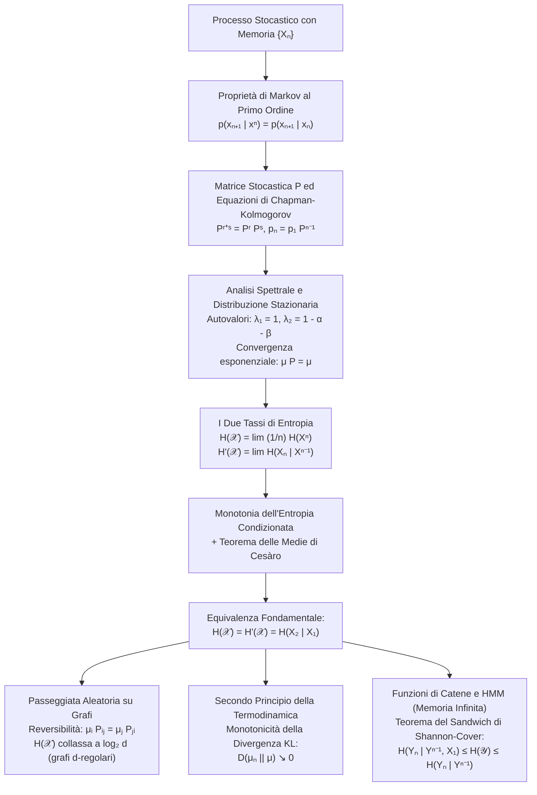

## Fondamenti Dei Processi Stocastici E Dipendenza Temporale

Un processo stocastico discreto a tempo discreto è formalmente definito come una successione infinita di variabili aleatorie $\{X_i\}_{i=1}^\infty$ (con indice temporale $i \in \mathbb{N}$), definite sul medesimo spazio di probabilità e a valori in un alfabeto discreto $\mathcal{X}$.

La struttura probabilistica del processo è interamente caratterizzata dalla famiglia coerente delle funzioni di massa di probabilità congiunte su blocchi finiti di lunghezza arbitraria $n$:

$$
p(x^n) = p(x_1, x_2, \dots, x_n) = \text{Pr}\{X_1 = x_1, X_2 = x_2, \dots, X_n = x_n\}
$$

La misura di probabilità congiunta governa sia la frequenza con cui compaiono i singoli simboli, sia la memoria statistica che lega sequenze di osservazioni temporalmente distanti.

### Esempio Didattico Fondamentale: La Passeggiata Aleatoria Unidimensionale

Consideriamo una successione di variabili aleatorie binarie $Y_1, Y_2, \dots$ indipendenti e identicamente distribuite (i.i.d.), che modellano passi elementari equiprobabili verso destra o verso sinistra:

$$
\text{Pr}\{Y_i = +1\} = \text{Pr}\{Y_i = -1\} = \frac{1}{2}
$$

Definiamo la passeggiata aleatoria semplice unidimensionale (1D Random Walk) imponendo la posizione iniziale deterministica $X_0 = 0$ e accumulando la somma parziale degli incrementi:

$$
X_n = \sum_{i=1}^n Y_i, \quad n \ge 1
$$

Lo spazio dei valori assumibili all'istante $n$ si dilata linearmente nel tempo: $|\mathcal{X}_n| = n + 1$, con supporto $x_n \in \{-n, -n+2, \dots, n-2, n\}$. Valutiamo i momenti di ordine uno e due della posizione:

$$
\mathbb{E}[X_n] = \sum_{i=1}^n \mathbb{E}[Y_i] = 0
$$

$$
\text{Var}(X_n) = \sum_{i=1}^n \text{Var}(Y_i) = n \cdot 1 = n
$$

Notiamo che la varianza cresce linearmente con il numero di passi $n$. Di conseguenza, per il Teorema del Limite Centrale, la variabile standardizzata $\frac{1}{\sqrt{n}}X_n$ converge in legge a una distribuzione gaussiana normale $\mathcal{N}(0, 1)$. Poiché i momenti del secondo ordine dipendono esplicitamente dal tempo, il processo $\{X_n\}$ è intrinsecamente __non stazionario__.

Tuttavia, se applichiamo l'operatore di differenziazione temporale all'indietro:

$$
Z_n = X_n - X_{n-1} = Y_n
$$

il processo differenziato $\{Z_n\}$ coincide identicamente con la sequenza di incrementi originaria, risultando un processo i.i.d. perfettamente stazionario.

Esaminiamo ora il comportamento dell'informazione:
1. Condizionatamente alla posizione nota al passo precedente $X_{n-1} = x_{n-1}$, il passo successivo $X_n$ può assumere esclusivamente i due valori equiprobabili $x_{n-1} + 1$ e $x_{n-1} - 1$. L'incertezza residua a ogni singolo passo è dunque costante e unitaria:

$$
H(X_n \mid X_{n-1}) = H_B\left(\frac{1}{2}\right) = 1 \quad \text{bit/passo}
$$

2. Poiché la corrispondenza tra la traiettoria delle posizioni $(X_1, \dots, X_n)$ e la sequenza degli incrementi $(Y_1, \dots, Y_n)$ è una trasformazione deterministica invertibile a matrice triangolare con determinante unitario discreto, l'entropia congiunta dell'intera traiettoria è:

$$
H(X_1, X_2, \dots, X_n) = H(Y_1, Y_2, \dots, Y_n) = \sum_{i=1}^n H(Y_i) = n \quad \text{bit}
$$

Ne discende che l'entropia media per simbolo è costante e pari a $\frac{1}{n} H(X^n) = 1$ bit/passo.
3. Al contrario, l'entropia marginale del singolo stato non condizionato $H(X_n)$ riflette la dispersione della distribuzione binomiale su una varianza $n$. Per valori elevati di $n$, la massa di probabilità si approssima a una campana gaussiana campionata su passo 2, la cui entropia discreta diverge logaritmicamente:

$$
H(X_n) \sim \frac{1}{2} \log_2(2\pi e n) \to \infty \quad \text{per } n \to \infty
$$

Questo fenomeno illustra un fondamentale trabocchetto d'esame: per processi non stazionari, l'entropia del singolo stato non riflette il tasso di innovazione informativa del processo, poiché la dispersione marginale continua ad accumulare la varianza storica.

### Processi Stazionari in Senso Stretto

Un processo stocastico discreto $\{X_n\}_{n=1}^\infty$ si definisce __stazionario in senso stretto__ (Strict-Sense Stationary, SSS) se la distribuzione di probabilità congiunta di qualsiasi blocco di variabili aleatorie è invariante rispetto a una traslazione temporale arbitraria $l \in \mathbb{Z}$:

$$
\text{Pr}\{X_1 = x_1, X_2 = x_2, \dots, X_n = x_n\} = \text{Pr}\{X_{1+l} = x_1, X_{2+l} = x_2, \dots, X_{n+l} = x_n\}
$$

per ogni dimensione di blocco $n \ge 1$ e per qualunque stringa $(x_1, \dots, x_n) \in \mathcal{X}^n$.

La stazionarietà in senso stretto comporta due proprietà essenziali:
- Le distribuzioni marginali dei singoli campioni sono rigorosamente tempo-invarianti: $p(X_n = x) = p(X_1 = x)$ per ogni istante $n$, il che implica che l'entropia marginale $H(X_n) = H(X_1)$ è costante;
- La distribuzione congiunta di due campioni $p(X_i, X_{i+k})$ dipende esclusivamente dalla loro distanza temporale relativa $k$, e non dalla loro collocazione temporale assoluta $i$.

## Catene Di Markov Discrete E Matrici Di Transizione Stocastiche

La famiglia di modelli con memoria più rilevante per le telecomunicazioni e la teoria dell'informazione è costituita dalle catene di Markov, in cui la dipendenza temporale è circoscritta unicamente allo stato più recente del sistema.

### Proprietà Di Markov E Fattorizzazione a Cascata

Un processo stocastico discreto $\{X_n\}_{n=1}^\infty$ su un alfabeto finito di stati $\mathcal{X} = \{1, 2, \dots, m\}$ è una __catena di Markov__ del primo ordine se soddisfa la proprietà di assenza di memoria storica:

$$
\text{Pr}\{X_{n+1} = x_{n+1} \mid X_n = x_n, X_{n-1} = x_{n-1}, \dots, X_1 = x_1\} = \text{Pr}\{X_{n+1} = x_{n+1} \mid X_n = x_n\}
$$

per ogni indice temporale $n \ge 1$ e per ogni sequenza ammissibile $(x_1, \dots, x_{n+1}) \in \mathcal{X}^{n+1}$.

Applicando la regola della catena della probabilità condizionata e semplificando i condizionamenti storici grazie alla proprietà di Markov, la distribuzione congiunta fattorizza in forma telescopica:

$$
p(x_1, x_2, \dots, x_n) = p(x_1) p(x_2 \mid x_1) p(x_3 \mid x_2) \cdots p(x_n \mid x_{n-1}) = p(x_1) \prod_{i=1}^{n-1} p(x_{i+1} \mid x_i)
$$

### Omogeneità Temporale E Matrice Stocastica

Una catena di Markov si definisce __omogenea__ (tempo-invariante) se le probabilità di transizione tra gli stati non dipendono esplicitamente dall'istante di osservazione $n$:

$$
\text{Pr}\{X_{n+1} = j \mid X_n = i\} = \text{Pr}\{X_2 = j \mid X_1 = i\} = P_{ij} \quad \forall n \ge 1
$$

Raccogliamo le probabilità di transizione nella __matrice stocastica__ quadrata $\mathbf{P} \in \mathbb{R}^{m \times m}$:

$$
\mathbf{P} = \begin{bmatrix} P_{11} & P_{12} & \cdots & P_{1m} \\ P_{21} & P_{22} & \cdots & P_{2m} \\ \vdots & \vdots & \ddots & \vdots \\ P_{m1} & P_{m2} & \cdots & P_{mm} \end{bmatrix}
$$

Ogni riga della matrice rappresenta una distribuzione di probabilità condizionata valida. Pertanto, gli elementi soddisfano $P_{ij} \ge 0$ e la somma lungo ciascuna riga è unitaria:

$$
\sum_{j=1}^m P_{ij} = 1 \quad \forall i \in \{1, \dots, m\} \iff \mathbf{P} \mathbf{1} = \mathbf{1}
$$

dove $\mathbf{1}$ indica il vettore colonna di tutti uno. L'equazione $\mathbf{P}\mathbf{1} = \mathbf{1}$ esprime il fatto che il vettore unitario è sempre un autovettore destro di $\mathbf{P}$ associato all'autovalore $\lambda = 1$.

### Propagazione Temporale Ed Equazioni Di Chapman-Kolmogorov

Sia $\mathbf{p}_n = [p_n(1), p_n(2), \dots, p_n(m)]$ il vettore riga che descrive la distribuzione di probabilità dello stato all'istante $n$, dove $p_n(i) = \text{Pr}\{X_n = i\}$. Applicando il teorema della probabilità totale, l'evoluzione della distribuzione a uno step corrisponde al prodotto vettore-matrice:

$$
p_{n+1}(j) = \sum_{i=1}^m p_n(i) P_{ij} \iff \mathbf{p}_{n+1} = \mathbf{p}_n \mathbf{P}
$$

Iterando il prodotto a partire dalla distribuzione dello stato iniziale $\mathbf{p}_1$, ricaviamo la legge di propagazione su un orizzonte di $n-1$ passi:

$$
\mathbf{p}_n = \mathbf{p}_1 \mathbf{P}^{n-1} \iff \mathbf{p}_{n+1} = \mathbf{p}_1 \mathbf{P}^n
$$

L'elemento nella posizione $(i, j)$ della matrice potenza $\mathbf{P}^k$, indicato con $P_{ij}^k$, denota la probabilità di transizione in $k$ passi dallo stato $i$ allo stato $j$:

$$
P_{ij}^k = \text{Pr}\{X_{n+k} = j \mid X_n = i\}
$$

La composizione delle traiettorie su intervalli intermedi soddisfa le celebri __equazioni di Chapman-Kolmogorov__: per ogni coppia di passi temporali interi $r, s \ge 0$, la probabilità di raggiungere $j$ da $i$ in $r+s$ passi è pari alla somma ponderata su tutti i possibili stati intermedi $k$ attraversati al passo intermedio $r$:

$$
P_{ij}^{r+s} = \sum_{k=1}^m P_{ik}^r P_{kj}^s \iff \mathbf{P}^{r+s} = \mathbf{P}^r \mathbf{P}^s
$$

In termini matriciali, le equazioni di Chapman-Kolmogorov equivalgono alla naturale proprietà associativa del prodotto tra potenze della matrice di transizione $\mathbf{P}$.

### Proprietà Topologiche: Irriducibilità E Aperiodicità

Il comportamento a lungo termine di una catena di Markov dipende dalla topologia del suo grafo di transizione orientato:

1. __Irriducibilità__: una catena di Markov è irriducibile se è possibile transitare da qualsiasi stato $i$ a qualunque altro stato $j$ in un numero finito di passi con probabilità strettamente positiva:

$$
\forall i, j \in \mathcal{X}, \quad \exists k \ge 1 : P_{ij}^k > 0
$$

Nel grafo degli stati, ciò equivale a richiedere che il grafo sia fortemente connesso.

2. __Aperiodicità__: il periodo di uno stato $i$ è definito come il massimo comune divisore delle lunghezze di tutti i cicli chiusi che partono e ritornano in $i$:

$$
d(i) = \gcd\{k \ge 1 : P_{ii}^k > 0\}
$$

Se per tutti gli stati vale $d(i) = 1$, la catena si dice aperiodica, escludendo intrappolamenti in oscillazioni deterministiche cicliche.

Una catena a stati finiti sia irriducibile che aperiodica viene definita __ergodica__.

## Distribuzione Stazionaria E Convergenza Asintotica

Quando una catena di Markov ergodica evolve nel tempo, la distribuzione di probabilità dello stato si disaccoppia progressivamente dalle condizioni iniziali e converge a un equilibrio dinamico immutabile.

### Definizione Di Distribuzione Stazionaria

Un vettore riga di probabilità $\boldsymbol{\mu} = [\mu_1, \mu_2, \dots, \mu_m]$ è una __distribuzione stazionaria__ (o invariante) per la catena regolata dalla matrice $\mathbf{P}$ se rappresenta un punto fisso della trasformazione:

$$
\boldsymbol{\mu} \mathbf{P} = \boldsymbol{\mu}
$$

unitamente ai vincoli di normalizzazione probabilistica:

$$
\mu_i \ge 0 \quad \forall i \in \{1, \dots, m\}, \qquad \sum_{i=1}^m \mu_i = 1
$$

Dal punto di vista dell'algebra lineare, $\boldsymbol{\mu}$ è un autovettore sinistro normalizzato della matrice $\mathbf{P}$ associato all'autovalore $\lambda_1 = 1$. Se la variabile iniziale è distribuita secondo la stazionaria ($X_1 \sim \boldsymbol{\mu}$), allora $X_n \sim \boldsymbol{\mu}$ per ogni $n \ge 1$, rendendo l'intero processo una sequenza strettamente stazionaria.

### Teorema Di Convergenza Asintotica

Se una catena di Markov a stati finiti è irriducibile e aperiodica, il Teorema di Perron-Frobenius garantisce che:
1. Esiste un'unica distribuzione stazionaria $\boldsymbol{\mu}$;
2. Indipendentemente dalla distribuzione di probabilità iniziale $\mathbf{p}_1$, l'evoluzione temporale converge esponenzialmente verso $\boldsymbol{\mu}$:

$$
\lim_{n \to \infty} \mathbf{p}_n = \lim_{n \to \infty} \mathbf{p}_1 \mathbf{P}^{n-1} = \boldsymbol{\mu}
$$

3. La matrice di transizione a $n$ passi converge a una matrice avente tutte le righe identiche ed uguali al vettore stazionario $\boldsymbol{\mu}$:

$$
\lim_{n \to \infty} \mathbf{P}^n = \mathbf{1} \boldsymbol{\mu} = \begin{bmatrix} \mu_1 & \mu_2 & \cdots & \mu_m \\ \mu_1 & \mu_2 & \cdots & \mu_m \\ \vdots & \vdots & \ddots & \vdots \\ \mu_1 & \mu_2 & \cdots & \mu_m \end{bmatrix} \iff \lim_{n \to \infty} P_{ij}^n = \mu_j \quad \forall i, j
$$

### Analisi Dettagliata Della Catena Di Markov a Due Stati

Consideriamo una catena di Markov binaria a due stati $\mathcal{X} = \{1, 2\}$, ampiamente adottata per modellare canali radiomobili affetti da dissolvenze lente o burst di errore (modello di Gilbert-Elliott):

$$
\mathbf{P} = \begin{bmatrix} P_{11} & P_{12} \\ P_{21} & P_{22} \end{bmatrix} = \begin{bmatrix} 1 - \alpha & \alpha \\ \beta & 1 - \beta \end{bmatrix}
$$

con parametri di transizione $\alpha, \beta \in (0, 1)$.

![[slide_14_two_state_markov_chain.png|center mid]]

#### Determinazione Della Distribuzione Stazionaria

Imponiamo la condizione di punto fisso $\boldsymbol{\mu} \mathbf{P} = \boldsymbol{\mu}$ sul vettore riga $\boldsymbol{\mu} = [\mu_1, \, \mu_2]$:

$$
\begin{bmatrix} \mu_1 & \mu_2 \end{bmatrix} \begin{bmatrix} 1 - \alpha & \alpha \\ \beta & 1 - \beta \end{bmatrix} = \begin{bmatrix} \mu_1 & \mu_2 \end{bmatrix}
$$

Esplicitiamo la prima equazione scalare e sostituiamo il vincolo di normalizzazione $\mu_2 = 1 - \mu_1$:

$$
\mu_1 (1 - \alpha) + \mu_2 \beta = \mu_1 \implies \mu_1 - \alpha \mu_1 + \beta (1 - \mu_1) = \mu_1
$$

Semplificando il termine $\mu_1$ a entrambi i membri:

$$
-\alpha \mu_1 + \beta - \beta \mu_1 = 0 \iff (\alpha + \beta) \mu_1 = \beta
$$

Otteniamo la distribuzione stazionaria in forma chiusa:

$$
\mu_1 = \frac{\beta}{\alpha + \beta}, \qquad \mu_2 = \frac{\alpha}{\alpha + \beta}
$$

Notiamo l'intuitiva interpretazione fisica: la probabilità di risiedere nello stato 1 è direttamente proporzionale alla probabilità $\beta$ di entrarvi provenendo dallo stato 2, e inversamente proporzionale alla somma dei tassi di transizione $\alpha + \beta$.

#### Analisi Spettrale E Dinamica Di Convergenza

Calcoliamo gli autovalori della matrice $\mathbf{P}$ annullando il polinomio caratteristico:

$$
\det(\lambda \mathbf{I} - \mathbf{P}) = \det \begin{bmatrix} \lambda - (1 - \alpha) & -\alpha \\ -\beta & \lambda - (1 - \beta) \end{bmatrix} = (\lambda - 1 + \alpha)(\lambda - 1 + \beta) - \alpha \beta = 0
$$

Sviluppiamo il prodotto:

$$
\lambda^2 - (2 - \alpha - \beta)\lambda + (1 - \alpha)(1 - \beta) - \alpha \beta = \lambda^2 - (2 - \alpha - \beta)\lambda + (1 - \alpha - \beta) = 0
$$

Fattorizzando l'equazione quadratica:

$$
(\lambda - 1)[\lambda - (1 - \alpha - \beta)] = 0
$$

Identifichiamo immediatamente i due autovalori del sistema:

$$
\lambda_1 = 1, \qquad \lambda_2 = 1 - \alpha - \beta
$$

La decomposizione spettrale della matrice di transizione alla potenza $n$-esima fornisce:

$$
\mathbf{P}^n = \frac{1}{\alpha + \beta} \begin{bmatrix} \beta & \alpha \\ \beta & \alpha \end{bmatrix} + \frac{(1 - \alpha - \beta)^n}{\alpha + \beta} \begin{bmatrix} \alpha & -\alpha \\ -\beta & \beta \end{bmatrix}
$$

Esaminiamo il ruolo del secondo autovalore $\lambda_2 = 1 - \alpha - \beta$:
- Poiché $\alpha, \beta \in (0, 1)$, si ha strettamente $|\lambda_2| < 1$, confermando che il termine transitorio decade esponenzialmente a zero come $\lambda_2^n = (1 - \alpha - \beta)^n$.
- Se $\alpha + \beta = 1$, allora $\lambda_2 = 0$: la matrice di transizione $\mathbf{P}$ ha righe identiche pari a $[\beta, \, \alpha]$, la memoria svanisce istantaneamente al primo passo e le variabili del processo sono indipendenti.
- Se $\alpha + \beta \to 0$, allora $\lambda_2 \to 1$: il tempo di rilassamento $\tau \approx -\frac{1}{\ln|\lambda_2|}$ diverge; il sistema manifesta forte metastabilità, permanendo confinato per lunghi intervalli nello stato corrente.
- Se $\alpha = \beta = 1$, allora $\lambda_2 = -1$: la catena diventa puramente periodica con oscillazione deterministica alternata tra stato 1 e stato 2.

A regime stazionario, l'entropia marginale dello stato coincide con l'entropia binaria di Shannon calcolata sulla probabilità stazionaria:

$$
H(X_n) = H_B(\mu_2) = H_B\left( \frac{\alpha}{\alpha + \beta} \right) \quad \text{bit}
$$

## Entropia E Tassi Di Entropia (Entropy Rates)

Quando analizziamo una sorgente con memoria temporale, l'entropia della sequenza congiunta $H(X_1, X_2, \dots, X_n)$ cresce asintoticamente in modo lineare con la lunghezza di blocco $n$. La pendenza asintotica di questa crescita definisce l'__entropy rate__ della sorgente.

### Definizioni Dei Due Tassi Di Entropia

Nella letteratura dell'information theory si introducono due differenti definizioni analitiche per quantificare la velocità di generazione dell'informazione:

1. __Tasso di Entropia per Simbolo__ $H(\mathcal{X})$: quantifica l'incertezza media per carattere normalizzata sulla lunghezza del blocco:

$$
H(\mathcal{X}) = \lim_{n \to \infty} \frac{1}{n} H(X_1, X_2, \dots, X_n)
$$

2. __Tasso di Entropia Condizionata__ $H'(\mathcal{X})$: quantifica l'incertezza residua sulla generazione del prossimo simbolo quando si possiede la conoscenza integrale della traiettoria passata:

$$
H'(\mathcal{X}) = \lim_{n \to \infty} H(X_n \mid X_{n-1}, X_{n-2}, \dots, X_1)
$$

### Casi Particolari Immediati

- __Macchina da Scrivere Casuale (Typewriter di Shannon)__: se la sorgente genera caratteri indipendenti ed equiprobabili estratti da un alfabeto di cardinalità $m$, la probabilità di ciascuna delle $m^n$ sequenze è $m^{-n}$. Otteniamo:

$$
H(X_1, \dots, X_n) = \log_2(m^n) = n \log_2 m \implies H(\mathcal{X}) = \log_2 m \quad \text{bit/simbolo}
$$

- __Sorgente i.i.d. Generica__: se le variabili $X_i$ sono indipendenti e identicamente distribuite con entropia $H(X_1)$:

$$
H(X_1, \dots, X_n) = \sum_{i=1}^n H(X_i) = n H(X_1) \implies H(\mathcal{X}) = H'(\mathcal{X}) = H(X_1)
$$

- __Passeggiata Aleatoria 1D__: per la passeggiata aleatoria abbiamo verificato che il tasso condizionato è $H'( \mathcal{X} ) = H(X_n \mid X_{n-1}) = 1$ bit/passo e che il tasso medio per blocco è $\frac{1}{n}H(X^n) = 1$ bit/passo. Tuttavia, a causa della non stazionarietà della varianza ($\text{Var}(X_n) = n$), l'entropia del singolo stato diverge come $H(X_n) \sim \frac{1}{2}\log_2(2\pi e n) \to \infty$.

### Teorema Di Equivalenza Dei Tassi Di Entropia

__Teorema__: Per qualsiasi processo stocastico discreto stazionario in senso stretto, entrambi i limiti $H(\mathcal{X})$ e $H'(\mathcal{X})$ esistono finiti e coincidono:

$$
H(\mathcal{X}) = H'(\mathcal{X})
$$

La derivazione si articola su due pilastri analitici consequenziali:

1. __Monotonia dell'Entropia Condizionata__:
Definiamo la successione delle entropie condizionate $a_n = H(X_n \mid X^{n-1}) = H(X_n \mid X_{n-1}, \dots, X_1)$. Sfruttando la stazionarietà temporale (traslazione di un passo indietro):

$$
a_n = H(X_n \mid X_{n-1}, \dots, X_1) = H(X_{n+1} \mid X_n, \dots, X_2)
$$

Aggiungendo il condizionamento sulla variabile iniziale $X_1$, per la proprietà fondamentale secondo cui il condizionamento non aumenta mai l'entropia ($H(A \mid B, C) \le H(A \mid B)$):

$$
a_n \ge H(X_{n+1} \mid X_n, \dots, X_2, X_1) = H(X_{n+1} \mid X^n) = a_{n+1}
$$

La successione $a_n$ è dunque monotona non crescente ($a_{n+1} \le a_n$). Essendo inferiormente limitata da zero ($a_n \ge 0$ per variabili discrete), per il Teorema di Weierstrass sui limiti ammette limite finito:

$$
\lim_{n \to \infty} a_n = H'(\mathcal{X})
$$

2. __Regola della Catena e Teorema delle Medie di Cesàro__:
Applicando la regola della catena multivariata dell'entropia congiunta:

$$
H(X_1, X_2, \dots, X_n) = \sum_{i=1}^n H(X_i \mid X_{i-1}, \dots, X_1) = \sum_{i=1}^n a_i
$$

Dividendo ambo i membri per la lunghezza del blocco $n$:

$$
\frac{1}{n} H(X_1, \dots, X_n) = \frac{1}{n} \sum_{i=1}^n a_i
$$

L'entropia per simbolo $\frac{1}{n} H(X^n)$ coincide esattamente con la media aritmetica campionaria dei primi $n$ termini della successione $a_i$. Il Teorema delle Medie di Cesàro stabilisce che se una successione numerica $a_n$ converge a un limite $L$, anche la successione delle sue medie aritmetiche $\frac{1}{n}\sum_{i=1}^n a_i$ converge al medesimo limite $L$.

Ne deduciamo l'uguaglianza rigorosa:

$$
H(\mathcal{X}) = \lim_{n \to \infty} \frac{1}{n} H(X^n) = \lim_{n \to \infty} a_n = H'(\mathcal{X})
$$

Per la dimostrazione analitica integrale $\epsilon$-$\delta$ del Teorema di Cesàro, rimandiamo alla [[Anno 1/Information and Estimation Theory/zz. Argomenti extra#Dimostrazione Analitica della Convergenza di Cesàro e dell'Uguaglianza dei Tassi di Entropia|dimostrazione analitica della convergenza di Cesàro e dell'uguaglianza dei tassi di entropia]].

### Significato Operativo Ed Epistemologico dell'Entropy Rate

Il valore fondante dell'entropy rate $H(\mathcal{X})$ risiede nell'estensione del Teorema di Shannon-McMillan-Breiman ai processi stazionari ed ergodici:

$$
-\frac{1}{n} \log_2 p(X_1, X_2, \dots, X_n) \xrightarrow{\text{a.s.}} H(\mathcal{X}) \quad \text{per } n \to \infty
$$

Questo risultato garantisce che l'insieme tipico $A_\epsilon^{(n)}$ per sorgenti con memoria possiede cardinalità concentrata su $|A_\epsilon^{(n)}| \approx 2^{n H(\mathcal{X})}$, dove ciascuna sequenza tipica compare con probabilità uniforme $p(x^n) \approx 2^{-n H(\mathcal{X})}$.

Ne consegue il principio cardine della compressione:

$$
\mathbb{E}\left[ \frac{1}{n} l(X^n) \right] \to H(\mathcal{X}) \quad \text{bit/simbolo}
$$

L'entropy rate $H(\mathcal{X})$ rappresenta la soglia fisica e matematica invalicabile per la codifica lossless di qualunque sorgente di informazione stazionaria ed ergodica dotata di memoria.

## Calcolo dell'Entropy Rate per Catene Di Markov E Grafi

Per le catene di Markov stazionarie, la proprietà di assenza di memoria storica oltre il primo passo consente di calcolare l'entropy rate in forma algebrica chiusa.

### Formula Analitica per Catene Di Markov Stazionarie

__Teorema__: Sia $\{X_n\}$ una catena di Markov stazionaria con distribuzione invariante $\boldsymbol{\mu} = [\mu_1, \dots, \mu_m]$ e matrice di transizione $\mathbf{P} = [P_{ij}]$. L'entropy rate del processo vale:

$$
H(\mathcal{X}) = H(X_2 \mid X_1) = -\sum_{i=1}^m \mu_i \sum_{j=1}^m P_{ij} \log_2 P_{ij} = \sum_{i=1}^m \mu_i H(X_2 \mid X_1 = i)
$$

#### Dimostrazione Passo-Passo

Sfruttando l'equivalenza dei tassi $H(\mathcal{X}) = H'(\mathcal{X})$ e la definizione di catena di Markov, la dipendenza condizionata collassa sull'istante immediatamente precedente:

$$
H(\mathcal{X}) = \lim_{n \to \infty} H(X_n \mid X_{n-1}, \dots, X_1) = \lim_{n \to \infty} H(X_n \mid X_{n-1})
$$

Poiché la catena è tempo-invariante e stazionaria ($X_{n-1} \sim \boldsymbol{\mu}$ e $\mathbf{P}$ costante), per ogni $n \ge 2$ l'entropia condizionata a un passo è rigorosamente identica:

$$
H(X_n \mid X_{n-1}) = H(X_2 \mid X_1)
$$

Sviluppiamo $H(X_2 \mid X_1)$ applicando la definizione di entropia condizionata:

$$
H(X_2 \mid X_1) = -\sum_{i=1}^m \sum_{j=1}^m p(X_1 = i, X_2 = j) \log_2 p(X_2 = j \mid X_1 = i)
$$

Sostituiamo la fattorizzazione $p(X_1 = i, X_2 = j) = p(X_1 = i) P_{ij} = \mu_i P_{ij}$:

$$
H(\mathcal{X}) = -\sum_{i=1}^m \mu_i \sum_{j=1}^m P_{ij} \log_2 P_{ij} = \sum_{i=1}^m \mu_i \left( -\sum_{j=1}^m P_{ij} \log_2 P_{ij} \right) = \sum_{i=1}^m \mu_i H(\mathbf{P}_{i,:})
$$

L'entropy rate di una catena di Markov stazionaria è la media pesata dell'entropia di ciascuna riga della matrice di transizione, dove i pesi coincidono con le probabilità stazionarie dei rispettivi stati di partenza.

### Entropy Rate Della Catena a Due Stati

Applichiamo la formula generale alla catena binaria a due stati regolata da $\mathbf{P} = \begin{bmatrix} 1-\alpha & \alpha \\ \beta & 1-\beta \end{bmatrix}$ e distribuzione stazionaria $\mu_1 = \frac{\beta}{\alpha+\beta}, \, \mu_2 = \frac{\alpha}{\alpha+\beta}$:
- La riga 1 ha entropia binaria $H_B(\alpha) = -\alpha \log_2 \alpha - (1-\alpha)\log_2(1-\alpha)$;
- La riga 2 ha entropia binaria $H_B(\beta) = -\beta \log_2 \beta - (1-\beta)\log_2(1-\beta)$.

L'entropy rate complessivo è:

$$
H(\mathcal{X}) = \mu_1 H_B(\alpha) + \mu_2 H_B(\beta) = \frac{\beta}{\alpha + \beta} H_B(\alpha) + \frac{\alpha}{\alpha + \beta} H_B(\beta) \quad \text{bit/simbolo}
$$

Confrontiamo $H(\mathcal{X})$ con l'entropia dello stato isolato $H(X_n) = H_B\left( \frac{\alpha}{\alpha+\beta} \right)$. Poiché il condizionamento non aumenta l'entropia:

$$
H(\mathcal{X}) = H(X_2 \mid X_1) \le H(X_2) = H(X_n)
$$

L'uguaglianza $H(\mathcal{X}) = H(X_n)$ sussiste se e solo se $X_2$ è statisticamente indipendente da $X_1$, il che richiede che le due righe di $\mathbf{P}$ siano identiche:

$$
1 - \alpha = \beta \iff \alpha + \beta = 1
$$

Se $\alpha + \beta \neq 1$, la correlazione temporale riduce strettamente l'incertezza generata a regime: conoscere lo stato precedente restringe lo spazio delle transizioni ammissibili, abbattendo il tasso informativo rispetto all'incertezza del singolo stato.

### Passeggiata Aleatoria Su Grafi Pesati Non Orientati

Sia $G = (V, E)$ un grafo non orientato connesso privo di cappi autoconnessi ($W_{ii} = 0$), con pesi simmetrici $W_{ij} = W_{ji} \ge 0$. Definiamo il grado pesato del vertice $i$ e il peso totale del grafo:

$$
d_i = \sum_{j \in V} W_{ij}, \qquad 2m = \sum_{i \in V} d_i = \sum_{i \in V} \sum_{j \in V} W_{ij}
$$

Una particella esegue un random walk sul grafo scegliendo il nodo successivo proporzionalmente al peso dell'arco di collegamento:

$$
P_{ij} = \frac{W_{ij}}{d_i}
$$

Verifichiamo la condizione di bilancio dettagliato (reversibilità temporale) associando a ciascun vertice la probabilità stazionaria proporzionale al suo grado:

$$
\mu_i = \frac{d_i}{2m}
$$

Calcoliamo il flusso di probabilità dal vertice $i$ al vertice $j$:

$$
\mu_i P_{ij} = \left( \frac{d_i}{2m} \right) \left( \frac{W_{ij}}{d_i} \right) = \frac{W_{ij}}{2m} = \frac{W_{ji}}{2m} = \left( \frac{d_j}{2m} \right) \left( \frac{W_{ji}}{d_j} \right) = \mu_j P_{ji}
$$

La condizione di reversibilità $\mu_i P_{ij} = \mu_j P_{ji}$ è identicamente soddisfatta per simmetria dei pesi. Sommando su $i$:

$$
\sum_{i \in V} \mu_i P_{ij} = \sum_{i \in V} \mu_j P_{ji} = \mu_j \sum_{i \in V} P_{ji} = \mu_j \cdot 1 = \mu_j \iff \boldsymbol{\mu} \mathbf{P} = \boldsymbol{\mu}
$$

La distribuzione $\mu_i = \frac{d_i}{2m}$ è la distribuzione stazionaria della catena. Calcoliamo ora l'entropy rate del random walk:

$$
H(\mathcal{X}) = -\sum_{i \in V} \mu_i \sum_{j \in V} P_{ij} \log_2 P_{ij} = -\sum_{i \in V} \frac{d_i}{2m} \sum_{j \in V} \frac{W_{ij}}{d_i} \log_2 \left( \frac{W_{ij}}{d_i} \right)
$$

Sfruttando le proprietà dei logaritmi $\log_2(W_{ij}/d_i) = \log_2 W_{ij} - \log_2 d_i$:

$$
H(\mathcal{X}) = -\frac{1}{2m} \sum_{i \in V} \sum_{j \in V} W_{ij} \log_2 W_{ij} + \frac{1}{2m} \sum_{i \in V} \left( \sum_{j \in V} W_{ij} \right) \log_2 d_i
$$

Poiché $\sum_j W_{ij} = d_i$, riorganizziamo i termini nell'espressione in forma chiusa:

$$
H(\mathcal{X}) = \frac{1}{2m} \sum_{i \in V} d_i \log_2 d_i - \frac{1}{2m} \sum_{i \in V} \sum_{j \in V} W_{ij} \log_2 W_{ij}
$$

Esaminiamo il caso notevole di un grafo non pesato ($W_{ij} \in \{0, 1\}$) e $d$-regolare, in cui ogni vertice possiede esattamente grado uniforme $d_i = d$:
- Per gli archi attivi $W_{ij} = 1$, il termine $\log_2 1 = 0$, annullando il secondo addendo;
- Il primo addendo si semplifica notando che $\sum_i d_i = 2m$:

$$
H(\mathcal{X}) = \frac{1}{2m} \left( \sum_{i \in V} d_i \right) \log_2 d = \log_2 d \quad \text{bit/passo}
$$

A ogni passo la particella sceglie uniformemente tra i $d$ nodi adiacenti, generando esattamente $\log_2 d$ bit di incertezza.

Per la trattazione completa e le condizioni sui grafi orientati, si veda la [[Anno 1/Information and Estimation Theory/zz. Argomenti extra#Derivazione Rigorosa della Distribuzione Stazionaria e dell'Entropy Rate per il Random Walk su Grafi|derivazione rigorosa per il random walk su grafi]].

### Entropia Del Linguaggio Naturale (Shannon 1951)

Nel celebre articolo del 1951 (_Prediction and Entropy of Printed English_), Claude Shannon stimò l'entropy rate del testo scritto in lingua inglese mediante l'analisi statistica a $n$-grammi e test di predizione sequenziale eseguiti da parlanti umani:

| Modello Statistico | Formula del Tasso Informativo | Stima dell'Entropy Rate (Inglese) |
| :--- | :--- | :---: |
| __Ordine 0 (Equiprobabile)__ | $H_0 = \log_2 27$ (26 lettere + spazio) | $\approx 4.76 \quad \text{bit/carattere}$ |
| __Ordine 1 (Frequenze Unigrammi)__ | $H_1 = -\sum p(x) \log_2 p(x)$ | $\approx 4.03 \quad \text{bit/carattere}$ |
| __Ordine 2 (Frequenze Bigrammi)__ | $H_2 = H(X_2 \mid X_1)$ | $\approx 3.32 \quad \text{bit/carattere}$ |
| __Ordine 3 (Frequenze Trigrammi)__ | $H_3 = H(X_3 \mid X_2, X_1)$ | $\approx 3.10 \quad \text{bit/carattere}$ |
| __Limite Asintotico (Umano / Modellistica)__ | $H(\mathcal{X}) = \lim_{n \to \infty} H(X_n \mid X^{n-1})$ | $\approx 1.0 \text{ – } 1.5 \quad \text{bit/carattere}$ |

La ridondanza $R$ del linguaggio naturale scritto supera il $70\%$:

$$
R = 1 - \frac{H(\mathcal{X})}{\log_2 |\mathcal{X}|} \approx 1 - \frac{1.3}{4.76} \approx 0.73
$$

Questa marcata ridondanza strutturale garantisce la comprensibilità dei testi in presenza di rumore, errori ortografici o cancellazioni, e spiega l'eccellente fattore di compressione ottenuto dagli algoritmi a dizionario (LZ77 e LZ78) su file di testo.

## Connessione Con Il Secondo Principio Della Termodinamica

Nella fisica statistica, l'entropia quantifica il volume dello spazio delle fasi occupato dai microstati compatibili con un dato macrostato termodinamico. Nella teoria dell'informazione, il Secondo Principio della Termodinamica si riflette nel comportamento monotonico della divergenza di Kullback-Leibler e dell'entropia sotto l'azione dissipativa di catene di Markov.

### Le Cinque Formulazioni Informative Di Monotonicità

Siano $\boldsymbol{\mu}_n$ e $\boldsymbol{\mu}'_n$ due distribuzioni di probabilità distinte definite sullo spazio degli stati che evolvono sotto l'azione della medesima matrice di transizione stocastica $\mathbf{P}$, e sia $\boldsymbol{\mu}$ la distribuzione stazionaria della catena:

1. __Decrescita Temporale della Divergenza Relativa__:

$$
D(\boldsymbol{\mu}_n \parallel \boldsymbol{\mu}'_n) \le D(\boldsymbol{\mu}_{n-1} \parallel \boldsymbol{\mu}'_{n-1})
$$

Dimostrazione: poiché la transizione temporale forma la catena di Markov $X_{n-1} \to X_n$, la proprietà discende direttamente dalla Data Processing Inequality (DPI) applicata alla divergenza KL. Due distribuzioni soggette al medesimo operatore stocastico diventano progressivamente più indistinguibili.

2. __Attrazione Monotona Verso la Distribuzione Stazionaria__:
Ponendo $\boldsymbol{\mu}'_{n-1} = \boldsymbol{\mu}$ (invariante sotto $\mathbf{P}$):

$$
D(\boldsymbol{\mu}_n \parallel \boldsymbol{\mu}) \le D(\boldsymbol{\mu}_{n-1} \parallel \boldsymbol{\mu})
$$

La discrepanza informativa tra lo stato corrente del sistema e la configurazione di equilibrio asintotico decresce monotonicamente verso zero.

3. __Crescita dell'Entropia sotto Matrici Doppiamente Stocastiche__:
Se la matrice di transizione $\mathbf{P}$ è __doppiamente stocastica__ (ossia la somma su ogni colonna è unitaria: $\sum_i P_{ij} = 1$), la distribuzione stazionaria è uniforme: $\boldsymbol{\mu} = \mathbf{u} = [1/m, \dots, 1/m]$. In tal caso:

$$
D(\boldsymbol{\mu}_n \parallel \mathbf{u}) = \sum_{i=1}^m \mu_n(i) \log_2 \frac{\mu_n(i)}{1/m} = \log_2 m - H(X_n)
$$

Poiché $D(\boldsymbol{\mu}_n \parallel \mathbf{u})$ è non crescente nel tempo, ricaviamo:

$$
H(X_n) \ge H(X_{n-1})
$$

L'entropia di un sistema isolato governato da transizioni doppiamente stocastiche cresce nel tempo, riproducendo il principio termodinamico classico di Clausius ($\mathrm{d}S \ge 0$). Se tuttavia $\mathbf{P}$ non è doppiamente stocastica, l'entropia di stato $H(X_n)$ può decrescere localmente qualora il sistema parta da una distribuzione uniforme e collassi verso uno stato stazionario fortemente sbilanciato.

4. __Crescita dell'Incertezza Condizionata sul Futuro Remoto__:
Per una catena di Markov stazionaria:

$$
H(X_n \mid X_1) \ge H(X_{n-1} \mid X_1)
$$

La capacità di prevedere l'evoluzione futura del sistema conoscendo la condizione iniziale decade monotonicamente all'aumentare dell'orizzonte temporale $n$.

5. __Oblio Stocastico delle Condizioni Iniziali__:
Per qualsiasi catena di Markov:

$$
H(X_1 \mid X_n) \ge H(X_1 \mid X_{n-1})
$$

Con il trascorrere del tempo, l'osservazione dello stato presente $X_n$ rivela una quantità di informazione decrescente sull'istante iniziale $X_1$: il sistema cancella progressivamente la propria memoria microscopica.

## Funzioni Di Catene Di Markov E Modelli Nascosti (HMM)

Nei problemi applicativi di elaborazione del segnale, lo stato microscopico del sistema non è direttamente accessibile, ma viene osservato tramite una trasformazione deterministica con perdita di iniettività o attraverso un canale rumoroso.

### Il Paradosso Della Memoria Nelle Funzioni Di Catene

Sia $\{X_n\}$ una catena di Markov stazionaria del primo ordine e sia $Y_n = \phi(X_n)$ il processo osservabile ottenuto applicando la funzione non iniettiva $\phi: \mathcal{X} \to \mathcal{Y}$.

Sebbene la dinamica sottostante $\{X_n\}$ possegga memoria limitata al passo precedente, il processo proiettato $\{Y_n\}$ in generale __non è una catena di Markov di alcun ordine finito__. Le osservazioni passate $(Y_1, \dots, Y_{n-1})$ forniscono evidenza statistica che restringe lo spazio di verosimiglianza dello stato nascosto $X_{n-1}$, proiettando correlazioni informative fino all'istante iniziale.

Tuttavia, poiché $\{X_n\}$ è stazionario, anche il processo $\{Y_n\}$ eredita la stazionarietà in senso stretto. Il calcolo dell'entropy rate $H(\mathcal{Y})$ è complicato dal fatto che il condizionamento $H(Y_n \mid Y^{n-1})$ converge lentamente.

### Il Teorema Del Sandwich (Delimitazione Di Shannon-Cover)

Per calcolare e delimitare l'entropy rate $H(\mathcal{Y})$ di una funzione di catena di Markov si adotta il __Teorema del Sandwich__:

![[entropy_rate_sandwich_bounds.svg|center mid]]

__Teorema__: Per ogni indice temporale $n \ge 1$:

$$
H(Y_n \mid Y_{n-1}, \dots, Y_1, X_1) \le H(\mathcal{Y}) \le H(Y_n \mid Y_{n-1}, \dots, Y_1)
$$

e al tendere di $n$ all'infinito:

$$
\lim_{n \to \infty} H(Y_n \mid Y_{n-1}, \dots, Y_1, X_1) = H(\mathcal{Y}) = \lim_{n \to \infty} H(Y_n \mid Y_{n-1}, \dots, Y_1)
$$

#### Dimostrazione Della Chiusura Del Sandwich

Definiamo il limite superiore $U_n = H(Y_n \mid Y^{n-1})$ e il limite inferiore $L_n = H(Y_n \mid Y^{n-1}, X_1)$:
1. Per il ramo superiore, $U_n$ è monotono non crescente per il lemma di condizionamento ($U_{n+1} \le U_n$) e converge a $H(\mathcal{Y})$ per il Teorema di Cesàro.
2. Per il ramo inferiore, aggiungendo $X_1$ otteniamo una successione monotona non decrescente ($L_{n+1} \ge L_n$).
3. Valutiamo l'ampiezza dell'intervallo di incertezza (gap informativo):

$$
U_n - L_n = H(Y_n \mid Y^{n-1}) - H(Y_n \mid Y^{n-1}, X_1) = I(X_1; Y_n \mid Y^{n-1})
$$

Sommando il divario su un orizzonte temporale $k$ e applicando la regola della catena per l'informazione mutua:

$$
\sum_{n=1}^k (U_n - L_n) = \sum_{n=1}^k I(X_1; Y_n \mid Y^{n-1}) = I(X_1; Y_1, Y_2, \dots, Y_k) \le H(X_1) \le \log_2 m < \infty
$$

La serie telescopica a termini positivi converge a un valore finito maggiorato dall'entropia dello stato iniziale $H(X_1)$. Ne consegue che il termine generale deve necessariamente annullarsi asintoticamente:

$$
\lim_{n \to \infty} [U_n - L_n] = \lim_{n \to \infty} I(X_1; Y_n \mid Y^{n-1}) = 0
$$

I limiti superiore e inferiore si stringono a tenaglia attorno al medesimo valore asintotico $H(\mathcal{Y})$.

Per i dettagli analitici, si consulti la [[Anno 1/Information and Estimation Theory/zz. Argomenti extra#Delimitazione dell'Entropy Rate per Funzioni di Catene di Markov e Modelli Nascosti|delimitazione per funzioni di catene di Markov]].

### Modelli Di Markov Nascosti (Hidden Markov Models, HMM)

Nei modelli HMM, la catena di Markov sottostante $\{X_n\}$ governa l'emissione stocastica di un segnale osservabile $\{Y_n\}$ attraverso una matrice di emissione rumorosa:

$$
p(x^n, y^n) = p(x_1) \prod_{i=1}^{n-1} p(x_{i+1} \mid x_i) \prod_{i=1}^n p(y_i \mid x_i)
$$

![[slide_30_hidden_markov_model.png|center mid]]

Un modello HMM è univocamente specificato dalla terna di parametri $(\boldsymbol{\pi}, \mathbf{A}, \mathbf{B})$:
- $\boldsymbol{\pi} = [\pi_i]$: vettore della distribuzione iniziale dello stato nascosto $\pi_i = \text{Pr}\{X_1 = i\}$;
- $\mathbf{A} = [a_{ij}]$: matrice stocastica di transizione di stato $a_{ij} = \text{Pr}\{X_{n+1} = j \mid X_n = i\}$;
- $\mathbf{B} = [b_i(k)]$: matrice di emissione osservabile $b_i(k) = \text{Pr}\{Y_n = v_k \mid X_n = i\}$.

L'impiego computazionale degli HMM si fonda sulla risoluzione di tre problemi classici:

1. __Valutazione (Algoritmo Forward-Backward)__: calcola la verosimiglianza di una sequenza osservata $p(y^n \mid \boldsymbol{\pi}, \mathbf{A}, \mathbf{B})$. Mediante programmazione dinamica, la complessità collassa da esponenziale $O(m^n)$ a polinomiale $O(m^2 n)$ tramite la propagazione delle variabili in avanti $\alpha_t(i)$ e all'indietro $\beta_t(i)$.
2. __Decodifica (Algoritmo di Viterbi)__: determina la traiettoria di stati nascosti più probabile $\hat{x}^n = \arg\max_{x^n} p(x^n \mid y^n)$. L'algoritmo opera sul traliccio temporale ricercando il cammino a costo minimo con complessità $O(m^2 n)$.
3. __Apprendimento (Algoritmo di Baum-Welch / EM)__: stima i parametri ottimi $(\mathbf{A}, \mathbf{B})$ a partire dalle osservazioni non etichettate. L'algoritmo alterna iterativamente la fase di aspettazione (E-step, calcolo delle frequenze attese di transizione) con la fase di massimizzazione (M-step, riassegnazione vincolata delle probabilità).

## Quadro Sinottico Dei Modelli Stocastici Ed Entropy Rates

La tabella seguente riassume in modo organico le formulazioni dell'entropy rate per le classi fondamentali di processi stocastici analizzate:

| Modello Stocastico | Proprietà di Memoria | Espressione dell'Entropy Rate $H(\mathcal{X})$ | Condizioni di Validità | Applicazione Ingegneristica |
| :--- | :--- | :--- | :--- | :--- |
| __Sorgente Senza Memoria (i.i.d.)__ | Nulla ($p(x_n \mid x^{n-1}) = p(x_n)$) | $H(X_1) = -\sum p(x) \log_2 p(x)$ | Sempre valida | Codifica di sorgente elementare e quantizzazione |
| __Processo Stazionario Generico__ | Memoria arbitraria a lungo raggio | $\lim_{n \to \infty} H(X_n \mid X_{n-1}, \dots, X_1)$ | Stazionarietà in senso stretto (SSS) | Compressione dati universale e serie temporali |
| __Catena di Markov Omogenea__ | Memoria al primo ordine ($X_{n-1}$) | $-\sum_{i} \mu_i \sum_{j} P_{ij} \log_2 P_{ij}$ | Irriducibile ed aperiodica con $\boldsymbol{\mu} \mathbf{P} = \boldsymbol{\mu}$ | Canali radiomobili a burst (Gilbert-Elliott) |
| __Passeggiata Aleatoria 1D__ | Incrementi indipendenti | $H'( \mathcal{X} ) = H_B(1/2) = 1 \text{ bit/passo}$ | Processo non stazionario ($\text{Var}(X_n) = n$) | Modelli diffusivi, moto browniano e passeggiate |
| __Random Walk su Grafo Pesato__ | Transizioni proporzionali a $W_{ij}$ | $\frac{1}{2m} \sum d_i \log_2 d_i - \frac{1}{2m} \sum W_{ij} \log_2 W_{ij}$ | Grafo connesso non orientato simmetrico | PageRank, analisi di reti complesse e web search |
| __Grafo Regolare di Grado $d$__ | $d$ vicini equiprobabili per nodo | $\log_2 d \quad \text{bit/passo}$ | Grafo non pesato $d$-regolare | Routing simmetrico su topologie di rete uniformi |
| __Funzione di Catena / HMM__ | Memoria a raggio infinito | $H(Y_n \mid Y^{n-1}, X_1) \le H(\mathcal{Y}) \le H(Y_n \mid Y^{n-1})$ | Convergenza a sandwich per $n \to \infty$ | Riconoscimento vocale, sintesi ed elaborazione NLP |

## Takeaway d'Esame E Trabocchetti Operativi

In sede d'esame e nella risoluzione degli esercizi emergono frequentemente alcuni trabocchetti concettuali ed operativi da presidiare con rigore:

1. __Confusione tra $H(X_n)$ ed $H(\mathcal{X})$ nelle Catene di Markov__:
   - L'entropia marginale $H(X_n) = H_B(\mu_2)$ quantifica l'incertezza dello stato singolo osservato isolatamente;
   - L'entropy rate $H(\mathcal{X}) = H(X_2 \mid X_1)$ quantifica la nuova informazione generata a regime ad ogni passo temporale;
   - Vale sempre la disuguaglianza $H(\mathcal{X}) \le H(X_n)$, con uguaglianza stretta se e solo se la catena è a variabili indipendenti ($\alpha + \beta = 1$ nel modello a due stati).
2. __Il Falso Mito della Crescita Universale dell'Entropia di Stato__:
   - Nelle catene di Markov, l'entropia di stato $H(X_n)$ cresce monotonicamente nel tempo se e solo se la matrice di transizione $\mathbf{P}$ è doppiamente stocastica (il che comporta distribuzione stazionaria uniforme $\boldsymbol{\mu} = \mathbf{u}$);
   - Se $\mathbf{P}$ non è doppiamente stocastica, $H(X_n)$ può decrescere o manifestare andamenti non monotoni qualora il sistema parta da condizioni iniziali disordinate per convergere a uno stato stazionario concentrato.
3. __Il Paradosso del Random Walk 1D__:
   - Per la passeggiata aleatoria semplice, il tasso di entropia condizionata è unitario ($H'(\mathcal{X}) = 1$ bit/passo) e l'entropia media normalizzata è $\frac{1}{n}H(X^n) = 1$ bit/passo;
   - Tuttavia, l'entropia marginale dello stato diverge logaritmicamente: $H(X_n) \sim \frac{1}{2}\log_2(2\pi e n) \to \infty$, a causa della non stazionarietà della varianza $\text{Var}(X_n) = n$.
4. __Analisi Spettrale e Velocità di Rilassamento__:
   - Nella catena a due stati, la velocità con cui la distribuzione temporale si allinea all'equilibrio dipende dal secondo autovalore $\lambda_2 = 1 - \alpha - \beta$;
   - La discrepanza rispetto alla distribuzione stazionaria decade come $|\lambda_2|^n$. Se $\lambda_2 \approx 1$ la convergenza è lentissima e la catena mostra persistenza dinamica (metastabilità); se $\lambda_2 = 0$ la convergenza è istantanea.
5. __Perdita della Proprietà di Markov nelle Funzioni di Catena__:
   - L'applicazione di una funzione non iniettiva allo stato di una catena di Markov produce un processo $\{Y_n\}$ dotato di memoria infinita;
   - Per calcolare l'entropy rate $H(\mathcal{Y})$ non si può usare la formula a un passo, ma occorre serrare i limiti del Teorema del Sandwich sfruttando l'estinzione asintotica dell'informazione mutua residua $I(X_1; Y_n \mid Y^{n-1}) \to 0$.


# A. Compressione Dati E Codifica Di Sorgente

La compressione dei dati rappresenta l'applicazione ingegneristica più diretta e pervasiva della teoria dell'informazione di Claude Shannon. L'obiettivo primario della codifica di sorgente senza perdita (__lossless data compression__) consiste nel convertire una sequenza di simboli emessa da una sorgente aleatoria in una sequenza binaria di lunghezza media attesa minima, garantendo al contempo che il decodificatore possa ricostruire la sequenza originale in modo deterministico, esatto e privo di ambiguità.

La formalizzazione della codifica di sorgente si fonda sulla tassonomia rigorosa delle classi di codici e sui teoremi strutturali di Kraft e McMillan. Tale impalcatura stabilisce il limite teorico invalicabile di Shannon, apre la strada alla sintesi ottima di David Huffman, fonda le architetture canoniche impiegate negli standard industriali (Deflate, JPEG, PNG) e introduce la codifica di Shannon-Fano-Elias con i criteri di dominanza stocastica nell'ottimalità competitiva.

## Architettura Concettuale Della Codifica Di Sorgente

Il diagramma seguente sintetizza la mappa delle dipendenze concettuali e matematiche della codifica di sorgente:

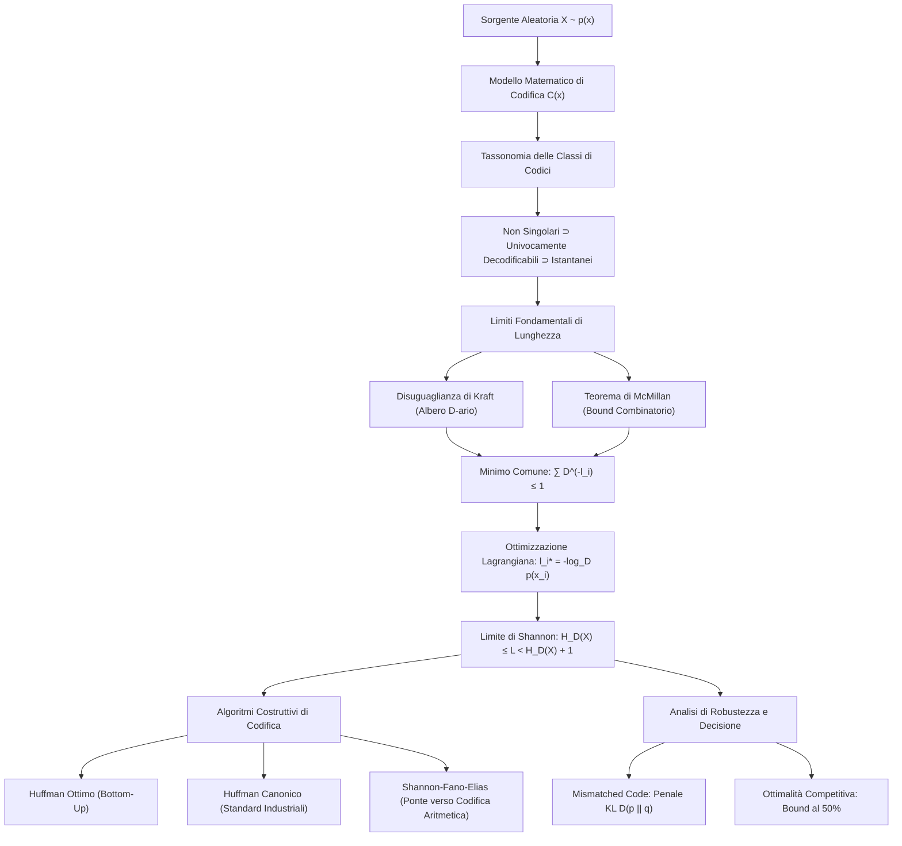

## Modello Matematico Della Codifica Di Sorgente

Consideriamo una sorgente discreta senza memoria (__Discrete Memoryless Source__, DMS) modellata come una variabile aleatoria discreta $X$ definita su un alfabeto finito $\mathcal{X} = \{x_1, x_2, \dots, x_m\}$.

La distribuzione statistica della sorgente è descritta dalla funzione di massa di probabilità (PMF) $p(x) = \text{Pr}\{X = x\}$, con $p(x_i) > 0$ per ciascun indice $i$ e condizione di normalizzazione $\sum_{i=1}^m p(x_i) = 1$.

L'alfabeto di codice $\mathcal{D} = \{0, 1, \dots, D-1\}$ è un insieme discreto di simboli di cardinalità finita $D \ge 2$. Nei sistemi informatici e nelle telecomunicazioni digitali si adotta quasi universalmente l'alfabeto binario con $D = 2$ e $\mathcal{D} = \{0, 1\}$.

Indichiamo con $\mathcal{D}^*$ l'insieme di tutte le sequenze finite (parole o stringhe) ottenute concatenando un numero arbitrario di simboli dell'alfabeto $\mathcal{D}$:

$$
\mathcal{D}^* = \bigcup_{k=1}^\infty \mathcal{D}^k = \mathcal{D} \cup \mathcal{D}^2 \cup \mathcal{D}^3 \cup \dots
$$

### Definizione Formale Di Codice Di Sorgente

Un __codice di sorgente__ $C$ per la variabile aleatoria $X$ è una mappa deterministica che associa a ciascun simbolo dell'alfabeto di sorgente una sequenza finita di simboli di codice:

$$
C: \mathcal{X} \to \mathcal{D}^*
$$

L'immagine $C(x)$ prende il nome di __parola di codice__ (__codeword__) assegnata al simbolo di sorgente $x$.

La __lunghezza__ della parola di codice $C(x)$, misurata come numero di simboli di codice (bit se $D = 2$), è indicata con la notazione scalare $l(x)$ oppure $l_i = l(x_i)$ per $i = 1, \dots, m$.

### Lunghezza Media Attesa Del Codice

La prestazione di un codice di sorgente si misura attraverso la sua __lunghezza media attesa__ $L(C)$, definita come il valore atteso della lunghezza delle parole rispetto alla distribuzione di probabilità della sorgente:

$$
L(C) = \mathbb{E}[l(X)] = \sum_{x \in \mathcal{X}} p(x) l(x) = \sum_{i=1}^m p(x_i) l_i
$$

Il problema fondamentale della compressione senza perdita consiste nel minimizzare $L(C)$ selezionando opportunamente le lunghezze $l_i$, sotto il vincolo inderogabile che il ricevitore possa decodificare ogni sequenza senza equivoci.

## Tassonomia E Classi Fondamentali Di Codici

Non tutte le funzioni di mappa $C: \mathcal{X} \to \mathcal{D}^*$ consentono una decodifica affidabile. Quando trasmettiamo simboli isolati o flussi continui privi di spaziatori, dobbiamo imporre condizioni di invertibilità via via più restrittive.

I codici di sorgente si articolano in quattro classi gerarchiche nidificate.

### Codici Non Singolari

Un codice $C$ si definisce __non singolare__ se assegna parole di codice distinte a simboli di sorgente distinti:

$$
x_i \neq x_j \implies C(x_i) \neq C(x_j)
$$

La non singolarità garantisce l'iniettività della mappa $C$ per singoli simboli isolati. Se un codice fosse singolare (ad esempio $C(x_1) = C(x_2) = 0$), il decodificatore non potrebbe risalire al simbolo emesso nemmeno in assenza di rumore.

Tuttavia, la non singolarità non è sufficiente quando la sorgente emette una sequenza continua di simboli nel tempo.

### Estensione Di Un Codice

Nella trasmissione di flussi continui, la sorgente emette stringhe composte da più simboli $x_{i_1} x_{i_2} \dots x_{i_n} \in \mathcal{X}^*$. L'__estensione di codice__ $C^*$ è la funzione definita dalla concatenazione diretta delle parole di codice corrispondenti:

$$
C^*(x_{i_1} x_{i_2} \dots x_{i_n}) = C(x_{i_1}) C(x_{i_2}) \dots C(x_{i_n}) \in \mathcal{D}^*
$$

### Codici Univocamente Decodificabili

Un codice $C$ si definisce __univocamente decodificabile__ (__uniquely decodable__) se la sua estensione $C^*$ è non singolare su sequenze di lunghezza arbitraria:

$$
\mathbf{x} \neq \mathbf{x}' \implies C^*(\mathbf{x}) \neq C^*(\mathbf{x}')
$$

Nei codici univocamente decodificabili, qualsiasi sequenza di bit concatenata può derivare da una sola sequenza originaria di simboli di sorgente.

Un codice può essere non singolare senza essere univocamente decodificabile. Consideriamo ad esempio l'alfabeto $\mathcal{X} = \{1, 2, 3, 4\}$ con assegnazione:

$$
C(1) = 0, \quad C(2) = 010, \quad C(3) = 01, \quad C(4) = 10
$$

La mappa è iniettiva sui singoli simboli, dunque il codice è non singolare. Tuttavia, ricevendo la sequenza binaria $010$, il decodificatore si trova davanti a un'ambiguità insanabile: la sequenza può rappresentare il singolo simbolo $2$, oppure la coppia $14$ (cioè $0$ seguito da $10$), oppure la coppia $31$ (cioè $01$ seguito da $0$). Il codice non è univocamente decodificabile.

### Codici Istantanei O Codici Prefisso

Un codice $C$ si definisce __istantaneo__ o __codice a prefisso__ (__prefix-free code__) se nessuna parola di codice valida costituisce il prefisso di un'altra parola di codice dello stesso insieme:

$$
\forall i \neq j, \quad C(x_i) \text{ non è prefisso di } C(x_j)
$$

Nei codici istantanei la delimitazione di ciascuna parola è intrinseca: non appena il decodificatore riconosce una sequenza di bit corrispondente a una parola di codice valida, può emettere immediatamente il simbolo decodificato. Non occorre attendere i bit successivi (zero ritardo di decodifica) né inserire caratteri di spaziatura.

### Gerarchia Insiemistica Delle Classi

Le quattro classi formano una catena di inclusioni proprie:

$$
\text{Tutti i Codici} \supset \text{Codici Non Singolari} \supset \text{Codici Univocamente Decodificabili} \supset \text{Codici Istantanei}
$$

![[slide_12_code_classes_venn.png|center mid]]

Ogni codice istantaneo è univocamente decodificabile, ogni codice univocamente decodificabile è non singolare, ma i viceversa non valgono.

### Il Caso Storico Del Codice Morse

Nel codice telegrafico ideato da Samuel Morse, le lettere sono rappresentate da sequenze di punti e linee: la lettera $E$ corrisponde a un punto $(\cdot)$ e la lettera $A$ a un punto seguito da una linea $(\cdot -)$. Poiché la sequenza per $E$ è prefisso esatto di quella per $A$, il codice Morse binario non sarebbe né istantaneo né univocamente decodificabile.

Nella pratica telegrafica il sistema opera in modo affidabile perché introduce una __pausa di silenzio__ tra lettere consecutive e una pausa più lunga tra parole. L'alfabeto di codice reale non è binario ma ternario: $\mathcal{D} = \{\text{punto}, \text{linea}, \text{pausa}\}$, dove la pausa funge da delimitatore esplicito di fine parola.

### Confronto Operativo Tra Le Classi Di Codici

Consideriamo una sorgente a quattro simboli $\mathcal{X} = \{1, 2, 3, 4\}$. La tabella seguente illustra il comportamento delle quattro classi:

| Simbolo | Codice Singolare | Non Singolare, Non UD | Univocamente Decodificabile, Non Istantaneo | Codice Istantaneo (Prefisso) |
| :---: | :---: | :---: | :---: | :---: |
| $1$ | $0$ | $0$ | $10$ | $0$ |
| $2$ | $0$ | $010$ | $00$ | $10$ |
| $3$ | $0$ | $01$ | $11$ | $110$ |
| $4$ | $0$ | $10$ | $110$ | $111$ |

Analizziamo il terzo codice della tabella: la parola $C(3) = 11$ è prefisso di $C(4) = 110$, quindi il codice non è istantaneo. Tuttavia, esso è univocamente decodificabile: se la sequenza inizia per $00$ o $10$, decodifichiamo subito $2$ o $1$. Se invece inizia per $11$, dobbiamo guardare i bit successivi:
- Se segue un $1$, il primo simbolo è certamente $3$ ($11$ seguito da un blocco che inizia per $1$).
- Se segue una serie di zeri terminata da un uno, contiamo gli zeri: un numero dispari individua il simbolo $4$ ($110$ seguito da blocchi che iniziano per $00$ o $10$), mentre un numero pari individua il simbolo $3$ ($11$ seguito da sequenze di $00$).

La decodifica è esatta ma richiede ritardo e ispezione dei bit futuri (__lookahead__). Nel quarto codice, invece, nessuna parola è prefisso di un'altra: la lettura di uno $0$ identifica univocamente $1$, la stringa $10$ identifica $2$, $110$ identifica $3$ e $111$ identifica $4$, istantaneamente e a zero memoria.

## La Disuguaglianza Di Kraft per Codici Istantanei

La richiesta che nessun codice sia prefisso di un altro impone un vincolo geometrico e algebrico stringente sulle lunghezze delle parole: non possiamo assegnare stringhe corte a troppi simboli contemporaneamente. Tale limite è sancito dalla celebre __disuguaglianza di Kraft__ (1949).

### Enunciato Del Teorema Di Kraft

Sia dato un codice istantaneo definito su un alfabeto di codice di dimensione $D$, avente parole di codice con lunghezze intere $l_1, l_2, \dots, l_m$. Allora le lunghezze soddisfano necessariamente la disuguaglianza:

$$
\sum_{i=1}^m D^{-l_i} \le 1
$$

Viceversa, assegnato un qualsiasi insieme di interi positivi $l_1, l_2, \dots, l_m$ che soddisfi tale disuguaglianza, esiste sempre un codice istantaneo su alfabeto $D$-ario con esattamente tali lunghezze di parola.

### Dimostrazione Geometrica Tramite Albero D-ario

Rappresentiamo le parole di codice come nodi all'interno di un albero $D$-ario completo di profondità massima:

$$
l_{\max} = \max_{1 \le i \le m} l_i
$$

La radice dell'albero rappresenta la stringa vuota, i $D$ rami uscenti da ogni nodo rappresentano i simboli dell'alfabeto $\mathcal{D}$, e ciascun nodo a profondità $l$ corrisponde biunivocamente a una sequenza di lunghezza $l$.

Il numero totale di foglie (nodi terminali) al livello massimo $l_{\max}$ è pari a:

$$
N_{\text{foglie}} = D^{l_{\max}}
$$

![[slide_17_kraft_tree.png|center mid]]

Consideriamo ora una parola di codice $C(x_i)$ avente lunghezza $l_i \le l_{\max}$. Essa corrisponde a un nodo collocato a profondità $l_i$.

Affinché il codice sia istantaneo, nessun'altra parola può trovarsi nel sottoalbero generato da tale nodo (altrimenti $C(x_i)$ ne sarebbe prefisso) e tale nodo non può trovarsi nel sottoalbero di una parola già selezionata a profondità inferiore.

La selezione del nodo a profondità $l_i$ __elimina e riserva l'intero sottoalbero discendente__. Il numero di foglie al livello massimo $l_{\max}$ che discendono da tale nodo è pari a:

$$
D^{l_{\max} - l_i}
$$

Poiché nessun nodo di codice può essere discendente di un altro, i sottoalberi riservati dai simboli $i = 1, \dots, m$ sono reciprocamente disgiunti.

La somma delle foglie eliminate da tutte le $m$ parole di codice non può superare la capienza complessiva dell'ultimo livello dell'albero:

$$
\sum_{i=1}^m D^{l_{\max} - l_i} \le D^{l_{\max}}
$$

Raccogliendo il fattore $D^{l_{\max}}$ a primo membro:

$$
D^{l_{\max}} \sum_{i=1}^m D^{-l_i} \le D^{l_{\max}}
$$

Dividendo entrambi i membri per la costante strettamente positiva $D^{l_{\max}}$, otteniamo direttamente la disuguaglianza di Kraft:

$$
\sum_{i=1}^m D^{-l_i} \le 1
$$

### Dimostrazione Della Condizione Sufficiente

Assumiamo che un insieme di interi positivi $\{l_1, l_2, \dots, l_m\}$, ordinati in senso non decrescente ($l_1 \le l_2 \le \dots \le l_m$), soddisfi la condizione $\sum_{i=1}^m D^{-l_i} \le 1$.

Possiamo costruire il codice istantaneo mediante una procedura costruttiva greedy:
1. Al passo $k$, scegliamo un nodo disponibile a profondità $l_k$ che non sia discendente di alcun nodo già assegnato.
2. Tale assegnazione riserva $D^{l_{\max} - l_k}$ foglie al livello massimo $l_{\max}$.
3. Il numero totale di foglie occupate dopo aver assegnato i primi $k-1$ simboli è $\sum_{j=1}^{k-1} D^{l_{\max} - l_j}$.
4. Poiché per ipotesi $\sum_{i=1}^m D^{-l_i} \le 1$, per ciascun indice intermedio $k \le m$ vale:

$$
\sum_{j=1}^{k-1} D^{l_{\max} - l_j} < \sum_{i=1}^m D^{l_{\max} - l_i} \le D^{l_{\max}}
$$

All'ultimo livello rimane sempre almeno una foglia libera. Risalendo l'albero fino a quota $l_k$, troviamo necessariamente un nodo genitore disponibile.

L'algoritmo costruttivo assegna tutti gli $m$ simboli senza conflitti di prefisso, dimostrando la sufficienza della condizione.

### Estensione Ad Alfabeti Numerabili Infiniti

Se l'alfabeto di sorgente è infinito numerabile ($\mathcal{X} = \{x_1, x_2, \dots\}$ con $m \to \infty$), la disuguaglianza di Kraft mantiene la propria validità nella forma di serie convergente:

$$
\sum_{i=1}^\infty D^{-l_i} \le 1
$$

Se la serie diverge o supera l'unità, non può esistere alcun codice istantaneo con tali lunghezze.

## Il Teorema Di McMillan per Codici Univocamente Decodificabili

Sorge spontaneo un quesito ingegneristico fondamentale: se rinunciamo alla decodifica istantanea e ammettiamo un ritardo temporale (utilizzando codici univocamente decodificabili con lookahead), possiamo violare la disuguaglianza di Kraft e ottenere parole di codice più corte?

Il __Teorema di McMillan__ (1956) risponde negativamente: la medesima disuguaglianza governa l'intera classe dei codici univocamente decodificabili.

### Enunciato Del Teorema Di McMillan

Sia $C$ un codice univocamente decodificabile definito su un alfabeto di codice di dimensione $D$, con lunghezze delle parole $l_1, l_2, \dots, l_m$. Allora le lunghezze soddisfano necessariamente la disuguaglianza di Kraft:

$$
\sum_{i=1}^m D^{-l_i} \le 1
$$

### Dimostrazione Algebrica Tramite Bound Combinatorio

Dimostriamo il teorema elevando la sommatoria a una potenza intera arbitraria $k \ge 1$:

$$
\left( \sum_{i=1}^m D^{-l_i} \right)^k = \sum_{i_1=1}^m \sum_{i_2=1}^m \dots \sum_{i_k=1}^m D^{-(l_{i_1} + l_{i_2} + \dots + l_{i_k})}
$$

La somma a secondo membro scorre su tutte le $m^k$ possibili sequenze di $k$ simboli di sorgente.

Raggruppiamo i termini in base alla lunghezza complessiva della sequenza di codice concatenata:

$$
j = \sum_{r=1}^k l_{i_r}
$$

Poiché ogni parola ha lunghezza minima pari a $1$ e massima pari a $l_{\max}$, la lunghezza complessiva $j$ assume valori nell'intervallo discreto:

$$
k \le j \le k l_{\max}
$$

Possiamo quindi riscrivere la potenza $k$-esima raccogliendo i termini con la medesima lunghezza $j$:

$$
\left( \sum_{i=1}^m D^{-l_i} \right)^k = \sum_{j=k}^{k l_{\max}} N_{k, j} D^{-j}
$$

dove $N_{k, j}$ indica il numero esatto di sequenze composte da $k$ simboli di sorgente la cui parola di codice estesa ha lunghezza pari a $j$.

Qui interviene il punto logico cruciale: poiché il codice è univocamente decodificabile per ipotesi, sequenze distinte di $k$ simboli di sorgente devono necessariamente produrre stringhe binarie distinte.

D'altra parte, il numero totale di sequenze distinte di lunghezza $j$ costruibili con un alfabeto di dimensione $D$ è pari a $D^j$. Ne consegue il bound combinatorio:

$$
N_{k, j} \le D^j
$$

Sostituendo questa disuguaglianza nella sommatoria, ciascun termine soddisfa:

$$
N_{k, j} D^{-j} \le D^j D^{-j} = 1
$$

La sommatoria contiene al più $k l_{\max} - k + 1 \le k l_{\max}$ termini, ciascuno limitato superiormente da $1$:

$$
\left( \sum_{i=1}^m D^{-l_i} \right)^k \le \sum_{j=k}^{k l_{\max}} 1 \le k l_{\max}
$$

Estraendo la radice $k$-esima da entrambi i membri:

$$
\sum_{i=1}^m D^{-l_i} \le (k l_{\max})^{1/k}
$$

Poiché la disuguaglianza vale per qualsiasi intero positivo $k$, facciamo tendere $k$ all'infinito:

$$
\lim_{k \to \infty} (k l_{\max})^{1/k} = 1
$$

Otteniamo così in modo inconfutabile:

$$
\sum_{i=1}^m D^{-l_i} \le 1
$$

Per la trattazione analitica estesa e ulteriori note storiche rimandiamo all'[[Anno 1/Information and Estimation Theory/zz. Argomenti extra#Dimostrazione Integrale del Teorema di McMillan per Codici Univocamente Decodificabili|approfondimento analitico di McMillan]].

### Conseguenza Fondamentale: Nessun Vantaggio Dal Ritardo

Poiché i codici istantanei sono un sottoinsieme proprio dei codici univocamente decodificabili, ed entrambe le classi condividono esattamente il medesimo vincolo algebrico $\sum D^{-l_i} \le 1$:

$$
\min_{C \in \text{Univocamente Decodificabili}} L(C) = \min_{C \in \text{Istantanei}} L(C)
$$

Ammettere un ritardo di decodifica o una complessità di parsing retrogrado non consente di guadagnare nemmeno una frazione di bit nella lunghezza media attesa. Ai fini della compressione ottima possiamo quindi restringere l'attenzione esclusivamente ai codici prefissi.

## Lunghezza Media Ottima E Limite Di Shannon

Avendo dimostrato che ogni codice ammissibile deve rispettare il vincolo di Kraft, il problema della progettazione ottima si traduce nel problema di ottimizzazione matematica vincolata:

$$
\min_{l_1, \dots, l_m \in \mathbb{N}^+} \sum_{i=1}^m p_i l_i \quad \text{soggetto a} \quad \sum_{i=1}^m D^{-l_i} \le 1
$$

### Rilassamento Continuo E Ottimizzazione Lagrangiana

Rilassiamo momentaneamente il vincolo di interezza, ammettendo che le lunghezze possano assumere valori reali continui $l_i \in \mathbb{R}^+$.

Poiché la funzione obiettivo è lineare e il vincolo definisce un insieme convesso, l'ottimo si troverà sul bordo del vincolo ($\sum D^{-l_i} = 1$). Formuliamo la funzione Lagrangiana:

$$
\mathcal{L}(l_1, \dots, l_m, \lambda) = \sum_{i=1}^m p_i l_i + \lambda \left( \sum_{i=1}^m D^{-l_i} - 1 \right)
$$

Esprimendo la base $D$ tramite esponenziale naturale $D^{-l_i} = e^{-l_i \ln D}$ e derivando parzialmente rispetto a ciascuna lunghezza $l_i$:

$$
\frac{\partial \mathcal{L}}{\partial l_i} = p_i - \lambda D^{-l_i} \ln D = 0
$$

Risolvendo rispetto al termine esponenziale:

$$
D^{-l_i} = \frac{p_i}{\lambda \ln D}
$$

Sommiamo su tutti gli indici $i = 1, \dots, m$ per imporre la saturazione del vincolo di Kraft:

$$
\sum_{i=1}^m D^{-l_i} = \frac{\sum_{i=1}^m p_i}{\lambda \ln D} = \frac{1}{\lambda \ln D} = 1 \implies \lambda \ln D = 1
$$

Sostituendo il moltiplicatore ottimo $\lambda \ln D = 1$ nella relazione precedente:

$$
D^{-l_i^*} = p_i \iff l_i^* = -\log_D p_i = \log_D \frac{1}{p_i}
$$

Calcoliamo ora la lunghezza media attesa corrispondente alle lunghezze ottime continue:

$$
L^* = \sum_{i=1}^m p_i l_i^* = -\sum_{i=1}^m p_i \log_D p_i = H_D(X)
$$

L'entropia di sorgente $H_D(X)$ costituisce il limite inferiore invalicabile per la lunghezza media attesa di qualsiasi codice di sorgente decodificabile senza ambiguità.

### Distribuzioni Diadiche E Compressione Ideale

Una distribuzione di probabilità si definisce __diadica__ (o $D$-adica) se ogni probabilità è una potenza intera negativa della base dell'alfabeto di codice:

$$
p_i = D^{-k_i}, \quad k_i \in \mathbb{N}^+
$$

Per le distribuzioni $D$-adiche, le lunghezze ottime continue $l_i^* = -\log_D(D^{-k_i}) = k_i$ sono già numeri interi esatti. In questo scenario ideale:
1. La disuguaglianza di Kraft è saturata all'uguaglianza: $\sum D^{-k_i} = \sum p_i = 1$.
2. La lunghezza media attesa del codice prefisso coincide esattamente con l'entropia della sorgente:

$$
L = H_D(X)
$$

Non vi è alcuno spreco di bit, e il codice è perfetto.

### Teorema Del Limite Di Shannon per Sorgenti Generiche

Nelle sorgenti reali le probabilità non sono generalmente potenze negative di $D$, per cui i valori $-\log_D p_i$ non risultano interi.

Per preservare la decodificabilità istantanea garantendo la validità del vincolo di Kraft, Claude Shannon propose di arrotondare ciascuna lunghezza continua all'intero superiore immediato tramite la funzione soffitto (__ceiling__):

$$
l_i = \left\lceil \log_D \frac{1}{p_i} \right\rceil
$$

Tale schema costruttivo prende il nome di __codice di Shannon__.

Verifichiamo che il codice di Shannon soddisfi la disuguaglianza di Kraft:

$$
l_i \ge \log_D \frac{1}{p_i} \implies D^{-l_i} \le D^{-\log_D(1/p_i)} = p_i
$$

Sommando su tutti i simboli della sorgente:

$$
\sum_{i=1}^m D^{-l_i} \le \sum_{i=1}^m p_i = 1
$$

La condizione di Kraft è rigorosamente soddisfatta, assicurando l'esistenza di un codice prefisso avente tali lunghezze.

Dalla definizione della funzione soffitto, ogni lunghezza intera rispetta la doppia disuguaglianza:

$$
\log_D \frac{1}{p_i} \le l_i < \log_D \frac{1}{p_i} + 1
$$

Moltiplichiamo ciascun termine per la probabilità $p_i$ e sommiamo su tutti i simboli $i = 1, \dots, m$:

$$
\sum_{i=1}^m p_i \log_D \frac{1}{p_i} \le \sum_{i=1}^m p_i l_i < \sum_{i=1}^m p_i \log_D \frac{1}{p_i} + \sum_{i=1}^m p_i
$$

Riconoscendo l'entropia $H_D(X)$ a primo membro e ricordando che $\sum p_i = 1$, otteniamo il celebre __Teorema del Limite di Shannon__:

$$
H_D(X) \le L < H_D(X) + 1
$$

Sia $L^*$ la lunghezza media attesa del codice prefisso globalmente ottimo (il codice di Huffman). Poiché il codice di Huffman minimizza la lunghezza media su tutti i codici prefissi e il codice di Shannon è un codice prefisso ammissibile, vale la catena di disuguaglianze:

$$
H_D(X) \le L^* \le L_{\text{Shannon}} < H_D(X) + 1
$$

L'inefficienza dovuta all'arrotondamento all'intero non supera mai $1$ simbolo di codice per simbolo di sorgente ($1$ bit per simbolo se $D = 2$).

### Abbattimento Del Sovraccarico Tramite Codifica a Blocchi

Un sovraccarico fino a $1$ bit/simbolo può risultare inaccettabile quando l'entropia della sorgente è molto bassa (ad esempio se $H(X) = 0.2$ bit/simbolo, pagare $1.2$ bit significa introdurre una ridondanza percentuale del $500\%$).

Per abbattere tale sovraccarico, raggruppiamo la sequenza in blocchi di $n$ simboli consecutivi:

$$
X^n = (X_1, X_2, \dots, X_n) \in \mathcal{X}^n
$$

Trattiamo il vettore $X^n$ come un super-simbolo appartenente all'alfabeto prodotto di cardinalità $m^n$. Applicando il Teorema di Shannon al codice ottimo per il blocco $X^n$:

$$
H_D(X^n) \le L_n^* < H_D(X^n) + 1
$$

Dividendo l'intera disuguaglianza per la dimensione del blocco $n$, la lunghezza media per singolo simbolo di sorgente $L_n^* / n$ soddisfa:

$$
\frac{H_D(X^n)}{n} \le \frac{L_n^*}{n} < \frac{H_D(X^n)}{n} + \frac{1}{n}
$$

Se la sorgente è priva di memoria e identicamente distribuita (i.i.d.), l'entropia congiunta si fattorizza in $H_D(X^n) = n H_D(X)$, per cui:

$$
H_D(X) \le \frac{L_n^*}{n} < H_D(X) + \frac{1}{n}
$$

Facendo tendere la lunghezza del blocco all'infinito:

$$
\lim_{n \to \infty} \frac{L_n^*}{n} = H_D(X)
$$

Se la sorgente presenta memoria statistica ma è stazionaria, per il teorema dell'entropy rate vale $\lim_{n \to \infty} \frac{H(X^n)}{n} = H(\mathcal{X})$, ottenendo:

$$
\lim_{n \to \infty} \frac{L_n^*}{n} = H(\mathcal{X})
$$

La codifica a blocchi consente di avvicinarsi all'entropia con precisione arbitraria, al prezzo di una complessità combinatoria crescente esponenzialmente con la dimensione del blocco ($m^n$).

### Il Costo Della Statistica Errata: Mismatched Code E Divergenza KL

Supponiamo che un progettista ottimizzi un codice prefisso assumendo un modello teorico errato $q(x)$, mentre la realtà fisica della sorgente è governata dalla distribuzione $p(x)$.

Le lunghezze assegnate ai simboli saranno determinate in base al modello presunto:

$$
l_q(x) = \left\lceil \log_2 \frac{1}{q(x)} \right\rceil
$$

Calcoliamo la lunghezza media attesa rispetto alla vera misura di probabilità $p(x)$:

$$
\mathbb{E}_p[l_q(X)] = \sum_{x \in \mathcal{X}} p(x) \left\lceil \log_2 \frac{1}{q(x)} \right\rceil
$$

Sfruttando la delimitazione $\log_2 \frac{1}{q(x)} \le l_q(x) < \log_2 \frac{1}{q(x)} + 1$:

$$
\sum_{x \in \mathcal{X}} p(x) \log_2 \frac{1}{q(x)} \le \mathbb{E}_p[l_q(X)] < \sum_{x \in \mathcal{X}} p(x) \log_2 \frac{1}{q(x)} + 1
$$

Scomponiamo l'argomento logaritmico moltiplicando e dividendo per la vera probabilità $p(x)$:

$$
\log_2 \frac{1}{q(x)} = \log_2 \frac{p(x)}{q(x)} + \log_2 \frac{1}{p(x)}
$$

Moltiplicando per $p(x)$ e sommando su tutto l'alfabeto $\mathcal{X}$:

$$
\sum_{x \in \mathcal{X}} p(x) \log_2 \frac{1}{p(x)} + \sum_{x \in \mathcal{X}} p(x) \log_2 \frac{p(x)}{q(x)} = H(p) + D(p \parallel q)
$$

Ne discende il __Teorema del Codice Mismatched__:

$$
H(p) + D(p \parallel q) \le \mathbb{E}_p[l_q(X)] < H(p) + D(p \parallel q) + 1
$$

Il prezzo esatto, misurato in bit sprecati per simbolo, pagato per aver formulato un modello statistico errato coincide con la __divergenza di Kullback-Leibler__ $D(p \parallel q) \ge 0$. La divergenza KL quantifica l'inefficienza intrinseca di compressione derivante dall'adozione del modello $q$ al posto della realtà $p$.

## Algoritmo Di Huffman Ottimo

Mentre il codice di Shannon assegna lunghezze teoriche $l_i = \lceil \log(1/p_i) \rceil$ senza garantire l'ottimalità globale a blocchi finiti, David Huffman (1952) ideò una procedura deterministica greedy che costruisce il codice prefisso a minima lunghezza media attesa assoluta.

### Procedura Costruttiva Bottom-Up

L'algoritmo di Huffman costruisce l'albero di codice partendo dalle foglie (i simboli meno probabili) e risalendo progressivamente verso la radice:

1. __Ordinamento__: Elenchiamo i simboli della sorgente in ordine decrescente di probabilità.
2. __Fusione (Merge)__: Selezioniamo i due simboli con le probabilità più basse e li fondiamo in un unico super-nodo avente probabilità pari alla somma delle due probabilità.
3. __Ricorsione__: Riordiniamo la lista ridotta di $m-1$ elementi e iteriamo la fusione fino a ottenere un unico nodo radice di probabilità $1.00$.
4. __Backtracking e Assegnazione Bit__: Partendo dalla radice, assegniamo a ciascuna diramazione un bit binario ('0' al ramo superiore, '1' al ramo inferiore). Ripercorrendo l'albero dalla radice alle foglie, ricaviamo le parole di codice definitive.

### Sviluppo Analitico Completo Su Esempio a Cinque Simboli

Consideriamo una sorgente a 5 simboli $\mathcal{X} = \{1, 2, 3, 4, 5\}$ caratterizzata dal seguente vettore di probabilità:

$$
p(1) = 0.25, \quad p(2) = 0.25, \quad p(3) = 0.20, \quad p(4) = 0.15, \quad p(5) = 0.15
$$

![[slide_04_huffman_reduction_example.png|center mid]]

Seguiamo l'evoluzione dell'albero di riduzione passo dopo passo:
1. I due simboli a probabilità minima sono $4$ e $5$ ($p(4) = p(5) = 0.15$). Li fondiamo nel super-nodo $\{4, 5\}$ con probabilità $0.15 + 0.15 = 0.30$.
2. L'insieme ridotto contiene ora $\{1: 0.25, 2: 0.25, 3: 0.20, \{4, 5\}: 0.30\}$. Ordinando in modo decrescente: $\{4, 5\}: 0.30$, $1: 0.25$, $2: 0.25$, $3: 0.20$.
3. I due elementi minimi sono $2$ e $3$. Li fondiamo nel super-nodo $\{2, 3\}$ avente probabilità $0.25 + 0.20 = 0.45$.
4. L'insieme ridotto contiene $\{\{2, 3\}: 0.45, \{4, 5\}: 0.30, 1: 0.25\}$. I due elementi minimi sono $\{4, 5\}$ e $1$. Li fondiamo generando il nodo $\{\{4, 5\}, 1\}$ con probabilità $0.30 + 0.25 = 0.55$.
5. Rimangono due super-nodi: $\{\{4, 5\}, 1\}$ ($0.55$) e $\{2, 3\}$ ($0.45$). La loro fusione finale chiude la radice a probabilità $1.00$.

Ripercorrendo l'albero per l'assegnazione dei bit otteniamo la tabella seguente:

| Simbolo $x$ | Probabilità $p(x)$ | Parola di Codice $C(x)$ | Lunghezza $l(x)$ | Lunghezza Ideale $-\log_2 p(x)$ |
| :---: | :---: | :---: | :---: | :---: |
| $1$ | $0.25$ | $01$ | $2$ bit | $2.00$ bit |
| $2$ | $0.25$ | $10$ | $2$ bit | $2.00$ bit |
| $3$ | $0.20$ | $11$ | $2$ bit | $2.32$ bit |
| $4$ | $0.15$ | $000$ | $3$ bit | $2.74$ bit |
| $5$ | $0.15$ | $001$ | $3$ bit | $2.74$ bit |

Calcoliamo la lunghezza media attesa del codice di Huffman:

$$
L(C_{\text{Huff}}) = 0.25(2) + 0.25(2) + 0.20(2) + 0.15(3) + 0.15(3) = 0.50 + 0.50 + 0.40 + 0.45 + 0.45 = 2.30 \quad \text{bit}
$$

Calcoliamo l'entropia di Shannon della sorgente:

$$
H(X) = 2(0.25 \log_2 4) + 0.20 \log_2 5 + 2\left(0.15 \log_2 \frac{1}{0.15}\right) \approx 2(0.50) + 0.20(2.3219) + 0.30(2.7370) \approx 2.2855 \quad \text{bit}
$$

La ridondanza del codice di Huffman è trascurabile:

$$
R = L(C_{\text{Huff}}) - H(X) = 2.30 - 2.2855 = 0.0145 \quad \text{bit/simbolo}
$$

L'efficienza di compressione raggiunge:

$$
\eta = \frac{H(X)}{L(C_{\text{Huff}})} = \frac{2.2855}{2.30} \approx 99.37\%
$$

### Codici Di Huffman D-ari E Calcolo Dei Simboli Dummy

Quando l'alfabeto di codice ha cardinalità $D > 2$ (ad esempio ternario con $D = 3$), a ciascun passo di riduzione dobbiamo fondere $D$ nodi anziché $2$.

A ogni fusione, il numero totale di elementi si riduce esattamente di $D - 1$:

$$
m_{\text{nuovo}} = m_{\text{vecchio}} - (D - 1)
$$

Affinché l'albero si chiuda perfettamente su un unico nodo radice dopo un numero intero $k$ di aggregazioni successive, la dimensione iniziale dell'alfabeto deve soddisfare la congruenza modulare:

$$
m = 1 + k(D - 1) \iff m \equiv 1 \pmod{D - 1}
$$

Se la dimensione originaria $m$ non soddisfa tale condizione, all'ultimo passo di riduzione rimarrebbero meno di $D$ rami (tra $2$ e $D-1$), generando una biforcazione incompleta alla radice che viola la compattezza ottima dell'albero.

Risolviamo il problema aggiungendo $m_{\text{dummy}}$ __simboli fittizi__ (__dummy symbols__) aventi probabilità rigorosamente nulla ($p_{\text{dummy}} = 0$). Il numero di simboli dummy necessari è dato dalla formula analitica:

$$
m_{\text{dummy}} = [-(m - 1)] \bmod (D - 1) = \begin{cases} 0 & \text{se } (m - 1) \bmod (D - 1) = 0 \\ (D - 1) - [(m - 1) \bmod (D - 1)] & \text{altrimenti} \end{cases}
$$

I simboli fittizi vengono collocati in fondo alla lista ordinata e assorbiti immediatamente nella primissima fusione, garantendo la perfetta simmetria dell'albero $D$-ario.

### Dimostrazione Di Ottimalità Tramite Forma Canonica

L'ottimalità globale dell'algoritmo di Huffman poggia sulle tre proprietà necessarie di un codice prefisso ottimo in forma canonica:
1. __Inversione dell'ordine__: se $p_j > p_k$, allora $l_j \le l_k$ (simboli più frequenti hanno parole non più lunghe).
2. __Parità di lunghezza minima__: i due simboli a probabilità minima hanno la medesima lunghezza massima: $l_{m-1} = l_m$.
3. __Gemellaggio__: i due simboli a probabilità minima differiscono solo per l'ultimo bit, ossia condividono lo stesso nodo genitore nell'albero di codice.

Dimostriamo l'ottimalità per induzione matematica sul numero di simboli $m$.

Per la base induttiva $m = 2$, l'unico codice prefisso ammissibile assegna un singolo bit a ciascun simbolo ($l_1 = l_2 = 1$). La lunghezza media è $L = 1$, che coincide con la costruzione di Huffman.

Assumiamo ora come ipotesi induttiva che l'algoritmo di Huffman sia ottimo per qualsiasi sorgente con $m - 1$ simboli.

Consideriamo una sorgente a $m$ simboli e sia $C_m$ il codice generato da Huffman. La fusione dei due simboli minimi $m-1$ e $m$ in un super-simbolo aggregato genera una sorgente ridotta a $m-1$ simboli con codice $C_{m-1}$.

Esprimiamo la lunghezza media di $C_m$ in funzione di quella di $C_{m-1}$:

$$
L(C_m) = \sum_{i=1}^{m-2} p_i l_i + p_{m-1} l_{m-1} + p_m l_m
$$

Poiché $l_{m-1} = l_m = l_{\text{super}} + 1$:

$$
L(C_m) = \sum_{i=1}^{m-2} p_i l_i + (p_{m-1} + p_m)(l_{\text{super}} + 1) = L(C_{m-1}) + p_{m-1} + p_m
$$

Sia ora $C_m^*$ un codice prefisso ipoteticamente ottimo a $m$ simboli. Senza perdita di generalità, possiamo riorganizzare $C_m^*$ in modo che i due simboli minimi siano fratelli a profondità massima. Fondendoli, otteniamo un codice prefisso ammissibile $C_{m-1}^*$ per la sorgente ridotta, per cui vale analogamente:

$$
L(C_m^*) = L(C_{m-1}^*) + p_{m-1} + p_m
$$

Sottraendo membro a membro le due relazioni:

$$
L(C_m) - L(C_m^*) = L(C_{m-1}) - L(C_{m-1}^*)
$$

Per ipotesi induttiva, Huffman è globalmente ottimo per alfabeti di $m-1$ simboli, dunque $L(C_{m-1}) \le L(C_{m-1}^*)$, da cui $L(C_{m-1}) - L(C_{m-1}^*) \le 0$.

D'altra parte, per definizione di codice ottimo su $m$ simboli, deve valere $L(C_m^*) \le L(C_m)$, ossia $L(C_m) - L(C_m^*) \ge 0$.

L'unica condizione compatibile è l'identità a somma zero:

$$
L(C_m) - L(C_m^*) = 0 \iff L(C_m) = L(C_m^*)
$$

Il codice di Huffman è rigorosamente ottimo per ogni $m$. Per i dettagli completi si veda la [[Anno 1/Information and Estimation Theory/zz. Argomenti extra#Dimostrazione Formale del Teorema di Ottimalità dei Codici di Huffman tramite Riduzione Canonica|dimostrazione formale di ottimalità di Huffman]].

## Codici Di Huffman Canonici E Standard Industriali

In un'applicazione ingegneristica reale (come la decompressione di un archivio ZIP o la riproduzione di un flusso JPEG), trasmettere l'albero di Huffman esplicito comporterebbe un overhead di metadati inaccettabile: salvare la topologia dei nodi e i puntatori per un alfabeto di $256$ byte richiederebbe svariate centinaia di byte aggiuntivi.

I __Codici di Huffman Canonici__ risolvono il problema alla radice standardizzando l'assegnazione delle parole di codice a partire dalla sola conoscenza della lista ordinata delle lunghezze $\{l_1, l_2, \dots, l_m\}$.

### Il Problema dell'Overhead Dei Metadati

Un albero di Huffman non è univoco: a ogni fusione possiamo scambiare arbitrariamente l'assegnazione dello '0' e dell' '1' sui due rami, generando decine di codici equivalenti con la medesima lunghezza media $L$.

Nei sistemi industriali vogliamo eliminare questa ambiguità imponendo una convenzione deterministica universale nota sia al codificatore sia al decodificatore.

### Algoritmo Deterministico Di Assegnazione Canonica

L'algoritmo di canonizzazione opera secondo due regole fondamentali:

1. __Ordinamento Primario e Secondario__: Ordiniamo i simboli primariamente per lunghezza di parola crescente ($l_i \le l_{i+1}$) e secondariamente per ordine lessicografico naturale per simboli aventi la medesima lunghezza.
2. __Assegnazione del Primo Codice__: Alla prima parola (la più corta in assoluto) assegniamo una sequenza interamente formata da $l_1$ zeri:

$$
C(x_1) = 00\dots0_2 \quad (V_1 = 0)
$$

3. __Regola di Avanzamento Sequenziale__: Per calcolare la parola successiva $C(x_{i+1})$ avente lunghezza $l_{i+1}$:
   - Se la lunghezza non cambia ($l_{i+1} = l_i$), incrementiamo di un'unità il valore intero binario:

$$
V_{i+1} = V_i + 1
$$

   - Se la lunghezza aumenta ($l_{i+1} > l_i$), incrementiamo prima di uno il valore precedente e poi eseguiamo uno shift a sinistra di $l_{i+1} - l_i$ posizioni binarie, accodando $l_{i+1} - l_i$ zeri:

$$
V_{i+1} = (V_i + 1) \ll (l_{i+1} - l_i) = (V_i + 1) \cdot 2^{l_{i+1} - l_i}
$$

Lo shift a sinistra garantisce che il nuovo valore occupi un sottoalbero distinto e che nessuna parola precedente possa diventarne prefisso.

### Generazione Dettagliata Del Codebook Canonico

Applichiamo la procedura al vettore delle lunghezze ricavato nell'esempio a 5 simboli: $l = [2, 2, 2, 3, 3]$.

1. Simbolo $x_1$ ($l_1 = 2$): assegniamo $2$ zeri $\implies C(x_1) = 00_2$ ($V_1 = 0$).
2. Simbolo $x_2$ ($l_2 = 2$): stessa lunghezza $\implies V_2 = V_1 + 1 = 1 \implies C(x_2) = 01_2$.
3. Simbolo $x_3$ ($l_3 = 2$): stessa lunghezza $\implies V_3 = V_2 + 1 = 2 \implies C(x_3) = 10_2$.
4. Simbolo $x_4$ ($l_4 = 3$): salto di lunghezza ($l_4 - l_3 = 1$ bit) $\implies V_4 = (V_3 + 1) \ll 1 = (2 + 1) \ll 1 = 6 \implies C(x_4) = 110_2$.
5. Simbolo $x_5$ ($l_5 = 3$): stessa lunghezza $\implies V_5 = V_4 + 1 = 7 \implies C(x_5) = 111_2$.

Il diagramma vettoriale seguente illustra il flusso deterministico di generazione:

![[huffman_canonical_codebook.svg|center mid]]

### Vantaggi Hardware E Implementazioni Nei Formati Reali

Questa formulazione offre vantaggi ingegneristici straordinari:
- __Minimo overhead nel file compresso__: il trasmettitore non deve inviare l'albero né le parole di codice; è sufficiente trasmettere il conteggio di quante parole esistono per ciascuna lunghezza. Per un alfabeto di $256$ byte bastano poche decine di byte di header.
- __Decodifica hardware istantanea__: il ricevitore memorizza unicamente due array compatti (`base_code[len]` e `symbol_offset[len]`). La decodifica si riduce a un semplice confronto numerico e a un accesso indicizzato in tabella (__lookup table__), senza alcun puntatore ad albero in memoria RAM.
- __Standard industriali__: i codici canonici di Huffman costituiscono il nucleo di compressione di formati universali come __Deflate (ZIP, gzip, zlib)__, __PNG__, __JPEG__, __MP3__ e __Brotli__.

## Equivalenza Con Il Gioco Delle Venti Domande

Un'elegante interpretazione della codifica di sorgente risiede nella sua equivalenza formale con il gioco logico delle "20 Domande", in cui un giocatore deve identificare un oggetto incognito $X \sim p(x)$ formulando domande binarie a risposta esclusiva (Sì / No).

### Strategia Ottima Con Domande Binarie Libere

Sia $Q$ il numero di domande necessarie per individuare con certezza l'oggetto $X$. Ogni domanda corrisponde a partizionare lo spazio $\mathcal{X}$ in due insiemi complementari $A$ e $A^c$, chiedendo «$X \in A$ ?».

Se il giocatore può scegliere arbitrariamente i sottoinsiemi $A$:
- La sequenza delle risposte Sì ($1$) e No ($0$) corrisponde a un cammino su un albero binario prefisso le cui foglie sono i singoli oggetti di $\mathcal{X}$.
- Il numero di domande formulate per identificare l'oggetto $x$ coincide con la profondità della foglia, ossia la lunghezza della parola $l(x)$.
- Il numero medio atteso di domande coincide con la lunghezza media attesa del codice:

$$
\mathbb{E}[Q] = \sum_{x \in \mathcal{X}} p(x) l(x) = L(C)
$$

- La strategia di interrogazione che minimizza il numero medio di quesiti è esattamente l'__algoritmo di Huffman__.
- Il numero medio di domande è delimitato inferiormente e superiormente dall'entropia di Shannon:

$$
H(X) \le \mathbb{E}[Q_{\text{ottimo}}] < H(X) + 1
$$

### Domande Vincolate all'Ordine E Codici a Fetta

Consideriamo ora una variante in cui gli elementi di $\mathcal{X} = \{1, 2, \dots, m\}$ possiedono un ordinamento intrinseco e le uniche domande ammissibili sono della forma «$X > a$ ?» per una data soglia $a$ (__slice questions__ o domande a fetta).

Si distinguono due scenari fondamentali:

1. __Ordinamento per probabilità decrescente ($p_1 \ge p_2 \ge \dots \ge p_m$)__:
   - Se preleviamo il vettore delle lunghezze ottime di Huffman ordinate $l_1 \le l_2 \le \dots \le l_m$ e assegniamo le parole ordinatamente da sinistra a destra sull'albero, ogni bit partiziona lo spazio in insiemi contigui del tipo $\{x : x \le a\}$ e $\{x : x > a\}$.
   - Le lunghezze rimangono identiche a quelle del codice di Huffman originario:

$$
L_{\text{slice}} = L_{\text{Huff}} = 2.30 \quad \text{bit}
$$

   Il codice a fette è contemporaneamente alfabetico e globalmente ottimo.

2. __Ordinamento lessicografico arbitrario indipendente dalle probabilità__:
   - Se l'alfabeto possiede un ordine alfabetico fisso in cui le probabilità non sono monotone, l'albero di Huffman standard non può essere riordinato senza alterare le lunghezze.
   - Il codice ottimo che rispetta il vincolo d'ordine (albero binario di ricerca ottimo) viene ricavato mediante algoritmi dedicati, quali l'__algoritmo di Hu-Tucker__ o di __Gilbert-Moore__.
   - In questo scenario generale, la lunghezza media soddisfa la delimitazione:

$$
H(X) \le L_{\text{alfabetico}} < H(X) + 2
$$

Il vincolo d'ordine costa al più $1$ bit aggiuntivo rispetto a Huffman.

## Confronto Prestazionale: Shannon, Fano E Huffman

Prima dell'algoritmo di Huffman, Claude Shannon (1948) e Robert Fano (1949) avevano proposto due approcci indipendenti di codifica a prefisso.

### Filosofie Algoritmiche a Confronto

- __Codice di Shannon (Analitico Diretto)__: calcola le lunghezze $l_i = \lceil \log_2(1/p_i) \rceil$ a partire dalle probabilità cumulative. Garantisce la decodificabilità prefissa e la convergenza asintotica a blocchi, ma su singoli simboli è spesso sub-ottimo.
- __Codice di Fano (Top-Down Greedy)__: ordina i simboli per probabilità decrescente e li partiziona ricorsivamente in due sottoinsiemi contigui di massa probabilistica il più vicina possibile a $0.5$. Assegna il bit '0' al primo gruppo e '1' al secondo, procedendo dall'alto verso il basso.
- __Codice di Huffman (Bottom-Up Esatto)__: fonde i nodi minimi dal basso verso l'alto, garantendo l'ottimalità globale matematica.

### Il Controesempio Di Cover E Thomas: Sub-Ottimalità Di Fano

L'approccio greedy top-down di Fano è intuitivo ma soffre di miopia algoritmica: una decisione localmente ottima alla radice può vincolare le partizioni successive a configurazioni complessivamente inefficienti.

Thomas Cover e Joy Thomas illustrano questa discrepanza tramite una celebre distribuzione a 5 simboli (Esempio 5.5.1):

| Simbolo $x$ | Probabilità $p(x)$ | Codice di Fano | Lunghezza $l_F(x)$ | Codice di Huffman | Lunghezza $l_H(x)$ |
| :---: | :---: | :---: | :---: | :---: | :---: |
| $1$ | $0.35$ | $00$ | $2$ bit | $0$ | $1$ bit |
| $2$ | $0.17$ | $01$ | $2$ bit | $100$ | $3$ bit |
| $3$ | $0.17$ | $10$ | $2$ bit | $101$ | $3$ bit |
| $4$ | $0.16$ | $110$ | $3$ bit | $110$ | $3$ bit |
| $5$ | $0.15$ | $111$ | $3$ bit | $111$ | $3$ bit |

Esaminiamo le scelte compiute dai due algoritmi:

1. __Costruzione di Fano__:
   - Alla prima bipartizione, l'algoritmo confronta la separazione $\{1\}$ ($0.35$) vs $\{2, 3, 4, 5\}$ ($0.65$), scarto $|0.35 - 0.65| = 0.30$, con la separazione $\{1, 2\}$ ($0.52$) vs $\{3, 4, 5\}$ ($0.48$), scarto $|0.52 - 0.48| = 0.04$.
   - Fano sceglie avidamente la seconda partizione, assegnando il prefisso '0' a $\{1, 2\}$ e '1' a $\{3, 4, 5\}$.
   - Le suddivisioni successive producono le lunghezze $\{2, 2, 2, 3, 3\}$.
   - Calcolo della lunghezza media di Fano:

$$
L_{\text{Fano}} = 0.35(2) + 0.17(2) + 0.17(2) + 0.16(3) + 0.15(3) = 0.70 + 0.34 + 0.34 + 0.48 + 0.45 = 2.31 \quad \text{bit}
$$

2. __Costruzione di Huffman__:
   - Fonde dal basso i simboli $4$ e $5$: $0.16 + 0.15 = 0.31$.
   - Fonde i simboli $2$ e $3$: $0.17 + 0.17 = 0.34$.
   - Fonde i due super-nodi: $0.34 + 0.31 = 0.65$.
   - Fusione finale alla radice: il simbolo più frequente $1$ ($0.35$) si unisce con il super-nodo ($0.65$).
   - Al simbolo $1$ viene assegnata una parola di un solo bit ('0'), mentre agli altri quattro simboli è assegnata una parola di $3$ bit.
   - Calcolo della lunghezza media di Huffman:

$$
L_{\text{Huff}} = 0.35(1) + (0.17 + 0.17 + 0.16 + 0.15) \cdot 3 = 0.35 + 3(0.65) = 2.30 \quad \text{bit}
$$

Il confronto numerico dimostra in modo inconfutabile la stretta sub-ottimalità di Fano:

$$
L_{\text{Huff}} = 2.30 \quad \text{bit} < L_{\text{Fano}} = 2.31 \quad \text{bit}
$$

## Codifica Di Shannon-Fano-Elias E Fondamenti Della Codifica Aritmetica

La codifica di __Shannon-Fano-Elias__ riveste un'importanza concettuale primaria perché stabilisce il legame matematico diretto tra la codifica a simboli discreti e la moderna __codifica aritmetica__.

### Funzione Di Ripartizione Cumulativa Modificata

Sia $\mathcal{X} = \{1, 2, \dots, m\}$ un alfabeto discreto ordinato con probabilità $p(x) > 0$. Definiamo la funzione di distribuzione cumulativa (CDF):

$$
F(x) = \sum_{a=1}^x p(a)
$$

con la convenzione iniziale $F(0) = 0$.

La funzione $F(x)$ definisce gradini discreti di ampiezza $p(x)$ nell'intervallo $[0, 1]$. Peter Elias propose di utilizzare il __punto medio__ di ciascun gradino, introducendo la funzione cumulativa modificata:

$$
\bar{F}(x) = \sum_{a=1}^{x-1} p(a) + \frac{1}{2} p(x) = F(x-1) + \frac{1}{2} p(x)
$$

Poiché $p(x) > 0$, i punti medi di simboli distinti sono rigorosamente separati:

$$
x \neq y \implies \bar{F}(x) \neq \bar{F}(y)
$$

Il numero reale $\bar{F}(x) \in [0, 1)$ identifica univocamente il simbolo $x$.

![[slide_28_shannon_fano_elias_interval.png|center mid]]

### Troncamento Binario Ed Estrazione Della Codeword

Essendo un numero reale continuo in $[0, 1)$, $\bar{F}(x)$ richiederebbe in linea di principio un numero infinito di bit. Per ricavare una parola finita, consideriamo il suo sviluppo binario:

$$
\bar{F}(x) = 0.b_1 b_2 b_3 \dots = \sum_{i=1}^\infty b_i 2^{-i}
$$

Definiamo il troncamento di $\bar{F}(x)$ a $l(x)$ bit:

$$
\lfloor \bar{F}(x) \rfloor_{l(x)} = 0.b_1 b_2 \dots b_{l(x)} = \sum_{i=1}^{l(x)} b_i 2^{-i}
$$

La sequenza finita di bit $b_1 b_2 \dots b_{l(x)}$ costituisce la parola di codice $C(x)$.

### Dimostrazione Rigorosa Della Proprietà Prefissa

Scegliendo come lunghezza di troncamento:

$$
l(x) = \left\lceil \log_2 \frac{1}{p(x)} \right\rceil + 1
$$

il codice di Shannon-Fano-Elias risulta rigorosamente __istantaneo (prefisso)__.

Dimostriamo questa proprietà fondamentale. Dalla scelta di $l(x)$:

$$
l(x) \ge \log_2 \frac{1}{p(x)} + 1 \implies 2^{-l(x)} \le 2^{-(\log_2(1/p(x)) + 1)} = \frac{p(x)}{2}
$$

D'altra parte, per le proprietà elementari dello sviluppo binario, l'errore commesso trascurando i bit successivi a $l(x)$ è strettamente delimitato:

$$
\bar{F}(x) - \lfloor \bar{F}(x) \rfloor_{l(x)} = \sum_{i=l(x)+1}^\infty b_i 2^{-i} < 2^{-l(x)} \le \frac{p(x)}{2}
$$

Associamo al troncamento l'intervallo diadico semiaperto:

$$
I(x) = \left[ \lfloor \bar{F}(x) \rfloor_{l(x)}, \, \lfloor \bar{F}(x) \rfloor_{l(x)} + 2^{-l(x)} \right)
$$

L'intervallo $I(x)$ ha ampiezza $2^{-l(x)} \le p(x)/2$ e contiene il punto medio $\bar{F}(x)$. Poiché per definizione $\bar{F}(x) = F(x-1) + \frac{1}{2}p(x)$ dista esattamente $p(x)/2$ da entrambi gli estremi del gradino $[F(x-1), F(x))$, l'intero intervallo diadico $I(x)$ cade strettamente all'interno del gradino:

$$
I(x) \subset [F(x-1), F(x))
$$

Poiché i gradini associati a simboli differenti sono mutuamente disgiunti, anche gli intervalli diadici $I(x)$ e $I(y)$ per $x \neq y$ sono disgiunti.

Nessun intervallo diadico può contenerne un altro. In termini di stringhe binarie, ciò implica che nessuna sequenza troncata può essere prefisso di un'altra. Il codice è rigorosamente prefisso.

### Delimitazione Della Lunghezza Media Attesa

Calcoliamo il valore atteso della lunghezza del codice di Shannon-Fano-Elias:

$$
L_{\text{SFE}} = \sum_{x \in \mathcal{X}} p(x) l(x) = \sum_{x \in \mathcal{X}} p(x) \left( \left\lceil \log_2 \frac{1}{p(x)} \right\rceil + 1 \right)
$$

Applicando la disuguaglianza $\lceil z \rceil < z + 1$:

$$
l(x) < \log_2 \frac{1}{p(x)} + 2
$$

Moltiplicando per $p(x)$ e sommando su tutti i simboli:

$$
L_{\text{SFE}} < \sum_{x \in \mathcal{X}} p(x) \log_2 \frac{1}{p(x)} + 2 \sum_{x \in \mathcal{X}} p(x) = H(X) + 2 \quad \text{bit}
$$

D'altra parte, poiché $l(x) \ge \log_2(1/p(x)) + 1$:

$$
H(X) + 1 \le L_{\text{SFE}} < H(X) + 2
$$

Il codice di Shannon-Fano-Elias richiede tra $1$ e $2$ bit in più rispetto all'entropia teorica della sorgente.

### Connessione Architetturale Con la Codifica Aritmetica

La codifica di Shannon-Fano-Elias paga un prezzo di circa $1$ bit di sovraccarico in più rispetto a Huffman sul singolo simbolo. Tuttavia, essa presenta un vantaggio concettuale decisivo: non richiede la costruzione di alberi combinatori.

Quando la applichiamo a una sequenza di $n$ simboli consecutivi, l'intervallo $[0, 1)$ viene suddiviso ricorsivamente moltiplicando le probabilità condizionate dei simboli in arrivo. Al termine della sequenza, è sufficiente trasmettere i bit corrispondenti al punto medio dell'intervallo finale.

Il sovraccarico di $2$ bit viene così spalmato sull'intera sequenza di $n$ simboli, riducendo l'overhead a soli $2/n$ bit per simbolo. Questo principio costituisce il fondamento matematico diretto della __Codifica Aritmetica__, impiegata nei moderni standard di compressione video (H.264/AVC, H.265/HEVC tramite CABAC) e immagini (JPEG 2000, JPEG XL).

## Teorema sull'Ottimalità Competitiva Della Codifica Di Sorgente

La formulazione classica di ottimalità mira a minimizzare la lunghezza media attesa:

$$
C^* = \arg\min_C \mathbb{E}[l_C(X)]
$$

Tuttavia, in uno scenario di teoria dei giochi o di decisione competitiva, possiamo porci una domanda più profonda: _un codice concorrente $C'$ potrebbe risultare migliore del codice di Shannon o di Huffman nella maggioranza delle trasmissioni individuali, pagando una media peggiore solo a causa di parole molto lunghe assegnate a eventi rarissimi?_

Il __Teorema dell'Ottimalità Competitiva__ (Thomas Cover e Joy Thomas, Sez. 5.10) dimostra che ciò è matematicamente impossibile: il codice ottimo domina stocasticamente qualsiasi concorrente anche nel confronto a coppie.

### Il Modello Del Gioco a Somma Zero Tra Codificatori

Consideriamo due progettisti che competono per codificare la medesima variabile aleatoria $X \sim p(x)$. Il primo giocatore assegna le lunghezze $l(x)$ previste dal codice di Shannon, mentre il secondo adotta un qualsiasi codice alternativo univocamente decodificabile con lunghezze $l'(x)$.

A ogni estrazione del simbolo $X$, definiamo il payoff $W$ per il codice di Shannon come:

$$
W = \begin{cases} +1 & \text{se } l(X) < l'(X) \quad (\text{Shannon vince}) \\ 0 & \text{se } l(X) = l'(X) \quad (\text{Parità}) \\ -1 & \text{se } l(X) > l'(X) \quad (\text{Shannon perde}) \end{cases}
$$

### Enunciato E Dimostrazione Del Teorema Di Cover E Thomas

Sia $l(x) = \lceil \log_2(1/p(x)) \rceil$ la lunghezza assegnata dal codice di Shannon per una distribuzione $p(x)$, e sia $l'(x)$ la lunghezza assegnata da un qualsiasi codice concorrente univocamente decodificabile.

Per ogni intero $c \ge 1$, la probabilità che il codice concorrente batta il codice di Shannon di almeno $c$ bit decade esponenzialmente:

$$
\text{Pr}\{l(X) \ge l'(X) + c\} \le \frac{1}{2^{c-1}}
$$

Dimostriamo il teorema in modo rigoroso. Definiamo l'insieme dei simboli per cui il codice concorrente supera il codice di Shannon di almeno $c$ bit:

$$
S = \{x \in \mathcal{X} : l(x) - l'(x) \ge c\}
$$

Dalla definizione della funzione soffitto nel codice di Shannon, abbiamo:

$$
l(x) < \log_2 \frac{1}{p(x)} + 1 \iff 2^{l(x) - 1} < \frac{1}{p(x)} \iff p(x) < 2^{-(l(x) - 1)} = 2 \cdot 2^{-l(x)}
$$

Per ogni simbolo $x \in S$, vale la condizione $l(x) \ge l'(x) + c$, da cui $-l(x) \le -l'(x) - c$. Sostituendo nella disequazione precedente:

$$
p(x) < 2 \cdot 2^{-l'(x) - c} = 2^{-(c-1)} 2^{-l'(x)}
$$

Sommiamo ora le probabilità su tutti gli elementi dell'insieme critico $S$:

$$
\text{Pr}\{l(X) - l'(X) \ge c\} = \sum_{x \in S} p(x) < 2^{-(c-1)} \sum_{x \in S} 2^{-l'(x)} \le 2^{-(c-1)} \sum_{x \in \mathcal{X}} 2^{-l'(x)}
$$

Poiché il codice alternativo $l'$ è univocamente decodificabile per ipotesi, esso deve rispettare la disuguaglianza di McMillan: $\sum_{x \in \mathcal{X}} 2^{-l'(x)} \le 1$.

Sostituendo questo limite superiore unitario:

$$
\text{Pr}\{l(X) \ge l'(X) + c\} \le 2^{-(c-1)}
$$

La disuguaglianza è pienamente dimostrata. Per ulteriori dettagli e generalizzazioni si veda la sezione dedicata in [[Anno 1/Information and Estimation Theory/zz. Argomenti extra#Teorema sull'Ottimalità Competitiva della Codifica di Shannon e Huffman|approfondimento sull'ottimalità competitiva]].

### Conseguenze Operative: Bound Al Cinquanta Percento E Payoff Atteso

Questo risultato comporta conseguenze decisive:

1. __Bound al 50% per $c = 2$__: ponendo $c = 2$ nella disuguaglianza:

$$
\text{Pr}\{l(X) - l'(X) \ge 2\} \le \frac{1}{2^{2-1}} = \frac{1}{2}
$$

Nessun codice al mondo può superare il codice di Shannon di $2$ o più bit per più del $50\%$ delle trasmissioni.
2. __Decadimento Esponenziale__: per margini maggiori la probabilità crolla: un codice alternativo può vincere con un vantaggio di $c = 5$ bit in meno di $2^{-(5-1)} = 1/16$ dei casi ($6.25\%$), e di $c = 10$ bit in meno dello $0.2\%$.
3. __Dominanza Stocastica a Coppie__: considerando il confronto globale tra vittoria e sconfitta:

$$
\text{Pr}\{l(X) < l'(X)\} \ge \text{Pr}\{l(X) > l'(X)\}
$$

Il codice di Shannon (e a maggior ragione il codice globalmente ottimo di Huffman) garantisce che la probabilità di vincere sia sempre maggiore o uguale alla probabilità di perdere contro qualsiasi avversario, assicurando un payoff medio atteso intrinsecamente non negativo:

$$
\mathbb{E}[W] \ge 0
$$

Ottimizzare la media attesa $\mathbb{E}[L]$ non espone a rischi occulti nella stragrande maggioranza delle realizzazioni individuali.

## Quadro Sinottico Comparativo Dei Metodi Di Codifica

La tabella seguente riassume le caratteristiche matematiche, algoritmiche e prestazionali degli schemi di codifica senza perdita analizzati nel capitolo:

| Metodo di Codifica | Filosofia Costruttiva | Assegnazione Lunghezze $l(x)$ | Delimitazione Lunghezza Media $L$ | Grado di Ottimalità | Standard e Applicazioni |
| :--- | :--- | :--- | :--- | :--- | :--- |
| __Codice di Shannon (1948)__ | Assegnazione analitica diretta | $l(x) = \lceil \log_D(1/p(x)) \rceil$ | $H_D(X) \le L < H_D(X) + 1$ | Sub-ottimo a blocchi finiti; asintotico per $n \to \infty$ | Dimostrazioni teoriche, teoremi limite |
| __Codice di Fano (1949)__ | Top-down greedy per bisezione di probabilità | Bipartizione ricorsiva con $p(A) \approx p(B)$ | $H(X) \le L < H(X) + 2$ | Sub-ottimo (decisioni top-down irreversibili) | Primi protocolli telematici, architetture storiche |
| __Codice di Huffman (1952)__ | Bottom-up esatto tramite fusione nodi minimi | Topologia dell'albero binario/D-ario | $H_D(X) \le L^* < H_D(X) + 1$ | __Ottimo Assoluto__ su blocchi a cardinalità fissa | Compressione generica, archivi ZIP, gzip |
| __Huffman Canonico__ | Generazione deterministica lessicografica | Dal solo vettore delle lunghezze $\{l_i\}$ | Coincide esattamente con Huffman | Ottimo con trasmissione minima dei metadati | __Deflate (ZIP, gzip)__, __JPEG__, __PNG__, __MP3__, __Brotli__ |
| __Shannon-Fano-Elias__ | Troncamento binario del punto medio CDF | $l(x) = \lceil \log_2(1/p(x)) \rceil + 1$ | $H(X) + 1 \le L < H(X) + 2$ | Sub-ottimo per singoli simboli (+2 bit) | Fondamento teorico della __Codifica Aritmetica__ |
| __Codifica a Blocchi ($n$-estesa)__ | Huffman applicato a super-simboli $\mathcal{X}^n$ | Lunghezze ottime su alfabeto $\mathcal{X}^n$ | $H(\mathcal{X}) \le \frac{L_n^*}{n} < H(\mathcal{X}) + \frac{1}{n}$ | Asintoticamente convergente all'entropy rate | Compressione testi naturali, fax, immagini |


# B. Capacità Di Canale E Teorema Di Shannon

La trasmissione affidabile di flussi informativi attraverso mezzi fisici reali costituisce il cuore teorico e applicativo delle telecomunicazioni e dell'ingegneria dell'informazione. Qualsiasi canale materiale — dal doppino in rame alla fibra ottica monomodale, dal collegamento radio satellitare al bus di memoria su silicio — è soggetto a dissipazione, dispersione e perturbazioni termiche di natura stocastica.

Nel suo storico trattato del 1948, Claude Shannon scardinò il senso comune dell'epoca dimostrando un principio straordinario: il rumore non impone un pavimento intrinseco alla probabilità d'errore di una trasmissione, bensì delimita esclusivamente la velocità massima con cui l'informazione può attraversare il mezzo. Fintanto che il tasso di trasmissione $R$ (in bit per uso di canale) si mantiene inferiore a una soglia critica calcolata analiticamente, denominata __capacità di canale__ ($C$), possiamo trasmettere con una probabilità d'errore arbitrariamente prossima a zero, sfruttando codici a correzione d'errore su blocchi sufficientemente lunghi.

La mappa concettuale seguente illustra l'architettura logica della trasmissione su canale, tracciando il percorso analitico dalla definizione fisica di canale discreto fino alle frontiere asintotiche di Shannon:

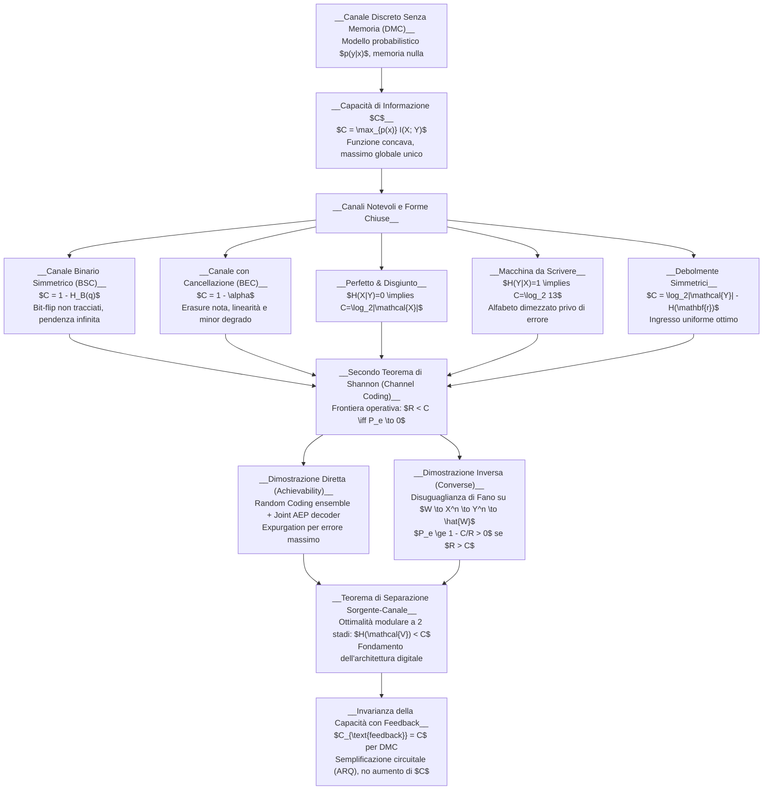

## Il Modello Del Canale Di Comunicazione

Sul piano fisico e logico, un processo di telecomunicazione tra un trasmettitore e un ricevitore consiste nell'indurre, mediante una sequenza di sollecitazioni controllate, uno stato fisico correlato e interpretabile all'altro capo del mezzo. La comunicazione ha successo se e solo se il ricevitore riesce a ricostruire univocamente il messaggio inteso dal trasmettitore.

Lo schema a blocchi fondamentale introdotto da Shannon formalizza tale catena di elaborazione:

![[slide_02_communication_system_block.png|center mid]]

Analizziamo i quattro elementi cardine che costituiscono l'architettura:

1. __Sorgente di Informazione e Messaggio__: La sorgente genera un messaggio $W$ selezionato da un insieme finito di $M$ messaggi equiprobabili:

   $$
   W \in \mathcal{W} = \{1, 2, \dots, M\}
   $$

   Poiché i messaggi sono equiprobabili, l'entropia della sorgente è pari a $H(W) = \log_2 M$ bit.

2. __Codificatore di Canale (Encoder)__: Assegna a ciascun indice di messaggio $W$ una parola di codice (__codeword__) composta da $n$ simboli appartenenti all'alfabeto di canale $\mathcal{X}$:

   $$
   X^n(W) = \big(X_1(W), X_2(W), \dots, X_n(W)\big) \in \mathcal{X}^n
   $$

   Il parametro intero $n$ rappresenta la __lunghezza di blocco__ (il numero di utilizzi elementari del canale necessari a recapitare il messaggio). L'insieme delle $M$ parole $\{X^n(1), \dots, X^n(M)\}$ costituisce il __codebook__.

3. __Canale Rumoroso__: È il mezzo fisico stocastico, descritto statisticamente da una famiglia di probabilità di transizione condizionate $p(y^n \mid x^n)$. Il canale altera la sequenza inviata e restituisce al ricevitore la sequenza aleatoria osservata:

   $$
   Y^n = (Y_1, Y_2, \dots, Y_n) \in \mathcal{Y}^n
   $$

4. __Decodificatore di Canale (Decoder)__: Riceve la sequenza perturbata $Y^n$ e applica una regola di decisione deterministica:

   $$
   g: \mathcal{Y}^n \to \{1, 2, \dots, M\}
   $$

   generando la stima del messaggio trasmesso $\hat{W} = g(Y^n)$.

Definiamo il __tasso di trasmissione__ (__code rate__) $R$, misurato in bit per uso di canale (bit/simbolo), come il rapporto tra il contenuto informativo del messaggio e il numero di impieghi del canale:

$$
R = \frac{\log_2 M}{n} \quad \text{bit/uso} \iff M = \lceil 2^{nR} \rceil
$$

Un codice identificato da $M$ parole di lunghezza $n$ viene denotato convenzionalmente come codice $(2^{nR}, n)$ o codice $(M, n)$.

## Confusione Tra Sequenze E Principio Delle Sfere Di Decodifica

L'insorgenza degli errori di decodifica scaturisce dal fenomeno della __confusione di canale__: poiché il rumore è un processo stocastico dispersivo, due ingressi distinti $X^n(1)$ e $X^n(2)$ possono produrre all'uscita la medesima sequenza $Y^n$ con probabilità strettamente positiva.

### L'Intuizione Nel Linguaggio Naturale

Consideriamo due frasi trasmesse attraverso un canale di testo rumoroso che altera sporadicamente i caratteri:
- Messaggio 1: «The cat sat on the mat»
- Messaggio 2: «The cat sat on the map»

Se il canale scambia l'ultimo carattere con una 'd', il ricevitore osserva:
- Sequenza ricevuta: «The cat sat on the mad»

In sede di decodifica, entrambe le ipotesi originarie risultano ugualmente plausibili: la stima collassa nell'ambiguità «The cat sat on the ma?». Gli ingressi sono tra loro __confondibili__ perché la loro distanza metrica (in questo caso una sola lettera di differenza) è inferiore all'entità della perturbazione indotta dal canale.

### Il Ruolo Della Ridondanza Controllata

Per sopprimere l'ambiguità, introduciamo __ridondanza geometrica strutturata__: anziché consentire l'uso di tutte le sequenze possibili dell'alfabeto, il trasmettitore seleziona un sottoinsieme ristretto di sequenze opportunamente distanziate.

Proteggiamo le due frasi precedenti con caratteri ridondanti:
- Messaggio 1 codificato: «The cat sat on the mattt»
- Messaggio 2 codificato: «The cat sat on the mappp»

Se il canale altera la consonante centrale e introduce rumore residuo sull'estensione, producendo in ricezione:
- Sequenza ricevuta: «The cat sat on the madpp»

Il decodificatore confronta l'osservazione con le sole parole lecite del codebook. La correlazione statistica con il Messaggio 2 è schiacciante: la stima restituisce senza esitazione $\hat{W} =$ «The cat sat on the map».

### Interpretazione Geometrica Dei Volumi Di Decodifica

Questo principio trova una formulazione geometrica rigorosa nello spazio asintotico delle sequenze tipiche:
- A ciascuna codeword trasmessa $X^n(w)$ corrisponde nello spazio delle uscite $\mathcal{Y}^n$ un insieme di sequenze condizionatamente tipiche di volume orientativo:

  $$
  |A_\epsilon^{(n)}(Y \mid X^n(w))| \approx 2^{n H(Y \mid X)}
  $$

  Tale insieme rappresenta la "sfera di incertezza" o cono di rumore generato da quell'ingresso.
- Lo spazio complessivo delle sequenze di uscita tipiche ha volume pari a:

  $$
  |A_\epsilon^{(n)}(Y)| \approx 2^{n H(Y)}
  $$

- Affinché il ricevitore possa decodificare senza equivoci, le sfere di rumore associate alle diverse parole di codice devono risultare mutuamente disgiunte. Il numero massimo $M$ di parole collocabili nello spazio delle uscite senza sovrapposizioni critiche è delimitato dal rapporto dei volumi:

  $$
  M \approx \frac{2^{n H(Y)}}{2^{n H(Y \mid X)}} = 2^{n [H(Y) - H(Y \mid X)]} = 2^{n I(X; Y)}
  $$

- Ricordando la definizione di rate $M = 2^{nR}$, notiamo immediatamente che il tasso massimo a cui possiamo comunicare senza confusione coincide con la mutua informazione $I(X; Y)$.

## Canale Discreto Senza Memoria E Capacità Di Informazione

Un canale di comunicazione discreto è identificato dalla terna $(\mathcal{X}, p(y \mid x), \mathcal{Y})$, dove:
- $\mathcal{X}$ è l'alfabeto d'ingresso discreto e finito;
- $\mathcal{Y}$ è l'alfabeto d'uscita discreto e finito;
- $p(y \mid x) = \text{Pr}\{Y = y \mid X = x\}$ è la matrice delle probabilità di transizione condizionate, soggetta ai vincoli di conservazione della probabilità:

  $$
  p(y \mid x) \ge 0, \quad \sum_{y \in \mathcal{Y}} p(y \mid x) = 1, \quad \forall x \in \mathcal{X}
  $$

### La Proprietà Di Memoria Nulla (DMC)

Un canale si definisce __discreto senza memoria__ (__Discrete Memoryless Channel__, DMC) se la distribuzione di probabilità dell'uscita all'istante presente $k$ dipende unicamente dal simbolo d'ingresso al medesimo istante, risultando condizionatamente indipendente da tutti gli ingressi e dalle uscite precedenti:

$$
p(y_k \mid x_1, x_2, \dots, x_k, y_1, y_2, \dots, y_{k-1}) = p(y_k \mid x_k)
$$

Grazie alla memoria nulla, la probabilità condizionata associata a un intero blocco di lunghezza $n$ si fattorizza esattamente nel prodotto delle singole probabilità di transizione marginali:

$$
p(y^n \mid x^n) = \prod_{k=1}^n p(y_k \mid x_k)
$$

### Definizione Variazionale Della Capacità Di Informazione

Definiamo __capacità di informazione__ di un canale discreto senza memoria la massima mutua informazione ottenibile tra l'ingresso $X$ e l'uscita $Y$ su un singolo utilizzo del canale, massimizzando rispetto a tutte le distribuzioni di probabilità ammissibili all'ingresso:

$$
C = \max_{p(x)} I(X; Y)
$$

La massimizzazione varia sul simplesso probabilistico di dimensione $|\mathcal{X}| - 1$:

$$
\mathcal{P}(\mathcal{X}) = \left\{ p(x) \in \mathbb{R}^{|\mathcal{X}|} : p(x) \ge 0, \; \sum_{x \in \mathcal{X}} p(x) = 1 \right\}
$$

Questo problema variazionale gode di una proprietà analitica decisiva: per una matrice di transizione $p(y \mid x)$ fissata, la mutua informazione $I(X; Y)$ è una __funzione concava__ rispetto al vettore di probabilità d'ingresso $p(x)$ (Teorema di Cover & Thomas 2.7.4). Poiché il simplesso $\mathcal{P}(\mathcal{X})$ è un insieme convesso e compatto (chiuso e limitato in spazio euclideo), per il Teorema di Weierstrass il valore massimo $C$ esiste sempre ed è unico: ogni massimo locale individuato corrisponde tassativamente al massimo globale assoluto (l'eventuale molteplicità dei massimizzatori $p^*(x)$ sussiste unicamente in presenza di simboli d'ingresso ridondanti con righe di transizione identiche).

### Proprietà E Bound Fondamentali Della Capacità

Dalla definizione variazionale $C = \max_{p(x)} I(X; Y)$ discendono immediatamente tre proprietà fondamentali che delimitano la capacità di qualsiasi canale discreto:

1. __Non-negatività__: Poiché l'informazione mutua tra due variabili aleatorie è sempre non negativa ($I(X; Y) \ge 0$), vale:

   $$
   C \ge 0
   $$

   con $C = 0$ se e solo se $X$ e $Y$ sono statisticamente indipendenti per qualsiasi scelta di $p(x)$ (canale totalmente rumoroso, ad es. BSC con $q = 1/2$).

2. __Delimitazione Superiore da Ingresso e Uscita__:
   - Sviluppando l'informazione mutua rispetto all'ingresso:

     $$
     I(X; Y) = H(X) - H(X \mid Y) \le H(X) \le \log_2 |\mathcal{X}|
     $$

   - Sviluppando l'informazione mutua rispetto all'uscita:

     $$
     I(X; Y) = H(Y) - H(Y \mid X) \le H(Y) \le \log_2 |\mathcal{Y}|
     $$

   Prendendo il massimo su $p(x)$, otteniamo il limite fondamentale invalicabile:

   $$
   0 \le C \le \min\big(\log_2 |\mathcal{X}|, \; \log_2 |\mathcal{Y}|\big) \quad \text{bit/uso}
   $$

Il canale non può trasferire più bit di quanti ne contenga il suo alfabeto d'ingresso (bottleneck di modulazione/trasmissione) né più bit di quanti ne possa distinguere il suo alfabeto d'uscita (bottleneck di osservazione/ricezione).

### Capacità Operativa Di Canale

Distinguiamo accuratamente la capacità di informazione (costrutto matematico astratto) dalla __capacità operativa__, definita come l'estremo superiore di tutti i tassi di trasmissione per i quali esiste una sequenza di codici con probabilità d'errore asintoticamente nulla:

$$
C_{\text{operativa}} = \sup \left\{ R : \lim_{n \to \infty} P_e^{(n)} = 0 \right\}
$$

Il cardine su cui poggia l'intera teoria di Shannon è la perfetta equivalenza tra queste due quantità:

$$
C_{\text{operativa}} = C = \max_{p(x)} I(X; Y)
$$

La massimizzazione di $I(X; Y)$ non è una mera curiosità analitica, ma quantifica con precisione assoluta il limite invalicabile di velocità imposto dalla fisica alla comunicazione numerica.

## Calcolo Della Capacità per Canali Canonici

Esaminiamo ora l'applicazione del principio variazionale $C = \max_{p(x)} I(X; Y)$ alle principali topologie di canale, derivando in forma chiusa le rispettive capacità e interpretandone i risvolti ingegneristici.

### Canale Perfetto Privo Di Rumore (Noiseless Channel)

Nel canale ideale, l'uscita riproduce fedelmente e deterministicamente l'ingresso: $Y = X$. La matrice di transizione è la matrice identità: $p(y \mid x) = \delta_{xy}$.

Espandiamo l'informazione mutua:

$$
I(X; Y) = H(X) - H(X \mid Y)
$$

Dato che $Y = X$, conoscere l'uscita azzera ogni incertezza residua sull'ingresso: $H(X \mid Y) = 0$. Ne consegue:

$$
I(X; Y) = H(X)
$$

Massimizzando rispetto alla distribuzione d'ingresso:

$$
C = \max_{p(x)} H(X) = \log_2 |\mathcal{X}| \quad \text{bit/uso}
$$

Il massimo è raggiunto quando i simboli d'ingresso sono equiprobabili: $p^*(x) = 1/|\mathcal{X}|$. A ciascun uso del canale trasmettiamo esattamente $\log_2 |\mathcal{X}|$ bit privi di rumore.

### Canale Con Uscite Disgiunte Non Sovrapposte

Consideriamo un canale in cui a ingressi distinti corrispondono sottoinsiemi di uscite mutuamente disgiunti. Sia ad esempio $\mathcal{X} = \{0, 1\}$ e $\mathcal{Y} = \{1, 2, 3, 4\}$ con le seguenti transizioni:
- Se $X = 0$, $Y$ assume equiprobabilmente i valori $\{1, 2\}$;
- Se $X = 1$, $Y$ assume equiprobabilmente i valori $\{3, 4\}$.

Sebbene l'uscita $Y$ sia stocastica e presenti dispersione, osservare il valore di $Y$ identifica senza ombra di dubbio quale ingresso sia stato inviato: se riceviamo $1$ o $2$, l'ingresso era $0$; se riceviamo $3$ o $4$, l'ingresso era $1$.

L'entropia condizionata dell'ingresso data l'uscita è nulla: $H(X \mid Y) = 0$. Calcoliamo la mutua informazione:

$$
I(X; Y) = H(X) - H(X \mid Y) = H(X) - 0 = H(X)
$$

Massimizzando su $p(x)$ otteniamo:

$$
C = \max_{p(x)} H(X) = \log_2 |\mathcal{X}| = 1 \quad \text{bit/uso}
$$

Questo risultato evidenzia un punto fondamentale per l'esame: l'aleatorietà dell'uscita non penalizza la capacità fintanto che non produce __confusione__ (sovrapposizione) tra le uscite generate da ingressi diversi.

### Macchina Da Scrivere Rumorosa (Noisy Typewriter)

Immaginiamo una macchina da scrivere con una tastiera circolare di $26$ lettere. Quando premiamo il tasto $x$, il dispositivo batte la lettera corretta $x$ con probabilità $1/2$, oppure batte la lettera successiva $(x+1) \bmod 26$ con probabilità $1/2$.

Calcoliamo l'entropia condizionata dell'uscita per un simbolo fissato:

$$
H(Y \mid X = x) = H_B(1/2) = 1 \quad \text{bit}
$$

Poiché tale incertezza è identica per ogni tasto, la media su qualsiasi distribuzione d'ingresso produce:

$$
H(Y \mid X) = \sum_{x} p(x) H(Y \mid X = x) = 1 \quad \text{bit}
$$

L'informazione mutua si riduce a:

$$
I(X; Y) = H(Y) - H(Y \mid X) = H(Y) - 1
$$

Per massimizzare $I(X; Y)$ dobbiamo massimizzare l'entropia marginale dell'uscita $H(Y)$. Poiché l'alfabeto di ricezione conta $26$ simboli, l'entropia è superiormente limitata da $H(Y) \le \log_2 26$. Alimentando il canale con una distribuzione d'ingresso uniforme $p(x) = 1/26$, la simmetria circolare rende uniforme anche l'uscita, saturando il limite $H(Y) = \log_2 26$.

La capacità vale dunque:

$$
C = \log_2 26 - 1 = \log_2 26 - \log_2 2 = \log_2\left( \frac{26}{2} \right) = \log_2 13 \approx 3.70 \quad \text{bit/uso}
$$

Notiamo l'elegante risvolto operativo: per trasmettere con probabilità d'errore esattamente zero senza ricorrere ad algoritmi complessi di correzione d'errore, è sufficiente utilizzare un alfabeto dimezzato selezionando $13$ lettere alternate (ad esempio $A, C, E, G, \dots$). In questo modo le coppie di uscite possibili associate a ciascuna lettera selezionata non si sovrappongono mai, consentendo una decodifica perfetta al tasso di $\log_2 13$ bit per battuta.

### Il Canale Binario Simmetrico (Binary Symmetric Channel, BSC)

Il Canale Binario Simmetrico costituisce il modello di riferimento per tutti i sistemi affetti da rumore additivo binario non controllato (fenomeno del bit-flip).

Gli alfabeti sono strettamente binari: $\mathcal{X} = \{0, 1\}$ e $\mathcal{Y} = \{0, 1\}$. Il parametro $q \in [0, 1]$ rappresenta la probabilità di inversione del bit:

$$
p(0 \mid 0) = 1 - q, \quad p(1 \mid 0) = q, \quad p(0 \mid 1) = q, \quad p(1 \mid 1) = 1 - q
$$

![[slide_06_bsc_channel_model.png|center mid]]

Nel BSC il rumore opera in modo del tutto cieco rispetto all'informazione: il ricevitore osserva un bit, ma non ha alcun mezzo per sapere se quel bit sia arrivato integro o invertito.

Deriviamo analiticamente la capacità. Calcoliamo l'entropia condizionata dell'uscita condizionata al simbolo inviato:

$$
H(Y \mid X = 0) = -q \log_2 q - (1 - q) \log_2(1 - q) = H_B(q)
$$

$$
H(Y \mid X = 1) = -q \log_2 q - (1 - q) \log_2(1 - q) = H_B(q)
$$

Poiché l'entropia delle righe della matrice di transizione è identica e indipendente dal simbolo trasmesso, la media su qualsiasi distribuzione d'ingresso $p(x)$ fornisce:

$$
H(Y \mid X) = p(0) H_B(q) + p(1) H_B(q) = H_B(q)
$$

Sviluppiamo la mutua informazione:

$$
I(X; Y) = H(Y) - H(Y \mid X) = H(Y) - H_B(q)
$$

Il termine di rumore $H_B(q)$ è una costante fissata dal canale. Di conseguenza, massimizzare $I(X; Y)$ equivale a massimizzare l'entropia marginale d'uscita $H(Y)$. Poiché $Y$ è una variabile binaria, la sua entropia non può eccedere $1$ bit:

$$
H(Y) \le 1 \quad \text{bit}
$$

con uguaglianza se e solo se l'uscita è equiprobabile: $\text{Pr}\{Y = 0\} = \text{Pr}\{Y = 1\} = 1/2$. Esprimiamo la probabilità di ricevere '1' in funzione della probabilità d'ingresso $p = \text{Pr}\{X = 1\}$:

$$
\text{Pr}\{Y = 1\} = p(1 - q) + (1 - p)q = p + q - 2pq
$$

Imponendo la condizione di ottimalità $\text{Pr}\{Y = 1\} = 1/2$:

$$
p + q - 2pq = \frac{1}{2} \iff p(1 - 2q) = \frac{1}{2} - q = \frac{1}{2}(1 - 2q)
$$

Per qualsiasi canale non degenere ($q \neq 1/2$), semplifichiamo il fattore $(1 - 2q)$ ricavando l'unica soluzione ottima:

$$
p^* = \frac{1}{2}
$$

Scegliendo l'ingresso uniforme $p^*(0) = p^*(1) = 1/2$, saturiamo l'uscita a $H(Y) = 1$ bit. Otteniamo così la celebre espressione per la __capacità del Canale Binario Simmetrico__:

$$
C_{\text{BSC}} = 1 - H_B(q) \quad \text{bit/uso}
$$

Esaminiamo il comportamento della capacità nei regimi operativi notevoli:

1. __Canale Perfetto ($q = 0$)__: $H_B(0) = 0 \implies C = 1$ bit/uso. Il mezzo trasferisce l'informazione alla massima velocità consentita dall'alfabeto.
2. __Canale a Rumore Puro ($q = 1/2$)__: $H_B(1/2) = 1 \implies C = 0$ bit/uso. L'uscita è stocasticamente indipendente dall'ingresso ($\text{Pr}\{Y = 1\} = 1/2$ a prescindere da $X$). Nessuna correlazione sopravvive: la trasmissione a tasso positivo è impossibile.
3. __Canale Invertitore Deterministico ($q = 1$)__: $H_B(1) = 0 \implies C = 1$ bit/uso. Ogni bit viene sistematicamente negato. Poiché la regola di inversione è nota e priva di aleatorietà, il decodificatore inverte l'uscita ($\hat{X} = 1 - Y$), recuperando il flusso a tasso massimo.
4. __Simmetria Funzionale__: Poiché $H_B(q) = H_B(1 - q)$, la curva di capacità è perfettamente simmetrica attorno a $q = 1/2$. Operare a $q = 0.9$ offre le medesime prestazioni teoriche di operare a $q = 0.1$.

### Il Canale Binario Con Cancellazione (Binary Erasure Channel, BEC)

In numerosi contesti reali — quali le reti a commutazione di pacchetto dove i checksum scartano i pacchetti corrotti, o le memorie a semiconduttore con letture sotto-soglia — il ricevitore non subisce inversioni invisibili, ma è consapevole di quando un simbolo è andato perduto.

Il __Canale Binario con Cancellazione__ possiede un ingresso binario $\mathcal{X} = \{0, 1\}$ e un'uscita ternaria $\mathcal{Y} = \{0, 1, e\}$, dove $e$ denota l'evento di __cancellazione__ (__erasure__). Il parametro $\alpha \in [0, 1]$ rappresenta la probabilità di cancellazione:

$$
p(0 \mid 0) = 1 - \alpha, \quad p(e \mid 0) = \alpha, \quad p(1 \mid 0) = 0
$$

$$
p(1 \mid 1) = 1 - \alpha, \quad p(e \mid 1) = \alpha, \quad p(0 \mid 1) = 0
$$

Sia $p = \text{Pr}\{X = 1\}$ la probabilità di trasmettere '1'. La distribuzione marginale dell'uscita vale:

$$
\text{Pr}\{Y = 0\} = (1 - p)(1 - \alpha), \quad \text{Pr}\{Y = 1\} = p(1 - \alpha), \quad \text{Pr}\{Y = e\} = \alpha
$$

Per calcolare l'entropia dell'uscita $H(Y)$ in modo rigoroso ed elegante, definiamo la variabile aleatoria indicatrice di cancellazione:

$$
E = \mathbf{1}_{\{Y = e\}} = \begin{cases} 1 & \text{se } Y = e \\ 0 & \text{se } Y \in \{0, 1\} \end{cases}
$$

Applicando la regola di scomposizione della catena per l'entropia congiunta:

$$
H(Y, E) = H(E) + H(Y \mid E)
$$

Poiché $E$ è una funzione deterministica di $Y$, l'entropia congiunta coincide con l'entropia marginale: $H(Y, E) = H(Y)$. Sviluppando i singoli addendi:
- $H(E) = H_B(\alpha)$, in quanto $E$ è una variabile bernoulliana con parametro $\alpha$.
- $H(Y \mid E) = (1 - \alpha) H(Y \mid E = 0) + \alpha H(Y \mid E = 1)$.

Quando $E = 1$, l'uscita è deterministicamente pari a $e$, dunque $H(Y \mid E = 1) = 0$. Quando $E = 0$, l'uscita assume i valori $0$ e $1$ con probabilità condizionate $1 - p$ e $p$, per cui $H(Y \mid E = 0) = H_B(p)$. Sostituendo:

$$
H(Y) = H_B(\alpha) + (1 - \alpha) H_B(p)
$$

Calcoliamo l'entropia condizionata del canale: per qualunque simbolo trasmesso $x$, l'uscita è pari a $x$ con probabilità $1 - \alpha$ oppure a $e$ con probabilità $\alpha$:

$$
H(Y \mid X) = H_B(\alpha)
$$

Sottraendo i due termini per ottenere la mutua informazione, notiamo una semplificazione esatta:

$$
I(X; Y) = H(Y) - H(Y \mid X) = \big[ H_B(\alpha) + (1 - \alpha) H_B(p) \big] - H_B(\alpha) = (1 - \alpha) H_B(p)
$$

Il termine di rumore $H_B(\alpha)$ scompare per cancellazione algebrica. Massimizzando rispetto a $p$, saturiamo $H_B(p) \le 1$ ponendo l'ingresso uniforme $p^* = 1/2$. Otteniamo la __capacità del Canale Binario con Cancellazione__:

$$
C_{\text{BEC}} = 1 - \alpha \quad \text{bit/uso}
$$

### Confronto Critico E Geometrico Tra BSC E BEC

Il confronto tra le prestazioni del canale BSC e del canale BEC rivela uno dei concetti più fecondi della teoria dell'informazione: il valore della localizzazione dell'errore.

![[bsc_vs_bec_capacity_curves.svg|center mid]]

Analizziamo i contrasti strutturali emergenti dal grafico:

1. __Linearità vs Decadimento Entropico__:
   - La capacità del BEC decade in modo perfettamente lineare: $C_{\text{BEC}} = 1 - \alpha$.
   - La capacità del BSC segue la curva dell'entropia binaria: $C_{\text{BSC}} = 1 - H_B(q)$.

2. __Pendenza Infinita all'Origine per il BSC__:
   Calcoliamo la derivata prima della capacità del BSC rispetto alla probabilità d'errore $q$:

   $$
   \frac{\mathrm{d}C_{\text{BSC}}}{\mathrm{d}q} = -\frac{\mathrm{d}H_B(q)}{\mathrm{d}q} = \log_2\left( \frac{q}{1 - q} \right)
   $$

   Facendo tendere il rumore a zero ($q \to 0^+$), notiamo che:

   $$
   \lim_{q \to 0^+} \frac{\mathrm{d}C_{\text{BSC}}}{\mathrm{d}q} = -\infty
   $$

   Al contrario, per il canale BEC la pendenza è costante: $\frac{\mathrm{d}C_{\text{BEC}}}{\mathrm{d}\alpha} = -1$.
   Significato fisico fondamentale: un livello infinitesimo di bit-flip inosservati distrugge capacità a una velocità infinitamente superiore rispetto a un livello equivalente di cancellazioni.

3. __Gap Informativo e Localizzazione del Guasto__:
   Fissiamo un tasso di perturbazione del $10\%$ ($q = \alpha = 0.1$):
   - Nel BEC: $C_{\text{BEC}}(0.1) = 1 - 0.1 = 0.90$ bit/uso.
   - Nel BSC: $C_{\text{BSC}}(0.1) = 1 - H_B(0.1) \approx 1 - 0.469 = 0.531$ bit/uso.
   Il canale con cancellazione conserva quasi il $70\%$ di capacità in più rispetto al canale con bit-flip ($\Delta C \approx +0.369$ bit). Sapere _dove_ si è verificata la perdita di informazione riduce drasticamente l'entropia residua che il codice deve risolvere.

4. __Divergenza nei Punti Singolari__:
   - A $q = \alpha = 0.5$: il BSC collassa a $C=0$ (indipendenza stocastica totale), mentre il BEC mantiene $C = 0.50$ bit/uso (la metà dei bit arriva perfettamente integra e identificata).
   - A $q = \alpha = 1.0$: il BEC collassa a $C=0$ (tutti i bit vengono cancellati), mentre il BSC risale a $C=1$ bit/uso grazie alla decodifica deterministica per inversione.

### Canali Debolmente Simmetrici

Generalizziamo i risultati analitici precedenti introducendo la classe dei canali debolmente simmetrici, per i quali la capacità ammette una derivazione immediata.

Un canale $(\mathcal{X}, p(y \mid x), \mathcal{Y})$ si definisce __debolmente simmetrico__ (__weakly symmetric__) se soddisfa due condizioni strutturali sulla matrice di transizione $[p(y \mid x)]$:
1. Ogni riga della matrice è una permutazione di qualsiasi altra riga. Di conseguenza, l'entropia condizionata associata a ciascuna riga $\mathbf{r}$ è costante:

   $$
   H(Y \mid X = x) = -\sum_{y \in \mathcal{Y}} p(y \mid x) \log_2 p(y \mid x) = H(\mathbf{r}), \quad \forall x \in \mathcal{X}
   $$

2. Tutte le somme per colonna sono identiche tra loro:

   $$
   \sum_{x \in \mathcal{X}} p(y \mid x) = c = \frac{|\mathcal{X}|}{|\mathcal{Y}|}, \quad \forall y \in \mathcal{Y}
   $$

#### Teorema Di Capacità per Canali Debolmente Simmetrici

Per qualsiasi canale debolmente simmetrico, la capacità di informazione vale:

$$
C = \log_2 |\mathcal{Y}| - H(\mathbf{r}) \quad \text{bit/uso}
$$

ed è raggiunta tassativamente dalla distribuzione di probabilità d'ingresso uniforme:

$$
p^*(x) = \frac{1}{|\mathcal{X}|}, \quad \forall x \in \mathcal{X}
$$

#### Dimostrazione

Grazie alla costanza dell'entropia di riga, l'entropia condizionata non dipende dalla distribuzione d'ingresso:

$$
H(Y \mid X) = \sum_{x \in \mathcal{X}} p(x) H(Y \mid X = x) = H(\mathbf{r}) \sum_{x \in \mathcal{X}} p(x) = H(\mathbf{r})
$$

Esprimiamo la mutua informazione e imponiamo il limite superiore sull'entropia dell'uscita:

$$
I(X; Y) = H(Y) - H(Y \mid X) = H(Y) - H(\mathbf{r}) \le \log_2 |\mathcal{Y}| - H(\mathbf{r})
$$

Verifichiamo se la distribuzione uniforme d'ingresso $p(x) = 1/|\mathcal{X}|$ riesce a saturare la disuguaglianza. Calcoliamo la distribuzione marginale d'uscita indotta:

$$
p(y) = \sum_{x \in \mathcal{X}} p(x) p(y \mid x) = \frac{1}{|\mathcal{X}|} \sum_{x \in \mathcal{X}} p(y \mid x) = \frac{1}{|\mathcal{X}|} \cdot \left( \frac{|\mathcal{X}|}{|\mathcal{Y}|} \right) = \frac{1}{|\mathcal{Y}|}
$$

L'uscita risulta rigorosamente equiprobabile sull'intero alfabeto $\mathcal{Y}$. Ne deriva che $H(Y) = \log_2 |\mathcal{Y}|$, saturando il bound e confermando che $p^*(x) = 1/|\mathcal{X}|$ realizza la capacità.

## Secondo Teorema Di Shannon (Channel Coding Theorem)

Il Secondo Teorema Fondamentale di Claude Shannon (1948) stabilisce il confine invalicabile tra la regione di trasmissione affidabile a errore nullo e la regione in cui la comunicazione collassa irreversibilmente nell'ambiguità stocastica.

### Enunciato Globale Del Teorema

Dato un canale discreto senza memoria con capacità di informazione $C = \max_{p(x)} I(X; Y)$:

1. __Parte Diretta (Achievability)__:
   Per ogni tasso di trasmissione $R < C$ e per qualsiasi margine di tolleranza $\epsilon > 0$, per blocchi di lunghezza $n$ sufficientemente grande esiste un codice di canale $(2^{nR}, n)$ la cui probabilità massima d'errore di decodifica soddisfa:

   $$
   \lambda_{\max}^{(n)} = \max_{w \in \{1, \dots, 2^{nR}\}} \text{Pr}\{g(Y^n) \neq w \mid W = w\} < \epsilon
   $$

2. __Parte Inversa (Converse)__:
   Qualsiasi sequenza di codici di blocco $(2^{nR}, n)$ che tenti di trasmettere a un tasso $R > C$ presenta una probabilità media d'errore $P_e^{(n)}$ confinata inferiormente lontano da zero per $n \to \infty$:

   $$
   P_e^{(n)} \ge 1 - \frac{C}{R} - \frac{1}{nR} \xrightarrow{n \to \infty} 1 - \frac{C}{R} > 0
   $$

   È fisicamente e matematicamente impossibile comunicare con affidabilità ideale superando la capacità del canale.

### Rottura Del Paradigma Classico Della Ripetizione

Prima del 1948, la prassi ingegneristica riteneva che l'unico modo per contrastare il rumore consistesse nel ripetere i bit un numero crescente di volte (codici a ripetizione). Tuttavia, ripetere un bit $n$ volte riduce il rate effettivo come $R = 1/n$: per azzerare l'errore ($n \to \infty$), il tasso di trasmissione precipita a zero ($R \to 0$).

Shannon dimostrò la sub-ottimalità di tale approccio. Anziché confinare i segnali su traiettorie monodimensionali collineari, costruiamo parole di codice vettoriali distribuite nell'iperspazio $n$-dimensionale. Sfruttando il fenomeno della concentrazione della misura (AEP congiunta), le sfere di dispersione del rumore si disgiungono quasi totalmente, rendendo possibile comunicare con errore nullo a qualsiasi tasso positivo $R$ purché inferiore a $C$.

### Struttura Della Dimostrazione Diretta (Random Coding E Joint AEP)

La dimostrazione diretta di Shannon non produce un algoritmo costruttivo deterministico (la ricerca di codici pratici capacity-achieving richiederà mezzo secolo, culminando con i codici Turbo, LDPC e Polari), ma prova l'esistenza del codice ottimo mediante il celebre metodo probabilistico:

1. __Generazione Casuale dell'Ensemble (Random Coding)__:
   Sia $p^*(x)$ la distribuzione che massimizza la capacità. Generiamo casualmente una matrice di codice (codebook) di $2^{nR}$ parole, ciascuna di $n$ simboli, estraendo ogni elemento in modo indipendente secondo la distribuzione prodotto:

   $$
   p(x^n) = \prod_{j=1}^n p^*(x_j)
   $$

2. __Decodifica a Tipicità Congiunta (Joint Typicality Decoder)__:
   Il ricevitore osserva la sequenza $Y^n$ e verifica l'appartenenza all'insieme congiuntamente tipico $A_\epsilon^{(n)}$. Dichiara che il messaggio trasmesso è l'indice $\hat{w}$ se e solo se:
   - La coppia $(X^n(\hat{w}), Y^n)$ appartiene ad $A_\epsilon^{(n)}$;
   - Non esiste nessun altro indice $k \neq \hat{w}$ tale che $(X^n(k), Y^n) \in A_\epsilon^{(n)}$.
   In caso contrario, il ricevitore segnala un errore di decodifica.

3. __Analisi degli Eventi d'Errore tramite Joint AEP__:
   Assumiamo senza perdita di generalità che sia stato trasmesso il messaggio $W = 1$. L'errore si manifesta se si verifica l'unione di due eventi:
   - Evento $E_1$: la parola corretta non è tipica con l'uscita, $(X^n(1), Y^n) \notin A_\epsilon^{(n)}$. Per la proprietà fondamentale dell'AEP congiunta (legge dei grandi numeri), la probabilità decade a zero:

     $$
     \text{Pr}(E_1) \le \epsilon \quad \text{per } n \text{ sufficientemente grande}
     $$

   - Eventi $E_i$ ($i \ge 2$): una parola incorretta $X^n(i)$ risulta casualmente congiuntamente tipica con l'uscita osservata $Y^n$. Poiché per $i \neq 1$ la parola $X^n(i)$ e l'uscita $Y^n$ sono statisticamente indipendenti, la proprietà di dispersione dell'AEP stabilisce che:

     $$
     \text{Pr}\big((X^n(i), Y^n) \in A_\epsilon^{(n)}\big) \le 2^{-n(I(X; Y) - 3\epsilon)}
     $$

4. __Applicazione dello Union Bound e Convergenza__:
   Valutiamo la probabilità media d'errore mediata sull'intero ensemble di codici casuali:

   $$
   \mathbb{E}[P_e^{(n)}] \le \text{Pr}(E_1) + \sum_{i=2}^{2^{nR}} \text{Pr}(E_i) \le \epsilon + (2^{nR} - 1) 2^{-n(I(X; Y) - 3\epsilon)} \le \epsilon + 2^{-n(I(X; Y) - R - 3\epsilon)}
   $$

   Se imponiamo la condizione fondamentale sul tasso:

   $$
   R < I(X; Y) - 3\epsilon = C - 3\epsilon
   $$

   l'esponente è strettamente negativo. Per $n \to \infty$, il termine esponenziale decade a zero, garantendo:

   $$
   \mathbb{E}[P_e^{(n)}] \le 2\epsilon
   $$

5. __Tecnica di Expurgation (Passaggio all'Errore Massimo)__:
   Poiché la media sull'ensemble è inferiore a $2\epsilon$, deve esistere almeno un codice deterministico $\mathcal{C}^*$ la cui probabilità d'errore media soddisfa $P_e^{(n)}(\mathcal{C}^*) \le 2\epsilon$.
   Per convertire la garanzia sull'errore medio in una garanzia sull'errore massimo $\lambda_{\max}$, ordiniamo le $2^{nR}$ parole di codice in base alla loro probabilità d'errore individuale $\lambda_w$ ed eliminiamo la metà peggiore ($2^{nR-1}$ parole). Sulle parole rimanenti, per la disuguaglianza di Markov, l'errore massimo non può eccedere il doppio della media:

   $$
   \lambda_{\max} \le 2 P_e^{(n)}(\mathcal{C}^*) \le 4\epsilon
   $$

   Il tasso di trasmissione del codice epurato è pari a:

   $$
   R' = \frac{\log_2(2^{nR-1})}{n} = \frac{nR - 1}{n} = R - \frac{1}{n} \xrightarrow{n \to \infty} R
   $$

   La perdita di tasso è asintoticamente nulla, completando la dimostrazione diretta.

Per consultare lo sviluppo analitico integrale di ogni singolo passaggio, si rimanda alla [[Anno 1/Information and Estimation Theory/zz. Argomenti extra#Dimostrazione del Teorema di Codifica di Canale (Diretta: Random Coding e Joint AEP)|Dimostrazione del Teorema di Codifica di Canale (Diretta: Random Coding e Joint AEP)]].

### Struttura Della Dimostrazione Inversa (Converse via Fano)

Dimostriamo ora che nessun sistema può operare in modo affidabile al di sopra della capacità. Consideriamo la catena di elaborazione:

$$
W \to X^n(W) \to Y^n \to \hat{W} = g(Y^n)
$$

Il messaggio $W$ è distribuito uniformemente su $\{1, \dots, 2^{nR}\}$, da cui $H(W) = nR$. Applicando la Disuguaglianza di Fano alla stima di $W$ a partire da $Y^n$, l'incertezza residua sul messaggio è delimitata superiormente da:

$$
H(W \mid Y^n) \le 1 + P_e^{(n)} \log_2 M = 1 + P_e^{(n)} n R
$$

Espandiamo l'entropia del messaggio applicando la definizione di mutua informazione:

$$
nR = H(W) = H(W \mid Y^n) + I(W; Y^n)
$$

Poiché $W \to X^n \to Y^n$ forma una catena di Markov, per la Data Processing Inequality (DPI) la mutua informazione non può aumentare lungo la catena:

$$
I(W; Y^n) \le I(X^n; Y^n)
$$

Inoltre, per la proprietà di memoria nulla del canale (DMC), l'informazione mutua di blocco è limitata dalla somma delle capacità sui singoli utilizzi:

$$
I(X^n; Y^n) = H(Y^n) - H(Y^n \mid X^n) \le \sum_{i=1}^n H(Y_i) - \sum_{i=1}^n H(Y_i \mid X_i) = \sum_{i=1}^n I(X_i; Y_i) \le n C
$$

Combinando le disuguaglianze ottenute:

$$
nR \le 1 + P_e^{(n)} n R + n C
$$

Riorganizziamo i termini per isolare la probabilità d'errore $P_e^{(n)}$:

$$
nR(1 - P_e^{(n)}) \le 1 + nC \iff 1 - P_e^{(n)} \le \frac{1}{nR} + \frac{C}{R}
$$

Concludiamo ricavando il limite inferiore invalicabile:

$$
P_e^{(n)} \ge 1 - \frac{C}{R} - \frac{1}{nR} \xrightarrow{n \to \infty} 1 - \frac{C}{R}
$$

Se $R > C$, la quantità $1 - C/R$ è strettamente positiva. Indipendentemente dalla complessità dell'algoritmo di decodifica o dalla lunghezza di blocco $n$, la probabilità d'errore non potrà mai scendere sotto tale valore.

I dettagli analitici formali sono consultabili nella [[Anno 1/Information and Estimation Theory/zz. Argomenti extra#Dimostrazione della Parte Inversa del Teorema di Codifica di Canale (Converse via Fano)|Dimostrazione della Parte Inversa del Teorema di Codifica di Canale (Converse via Fano)]].

## Dualità Di Shannon Tra Compressione E Trasmissione

Tra i due pilastri della teoria dell'informazione sussiste una profonda simmetria speculare, formalizzata dal principio di dualità di Shannon:

1. __Compressione Dati (Codifica di Sorgente)__:
   La sorgente produce sequenze affette da ridondanza statistica (dipendenze temporali, disomogeneità probabilistiche). Il codificatore di sorgente rimuove sistematicamente tale ridondanza, comprimendo i dati fino al tasso minimo rappresentato dall'entropia $H(X)$. Il flusso compresso risultante è denso e privo di struttura, indistinguibile all'analisi spettrale da rumore bianco.

2. __Trasmissione su Canale (Codifica di Canale)__:
   Ricevuto il flusso compresso privo di ridondanza, il codificatore di canale vi reintroduce deliberatamente una ridondanza controllata e rigidamente strutturata nello spazio geometrico dei segnali (parità, grafi di Tanner, vincoli di traliccio). Questa ridondanza allontana le parole nello spazio di Hamming, respingendo le perturbazioni stocastiche introdotte dal canale fino al limite di velocità $C$.

La compressione elimina la ridondanza naturale non strutturata; la codifica di canale inietta ridondanza artificiale strutturata.

## Teorema Di Separazione Sorgente-Canale Di Shannon

In un impianto di trasmissione reale, si potrebbe ipotizzare che progettare un unico codificatore congiunto non lineare — che mappi direttamente i campioni della sorgente nei simboli fisici di canale — consenta di superare le prestazioni di un'architettura modulare a stadi disaccoppiati.

Il celebre __Teorema di Separazione Sorgente-Canale__ (Shannon 1948) dimostra inconfutabilmente che tale congettura è errata: l'architettura a due stadi separati è __globalmente e asintoticamente ottima__.

### Enunciato Del Teorema

Sia assegnata una sorgente stazionaria ed ergodica $\mathcal{V}$ con tasso di entropia $H(\mathcal{V})$ (espressa in bit per simbolo di sorgente), e sia assegnato un canale discreto senza memoria con capacità $C$ (in bit per uso di canale). Supponiamo che il sistema utilizzi il canale $n$ volte per trasmettere ogni blocco di $k$ simboli di sorgente.

1. __Condizione di Trasmissibilità Affidabile__:
   Se il tasso di entropia normalizzato è inferiore alla capacità del canale:

   $$
   \frac{k}{n} H(\mathcal{V}) < C
   $$

   possiamo comprimere la sorgente e codificare il canale mediante due stadi indipendenti, garantendo una probabilità di ricostruzione errata asintoticamente nulla per blocchi sufficientemente lunghi.

2. __Condizione di Intrasmissibilità__:
   Se $\frac{k}{n} H(\mathcal{V}) > C$, per qualsiasi sistema di codifica (anche congiunto) la probabilità d'errore di ricostruzione è confinata inferiormente lontano da zero.

La dimostrazione rigorosa è consultabile nella sezione [[Anno 1/Information and Estimation Theory/zz. Argomenti extra#Dimostrazione del Teorema di Separazione Sorgente-Canale di Shannon|Dimostrazione del Teorema di Separazione Sorgente-Canale di Shannon]].

### Impatto Architetturale Del Principio Di Separazione

Il Teorema di Separazione costituisce l'architrave su cui si fonda l'intera industria informatica e delle telecomunicazioni contemporanee:
- __Disaccoppiamento dei Livelli di Progettazione__: L'ingegnere software che sviluppa un algoritmo di compressione video (es. H.264, HEVC, AV1) deve unicamente ottimizzare la rimozione della ridondanza per minimizzare il bitrate in uscita, senza preoccuparsi del mezzo fisico di destinazione.
- __Universalità del Canale Digitale__: L'ingegnere delle telecomunicazioni che progetta un collegamento fisico 5G, Wi-Fi 7 o un transponder ottico deve unicamente massimizzare la capacità $C$ del canale e correggere gli errori di bit, trattando il flusso informativo come una sequenza astratta di bit priva di significato semantico.
- __L'Architettura di Internet__: Senza il Teorema di Separazione, la pila di protocolli ISO/OSI e l'architettura a pacchetti TCP/IP — fondate sul disaccoppiamento tra il livello applicativo e il livello fisico — non avrebbero alcuna giustificazione teorica di ottimalità.

## Capacità Di Canale in Presenza Di Feedback Causale

Un fondamentale quesito teorico riguarda l'impiego del canale di ritorno: se il ricevitore dispone di un collegamento privo di rumore attraverso il quale rinvia immediatamente al trasmettitore i simboli $Y$ ricevuti negli istanti precedenti, la capacità di trasmissione del canale aumenta?

### Teorema Di Shannon sull'Invarianza Della Capacità Con Feedback

Per qualsiasi canale discreto senza memoria (DMC), l'introduzione di un canale di feedback causale privo di rumore non incrementa in alcun modo la capacità di canale:

$$
C_{\text{feedback}} = C
$$

#### Dimostrazione

In un sistema con feedback causale, il simbolo trasmesso all'istante $i$ può dipendere sia dal messaggio originario $W \in \{1, \dots, 2^{nR}\}$ sia da tutte le uscite di canale registrate fino all'istante precedente $Y^{i-1} = (Y_1, \dots, Y_{i-1})$:

$$
X_i = f_i(W, Y^{i-1})
$$

Applicando la Disuguaglianza di Fano alla stima del messaggio $W \sim \text{Uniform}\{1, \dots, 2^{nR}\}$ a partire dall'intera sequenza di ricezione $Y^n$:

$$
nR = H(W) = H(W \mid Y^n) + I(W; Y^n) \le 1 + P_e^{(n)} n R + I(W; Y^n)
$$

Scomponiamo l'informazione mutua $I(W; Y^n)$ mediante la regola della catena:

$$
I(W; Y^n) = H(Y^n) - H(Y^n \mid W) = \sum_{i=1}^n H(Y_i \mid Y^{i-1}) - \sum_{i=1}^n H(Y_i \mid Y^{i-1}, W)
$$

Poiché il condizionamento non può aumentare l'entropia, abbiamo $H(Y_i \mid Y^{i-1}) \le H(Y_i)$.
Esaminiamo ora il secondo addendo. Per la proprietà di memoria nulla del canale (DMC), condizionatamente al simbolo d'ingresso $X_i$, l'uscita $Y_i$ è statisticamente indipendente da tutti i simboli precedenti $Y^{i-1}$ e dal messaggio $W$:

$$
H(Y_i \mid Y^{i-1}, W, X_i) = H(Y_i \mid X_i)
$$

Poiché per ipotesi $X_i$ è una funzione deterministica di $(W, Y^{i-1})$, condizionare rispetto a $(Y^{i-1}, W)$ equivale a condizionare rispetto a $(Y^{i-1}, W, X_i)$. Otteniamo:

$$
H(Y_i \mid Y^{i-1}, W) = H(Y_i \mid X_i)
$$

Sostituendo queste relazioni nella mutua informazione:

$$
I(W; Y^n) \le \sum_{i=1}^n H(Y_i) - \sum_{i=1}^n H(Y_i \mid X_i) = \sum_{i=1}^n I(X_i; Y_i) \le \sum_{i=1}^n C = n C
$$

Inserendo questo limite superiore nel bound di Fano:

$$
nR \le 1 + P_e^{(n)} n R + n C \implies R \le \frac{1}{n} + P_e^{(n)} R + C
$$

Prendendo il limite per $n \to \infty$ sotto l'ipotesi di trasmissione affidabile ($P_e^{(n)} \to 0$), ricaviamo che $R \le C$. Ne consegue:

$$
C_{\text{feedback}} \le C
$$

D'altra parte, trasmettere ignorando il segnale di feedback è un caso particolare di trasmissione con feedback: vale banalmente $C_{\text{feedback}} \ge C$. Concludiamo che $C_{\text{feedback}} = C$.

#### Ruolo Ingegneristico Del Feedback

Sebbene il feedback non aumenti la capacità asintotica di un canale privo di memoria, esso riveste un'importanza applicativa eccezionale:
1. __Semplificazione Circuitale__: Consente di implementare codici con complessità di codifica e decodifica quasi nulla (come i protocolli ARQ a ritrasmissione rapida e gli schemi ad aggiornamento di stima alla Horstein-Schalkwijk-Kailath).
2. __Accelerazione della Convergenza__: Aumenta drasticamente l'esponente d'errore di affidabilità ($E(R)$), facendo decadere la probabilità d'errore a zero per lunghezze di blocco $n$ ordini di grandezza inferiori rispetto ai codici aperti.
3. __Canali con Memoria__: Se il canale presenta memoria temporale o dissolvenza (fading), la conoscenza dello stato del canale al trasmettitore (CSIT) tramite feedback _aumenta effettivamente la capacità_, consentendo di attuare tecniche di allocazione dinamica di potenza (water-filling temporale) e modulazione adattativa.

## Quadro Sinottico E Prontuario per l'Esame

Riepiloghiamo nella tabella seguente le formule e le caratteristiche strutturali dei canali di comunicazione esaminati:

| Modello di Canale | Alfabeti $\mathcal{X}, \mathcal{Y}$ | Meccanismo di Rumore | Ingresso Ottimo $p^*(x)$ | Capacità $C$ [bit/uso] | Proprietà Geometrica e Operativa |
| :--- | :--- | :--- | :--- | :--- | :--- |
| __Canale Perfetto (Noiseless)__ | $|\mathcal{X}| = |\mathcal{Y}| = m$ | Nessun rumore ($Y = X$) | Uniforme: $p^*(x) = 1/m$ | $\log_2 m$ | Canale ideale privo di dispersione |
| __Canale a Uscite Disgiunte__ | $|\mathcal{X}| = m, \; |\mathcal{Y}| = m \cdot k$ | Rumore interno non sovrapposto | Uniforme: $p^*(x) = 1/m$ | $\log_2 m$ | Zero confusione: decodifica perfetta |
| __Macchina da Scrivere Rumorosa__ | $|\mathcal{X}| = |\mathcal{Y}| = 26$ | Errore ciclico con probabilità $1/2$ | Uniforme su 13 lettere alternate | $\log_2 13 \approx 3.70$ | Raggiungibile a zero errori dimezzando l'alfabeto |
| __Canale Binario Simmetrico (BSC)__ | $\mathcal{X} = \mathcal{Y} = \{0, 1\}$ | Inversione bit cieca con probabilità $q$ | Uniforme: $p^*(0) = p^*(1) = 1/2$ | $1 - H_B(q)$ | Pendenza infinita a $q \to 0^+$, simmetria $q \leftrightarrow 1-q$ |
| __Canale Binario con Cancellazione (BEC)__ | $\mathcal{X} = \{0, 1\}, \; \mathcal{Y} = \{0, 1, e\}$ | Cancellazione palese con probabilità $\alpha$ | Uniforme: $p^*(0) = p^*(1) = 1/2$ | $1 - \alpha$ | Decadimento lineare: localizzazione nota dell'errore |
| __Canale Debolmente Simmetrico__ | Alfabeti discreti arbitrari | Righe e colonne permutate | Uniforme: $p^*(x) = 1/|\mathcal{X}|$ | $\log_2 |\mathcal{Y}| - H(\mathbf{r})$ | Uscita uniforme garantita dalla simmetria di colonna |
| __DMC con Feedback Causale__ | Alfabeti del canale originario | Feedback causale privo di rumore | Coincidente con il caso aperto | Identica a $C$ del DMC | Non sposta $C$, abbatte la complessità circuitale (ARQ) |

### Trabocchetti d'Esame E Check-List Operativa

- __Massimizzazione di $I(X; Y)$__: Ricorda che $I(X; Y) = H(Y) - H(Y \mid X)$. Nei canali simmetrici (come BSC o weakly symmetric), il termine condizionato $H(Y \mid X)$ è una costante numerica indipendente da $p(x)$; perciò la massimizzazione si riduce a rendere uniforme l'uscita $H(Y)$. Nei canali generici non simmetrici, $H(Y \mid X)$ dipende invece esplicitamente da $p(x)$ e non può essere estratto dall'operatore di massimo.
- __Probabilità Media vs Probabilità Massima nel Teorema di Canale__: Nella dimostrazione diretta di Shannon, il Random Coding e lo Union Bound dimostrano inizialmente che la probabilità media d'errore sull'ensemble decade a zero ($\mathbb{E}[P_e^{(n)}] \to 0$). All'orale viene spesso chiesto: _come si passa alla probabilità massima d'errore su ogni singola parola?_ La risposta è la tecnica di __expurgation__ (epurazione della metà peggiore delle parole), che costa solo una perdita trascurabile di $1/n$ sul rate.
- __Il Feedback aumenta la capacità?__: Risposta immediata: __No__ per i canali discreti senza memoria ($C_{\text{feedback}} = C$). La dimostrazione poggia sul fatto che, condizionatamente all'ingresso attuale $X_i$, l'uscita presente $Y_i$ è indipendente dalla storia passata. Aggiungi il commento brillante: il feedback aumenta la capacità _soltanto_ nei canali con memoria o tempo-varianti mediante water-filling temporale.
- __Confronto numerico BSC vs BEC__: Tieni a mente il caso $q = \alpha = 0.1$. Nel BEC la capacità è $0.90$ bit/uso, nel BSC scende a $0.531$ bit/uso. Sapere dove si trova l'errore equivale a un guadagno informativo tangibile di oltre il $70\%$.


# C. Entropia Differenziale E Canale Gaussiano

Nelle sorgenti e nei canali a valori discreti, l'entropia di Shannon misura in modo assoluto e strettamente non negativo il contenuto informativo medio o il minimo tasso di compressione senza perdita. Quando passiamo ai sistemi fisici analogici (linee di trasmissione, comunicazioni radio, sensori continui), i segnali assumono valori su insiemi continui come la retta reale $\mathbb{R}$ o lo spazio vettoriale $\mathbb{R}^n$.

L'estensione dell'entropia al dominio continuo, introdotta da Claude Shannon nel 1948 con la definizione di __entropia differenziale__, presenta proprietà geometriche e analitiche profondamente differenti rispetto al dominio discreto: può assumere valori negativi, non è invariante per un semplice cambio di scala delle unità di misura e riflette la densità geometrica di volume occupata dalla distribuzione.

Tuttavia, l'entropia differenziale preserva la nozione fondamentale di volume dell'insieme tipico e costituisce la chiave di volta per calcolare la capacità dei canali fisici continui, culminando nella celebre formula di Shannon-Hartley e nel principio di allocazione ottima tramite water-filling.

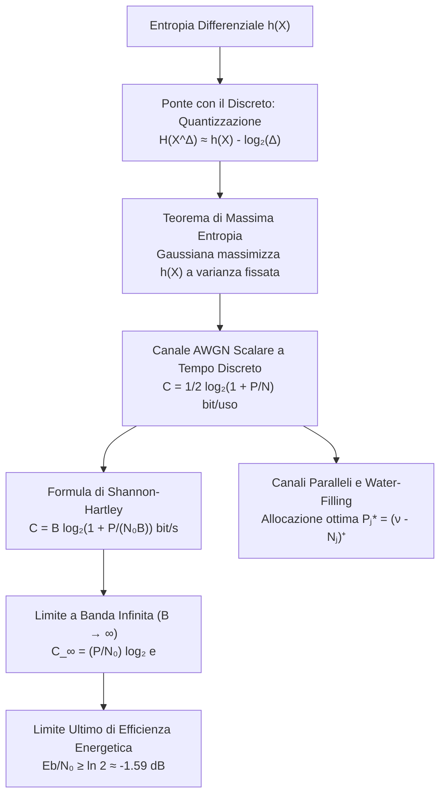

## Limiti dell'Entropia Discreta E Fondamenti dell'Entropia Differenziale

Consideriamo una variabile aleatoria continua $X$ dotata di funzione di distribuzione cumulativa (CDF) $F(x) = \text{Pr}\{X \le x\}$. Se $F(x)$ è assolutamente continua rispetto alla misura di Lebesgue, esiste la funzione di densità di probabilità (PDF) definita dalla derivata quasi ovunque:

$$
f(x) = \frac{\mathrm{d}F(x)}{\mathrm{d}x}
$$

con $\int_{-\infty}^{+\infty} f(x) \mathrm{d}x = 1$. Definiamo il supporto $\mathcal{S}$ della variabile aleatoria come l'insieme dei punti in cui la densità è strettamente positiva:

$$
\mathcal{S} = \{ x \in \mathbb{R} : f(x) > 0 \}
$$

L'__entropia differenziale__ $h(X)$ di una variabile aleatoria continua $X$ avente densità $f(x)$ è definita dall'integrale:

$$
h(X) = -\int_{\mathcal{S}} f(x) \log_2 f(x) \mathrm{d}x = \mathbb{E}[-\log_2 f(X)]
$$

Analogamente al caso discreto, l'entropia differenziale dipende unicamente dalla forma analitica della densità $f(x)$ e non dai particolari valori numerici assunti dalla variabile; per tale ragione viene indicata anche con la notazione funzionale $h(f)$.

### Perché l'Entropia Differenziale Può Essere Negativa

Nel caso discreto abbiamo la certezza matematica $H(X) \ge 0$, poiché ogni singola probabilità elementare è una massa limitata $0 \le p_i \le 1$, per cui $-\log_2 p_i \ge 0$. Nel dominio continuo, invece, $f(x)$ è una __densità di probabilità per unità di misura__ infinitesima ($\mathrm{d}x$) e non una probabilità adimensionale.

Una densità di probabilità può assumere valori locali arbitrariamente grandi ($f(x) > 1$), purché l'area sottesa totale rimanga unitaria. Quando la probabilità si concentra in un intervallo di ampiezza inferiore all'unità, la densità supera 1 e il logaritmo $-\log_2 f(x)$ diviene strettamente negativo:

$$
f(x) > 1 \implies \log_2 f(x) > 0 \implies -\log_2 f(x) < 0
$$

Se l'intera massa si comprime in una regione minuscola (ad esempio una variabile uniforme su un intervallo di ampiezza $1/8$ o una gaussiana con deviazione standard infinitesima $\sigma \to 0$), l'integrale risulta negativo o diverge:

$$
\lim_{\sigma \to 0} h(X) = -\infty
$$

L'entropia differenziale non quantifica il numero assoluto di bit di informazione della sorgente (che per una variabile continua è infinito), ma misura il grado di dispersione relativo della densità rispetto alla misura di Lebesgue di riferimento.

### Comportamento Sotto Trasformazioni Affini E Non Invarianza Di Scala

Una variabile discreta gode di invarianza per qualsiasi trasformazione biunivoca: $H(g(X)) = H(X)$. Per l'entropia differenziale questa proprietà fallisce a causa dello Jacobiano introdotto nel cambio di coordinate della misura differenziale infinitesima.

Sia $X$ una variabile aleatoria continua ed esaminiamo la trasformazione affine $Y = aX + b$, con $a \neq 0$ e $b \in \mathbb{R}$. La trasformazione è invertibile con $x = \frac{y - b}{a}$ e derivata $\frac{\mathrm{d}x}{\mathrm{d}y} = \frac{1}{a}$. La densità della variabile trasformata $Y$ vale:

$$
f_Y(y) = \frac{1}{|a|} f_X\left( \frac{y - b}{a} \right)
$$

Calcoliamo l'entropia differenziale di $Y$ applicando la definizione:

$$
h(Y) = -\int_{-\infty}^{+\infty} f_Y(y) \log_2 f_Y(y) \mathrm{d}y = -\int_{-\infty}^{+\infty} \frac{1}{|a|} f_X\left( \frac{y - b}{a} \right) \log_2 \left[ \frac{1}{|a|} f_X\left( \frac{y - b}{a} \right) \right] \mathrm{d}y
$$

Eseguiamo il cambio di variabile nell'integrale ponendo $x = \frac{y - b}{a}$, da cui la relazione differenziale $\mathrm{d}y = |a|\mathrm{d}x$:

$$
h(Y) = -\int_{-\infty}^{+\infty} \frac{1}{|a|} f_X(x) \left[ \log_2 f_X(x) - \log_2 |a| \right] |a|\mathrm{d}x
$$

Semplificando il fattore di scala $|a|$ tra numeratore e denominatore ed espandendo la somma:

$$
h(Y) = -\int_{-\infty}^{+\infty} f_X(x) \log_2 f_X(x) \mathrm{d}x + \log_2 |a| \int_{-\infty}^{+\infty} f_X(x) \mathrm{d}x
$$

Poiché l'integrale di $f_X(x)$ su tutto l'asse reale è pari ad 1 per conservazione della probabilità, otteniamo il __Teorema della Trasformazione Scalare__:

$$
h(aX + b) = h(X) + \log_2 |a|
$$

Da questo risultato discendono due conseguenze fondamentali per l'analisi dei segnali:
1. __Invarianza rigorosa per pura traslazione__: Ponendo $a = 1$, per qualunque costante di offset $c \in \mathbb{R}$ troviamo:

$$
h(X + c) = h(X)
$$

   Spostare rigidamente una distribuzione lungo l'asse delle ascisse non altera la forma della densità né il volume occupato dalla variabile.
2. __Dipendenza dalla scala metrica__: Se raddoppiamo l'ampiezza del segnale ($a = 2$), l'entropia differenziale aumenta esattamente di 1 bit: $h(2X) = h(X) + 1$. Cambiare unità di misura (ad esempio passare da metri a millimetri con $a = 1000$) trasla l'entropia differenziale di una costante additiva $\log_2(1000) \approx 9.97$ bit.

Nel caso multivariato di un vettore aleatorio continuo $\mathbf{X} \in \mathbb{R}^n$ trasformato linearmente secondo $\mathbf{Y} = \mathbf{A}\mathbf{X} + \mathbf{b}$, dove $\mathbf{A} \in \mathbb{R}^{n \times n}$ è invertibile ($\det \mathbf{A} \neq 0$), la misura infinitesima si trasforma tramite lo Jacobiano $\mathrm{d}\mathbf{y} = |\det \mathbf{A}|\mathrm{d}\mathbf{x}$, determinando:

$$
h(\mathbf{A}\mathbf{X} + \mathbf{b}) = h(\mathbf{X}) + \log_2 |\det \mathbf{A}|
$$

Se $\mathbf{A} = \mathbf{Q}$ è una matrice ortogonale (rotazione o riflessione pura nello spazio, per cui $\mathbf{Q}^T\mathbf{Q} = \mathbf{I}$ e $|\det \mathbf{Q}| = 1$), l'entropia differenziale rimane identica: $h(\mathbf{Q}\mathbf{X}) = h(\mathbf{X})$.

### Volume Effettivo Del Supporto

Sebbene $h(X)$ possa essere negativa, la grandezza esponenziale $2^{h(X)}$ definisce il __volume effettivo__ (o lunghezza effettiva per $n=1$) occupato dalla distribuzione nello spazio campionario:

$$
\text{Vol}_{\text{eff}}(X) = 2^{h(X)} \ge 0
$$

Tale valore è sempre rigorosamente non negativo e quantifica la misura dell'intervallo che conterrebbe la stessa incertezza qualora la variabile fosse distribuita in modo perfettamente uniforme.

## Ponte Tra Continuo E Discreto Tramite Quantizzazione Uniforme

Per stabilire un collegamento rigoroso tra l'entropia differenziale e l'entropia discreta di Shannon, analizziamo la conversione analogico-digitale (ADC) operata mediante una __quantizzazione uniforme__ con passo $\Delta > 0$.

Suddividiamo l'asse reale in intervalli contigui disgiunti di larghezza $\Delta$:

$$
I_i = [i\Delta, (i+1)\Delta), \quad i \in \mathbb{Z}
$$

![[slide_13_quantized_continuous_rv.png|center mid]]

Assumendo che la densità $f(x)$ sia continua all'interno di ciascun intervallo, per il Teorema della Media Integrale esiste almeno un punto interno $x_i \in I_i$ tale che la probabilità associata al bin $I_i$ sia pari all'area del rettangolo elementare:

$$
p_i = \text{Pr}\{X \in I_i\} = \int_{i\Delta}^{(i+1)\Delta} f(x) \mathrm{d}x = f(x_i)\Delta
$$

Definiamo la variabile quantizzata discreta $X^\Delta$ che associa a ciascun intervallo $I_i$ il valore rappresentativo $x_i$:

$$
X^\Delta = x_i \quad \text{se } X \in I_i
$$

Calcoliamo l'entropia discreta di Shannon della variabile quantizzata $X^\Delta$:

$$
H(X^\Delta) = -\sum_{i=-\infty}^{+\infty} p_i \log_2 p_i = -\sum_{i=-\infty}^{+\infty} f(x_i)\Delta \log_2 \left( f(x_i)\Delta \right)
$$

Applichiamo la proprietà dei logaritmi scomponendo il prodotto $\log_2(f(x_i)\Delta) = \log_2 f(x_i) + \log_2 \Delta$:

$$
H(X^\Delta) = -\sum_{i=-\infty}^{+\infty} f(x_i)\Delta \log_2 f(x_i) - \sum_{i=-\infty}^{+\infty} f(x_i)\Delta \log_2 \Delta
$$

Nel secondo termine raccogliamo la costante $\log_2 \Delta$ al di fuori della sommatoria. Poiché la somma delle probabilità elementari si normalizza all'unità ($\sum_i f(x_i)\Delta = \sum_i p_i = 1$), otteniamo:

$$
H(X^\Delta) = -\sum_{i=-\infty}^{+\infty} \Delta f(x_i) \log_2 f(x_i) - \log_2 \Delta
$$

### Teorema Del Limite Di Quantizzazione E Costo Informativo Del Continuo

Se la funzione integranda $f(x)\log_2 f(x)$ è Riemann-integrabile, la prima sommatoria rappresenta la somma di Riemann che converge all'integrale di Lebesgue quando il passo di quantizzazione tende a zero ($\Delta \to 0$):

$$
\lim_{\Delta \to 0} \left( -\sum_{i=-\infty}^{+\infty} \Delta f(x_i) \log_2 f(x_i) \right) = -\int_{-\infty}^{+\infty} f(x) \log_2 f(x) \mathrm{d}x = h(X)
$$

Otteniamo così la celebre relazione asintotica tra l'entropia della variabile quantizzata e l'entropia differenziale continua:

$$
H(X^\Delta) \approx h(X) - \log_2 \Delta
$$

oppure, nella forma limite esatta:

$$
\lim_{\Delta \to 0} \left[ H(X^\Delta) + \log_2 \Delta \right] = h(X)
$$

Questa equazione rivela il significato concettuale più profondo dell'entropia differenziale:
- Il termine $-\log_2 \Delta$ diverge a $+\infty$ per $\Delta \to 0$. Rappresenta il __costo informativo infinito__ necessario per specificare con precisione assoluta un numero reale sulla retta continua (occorrono infiniti bit per descrivere infinite cifre decimali).
- L'entropia differenziale $h(X)$ rappresenta la __parte finita__ (l'offset asintotico) che sopravvive alla sottrazione del costo di discretizzazione divergente $-\log_2 \Delta$.

### Risoluzione a $n$ Bit E Interpretazione Pratica

Se quantizziamo il segnale tramite un convertitore analogico-digitale uniforme con risoluzione pari a $n$ bit frazionari, il passo di quantizzazione vale $\Delta = 2^{-n}$, da cui $\log_2 \Delta = -n$. Sostituendo nella relazione asintotica:

$$
H(X^\Delta) \approx h(X) - \log_2(2^{-n}) = h(X) + n \quad \text{bit}
$$

Troviamo due implicazioni immediate per la progettazione dei sistemi:
1. $h(X) + n$ quantifica il numero medio di bit necessari per descrivere la variabile continua $X$ con un'accuratezza di $n$ bit.
2. Per aumentare la risoluzione di 1 bit (dimezzando il passo $\Delta$), l'entropia della parola digitale deve crescere esattamente di 1 bit.
3. Sorgenti con entropia differenziale più bassa richiedono meno bit a parità di risoluzione richiesta: l'entropia differenziale misura il risparmio o surplus di codifica intrinseco della sorgente rispetto al livello zero.

Verifichiamo questo comportamento su configurazioni concrete:
- __Uniforme su $[0, 1]$__: Essendo $h(X) = \log_2(1) = 0$ bit, la quantizzazione a $n$ bit richiede $H(X^\Delta) \approx 0 + n = n$ bit, che coincide con la scelta equiprobabile tra $2^n$ livelli discreti.
- __Uniforme compressa su $[0, 1/8]$__: L'entropia differenziale vale $h(X) = \log_2(1/8) = -3$ bit. Con una quantizzazione a $n$ bit, otteniamo $H(X^\Delta) \approx n - 3$ bit: risparmiamo esattamente 3 bit perché i primi tre bit dopo la virgola sono costantemente fissati a zero ($2^{-1}=0, 2^{-2}=0, 2^{-3}=0$).
- __Gaussiana a dispersione $\sigma = 10$__: Avendo $h(X) = \frac{1}{2}\log_2(2\pi e \cdot 100) \approx 5.37$ bit, la quantizzazione a $n$ bit richiede mediamente $n + 5.37$ bit di codifica.
- __Collasso per variabili puramente discrete__: Se applichiamo formalmente la procedura a una variabile discreta pura, l'entropia di quantizzazione satura al valore finito $H(X)$ appena $\Delta$ è abbastanza piccolo da separare i singoli atomi. Al limite troviamo $h(X) = \lim_{\Delta \to 0} [H(X) + \log_2 \Delta] = H(X) + (-\infty) = -\infty$, coerentemente con il fatto che punti isolati occupano misura di Lebesgue nulla.

## Calcolo Analitico per Distribuzioni Notevoli

Sviluppiamo il calcolo esplicito dell'entropia differenziale per le famiglie di densità di probabilità standard.

### Distribuzione Uniforme

Sia $X \sim \mathcal{U}[a, b]$ con ampiezza di supporto $b - a > 0$. La densità vale:

$$
f(x) = \begin{cases} \frac{1}{b - a} & \text{se } a \le x \le b \\ 0 & \text{altrove} \end{cases}
$$

Integrando sul supporto:

$$
h(X) = -\int_a^b \frac{1}{b - a} \log_2 \left( \frac{1}{b - a} \right) \mathrm{d}x = \log_2(b - a) \int_a^b \frac{1}{b - a} \mathrm{d}x = \log_2(b - a) \quad \text{bit}
$$

L'analisi al variare dell'ampiezza mostra:
- Per $b - a = 1$: $h(X) = \log_2 1 = 0$ bit.
- Per $b - a > 1$: $h(X) > 0$ bit (ad esempio, per $b - a = 4$, $h(X) = 2$ bit).
- Per $b - a < 1$: $h(X) < 0$ bit (ad esempio, per $b - a = 0.5$, $h(X) = -1$ bit).
- Il volume effettivo vale $2^{h(X)} = 2^{\log_2(b - a)} = b - a$, che coincide esattamente con la lunghezza geometrica del supporto.

### Distribuzione Normale (Gaussiana) Unidimensionale

Sia $X \sim \mathcal{N}(\mu, \sigma^2)$ con media $\mu$ e varianza $\sigma^2 > 0$. La densità è:

$$
\phi(x) = \frac{1}{\sqrt{2\pi\sigma^2}} \exp\left( -\frac{(x - \mu)^2}{2\sigma^2} \right)
$$

Per semplificare l'algebra, calcoliamo prima l'entropia differenziale naturale in nats ($h_e$):

$$
\ln \phi(x) = -\frac{1}{2}\ln(2\pi\sigma^2) - \frac{(x - \mu)^2}{2\sigma^2}
$$

Sostituiamo nel valore atteso dell'entropia differenziale:

$$
h_e(\phi) = -\mathbb{E}[\ln \phi(X)] = \mathbb{E}\left[ \frac{1}{2}\ln(2\pi\sigma^2) + \frac{(X - \mu)^2}{2\sigma^2} \right]
$$

Sfruttiamo la linearità del valore atteso e l'identità fondamentale $\mathbb{E}[(X - \mu)^2] = \sigma^2$:

$$
h_e(\phi) = \frac{1}{2}\ln(2\pi\sigma^2) + \frac{\mathbb{E}[(X - \mu)^2]}{2\sigma^2} = \frac{1}{2}\ln(2\pi\sigma^2) + \frac{\sigma^2}{2\sigma^2} = \frac{1}{2}\ln(2\pi\sigma^2) + \frac{1}{2}
$$

Esprimendo la costante additiva come $\frac{1}{2} = \frac{1}{2}\ln(e)$ e unendo i logaritmi:

$$
h_e(\phi) = \frac{1}{2}\ln(2\pi\sigma^2) + \frac{1}{2}\ln(e) = \frac{1}{2}\ln(2\pi e \sigma^2) \quad \text{nat}
$$

Convertendo l'unità di misura in bit moltiplicando per $\log_2(e) = \frac{1}{\ln 2}$:

$$
h(X) = \frac{1}{2}\log_2(2\pi e \sigma^2) \quad \text{bit}
$$

Evidenziamo tre aspetti cruciali:
1. __Indipendenza dalla media__: L'entropia gaussiana dipende unicamente dalla dispersione $\sigma^2$ e non dal valore atteso $\mu$.
2. __Valore per varianza unitaria__: Per $\sigma^2 = 1$, $h(X) = \frac{1}{2}\log_2(2\pi e) \approx 2.0471$ bit.
3. __Soglia di annullamento__: L'entropia si annulla ($h(X) = 0$) quando l'argomento del logaritmo vale 1:

$$
2\pi e \sigma^2 = 1 \iff \sigma = \frac{1}{\sqrt{2\pi e}} \approx 0.2420
$$

   Per $\sigma < 0.2420$, l'entropia della gaussiana diviene negativa.

### Vettore Gaussiano Multivariato

Sia $\mathbf{X} = (X_1, \dots, X_n)^T \sim \mathcal{N}_n(\boldsymbol{\mu}, \mathbf{K})$ un vettore gaussiano in $\mathbb{R}^n$, con matrice di covarianza simmetrica definita positiva $\mathbf{K} > 0$. La densità congiunta vale:

$$
\phi_{\mathbf{K}}(\mathbf{x}) = \frac{1}{(2\pi)^{n/2} (\det \mathbf{K})^{1/2}} \exp\left( -\frac{1}{2}(\mathbf{x} - \boldsymbol{\mu})^T \mathbf{K}^{-1}(\mathbf{x} - \boldsymbol{\mu}) \right)
$$

L'entropia differenziale congiunta in bit è data da:

$$
h(\mathbf{X}) = \frac{1}{2}\log_2\left( (2\pi e)^n \det \mathbf{K} \right) \quad \text{bit}
$$

Possiamo comprendere l'origine di questa formula diagonalizzando la matrice di covarianza. Poiché $\mathbf{K}$ è reale e simmetrica, ammette la scomposizione spettrale $\mathbf{K} = \mathbf{Q}\boldsymbol{\Lambda}\mathbf{Q}^T$, dove $\mathbf{Q}$ è una matrice ortogonale ($\mathbf{Q}^T\mathbf{Q} = \mathbf{I}$, $|\det \mathbf{Q}| = 1$) contenente gli autovettori ortonormali e $\boldsymbol{\Lambda} = \text{diag}(\lambda_1, \dots, \lambda_n)$ è la matrice degli autovalori positivi $\lambda_i > 0$.

Definendo il vettore ruotato centrato $\mathbf{Y} = \mathbf{Q}^T(\mathbf{X} - \boldsymbol{\mu})$, la matrice di covarianza di $\mathbf{Y}$ vale:

$$
\mathbf{K}_{\mathbf{Y}} = \mathbb{E}[\mathbf{Y}\mathbf{Y}^T] = \mathbf{Q}^T \mathbf{K} \mathbf{Q} = \boldsymbol{\Lambda}
$$

Nel sistema di riferimento degli assi principali, le coordinate $Y_i$ sono gaussiane scalari mutuamente incorrelate e quindi indipendenti, ciascuna con varianza pari all'autovalore $\lambda_i$. Per l'invarianza dell'entropia sotto rotazioni ortogonali ($|\det \mathbf{Q}^T| = 1$):

$$
h(\mathbf{X}) = h(\mathbf{Y}) = \sum_{i=1}^n h(Y_i) = \sum_{i=1}^n \frac{1}{2}\log_2(2\pi e \lambda_i) = \frac{1}{2}\log_2\left( (2\pi e)^n \prod_{i=1}^n \lambda_i \right)
$$

Poiché il determinante coincide con il prodotto degli autovalori ($\det \mathbf{K} = \prod_{i=1}^n \lambda_i$), ritroviamo l'espressione generale.

### Distribuzione Esponenziale

Sia $X \sim \text{Exp}(\lambda)$ con parametro di tasso $\lambda > 0$, supportata sulla semiretta positiva $[0, +\infty)$. La densità vale:

$$
f(x) = \begin{cases} \lambda e^{-\lambda x} & \text{se } x \ge 0 \\ 0 & \text{se } x < 0 \end{cases}
$$

con valore atteso $\mathbb{E}[X] = \frac{1}{\lambda}$. Calcoliamo il logaritmo naturale della densità:

$$
\ln f(x) = \ln \lambda - \lambda x
$$

Valutiamo l'entropia differenziale in nats:

$$
h_e(X) = -\mathbb{E}[\ln f(X)] = -\mathbb{E}[\ln \lambda - \lambda X] = -\ln \lambda + \lambda \mathbb{E}[X]
$$

Sostituendo la media $\mathbb{E}[X] = \frac{1}{\lambda}$, il termine $\lambda \mathbb{E}[X]$ collassa all'unità:

$$
h_e(X) = -\ln \lambda + \lambda \left(\frac{1}{\lambda}\right) = 1 - \ln \lambda = \ln\left( \frac{e}{\lambda} \right) \quad \text{nat}
$$

Convertendo in bit:

$$
h(X) = \log_2\left( \frac{e}{\lambda} \right) = \log_2 e - \log_2 \lambda \approx 1.4427 - \log_2 \lambda \quad \text{bit}
$$

Se esprimiamo l'entropia in funzione della media $\mu = \mathbb{E}[X] = \frac{1}{\lambda}$, otteniamo $h(X) = \log_2(e \mu)$, che mostra come l'entropia cresca logaritmicamente con il valore medio del fenomeno.

## Teorema Di Massima Entropia Differenziale E Principi Variazionali

Uno dei pilastri teorici dell'Information Theory è la risposta al problema variazionale: quale distribuzione continua presenta la massima incertezza sotto determinati vincoli fisici?

### Massimizzazione Sotto Vincolo Di Varianza (Gaussiana)

Sia $X$ una variabile aleatoria continua con media $\mu$ e varianza assegnata $\sigma^2 = \mathbb{E}[(X - \mu)^2]$.

__Teorema di Massima Entropia Differenziale__: Tra tutte le distribuzioni di probabilità continue aventi varianza fissata $\sigma^2$, la distribuzione Normale $\mathcal{N}(\mu, \sigma^2)$ massimizza in modo assoluto e unico l'entropia differenziale:

$$
h(X) \le \frac{1}{2}\log_2(2\pi e \sigma^2)
$$

con uguaglianza se e solo se $X \sim \mathcal{N}(\mu, \sigma^2)$.

__Dimostrazione Variazionale tramite Divergenza KL__:
Sia $\phi(x) = \frac{1}{\sqrt{2\pi\sigma^2}} \exp\left( -\frac{(x-\mu)^2}{2\sigma^2} \right)$ la densità normale e sia $g(x)$ una qualsiasi altra densità avente la medesima media $\mu$ e la medesima varianza $\sigma^2$.

Consideriamo la divergenza di Kullback-Leibler tra la densità generica $g(x)$ e la densità gaussiana $\phi(x)$, sapendo che $D(g \parallel \phi) \ge 0$:

$$
D(g \parallel \phi) = \int_{-\infty}^{+\infty} g(x) \ln \left( \frac{g(x)}{\phi(x)} \right) \mathrm{d}x = \int g(x) \ln g(x) \mathrm{d}x - \int g(x) \ln \phi(x) \mathrm{d}x \ge 0
$$

Riconosciamo nel primo termine l'opposto dell'entropia differenziale di $g$: $\int g(x)\ln g(x)\mathrm{d}x = -h_e(g)$.

Esaminiamo ora il secondo integrale $-\int g(x) \ln \phi(x) \mathrm{d}x$. Ricordiamo che:

$$
\ln \phi(x) = -\frac{1}{2}\ln(2\pi\sigma^2) - \frac{(x - \mu)^2}{2\sigma^2}
$$

Integrando questa forma quadratica rispetto alla densità $g(x)$:

$$
\int_{-\infty}^{+\infty} g(x) \ln \phi(x) \mathrm{d}x = -\frac{1}{2}\ln(2\pi\sigma^2) \int g(x)\mathrm{d}x - \frac{1}{2\sigma^2}\int g(x)(x - \mu)^2 \mathrm{d}x
$$

Poiché $g(x)$ è una densità valida, $\int g(x)\mathrm{d}x = 1$. Poiché per ipotesi $g(x)$ possiede varianza $\sigma^2$, $\int g(x)(x - \mu)^2 \mathrm{d}x = \sigma^2$. Sostituendo:

$$
\int g(x) \ln \phi(x) \mathrm{d}x = -\frac{1}{2}\ln(2\pi\sigma^2) - \frac{\sigma^2}{2\sigma^2} = -\frac{1}{2}\ln(2\pi e \sigma^2)
$$

Notiamo che il risultato dipende unicamente dai momenti di ordine zero, uno e due di $g$, i quali coincidono con quelli di $\phi$. Di conseguenza:

$$
\int g(x) \ln \phi(x) \mathrm{d}x = \int \phi(x) \ln \phi(x) \mathrm{d}x = -h_e(\phi)
$$

Sostituendo questa identità fondamentale nella divergenza KL:

$$
D(g \parallel \phi) = -h_e(g) - (-h_e(\phi)) = h_e(\phi) - h_e(g) \ge 0
$$

Otteniamo direttamente:

$$
h_e(g) \le h_e(\phi)
$$

Poiché la divergenza KL si annulla se e solo se le due distribuzioni coincidono quasi ovunque ($g(x) = \phi(x)$), la distribuzione Gaussiana è il massimizzatore unico dell'entropia differenziale a varianza data.

La generalizzazione a $\mathbb{R}^n$ sotto vincolo di matrice di covarianza $\mathbf{K}$ segue identicamente sfruttando la traccia $\mathbb{E}_g[(\mathbf{X}-\boldsymbol{\mu})^T \mathbf{K}^{-1}(\mathbf{X}-\boldsymbol{\mu})] = \text{Tr}(\mathbf{K}^{-1}\mathbf{K}) = n$. I dettagli analitici estesi sono consultabili in [[Anno 1/Information and Estimation Theory/zz. Argomenti extra#Dimostrazione Variazionale dell'Ottimalità della PDF Gaussiana come Massimizzatore di Entropia Differenziale]].

### Altri Problemi Di Massima Entropia

Lo stesso impianto dimostrativo basato sulla divergenza KL risolve immediatamente altri vincoli geometrici e fisici fondamentali:
- __Supporto limitato $[a, b]$ senza vincoli di momenti__: La distribuzione che massimizza l'entropia differenziale è la __Uniforme__ $\mathcal{U}[a, b]$, con $h_{\max} = \log_2(b - a)$.
- __Supporto semiretta $[0, +\infty)$ con media fissata $\mu = \mathbb{E}[X]$__: La distribuzione che massimizza l'entropia è la __Esponenziale__ di parametro $\lambda = 1/\mu$, con $h_{\max} = \log_2(e \mu)$.

Il principio di massima entropia assegna alla distribuzione Gaussiana un ruolo cruciale: a parità di potenza del segnale (energia del secondo ordine), il rumore gaussiano è il perturbatore più distruttivo possibile per un canale di comunicazione, poiché genera la massima incertezza informativa.

## Dimostrazione Informatica Della Disuguaglianza Di Hadamard

La Disuguaglianza di Hadamard (1893) stabilisce che per qualsiasi matrice simmetrica definita positiva $\mathbf{K} \in \mathbb{R}^{n \times n}$, il determinante è maggiorato dal prodotto degli elementi sulla diagonale principale:

$$
\det \mathbf{K} \le \prod_{i=1}^n K_{ii}
$$

con uguaglianza se e solo se la matrice $\mathbf{K}$ è diagonale ($K_{ij} = 0$ per ogni $i \neq j$).

L'Information Theory offre una dimostrazione immediata ed elegante basata sull'entropia differenziale di un vettore gaussiano $\mathbf{X} \sim \mathcal{N}_n(\mathbf{0}, \mathbf{K})$.

Applichiamo la regola della catena dell'entropia differenziale e la proprietà per cui il condizionamento riduce (o lascia inalterata) l'entropia:

$$
h(X_1, X_2, \dots, X_n) = \sum_{i=1}^n h(X_i \mid X_1, \dots, X_{i-1}) \le \sum_{i=1}^n h(X_i)
$$

Esprimiamo i due membri sfruttando le formule note per le distribuzioni gaussiane:
- L'entropia congiunta del vettore $\mathbf{X}$ vale:

$$
h(\mathbf{X}) = \frac{1}{2}\log_2\left( (2\pi e)^n \det \mathbf{K} \right)
$$

- Ciascuna componente marginale $X_i$ è una variabile gaussiana scalare con varianza $K_{ii}$ (l'$i$-esimo elemento diagonale di $\mathbf{K}$), per cui:

$$
h(X_i) = \frac{1}{2}\log_2(2\pi e K_{ii})
$$

Sostituendo nella disuguaglianza:

$$
\frac{1}{2}\log_2\left( (2\pi e)^n \det \mathbf{K} \right) \le \sum_{i=1}^n \frac{1}{2}\log_2(2\pi e K_{ii}) = \frac{1}{2}\log_2\left( (2\pi e)^n \prod_{i=1}^n K_{ii} \right)
$$

Sottraendo il termine costante $\frac{1}{2}\log_2((2\pi e)^n)$ da ambo i membri ed elevando ad esponente in base 2, otteniamo istantaneamente:

$$
\det \mathbf{K} \le \prod_{i=1}^n K_{ii}
$$

L'uguaglianza è raggiunta se e solo se $h(X_i \mid X_1, \dots, X_{i-1}) = h(X_i)$ per ogni $i$, ossia se e solo se le coordinate gaussiane sono reciprocamente indipendenti ($K_{ij} = 0$ per $i \neq j$). La derivazione completa è disponibile in [[Anno 1/Information and Estimation Theory/zz. Argomenti extra#Dimostrazione Informatica della Disuguaglianza di Hadamard]].

## Proprietà Di Equipartizione Asintotica Nel Continuo Ed Insieme Tipico

In analogia con la [[8. Proprietà di Equipartizione Asintotica (AEP)]] nel dominio discreto, l'entropia differenziale governa il comportamento geometrico asintotico di vettori composti da campioni continui indipendenti e identicamente distribuiti (i.i.d.).

Sia $X_1, X_2, \dots, X_n$ una sequenza di variabili aleatorie continue i.i.d. regolate dalla densità $f(x)$. La densità congiunta della sequenza vettoriale $\mathbf{X} = (X_1, \dots, X_n)^T$ fattorizza come:

$$
f(\mathbf{x}) = \prod_{i=1}^n f(x_i)
$$

### Teorema AEP Continuo

Per una sequenza di variabili i.i.d. con densità $f(x)$, la densità campionaria normalizzata converge in probabilità all'entropia differenziale:

$$
-\frac{1}{n}\log_2 f(X_1, X_2, \dots, X_n) \xrightarrow{P} \mathbb{E}[-\log_2 f(X)] = h(X)
$$

__Dimostrazione__:
Definiamo la successione di variabili aleatorie scalari $Y_i = -\log_2 f(X_i)$. Essendo le $X_i$ i.i.d., anche le $Y_i$ sono i.i.d., con valore atteso finito $\mathbb{E}[Y_i] = \mathbb{E}[-\log_2 f(X_i)] = h(X)$.

Per la Legge Debole dei Grandi Numeri (WLLN), la media campionaria converge in probabilità al valore atteso:

$$
-\frac{1}{n}\log_2 f(X_1, \dots, X_n) = \frac{1}{n}\sum_{i=1}^n Y_i \xrightarrow{P} h(X)
$$

### Definizione Geometrica E Proprietà dell'Insieme Tipico Continuo

Fissato $\epsilon > 0$, definiamo l'__insieme tipico continuo__ $A_\epsilon^{(n)}$ rispetto alla densità $f(x)$ come:

$$
A_\epsilon^{(n)} = \left\{ (x_1, \dots, x_n) \in \mathcal{S}^n : \left| -\frac{1}{n}\log_2 f(x_1, \dots, x_n) - h(X) \right| \le \epsilon \right\}
$$

Ogni configurazione appartenente all'insieme tipico soddisfa la doppia limitazione esponenziale:

$$
2^{-n(h(X) + \epsilon)} \le f(x_1, \dots, x_n) \le 2^{-n(h(X) - \epsilon)}
$$

Nel continuo, la nozione di cardinalità dell'insieme è sostituita dalla misura euclidea di __volume__ $n$-dimensionale:

$$
\text{Vol}(A_\epsilon^{(n)}) = \int_{A_\epsilon^{(n)}} \mathrm{d}x_1 \dots \mathrm{d}x_n
$$

![[slide_07_typical_set_continuous_volume.png|center mid]]

L'insieme tipico continuo soddisfa tre proprietà strutturali:
1. $\text{Pr}\{A_\epsilon^{(n)}\} > 1 - \epsilon$ per $n$ sufficientemente grande (la quasi totalità della probabilità risiede in questa regione).
2. $\text{Vol}(A_\epsilon^{(n)}) \le 2^{n(h(X) + \epsilon)}$ per ogni $n$, ricavabile integrando: $1 = \int f(\mathbf{x})\mathrm{d}\mathbf{x} \ge \int_{A_\epsilon^{(n)}} f(\mathbf{x})\mathrm{d}\mathbf{x} \ge 2^{-n(h(X)+\epsilon)}\text{Vol}(A_\epsilon^{(n)})$.
3. $\text{Vol}(A_\epsilon^{(n)}) \ge (1 - \epsilon) 2^{n(h(X) - \epsilon)}$ per $n$ grande, ricavabile da $1 - \epsilon \le \text{Pr}\{A_\epsilon^{(n)}\} \le 2^{-n(h(X)-\epsilon)}\text{Vol}(A_\epsilon^{(n)})$.

Combinando i vincoli, il volume dell'insieme tipico scala asintoticamente come:

$$
\text{Vol}(A_\epsilon^{(n)}) \approx 2^{n h(X)}
$$

L'insieme tipico continuo costituisce l'insieme di __volume minimo__ che concentra una massa di probabilità prossima a 1. La lunghezza del lato di un ipercubo equivalente $n$-dimensionale vale:

$$
L_{\text{lato}} = \left( \text{Vol}(A_\epsilon^{(n)}) \right)^{1/n} \approx 2^{h(X)}
$$

Se l'entropia differenziale è piccola o negativa, il volume occupato nello spazio campionario si riduce drasticamente, concentrando le sequenze fisiche osservabili attorno alla traiettoria media.

## Informazione Mutua Continua E Invarianza per Trasformazioni Invertibili

L'__informazione mutua__ tra due variabili aleatorie continue congiuntamente distribuite secondo la densità $f(x, y)$ è definita come la divergenza di Kullback-Leibler tra la densità congiunta e il prodotto delle densità marginali:

$$
I(X; Y) = D(f(x, y) \parallel f(x)f(y)) = \int_{-\infty}^{+\infty} \int_{-\infty}^{+\infty} f(x, y) \log_2 \left( \frac{f(x, y)}{f(x)f(y)} \right) \mathrm{d}x \mathrm{d}y
$$

Scomponendo il logaritmo del quoziente, esprimiamo l'informazione mutua tramite le entropie differenziali:

$$
I(X; Y) = h(X) - h(X \mid Y) = h(Y) - h(Y \mid X) = h(X) + h(Y) - h(X, Y)
$$

A differenza dell'entropia differenziale, l'informazione mutua continua gode della proprietà cardinale di essere __strettamente non negativa__:

$$
I(X; Y) \ge 0
$$

con $I(X; Y) = 0$ se e solo se $X$ e $Y$ sono statisticamente indipendenti ($f(x, y) = f(x)f(y)$ quasi ovunque).

### Invarianza Rigorosa per Trasformazioni Invertibili

Mentre l'entropia differenziale $h(X)$ varia sotto riscalamenti o trasformazioni di coordinate, l'informazione mutua è __completamente invariante__ per qualsiasi trasformazione invertibile applicata alle variabili.

Siano $U = g(X)$ e $V = \psi(Y)$ trasformazioni biunivoche e differenziabili con derivate $g'(x) \neq 0$ e $\psi'(y) \neq 0$. Per il teorema di trasformazione delle coordinate, l'entropia differenziale marginale di $U$ acquisisce un termine di scala pari al valore atteso del logaritmo del fattore di scala jacobiano:

$$
h(U) = h(X) + \mathbb{E}[\log_2 |g'(X)|]
$$

Valutiamo l'entropia condizionata $h(U \mid V)$. Poiché la trasformazione $V = \psi(Y)$ è deterministica e biunivoca, condizionare rispetto a $V$ equivale a condizionare rispetto a $Y$. La trasformazione condizionata su $U$ applica lo stesso identico riscalamento locale:

$$
h(U \mid V) = h(U \mid Y) = h(X \mid Y) + \mathbb{E}[\log_2 |g'(X)|]
$$

Sottraendo le due espressioni per ottenere l'informazione mutua $I(U; V)$:

$$
I(U; V) = h(U) - h(U \mid V) = \left( h(X) + \mathbb{E}[\log_2 |g'(X)|] \right) - \left( h(X \mid Y) + \mathbb{E}[\log_2 |g'(X)|] \right)
$$

Il termine di distorsione jacobiana $\mathbb{E}[\log_2 |g'(X)|]$ è identico in entrambi i blocchi e si annulla per perfetta cancellazione algebrica:

$$
I(g(X); \psi(Y)) = h(X) - h(X \mid Y) = I(X; Y)
$$

L'informazione mutua non dipende dalla scelta delle coordinate geometriche né dalle unità fisiche adottate per registrare le osservazioni.

### Limite Delle Variabili Quantizzate E Formulazione Di Kolmogorov

Consideriamo le versioni discretizzate $X^\Delta$ e $Y^\Delta$ ottenute quantizzando uniformemente con passo $\Delta$:

$$
I(X^\Delta; Y^\Delta) = H(X^\Delta) - H(X^\Delta \mid Y^\Delta) \approx \left[ h(X) - \log_2 \Delta \right] - \left[ h(X \mid Y) - \log_2 \Delta \right]
$$

I termini divergenti $-\log_2 \Delta$ si cancellano reciprocamente, garantendo la convergenza esatta:

$$
\lim_{\Delta \to 0} I(X^\Delta; Y^\Delta) = I(X; Y)
$$

Questo risultato convalida la definizione assiomatica di Kolmogorov e Gelfand-Yaglom per spazi di probabilità generali:

$$
I(X; Y) = \sup_{\mathcal{P}, \mathcal{Q}} I([X]_\mathcal{P}; [Y]_\mathcal{Q})
$$

dove il supremum è calcolato su tutte le possibili partizioni finite $\mathcal{P}$ e $\mathcal{Q}$ degli spazi campionari.

### Esempio Analitico: Variabili Gaussiane Bivariate Correlate

Sia $(X, Y)^T \sim \mathcal{N}_2(\mathbf{0}, \mathbf{K})$ una coppia di variabili aleatorie congiuntamente gaussiane a media nulla con matrice di covarianza:

$$
\mathbf{K} = \begin{bmatrix} \sigma^2 & \rho\sigma^2 \\ \rho\sigma^2 & \sigma^2 \end{bmatrix}
$$

dove $\rho \in (-1, 1)$ è il coefficiente di correlazione lineare di Pearson. Il determinante vale:

$$
\det \mathbf{K} = \sigma^4(1 - \rho^2)
$$

Le entropie differenziali marginali sono $h(X) = h(Y) = \frac{1}{2}\log_2(2\pi e \sigma^2)$, mentre l'entropia congiunta bivariata vale $h(X, Y) = \frac{1}{2}\log_2\left( (2\pi e)^2 \sigma^4 (1 - \rho^2) \right)$.

Calcoliamo l'informazione mutua:

$$
I(X; Y) = h(X) + h(Y) - h(X, Y) = \frac{1}{2}\log_2\left( \frac{(2\pi e \sigma^2)^2}{(2\pi e)^2 \sigma^4 (1 - \rho^2)} \right)
$$

Semplificando il fattore $(2\pi e \sigma^2)^2$:

$$
I(X; Y) = -\frac{1}{2}\log_2(1 - \rho^2) \quad \text{bit}
$$

Osserviamo che:
- Per $\rho = 0$, $I(X; Y) = -\frac{1}{2}\log_2(1) = 0$ bit: l'incorrelazione implica l'indipendenza statistica per le gaussiane.
- Per $|\rho| \to 1$, $I(X; Y) \to +\infty$: la dipendenza deterministica tra variabili continue condivide un quantitativo infinito di informazione.
- L'espressione è indipendente dalla varianza $\sigma^2$, confermando l'invarianza per amplificazione lineare.

## Errore Di Stima, Disuguaglianza Di Fano Continua Ed Entropy Power

La teoria dell'informazione si salda intimamente con la teoria della stima classica e bayesiana ([[0. Fondamenti di Stima Classica e Limite di Cramer-Rao]] e [[2. Stima Bayesiana - MMSE e LMMSE]]), stabilendo limiti invalicabili sull'errore quadratico medio conseguibile.

### Teorema Del Limite Inferiore sull'Errore Di Stima (Fano Continuo)

Sia $X$ una variabile aleatoria continua avente entropia differenziale $h(X)$. Per qualunque stimatore scalare deterministico $\hat{X}$ di $X$:

$$
\mathbb{E}[(X - \hat{X})^2] \ge \frac{1}{2\pi e} 2^{2 h(X)}
$$

con uguaglianza se e solo se $X$ è distribuita normalmente ($X \sim \mathcal{N}$) e lo stimatore è il valore atteso $\hat{X} = \mathbb{E}[X]$.

__Dimostrazione__:
L'errore quadratico medio per una stima costante è minimizzato scegliendo la media:

$$
\min_{\hat{X}} \mathbb{E}[(X - \hat{X})^2] = \mathbb{E}[(X - \mathbb{E}[X])^2] = \text{Var}(X) = \sigma_X^2
$$

Per il Teorema di Massima Entropia Differenziale a varianza fissata $\sigma_X^2$:

$$
h(X) \le \frac{1}{2}\log_2(2\pi e \sigma_X^2)
$$

Esponenziamo in base 2 entrambi i membri:

$$
2^{2 h(X)} \le 2\pi e \sigma_X^2 \implies \sigma_X^2 \ge \frac{1}{2\pi e} 2^{2 h(X)}
$$

Combinando le disuguaglianze otteniamo l'asserto:

$$
\mathbb{E}[(X - \hat{X})^2] \ge \text{Var}(X) \ge \frac{1}{2\pi e} 2^{2 h(X)}
$$

Se disponiamo di un'osservazione collaterale $Y$ e costruiamo uno stimatore $\hat{X}(Y)$, la disuguaglianza si estende all'entropia condizionata:

$$
\mathbb{E}[(X - \hat{X}(Y))^2] \ge \frac{1}{2\pi e} 2^{2 h(X \mid Y)}
$$

L'uguaglianza è raggiunta se e solo se la coppia $(X, Y)$ è congiuntamente gaussiana e lo stimatore adottato è il predittore ottimo MMSE bayesiano $\hat{X}_{\text{MMSE}}(Y) = \mathbb{E}[X \mid Y]$.

### Entropy Power E Ponte Con Il Limite Di Cramér-Rao

Shannon definì la grandezza:

$$
N(X) = \frac{1}{2\pi e} 2^{2 h(X)}
$$

denominata __potenza di entropia__ (Entropy Power). Essa esprime la varianza di una variabile casuale gaussiana equivalente che possiede la stessa entropia differenziale di $X$.

Nella stima classica non polarizzata di un parametro di traslazione $\theta$ da osservazioni $X = \theta + W$, la potenza di entropia è legata all'Informazione di Fisher $J(X)$ dalla celebre __Disuguaglianza Isoperimetrica di Fisher-Shannon__:

$$
J(X) \cdot N(X) \ge 1 \iff \frac{1}{J(X)} \le N(X) = \frac{1}{2\pi e} 2^{2 h(X)}
$$

Poiché $N(X) \le \text{Var}(X)$ per massima entropia e $\text{Var}(\hat{\theta}) \ge \frac{1}{J(X)}$ per il Limite di Cramér-Rao (CRLB), otteniamo la catena fondamentale delle disuguaglianze informative:

$$
\text{Var}(X) \ge \frac{1}{2\pi e} 2^{2 h(X)} \ge \frac{1}{J(X)}
$$

con uguaglianze simultanee se e solo se la distribuzione è perfettamente Gaussiana.

## Il Canale Gaussiano AWGN E la Formula Di Shannon-Hartley

L'applicazione più celebre dell'Information Theory alle telecomunicazioni è la caratterizzazione della capacità di trasmissione di un canale perturbato da rumore additivo bianco gaussiano (AWGN).

### Canale Gaussiano a Tempo Discreto

Consideriamo il canale a tempo discreto modellato dall'equazione d'ingresso-uscita:

$$
Y_i = X_i + Z_i, \quad i = 1, 2, \dots
$$

dove:
- $X_i$ è il simbolo trasmesso al tempo $i$, soggetto a un vincolo di potenza media: $\frac{1}{n}\sum_{i=1}^n x_i^2 \le P$ (ossia $\mathbb{E}[X_i^2] \le P$).
- $Z_i \sim \mathcal{N}(0, N)$ è un rumore additivo bianco gaussiano indipendente da $X_i$, con potenza (varianza) $\sigma_Z^2 = N$.

L'informazione mutua per singolo uso del canale vale:

$$
I(X; Y) = h(Y) - h(Y \mid X) = h(Y) - h(X + Z \mid X) = h(Y) - h(Z)
$$

Poiché $Z$ è gaussiana a varianza $N$, la sua entropia è fissata e non dipende dalla trasmissione:

$$
h(Z) = \frac{1}{2}\log_2(2\pi e N)
$$

Calcoliamo la potenza media del segnale ricevuto $Y$:

$$
\mathbb{E}[Y^2] = \mathbb{E}[(X + Z)^2] = \mathbb{E}[X^2] + \mathbb{E}[Z^2] + 2\mathbb{E}[X]\mathbb{E}[Z] = \mathbb{E}[X^2] + N \le P + N
$$

Per massimizzare l'informazione mutua $I(X; Y)$ dobbiamo rendere massima l'entropia del segnale ricevuto $h(Y)$ sotto il vincolo di potenza $\mathbb{E}[Y^2] \le P + N$.

Per il Teorema di Massima Entropia Differenziale, $h(Y)$ è massimizzata se e solo se $Y$ è gaussiana a varianza massima $P + N$:

$$
h(Y) \le \frac{1}{2}\log_2(2\pi e (P + N))
$$

Poiché la somma di variabili indipendenti è gaussiana se e solo se entrambi gli addendi sono gaussiani, tale condizione richiede che il trasmettitore generi simboli gaussiani: $X \sim \mathcal{N}(0, P)$.

Sostituendo le due entropie nell'espressione dell'informazione mutua, ricaviamo la __capacità del canale gaussiano a tempo discreto__:

$$
C = \max_{f(x): \mathbb{E}[X^2] \le P} I(X; Y) = \frac{1}{2}\log_2(2\pi e (P + N)) - \frac{1}{2}\log_2(2\pi e N) = \frac{1}{2}\log_2\left( 1 + \frac{P}{N} \right) \quad \text{bit/uso}
$$

### Canale Continuo a Banda Limitata: La Formula Di Shannon-Hartley

Nei sistemi fisici a tempo continuo, il segnale è una forma d'onda $X(t)$ limitata rigorosamente a una banda di frequenze pari a $B$ Hertz (intervallo $[-B, B]$) e vincolata a una potenza media $P$ Watt:

$$
Y(t) = X(t) + Z(t)
$$

dove $Z(t)$ è rumore termico gaussiano stazionario avente densità spettrale di potenza (PSD) bilaterale piatta pari a $\frac{N_0}{2}$ W/Hz.

Per il Teorema del Campionamento di Nyquist-Shannon, qualsiasi forma d'onda a banda limitata $B$ è univocamente descritta da $2B$ campioni ortogonali al secondo. Ciascun campione di rumore che attraversa il filtro passa-basso di ricezione possiede una varianza pari alla potenza di rumore integrata nella banda:

$$
N = \sigma_Z^2 = \int_{-B}^B \frac{N_0}{2} \mathrm{d}f = N_0 B
$$

Moltiplicando la capacità informativa di ogni singolo campione per il numero di campioni indipendenti generati in un secondo ($2B$), approdiamo alla celebre __Formula di Shannon-Hartley__:

$$
C = 2B \cdot \left[ \frac{1}{2}\log_2\left( 1 + \frac{P}{N_0 B} \right) \right] = B \log_2\left( 1 + \frac{P}{N_0 B} \right) \quad \text{bit/s}
$$

Spesso la formula viene espressa in funzione dell'SNR adimensionale di banda $\text{SNR} = \frac{P}{N_0 B}$:

$$
C = B \log_2(1 + \text{SNR}) \quad \text{bit/s}
$$

La derivazione formale a partire dallo sviluppo in serie di Fourier e dall'espansione di Karhunen-Loève è esposta in [[Anno 1/Information and Estimation Theory/zz. Argomenti extra#Derivazione Rigorosa della Formula di Capacità di Shannon-Hartley]].

### Limite a Banda Infinita ($B \to \infty$)

Cosa accade se disponiamo di una banda infinita ($B \to \infty$) mantenendo costante la potenza totale trasmessa $P$? La capacità non cresce all'infinito, ma satura a un valore asintotico finito.

Calcoliamo il limite al tendere di $B$ all'infinito:

$$
C_\infty = \lim_{B \to \infty} B \log_2\left( 1 + \frac{P}{N_0 B} \right) = \lim_{B \to \infty} \frac{B}{\ln 2} \ln\left( 1 + \frac{P}{N_0 B} \right)
$$

Poniamo $x = \frac{P}{N_0 B} \to 0$ ed espandiamo con lo sviluppo di Taylor $\ln(1 + x) = x - \frac{x^2}{2} + \dots$:

$$
C_\infty = \lim_{B \to \infty} \frac{B}{\ln 2} \left( \frac{P}{N_0 B} \right) = \frac{P}{N_0 \ln 2} = \frac{P}{N_0}\log_2 e \approx 1.4427 \frac{P}{N_0} \quad \text{bit/s}
$$

La motivazione fisica della saturazione risiede nel fatto che espandere la banda $B$ incrementa linearmente il numero di campioni disponibili al secondo ($2B$), ma al contempo raccoglie una quantità proporzionale di rumore termico complessivo in banda ($N_0 B$). L'SNR per singolo campione degrada esattamente alla stessa velocità con cui cresce il numero di campioni.

### Il Limite Ultimo Di Shannon ($E_b / N_0 \ge -1.59$ dB)

Esprimiamo la potenza di trasmissione $P$ come prodotto tra l'energia spesa per singolo bit di informazione $E_b$ e il tasso di trasmissione effettivo $R$ espresso in bit/s ($P = R \cdot E_b$). Imponendo la condizione di Shannon per una trasmissione a tasso affidabile priva di errori ($R \le C$):

$$
R \le B \log_2\left( 1 + \frac{R E_b}{N_0 B} \right)
$$

Dividendo ambo i membri per la banda $B$ e definendo l'efficienza spettrale $\eta = \frac{R}{B}$ (espressa in bit/s/Hz):

$$
\eta \le \log_2\left( 1 + \eta \frac{E_b}{N_0} \right)
$$

Applicando l'esponenziale in base 2 e riorganizzando i termini:

$$
2^\eta - 1 \le \eta \frac{E_b}{N_0} \implies \frac{E_b}{N_0} \ge \frac{2^\eta - 1}{\eta}
$$

Nel regime di massima espansione spettrale (banda infinita, $\eta \to 0$), calcoliamo il limite notevole del rapporto:

$$
\lim_{\eta \to 0} \frac{2^\eta - 1}{\eta} = \ln 2 \approx 0.69315
$$

Convertendo questo valore adimensionale in decibel:

$$
\left( \frac{E_b}{N_0} \right)_{\text{dB}} \ge 10 \log_{10}(\ln 2) \approx -1.5917 \quad \text{dB}
$$

Il valore $-1.59$ dB rappresenta il __Limite Ultimo di Shannon__: al di sotto di questa soglia fisica universale, nessun codice di correzione d'errore (indipendentemente dalla complessità algoritmica o dalla lunghezza di blocco) potrà mai garantire una trasmissione a probabilità d'errore arbitrariamente piccola su canale AWGN.

## Canali Gaussiani Paralleli E Algoritmo Di Water-Filling

Nei moderni sistemi di telecomunicazione multifrequenza (modulazioni multicarrier come OFDM in Wi-Fi e 5G) o spaziali (sistemi MIMO), il canale complessivo si scompone in un insieme di $k$ subcanali gaussiani paralleli e indipendenti:

$$
Y_j = X_j + Z_j, \quad j = 1, 2, \dots, k
$$

dove ciascun subcanale presenta un livello di rumore indipendente $Z_j \sim \mathcal{N}(0, N_j)$, con potenza di rumore $N_j = \sigma_{Z_j}^2$.

Il trasmettitore dispone di un budget complessivo di potenza $P$ che deve distribuire tra i vari sottocanali:

$$
\sum_{j=1}^k P_j \le P, \quad \text{con } P_j \ge 0 \quad \forall j
$$

Poiché i sottocanali sono mutuamente indipendenti, l'informazione mutua complessiva è la somma delle informazioni mutue dei singoli canali. Massimizzando rispetto alle distribuzioni d'ingresso, ogni $X_j$ deve essere gaussiana a potenza $P_j$, e la capacità complessiva corrisponde al problema di ottimizzazione convessa:

$$
C = \max_{\{P_1, \dots, P_k\}} \sum_{j=1}^k \frac{1}{2}\log_2\left( 1 + \frac{P_j}{N_j} \right) \quad \text{soggetto a} \quad \sum_{j=1}^k P_j \le P, \quad P_j \ge 0
$$

### Formulazione Variazionale Con Condizioni KKT

Costruiamo la funzione Lagrangiana incorporando il vincolo globale di potenza (con moltiplicatore di Lagrange $\lambda$) e i vincoli di non negatività sulle potenze locali (con moltiplicatori $\mu_j$):

$$
\mathcal{L}(P_1, \dots, P_k, \lambda, \mu_1, \dots, \mu_k) = \sum_{j=1}^k \frac{1}{2}\log_2\left( 1 + \frac{P_j}{N_j} \right) - \lambda \left( \sum_{j=1}^k P_j - P \right) + \sum_{j=1}^k \mu_j P_j
$$

Convertiamo la base del logaritmo in base naturale ($\log_2(\cdot) = \frac{\ln(\cdot)}{\ln 2}$) e imponiamo le condizioni di ottimalità di Karush-Kuhn-Tucker (KKT):

1. __Stazionarietà rispetto a $P_j$__:

$$
\frac{\partial \mathcal{L}}{\partial P_j} = \frac{1}{2\ln 2} \frac{1}{P_j + N_j} - \lambda + \mu_j = 0
$$

2. __Ammissibilità primale e duale__:

$$
P_j \ge 0, \quad \sum_{j=1}^k P_j \le P, \quad \lambda \ge 0, \quad \mu_j \ge 0
$$

3. __Complementarietà KKT__:

$$
\mu_j P_j = 0, \quad \lambda \left( \sum_{j=1}^k P_j - P \right) = 0
$$

Analizziamo i due scenari possibili per ciascun subcanale:
- Se $P_j > 0$: per la complementarietà deve risultare $\mu_j = 0$. Dalla condizione di stazionarietà ricaviamo:

$$
\frac{1}{2\ln 2} \frac{1}{P_j + N_j} = \lambda \implies P_j + N_j = \frac{1}{2\lambda \ln 2} \equiv \nu \implies P_j = \nu - N_j
$$

- Se $P_j = 0$: la complementarietà consente $\mu_j \ge 0$. Dalla stazionarietà troviamo:

$$
\frac{1}{2\ln 2} \frac{1}{N_j} - \lambda + \mu_j = 0 \implies \frac{1}{2\ln 2 N_j} \le \lambda \implies N_j \ge \nu
$$

Unificando i due rami in una formula compatta, l'allocazione ottima di potenza $P_j^*$ su ciascun subcanale assume la celebre forma dell'__Algoritmo di Water-Filling__:

$$
P_j^* = (\nu - N_j)^+ = \max(0, \nu - N_j)
$$

dove la costante $\nu$ (detta __livello dell'acqua__) è determinata imponendo il consumo completo della potenza disponibile:

$$
\sum_{j=1}^k (\nu - N_j)^+ = P
$$

![[water_filling_gaussian_channels.svg|center mid]]

### Significato Fisico dell'Algoritmo Di Riempimento d'Acqua

La metafora idraulica illustra con trasparenza la fisica dell'allocazione:
1. Immaginiamo un recipiente con fondo irregolare, dove i gradini rappresentano i pavimenti di rumore $N_j$ dei vari subcanali.
2. Versiamo nel recipiente una quantità di "acqua" pari alla potenza complessiva disponibile $P$.
3. L'acqua si dispone raggiungendo una superficie libera orizzontale uniforme a quota $\nu$.
4. __Subcanali a basso rumore ($N_j < \nu$)__: Ricevono un quantitativo d'acqua proporzionale alla loro bontà: $P_j^* = \nu - N_j$. Notiamo che per tutti i canali attivi la potenza totale (segnale + rumore) è costante: $P_j^* + N_j = \nu$.
5. __Subcanali fortemente degradati ($N_j \ge \nu$)__: Il loro pavimento di rumore supera il livello dell'acqua. La condizione KKT impone di porre $P_j^* = 0$. Il sistema spegne completamente i canali in forte evanescenza (_deep fade_) per non sprecare budget di potenza in collegamenti a basso rendimento.

### Algoritmo Operativo Passo-Passo per l'Esame

All'esame, quando ci viene richiesto di calcolare l'allocazione ottima e la capacità di canali paralleli, applichiamo questa procedura sistematica:

1. __Ordinamento crescente dei rumori__: Riordiniamo i subcanali in modo che $N_{(1)} \le N_{(2)} \le \dots \le N_{(k)}$.
2. __Ipotesi iniziale di tutti i canali attivi ($m = k$)__: Ipotizziamo che tutti i canali ricevano potenza. Risolviamo rispetto a $\nu$:

$$
\sum_{j=1}^m (\nu - N_{(j)}) = P \implies m\nu - \sum_{j=1}^m N_{(j)} = P \implies \nu = \frac{1}{m}\left( P + \sum_{j=1}^m N_{(j)} \right)
$$

3. __Verifica della soglia__: Controlliamo se il canale più rumoroso soddisfa la condizione di accensione: $N_{(m)} < \nu$.
   - Se la condizione è verificata, allora tutti i canali $j \le m$ sono attivi: l'allocazione è trovata con $P_j^* = \nu - N_{(j)}$.
   - Se la condizione è violata ($N_{(m)} \ge \nu$), spegniamo il subcanale $m$ ponendo $P_{(m)}^* = 0$, decrementiamo il numero di canali attivi ($m \leftarrow m - 1$) e ricalcoliamo la nuova soglia $\nu$ sui soli canali superstiti fino a ottenere consistenza.
4. __Calcolo della capacità complessiva__:

$$
C = \sum_{j: N_j < \nu} \frac{1}{2}\log_2\left( \frac{\nu}{N_j} \right) \quad \text{bit/uso}
$$

## Sintesi Comparativa E Guida Operativa all'Esame

Riepiloghiamo i concetti cardine per consolidare la memorizzazione e prevenire errori nei calcoli d'esame.

### Tabella Sinottica: Dominio Discreto Vs Dominio Continuo

| Proprietà Informatica | Dominio Discreto ($X \in \mathcal{X}$) | Dominio Continuo ($X \in \mathbb{R}$) |
| :--- | :--- | :--- |
| __Definizione di base__ | $H(X) = -\sum p_i \log_2 p_i$ | $h(X) = -\int f(x) \log_2 f(x) \mathrm{d}x$ |
| __Non negatività__ | Rigorosa: $H(X) \ge 0$ | Violata: $h(X)$ può essere $< 0$ o $-\infty$ |
| __Riscalamento lineare__ | Invariante: $H(aX) = H(X)$ | Varia con Jacobiano: $h(aX) = h(X) + \log_2 \|a\|$ |
| __Pura traslazione__ | Invariante: $H(X + c) = H(X)$ | Invariante: $h(X + c) = h(X)$ |
| __Legame di Quantizzazione__ | — | $H(X^\Delta) \approx h(X) - \log_2 \Delta$ |
| __Informazione Mutua__ | $I(X; Y) = H(X) - H(X \mid Y) \ge 0$ | $I(X; Y) = h(X) - h(X \mid Y) \ge 0$ |
| __Invarianza Informazione Mutua__| Invariante per qualsiasi biiezione | Invariante per qualsiasi trasformazione invertibile |
| __Distribuzione Massimizzante__| Uniforme su alfabeto finito ($H = \log_2 K$) | Gaussiana a varianza fissata ($h = \frac{1}{2}\log_2(2\pi e \sigma^2)$) |

### Formulario Condensato per l'Esame

- __Uniforme su $[a, b]$__: $h(X) = \log_2(b - a)$ bit.
- __Gaussiana scalare $\mathcal{N}(\mu, \sigma^2)$__: $h(X) = \frac{1}{2}\log_2(2\pi e \sigma^2)$ bit.
- __Vettore Gaussiano $\mathcal{N}_n(\boldsymbol{\mu}, \mathbf{K})$__: $h(\mathbf{X}) = \frac{1}{2}\log_2\left((2\pi e)^n \det \mathbf{K}\right)$ bit.
- __Esponenziale $\text{Exp}(\lambda)$__: $h(X) = \log_2(e / \lambda) = \log_2 e - \log_2 \lambda$ bit.
- __Disuguaglianza di Hadamard__: $\det \mathbf{K} \le \prod_{i=1}^n K_{ii}$.
- __Canale AWGN Discreto__: $C = \frac{1}{2}\log_2\left(1 + \frac{P}{N}\right)$ bit/uso.
- __Formula di Shannon-Hartley__: $C = B \log_2\left(1 + \frac{P}{N_0 B}\right)$ bit/s.
- __Limite a Banda Infinita__: $C_\infty = \frac{P}{N_0}\log_2 e \approx 1.4427 \frac{P}{N_0}$ bit/s.
- __Limite di Efficienza Energetica__: $\frac{E_b}{N_0} \ge \ln 2 \approx -1.59$ dB.
- __Water-Filling__: $P_j^* = \max(0, \nu - N_j)$ con $\sum_{j} (\nu - N_j)^+ = P$.

### Trabocchetti Tipici d'Esame E Check-list

1. __Confondere nats e bit nei calcoli gaussiani__:
   Ricordiamo che $\frac{1}{2}\ln(2\pi e \sigma^2)$ è espressa in __nats__. Se l'esercizio richiede i bit, dobbiamo tassativamente usare $\log_2$ oppure dividere per $\ln 2 \approx 0.6931$.
2. __Dimenticare il fattore Jacobiano nel riscalamento multivariato__:
   Se $\mathbf{Y} = \mathbf{A}\mathbf{X}$ con $\mathbf{X} \in \mathbb{R}^n$, ricordiamo che l'incremento additivo è $\log_2 |\det \mathbf{A}|$. Se $\mathbf{A} = c \mathbf{I}$, allora $\det \mathbf{A} = c^n$, e il termine da sommare è $n \log_2 |c|$, non semplicemente $\log_2 |c|$.
3. __Attribuire valori negativi all'informazione mutua__:
   Mentre l'entropia differenziale $h(X)$ può risultare negativa, l'informazione mutua $I(X; Y)$ deve risultare sempre $\ge 0$. Se durante un calcolo troviamo un valore negativo, abbiamo commesso un errore di segno nella combinazione di $h(X) + h(Y) - h(X, Y)$ o invertito l'argomento del logaritmo.
4. __Scambiare potenza di rumore $N$ con la densità spettrale $N_0$__:
   Nel canale continuo a tempo, la varianza per campione è $N = N_0 B$. Nella formula di capacità per campione abbiamo $\frac{P_{\text{campione}}}{N}$, mentre nella capacità complessiva al secondo abbiamo $B \log_2\left(1 + \frac{P}{N_0 B}\right)$ dove $P$ è la potenza media continua in Watt.
5. __Assegnare potenze negative nel Water-Filling__:
   Non dimentichiamo mai la parentesi positiva $(\nu - N_j)^+$. Se per un subcanale calcoliamo $\nu - N_j < 0$, quel subcanale deve essere spento ($P_j^* = 0$) e la soglia $\nu$ deve essere ricalcolata ripartendo la potenza totale $P$ unicamente tra i rimanenti canali attivi.


# D. Teoria Rate-Distortion E Quantizzazione Ottima

La codifica di sorgente senza perdita (lossless), formalizzata dai teoremi di Shannon e implementata da algoritmi quali Huffman e Lempel-Ziv, impone che la sequenza originale di dati sia ricostruita con probabilità d'errore rigorosamente nulla. In tale paradigma, il limite invalicabile al tasso medio di compressione coincide con l'entropia della sorgente:

$$
R \ge H(X)
$$

Quando trattiamo grandezze fisiche continue nel tempo o nell'ampiezza (quali segnali audio, flussi video, immagini ad alta risoluzione o telemetrie sensoristiche), una ricostruzione esatta richiederebbe una risoluzione infinitesima ($\Delta \to 0$), provocando la divergenza all'infinito dell'entropia di quantizzazione discreta ($H(X^\Delta) \to +\infty$). Trasmettere o memorizzare tali segnali senza perdita richiederebbe pertanto una capacità di canale infinita.

La __compressione con perdita__ (lossy compression) supera questo limite accettando una discrepanza controllata tra il segnale originale $X$ e la sua approssimazione discreta $\hat{X}$. La __Teoria Rate-Distortion__, formulata da Claude Shannon nel 1959, stabilisce il limite teorico fondamentale e insuperabile tra il tasso di informazione $R$ (in bit per campione) e la distorsione media tollerata $D$.

## Mappa Concettuale Della Teoria Rate-Distortion

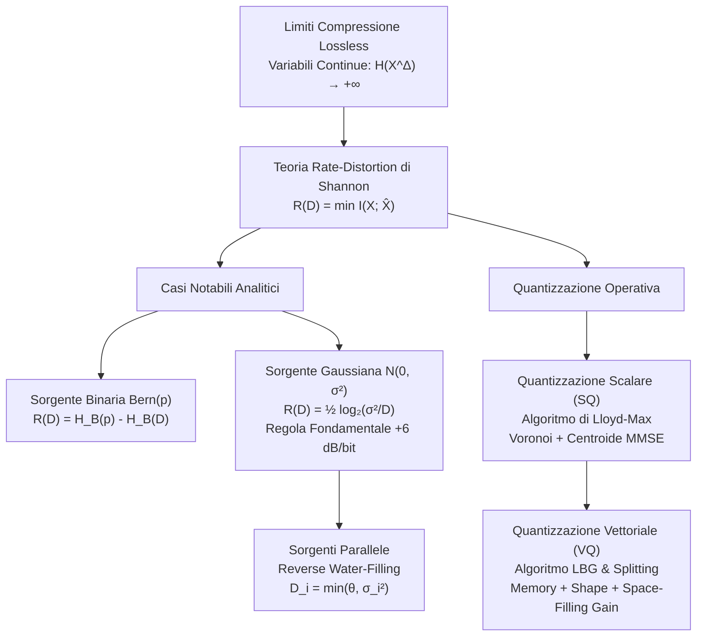

## Dai Limiti Della Compressione Lossless Alla Teoria Rate-Distortion

Comprendere la necessità della compressione con perdita richiede un'analisi puntuale di cosa accade quando discretizziamo una variabile aleatoria continua.

### Divergenza dell'Entropia per Variabili Continue

Consideriamo una variabile aleatoria continua $X$ con densità di probabilità $f(x)$ ed [[C. Entropia Differenziale e Canale Gaussiano|entropia differenziale]] $h(X)$. Se partizioniamo l'asse reale in intervalli elementari di ampiezza uniforme $\Delta$, la variabile quantizzata $X^\Delta$ presenta una distribuzione discreta con probabilità $p_i \approx f(x_i) \Delta$.

Calcolando l'entropia discreta di Shannon di $X^\Delta$, otteniamo:

$$
H(X^\Delta) = -\sum_i p_i \log_2 p_i \approx h(X) - \log_2 \Delta
$$

Nel limite in cui ricerchiamo una rappresentazione digitale infinitamente fedele ($\Delta \to 0$):

$$
\lim_{\Delta \to 0} H(X^\Delta) = h(X) - \lim_{\Delta \to 0} \log_2 \Delta = +\infty
$$

Questo risultato dimostra che una sorgente continua possiede un contenuto informativo intrinsecamente illimitato. Non potendo allocare infiniti bit, dobbiamo necessariamente introdurre un criterio matematico che quantifichi l'inevitabile errore di approssimazione.

### Criteri Di Fedeltà E Funzioni Di Distorsione

Sia $\mathcal{X}$ l'alfabeto della sorgente e $\hat{\mathcal{X}}$ l'alfabeto dei simboli di ricostruzione. Una __funzione di distorsione__ (o costo di riproduzione) per singolo simbolo è un'applicazione non negativa:

$$
d: \mathcal{X} \times \hat{\mathcal{X}} \to \mathbb{R}^+, \quad (x, \hat{x}) \mapsto d(x, \hat{x}) \ge 0
$$

Le metriche di gran lunga più utilizzate nella teoria e nella pratica ingegneristica sono:

1. __Distorsione di Hamming (alfabeti discreti)__:

$$
d_H(x, \hat{x}) = \begin{cases} 0 & \text{se } x = \hat{x} \\ 1 & \text{se } x \neq \hat{x} \end{cases}
$$

   Il valore atteso $\mathbb{E}[d_H(X, \hat{X})]$ coincide esattamente con la probabilità d'errore di simbolo $P_e = \text{Pr}\{X \neq \hat{X}\}$.

2. __Distorsione Quadratica MSE (alfabeti continui)__:

$$
d(x, \hat{x}) = (x - \hat{x})^2
$$

   Il valore atteso coincide con l'errore quadratico medio $\mathbb{E}[(X - \hat{X})^2]$, standard indiscusso per segnali audio, elaborazione d'immagini e stima parametrica.

Estendendo il criterio a blocchi di $n$ campioni $\mathbf{x} = (x_1, \dots, x_n)$ e $\hat{\mathbf{x}} = (\hat{x}_1, \dots, \hat{x}_n)$, definiamo la distorsione media additiva per campione come:

$$
\bar{d}(\mathbf{x}, \hat{\mathbf{x}}) = \frac{1}{n} \sum_{k=1}^n d(x_k, \hat{x}_k)
$$

## La Funzione Rate-Distortion Di Shannon

Shannon ha affrontato il problema ponendosi la domanda fondamentale: qual è il numero minimo di bit per campione necessario per codificare una sorgente in modo tale che il ricevitore possa ricostruirla con una distorsione media non superiore a una soglia assegnata $D$?

### Codici a Blocchi Con Perdita E Regione Ammissibile

Un codice Rate-Distortion $(2^{nR}, n)$ è composto da:
- un codificatore $f_n: \mathcal{X}^n \to \{1, 2, \dots, 2^{nR}\}$ che associa a ogni sequenza di sorgente un indice discreto;
- un decodificatore $g_n: \{1, 2, \dots, 2^{nR}\} \to \hat{\mathcal{X}}^n$ che associa all'indice una parola di codice di ricostruzione $\hat{\mathbf{x}}$.

Il tasso di trasmissione del codice è pari a $R$ bit per simbolo. Una coppia tasso-distorsione $(R, D)$ è detta __ammissibile__ (o raggiungibile) se, per qualsiasi $\epsilon > 0$ e per $n$ sufficientemente grande, esiste un codice di lunghezza $n$ e tasso al più $R + \epsilon$ la cui distorsione media soddisfa:

$$
\mathbb{E}\left[ \bar{d}(X^n, \hat{X}^n) \right] \le D + \epsilon
$$

La frontiera inferiore dell'insieme di tutte le coppie ammissibili definisce la __curva Rate-Distortion operativa__.

![[slide_20_rate_distortion_curve.png|center mid]]

### Formulazione Variazionale dell'Informazione Di Shannon

Shannon ha dimostrato che il limite operativo coincide con una grandezza probabilistica computabile, detta __funzione di informazione Rate-Distortion__:

$$
R(D) = \min_{p(\hat{x} \mid x) : \, \mathbb{E}[d(X, \hat{X})] \le D} I(X; \hat{X})
$$

dove il minimo è valutato rispetto a tutte le distribuzioni di probabilità condizionate $p(\hat{x} \mid x)$ (dette canali test di quantizzazione) che soddisfano il vincolo di distorsione media:

$$
\mathbb{E}[d(X, \hat{X})] = \sum_{x \in \mathcal{X}} \sum_{\hat{x} \in \hat{\mathcal{X}}} p(x) p(\hat{x} \mid x) d(x, \hat{x}) \le D
$$

Perché minimizziamo rispetto a $p(\hat{x} \mid x)$ tenendo fissa la sorgente $p(x)$?
La densità di sorgente $p(x)$ è un dato della natura non modificabile. La matrice di transizione $p(\hat{x} \mid x)$ descrive invece il meccanismo di quantizzazione e approssimazione. Minimizzare l'informazione mutua $I(X; \hat{X})$ equivale a cercare il quantizzatore più "parsimonioso", ossia quello che estrae dalla sorgente il minor quantitativo di bit indispensabile a garantire la fedeltà $D$.

### Il Teorema Fondamentale Di Rate-Distortion

Il risultato cardine della teoria della compressione lossy si articola in due parti speculari:

1. __Raggiungibilità (Direct Coding Theorem)__: Per ogni tasso $R > R(D)$, esiste una sequenza di codici a blocchi con lunghezza di blocco $n \to \infty$ che consegue una distorsione media asintotica $\le D$.
2. __Converso (Converse Theorem)__: È fisicamente e matematicamente impossibile progettare un sistema di compressione operante a un tasso $R < R(D)$ che rispetti il vincolo di distorsione media $D$, qualunque sia la complessità del codice o la memoria utilizzata.

### Proprietà Geometriche E Punti Notevoli Della Curva R(D)

La funzione $R(D)$ gode di proprietà geometriche strutturali:

1. __Convessità__: La funzione $R(D)$ è convessa rispetto alla distorsione $D$:

$$
R(\alpha D_1 + (1-\alpha) D_2) \le \alpha R(D_1) + (1-\alpha) R(D_2), \quad \forall \alpha \in [0, 1]
$$

   La dimostrazione formale, basata sulla convessità dell'informazione mutua rispetto ai canali di transizione per distribuzione d'ingresso fissata, è consultabile in [[Anno 1/Information and Estimation Theory/zz. Argomenti extra#Dimostrazione della Convessità della Funzione di Rate-Distortion $R(D)$]].

2. __Monotonia Decrescente e Rendimenti Marginali Decrescenti__:
   La derivata prima (pendenza della curva) è sempre non positiva:

$$
s = \frac{\mathrm{d}R}{\mathrm{d}D} \le 0, \quad \frac{\mathrm{d}^2 R}{\mathrm{d}D^2} \ge 0
$$

   All'aumentare della distorsione tollerata, il tasso in bit decresce rapidamente. Al contrario, quando $D \to 0$, la pendenza diverge ($s \to -\infty$), indicando che guadagnare frazioni minime di fedeltà a livelli di rumore bassissimi richiede un dispendio esponenziale di bit.

3. __Punto a Distorsione Nulla $R(0)$__:
   Per sorgenti discrete, quando non tolleriamo alcun errore ($D = 0$), il canale test forza $\hat{X} = X$, da cui $R(0) = I(X; X) = H(X)$. La teoria con perdita riaggancia perfettamente l'entropia della compressione senza perdita. Per sorgenti continue, invece, $R(0) \to +\infty$.

4. __Distorsione Massima a Tasso Nullo $D_{\max}$__:
   Se abbiamo a disposizione un tasso nullo ($R = 0$), non possiamo trasmettere alcun bit sul canale. Il ricevitore deve quindi generare un valore di ricostruzione deterministico costante $\hat{x}^*$ basandosi esclusivamente sulla conoscenza statistica a priori della sorgente. La distorsione massima ammissibile oltre la quale il tasso si azzera è data da:

$$
D_{\max} = \min_{\hat{x} \in \hat{\mathcal{X}}} \mathbb{E}[d(X, \hat{x})]
$$

   Per ogni $D \ge D_{\max}$, la funzione vale identicamente $R(D) = 0$.

## Calcolo Analitico: Sorgente Binaria Con Distorsione Di Hamming

Consideriamo una sorgente binaria senza memoria che emette simboli $X \in \{0, 1\}$ governati da una legge di Bernoulli con parametro di sbilanciamento $p$:

$$
\text{Pr}\{X = 1\} = p, \quad \text{Pr}\{X = 0\} = 1 - p
$$

Senza perdita di generalità, assumiamo $0 \le p \le \frac{1}{2}$. Adottiamo come metrica la distorsione di Hamming $d_H(x, \hat{x})$.

### Derivazione Analitica Del Limite Inferiore

Sviluppiamo l'informazione mutua per un generico canale test $p(\hat{x} \mid x)$:

$$
I(X; \hat{X}) = H(X) - H(X \mid \hat{X}) = H_B(p) - H(X \oplus \hat{X} \mid \hat{X})
$$

dove $H_B(q) = -q \log_2 q - (1-q) \log_2(1-q)$ rappresenta la funzione di entropia binaria e $\oplus$ indica la somma modulo 2 (operatore XOR).

Poiché il condizionamento non può mai incrementare l'entropia:

$$
H(X \oplus \hat{X} \mid \hat{X}) \le H(X \oplus \hat{X})
$$

Definiamo la variabile binaria indicatrice d'errore $E = X \oplus \hat{X}$. Il vincolo di distorsione impone che:

$$
\text{Pr}\{E = 1\} = \mathbb{E}[d_H(X, \hat{X})] \le D
$$

Essendo la funzione $H_B(q)$ monotona strettamente crescente nell'intervallo $q \in [0, 1/2]$, per qualsiasi distorsione $D \le p \le 1/2$ abbiamo:

$$
H(X \oplus \hat{X}) = H_B(\text{Pr}\{E = 1\}) \le H_B(D)
$$

Concatenando le disuguaglianze, otteniamo il limite inferiore:

$$
I(X; \hat{X}) \ge H_B(p) - H_B(D)
$$

### Raggiungibilità E Comportamento Ad Alta Distorsione

Dimostriamo che questo limite è esattamente raggiungibile costruendo il canale test inverso (backward channel). Poniamo:

$$
X = \hat{X} \oplus Z
$$

dove $Z \sim \text{Bern}(D)$ è indipendente da $\hat{X}$. Affinché la marginale di $X$ mantenga parametro $p$, la distribuzione di $\hat{X}$ deve soddisfare:

$$
p = \text{Pr}\{\hat{X} = 1\}(1 - D) + \text{Pr}\{\hat{X} = 0\} D
$$

Risolvendo rispetto a $\text{Pr}\{\hat{X} = 1\}$, otteniamo:

$$
\text{Pr}\{\hat{X} = 1\} = \frac{p - D}{1 - 2D}
$$

Poiché per $D \le p$ tale probabilità è compresa in $[0, 1/2]$, il canale inverso esiste ed è legittimo. In questa configurazione, $H(X \oplus \hat{X} \mid \hat{X}) = H(Z) = H_B(D)$, e la disuguaglianza diventa un'uguaglianza stretta.

Cosa accade se tolleriamo una distorsione $D \ge p$?
In questo caso, il codificatore non ha bisogno di trasmettere alcun bit ($R = 0$). Il ricevitore pone deterministicamente $\hat{X} = 0$ per ogni simbolo. La distorsione media risulta pari a:

$$
\mathbb{E}[d_H(X, 0)] = \text{Pr}\{X \neq 0\} = \text{Pr}\{X = 1\} = p \le D
$$

Pertanto, per $D \ge p$, la distorsione tollerata è già soddisfatta a costo informativo nullo. La funzione Rate-Distortion per la sorgente di Bernoulli vale:

$$
R(D) = \begin{cases} H_B(p) - H_B(D) & \text{se } 0 \le D \le p \\ 0 & \text{se } D > p \end{cases} \quad \text{bit/simbolo}
$$

### Caso Studio Applicativo: Griglie Di Occupazione in Robotica Autonoma

Nei robot mobili dotati di sensori LiDAR o radar per la navigazione autonoma, l'ambiente circostante è discretizzato in una mappa a griglia di occupazione bidimensionale (Occupancy Grid Map). Ciascuna cella è una variabile binaria: $X = 1$ indica presenza di un ostacolo, $X = 0$ indica spazio libero calpestabile.

In ambienti industriali strutturati, la densità media di ostacoli è pari al $30\%$ ($p = 0.30$). Per trasmettere la mappa senza perdite via radio al server di flotta occorrono:

$$
H_B(0.30) = -0.30 \log_2(0.30) - 0.70 \log_2(0.70) \approx 0.8813 \quad \text{bit/cella}
$$

Se l'algoritmo di pianificazione delle traiettorie tollera un tasso d'errore di classificazione del $10\%$ ($D = 0.10$):

$$
H_B(0.10) = -0.10 \log_2(0.10) - 0.90 \log_2(0.90) \approx 0.4690 \quad \text{bit/cella}
$$

Il tasso trasmissivo minimo richiesto crolla a:

$$
R(0.10) = H_B(0.30) - H_B(0.10) = 0.8813 - 0.4690 = 0.4123 \quad \text{bit/cella}
$$

Accettando una distorsione del $10\%$, il robot riduce l'occupazione di banda radio del $53.2\%$.

> [!TIP] __Trabocchetto d'Esame: Il Dominio della Distorsione Binaria__
> Nei compiti d'esame capita spesso che venga richiesto di calcolare $R(D)$ per $D > p$. L'errore più comune consiste nell'applicare ciecamente la formula $H_B(p) - H_B(D)$, ottenendo un valore negativo privo di senso fisico.
> Ricorda sempre: non appena $D \ge p$, la stima banale costante $\hat{X} = 0$ soddisfa il vincolo con zero bit, imponendo tassativamente $R(D) = 0$.

## Calcolo Analitico: Sorgente Gaussiana Con Distorsione Quadratica

La sorgente gaussiana sotto distorsione quadratica MSE rappresenta il pilastro teorico dell'elaborazione numerica dei segnali continui.

### Derivazione Analitica Della Funzione R(D)

Sia $X \sim \mathcal{N}(0, \sigma^2)$ una variabile continua normale con varianza $\sigma^2$, e consideriamo la distorsione quadratica $d(x, \hat{x}) = (x - \hat{x})^2$.

Sviluppiamo l'informazione mutua sfruttando l'entropia differenziale:

$$
I(X; \hat{X}) = h(X) - h(X \mid \hat{X}) = h(X) - h(X - \hat{X} \mid \hat{X})
$$

Poiché condizionare riduce l'entropia differenziale:

$$
h(X - \hat{X} \mid \hat{X}) \le h(X - \hat{X})
$$

Il vincolo di fedeltà impone che l'errore di quantizzazione soddisfi $\mathbb{E}[(X - \hat{X})^2] \le D$. Tra tutte le distribuzioni continue aventi varianza fissata o limitata da $D$, la distribuzione gaussiana è quella che massimizza l'entropia differenziale (come dimostrato in [[Anno 1/Information and Estimation Theory/zz. Argomenti extra#Dimostrazione Variazionale dell'Ottimalità della PDF Gaussiana come Massimizzatore di Entropia Differenziale]]):

$$
h(X - \hat{X}) \le \frac{1}{2} \log_2(2\pi e D)
$$

Sapendo che l'entropia differenziale della sorgente è $h(X) = \frac{1}{2}\log_2(2\pi e \sigma^2)$, otteniamo la disuguaglianza:

$$
I(X; \hat{X}) \ge \frac{1}{2} \log_2(2\pi e \sigma^2) - \frac{1}{2} \log_2(2\pi e D) = \frac{1}{2} \log_2\left( \frac{\sigma^2}{D} \right)
$$

Per dimostrare l'esatta uguaglianza, costruiamo il canale test inverso ponendo:

$$
X = \hat{X} + Z
$$

dove $Z \sim \mathcal{N}(0, D)$ è indipendente dalla ricostruzione $\hat{X}$. Affinché la varianza totale di $X$ sia $\sigma^2$, la variabile di ricostruzione deve seguire la distribuzione $\hat{X} \sim \mathcal{N}(0, \sigma^2 - D)$.

Tale costruzione è matematicamente valida se e solo se $\sigma^2 - D \ge 0$, ossia $D \le \sigma^2$. Se $D > \sigma^2$, il ricevitore adotta la stima costante a media nulla $\hat{X} = 0$, conseguendo una distorsione pari alla varianza naturale $\mathbb{E}[X^2] = \sigma^2 < D$ a costo zero bit.

La funzione Rate-Distortion della sorgente gaussiana è quindi:

$$
R(D) = \begin{cases} \frac{1}{2} \log_2\left( \frac{\sigma^2}{D} \right) & \text{se } 0 \le D \le \sigma^2 \\ 0 & \text{se } D > \sigma^2 \end{cases} \quad \text{bit/campione}
$$

La derivazione formale completa è consultabile in [[Anno 1/Information and Estimation Theory/zz. Argomenti extra#Teorema di Rate-Distortion per la Sorgente Gaussiana con Distorsione Quadratica]].

### Funzione Distortion-Rate E la Regola Fondamentale Dei +6 dB per Bit

Invertendo la relazione tra tasso e distorsione per $R \ge 0$, otteniamo la formulazione duale della __funzione Distortion-Rate__:

$$
D(R) = \sigma^2 2^{-2R}
$$

Questa relazione esponenziale evidenzia una legge cardine di tutto il signal processing digitale. Calcoliamo il rapporto segnale-rumore di quantizzazione (Signal-to-Distortion Ratio, SDR) espresso in decibel:

$$
\text{SDR}_{\text{dB}} = 10 \log_{10}\left( \frac{\sigma^2}{D(R)} \right) = 10 \log_{10}(2^{2R}) = 2R \cdot 10 \log_{10}(2)
$$

Poiché $10 \log_{10}(2) \approx 3.0103$ dB:

$$
\text{SDR}_{\text{dB}} \approx 6.02 \cdot R \quad \text{dB}
$$

Se aumentiamo la risoluzione di un singolo bit per campione ($R \to R + 1$):

$$
D(R+1) = \sigma^2 2^{-2(R+1)} = \frac{1}{4} D(R)
$$

$$
\Delta \text{SDR} = 10 \log_{10}(4) \approx 6.02 \quad \text{dB}
$$

> [!IMPORTANT] __Regola d'Oro dei +6 dB per Bit__
> Ogni bit supplementare allocato per campione dimezza la dispersione dell'errore, riduce la distorsione quadratica di un fattore 4 e incrementa il rapporto segnale-rumore di quantizzazione esattamente di circa __$6.02$ dB__.

### Caso Studio Applicativo: Telemetria Sensoristica LoRaWAN

Consideriamo un sensore IoT per il monitoraggio sismico di un ponte, collegato tramite rete a lungo raggio LoRaWAN. Il sensore rileva vibrazioni meccaniche modellate come una gaussiana $\mathcal{N}(0, \sigma^2)$.

A causa delle severe limitazioni di banda e di trasmissione (duty cycle all'1%), dobbiamo comprimere i dati al minimo bitrate possibile:
- A $R = 1$ bit/campione: il limite di Shannon impone una distorsione minima $D = \sigma^2 / 4$, fornendo uno $\text{SDR} = 6.02$ dB.
- A $R = 2$ bit/campione: la distorsione scende a $D = \sigma^2 / 16$, raggiungendo uno $\text{SDR} = 12.04$ dB.
- A $R = 3$ bit/campione: la distorsione crolla a $D = \sigma^2 / 64$, ottenendo uno $\text{SDR} = 18.06$ dB.

Ciascun incremento unitario di bit aggiunge esattamente $6.02$ dB di qualità al segnale ricostruito a destinazione.

> [!TIP] __Trabocchetto d'Esame: Canale Diretto vs Canale Retrogrado__
> Nella derivazione gaussiana, non commettere l'errore di scrivere $X = \hat{X} + Z$ con $\hat{X}$ e $Z$ indipendenti nel quantizzatore reale. Nel quantizzatore fisico, $\hat{X} = Q(X)$, quindi l'errore $X - \hat{X}$ è correlato con $X$.
> L'indipendenza statistica sussiste esclusivamente nel canale test fittizio orientato a ritroso da $\hat{X}$ verso $X$.

## Sorgenti Gaussiane Parallele E Principio Di Reverse Water-Filling

Nei moderni algoritmi di compressione audio, immagini e video (quali MP3, AAC, JPEG e H.264), i segnali reali presentano forte correlazione temporale o spaziale. Tramite trasformate ortogonali (come la KLT, la DCT o le Wavelet), il segnale viene decomposto in un insieme di $m$ componenti spettrali tra loro incorrelate.

Consideriamo un vettore di $m$ sorgenti gaussiane indipendenti:

$$
X_i \sim \mathcal{N}(0, \sigma_i^2), \quad i = 1, 2, \dots, m
$$

ordinate in senso non crescente di energia: $\sigma_1^2 \ge \sigma_2^2 \ge \dots \ge \sigma_m^2$.

Assegniamo al codificatore un budget di distorsione quadratica totale $D$. Il problema consiste nel distribuire la distorsione tra le singole componenti ($D = \sum_{i=1}^m D_i$) in modo da minimizzare il tasso complessivo di codifica:

$$
R(D) = \min_{\substack{\{D_i\}_{i=1}^m : \\ \sum D_i \le D, \\ 0 < D_i \le \sigma_i^2}} \sum_{i=1}^m \frac{1}{2} \log_2\left( \frac{\sigma_i^2}{D_i} \right)
$$

### Formulazione Variazionale dell'Allocazione Congiunta

Impostiamo la funzione Lagrangiana associata al problema di minimizzazione convessa vincolata:

$$
\mathcal{L}(D_1, \dots, D_m, \mu, \boldsymbol{\lambda}) = \sum_{i=1}^m \frac{1}{2} \log_2\left( \frac{\sigma_i^2}{D_i} \right) + \mu \left( \sum_{i=1}^m D_i - D \right) - \sum_{i=1}^m \lambda_i (\sigma_i^2 - D_i)
$$

dove $\mu \ge 0$ è il moltiplicatore associato al vincolo di budget globale e $\lambda_i \ge 0$ sono i moltiplicatori associati ai vincoli di non eccedenza $D_i \le \sigma_i^2$.

### Risoluzione Analitica Tramite Moltiplicatori Di Lagrange E KKT

Calcoliamo la derivata parziale rispetto a ciascuna distorsione $D_i$ e imponiamo le condizioni di Karush-Kuhn-Tucker (KKT):

$$
\frac{\partial \mathcal{L}}{\partial D_i} = -\frac{1}{2 \ln 2 \cdot D_i} + \mu + \lambda_i = 0
$$

Definiamo la soglia costante di distorsione:

$$
\theta = \frac{1}{2 \ln 2 \cdot \mu}
$$

Dalle condizioni di complementarità KKT ($\lambda_i (\sigma_i^2 - D_i) = 0$ con $\lambda_i \ge 0$):

1. __Componenti dominanti ad alta energia ($\sigma_i^2 > \theta$)__:
   Il vincolo $D_i \le \sigma_i^2$ non è attivo, quindi $\lambda_i = 0$. Dalla derivata ricaviamo:

$$
D_i = \theta
$$

   Il tasso allocato è strettamente positivo:

$$
R_i = \frac{1}{2} \log_2\left( \frac{\sigma_i^2}{\theta} \right) > 0
$$

2. __Componenti deboli a bassa energia ($\sigma_i^2 \le \theta$)__:
   Se imponessimo $D_i = \theta$, avremmo $D_i > \sigma_i^2$, violando il vincolo. Il vincolo deve quindi essere attivo ($\lambda_i > 0$), imponendo:

$$
D_i = \sigma_i^2
$$

   Il tasso assegnato alla componente si annulla:

$$
R_i = 0
$$

Riassumendo, la legge di allocazione ottima per ciascuna componente vale:

$$
D_i = \min(\theta, \sigma_i^2) = \begin{cases} \theta & \text{se } \sigma_i^2 > \theta \\ \sigma_i^2 & \text{se } \sigma_i^2 \le \theta \end{cases}
$$

$$
R_i = \max\left( 0, \, \frac{1}{2}\log_2\left( \frac{\sigma_i^2}{\theta} \right) \right) = \begin{cases} \frac{1}{2}\log_2\left( \frac{\sigma_i^2}{\theta} \right) & \text{se } \sigma_i^2 > \theta \\ 0 & \text{se } \sigma_i^2 \le \theta \end{cases}
$$

dove il parametro di soglia $\theta$ è individuato in modo univoco imponendo la conservazione del budget di distorsione:

$$
\sum_{i=1}^m \min(\theta, \sigma_i^2) = D
$$

Il tasso complessivo per il blocco di sorgenti gaussiane parallele risulta pari a:

$$
R(D) = \sum_{i=1}^m R_i = \sum_{i=1}^m \max\left( 0, \, \frac{1}{2} \log_2\left( \frac{\sigma_i^2}{\theta} \right) \right)
$$

La derivazione formale estesa è consultabile in [[Anno 1/Information and Estimation Theory/zz. Argomenti extra#Derivazione Rigorosa della Soluzione di Reverse Water-Filling per Sorgenti Gaussiane Parallele]].

### Interpretazione Geometrica E Contrasto Con Il Canale Parallelo

La dinamica geometrica di questa soluzione prende il nome di __Reverse Water-Filling__ (riempimento inverso d'acqua).

![[reverse_water_filling_geometry.svg|center mid]]

![[slide_46_reverse_water_filling.png|center mid]]

Analizziamo il contrasto logico e operativo fondamentale tra i due algoritmi di Shannon:

1. __Water-Filling Diretto di Canale__:
   - Nel problema di trasmissione su canali paralleli con rumori $\{N_i\}$, disponiamo di un budget di __potenza__ $P$.
   - Versiamo la potenza nei canali che presentano il __minor livello di rumore__ ($N_i < \nu$), garantendo la massima capacità. I canali rumorosi e degradati vengono spenti ponendo $P_i = 0$.

2. __Reverse Water-Filling di Sorgente__:
   - Nel problema di compressione con distorsione su sorgenti con energie $\{\sigma_i^2\}$, disponiamo di un budget di __distorsione tollerata__ $D$.
   - Riempiamo le componenti di distorsione dal basso fino al livello $\theta$.
   - Proteggiamo e codifichiamo con bit ($R_i > 0$) unicamente le componenti ad __alta varianza__ ($\sigma_i^2 > \theta$), pareggiandone la distorsione residua alla quota comune $\theta$.
   - Al contrario, le componenti a bassa varianza ($\sigma_i^2 \le \theta$) vengono completamente scartate dal codificatore ponendo $R_i = 0$ e assorbendo la loro intera varianza naturale come distorsione: $D_i = \sigma_i^2$.

### Impatto Ingegneristico: la Codifica per Trasformata

Il Reverse Water-Filling fornisce la giustificazione teorica universale della __codifica per trasformata__ (Transform Coding, Goyal 2001).

Nello standard JPEG per immagini fisse o nei codec video MPEG:
1. L'immagine viene suddivisa in blocchi $8 \times 8$ pixel e proiettata nel dominio della frequenza spaziale tramite la Trasformata Discreta del Coseno (DCT).
2. La DCT concentra l'energia visiva su pochissimi coefficienti a bassa frequenza (ad altissima varianza), lasciando i coefficienti ad alta frequenza con varianza prossima allo zero.
3. Il quantizzatore alloca bit quasi esclusivamente ai coefficienti a grande varianza, azzerando completamente i coefficienti al di sotto della soglia di distorsione $\theta$.

Questo principio permette di eliminare oltre il $90\%$ dei dati senza che l'occhio umano percepisca artefatti visibili.

> [!TIP] __Trabocchetto d'Esame: Determinazione della Soglia $\theta$__
> Negli esercizi numerici d'esame con Reverse Water-Filling, non ipotizzare a priori che tutte le componenti siano attive ($R_i > 0$).
> Procedi a ritroso: calcola $\theta$ ipotizzando che tutte le $m$ componenti siano accese ($\theta = D / m$). Se verifichi che per una o più componenti $\sigma_i^2 \le \theta$, scartale immediatamente ponendo $D_i = \sigma_i^2$, sottrai la loro varianza dal budget totale ($D_{\text{rimasto}} = D - \sum_{\text{spente}} \sigma_i^2$) e ricalcola la soglia $\theta$ unicamente sul sottoinsieme delle componenti rimaste attive.

## Quantizzazione Scalare Ottima Di Lloyd-Max

La teoria Rate-Distortion di Shannon definisce il limite teorico insuperabile operando su blocchi di lunghezza infinita ($n \to \infty$). Nella pratica implementativa di convertitori analogico-digitali (ADC) e DSP a bassissima latenza, il dispositivo basilare è il __quantizzatore scalare__, che elabora i campioni uno alla volta in modo istantaneo.

### Formulazione Matematica Del Quantizzatore a K Livelli

Sia $X \in \mathbb{R}$ una variabile aleatoria continua con densità di probabilità $f(x)$. Un quantizzatore scalare a $K$ livelli è una funzione:

$$
Q: \mathbb{R} \to \{y_1, y_2, \dots, y_K\}
$$

che partiziona l'asse reale in $K$ intervalli disgiunti (celle di quantizzazione) mediante $K+1$ soglie di decisione ordinate:

$$
-\infty = t_0 < t_1 < t_2 < \dots < t_{K-1} < t_K = +\infty
$$

Assegnando a ciascun intervallo $\mathcal{R}_i = (t_{i-1}, t_i]$ un unico livello discreto di ricostruzione $y_i \in \mathbb{R}$:

$$
Q(x) = y_i \quad \text{se } x \in \mathcal{R}_i = (t_{i-1}, t_i]
$$

Sotto distorsione quadratica, l'errore medio totale è dato dal funzionale:

$$
D = \mathbb{E}[(X - Q(X))^2] = \sum_{i=1}^K \int_{t_{i-1}}^{t_i} (x - y_i)^2 f(x) \mathrm{d}x
$$

Il problema della quantizzazione scalare ottima consiste nell'individuare simultaneamente le $K-1$ soglie interne $\{t_i\}_{i=1}^{K-1}$ e i $K$ livelli di ricostruzione $\{y_i\}_{i=1}^K$ che minimizzano $D$.

### Derivazione Delle Due Condizioni Di Ottimalità

Derivando il funzionale $D$ e imponendo l'annullamento del gradiente, Stuart Lloyd (1957) e Joel Max (1960) hanno stabilito che qualsiasi quantizzatore ottimo deve verificare due condizioni necessarie:

1. __Condizione della Soglia (Nearest Neighbor / Partizione di Voronoi)__:
   Deriviamo $D$ rispetto alla generica soglia interna $t_i$:

$$
\frac{\partial D}{\partial t_i} = (t_i - y_i)^2 f(t_i) - (t_i - y_{i+1})^2 f(t_i) = 0
$$

   Assumendo che la densità di probabilità non sia nulla sulla soglia ($f(t_i) > 0$):

$$
(t_i - y_i)^2 = (t_i - y_{i+1})^2 \implies t_i - y_i = -(t_i - y_{i+1})
$$

   da cui otteniamo la regola fondamentale:

$$
t_i = \frac{y_i + y_{i+1}}{2}, \quad i = 1, 2, \dots, K-1
$$

   Fissati i livelli di ricostruzione $\{y_i\}$, ciascuna soglia ottima coincide esattamente con il punto medio tra due livelli adiacenti. Ogni regione $\mathcal{R}_i$ è una cella di Voronoi unidimensionale in cui ciascun punto $x$ è associato al livello $y_i$ geometricamente più vicino.

2. __Condizione del Centroide (Stima MMSE / Baricentro Condizionato)__:
   Deriviamo $D$ rispetto al generico livello di ricostruzione $y_i$:

$$
\frac{\partial D}{\partial y_i} = -2 \int_{t_{i-1}}^{t_i} (x - y_i) f(x) \mathrm{d}x = 0
$$

   Sviluppando l'integrale:

$$
\int_{t_{i-1}}^{t_i} x f(x) \mathrm{d}x = y_i \int_{t_{i-1}}^{t_i} f(x) \mathrm{d}x
$$

   da cui discende:

$$
y_i = \frac{\int_{t_{i-1}}^{t_i} x f(x) \mathrm{d}x}{\int_{t_{i-1}}^{t_i} f(x) \mathrm{d}x} = \mathbb{E}[X \mid X \in \mathcal{R}_i], \quad i = 1, 2, \dots, K
$$

   Fissata la partizione dello spazio, ciascun livello di ricostruzione deve coincidere con il valore atteso condizionato di $X$ all'interno della cella, in perfetta risonanza con lo stimatore bayesiano MMSE ricavato in [[Anno 1/Information and Estimation Theory/zz. Argomenti extra#Ottimalità della Media a Posteriori per il Criterio MMSE]].

### Algoritmo Iterativo Ad Alternanza E Proprietà Di Convergenza

Poiché le soglie dipendono dai livelli e i livelli dipendono a loro volta dalle soglie, il sistema di equazioni non ammette soluzione analitica in forma chiusa per distribuzioni generali.

L'__algoritmo di Lloyd-Max__ risolve il problema tramite iterazione alternata:
1. __Inizializzazione__: Si sceglie un insieme arbitrario di $K$ livelli distinti $\{y_i^{(0)}\}$.
2. __Passo di Partizione__: Si aggiornano le soglie come punti medi:

$$
t_i^{(k)} = \frac{y_i^{(k)} + y_{i+1}^{(k)}}{2}
$$

3. __Passo del Centroide__: Si ricalcolano i livelli come baricentri sulle nuove celle:

$$
y_i^{(k+1)} = \mathbb{E}\left[ X \mid X \in (t_{i-1}^{(k)}, t_i^{(k)}] \right]
$$

4. __Arresto__: Si calcola la variazione di distorsione. Poiché ciascun semipasso minimizza la distorsione condizionata lasciando inalterata l'altra variabile, la sequenza di distorsioni $\{D^{(k)}\}$ è monotona non crescente e converge a un minimo locale (che coincide con il minimo globale per densità log-concave come la gaussiana).

### Caso Studio Analitico: Quantizzatore Gaussiano a 1 Bit

Calcoliamo analiticamente il quantizzatore ottimo di Lloyd-Max a 1 bit ($K = 2$ livelli) per una gaussiana standard $X \sim \mathcal{N}(0, \sigma^2)$.

Per ragioni di simmetria rispetto all'origine:
- la soglia di decisione è $t_1 = 0$, determinando le due regioni $\mathcal{R}_1 = (-\infty, 0]$ e $\mathcal{R}_2 = (0, +\infty)$;
- i livelli sono opposti: $y_1 = -y_2$.

Calcoliamo il livello positivo $y_2$ applicando la condizione del centroide:

$$
y_2 = \mathbb{E}[X \mid X > 0] = \frac{\int_0^{+\infty} x \frac{1}{\sqrt{2\pi\sigma^2}} e^{-\frac{x^2}{2\sigma^2}} \mathrm{d}x}{\text{Pr}\{X > 0\}} = \frac{\frac{1}{\sqrt{2\pi\sigma^2}} \left[ -\sigma^2 e^{-\frac{x^2}{2\sigma^2}} \right]_0^{+\infty}}{\frac{1}{2}}
$$

Sostituendo gli estremi di integrazione:

$$
y_2 = 2 \cdot \frac{\sigma^2}{\sqrt{2\pi\sigma^2}} (0 - (-1)) = \sqrt{\frac{2}{\pi}} \sigma \approx 0.7979 \sigma
$$

I due livelli ottimi di ricostruzione sono quindi:

$$
y_1 = -\sqrt{\frac{2}{\pi}}\sigma, \quad y_2 = +\sqrt{\frac{2}{\pi}}\sigma
$$

Calcoliamo la distorsione quadratica media risultante:

$$
D = \mathbb{E}[(X - Q(X))^2] = \mathbb{E}[X^2] - 2\mathbb{E}[X Q(X)] + \mathbb{E}[Q(X)^2]
$$

Notiamo che $Q(X)^2 = y_2^2 = \frac{2}{\pi}\sigma^2$ con probabilità 1. Inoltre:

$$
\mathbb{E}[X Q(X)] = \int_{-\infty}^0 x y_1 f(x) \mathrm{d}x + \int_0^{+\infty} x y_2 f(x) \mathrm{d}x = 2 y_2 \left( \frac{1}{2} y_2 \right) = y_2^2
$$

La distorsione minima vale quindi:

$$
D = \sigma^2 - y_2^2 = \sigma^2 - \frac{2}{\pi}\sigma^2 = \sigma^2 \left( 1 - \frac{2}{\pi} \right) \approx 0.3634 \sigma^2
$$

Il rapporto segnale-rumore di quantizzazione (SQNR) in decibel è:

$$
\text{SQNR} = 10 \log_{10}\left( \frac{\sigma^2}{D} \right) = 10 \log_{10}\left( \frac{1}{1 - 2/\pi} \right) \approx 10 \log_{10}(2.752) \approx 4.40 \quad \text{dB}
$$

Confrontiamo questo risultato con il limite teorico di Shannon $R(D)$:
Per $R = 1$ bit, la formula di Shannon fornisce una distorsione minima pari a $D_{\text{Shannon}} = \sigma^2 2^{-2(1)} = 0.25 \sigma^2$, con uno $\text{SQNR} = 6.02$ dB.
Il miglior quantizzatore scalare possibile paga uno scarto incolmabile di $1.62$ dB rispetto al limite ultimo della teoria dell'informazione.

### Quantizzatore Gaussiano a 2 Bit E Confronto Con la Quantizzazione Uniforme

Risolvendo l'algoritmo di Lloyd-Max per $K = 4$ livelli ($R = 2$ bit) su una gaussiana standard $X \sim \mathcal{N}(0, 1)$, l'iterazione numerica converge a:
- Soglie ottime: $t_1 = -0.9816$, $t_2 = 0.0000$, $t_3 = +0.9816$;
- Livelli di ricostruzione: $y_1 = -1.5104$, $y_2 = -0.4528$, $y_3 = +0.4528$, $y_4 = +1.5104$;
- Distorsione quadratica: $D \approx 0.1175 \sigma^2$;
- Rapporto segnale-rumore: $\text{SQNR} \approx 9.30$ dB.

A titolo di confronto:
- Un quantizzatore scalare a passo uniforme con 4 livelli produce uno $\text{SQNR} \approx 7.84$ dB. Lloyd-Max guadagna ben $1.46$ dB senza alcun costo di banda.
- Il bound di Shannon a $R = 2$ bit è pari a $D = \sigma^2 / 16 = 0.0625 \sigma^2$, ossia $\text{SQNR} = 12.04$ dB. Il divario tra quantizzazione scalare e limite teorico sale a $2.74$ dB.

> [!TIP] __Trabocchetto d'Esame: Centroide vs Punto Medio__
> In un quantizzatore di Lloyd-Max, le soglie sono a metà strada tra i livelli di ricostruzione ($t_i = (y_i + y_{i+1})/2$), ma i livelli di ricostruzione __non__ si trovano a metà strada tra le soglie ($y_i \neq (t_{i-1} + t_i)/2$).
> I livelli $y_i$ sono i baricentri probabilistici condizionati, quindi sono spostati verso le zone in cui la densità $f(x)$ è più alta. Solo per la distribuzione uniforme i centroidi coincidono con i punti medi geometrici.

## Quantizzazione Vettoriale E Algoritmo LBG

Il crescente divario tra le prestazioni di Lloyd-Max e il limite di Shannon dimostra che elaborare i campioni in modo isolato è intrinsecamente subottimo. Per superare questa limitazione si adotta la __Quantizzazione Vettoriale__ (Vector Quantization, VQ).

In un quantizzatore vettoriale di dimensione $n$, raggruppiamo i campioni della sorgente in vettori $\mathbf{X} = (X_1, \dots, X_n)^T \in \mathbb{R}^n$. Lo spazio euclideo multidimensionale viene partizionato direttamente in celle di Voronoi $n$-dimensionali $\{\mathcal{R}_j\}_{j=1}^K$, associando a ciascuna cella una parola di codice vettoriale (codeword) $\mathbf{y}_j \in \mathbb{R}^n$.

![[slide_41_lbg_vector_quantization.png|center mid]]

### Perché Quantizzare Vettori: I Tre Guadagni Strutturali

Come formalizzato da Allen Lookabaugh e Robert M. Gray (1989), la superiorità della quantizzazione vettoriale rispetto a quella scalare risiede in tre vantaggi matematici distinti:

1. __Guadagno di Memoria (Memory/Correlation Gain)__:
   Se i campioni consecutivi del segnale sono correlati o dipendenti, la loro densità di probabilità congiunta si concentra su iper-ellissoidi orientati. La quantizzazione scalare cartesiana alloca celle su un'intera griglia quadrata o cubica, sprecando parole di codice in regioni a probabilità nulla. La VQ adatta invece la geometria dei centroidi disponendoli esclusivamente dove la densità di probabilità è elevata.

2. __Guadagno di Forma della PDF (Shape Gain)__:
   Anche per sorgenti prive di memoria con componenti incorrelate, le superfici di livello della densità congiunta sono sferiche o ellissoidali. Le celle scalari hanno la forma rigida di ipercubi, i cui spigoli si allontanano notevolmente dal centroide aumentando il momento d'inerzia medio. La VQ modella invece celle sferoidali con dispersione radiale minima.

3. __Guadagno di Riempimento dello Spazio (Space-Filling Gain)__:
   Nello spazio bidimensionale $\mathbb{R}^2$, il reticolo che minimizza il momento d'inerzia normalizzato per unità di volume non è la griglia quadrata cartesiana $\mathbb{Z}^2$, bensì il __reticolo esagonale__ $A_2$:

$$
G(A_2) = \frac{5}{36\sqrt{3}} \approx 0.080188
$$

   mentre per il reticolo cubico cartesiano $\mathbb{Z}^2$ (prodotto di quantizzatori scalari):

$$
G(\mathbb{Z}^2) = \frac{1}{12} \approx 0.083333
$$

   La quantizzazione vettoriale su reticolo esagonale garantisce un guadagno immediato:

$$
\Delta \text{SQNR} = 10 \log_{10}\left( \frac{0.083333}{0.080188} \right) \approx 0.169 \quad \text{dB}
$$

   Al crescere della dimensione dello spazio vettoriale verso l'infinito ($n \to \infty$), il celebre __Teorema di Zador__ dimostra che il guadagno di riempimento satura al limite asintotico universale:

$$
\Delta \text{SQNR}_{\max} = 10 \log_{10}\left( \frac{\pi e}{6} \right) \approx 1.53 \quad \text{dB}
$$

### L'Algoritmo Di Linde-Buzo-Gray Su Dataset Empirici

La progettazione analitica di un quantizzatore vettoriale richiederebbe il calcolo di integrali multipli di volume su politopi complessi in $\mathbb{R}^n$, operazione analiticamente intrattabile.

Nel 1980, Yoseph Linde, Andrés Buzo e Robert M. Gray hanno sviluppato l'__algoritmo LBG__, che consente di sintetizzare un codebook vettoriale ottimo operando direttamente su un insieme di campioni di addestramento (Training Set), senza alcuna necessità di conoscere la PDF analitica della sorgente.

Sia dato un training set composto da $N$ vettori continui $n$-dimensionali:

$$
\mathcal{T} = \{ \mathbf{x}_1, \mathbf{x}_2, \dots, \mathbf{x}_N \}, \quad \mathbf{x}_k \in \mathbb{R}^n
$$

L'obiettivo è individuare un codebook $\mathcal{C} = \{ \mathbf{y}_1, \dots, \mathbf{y}_K \}$ che minimizzi la distorsione empirica:

$$
J = \frac{1}{N} \sum_{k=1}^N \min_{1 \le j \le K} \|\mathbf{x}_k - \mathbf{y}_j\|^2
$$

L'algoritmo alterna due semipassi fondamentali (equivalente al $k$-means per l'elaborazione dei segnali):

1. __Passo di Partizione di Voronoi__:
   Assegniamo ciascun vettore di addestramento $\mathbf{x}_k$ al centroide corrente più vicino secondo la distanza euclidea minima, partizionando $\mathcal{T}$ in $K$ cluster disgiunti:

$$
\mathcal{S}_j = \left\{ \mathbf{x} \in \mathcal{T} : \|\mathbf{x} - \mathbf{y}_j\|^2 \le \|\mathbf{x} - \mathbf{y}_i\|^2 \quad \forall i \neq j \right\}
$$

2. __Passo di Aggiornamento dei Centroidi__:
   Ricalcoliamo ciascuna codeword come centroide empirico (media aritmetica vettoriale) dei campioni assegnati al rispettivo cluster:

$$
\mathbf{y}_j = \frac{1}{|\mathcal{S}_j|} \sum_{\mathbf{x} \in \mathcal{S}_j} \mathbf{x}
$$

A ogni iterazione la distorsione empirica $J$ decresce monotonicamente. L'iterazione si arresta quando il decremento relativo scende sotto una soglia di tolleranza $\epsilon$:

$$
\frac{J^{(k-1)} - J^{(k)}}{J^{(k)}} < \epsilon
$$

### Tecnica Di Splitting Del Codebook

Per evitare di rimanere intrappolati in minimi locali sfavorevoli e costruire codebook con cardinalità pari a potenze di due ($K = 2^m$), l'algoritmo LBG impiega la tecnica di __sdoppiamento ricorsivo__ (Codebook Splitting):

1. Si calcola il baricentro globale unico dell'intero dataset ($K = 1$):

$$
\mathbf{y}_1^{(0)} = \frac{1}{N} \sum_{k=1}^N \mathbf{x}_k
$$

2. Si sdoppia ciascun centroide esistente $\mathbf{y}_j$ lungo un vettore di perturbazione casuale $\boldsymbol{\epsilon}$:

$$
\mathbf{y}_j^+ = \mathbf{y}_j + \boldsymbol{\epsilon}, \quad \mathbf{y}_j^- = \mathbf{y}_j - \boldsymbol{\epsilon}
$$

   raddoppiando istantaneamente la dimensione del codebook ($1 \to 2 \to 4 \to 8 \dots \to K$).
3. Si esegue l'alternanza LBG (Voronoi + Centroide) fino a convergenza prima di procedere al successivo sdoppiamento.

### Evidenza Sperimentale Su Sorgenti Gaussiane Correlate

L'impatto della quantizzazione vettoriale emerge chiaramente comprimendo una sorgente bivariata gaussiana fortemente correlata ($\rho = 0.8$) con varianza unitaria a un tasso di 6 bit per coppia di campioni ($K = 64$ centroidi):

- __Quantizzazione Scalare Indipendente__: Quantizzando separatamente le due coordinate con 3 bit ciascuna (griglia cartesiana $8 \times 8$), la distorsione quadratica media risultante è pari a $D_{\text{scalare}} = 0.0345$.
- __Quantizzazione Vettoriale LBG__: L'algoritmo LBG adatta l'orientamento dei 64 centroidi disponendoli lungo l'asse principale dell'ellisse di covarianza, abbattendo la distorsione a $D_{\text{vettoriale}} = 0.0174$.

A parità identica di bitrate di trasmissione (3 bit/campione), l'algoritmo LBG dimezza la distorsione, conseguendo un guadagno netto di __$3.0$ dB__.

### Quadro Sinottico: Lloyd-Max versus Linde-Buzo-Gray

| Caratteristica | Quantizzatore di Lloyd-Max | Algoritmo LBG (Vector Quantization) |
| :--- | :--- | :--- |
| __Dominio di Operazione__ | Scalare unidimensionale ($n = 1$) | Vettoriale multidimensionale ($n \ge 2$) |
| __Conoscenza della Sorgente__ | Richiede la PDF analitica $f(x)$ | Opera su dataset empirico di training $\mathcal{T}$ |
| __Partizione dello Spazio__ | Intervalli continui su $\mathbb{R}$ | Celle di Voronoi multidimensionali in $\mathbb{R}^n$ |
| __Aggiornamento Livelli__ | Integrazione analitica $\mathbb{E}[X \mid \mathcal{R}_i]$ | Media aritmetica empirica dei campioni |
| __Sfruttamento Dipendenze__ | Nullo (tratta i campioni come incorrelati) | Completo (sfrutta correlazione, forma e reticolo) |
| __Prestazioni vs Shannon__ | Ampio gap strutturale | Asintoticamente ottimale per $n \to \infty$ |

## Strumenti Avanzati: Teorema Di Separazione, Bound E Metodi Numerici

Completiamo il quadro della teoria con i teoremi di convergenza sistemica e gli strumenti di calcolo numerico avanzato.

### Teorema Di Separazione Congiunta Sorgente-Canale Con Distorsione

Unendo la teoria Rate-Distortion con la teoria della capacità di canale ([[B. Capacità di Canale e Teorema di Shannon]]), Shannon ha formulato il __Teorema di Separazione con Criterio di Fedeltà__:

Una sorgente stazionaria con funzione Rate-Distortion $R(D)$ può essere trasmessa su un canale con capacità $C$ e ricostruita a destinazione con distorsione media non superiore a $D$ se e solo se:

$$
R(D) < C
$$

Se $R(D) > C$, è matematicamente impossibile soddisfare il vincolo di distorsione $D$, indipendentemente dalla lunghezza dei blocchi o dalla complessità del sistema di codifica congiunta.

### Shannon Lower Bound per Variabili Continue

Per sorgenti continue con distorsione basata sulla differenza $d(x - \hat{x})$, Shannon ha introdotto una delimitazione universale denominata __Shannon Lower Bound (SLB)__:

$$
R(D) \ge h(X) - \frac{1}{2}\log_2(2\pi e D)
$$

dove $h(X)$ è l'entropia differenziale della sorgente.
- Per sorgenti gaussiane, il bound coincide esattamente con $R(D)$.
- Per qualsiasi altra sorgente continua, l'SLB diventa asintoticamente esatto nel limite di alta risoluzione e bassa distorsione ($D \to 0$):

$$
\lim_{D \to 0} \left[ R(D) - \left( h(X) - \frac{1}{2}\log_2(2\pi e D) \right) \right] = 0
$$

### Algoritmo Di Blahut-Arimoto per Il Calcolo Numerico Di R(D)

Quando la distribuzione di probabilità della sorgente o la metrica di distorsione non consentono soluzioni analitiche in forma chiusa, la funzione $R(D)$ viene calcolata numericamente tramite l'__algoritmo di Blahut-Arimoto__ (1972).

Riformulando il problema variazionale tramite minimizzazione alternata (Alternating Minimization) parametrizzata dalla pendenza della curva $s = \frac{\mathrm{d}R}{\mathrm{d}D} < 0$:

$$
\min_{p(\hat{x} \mid x)} \min_{q(\hat{x})} \sum_{x} \sum_{\hat{x}} p(x) p(\hat{x} \mid x) \ln \frac{p(\hat{x} \mid x)}{q(\hat{x})} - s \sum_{x} \sum_{\hat{x}} p(x) p(\hat{x} \mid x) d(x, \hat{x})
$$

l'algoritmo alterna ricorsivamente due passaggi:
1. Calcolo del canale test condizionato secondo la distribuzione di Gibbs:

$$
p^{(k+1)}(\hat{x} \mid x) = \frac{q^{(k)}(\hat{x}) e^{s d(x, \hat{x})}}{\sum_{\hat{x}'} q^{(k)}(\hat{x}') e^{s d(x, \hat{x}')}}
$$

2. Aggiornamento della marginale di ricostruzione:

$$
q^{(k+1)}(\hat{x}) = \sum_x p(x) p^{(k+1)}(\hat{x} \mid x)
$$

La procedura converge monotonicamente alla soluzione esatta $(D(s), R(s))$. La derivazione analitica completa è consultabile in [[Anno 1/Information and Estimation Theory/zz. Argomenti extra#Algoritmo di Blahut-Arimoto per il Calcolo Numerico della Funzione Rate-Distortion]].

### Compendio Delle Formule Chiave E Regole Decisionali per l'Esame

1. __Sorgente Binaria $\text{Bern}(p)$ con Hamming__:

$$
R(D) = \begin{cases} H_B(p) - H_B(D) & \text{se } 0 \le D \le \min(p, 1-p) \\ 0 & \text{se } D > \min(p, 1-p) \end{cases}, \quad D_{\max} = \min(p, 1-p)
$$

2. __Sorgente Gaussiana $\mathcal{N}(0, \sigma^2)$ con Errore Quadratico__:

$$
R(D) = \max\left(0, \, \frac{1}{2}\log_2\left(\frac{\sigma^2}{D}\right)\right), \quad D(R) = \sigma^2 2^{-2R}, \quad D_{\max} = \sigma^2
$$

3. __Regola dei +6 dB per Bit__:
   Ogni bit aggiuntivo dimezza l'errore standard e incrementa la qualità di $10\log_{10}(4) \approx 6.02$ dB.

4. __Reverse Water-Filling su Componenti Parallele__:

$$
D_i = \min(\theta, \sigma_i^2), \quad R_i = \max\left(0, \, \frac{1}{2}\log_2\left(\frac{\sigma_i^2}{\theta}\right)\right), \quad \sum_{i=1}^m \min(\theta, \sigma_i^2) = D
$$

5. __Condizioni di Lloyd-Max__:
   - Soglia: $t_i = (y_i + y_{i+1})/2$ (Nearest Neighbor / Voronoi)
   - Centroide: $y_i = \mathbb{E}[X \mid X \in (t_{i-1}, t_i]]$ (MMSE / Baricentro)

6. __Quantizzatore Gaussiano 1-Bit__:
   - Livelli: $y = \pm \sqrt{2/\pi}\sigma \approx \pm 0.798\sigma$
   - Distorsione: $D = \sigma^2(1 - 2/\pi) \approx 0.363\sigma^2$
   - $\text{SQNR} \approx 4.40$ dB (a fronte dei $6.02$ dB di Shannon, gap di $1.62$ dB)

7. __Quantizzazione Vettoriale LBG__:
   Guadagno di memoria + guadagno di forma + guadagno di riempimento reticolare (fino a $1.53$ dB per Zador).


# E. Codici Universali E Compressione Dizionario

La teoria canonica della codifica di sorgente senza perdita (_lossless_), culminata nell'algoritmo di Huffman e nei codici ottimi di Shannon, raggiunge l'efficienza teorica ideale sotto un'ipotesi restrittiva: la perfetta e preliminare conoscenza della funzione di massa di probabilità (PMF) $p(x)$ che governa la sorgente.

Nelle applicazioni ingegneristiche reali, nei moderni sistemi informatici e nelle telecomunicazioni, questa condizione è quasi sempre inapplicabile:
1. La statistica dei dati non è nota a priori: si pensi a un archivio contenente codice sorgente, testo formattato, eseguibili binari e matrici numeriche eterogenee.
2. Molti processi reali sono non stazionari: la frequenza locale dei caratteri varia continuamente lungo il flusso.
3. Spesso i dati consistono in una singola sequenza finita e deterministica (come un firmware o un genoma) priva di un _ensemble_ probabilistico sottostante, la cui comprimibilità limite risponde ai canoni della __complessità di Kolmogorov__.

Un approccio empirico a due passate (_offline_), in cui calcoliamo l'istogramma dei caratteri nella prima passata e codifichiamo nella seconda mediante Huffman, introduce latenze inaccettabili nei sistemi in streaming e impone di trasmettere l'albero o la tabella di decodifica nell'header, introducendo un sensibile sovraccarico (_overhead_).

La __codifica universale di sorgente__ supera questo scoglio mediante algoritmi a singola passata (_online_ / _streaming_): il codificatore non assume alcuna conoscenza probabilistica iniziale, ma "apprende" la struttura statistica del flusso durante l'elaborazione dei simboli, sfruttando progressivamente le regolarità riscontrate per comprimere il testo.

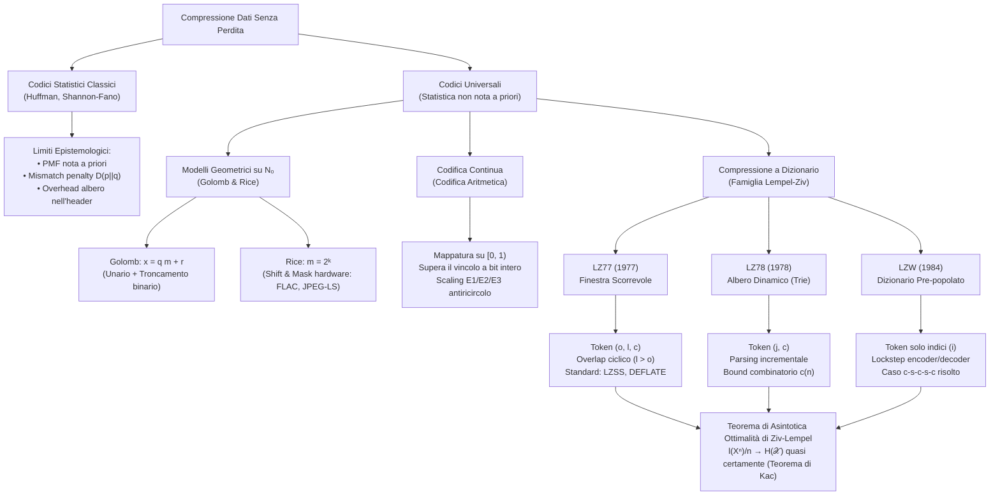

## Limiti Epistemologici Dei Codici Statistici Classici

Perché Huffman e Shannon-Fano falliscono nei contesti industriali moderni? Quando progettiamo un codice prefisso assumendo una distribuzione nominale $q(x)$ differente dalla vera distribuzione di sorgente $p(x)$, paghiamo una penalità inevitabile denominata __costo di mismatch__.

La lunghezza media attesa del codice $L_q$ rispetto alla vera misura $p(x)$ soddisfa:

$$
L_q = \sum_{x \in \mathcal{X}} p(x) l_q(x) \approx \sum_{x \in \mathcal{X}} p(x) \log_2 \frac{1}{q(x)}
$$

Scomponendo il logaritmo mediante il rapporto tra probabilità:

$$
L_q = \sum_{x \in \mathcal{X}} p(x) \log_2 \frac{p(x)}{q(x)} + \sum_{x \in \mathcal{X}} p(x) \log_2 \frac{1}{p(x)} = H(p) + D(p \parallel q)
$$

Notiamo che il costo medio di codifica si incrementa esattamente della __divergenza di Kullback-Leibler__ $D(p \parallel q) \ge 0$. Se stimiamo male la statistica o se la sorgente cambia regime stazionario nel tempo, $D(p \parallel q)$ degrada l'efficienza di compressione fino a rendere il flusso codificato più lungo del messaggio grezzo.

Inoltre, trasmettere la tabella dei simboli o l'albero di Huffman al decodificatore richiede un costo di testata pari a:

$$
\text{Overhead}_{\text{header}} = O(|\mathcal{X}| \log_2 |\mathcal{X}|) \quad \text{bit}
$$

Su blocchi di dati medio-piccoli, questo overhead annulla qualsiasi beneficio di compressione. Da qui nasce la necessità di costruire algoritmi universali che comprimano senza richiedere né stimare esplicitamente $p(x)$.

## Definizione Formale Di Codice Universale

Diamo una definizione rigorosa di universalità nel senso della teoria dell'informazione.

Sia $\mathcal{S}$ una classe di sorgenti stocastiche stazionarie ed ergodiche $\mathbf{X} = \{X_i\}_{i \ge 1}$ definite su un medesimo alfabeto finito $\mathcal{X}$. Una successione di codici di sorgente $\{C_n\}_{n \ge 1}$, dove $C_n: \mathcal{X}^n \to \{0, 1\}^*$, è definita __debolmente universale__ per la classe $\mathcal{S}$ se il tasso medio di compressione per simbolo converge all'entropy rate $H(\mathbf{X})$ della sorgente:

$$
\limsup_{n \to \infty} \frac{1}{n} \mathbb{E}\left[ l(C_n(X^n)) \right] \le H(\mathbf{X}) \quad \forall \mathbf{X} \in \mathcal{S}
$$

Il codice è detto __fortemente universale__ (o universale quasi certamente) se la convergenza si verifica con probabilità 1 per ogni singola sequenza infinita generata dalla sorgente:

$$
\lim_{n \to \infty} \frac{1}{n} l(C_n(X^n)) = H(\mathbf{X}) \quad \text{quasi certamente}
$$

Né il trasmettitore né il ricevitore necessitano di conoscere la PMF della sorgente o i parametri di transizione: il codice estrae l'informazione comprimibile unicamente dalle correlazioni e dalle ricorrenze lessicali del testo.

## Codici Di Golomb E Rice per Distribuzioni Geometriche

Nei contesti applicativi in cui i dati da comprimere sono numeri interi non negativi $x \in \mathbb{N}_0 = \{0, 1, 2, \dots\}$ con probabilità monotona decrescente, l'alfabeto di sorgente è infinito numerabile. La costruzione di un classico albero di Huffman richiederebbe una tabella infinita, risultando impraticabile.

Questo scenario si riscontra regolarmente:
- Nelle lunghezze delle sequenze di zeri nella codifica Run-Length (RLC);
- Negli errori di predizione (residui differenziali) nei codec lossless audio, video e per immagini;
- Nelle matrici di coefficienti spettrali quantizzati.

La famiglia dei __codici di Golomb__ (Solomon Golomb, 1966) e la sua specializzazione binaria, i __codici di Rice__ (Robert Rice, 1979), risolvono il problema con un modello parametrico analitico a complessità minima.

### Modello Di Sorgente E Decomposizione Euclidea

Consideriamo una variabile aleatoria discreta $X \in \mathbb{N}_0$ con distribuzione geometrica unificata di parametro $\theta \in (0, 1)$ (indicato talvolta con $p$):

$$
p(x) = (1 - \theta) \theta^x, \quad x = 0, 1, 2, \dots
$$

Fissato un intero positivo $M \ge 1$ (parametro di Golomb), scomponiamo qualsiasi intero $x \ge 0$ tramite divisione euclidea:

$$
x = q M + r
$$

dove:
- $q = \left\lfloor \frac{x}{M} \right\rfloor \in \{0, 1, 2, \dots\}$ è il quoziente intero;
- $r = x \bmod M \in \{0, 1, \dots, M-1\}$ è il resto.

Esaminiamo la probabilità congiunta della coppia $(q, r)$:

$$
p(x) = p(q M + r) = (1 - \theta) \theta^{q M + r} = (\theta^M)^q \cdot (1 - \theta) \theta^r
$$

Calcoliamo ora la probabilità marginale del quoziente $q$:

$$
p_Q(q) = \sum_{r=0}^{M-1} p(q M + r) = (1 - \theta) \theta^{q M} \sum_{r=0}^{M-1} \theta^r = (1 - \theta) \theta^{q M} \frac{1 - \theta^M}{1 - \theta} = (1 - \theta^M) (\theta^M)^q
$$

Notiamo che il quoziente $q$ segue esattamente una distribuzione geometrica di parametro $\theta^M$.

Valutiamo ora la distribuzione condizionata del resto $r$ dato $q$:

$$
p_{R \mid Q}(r \mid q) = \frac{p(q M + r)}{p_Q(q)} = \frac{(1 - \theta) \theta^{q M + r}}{(1 - \theta^M) \theta^{q M}} = \frac{1 - \theta}{1 - \theta^M} \theta^r
$$

Questa espressione non dipende in alcun modo da $q$. Di conseguenza, __il quoziente $q$ e il resto $r$ sono variabili aleatorie statisticamente indipendenti__. L'albero di codifica ottimo si scompone nel prodotto di due codici indipendenti: uno per il quoziente e uno per il resto.

### Codice Unario per Sorgenti Diadiche

La codifica più elementare per il quoziente $q$ è il __codice unario__: rappresentiamo $q$ con $q$ bit posti a '1' seguiti da un bit di terminazione '0':

$$
C_{\text{unario}}(q) = \underbrace{11\dots1}_{q \text{ volte}} 0
$$

La lunghezza della parola di codice è $l(q) = q + 1$ bit:
- $q = 0 \implies 0$ (1 bit)
- $q = 1 \implies 10$ (2 bit)
- $q = 2 \implies 110$ (3 bit)
- $q = 3 \implies 1110$ (4 bit)

Il codice unario coincide con il codice di Huffman ottimo per una sorgente geometrica avente parametro diadico $\theta = 1/2$, la cui probabilità vale $p(q) = 2^{-(q+1)}$. Poiché $l(q) = -\log_2 p(q)$, l'efficienza è identicamente pari al $100\%$ e il codice raggiunge l'entropia della sorgente.

### Struttura Del Codice Di Golomb E Teorema Di Gallager-Van Voorhis

Robert Gallager e David Van Voorhis (1975) hanno dimostrato che il codice di Huffman ottimo su alfabeto infinito per una distribuzione geometrica coincide con il codice di Golomb se e solo se il parametro $M$ è l'unico intero che soddisfa la relazione:

$$
\theta^M + \theta^{M+1} \le 1 < \theta^M + \theta^{M-1}
$$

la cui soluzione chiusa ottimale vale:

$$
M = \left\lceil -\frac{\log_2(1 + \theta)}{\log_2 \theta} \right\rceil
$$

Sotto questa scelta ottimale, $\theta^M \approx 1/2$. Il quoziente $q$ ha una distribuzione geometrica quasi diadica, per cui la sua codifica mediante codice unario risulta strettamente ottima.

Per codificare il resto $r \in \{0, 1, \dots, M-1\}$, utilizziamo un __codice a troncamento binario__ (_Truncated Binary Code_):
1. Calcoliamo la potenza inferiore di due $k = \lfloor \log_2 M \rfloor$ e il disavanzo $u = 2^{k+1} - M$.
2. Se $r < u$, assegniamo a $r$ una rappresentazione binaria standard su $k$ bit.
3. Se $r \ge u$, assegniamo a $r$ una rappresentazione binaria su $k + 1$ bit del valore traslato $r + u$.

In questo modo, i simboli più probabili (quelli con resto piccolo) ricevono $k$ bit, mentre i simboli meno probabili ricevono $k+1$ bit, rispettando rigorosamente la condizione del prefisso di Kraft-McMillan.

La parola di codice finale per l'intero $x$ è la concatenazione:

$$
C_M(x) = \big[ C_{\text{unario}}(q) \big] \, \big[ C_{\text{troncato}}(r) \big]
$$

### Esempio Operativo Dettagliato: Golomb Con Parametro $M = 5$

Progettiamo il codice di Golomb per $M = 5$:
- $k = \lfloor \log_2 5 \rfloor = 2$
- $k + 1 = 3$
- $u = 2^{2+1} - 5 = 8 - 5 = 3$

I primi $u = 3$ resti ($r \in \{0, 1, 2\}$) sono codificati con $k = 2$ bit:
- $r = 0 \to 00$
- $r = 1 \to 01$
- $r = 2 \to 10$

I restanti $M - u = 2$ resti ($r \in \{3, 4\}$) sono codificati con $k + 1 = 3$ bit rappresentando $r + u = r + 3$:
- $r = 3 \to 3 + 3 = 6 \to 110_2$
- $r = 4 \to 4 + 3 = 7 \to 111_2$

Verifichiamo la codifica per vari interi non negativi $x$:

| Intero $x$ | Quoziente $q = \lfloor x/5 \rfloor$ | Resto $r = x \bmod 5$ | Codice Quoziente (Unario) | Codice Resto (Troncato) | Parola di Codice $C_5(x)$ | Lunghezza Totale |
| :---: | :---: | :---: | :---: | :---: | :---: | :---: |
| 0 | 0 | 0 | `0` | `00` | `0 00` | 3 bit |
| 1 | 0 | 1 | `0` | `01` | `0 01` | 3 bit |
| 2 | 0 | 2 | `0` | `10` | `0 10` | 3 bit |
| 3 | 0 | 3 | `0` | `110` | `0 110` | 4 bit |
| 4 | 0 | 4 | `0` | `111` | `0 111` | 4 bit |
| 5 | 1 | 0 | `10` | `00` | `10 00` | 4 bit |
| 8 | 1 | 3 | `10` | `110` | `10 110` | 5 bit |
| 13 | 2 | 3 | `110` | `110` | `110 110` | 6 bit |

Se dobbiamo comprimere interi relativi $x \in \mathbb{Z}$ (come gli errori di predizione che oscillano attorno allo zero), applichiamo la mappatura a zigzag biunivoca $\mathbb{Z} \to \mathbb{N}_0$:

$$
x_{\text{mappato}} = \begin{cases} 2x & \text{se } x \ge 0 \\ 2|x| - 1 & \text{se } x < 0 \end{cases}
$$

che ordina i numeri secondo la sequenza $0, -1, +1, -2, +2, -3, +3, \dots \to 0, 1, 2, 3, 4, 5, 6, \dots$.

### Codici Di Rice Ed Efficienza Di Calcolo Hardware

Quando vincoliamo il parametro $M$ ad essere una potenza intera di due:

$$
M = 2^k, \quad k \in \mathbb{N}_0
$$

il codice prende il nome di __codice di Rice__ (Robert Rice, 1979). In questa configurazione notiamo che:

$$
u = 2^{k+1} - 2^k = 2^k = M
$$

Il numero di resti da codificare con $k$ bit coincide con l'intero insieme dei resti ($u = M$). Di conseguenza, __tutti i resti $r$ sono codificati con una parola binaria a lunghezza fissa di esattamente $k$ bit__.

Questo conferisce ai codici di Rice un vantaggio hardware enorme nei sistemi embedded, FPGA e DSP:
- Il quoziente $q$ si calcola con un semplice scorrimento logico a destra di $k$ bit: $q = x \gg k$.
- Il resto $r$ si estrae con un'operazione bitwise AND con maschera binaria: $r = x \ \& \ (2^k - 1)$.
- Non è richiesta alcuna operazione di divisione aritmetica o calcolo di modulo, operando a frequenze di clock elevatissime con consumo energetico minimo.

La dimostrazione dell'ottimalità asintotica dei codici di Golomb-Rice è approfondita in [[Anno 1/Information and Estimation Theory/zz. Argomenti extra#Dimostrazione dell'Ottimalità dei Codici di Golomb per Distribuzioni Geometriche]]. Grazie a questa efficienza, i codici di Rice costituiscono il cuore algoritmico del codec audio lossless FLAC, dello standard per immagini JPEG-LS (ITU-T T.87), della compressione dati per sonde spaziali CCSDS 121.0-B-3 e dei residui di moto nei profili video H.264/MPEG-4 AVC.

## Codifica Aritmetica Ad Intervalli Continui

L'algoritmo di Huffman assegna a ciascun simbolo un numero intero di bit di codice ($l_i \in \mathbb{N}$). Sebbene ottimo tra i codici a blocchi prefissati, questo vincolo introduce una severa perdita di efficienza quando la sorgente presenta probabilità sbilanciate.

### Superamento Del Vincolo Di Lunghezza Intera Dei Simboli

Consideriamo una sorgente binaria con simboli fortemente asimmetrici: $p(0) = 0.95$ e $p(1) = 0.05$. L'auto-informazione associata al simbolo più probabile è:

$$
I(0) = -\log_2(0.95) \approx 0.074 \quad \text{bit}
$$

Poiché qualsiasi codice prefisso deve allocare almeno 1 bit per ogni parola di codice, Huffman assegna 1 bit al simbolo '0'. Spendiamo $1.0$ bit per trasmettere un contenuto informativo reale di appena $0.074$ bit: una perdita secca del $92.6\%$. Per avvicinarsi al limite di Shannon con Huffman, dovremmo raggruppare i simboli in blocchi lunghi $n$, ma la complessità dell'albero esploderebbe esponenzialmente ($|\mathcal{X}|^n = 2^n$).

La __codifica aritmetica__ (_Arithmetic Coding_, Jorma Rissanen 1976; Richard Pasco 1976; Witten, Neal & Cleary 1987) supera radicalmente questo limite: invece di associare una stringa di bit a ciascun simbolo isolato, mappa l'intera sequenza di simboli $x_1 x_2 \dots x_n$ in un unico sotto-intervallo del segmento reale unitario $[0, 1)$.

### Fondamento Matematico: La Trasformata Integrale Di Probabilità

La codifica aritmetica trae la sua giustificazione analitica dal codice di Shannon-Fano-Elias e dal __Lemma della Trasformata Integrale di Probabilità__:
Sia $Y$ una variabile aleatoria continua con funzione di distribuzione cumulativa $F(y)$. Allora la variabile aleatoria trasformata $U = F(Y)$ è distribuita uniformemente sull'intervallo continuo:

$$
U \sim \mathcal{U}[0, 1]
$$

Se interpretiamo una sequenza infinita di simboli discreti $X_1 X_2 \dots$ come la parte frazionaria di un numero reale $0.X_1 X_2 \dots$, la CDF progressiva mappa tale successione in una variabile uniforme $U \in [0, 1]$. La rappresentazione in base 2 di una variabile distribuita uniformemente su $[0, 1)$ produce una sequenza di bit indipendenti ed equiprobabili ($\text{Bernoulli}(1/2)$). Tali bit possiedono entropia massima pari a 1 bit/simbolo e sono pertanto del tutto incomprimibili: essi costituiscono già la rappresentazione compressa ottima della sequenza.

### Algoritmo Di Partizione Progressiva dell'Intervallo

La codifica aritmetica opera ricorsivamente partizionando l'intervallo unitario:
1. Inizializziamo l'intervallo corrente:

$$
[L^{(0)}, H^{(0)}) = [0, 1)
$$

2. All'arrivo del $k$-esimo simbolo $x_k \in \{1, 2, \dots, m\}$ avente probabilità $p(x_k)$ e probabilità cumulata $F(x) = \sum_{y \le x} p(y)$ (ponendo per convenzione $F(0) = 0$), partizioniamo l'intervallo precedente $[L^{(k-1)}, H^{(k-1)})$ in sotto-intervalli proporzionali alla probabilità di ciascun simbolo.
3. Aggiorniamo il limite inferiore $L^{(k)}$ e il limite superiore $H^{(k)}$ mediante le equazioni di scaling:

$$
L^{(k)} = L^{(k-1)} + \left( H^{(k-1)} - L^{(k-1)} \right) F(x_k - 1)
$$

$$
H^{(k)} = L^{(k-1)} + \left( H^{(k-1)} - L^{(k-1)} \right) F(x_k)
$$

L'ampiezza dell'intervallo al termine dell'elaborazione di $n$ simboli indipendenti coincide con la probabilità congiunta dell'intera sequenza:

$$
\text{Width}^{(n)} = H^{(n)} - L^{(n)} = \prod_{k=1}^n p(x_k) = p(x^n)
$$

Qualsiasi numero reale all'interno del sotto-intervallo finale $[L^{(n)}, H^{(n)})$ identifica univocamente la sequenza originale $x^n$.

![[slide_16_arithmetic_coding_3ary_example.png|center mid]]

### Generazione Del Bitstream E Dimostrazione dell'Efficienza

Per trasformare l'intervallo finale in un flusso binario univocamente decodificabile:
1. Selezioniamo il punto medio dell'intervallo:

$$
T = \frac{L^{(n)} + H^{(n)}}{2}
$$

2. Tronchiamo l'espansione binaria del valore reale $T$ a un numero di bit pari a:

$$
l(x^n) = \left\lceil -\log_2 p(x^n) \right\rceil + 1 \quad \text{bit}
$$

Perché questa lunghezza garantisce la correttezza? Un troncamento a $l$ bit definisce un intervallo diadico di ampiezza $2^{-l}$. Poiché:

$$
2^{-l} = 2^{-\lceil -\log_2 p(x^n) \rceil - 1} \le 2^{\log_2 p(x^n) - 1} = \frac{p(x^n)}{2} = \frac{\text{Width}^{(n)}}{2}
$$

l'intervallo diadico generato dal troncamento attorno al punto medio $T$ è interamente contenuto all'interno dell'intervallo finale $[L^{(n)}, H^{(n)})$. Questo garantisce che nessun'altra sequenza di simboli possa generare lo stesso prefisso binario, assicurando decodificabilità istantanea e univoca.

Calcoliamo la lunghezza media per simbolo su una sorgente stazionaria di entropia $H(X)$:

$$
\frac{1}{n} \mathbb{E}[l(X^n)] \le \frac{1}{n} \mathbb{E}\left[ -\log_2 p(X^n) + 2 \right] = \frac{n H(X) + 2}{n} = H(X) + \frac{2}{n} \quad \text{bit/simbolo}
$$

Al crescere della lunghezza della sequenza ($n \to \infty$), il termine di overhead additivo $\frac{2}{n}$ tende a zero:

$$
\lim_{n \to \infty} \frac{1}{n} \mathbb{E}[l(X^n)] = H(X)
$$

La codifica aritmetica raggiunge l'entropia della sorgente senza richiedere alcuna aggregazione preliminare in macro-blocchi.

### Esempio Operativo Completo: Alfabeto Ternario

Consideriamo un alfabeto ternario $\mathcal{X} = \{A, B, C\}$ con vettore delle probabilità:

$$
p(A) = 0.40, \quad p(B) = 0.40, \quad p(C) = 0.20
$$

La funzione di distribuzione cumulata vale:

$$
F(A) = 0.40, \quad F(B) = 0.80, \quad F(C) = 1.00 \quad (F(0) = 0)
$$

Vogliamo codificare in streaming la sequenza di 4 simboli:

$$
x^4 = A \, C \, A \, A
$$

Seguiamo l'evoluzione degli estremi passo dopo passo:
- Passo 0: $[L^{(0)}, H^{(0)}) = [0.0000, 1.0000)$, ampiezza $\text{Width} = 1.0000$.
- Passo 1 (Simbolo $A$):
  - $L^{(1)} = 0 + 1.0 \cdot F(0) = 0.0000$
  - $H^{(1)} = 0 + 1.0 \cdot F(A) = 0.4000$
  - Intervallo corrente: $[0.0000, 0.4000)$, ampiezza $0.4000$.
- Passo 2 (Simbolo $C$):
  - Ampiezza precedente: $0.4000 - 0.0000 = 0.4000$.
  - $L^{(2)} = 0.0000 + 0.4000 \cdot F(B) = 0.0000 + 0.4000 \cdot 0.80 = 0.3200$
  - $H^{(2)} = 0.0000 + 0.4000 \cdot F(C) = 0.0000 + 0.4000 \cdot 1.00 = 0.4000$
  - Intervallo corrente: $[0.3200, 0.4000)$, ampiezza $0.0800$.
- Passo 3 (Simbolo $A$):
  - Ampiezza precedente: $0.4000 - 0.3200 = 0.0800$.
  - $L^{(3)} = 0.3200 + 0.0800 \cdot F(0) = 0.3200$
  - $H^{(3)} = 0.3200 + 0.0800 \cdot F(A) = 0.3200 + 0.0800 \cdot 0.40 = 0.3520$
  - Intervallo corrente: $[0.3200, 0.3520)$, ampiezza $0.0320$.
- Passo 4 (Simbolo $A$):
  - Ampiezza precedente: $0.3520 - 0.3200 = 0.0320$.
  - $L^{(4)} = 0.3200 + 0.0320 \cdot F(0) = 0.3200$
  - $H^{(4)} = 0.3200 + 0.0320 \cdot F(A) = 0.3200 + 0.0320 \cdot 0.40 = 0.3328$
  - Intervallo finale: $[0.3200, 0.3328)$.

Verifichiamo la probabilità congiunta:

$$
p(ACAA) = 0.40 \cdot 0.20 \cdot 0.40 \cdot 0.40 = 0.0128
$$

L'ampiezza dell'intervallo finale è esattamente pari a:

$$
H^{(4)} - L^{(4)} = 0.3328 - 0.3200 = 0.0128 = p(ACAA)
$$

Determiniamo il punto medio $T$ e la lunghezza di codice richiesta:

$$
T = \frac{0.3200 + 0.3328}{2} = 0.3264
$$

$$
l = \lceil -\log_2(0.0128) \rceil + 1 = \lceil 6.2877 \rceil + 1 = 7 + 1 = 8 \quad \text{bit}
$$

Convertiamo $T = 0.3264$ in forma binaria tramite moltiplicazioni successive per 2:
- $0.3264 \times 2 = 0.6528 \to 0$
- $0.6528 \times 2 = 1.3056 \to 1$ (residuo $0.3056$)
- $0.3056 \times 2 = 0.6112 \to 0$
- $0.6112 \times 2 = 1.2224 \to 1$ (residuo $0.2224$)
- $0.2224 \times 2 = 0.4448 \to 0$
- $0.4448 \times 2 = 0.8896 \to 0$
- $0.8896 \times 2 = 1.7792 \to 1$ (residuo $0.7792$)
- $0.7792 \times 2 = 1.5584 \to 1$

La sequenza binaria a 8 bit emessa dal codificatore è:

$$
01010011
$$

Il decodificatore confronta il valore frazionario binario $0.01010011_2 \approx 0.3242$ con le soglie cumulative dell'alfabeto, ricostruendo univocamente i simboli $A, C, A, A$.

### Rinormalizzazione E Gestione Della Precisione Finita

L'algoritmo teorico presuppone precisione aritmetica infinita. Su un processore reale con registri a 32 o 64 bit, man mano che $n$ cresce l'intervallo si restringe esponenzialmente e i registri collassano per __underflow aritmetico__.

Per consentire l'elaborazione in streaming su registri a dimensione finita, si adottano tre operazioni di __rinormalizzazione dinamica__ (Witten-Neal-Cleary):
1. __Condizione E1 (Entrambi i limiti nella metà inferiore, $H < 0.5$)__: Il bit più significativo (MSB) dei due estremi è identicamente '0'. Il codificatore emette subito il bit '0' nel bitstream e riscala l'intervallo verso l'alto:

   $$
   L \leftarrow 2L, \quad H \leftarrow 2H
   $$

2. __Condizione E2 (Entrambi i limiti nella metà superiore, $L \ge 0.5$)__: Il bit MSB di entrambi gli estremi è identicamente '1'. Il codificatore emette subito il bit '1' e riscala l'intervallo:

   $$
   L \leftarrow 2(L - 0.5), \quad H \leftarrow 2(H - 0.5)
   $$

3. __Condizione E3 (Straddle / Underflow: $L \ge 0.25$ e $H < 0.75$)__: I due estremi convergono verso il centro $0.5$ senza condividere il bit MSB ($L = 0.01\dots_2$ e $H = 0.10\dots_2$). In questo caso l'intervallo collasserebbe senza che possiamo determinare il bit immediato. Si rimuove il secondo bit sottraendo $0.25$ e raddoppiando:

   $$
   L \leftarrow 2(L - 0.25), \quad H \leftarrow 2(H - 0.25)
   $$

   incrementando un contatore interno `underflow_bits`. Non appena si verifica un evento E1 o E2, il codificatore emette il bit principale seguito da `underflow_bits` bit opposti di compensazione.

Grazie a questo meccanismo di scaling, la codifica aritmetica opera indefinitamente con registri interi a 16 o 32 bit. È il principio alla base di CABAC (_Context-Adaptive Binary Arithmetic Coding_) impiegato negli standard video H.264, H.265/HEVC e nelle immagini JPEG 2000.

## Compressione a Finestra Scorrevole: L'Algoritmo LZ77

Gli algoritmi a dizionario abbandonano il paradigma della modellazione probabilistica esplicita: essi sostituiscono sequenze di caratteri ripetuti con riferimenti numerici (puntatori) a occorrenze identiche già comparse in precedenza nel flusso dei dati.

L'algoritmo __LZ77__ (Jacob Ziv & Abraham Lempel, 1977) mantiene in memoria una __finestra scorrevole__ (_Sliding Window_) di dimensione finita $W$, composta da due buffer adiacenti:
1. __Search Buffer__ (buffer di ricerca, dimensione $S_B$): Contiene gli ultimi $S_B$ caratteri già processati e memorizzati nella cronologia recente.
2. __Lookahead Buffer__ (buffer di anticipazione, dimensione $L_B$): Contiene i prossimi $L_B$ simboli entranti da comprimere.

![[lz77_sliding_window_parsing.svg|center mid]]

### Regola Di Matching Ed Emissione Dei Token

Il codificatore analizza i simboli nel lookahead buffer e cerca all'interno del search buffer la più lunga sottostringa identica (_Longest Match_):
- Sia $o$ l'__offset__ (distanza a ritroso rispetto al cursore corrente, $1 \le o \le S_B$) in cui comincia la corrispondenza;
- Sia $l$ la __lunghezza__ del match ($l \ge 0$);
- Sia $c$ il primo __carattere non corrispondente__ (carattere innovatore) che segue immediatamente il match nel lookahead buffer.

L'algoritmo LZ77 classico emette ad ogni passo una tripletta di dati:

$$
(o, l, c)
$$

dove:
- $o$: posizione relativa all'indietro nella finestra di ricerca ($\lceil \log_2 S_B \rceil$ bit);
- $l$: numero di caratteri del match più lungo individuato ($\lceil \log_2 L_B \rceil$ bit);
- $c$: nuovo carattere letterale successivo ($\lceil \log_2 |\mathcal{X}| \rceil$ bit).

Dopo l'emissione del token, la finestra di scansione avanza di $l + 1$ posizioni lungo il flusso del testo.

### La Proprietà Di Overlap Ciclico per Pattern Periodici

Una proprietà algebrica fondamentale di LZ77 è la capacità di gestire corrispondenze con __lunghezza superiore all'offset__ ($l > o$).

Come può la lunghezza del match superare la distanza della posizione iniziale rispetto al cursore?
Il decodificatore opera in streaming: per ricostruire i dati legge dal proprio buffer a partire dalla posizione $t - o$ e scrive in avanti. Se $l > o$, mentre il decoder scrive i caratteri, essi diventano immediatamente parte della sorgente di lettura.

Se la sequenza da codificare è un pattern periodico (ad esempio `ABABABAB…` con periodo $o = 2$), un unico token $(o = 2, l = 6, c)$ replica ciclicamente l'intera serie. In questo modo, LZ77 emula nativamente la codifica Run-Length senza richiedere istruzioni speciali.

![[slide_24_lz77_sliding_window_example.png|center mid]]

### Esempio Operativo Dettagliato Di LZ77

Codifichiamo la stringa di 16 caratteri su alfabeto binario $\mathcal{X} = \{A, B\}$:

$$
\text{"ABBABBABBBAABABA"}
$$

Assumiamo una finestra di ricerca di dimensione $S_B = 4$ e un lookahead buffer sufficiente ad accogliere i match. All'inizio il search buffer è vuoto.

Esaminiamo l'evoluzione sequenziale adottando la notazione standard LZSS con bit di flag: $(F=0, c)$ per i caratteri non compressi e $(F=1, o, l)$ per i puntatori a ritroso (dove $o$ è l'offset all'indietro nella finestra e $l$ la lunghezza del match):
1. `A`: Search buffer vuoto. Nessun match. Emette token letterale: $(0, A)$ con flag $F=0$. Il search buffer diventa `[A]`.
2. `B`: Nel search buffer è presente `[A]`. Nessun match con `B`. Emette token letterale: $(0, B)$ con flag $F=0$. Search buffer: `[AB]`.
3. `B`: Nel search buffer c'è `[AB]`. Il carattere `B` compare a offset $o = 1$ con lunghezza $l = 1$. Emette token puntatore: $(1, 1, 1)$ con flag $F=1$, offset $o=1$ e lunghezza $l=1$. Search buffer: `[ABB]`.
4. `ABBABB`: Nel search buffer c'è `[ABB]`. La stringa `ABBABB` (6 caratteri) comincia a offset $o = 3$ e si ripete sfruttando l'overlap ciclico ($l = 6 > o = 3$). Emette token puntatore con overlap: $(1, 3, 6)$ con flag $F=1$, offset $o=3$ e lunghezza $l=6$. Search buffer aggiornato agli ultimi 4 caratteri: `[BABB]`.
5. `BA`: Nel search buffer `[BABB]`, la stringa `BA` comincia a offset $o = 4$ con lunghezza $l = 2$. Emette token puntatore: $(1, 4, 2)$ con flag $F=1$, offset $o=4$ e lunghezza $l=2$. Search buffer: `[BBBA]`.
6. `A`: Nel search buffer `[BBBA]`, il carattere `A` si trova a offset $o = 1$ con lunghezza $l = 1$. Emette token puntatore: $(1, 1, 1)$ con flag $F=1$, offset $o=1$ e lunghezza $l=1$. Search buffer: `[BBAA]`.
7. `BA`: Nel search buffer `[BBAA]`, la stringa `BA` compare a offset $o = 3$ con lunghezza $l = 2$. Emette token puntatore: $(1, 3, 2)$ con flag $F=1$, offset $o=3$ e lunghezza $l=2$. Search buffer: `[AABA]`.
8. `BA`: Nel search buffer `[AABA]`, la stringa `BA` compare a offset $o = 2$ con lunghezza $l = 2$. Emette token puntatore: $(1, 2, 2)$ con flag $F=1$, offset $o=2$ e lunghezza $l=2$.

La sequenza emessa in notazione a token con flag binario di discriminazione (variante LZSS) produce 8 token:

$$
(0, A), \, (0, B), \, (1, 1, 1), \, (1, 3, 6), \, (1, 4, 2), \, (1, 1, 1), \, (1, 3, 2), \, (1, 2, 2)
$$

Valutiamo il costo in bit:
- Token letterale $(F = 0, C)$: 1 bit per il flag $F=0$ e 1 bit per il carattere ($A=0, B=1$), per un totale di 2 bit.
- Token puntatore $(F = 1, o-1, l-1)$: 1 bit per il flag $F=1$, 2 bit per l'offset ($S_B=4 \implies 2$ bit) e 3 bit per la lunghezza ($L_B \le 8 \implies 3$ bit), per un totale di 6 bit.

Il flusso binario complessivo richiede esattamente 40 bit:

$$
\underbrace{00}_{(0,A)} \quad \underbrace{01}_{(0,B)} \quad \underbrace{100000}_{(1,1,1)} \quad \underbrace{110101}_{(1,3,6)} \quad \underbrace{111001}_{(1,4,2)} \quad \underbrace{100000}_{(1,1,1)} \quad \underbrace{110001}_{(1,3,2)} \quad \underbrace{101001}_{(1,2,2)}
$$

### Varianti Industriali: LZSS E DEFLATE

Nella formulazione originaria di LZ77, l'emissione del carattere innovatore $c$ in ogni token comporta uno spreco di bit quando incontriamo corrispondenze molto lunghe. Al contempo, emettere un puntatore $(o, l)$ per un match di 1 solo carattere occupa più bit del carattere grezzo stesso.

Per risolvere queste inefficienze sono nate due evoluzioni fondamentali:
1. __LZSS (Lempel-Ziv-Storer-Szymanski, 1982)__: Introduce un flag iniziale a 1 bit che discrimina tra:
   - Token Letterale $(0, c)$: emesso quando non c'è match o quando $l < 2$ (evita l'overhead del puntatore);
   - Token Puntatore $(1, o, l)$: emesso quando il match è conveniente ($l \ge 2$), omettendo il carattere letterale esplicito.
2. __DEFLATE (Phil Katz, 1991)__: È lo standard industriale che muove l'archiviazione dati mondiale (`ZIP`, `GZIP`, `tar.gz`, file `.png` e compressione HTTP/HTTPS). DEFLATE combina LZSS con una finestra $S_B = 32\text{ KB}$ e $L_B = 258\text{ byte}$, e sottopone i token emessi a una successiva compressione mediante codici di Huffman canonici bivariati: un albero per i simboli letterali e le lunghezze dei match, e un secondo albero per le distanze di offset.

### Fondamento Analitico: Il Teorema Del Tempo Di Ricorrenza Di Kac

Perché LZ77 è asintoticamente universale? L'ottimalità asintotica globale di LZ77 è stata dimostrata da Wyner e Ziv (1989) sfruttando il __Lemma del Tempo di Ritorno di Kac__ (1947).

Per qualsiasi processo stazionario ed ergodico, il tempo medio di prima ricorrenza $R_n$ necessario per riosservare all'indietro una sequenza tipica di $n$ simboli soddisfa:

$$
\mathbb{E}\left[ R_n(X^n) \mid X^n = x^n \right] = \frac{1}{p(x^n)}
$$

Prendendo il logaritmo e passando al limite per $n \to \infty$:

$$
\lim_{n \to \infty} \frac{1}{n} \log_2 R_n(X^n) = H(\mathcal{X}) \quad \text{quasi certamente}
$$

Ciò implica che una sequenza tipica di lunghezza $n$ ricorre nel passato a una distanza media $W \approx 2^{n H(\mathcal{X})}$. Per codificare l'offset in una finestra di tale dimensione occorrono $\log_2 W \approx n H(\mathcal{X})$ bit. Il costo per simbolo di sorgente è quindi:

$$
\frac{\text{Costo del puntatore}}{n} \approx \frac{\log_2 W}{n} = \frac{n H(\mathcal{X})}{n} = H(\mathcal{X}) \quad \text{bit/simbolo}
$$

La derivazione integrale è disponibile in [[Anno 1/Information and Estimation Theory/zz. Argomenti extra#Teorema del Tempo di Ricorrenza di Kac e Ottimalità Asintotica di LZ77]].

## Compressione Ad Albero Di Prefissi: L'Algoritmo LZ78

Mentre LZ77 effettua ricerche all'interno di un buffer lineare a memoria limitata, l'algoritmo __LZ78__ (Ziv & Lempel 1978) memorizza le frasi incontrate in un __dizionario dinamico indicizzato ad albero__. In questo modo, l'algoritmo non soffre della perdita di memoria dovuta allo scorrimento della finestra.

### Meccanismo Di Parsing Incrementale Ad Albero Dinamico

La sequenza di dati entrante viene segmentata in modo incrementale in una successione di $c(n)$ frasi distinte:

$$
x^n = w_1 \, w_2 \, \dots \, w_{c(n)}
$$

secondo la regola fondamentale:
Ogni frase $w_k$ è la più breve sottostringa della sequenza che non è mai comparsa tra le frasi registrate nel dizionario fino a quel momento.

Di conseguenza, ogni nuova frase $w_k$ si ottiene estendendo una frase già censita $w_{j(k)}$ (con $0 \le j(k) < k$, dove $w_0 = \epsilon$ denota la stringa vuota associata alla radice) con un singolo carattere innovatore $c_k \in \mathcal{X}$:

$$
w_k = w_{j(k)} \cdot c_k
$$

Il token emesso dal codificatore ad ogni passo è la coppia:

$$
(j, c)
$$

dove:
- $j$ è l'indice numerico del prefisso nel dizionario;
- $c \in \mathcal{X}$ è il nuovo carattere innovatore.

Subito dopo l'emissione del token, la nuova frase $w_k$ viene registrata nel dizionario all'indice $k$. La struttura dati sottostante è un albero di prefissi (_trie_): ogni nodo rappresenta una frase del dizionario e i rami uscenti sono etichettati con i caratteri dell'alfabeto.

![[slide_27_lz78_tree_structure.png|center mid]]

### Struttura Del Token Ed Esempio Operativo Completo

Applichiamo LZ78 alla medesima sequenza di 17 caratteri su alfabeto $\mathcal{X} = \{A, B\}$:

$$
\text{"ABBABBABBBAABABAA"}
$$

Inizializziamo il dizionario con l'elemento nullo all'indice 0: $D[0] = \epsilon$.

Eseguiamo il parsing passo dopo passo:
1. `A`: Non è nel dizionario. Prefisso vuoto $D[0] = \epsilon$, carattere $A$. Emette $(0, A)$. Inserisce $D[1] = \text{'A'}$.
2. `B`: Non è nel dizionario. Prefisso $\epsilon$, carattere $B$. Emette $(0, B)$. Inserisce $D[2] = \text{'B'}$.
3. `BA`: Legge `B` (presente come $D[2]$), il successivo è `A`. La stringa `BA` non è nel dizionario. Emette $(2, A)$. Inserisce $D[3] = \text{'BA'}$.
4. `BB`: Legge `B` (presente come $D[2]$), il successivo è `B`. La stringa `BB` non è presente. Emette $(2, B)$. Inserisce $D[4] = \text{'BB'}$.
5. `AB`: Legge `A` (presente come $D[1]$), il successivo è `B`. `AB` non è nel dizionario. Emette $(1, B)$. Inserisce $D[5] = \text{'AB'}$.
6. `BBA`: Legge `BB` (presente come $D[4]$), il successivo è `A`. `BBA` non è presente. Emette $(4, A)$. Inserisce $D[6] = \text{'BBA'}$.
7. `ABA`: Legge `AB` (presente come $D[5]$), il successivo è `A`. `ABA` non è presente. Emette $(5, A)$. Inserisce $D[7] = \text{'ABA'}$.
8. `BAA`: Legge `BA` (presente come $D[3]$), il successivo è `A`. `BAA` non è presente. Emette $(3, A)$. Inserisce $D[8] = \text{'BAA'}$.

La sequenza emessa è composta da 8 coppie:

$$
(0, A), \, (0, B), \, (2, A), \, (2, B), \, (1, B), \, (4, A), \, (5, A), \, (3, A)
$$

Poiché l'indice massimo del dizionario richiamato prima dell'emissione dei puntatori è $5$, per rappresentare gli indici bastano $\lceil \log_2 6 \rceil = 3$ bit, a cui aggiungiamo 1 bit per il carattere binario ($A=0, B=1$). Il bitstream completo a 32 bit è dato da:

$$
\underbrace{0000}_{(0,A)} \quad \underbrace{0001}_{(0,B)} \quad \underbrace{0100}_{(2,A)} \quad \underbrace{0101}_{(2,B)} \quad \underbrace{0011}_{(1,B)} \quad \underbrace{1000}_{(4,A)} \quad \underbrace{1010}_{(5,A)} \quad \underbrace{0110}_{(3,A)} \implies 32 \text{ bit}
$$

### Dimostrazione dell'Ottimalità Asintotica E Bound Combinatorio Di Ziv-Lempel

L'ottimalità universale di LZ78 si fonda sulla limitazione superiore del numero di frasi distinte $c(n)$ ottenibili dal parsing di una sequenza di $n$ simboli.

Ziv e Lempel (1978) hanno dimostrato che il numero di frasi $c(n)$ è massimizzato quando la sequenza contiene tutte le possibili parole corte prima di quelle lunghe ($|\mathcal{X}|$ frasi di lunghezza 1, $|\mathcal{X}|^2$ di lunghezza 2, e così via). Da tale analisi combinatoria discende il bound superiore uniforme:

$$
c(n) \le \frac{n}{(1 - \epsilon_n) \log_{|\mathcal{X}|} n}
$$

dove $\epsilon_n \to 0$ per $n \to \infty$.

Poiché ciascuna delle $c(n)$ frasi richiede $\lceil \log_2 c(n) \rceil$ bit per l'indice e $\lceil \log_2 |\mathcal{X}| \rceil$ bit per il carattere innovatore, la lunghezza complessiva del codice binario generato soddisfa:

$$
l(x^n) \le c(n) \log_2 c(n) + O(c(n))
$$

Sostituendo il bound combinatorio di $c(n)$:

$$
l(x^n) \le \frac{n}{\log_{|\mathcal{X}|} n} \log_2 \left( \frac{n}{\log_{|\mathcal{X}|} n} \right) \approx n \log_2 |\mathcal{X}|
$$

Applicando il Teorema di Shannon-McMillan-Breiman per processi ergodici (in cui le sequenze generate ricadono nell'insieme tipico di entropia $H(\mathcal{X})$), Ziv e Lempel hanno dimostrato che:

$$
\lim_{n \to \infty} \frac{l(X^n)}{n} = H(\mathcal{X}) \quad \text{quasi certamente}
$$

La trattazione analitica integrale del lemma combinatorio è documentata in [[Anno 1/Information and Estimation Theory/zz. Argomenti extra#Dimostrazione del Teorema di Ziv-Lempel sull'Efficienza Asintotica di LZ78]].

## L'Algoritmo LZW (Lempel-Ziv-Welch)

Nell'algoritmo LZ78 classico, l'emissione del carattere letterale esplicito $c$ ad ogni passo genera un overhead sensibile. Nel 1984, Terry A. Welch propose una variante ingegneristica denominata __LZW__ (_A Technique for High-Performance Data Compression_), destinata a diventare lo standard de facto dell'informatica per oltre un ventennio.

### Architettura a Dizionario Pre-Popolato

L'intuizione fondamentale di Welch consiste nel __pre-popolare il dizionario__ con tutti i singoli simboli dell'alfabeto elementare prima di iniziare la compressione.

Nel caso standard di un flusso di byte a 8 bit ($|\mathcal{X}| = 256$):
- Le posizioni iniziali (indici da $0$ a $255$) sono pre-assegnate a tutti i singoli caratteri ASCII/byte isolati;
- Il token emesso dal codificatore non contiene più alcun carattere letterale: esso è costituito __esclusivamente da un indice intero di dizionario__.

### Sincronizzazione Encoder-Decoder in Lockstep

Come fa il decodificatore a comprendere le stringhe se trasmettiamo solo indici numerici?
Il ricevitore possiede lo stesso dizionario iniziale pre-popolato (indici $0\text{–}255$).
- Quando l'encoder individua nel dizionario la più lunga sequenza corrispondente $S$ e legge il simbolo successivo $c$, emette l'indice di $S$ e memorizza nel proprio dizionario la stringa estesa $S \cdot c$.
- Quando il decoder riceve l'indice di $S$, emette la stringa $S$ e, conoscendo la stringa decodificata al passo precedente, inserisce anch'esso nel proprio dizionario la stringa estesa.

I due dizionari si aggiornano in perfetto sincronismo (_lockstep_) senza che sia necessario inviare stringhe esplicite sul canale di comunicazione.

### Esempio Operativo Dettagliato Di LZW

Comprimiamo la medesima sequenza di 17 caratteri `ABBABBABBBAABABAA` sull'alfabeto binario $\{A, B\}$.
- Pre-popolazione: Indice 1 = `A`, Indice 2 = `B`.

Evoluzione sequenziale:
1. Legge `A`. Successivo `B`. La stringa `AB` non è nel dizionario. Emette l'indice di `A` (__1__). Inserisce Indice 3 = `AB`.
2. Legge `B`. Successivo `B`. `BB` non è presente. Emette l'indice di `B` (__2__). Inserisce Indice 4 = `BB`.
3. Legge `B`. Successivo `A`. `BA` non è presente. Emette l'indice di `B` (__2__). Inserisce Indice 5 = `BA`.
4. Legge `AB` (presente all'indice 3). Successivo `B`. `ABB` non è presente. Emette indice __3__ (`AB`). Inserisce Indice 6 = `ABB`.
5. Legge `BA` (presente all'indice 5). Successivo `B`. `BAB` non è presente. Emette indice __5__ (`BA`). Inserisce Indice 7 = `BAB`.
6. Legge `BB` (presente all'indice 4). Successivo `B`. `BBB` non è presente. Emette indice __4__ (`BB`). Inserisce Indice 8 = `BBB`.
7. Legge `BA` (presente all'indice 5). Successivo `A`. `BAA` non è presente. Emette indice __5__ (`BA`). Inserisce Indice 9 = `BAA`.
8. Legge `AB` (presente all'indice 3). Successivo `A`. `ABA` non è presente. Emette indice __3__ (`AB`). Inserisce Indice 10 = `ABA`.
9. Legge `ABA` (presente all'indice 10). Successivo `A`. `ABAA` non è presente. Emette indice __10__ (`ABA`). Inserisce Indice 11 = `ABAA`.
10. Legge `A` (presente all'indice 1). Fine sequenza. Emette l'indice finale __1__ (`A`).

La sequenza emessa da LZW consiste in 10 indici interi:

$$
1, \, 2, \, 2, \, 3, \, 5, \, 4, \, 5, \, 3, \, 10, \, 1
$$

Codificando gli indici con larghezza di bit progressiva commisurata alla cardinalità del dizionario:

$$
\underbrace{0}_{(1)} \quad \underbrace{01}_{(2)} \quad \underbrace{01}_{(2)} \quad \underbrace{010}_{(3)} \quad \underbrace{100}_{(5)} \quad \underbrace{011}_{(4)} \quad \underbrace{100}_{(5)} \quad \underbrace{0010}_{(3)} \quad \underbrace{1001}_{(10)} \quad \underbrace{0000}_{(1)}
$$

otteniamo un costo di soli __29 bit__, a fronte dei 40 bit di LZ77 e dei 32 bit di LZ78 sulla stessa stringa.

### Risoluzione Del Caso Limite Eccezionale Di Decodifica

Nell'algoritmo LZW esiste una singolarità di decodifica ben nota che si verifica quando la sorgente genera un pattern del tipo $c \cdot s \cdot c \cdot s \cdot c$ (dove $c$ è un carattere e $s$ una sottostringa, es. `ABABABA`):
1. Il codificatore legge una stringa già presente nel dizionario, incontra un carattere, inserisce la nuova stringa $S$ nel dizionario ed emette il relativo indice.
2. Al passo immediatamente successivo, l'encoder incontra nuovamente la stessa stringa $S$ appena creata ed emette subito il suo indice.
3. Quando il decodificatore riceve questo indice, constata che tale numero __non è ancora stato registrato__ nel proprio dizionario locale: l'indice ricevuto corrisponde esattamente alla voce che il decoder sta per definire al passo corrente.

Welch dimostrò che questo paradosso si risolve in modo deterministico: la stringa ignota ha necessariamente come primo e ultimo carattere il medesimo simbolo iniziale della frase decodificata al passo precedente:

$$
S_{\text{ignota}} = S_{\text{precedente}} \cdot \text{FirstChar}(S_{\text{precedente}})
$$

Applicando questa regola di deduzione logica, il decodificatore inserisce la stringa corretta nel dizionario senza richiedere alcuna informazione aggiuntiva dal trasmettitore.

### Standard Applicativi Di LZW

L'algoritmo LZW è stato impiegato nelle più diffuse tecnologie informatiche:
- Lo storico comando di sistema `compress` degli ambienti UNIX;
- Il formato grafico d'immagine `GIF` (Graphics Interchange Format, 1987), con codifica ad ampiezza variabile da 9 a 12 bit;
- Il formato di archiviazione grafica ad alta risoluzione `TIFF`;
- La compressione dei flussi vettoriali e testuali nei file `PDF`;
- Lo standard per comunicazioni modem su linea commutata `ITU-T V.42bis`.

## Quadro Sinottico Comparativo Dei Metodi Di Compressione

Mettiamo a confronto l'intero spettro delle tecnologie di codifica analizzate nel corso:

| Algoritmo | Conoscenza Statistica Richiesta | Modello Operativo | Lunghezza Media per Simbolo | Complessità di Memoria | Standard e Ambiti di Riferimento |
| :--- | :--- | :--- | :--- | :--- | :--- |
| __Huffman__ | PMF $p(x)$ esatta a priori | Simbolo isolato o blocchi prefissati | $H(X) \le L < H(X) + 1$ | Bassa (tabella dell'albero prefisso) | JPEG (codifica DCT finale), MP3, DEFLATE |
| __Golomb-Rice__ | Parametro $\theta$ (distribuzione geometrica) | Quoziente unario + Resto binario troncato | $H(X) \le L < H(X) + 1$ | Minima (operazioni bitwise shift/mask in Rice) | FLAC, JPEG-LS, telemetria satellitare CCSDS |
| __Aritmetica__ | PMF statica o adattiva | Sotto-intervallo continuo in $[0, 1)$ | $H(X) \le \frac{L_n}{n} \le H(X) + \frac{2}{n}$ | Moderata (registri interi con scaling E1/E2/E3) | CABAC (H.264/HEVC), JPEG 2000, VP9 |
| __LZ77__ | Nessuna (Universale, 1-pass) | Puntatori a ritroso $(o, l, c)$ in finestra scorrevole $W$ | $\to H(\mathcal{X})$ per $W \to \infty$ | Costante (limitata alla dimensione di finestra $W$) | `gzip`, `zip`, `PNG`, formato DEFLATE |
| __LZ78__ | Nessuna (Universale, 1-pass) | Parsing incrementale ad albero dinamico $(j, c)$ | $\to H(\mathcal{X})$ per $n \to \infty$ | Crescente con la lunghezza del file (albero _trie_) | Modem ITU-T V.42bis, compressione testuale |
| __LZW__ | Nessuna (Universale, 1-pass) | Dizionario pre-popolato; soli indici interi $(i)$ | $\to H(\mathcal{X})$ per $n \to \infty$ | Controllata (dizionari a $2^{12}$ o $2^{16}$ ingressi con reset) | UNIX `compress`, immagini `GIF`, `TIFF`, `PDF` |

## Takeaway d'Esame E Trabocchetti Operativi

Nelle prove d'esame e nelle applicazioni numeriche, prestiamo particolare attenzione a questi punti critici:

1. __Parametro di Golomb $M$ e Resto Troncato__:
   - Non confondere $\theta$ (probabilità di continuazione) con $1 - \theta$.
   - Nel calcolo del resto troncato, verifica sempre il disavanzo $u = 2^{k+1} - M$. Ricorda che i resti $r < u$ occupano $k$ bit, mentre i resti $r \ge u$ occupano $k+1$ bit codificando il valore traslato $r + u$. Solo nei codici di Rice ($M = 2^k$) tutti i resti hanno esattamente $k$ bit.
2. __Codifica Aritmetica e Troncamento Diadico__:
   - L'ampiezza dell'intervallo finale è sempre identicamente uguale alla probabilità congiunta del blocco: $\text{Width}^{(n)} = p(x^n)$.
   - Per determinare il numero di bit, usa sempre la formula $l = \lceil -\log_2 p(x^n) \rceil + 1$. Il bit $+1$ non è facoltativo: è il margine analitico che garantisce che l'intervallo diadico generato dal troncamento binario cada strettamente all'interno dell'intervallo $[L^{(n)}, H^{(n)})$.
   - Negli esercizi con scaling/rinormalizzazione, ricorda che E1 e E2 scartano i bit MSB identici ('0' e '1'), mentre E3 espande la regione centrale (straddle attorno a 0.5) accumulando bit di underflow.
3. __Proprietà di Overlap in LZ77__:
   - È un errore comune ritenere che la lunghezza del match $l$ non possa superare l'offset $o$. Quando $l > o$, la sequenza si auto-replica periodicamente con periodo $o$. Questa è la modalità con cui LZ77 gestisce la compressione Run-Length.
4. __Distinzione Cruciale tra i Token di LZ78 e LZW__:
   - In __LZ78__, il dizionario parte dalla sola parola vuota $D[0] = \epsilon$. Il token emesso è SEMPRE la coppia $(j, c)$ formata da un puntatore numerico e da un carattere letterale esplicito.
   - In __LZW__, il dizionario parte già popolato con tutti i singoli caratteri dell'alfabeto (indici $0 \dots |\mathcal{X}|-1$). Il token emesso è UNICAMENTE un indice numerico intero $(i)$. Non vengono mai trasmessi caratteri letterali espliciti.
5. __La Singolarità $c \cdot s \cdot c \cdot s \cdot c$ in LZW__:
   - Se in un esercizio di decodifica LZW il ricevitore incontra un indice che corrisponde all'ingresso non ancora inserito nel dizionario, applica immediatamente la formula:

     $$
     S_{\text{ignota}} = S_{\text{precedente}} \cdot S_{\text{precedente}}[0]
     $$

   - Il simbolo mancante è sempre la prima lettera della frase decodificata al passo precedente.
6. __Assunzioni del Teorema di Asintotica Ottimalità__:
   - Gli algoritmi di Ziv-Lempel sono universali perché comprimono senza conoscere la PMF $p(x)$. Tuttavia, la convergenza quasi certa a $H(\mathcal{X})$ richiede che il processo stocastico sottostante sia __stazionario ed ergodico__. Se la sorgente è non ergodica, l'entropy rate oscilla tra diversi regimi e la convergenza si attesta sull'entropia condizionata al regime macroscopico osservato.


# Guida Alla Redazione Degli Appunti Di Information and Estimation Theory

> Corso di Laurea Magistrale in Ingegneria Informatica e Robotica — Anno 1
> Docenti: Prof. Luca Rugini (Parte I), Docente Parte II | Riferimenti Ufficiali: S. Kay (Vol. I & II), T. Cover & J. Thomas, Paper Scientifici

## 1. Perimetro Del Corso E Fonti Didattiche

Questo documento stabilisce le linee guida operative, strutturali e stilistiche per la redazione degli appunti della materia __Information and Estimation Theory__ (Anno 1), conformemente alle specifiche generali del vault definite in `STRUTTURA_E_GUIDA_APPUNTI.md`.

Il corso è articolato in due grandi macro-aree didattiche connesse:

1. __Parte I: Teoria della Stima e della Rilevazione (Estimation and Detection Theory)__:
   - __Docente__: Prof. Luca Rugini.
   - __Testi di Riferimento Ufficiali__:
     - Steven M. Kay, _Fundamentals of Statistical Signal Processing, Volume I: Estimation Theory_, Prentice Hall, 1993.
     - Steven M. Kay, _Fundamentals of Statistical Signal Processing, Volume II: Detection Theory_, Prentice Hall, 1998.
   - __Materiale Sorgente__:
     - `notes/Part I Notes (Estimation and Detection)/estimation_theory_final_2026.pdf` (105 lucidi).
     - `notes/Part I Notes (Estimation and Detection)/detection_theory_final_2026.pdf` (66 lucidi).

2. __Parte II: Teoria dell'Informazione (Information Theory)__:
   - __Testo di Riferimento Ufficiale__:
     - Thomas M. Cover and Joy A. Thomas, _Elements of Information Theory_, 2nd Edition, Wiley-Interscience, 2006.
   - __Materiale Sorgente__:
     - Archivio compresso `notes/Part II Notes (Information).zip` contenente 10 lezioni tematiche (`lec01` .. `lec09`).
     - Script ed esempi interattivi in `notes/MATLAB Examples.zip`.
     - Paper scientifici originali estratti in `notes/papers/`: Shannon (1948), Golomb (1966), Ziv & Lempel (LZ77, LZ78), Welch (LZW 1984), Linde-Buzo-Gray (LBG 1980), Goyal (2001).

---

## 2. Politica Di Gestione Degli Archivi ZIP E Dei Paper

1. __Decompressione On-Demand e Mirata__:
   - Gli archivi compressi `.zip` vengono estratti __esclusivamente quando si giunge alla trattazione della relativa parte__.
   - Ciascuna estrazione risiede tassativamente in una sottocartella dedicata dentro `notes/` (es. `notes/Part I Notes (Estimation and Detection)/`).
   - Gli archivi compressi originali restano intatti.
2. __Integrazione dei Paper Scientifici__:
   - I paper scientifici forniti dai docenti vengono analizzati per arricchire e chiarire passaggi matematici o algoritmi sintetizzati nelle slide (in particolare per la Teoria dell'Informazione: Shannon, codici LZ77/LZ78/LZW, quantizzazione vettoriale LBG, basi di Goyal, codici di Golomb).
   - Dimostrazioni estese, passaggi algebrici prolissi o modelli non presenti direttamente e letteralmente nelle slide risiedono nel file `zz. Argomenti extra.md`.

---

## 3. Architettura Dei File E Mappatura Dei Capitoli

La suddivisione della materia segue il principio pedagogico di __separazione tra fondamenti/limiti teorici e metodi/stimatori operativi__, garantendo capitoli compatti e autosufficienti ($\approx 25\text{–}35$ lucidi ciascuno, circa 350–450 righe di Markdown).

La progressione adotta la sequenza decimale continua da `0` a `9` seguita da lettere maiuscole `A`..`E` per coprire l'intero corso (6 capitoli per Parte I, 9 capitoli per Parte II), affiancata dal file `zz. Argomenti extra.md`:

```text
Anno 1/Information and Estimation Theory/
├── 0. Fondamenti di Stima Classica e Limite di Cramer-Rao.md
├── 1. Stimatori Classici - BLUE, MLE e LSE.md
├── 2. Stima Bayesiana - MMSE e LMMSE.md
├── 3. Teoria della Decisione e Criterio di Neyman-Pearson.md
├── 4. Prestazioni del Ricevitore e Rilevatori Bayesiani.md
├── 5. Rilevazione Multipla e Test di Ipotesi Composte (GLRT).md
├── 6. Introduzione alla Teoria dell'Informazione ed Entropia.md
├── 7. Proprietà dell'Entropia e Informazione Mutua.md
├── 8. Proprietà di Equipartizione Asintotica (AEP).md
├── 9. Entropia di Sorgenti con Memoria ed Entropy Rates.md
├── A. Compressione Dati e Codifica di Sorgente.md
├── B. Capacità di Canale e Teorema di Shannon.md
├── C. Entropia Differenziale e Canale Gaussiano.md
├── D. Teoria Rate-Distortion e Quantizzazione Ottima.md
├── E. Codici Universali e Compressione Dizionario.md
├── zz. Argomenti extra.md
├── GUIDA_APPUNTI_INFORMATION_AND_ESTIMATION_THEORY.md
├── immagini/
└── notes/
    ├── Part I Notes (Estimation and Detection)/
    │   ├── estimation_theory_final_2026.pdf
    │   └── detection_theory_final_2026.pdf
    ├── Part I Notes (Estimation and Detection).zip
    ├── Part II Notes (Information).zip
    ├── MATLAB Examples.zip
    └── papers/
        ├── golomb1966_Run-length_encodings_Corresp..pdf
        ├── goyal_Theoretical_foundations_of_transform_coding.pdf
        ├── lindebuzogray_An_Algorithm_for_Vector_Quantizer_Design.pdf
        ├── lz77.pdf
        ├── lz78_Compression_of_individual_sequences_via_variable-rate_coding.pdf
        ├── lzw_welch_1984_technique_for.pdf
        └── shannon_a_mathematical_theory_of_communication.pdf
```

---

## 4. Dettaglio Programmatico: Parte I (Stima E Rilevazione) — 6 Capitoli

### Tabella Di Corrispondenza Di Parte I

| File Markdown | Slide Sorgente | Pagine PDF | Tipologia | Argomenti e Contenuti d'Esame | Stato |
| :--- | :--- | :---: | :---: | :--- | :---: |
| `0. Fondamenti di Stima Classica e Limite di Cramer-Rao.md` | `estimation_theory` | 1–39 | __Teoria e Limiti__ | Modello di misura con rumore, polarizzazione, varianza, compromesso bias-varianza, MVU, regolarità PDF, score function, Informazione di Fisher, CRLB scalare/vettoriale, efficienza statistica, trasformazioni di parametri, line fitting. | __COMPLETATO & CERTIFICATO CONFORME__ |
| `1. Stimatori Classici - BLUE, MLE e LSE.md` | `estimation_theory` | 40–69 | __Stimatori Operativi__ | __BLUE__: vincolo di linearità, lagrangiana, Teorema di Gauss-Markov, rumore eteroschedastico/colorato diagonale, BLUE vettoriale. __MLE__: likelihood/LLF, score equations, esempio scalare a parametri coincidenti, proprietà asintotiche (consistenza, efficienza, normalità), invarianza di Zehna, MLE vettoriale e modello lineare gaussiano, livello DC con varianza incognita. __LSE__: paradigma deterministico, minimi quadrati lineari, equazioni normali, principio di ortogonalità, matrice di proiezione (Hat Matrix), fit polinomiale su serie reali (mercato elettrico) e line fitting. Guida comparativa operativa. | __COMPLETATO & CERTIFICATO CONFORME__ |
| `2. Stima Bayesiana - MMSE e LMMSE.md` | `estimation_theory` | 70–105 | __Teoria e Stimatori Bayesiani__ | Cambio di paradigma: parametro $\theta$ come variabile aleatoria con distribuzione a priori $f(\theta)$, Bayesian MSE (BMSE) vs MSE classico. __Stimatore MMSE__: minimizzazione del BMSE e derivazione della media a posteriori $\mathbb{E}[\theta \mid \mathbf{x}]$, livello DC con prior gaussiana (interpretazione di shrinkage / filtro di Kalman scalare), BMSE residuo, MMSE vettoriale per modello lineare gaussiano, non-polarizzazione bayesiana. __Stimatore LMMSE__: vincolo affine $a_0 + \mathbf{a}^T\mathbf{x}$, dipendenza esclusiva dai momenti di $1^\circ$ e $2^\circ$ ordine ($\mathbf{C}_{xx}, \mathbf{c}_{x\theta}$), principio di ortogonalità stocastica nello spazio di Hilbert delle variabili aleatorie, livello DC con prior uniforme (confronto analitico con l'integrale MMSE), estensione vettoriale, due forme dell'inversa (lemma di Woodbury). Tabella sinottica finale comparativa di tutti gli stimatori. | __COMPLETATO & CERTIFICATO CONFORME__ |
| `3. Teoria della Decisione e Criterio di Neyman-Pearson.md` | `detection_theory` | 1–32 | __Teoria e Limite Classico__ | Modello del ricevitore/rilevatore: spazio delle osservazioni, statistica di test $T(\mathbf{x})$, soglia di decisione $\gamma$, partizione in regioni di decisione $\mathcal{R}_0$ e $\mathcal{R}_1$. Tassonomia (ipotesi semplici vs composte, binarie vs multiple, deterministiche vs bayesiane). Errori di decisione: falso allarme ($P_{\text{FA}}$), rilevazione ($P_{\text{D}}$), mancata rilevazione ($P_{\text{M}} = 1 - P_{\text{D}}$), compromesso geometrico al variare della soglia $\gamma$. Criterio di Neyman-Pearson ($\max P_{\text{D}}$ s.t. $P_{\text{FA}} \le \alpha$), Teorema di Neyman-Pearson e Likelihood Ratio Test (LRT), derivazione lagrangiana, esempio livello DC in AWGN con funzione $Q$. | __COMPLETATO & CERTIFICATO CONFORME__ |
| `4. Prestazioni del Ricevitore e Rilevatori Bayesiani.md` | `detection_theory` | 33–48 | __Valutazione e Rilevatori Bayesiani__ | __Curva ROC__ (Receiver Operating Characteristic): definizione analitica, proprietà fondamentali (passaggio per $(0,0)$ e $(1,1)$, concavità verso il basso, pendenza $\frac{\partial P_{\text{D}}}{\partial P_{\text{FA}}} = \gamma$, area AUC), coefficiente di deflessione $d^2$ (SNR di rilevazione). __Criterio a Minima Probabilità d'Errore__: regola del Massimo a Posteriori (MAP), LRT a soglia pesata dalle prior $\frac{\text{Pr}(H_0)}{\text{Pr}(H_1)}$, caso a priori equiprobabili (ML), calcolo analitico di $P_e$ per segnale DC in AWGN. __Criterio del Rischio di Bayes__: matrice dei costi $C_{ij}$, formulazione del rischio medio $R$, derivazione della regola ottima con LRT a soglia pesata da costi e probabilità a priori. | __COMPLETATO & CERTIFICATO CONFORME__ |
| `5. Rilevazione Multipla e Test di Ipotesi Composte (GLRT).md` | `detection_theory` | 49–66 | __Rilevatori Avanzati__ | __Rilevazione Multipla ($M > 2$)__: partizione dello spazio vettoriale, regola MAP multi-ipotesi, esempio modulazione ternaria (3-PAM / 3 livelli DC in AWGN) con calcolo delle regioni multi-soglia e probabilità d'errore. __Ipotesi Composte e GLRT__: parametri sconosciuti o di disturbo under $H_0$ e $H_1$, principio del Generalized Likelihood Ratio Test (sostituzione dei parametri con MLE condizionati). Proprietà asintotiche del GLRT (Teorema di Wilks, distribuzioni $\chi^2$ centrale e non-centrale), rilevatore a legge quadratica / rilevatore di energia per livello DC a valore ignoto. Confronto con l'approccio bayesiano (marginalizzazione per integrazione della prior) e quadro sinottico finale di tutti i rilevatori. | __COMPLETATO & CERTIFICATO CONFORME__ |

---

## 5. Dettaglio Programmatico Previsto: Parte II (Teoria dell'Informazione) — 9 Capitoli

| File Markdown | Sorgente Primaria | Paper Scientifico Correlato | Temi Chiave | Stato |
| :--- | :--- | :--- | :--- | :---: |
| `6. Introduzione alla Teoria dell'Informazione ed Entropia.md` | `lec01`, `lec02` (1–32) | Shannon (1948) | Definizione di informazione, auto-informazione, entropia di Shannon $H(X)$, unità (bit, nat), interpretazione di incertezza e sorpresa, distribuzioni notevoli (Bernoulli, Binomiale, Poisson con Stirling), entropia congiunta/condizionata, regola della catena, divergenza KL $D(p \parallel q)$, cross-entropia, informazione mutua $I(X; Y)$, diagrammi di Venn informativi e regole della catena multivariate. | __COMPLETATO & CERTIFICATO CONFORME__ |
| `7. Proprietà dell'Entropia e Disuguaglianze Fondamentali.md` | `lec02` (33–70) | Cover & Thomas (Cap. 2) | Convessità/concavità, test derivata seconda, disuguaglianza di Jensen, disuguaglianza dell'informazione $D(p \parallel q) \ge 0$, non-negatività di $I(X; Y)$, condizionamento riduce l'entropia ($H(X \mid Y) \le H(X)$), massimizzazione dell'uniforme, log-sum inequality, convessità congiunta di $D(p \parallel q)$, concavità di $H(p)$, Data Processing Inequality (DPI), disuguaglianza di Fano. | __COMPLETATO & CERTIFICATO CONFORME__ |
| `8. Proprietà di Equipartizione Asintotica (AEP).md` | `lec03` | Shannon (1948) | Teorema AEP e legge debole dei grandi numeri applicata alla sorpresa, insieme tipico $A_\epsilon^{(n)}$, cardinalità e probabilità dell'insieme tipico, implicazioni per la compressione di blocchi. | __COMPLETATO & CERTIFICATO CONFORME__ |
| `9. Entropia di Sorgenti con Memoria ed Entropy Rates.md` | `lec04` | Shannon (1948) | Processi stocastici stazionari, catene di Markov discrete, calcolo dell'entropy rate $H(\mathcal{X})$, comportamento asintotico di sequenze linguistiche e dati con memoria. | __COMPLETATO & CERTIFICATO CONFORME__ |
| `A. Compressione Dati e Codifica di Sorgente.md` | `lec05a`, `lec06` | Golomb (1966), Huffman (1952) | Codici univocamente decodificabili e istantanei (prefissi), disuguaglianza di Kraft-McMillan, lunghezza media ottima e limite di Shannon, algoritmo di Huffman ottima, codifica run-length e codici di Golomb per distribuzioni geometriche. | __COMPLETATO & CERTIFICATO CONFORME__ |
| `B. Capacità di Canale e Teorema di Shannon.md` | `lec05b` | Shannon (1948) | Modelli di canale discreto senza memoria (DMC), canale binario simmetrico (BSC) e con cancellazione (BEC), capacità di canale $C = \max_{p(x)} I(X; Y)$, secondo teorema fondamentale di Shannon (codifica di canale e convergenza a probabilità d'errore nulla). | __COMPLETATO & CERTIFICATO CONFORME__ |
| `C. Entropia Differenziale e Canale Gaussiano.md` | `lec07` | Shannon (1948), Cover & Thomas | Estensione a variabili continue: entropia differenziale $h(X)$, proprietà e differenze con l'entropia discreta, massimizzazione dell'entropia sotto vincolo di potenza (distribuzione gaussiana), canale AWGN continuo e formula di Shannon-Hartley per la capacità $C = B \log_2(1 + \text{SNR})$. | __COMPLETATO & CERTIFICATO CONFORME__ |
| `D. Teoria Rate-Distortion e Quantizzazione Ottima.md` | `lec08` | Linde-Buzo-Gray (1980), Goyal (2001) | Compressione con perdita (lossy), misure di distorsione (errore quadratico), funzione Rate-Distortion $R(D)$, quantizzazione scalare ottima (Lloyd-Max), quantizzazione vettoriale e algoritmo LBG, fondamenti teorici della codifica per trasformata (Goyal). | __COMPLETATO & CERTIFICATO CONFORME__ |
| `E. Codici Universali e Compressione Dizionario.md` | `lec09` | LZ77 (1977), LZ78 (1978), Welch (LZW 1984) | Limiti dei codici dipendenti dalla statistica della sorgente, codici universali a dizionario, principio della finestra scorrevole LZ77, albero dinamico dei prefissi LZ78, algoritmo LZW (Unix compress, GIF, TIFF), analisi di complessità e convergenza asintotica all'entropia. | __COMPLETATO & CERTIFICATO CONFORME__ |

---

## 6. Ruolo Del File `zz. Argomenti extra.md`

Conformemente alla Sezione 3.12 di `STRUTTURA_E_GUIDA_APPUNTI.md`:
- I capitoli primari (`0.` .. `E.`) mantengono una narrazione agile, pragmatica e direttamente orientata alle lezioni e all'esame, spiegando il significato fisico e intuitivo prima della formula.
- Tutte le dimostrazioni matematiche analitiche estese non presenti letteralmente nelle slide, i passaggi algebrici prolissi e i dettagli costruttivi derivati dai testi di Steven Kay o Cover & Thomas devono risiedere in `zz. Argomenti extra.md`.
- Ogni dimostrazione o approfondimento spostato in `zz. Argomenti extra.md` viene puntualmente collegato nei file principali mediante wikilink espliciti (es. `[[zz. Argomenti extra#Dimostrazione del CRLB tramite Cauchy-Schwarz|zz. Argomenti extra: Dimostrazione del CRLB]]`) o callout dedicati `>[!note] Approfondimento Teorico`.

---

## 7. Pipeline Grafica Lossless E Controlli Anti-Crop

1. __Ritaglio Lossless e Standard 300 DPI__:
   - Per ciascuna figura estratta dai lucidi PDF, si garantisce una risoluzione minima di 150-300 DPI.
   - Si applica tassativamente il controllo analitico anti-crop a 6 fasi: esclusione di intestazioni, loghi universitari e footer, con mantenimento integrale di etichette degli assi, legende e formule interne.
   - Applicazione di un margine neutro di respiro (padding bianco) di almeno 8–15 pixel attorno ai grafici.
2. __Archiviazione e Naming Semantico__:
   - Tutti gli asset grafici risiedono nella cartella `immagini/`.
   - Denominazione standard: `slide_<num>_<descrizione_concisa>.png` (es. `slide_17_bias_variance_targets.png`, `slide_24_crlb_bound_pdf.png`, `slide_34_roc_curve.png`).
3. __Regole Tassative di Inclusione nei Documenti__:
   - Centratura e classe obbligatoria: mai immagini prive di modificatori.
   - Sintassi standard: `![[nome_file.png|center small]]` (prioritaria di default al 45%), `![[nome_file.png|center mid]]` (per grafici con testo denso al 70%), `![[nome_file.png|center big]]` (per confronti a più pannelli).
   - __Affiancamento orizzontale obbligatorio__: Quando compaiono due immagini `small` consecutive, devono essere inserite sulla stessa riga di testo separate da un singolo spazio:

     ```markdown
     ![[figura_1.png|center small]] ![[figura_2.png|center small]]
     ```

---

## 8. Convenzioni Stilistiche E Tipografiche

- __Titoli__: Solo H1 è numerato (`# N. Titolo`), corrispondente esattamente al nome del file `.md`. Tutti i sottotitoli interni (H2, H3, ecc.) sono __puramente descrittivi__ (senza numeri né prefissi tipo `1.1` o `2.3`).
- __Enfasi Linter__: Utilizzo del doppio underscore per il grassetto (`__termine__`) e singolo underscore per il corsivo (`_termine_`).
- __Nessuna Linea Orizzontale__: È severamente vietato inserire separatori `---` nel testo delle note.
- __Formule Matematiche__: Espressioni KaTeX isolate su blocchi display `$$ … $$` con riga vuota prima e dopo. Vettori in grassetto `\mathbf{x}`, differenziali con `\mathrm{d}t`.
- __Integrità degli Elenchi__: Gli elenchi puntati o numerati non devono mai essere interrotti a metà da immagini o callout; ogni elenco va completato prima di inserire elementi di blocco esterni.
- __Voce dell'Autore__: Stile ingegneristico in prima persona ("abbiamo visto", "se applichiamo il vincolo troviamo", "ho un vettore di campioni"), paragrafi snelli (1–4 righe), tono diretto da problem solver.
- __Lingua__: Redazione rigorosamente in lingua italiana, traducendo e rielaborando integralmente i testi originali in inglese.

---

## 9. Protocollo a Due Fasi: Ottimizzazione Cognitiva E Loop Di Revisione Accademica

Al termine della redazione di ciascun capitolo si applica tassativamente la pipeline aggiornata definita in `STRUTTURA_E_GUIDA_APPUNTI.md`, `[[.agents/rules/ottimizzazione_cognitiva_subagente.md]]` e `[[.agents/rules/revisione_automatica_subagente.md]]`:

### Fase A — Ottimizzazione Cognitiva E Didattica (`cognitive-study-editor-v3`)

1. __Invocazione Subagente__: Si invoca il subagente dedicato `cognitive-study-editor-v3`.
2. __Obiettivi Didattici__:
   - Massima scorrevolezza del testo, ritmo serrato e voce attiva in prima persona naturale da problem solver.
   - Paragrafi snelli (1–4 righe) e chunking concettuale per l'esame: _Obiettivo / Intuizione $\to$ Sviluppo analitico commentato $\to$ Takeaway operativo e trabocchetti d'esame_.
   - Dual coding visivo (_Dual Coding Theory_): integrazione di schemi a blocchi Mermaid (`flowchart LR/TD`) o curve/grafici vettoriali SVG salvati in `immagini/` ed inclusi come allegati nativi Obsidian (`![[nome_file.svg|center mid]]`).
3. __Conformità Tassativa al Vault__:
   - Grassetto `__termine__`, corsivo `_termine_`, ellissi tipografica `…` (U+2026, zero `…`), nessun divisore `---`.
   - Solo H1 numerato; tutti i sottotitoli puramente descrittivi.
   - Display math isolati con righe vuote prima e dopo.
   - __Regola Fondamentale (Zero Perdite)__: mantenimento integrale del 100% di formule, teoremi, dimostrazioni, esempi ed esercizi.

### Fase B — Loop Iterativo Di Revisione Accademica Indipendente (`Independent Academic Reviewer`)

1. __Invocazione Subagente Revisore__: Si invoca un revisore indipendente esterno a mente fresca.
2. __Mandato Esclusivo__:
   - Verifica riga per riga della correttezza teorica, concettuale e analitica a confronto con le slide e i paper ufficiali, accertando che l'ottimizzazione sintattica non abbia alterato alcuna formula.
   - Totale assenza di meta-commenti o callout che menzionino errori delle note o delle slide.
   - Esclusione assoluta di rilievi stilistici o grafici (riservati alla Fase A).
3. __Loop a Convergenza__: se emergono rilievi, si applicano le modifiche e si rilancia un nuovo subagente fino alla certificazione formale: __`CONFORME (Zero errori/incongruenze rilevate)`__.


# Zz. Argomenti Extra

Questo documento raccoglie dimostrazioni analitiche estese, passaggi algebrici dettagliati e modelli matematici collaterali del corso di __Information and Estimation Theory__ non presenti letteralmente nelle presentazioni sintetiche dei docenti, ma fondamentali nella letteratura scientifica di riferimento (Steven M. Kay, _Fundamentals of Statistical Signal Processing_, Vol. I & II; Thomas M. Cover & Joy A. Thomas, _Elements of Information Theory_).

Ogni sezione è puntualmente richiamata dai capitoli primari di lezione tramite wikilink dedicati.

## Dimostrazione Del Limite Inferiore Di Cramer-Rao (CRLB)

La derivazione formale della disuguaglianza del CRLB scalare poggia sull'applicazione della __disuguaglianza di Cauchy-Schwarz__ a due variabili aleatorie opportune definite nello spazio delle osservazioni $\mathcal{X}$.

Sia $\hat{\theta} = g(\mathbf{x})$ uno stimatore non polarizzato del parametro deterministico $\theta$, per cui:

$$
\mathbb{E}[\hat{\theta}] = \int_{\mathcal{X}} g(\mathbf{x}) f_{\mathbf{x}}(\mathbf{x}; \theta) \mathrm{d}\mathbf{x} = \theta \quad \forall \theta
$$

Definiamo la funzione di score:

$$
S(\mathbf{x}; \theta) = \frac{\partial \ln f_{\mathbf{x}}(\mathbf{x}; \theta)}{\partial \theta} = \frac{1}{f_{\mathbf{x}}(\mathbf{x}; \theta)} \frac{\partial f_{\mathbf{x}}(\mathbf{x}; \theta)}{\partial \theta}
$$

Sotto la condizione di regolarità, il valore atteso dello score è nullo:

$$
\mathbb{E}[S(\mathbf{x}; \theta)] = \int_{\mathcal{X}} \frac{\partial f_{\mathbf{x}}(\mathbf{x}; \theta)}{\partial \theta} \mathrm{d}\mathbf{x} = \frac{\partial}{\partial \theta} \int_{\mathcal{X}} f_{\mathbf{x}}(\mathbf{x}; \theta) \mathrm{d}\mathbf{x} = \frac{\partial}{\partial \theta} (1) = 0
$$

La varianza dello score coincide con l'Informazione di Fisher $I(\theta)$:

$$
\text{Var}\{S(\mathbf{x}; \theta)\} = \mathbb{E}\left[ S^2(\mathbf{x}; \theta) \right] = I(\theta)
$$

### Calcolo Della Covarianza Tra Stimatore E Score

Calcoliamo la covarianza tra lo stimatore $\hat{\theta}$ e la funzione di score $S(\mathbf{x}; \theta)$:

$$
\text{Cov}\{\hat{\theta}, S\} = \mathbb{E}\left[ (\hat{\theta} - \theta)(S - \mathbb{E}[S]) \right] = \mathbb{E}\left[ (\hat{\theta} - \theta) \frac{\partial \ln f_{\mathbf{x}}(\mathbf{x}; \theta)}{\partial \theta} \right]
$$

Esplicitiamo l'integrale:

$$
\text{Cov}\{\hat{\theta}, S\} = \int_{\mathcal{X}} (g(\mathbf{x}) - \theta) \frac{1}{f_{\mathbf{x}}(\mathbf{x}; \theta)} \frac{\partial f_{\mathbf{x}}(\mathbf{x}; \theta)}{\partial \theta} f_{\mathbf{x}}(\mathbf{x}; \theta) \mathrm{d}\mathbf{x} = \int_{\mathcal{X}} (g(\mathbf{x}) - \theta) \frac{\partial f_{\mathbf{x}}(\mathbf{x}; \theta)}{\partial \theta} \mathrm{d}\mathbf{x}
$$

Spezziamo l'integrale nei due addendi:

$$
\text{Cov}\{\hat{\theta}, S\} = \int_{\mathcal{X}} g(\mathbf{x}) \frac{\partial f_{\mathbf{x}}(\mathbf{x}; \theta)}{\partial \theta} \mathrm{d}\mathbf{x} - \theta \int_{\mathcal{X}} \frac{\partial f_{\mathbf{x}}(\mathbf{x}; \theta)}{\partial \theta} \mathrm{d}\mathbf{x}
$$

Il secondo integrale è nullo per la condizione di regolarità. Nel primo integrale, invertendo l'ordine di derivazione e integrazione:

$$
\int_{\mathcal{X}} g(\mathbf{x}) \frac{\partial f_{\mathbf{x}}(\mathbf{x}; \theta)}{\partial \theta} \mathrm{d}\mathbf{x} = \frac{\partial}{\partial \theta} \int_{\mathcal{X}} g(\mathbf{x}) f_{\mathbf{x}}(\mathbf{x}; \theta) \mathrm{d}\mathbf{x} = \frac{\partial}{\partial \theta} (\mathbb{E}[\hat{\theta}])
$$

Poiché lo stimatore $\hat{\theta}$ è non polarizzato, $\mathbb{E}[\hat{\theta}] = \theta$, per cui:

$$
\frac{\partial}{\partial \theta} (\theta) = 1 \implies \text{Cov}\{\hat{\theta}, S\} = 1
$$

La covarianza tra un qualsiasi stimatore non polarizzato e la funzione di score vale identicamente $1$.

### Applicazione Della Disuguaglianza Di Cauchy-Schwarz

Per due variabili aleatorie arbitrarie $U$ e $V$, la disuguaglianza di Cauchy-Schwarz stabilisce che il quadrato della loro covarianza è limitato superiormente dal prodotto delle loro varianze:

$$
\text{Cov}^2\{U, V\} \le \text{Var}\{U\} \text{Var}\{V\}
$$

Ponendo $U = \hat{\theta}$ e $V = S(\mathbf{x}; \theta)$:

$$
\text{Cov}^2\{\hat{\theta}, S\} \le \text{Var}\{\hat{\theta}\} \text{Var}\{S\}
$$

Sostituendo i valori ricavati:

$$
1^2 \le \text{Var}\{\hat{\theta}\} \cdot I(\theta)
$$

Poiché l'Informazione di Fisher è non negativa ($I(\theta) > 0$), dividendo per $I(\theta)$ otteniamo la disuguaglianza di Cramer-Rao:

$$
\text{Var}\{\hat{\theta}\} \ge \frac{1}{I(\theta)}
$$

### Condizione Di Uguaglianza Ed Efficienza

La disuguaglianza di Cauchy-Schwarz diventa un'uguaglianza se e solo se le due variabili aleatorie $(U - \mathbb{E}[U])$ e $(V - \mathbb{E}[V])$ sono proporzionali tra loro con probabilità $1$, ovvero esiste una costante $k(\theta)$ non dipendente da $\mathbf{x}$ tale che:

$$
S(\mathbf{x}; \theta) = k(\theta) (\hat{\theta} - \theta)
$$

Calcoliamo la covarianza sotto questa condizione di proporzionalità:

$$
\text{Cov}\{\hat{\theta}, S\} = \mathbb{E}\left[ (\hat{\theta} - \theta) \cdot k(\theta)(\hat{\theta} - \theta) \right] = k(\theta) \text{Var}\{\hat{\theta}\}
$$

Sapendo che $\text{Cov}\{\hat{\theta}, S\} = 1$ e che al raggiungimento del bound $\text{Var}\{\hat{\theta}\} = \frac{1}{I(\theta)}$:

$$
1 = k(\theta) \cdot \frac{1}{I(\theta)} \implies k(\theta) = I(\theta)
$$

Sostituendo $k(\theta) = I(\theta)$, la condizione necessaria e sufficiente affinché l'uguaglianza sia raggiunta diventa:

$$
\frac{\partial \ln f_{\mathbf{x}}(\mathbf{x}; \theta)}{\partial \theta} = I(\theta) (\hat{\theta} - \theta)
$$

Se riusciamo a esprimere la derivata prima della log-verosimiglianza come il prodotto di una funzione $I(\theta)$ per una differenza $(\hat{\theta} - \theta)$ in cui $\hat{\theta} = g(\mathbf{x})$ non dipende da $\theta$, allora $\hat{\theta} = g(\mathbf{x})$ è l'__MVU estimator efficiente__.

## Identità Tra la Prima E la Seconda Derivata dell'Informazione Di Fisher

Dimostriamo l'equivalenza fondamentale per il calcolo dell'Informazione di Fisher:

$$
\mathbb{E}\left[ \left( \frac{\partial \ln f_{\mathbf{x}}(\mathbf{x}; \theta)}{\partial \theta} \right)^2 \right] = -\mathbb{E}\left[ \frac{\partial^2 \ln f_{\mathbf{x}}(\mathbf{x}; \theta)}{\partial \theta^2} \right]
$$

Partiamo dalla condizione di regolarità:

$$
\int_{\mathcal{X}} \frac{\partial \ln f_{\mathbf{x}}(\mathbf{x}; \theta)}{\partial \theta} f_{\mathbf{x}}(\mathbf{x}; \theta) \mathrm{d}\mathbf{x} = 0
$$

Deriviamo entrambi i membri rispetto al parametro $\theta$:

$$
\frac{\partial}{\partial \theta} \int_{\mathcal{X}} \frac{\partial \ln f_{\mathbf{x}}(\mathbf{x}; \theta)}{\partial \theta} f_{\mathbf{x}}(\mathbf{x}; \theta) \mathrm{d}\mathbf{x} = 0
$$

Portando la derivata sotto il segno di integrale ed applicando la regola del prodotto di derivazione:

$$
\int_{\mathcal{X}} \left( \frac{\partial^2 \ln f_{\mathbf{x}}(\mathbf{x}; \theta)}{\partial \theta^2} f_{\mathbf{x}}(\mathbf{x}; \theta) + \frac{\partial \ln f_{\mathbf{x}}(\mathbf{x}; \theta)}{\partial \theta} \frac{\partial f_{\mathbf{x}}(\mathbf{x}; \theta)}{\partial \theta} \right) \mathrm{d}\mathbf{x} = 0
$$

Ricordando che $\frac{\partial f}{\partial \theta} = f \cdot \frac{\partial \ln f}{\partial \theta}$, il secondo termine dentro l'integrale diventa:

$$
\frac{\partial \ln f_{\mathbf{x}}(\mathbf{x}; \theta)}{\partial \theta} \cdot \left( \frac{\partial \ln f_{\mathbf{x}}(\mathbf{x}; \theta)}{\partial \theta} f_{\mathbf{x}}(\mathbf{x}; \theta) \right) = \left( \frac{\partial \ln f_{\mathbf{x}}(\mathbf{x}; \theta)}{\partial \theta} \right)^2 f_{\mathbf{x}}(\mathbf{x}; \theta)
$$

Sostituendo nell'equazione:

$$
\int_{\mathcal{X}} \frac{\partial^2 \ln f_{\mathbf{x}}(\mathbf{x}; \theta)}{\partial \theta^2} f_{\mathbf{x}}(\mathbf{x}; \theta) \mathrm{d}\mathbf{x} + \int_{\mathcal{X}} \left( \frac{\partial \ln f_{\mathbf{x}}(\mathbf{x}; \theta)}{\partial \theta} \right)^2 f_{\mathbf{x}}(\mathbf{x}; \theta) \mathrm{d}\mathbf{x} = 0
$$

Riconoscendo gli operatori di valore atteso:

$$
\mathbb{E}\left[ \frac{\partial^2 \ln f_{\mathbf{x}}(\mathbf{x}; \theta)}{\partial \theta^2} \right] + \mathbb{E}\left[ \left( \frac{\partial \ln f_{\mathbf{x}}(\mathbf{x}; \theta)}{\partial \theta} \right)^2 \right] = 0
$$

Isolando il secondo momento otteniamo la tesi:

$$
I(\theta) = \mathbb{E}\left[ \left( \frac{\partial \ln f_{\mathbf{x}}(\mathbf{x}; \theta)}{\partial \theta} \right)^2 \right] = -\mathbb{E}\left[ \frac{\partial^2 \ln f_{\mathbf{x}}(\mathbf{x}; \theta)}{\partial \theta^2} \right]
$$

## Disuguaglianza Tra Elementi Della FIM Inversa E Complemento Di Schur

Nel caso vettoriale, la disuguaglianza fondamentale tra l'elemento diagonale della matrice di informazione di Fisher inversa e il reciproco dell'elemento della matrice originaria:

$$
[\mathbf{I}^{-1}(\boldsymbol{\theta})]_{i, i} \ge \frac{1}{[\mathbf{I}(\boldsymbol{\theta})]_{i, i}}
$$

spiega perché la stima congiunta di più parametri incogniti comporti sempre una varianza minima maggiore (o al più uguale) rispetto al caso in cui tutti gli altri parametri siano noti a priori.

### Dimostrazione Algebrica Tramite Inversione a Blocchi

Senza perdita di generalità, isoliamo il primo parametro $\theta_1$ partizionando a blocchi la matrice simmetrica e definita positiva $\mathbf{I} \in \mathbb{R}^{P \times P}$:

$$
\mathbf{I} = \begin{bmatrix} i_{11} & \mathbf{i}_{12}^T \\ \mathbf{i}_{12} & \mathbf{I}_{22} \end{bmatrix}
$$

dove $i_{11} = [\mathbf{I}]_{11} > 0$ è uno scalare, $\mathbf{i}_{12} \in \mathbb{R}^{P-1}$ è il vettore delle informazioni incrociate tra $\theta_1$ e i restanti parametri, e $\mathbf{I}_{22} \in \mathbb{R}^{(P-1) \times (P-1)}$ è il blocco principale relativo ai parametri secondari (anch'esso definito positivo).

Applicando la formula di inversione a blocchi per matrici (identità del complemento di Schur), l'elemento in posizione $(1, 1)$ della matrice inversa $\mathbf{I}^{-1}$ è dato esattamente da:

$$
[\mathbf{I}^{-1}]_{11} = \frac{1}{i_{11} - \mathbf{i}_{12}^T \mathbf{I}_{22}^{-1} \mathbf{i}_{12}}
$$

Analizziamo il termine sottrattivo al denominatore:
1. Poiché la matrice $\mathbf{I}$ è definita positiva, la sottomatrice $\mathbf{I}_{22}$ è definita positiva $\implies$ la sua inversa $\mathbf{I}_{22}^{-1}$ è anch'essa definita positiva.
2. La forma quadratica associata a una matrice definita positiva è sempre non negativa per qualsiasi vettore:

$$
\mathbf{i}_{12}^T \mathbf{I}_{22}^{-1} \mathbf{i}_{12} \ge 0
$$

con uguaglianza a zero se e solo se $\mathbf{i}_{12} = \mathbf{0}$ (ovvero quando $\theta_1$ è ortogonale/scorrelato rispetto a tutti gli altri parametri).

Di conseguenza, il denominatore è limitato superiormente da $i_{11}$:

$$
i_{11} - \mathbf{i}_{12}^T \mathbf{I}_{22}^{-1} \mathbf{i}_{12} \le i_{11}
$$

Prendendo il reciproco (poiché entrambi i membri sono strettamente positivi per la definita positività di $\mathbf{I}$):

$$
\frac{1}{i_{11} - \mathbf{i}_{12}^T \mathbf{I}_{22}^{-1} \mathbf{i}_{12}} \ge \frac{1}{i_{11}}
$$

Sostituendo $[\mathbf{I}^{-1}]_{11}$ e $i_{11} = [\mathbf{I}]_{11}$:

$$
[\mathbf{I}^{-1}]_{11} \ge \frac{1}{[\mathbf{I}]_{11}}
$$

L'uguaglianza $[\mathbf{I}^{-1}]_{ii} = \frac{1}{[\mathbf{I}]_{ii}}$ si verifica se e solo se la colonna e la riga dei termini di accoppiamento sono nulle ($\mathbf{i}_{12} = \mathbf{0}$), ovvero quando la matrice di informazione di Fisher è diagonale a blocchi e i parametri non interferiscono statisticamente tra loro nella stima.

## Dimostrazione Del Teorema Di Gauss-Markov per Il BLUE Vettoriale

Consideriamo il modello lineare vettoriale per le osservazioni $\mathbf{x} \in \mathbb{R}^N$:

$$
\mathbf{x} = \mathbf{H}\boldsymbol{\theta} + \mathbf{w}
$$

dove $\boldsymbol{\theta} \in \mathbb{R}^P$ è il vettore dei parametri deterministici incogniti, $\mathbf{H} \in \mathbb{R}^{N \times P}$ è la matrice di osservazione a rango pieno colonna $\text{rk}(\mathbf{H}) = P \le N$, e $\mathbf{w}$ è un vettore aleatorio di rumore a media nulla $\mathbb{E}[\mathbf{w}] = \mathbf{0}$ e matrice di covarianza $\text{Cov}\{\mathbf{w}\} = \mathbf{C}_{\mathbf{w}\mathbf{w}} = \mathbf{C}_{\mathbf{x}\mathbf{x}}$ simmetrica e strettamente definita positiva.

Il __Teorema di Gauss-Markov__ afferma che lo stimatore:

$$
\hat{\boldsymbol{\theta}}_{\text{BLUE}} = (\mathbf{H}^T \mathbf{C}_{\mathbf{x}\mathbf{x}}^{-1} \mathbf{H})^{-1} \mathbf{H}^T \mathbf{C}_{\mathbf{x}\mathbf{x}}^{-1} \mathbf{x}
$$

è il migliore stimatore lineare non polarizzato nel senso che, per qualunque altro stimatore lineare non polarizzato $\tilde{\boldsymbol{\theta}} = \mathbf{B}\mathbf{x}$, la differenza tra le rispettive matrici di covarianza $\mathbf{C}_{\tilde{\boldsymbol{\theta}}} - \mathbf{C}_{\hat{\boldsymbol{\theta}}_{\text{BLUE}}}$ è una matrice __semidefinita positiva__.

### Dimostrazione Tramite Decomposizione dell'Operatore Lineare

Sia $\tilde{\boldsymbol{\theta}} = \mathbf{B}\mathbf{x}$ un generico stimatore lineare, con $\mathbf{B} \in \mathbb{R}^{P \times N}$.
Affinché $\tilde{\boldsymbol{\theta}}$ sia non polarizzato per qualsiasi valore del parametro $\boldsymbol{\theta}$, deve valere:

$$
\mathbb{E}[\tilde{\boldsymbol{\theta}}] = \mathbf{B} \mathbb{E}[\mathbf{x}] = \mathbf{B} \mathbf{H} \boldsymbol{\theta} = \boldsymbol{\theta} \quad \forall \boldsymbol{\theta} \iff \mathbf{B}\mathbf{H} = \mathbf{I}_P
$$

Definiamo la matrice dei coefficienti ottima del BLUE:

$$
\mathbf{A} = (\mathbf{H}^T \mathbf{C}_{\mathbf{x}\mathbf{x}}^{-1} \mathbf{H})^{-1} \mathbf{H}^T \mathbf{C}_{\mathbf{x}\mathbf{x}}^{-1}
$$

Si verifica immediatamente che $\mathbf{A}$ soddisfa il vincolo di non polarizzazione:

$$
\mathbf{A}\mathbf{H} = (\mathbf{H}^T \mathbf{C}_{\mathbf{x}\mathbf{x}}^{-1} \mathbf{H})^{-1} (\mathbf{H}^T \mathbf{C}_{\mathbf{x}\mathbf{x}}^{-1} \mathbf{H}) = \mathbf{I}_P
$$

Possiamo esprimere la generica matrice $\mathbf{B}$ come la somma della matrice ottima $\mathbf{A}$ e di una matrice di scostamento $\mathbf{D} \in \mathbb{R}^{P \times N}$:

$$
\mathbf{B} = \mathbf{A} + \mathbf{D}
$$

Imponendo il vincolo di non polarizzazione su $\mathbf{B}$:

$$
\mathbf{B}\mathbf{H} = (\mathbf{A} + \mathbf{D})\mathbf{H} = \mathbf{A}\mathbf{H} + \mathbf{D}\mathbf{H} = \mathbf{I}_P + \mathbf{D}\mathbf{H} = \mathbf{I}_P \iff \mathbf{D}\mathbf{H} = \mathbf{0}
$$

La matrice di deviazione $\mathbf{D}$ deve quindi avere le righe ortogonali a tutte le colonne della matrice $\mathbf{H}$.

Calcoliamo ora la matrice di covarianza di $\tilde{\boldsymbol{\theta}}$:

$$
\mathbf{C}_{\tilde{\boldsymbol{\theta}}} = \text{Cov}\{\mathbf{B}\mathbf{x}\} = \mathbf{B} \mathbf{C}_{\mathbf{x}\mathbf{x}} \mathbf{B}^T = (\mathbf{A} + \mathbf{D}) \mathbf{C}_{\mathbf{x}\mathbf{x}} (\mathbf{A} + \mathbf{D})^T
$$

Espandendo il prodotto matriciale:

$$
\mathbf{C}_{\tilde{\boldsymbol{\theta}}} = \mathbf{A} \mathbf{C}_{\mathbf{x}\mathbf{x}} \mathbf{A}^T + \mathbf{A} \mathbf{C}_{\mathbf{x}\mathbf{x}} \mathbf{D}^T + \mathbf{D} \mathbf{C}_{\mathbf{x}\mathbf{x}} \mathbf{A}^T + \mathbf{D} \mathbf{C}_{\mathbf{x}\mathbf{x}} \mathbf{D}^T
$$

Esaminiamo i termini incrociati. Sostituendo la definizione esplicita di $\mathbf{A}$:

$$
\mathbf{A} \mathbf{C}_{\mathbf{x}\mathbf{x}} \mathbf{D}^T = (\mathbf{H}^T \mathbf{C}_{\mathbf{x}\mathbf{x}}^{-1} \mathbf{H})^{-1} \mathbf{H}^T \mathbf{C}_{\mathbf{x}\mathbf{x}}^{-1} \mathbf{C}_{\mathbf{x}\mathbf{x}} \mathbf{D}^T = (\mathbf{H}^T \mathbf{C}_{\mathbf{x}\mathbf{x}}^{-1} \mathbf{H})^{-1} \mathbf{H}^T \mathbf{D}^T
$$

Poiché per la condizione di non polarizzazione $\mathbf{D}\mathbf{H} = \mathbf{0}$, trasponendo si ha $\mathbf{H}^T \mathbf{D}^T = (\mathbf{D}\mathbf{H})^T = \mathbf{0}^T = \mathbf{0}$. Di conseguenza:

$$
\mathbf{A} \mathbf{C}_{\mathbf{x}\mathbf{x}} \mathbf{D}^T = \mathbf{0} \quad \text{e analogamente} \quad \mathbf{D} \mathbf{C}_{\mathbf{x}\mathbf{x}} \mathbf{A}^T = (\mathbf{A} \mathbf{C}_{\mathbf{x}\mathbf{x}} \mathbf{D}^T)^T = \mathbf{0}
$$

I termini incrociati si annullano identicamente. L'espressione della covarianza si riduce a:

$$
\mathbf{C}_{\tilde{\boldsymbol{\theta}}} = \mathbf{A} \mathbf{C}_{\mathbf{x}\mathbf{x}} \mathbf{A}^T + \mathbf{D} \mathbf{C}_{\mathbf{x}\mathbf{x}} \mathbf{D}^T = \mathbf{C}_{\hat{\boldsymbol{\theta}}_{\text{BLUE}}} + \mathbf{D} \mathbf{C}_{\mathbf{x}\mathbf{x}} \mathbf{D}^T
$$

Sottraendo la matrice di covarianza del BLUE:

$$
\mathbf{C}_{\tilde{\boldsymbol{\theta}}} - \mathbf{C}_{\hat{\boldsymbol{\theta}}_{\text{BLUE}}} = \mathbf{D} \mathbf{C}_{\mathbf{x}\mathbf{x}} \mathbf{D}^T
$$

Poiché $\mathbf{C}_{\mathbf{x}\mathbf{x}}$ è una matrice simmetrica e definita positiva ($\mathbf{C}_{\mathbf{x}\mathbf{x}} > 0$), per qualunque vettore arbitrario $\mathbf{c} \in \mathbb{R}^P \setminus \{\mathbf{0}\}$ si ha:

$$
\mathbf{c}^T (\mathbf{C}_{\tilde{\boldsymbol{\theta}}} - \mathbf{C}_{\hat{\boldsymbol{\theta}}_{\text{BLUE}}}) \mathbf{c} = \mathbf{c}^T \mathbf{D} \mathbf{C}_{\mathbf{x}\mathbf{x}} \mathbf{D}^T \mathbf{c} = (\mathbf{D}^T \mathbf{c})^T \mathbf{C}_{\mathbf{x}\mathbf{x}} (\mathbf{D}^T \mathbf{c}) \ge 0
$$

La differenza $\mathbf{C}_{\tilde{\boldsymbol{\theta}}} - \mathbf{C}_{\hat{\boldsymbol{\theta}}_{\text{BLUE}}}$ è pertanto una matrice semidefinita positiva. L'uguaglianza alla minima varianza si ottiene se e solo se $\mathbf{D}^T \mathbf{c} = \mathbf{0}$ per ogni $\mathbf{c}$, il che implica $\mathbf{D} = \mathbf{0}$, ossia $\mathbf{B} = \mathbf{A}$.

Questo dimostra in modo costruttivo e inequivocabile che $\hat{\boldsymbol{\theta}}_{\text{BLUE}}$ minimizza la varianza di qualsiasi combinazione lineare dei parametri $\mathbf{c}^T \boldsymbol{\theta}$, sancendo l'unicità e l'ottimalità globale del BLUE nella classe lineare.

## Proprietà Geometriche Della Matrice Di Proiezione Ortogonale Nei Minimi Quadrati

Nel contesto della stima deterministica ai minimi quadrati per il modello lineare $\mathbf{x} = \mathbf{H}\boldsymbol{\theta} + \mathbf{e}$, con $\mathbf{H} \in \mathbb{R}^{N \times P}$ di rango colonna pieno $P \le N$, la stima del segnale utile $\hat{\mathbf{s}}$ è ottenuta proiettando il vettore delle osservazioni $\mathbf{x}$ sul sottospazio generato dalle colonne di $\mathbf{H}$ (indicato con $\mathcal{R}(\mathbf{H})$):

$$
\hat{\mathbf{s}} = \mathbf{H}\hat{\boldsymbol{\theta}}_{\text{LSE}} = \mathbf{H}(\mathbf{H}^T\mathbf{H})^{-1}\mathbf{H}^T \mathbf{x} = \mathbf{P}_{\mathbf{H}} \mathbf{x}
$$

La matrice $\mathbf{P}_{\mathbf{H}} = \mathbf{H}(\mathbf{H}^T\mathbf{H})^{-1}\mathbf{H}^T \in \mathbb{R}^{N \times N}$ gode di proprietà algebriche e geometriche fondamentali:

### Simmetria

La matrice di proiezione ortogonale coincide con la sua trasposta:

$$
\mathbf{P}_{\mathbf{H}}^T = \left( \mathbf{H}(\mathbf{H}^T\mathbf{H})^{-1}\mathbf{H}^T \right)^T = (\mathbf{H}^T)^T \left( (\mathbf{H}^T\mathbf{H})^{-1} \right)^T \mathbf{H}^T = \mathbf{H} (\mathbf{H}^T\mathbf{H})^{-1} \mathbf{H}^T = \mathbf{P}_{\mathbf{H}}
$$

### Idempotenza

Applicare la proiezione più volte consecutivamente equivale ad applicarla una volta sola:

$$
\mathbf{P}_{\mathbf{H}}^2 = \mathbf{P}_{\mathbf{H}} \mathbf{P}_{\mathbf{H}} = \left( \mathbf{H}(\mathbf{H}^T\mathbf{H})^{-1}\mathbf{H}^T \right) \left( \mathbf{H}(\mathbf{H}^T\mathbf{H})^{-1}\mathbf{H}^T \right) = \mathbf{H}(\mathbf{H}^T\mathbf{H})^{-1} (\mathbf{H}^T\mathbf{H}) (\mathbf{H}^T\mathbf{H})^{-1}\mathbf{H}^T = \mathbf{H}(\mathbf{H}^T\mathbf{H})^{-1}\mathbf{H}^T = \mathbf{P}_{\mathbf{H}}
$$

Di conseguenza, per induzione $\mathbf{P}_{\mathbf{H}}^k = \mathbf{P}_{\mathbf{H}}$ per qualsiasi intero positivo $k \ge 1$.

### Complemento Ortogonale

La matrice che proietta sul complemento ortogonale $\mathcal{R}(\mathbf{H})^\perp$ è definita da $\mathbf{P}_{\mathbf{H}}^\perp = \mathbf{I}_N - \mathbf{P}_{\mathbf{H}}$. Essa è a sua volta simmetrica e idempotente:

$$
(\mathbf{P}_{\mathbf{H}}^\perp)^T = (\mathbf{I}_N - \mathbf{P}_{\mathbf{H}})^T = \mathbf{I}_N - \mathbf{P}_{\mathbf{H}} = \mathbf{P}_{\mathbf{H}}^\perp
$$

$$
(\mathbf{P}_{\mathbf{H}}^\perp)^2 = (\mathbf{I}_N - \mathbf{P}_{\mathbf{H}})(\mathbf{I}_N - \mathbf{P}_{\mathbf{H}}) = \mathbf{I}_N - 2\mathbf{P}_{\mathbf{H}} + \mathbf{P}_{\mathbf{H}}^2 = \mathbf{I}_N - 2\mathbf{P}_{\mathbf{H}} + \mathbf{P}_{\mathbf{H}} = \mathbf{I}_N - \mathbf{P}_{\mathbf{H}} = \mathbf{P}_{\mathbf{H}}^\perp
$$

Inoltre, i due operatori di proiezione sono tra loro mutuamente ortogonali:

$$
\mathbf{P}_{\mathbf{H}} \mathbf{P}_{\mathbf{H}}^\perp = \mathbf{P}_{\mathbf{H}} (\mathbf{I}_N - \mathbf{P}_{\mathbf{H}}) = \mathbf{P}_{\mathbf{H}} - \mathbf{P}_{\mathbf{H}}^2 = \mathbf{P}_{\mathbf{H}} - \mathbf{P}_{\mathbf{H}} = \mathbf{0}
$$

### Traccia E Rango

Sfruttando la proprietà ciclica dell'operatore traccia $\text{tr}(\mathbf{A}\mathbf{B}) = \text{tr}(\mathbf{B}\mathbf{A})$:

$$
\text{tr}(\mathbf{P}_{\mathbf{H}}) = \text{tr}\left( \mathbf{H}(\mathbf{H}^T\mathbf{H})^{-1}\mathbf{H}^T \right) = \text{tr}\left( (\mathbf{H}^T\mathbf{H})^{-1} \mathbf{H}^T \mathbf{H} \right) = \text{tr}(\mathbf{I}_P) = P
$$

Poiché per una matrice di proiezione ortogonale gli autovalori possono valere unicamente $0$ oppure $1$, la traccia eguaglia la somma degli autovalori non nulli e coincide esattamente con il rango della matrice:

$$
\text{rk}(\mathbf{P}_{\mathbf{H}}) = \text{tr}(\mathbf{P}_{\mathbf{H}}) = P \quad \text{e} \quad \text{rk}(\mathbf{P}_{\mathbf{H}}^\perp) = \text{tr}(\mathbf{I}_N - \mathbf{P}_{\mathbf{H}}) = N - P
$$

### Decomposizione dell'Energia (Teorema Di Pitagora)

Poiché il vettore delle osservazioni si decompone ortogonalmente nella componente di segnale e nel residuo:

$$
\mathbf{x} = \hat{\mathbf{s}} + \hat{\mathbf{e}} = \mathbf{P}_{\mathbf{H}} \mathbf{x} + \mathbf{P}_{\mathbf{H}}^\perp \mathbf{x}
$$

calcolando la norma euclidea al quadrato dell'osservazione:

$$
\|\mathbf{x}\|^2 = \mathbf{x}^T \mathbf{x} = (\hat{\mathbf{s}} + \hat{\mathbf{e}})^T (\hat{\mathbf{s}} + \hat{\mathbf{e}}) = \|\hat{\mathbf{s}}\|^2 + \|\hat{\mathbf{e}}\|^2 + 2\hat{\mathbf{s}}^T \hat{\mathbf{e}}
$$

Poiché $\hat{\mathbf{s}}^T \hat{\mathbf{e}} = (\mathbf{P}_{\mathbf{H}}\mathbf{x})^T (\mathbf{P}_{\mathbf{H}}^\perp \mathbf{x}) = \mathbf{x}^T \mathbf{P}_{\mathbf{H}}^T \mathbf{P}_{\mathbf{H}}^\perp \mathbf{x} = \mathbf{x}^T \mathbf{0} \mathbf{x} = 0$, si ha la perfetta conservazione dell'energia:

$$
\|\mathbf{x}\|^2 = \|\hat{\mathbf{s}}\|^2 + \|\hat{\mathbf{e}}\|^2
$$

La norma al quadrato dell'errore minimo (il valore ottimo della funzione di costo $J(\hat{\boldsymbol{\theta}}_{\text{LSE}})$) può essere calcolata direttamente mediante:

$$
J_{\min} = \|\hat{\mathbf{e}}\|^2 = \mathbf{x}^T \mathbf{P}_{\mathbf{H}}^\perp \mathbf{x} = \mathbf{x}^T (\mathbf{I}_N - \mathbf{P}_{\mathbf{H}}) \mathbf{x} = \|\mathbf{x}\|^2 - \mathbf{x}^T \mathbf{H}(\mathbf{H}^T\mathbf{H})^{-1}\mathbf{H}^T \mathbf{x}
$$

## Teorema Di Zehna E Invarianza Del MLE per Funzioni Non Biunivoche

La proprietà di invarianza per trasformazioni continue è una delle caratteristiche distintive dello stimatore di massima verosimiglianza rispetto agli stimatori non polarizzati a minima varianza.

Sia $\hat{\boldsymbol{\theta}}_{\text{MLE}}$ lo stimatore di massima verosimiglianza di un parametro vettoriale $\boldsymbol{\theta} \in \Theta \subseteq \mathbb{R}^P$, ottenuto massimizzando la verosimiglianza $L(\boldsymbol{\theta}) = f_{\mathbf{x}}(\mathbf{x}; \boldsymbol{\theta})$.

Desideriamo trovare lo stimatore di massima verosimiglianza per una funzione vettoriale o scalare dei parametri:

$$
\boldsymbol{\alpha} = \mathbf{g}(\boldsymbol{\theta}), \quad \mathbf{g}: \Theta \to \Omega \subseteq \mathbb{R}^K
$$

dove la mappa $\mathbf{g}$ non è necessariamente invertibile né biunivoca (ad esempio la funzione modulo, elevamento al quadrato, o proiezioni a dimensione inferiore $K < P$).

### Definizione Di Funzione Di Verosimiglianza Indotta

Poiché la trasformazione può essere non iniettiva, a un generico valore $\boldsymbol{\alpha} \in \Omega$ può corrispondere un intero insieme di parametri $\boldsymbol{\theta}$ nella controimmagine:

$$
\mathbf{g}^{-1}(\boldsymbol{\alpha}) = \{ \boldsymbol{\theta} \in \Theta : \mathbf{g}(\boldsymbol{\theta}) = \boldsymbol{\alpha} \}
$$

La funzione di verosimiglianza indotta per il parametro $\boldsymbol{\alpha}$, introdotta da Peter W. Zehna (1966), è definita come l'estremo superiore (o massimo) della verosimiglianza originale su tutti i punti della controimmagine:

$$
\bar{L}(\boldsymbol{\alpha}) = \sup_{\boldsymbol{\theta} \in \mathbf{g}^{-1}(\boldsymbol{\alpha})} L(\boldsymbol{\theta}) = \sup_{\{ \boldsymbol{\theta} \in \Theta : \mathbf{g}(\boldsymbol{\theta}) = \boldsymbol{\alpha} \}} f_{\mathbf{x}}(\mathbf{x}; \boldsymbol{\theta})
$$

### Dimostrazione Del Teorema Di Invarianza

Lo stimatore di massima verosimiglianza di $\boldsymbol{\alpha}$ è definito per costruzione come il valore che massimizza la verosimiglianza indotta su $\Omega$:

$$
\hat{\boldsymbol{\alpha}}_{\text{MLE}} = \arg \max_{\boldsymbol{\alpha} \in \Omega} \bar{L}(\boldsymbol{\alpha})
$$

Sostituendo la definizione di $\bar{L}(\boldsymbol{\alpha})$:

$$
\max_{\boldsymbol{\alpha} \in \Omega} \bar{L}(\boldsymbol{\alpha}) = \max_{\boldsymbol{\alpha} \in \Omega} \left[ \sup_{\boldsymbol{\theta} \in \mathbf{g}^{-1}(\boldsymbol{\alpha})} L(\boldsymbol{\theta}) \right] = \sup_{\boldsymbol{\theta} \in \Theta} L(\boldsymbol{\theta})
$$

L'estremo superiore sull'intera partizione dello spazio $\Theta$ coincide con il massimo globale della funzione di verosimiglianza originaria $L(\boldsymbol{\theta})$, che per definizione è raggiunto nel punto $\hat{\boldsymbol{\theta}}_{\text{MLE}}$:

$$
\sup_{\boldsymbol{\theta} \in \Theta} L(\boldsymbol{\theta}) = L(\hat{\boldsymbol{\theta}}_{\text{MLE}})
$$

Sia $\boldsymbol{\alpha}^* = \mathbf{g}(\hat{\boldsymbol{\theta}}_{\text{MLE}})$. Poiché $\hat{\boldsymbol{\theta}}_{\text{MLE}} \in \mathbf{g}^{-1}(\boldsymbol{\alpha}^*)$, per la definizione di verosimiglianza indotta:

$$
\bar{L}(\boldsymbol{\alpha}^*) = \sup_{\boldsymbol{\theta} \in \mathbf{g}^{-1}(\boldsymbol{\alpha}^*)} L(\boldsymbol{\theta}) \ge L(\hat{\boldsymbol{\theta}}_{\text{MLE}})
$$

D'altra parte, poiché $\bar{L}(\boldsymbol{\alpha}) \le L(\hat{\boldsymbol{\theta}}_{\text{MLE}})$ per ogni $\boldsymbol{\alpha} \in \Omega$, deve necessariamente valere l'uguaglianza:

$$
\bar{L}(\boldsymbol{\alpha}^*) = L(\hat{\boldsymbol{\theta}}_{\text{MLE}}) = \max_{\boldsymbol{\alpha} \in \Omega} \bar{L}(\boldsymbol{\alpha})
$$

Di conseguenza, il punto di massimo della verosimiglianza indotta è esattamente:

$$
\hat{\boldsymbol{\alpha}}_{\text{MLE}} = \boldsymbol{\alpha}^* = \mathbf{g}(\hat{\boldsymbol{\theta}}_{\text{MLE}})
$$

Questo dimostra in piena generalità che per qualunque funzione $\mathbf{g}$, anche non biunivoca, la stima di massima verosimiglianza del parametro trasformato si ottiene applicando direttamente la trasformazione alla stima di massima verosimiglianza dei parametri originari.

## Ottimalità Della Media a Posteriori per Il Criterio MMSE

Nel paradigma bayesiano, il parametro da stimare $\theta$ è modellato come una variabile aleatoria avente densità di probabilità a priori $f_\theta(\theta)$. Il criterio di stima a minimo errore quadratico medio (__MMSE__, _Minimum Mean Square Error_) definisce la funzione di costo bayesiana (__BMSE__, _Bayesian Mean Square Error_):

$$
B_{\text{MSE}}(\hat{\theta}) = \mathbb{E}_{\mathbf{x}, \theta}\left[ (\theta - \hat{\theta}(\mathbf{x}))^2 \right] = \int_{\mathcal{X}} \int_{\Theta} (\theta - \hat{\theta}(\mathbf{x}))^2 f_{\mathbf{x}, \theta}(\mathbf{x}, \theta) \mathrm{d}\theta \mathrm{d}\mathbf{x}
$$

Dimostriamo in modo rigoroso e costruttivo che lo stimatore che minimizza globalmente il $B_{\text{MSE}}$ per qualsiasi realizzazione campionaria $\mathbf{x}$ è la __media a posteriori__ $\mathbb{E}[\theta \mid \mathbf{x}]$.

### Dimostrazione Tramite Decomposizione Del Valore Atteso Condizionato

Fattorizziamo la densità di probabilità congiunta secondo la regola di Bayes:

$$
f_{\mathbf{x}, \theta}(\mathbf{x}, \theta) = f_{\theta \mid \mathbf{x}}(\theta \mid \mathbf{x}) f_{\mathbf{x}}(\mathbf{x})
$$

Sostituendo nell'espressione del BMSE e invertendo l'ordine di integrazione per il teorema di Fubini-Tonelli:

$$
B_{\text{MSE}}(\hat{\theta}) = \int_{\mathcal{X}} \left[ \int_{\Theta} (\theta - \hat{\theta}(\mathbf{x}))^2 f_{\theta \mid \mathbf{x}}(\theta \mid \mathbf{x}) \mathrm{d}\theta \right] f_{\mathbf{x}}(\mathbf{x}) \mathrm{d}\mathbf{x} = \mathbb{E}_{\mathbf{x}}\left[ \mathbb{E}_{\theta \mid \mathbf{x}}\left[ (\theta - \hat{\theta}(\mathbf{x}))^2 \mid \mathbf{x} \right] \right]
$$

Poiché la densità marginale dei dati $f_{\mathbf{x}}(\mathbf{x}) \ge 0$ è non negativa ovunque, la minimizzazione dell'integrale esterno su $\mathcal{X}$ equivale a minimizzare l'integrale interno condizionato per ogni singolo valore fissato del vettore osservato $\mathbf{x}$:

$$
\min_{\hat{\theta}(\mathbf{x})} \mathbb{E}_{\theta \mid \mathbf{x}}\left[ (\theta - \hat{\theta}(\mathbf{x}))^2 \mid \mathbf{x} \right] = \min_{\hat{\theta}(\mathbf{x})} \int_{\Theta} (\theta - \hat{\theta}(\mathbf{x}))^2 f_{\theta \mid \mathbf{x}}(\theta \mid \mathbf{x}) \mathrm{d}\theta
$$

Definiamo la media a posteriori $\mu_{\theta \mid \mathbf{x}} = \mathbb{E}[\theta \mid \mathbf{x}] = \int_{\Theta} \theta f_{\theta \mid \mathbf{x}}(\theta \mid \mathbf{x}) \mathrm{d}\theta$. Aggiungiamo e sottraiamo $\mu_{\theta \mid \mathbf{x}}$ all'interno del quadrato dell'errore:

$$
\theta - \hat{\theta}(\mathbf{x}) = (\theta - \mu_{\theta \mid \mathbf{x}}) + (\mu_{\theta \mid \mathbf{x}} - \hat{\theta}(\mathbf{x}))
$$

Sviluppiamo il quadrato del binomio:

$$
(\theta - \hat{\theta}(\mathbf{x}))^2 = (\theta - \mu_{\theta \mid \mathbf{x}})^2 + (\mu_{\theta \mid \mathbf{x}} - \hat{\theta}(\mathbf{x}))^2 + 2 (\theta - \mu_{\theta \mid \mathbf{x}})(\mu_{\theta \mid \mathbf{x}} - \hat{\theta}(\mathbf{x}))
$$

Calcoliamo il valore atteso condizionato rispetto alla PDF a posteriori $f_{\theta \mid \mathbf{x}}(\theta \mid \mathbf{x})$:

$$
\mathbb{E}_{\theta \mid \mathbf{x}}\left[ (\theta - \hat{\theta}(\mathbf{x}))^2 \mid \mathbf{x} \right] = \mathbb{E}_{\theta \mid \mathbf{x}}\left[ (\theta - \mu_{\theta \mid \mathbf{x}})^2 \mid \mathbf{x} \right] + (\mu_{\theta \mid \mathbf{x}} - \hat{\theta}(\mathbf{x}))^2 + 2 (\mu_{\theta \mid \mathbf{x}} - \hat{\theta}(\mathbf{x})) \mathbb{E}_{\theta \mid \mathbf{x}}\left[ \theta - \mu_{\theta \mid \mathbf{x}} \mid \mathbf{x} \right]
$$

Il termine incrociato si annulla identicamente per definizione di media condizionata:

$$
\mathbb{E}_{\theta \mid \mathbf{x}}\left[ \theta - \mu_{\theta \mid \mathbf{x}} \mid \mathbf{x} \right] = \mathbb{E}_{\theta \mid \mathbf{x}}[\theta \mid \mathbf{x}] - \mu_{\theta \mid \mathbf{x}} = \mu_{\theta \mid \mathbf{x}} - \mu_{\theta \mid \mathbf{x}} = 0
$$

Otteniamo quindi l'identità fondamentale:

$$
\mathbb{E}_{\theta \mid \mathbf{x}}\left[ (\theta - \hat{\theta}(\mathbf{x}))^2 \mid \mathbf{x} \right] = \text{Var}\{\theta \mid \mathbf{x}\} + (\mu_{\theta \mid \mathbf{x}} - \hat{\theta}(\mathbf{x}))^2
$$

dove $\text{Var}\{\theta \mid \mathbf{x}\} = \mathbb{E}_{\theta \mid \mathbf{x}}\left[ (\theta - \mu_{\theta \mid \mathbf{x}})^2 \mid \mathbf{x} \right]$ rappresenta la varianza della PDF a posteriori, la quale non dipende dalla scelta dello stimatore $\hat{\theta}(\mathbf{x})$.

Poiché $(\mu_{\theta \mid \mathbf{x}} - \hat{\theta}(\mathbf{x}))^2 \ge 0$, il valore minimo dell'errore quadratico condizionato si ottiene se e solo se tale termine quadratico si annulla:

$$
\mu_{\theta \mid \mathbf{x}} - \hat{\theta}(\mathbf{x}) = 0 \iff \hat{\theta}_{\text{MMSE}}(\mathbf{x}) = \mu_{\theta \mid \mathbf{x}} = \mathbb{E}[\theta \mid \mathbf{x}]
$$

Il valore minimo del BMSE raggiungibile dallo stimatore ottimo è pari al valore atteso della varianza a posteriori:

$$
B_{\text{MSE}}(\hat{\theta}_{\text{MMSE}}) = \mathbb{E}_{\mathbf{x}}\left[ \text{Var}\{\theta \mid \mathbf{x}\} \right] = \int_{\mathcal{X}} \sigma_{\theta \mid \mathbf{x}}^2 f_{\mathbf{x}}(\mathbf{x}) \mathrm{d}\mathbf{x}
$$

Nel caso vettoriale $\boldsymbol{\theta} \in \mathbb{R}^P$, la medesima minimizzazione applicata a ciascuna componente scalare conduce immediatamente a $\hat{\boldsymbol{\theta}}_{\text{MMSE}} = \mathbb{E}[\boldsymbol{\theta} \mid \mathbf{x}]$, con matrice di errore bayesiano pari al valor medio della matrice di covarianza a posteriori $\mathbf{C}_{\boldsymbol{\theta} \mid \mathbf{x}}$.

## Aggiornamento Gaussiano E Completamento Del Quadrato per la Stima Bayesiana DC

Consideriamo il modello di misura scalare con rumore bianco Gaussiano:

$$
x[n] = \theta + w[n], \quad n = 0, \dots, N-1, \quad w[n] \sim \mathcal{N}(0, \sigma^2) \quad \text{i.i.d.}
$$

con parametro incognito avente distribuzione a priori Gaussiana:

$$
\theta \sim \mathcal{N}(\mu_\theta, \sigma_\theta^2)
$$

Vogliamo determinare la forma analitica esatta della PDF a posteriori $f_{\theta \mid \mathbf{x}}(\theta \mid \mathbf{x})$.

### Derivazione dell'Esponente E Regola Delle Precisioni

Applicando il teorema di Bayes, la densità a posteriori è proporzionale al prodotto tra la verosimiglianza condizionata e la prior:

$$
f_{\theta \mid \mathbf{x}}(\theta \mid \mathbf{x}) \propto f_{\mathbf{x} \mid \theta}(\mathbf{x} \mid \theta) f_\theta(\theta)
$$

Esplicitiamo le distribuzioni gaussiane:

$$
f_{\mathbf{x} \mid \theta}(\mathbf{x} \mid \theta) = \frac{1}{(2\pi \sigma^2)^{N/2}} \exp\left( -\frac{1}{2\sigma^2} \sum_{n=0}^{N-1} (x[n] - \theta)^2 \right)
$$

$$
f_\theta(\theta) = \frac{1}{\sqrt{2\pi \sigma_\theta^2}} \exp\left( -\frac{1}{2\sigma_\theta^2} (\theta - \mu_\theta)^2 \right)
$$

Isoliamo l'esponente totale $Q(\theta)$ (trascurando i fattori indipendenti da $\theta$):

$$
Q(\theta) = -\frac{1}{2} \left[ \frac{(\theta - \mu_\theta)^2}{\sigma_\theta^2} + \frac{\sum_{n=0}^{N-1} (x[n] - \theta)^2}{\sigma^2} \right]
$$

Sviluppiamo la sommatoria nel secondo addendo:

$$
\sum_{n=0}^{N-1} (x[n] - \theta)^2 = \sum_{n=0}^{N-1} x^2[n] - 2\theta \sum_{n=0}^{N-1} x[n] + N\theta^2 = \sum_{n=0}^{N-1} x^2[n] - 2N\bar{x}\theta + N\theta^2
$$

dove $\bar{x} = \frac{1}{N}\sum_{n=0}^{N-1} x[n]$ è la media campionaria. Raggruppiamo i termini quadratici e lineari in $\theta$ nell'espressione $-2 Q(\theta)$:

$$
-2 Q(\theta) = \frac{\theta^2 - 2\mu_\theta \theta + \mu_\theta^2}{\sigma_\theta^2} + \frac{N\theta^2 - 2N\bar{x}\theta + \sum x^2[n]}{\sigma^2}
$$

$$
-2 Q(\theta) = \left( \frac{1}{\sigma_\theta^2} + \frac{N}{\sigma^2} \right) \theta^2 - 2 \left( \frac{\mu_\theta}{\sigma_\theta^2} + \frac{N\bar{x}}{\sigma^2} \right) \theta + \text{costante}
$$

Definiamo la precisione a priori $\lambda_\theta = \frac{1}{\sigma_\theta^2}$ e la precisione dei dati $\lambda_{\text{data}} = \frac{N}{\sigma^2}$. La precisione a posteriori $\lambda_{\theta \mid \mathbf{x}} = \frac{1}{\sigma_{\theta \mid \mathbf{x}}^2}$ è data dalla somma algebrica delle precisioni:

$$
\frac{1}{\sigma_{\theta \mid \mathbf{x}}^2} = \frac{1}{\sigma_\theta^2} + \frac{N}{\sigma^2} \implies \sigma_{\theta \mid \mathbf{x}}^2 = \frac{1}{\frac{1}{\sigma_\theta^2} + \frac{N}{\sigma^2}} = \frac{\sigma_\theta^2 \frac{\sigma^2}{N}}{\sigma_\theta^2 + \frac{\sigma^2}{N}}
$$

Completando il quadrato per la media a posteriori $\mu_{\theta \mid \mathbf{x}}$:

$$
-2 Q(\theta) = \frac{1}{\sigma_{\theta \mid \mathbf{x}}^2} \left[ \theta^2 - 2 \sigma_{\theta \mid \mathbf{x}}^2 \left( \frac{\mu_\theta}{\sigma_\theta^2} + \frac{N\bar{x}}{\sigma^2} \right) \theta \right] + \text{costante} = \frac{(\theta - \mu_{\theta \mid \mathbf{x}})^2}{\sigma_{\theta \mid \mathbf{x}}^2} + \text{costante}'
$$

da cui:

$$
\mu_{\theta \mid \mathbf{x}} = \sigma_{\theta \mid \mathbf{x}}^2 \left( \frac{\mu_\theta}{\sigma_\theta^2} + \frac{N\bar{x}}{\sigma^2} \right) = \frac{\frac{\sigma^2}{N}}{\sigma_\theta^2 + \frac{\sigma^2}{N}} \mu_\theta + \frac{\sigma_\theta^2}{\sigma_\theta^2 + \frac{\sigma^2}{N}} \bar{x}
$$

La PDF a posteriori è pertanto una Gaussiana univariata esatta $\mathcal{N}(\mu_{\theta \mid \mathbf{x}}, \sigma_{\theta \mid \mathbf{x}}^2)$, e la media condizionata $\mu_{\theta \mid \mathbf{x}}$ è una combinazione convessa ottimale tra la media a priori $\mu_\theta$ e la media campionaria dei dati $\bar{x}$.

## Lemma Di Inversione Matriciale Di Woodbury E Forme Duali dell'LMMSE

Nel modello vettoriale lineare bayesiano $\mathbf{x} = \mathbf{H}\boldsymbol{\theta} + \mathbf{w}$, con $\boldsymbol{\theta} \in \mathbb{R}^P$ e $\mathbf{x} \in \mathbb{R}^N$ ($N \ge P$), dove $\boldsymbol{\theta}$ e $\mathbf{w}$ sono incorrelati con medie e covarianze $(\boldsymbol{\mu}_{\boldsymbol{\theta}}, \mathbf{C}_{\boldsymbol{\theta}\boldsymbol{\theta}})$ e $(\mathbf{0}, \mathbf{C}_{\mathbf{w}\mathbf{w}})$, lo stimatore lineare LMMSE assume due forme algebriche equivalenti che differiscono per la dimensione della matrice da invertire.

### Dimostrazione dell'Identità Di Woodbury

Il __Lemma di Inversione Matriciale__ (formula di Sherman-Morrison-Woodbury) stabilisce che per matrici di dimensioni compatibili:

$$
(\mathbf{A} + \mathbf{B}\mathbf{C}\mathbf{D})^{-1} = \mathbf{A}^{-1} - \mathbf{A}^{-1}\mathbf{B} (\mathbf{C}^{-1} + \mathbf{D}\mathbf{A}^{-1}\mathbf{B})^{-1} \mathbf{D}\mathbf{A}^{-1}
$$

Verifichiamo l'identità moltiplicando a destra il secondo membro per $(\mathbf{A} + \mathbf{B}\mathbf{C}\mathbf{D})$:

$$
\left[ \mathbf{A}^{-1} - \mathbf{A}^{-1}\mathbf{B} (\mathbf{C}^{-1} + \mathbf{D}\mathbf{A}^{-1}\mathbf{B})^{-1} \mathbf{D}\mathbf{A}^{-1} \right] (\mathbf{A} + \mathbf{B}\mathbf{C}\mathbf{D})
$$

Espandendo i quattro prodotti matriciali:

$$
= \mathbf{I} + \mathbf{A}^{-1}\mathbf{B}\mathbf{C}\mathbf{D} - \mathbf{A}^{-1}\mathbf{B} (\mathbf{C}^{-1} + \mathbf{D}\mathbf{A}^{-1}\mathbf{B})^{-1} \mathbf{D} - \mathbf{A}^{-1}\mathbf{B} (\mathbf{C}^{-1} + \mathbf{D}\mathbf{A}^{-1}\mathbf{B})^{-1} \mathbf{D}\mathbf{A}^{-1}\mathbf{B}\mathbf{C}\mathbf{D}
$$

Raccogliamo a fattor comune a sinistra $\mathbf{A}^{-1}\mathbf{B} (\mathbf{C}^{-1} + \mathbf{D}\mathbf{A}^{-1}\mathbf{B})^{-1}$ e a destra $\mathbf{C}\mathbf{D}$:

$$
= \mathbf{I} + \mathbf{A}^{-1}\mathbf{B}\mathbf{C}\mathbf{D} - \mathbf{A}^{-1}\mathbf{B} (\mathbf{C}^{-1} + \mathbf{D}\mathbf{A}^{-1}\mathbf{B})^{-1} \left[ \mathbf{I} + \mathbf{D}\mathbf{A}^{-1}\mathbf{B}\mathbf{C} \right] \mathbf{D}
$$

Notando che $[\mathbf{I} + \mathbf{D}\mathbf{A}^{-1}\mathbf{B}\mathbf{C}] = [\mathbf{C}^{-1} + \mathbf{D}\mathbf{A}^{-1}\mathbf{B}]\mathbf{C}$:

$$
= \mathbf{I} + \mathbf{A}^{-1}\mathbf{B}\mathbf{C}\mathbf{D} - \mathbf{A}^{-1}\mathbf{B} (\mathbf{C}^{-1} + \mathbf{D}\mathbf{A}^{-1}\mathbf{B})^{-1} (\mathbf{C}^{-1} + \mathbf{D}\mathbf{A}^{-1}\mathbf{B}) \mathbf{C}\mathbf{D}
$$

$$
= \mathbf{I} + \mathbf{A}^{-1}\mathbf{B}\mathbf{C}\mathbf{D} - \mathbf{A}^{-1}\mathbf{B} \mathbf{I} \mathbf{C}\mathbf{D} = \mathbf{I} + \mathbf{A}^{-1}\mathbf{B}\mathbf{C}\mathbf{D} - \mathbf{A}^{-1}\mathbf{B}\mathbf{C}\mathbf{D} = \mathbf{I}
$$

L'identità è così rigorosamente dimostrata.

### Applicazione Alle Due Forme dell'LMMSE

Nel modello lineare vettoriale:
- Vettore valor medio osservato: $\boldsymbol{\mu}_{\mathbf{x}} = \mathbf{H}\boldsymbol{\mu}_{\boldsymbol{\theta}}$.
- Matrice di covarianza incrociata: $\mathbf{C}_{\boldsymbol{\theta}\mathbf{x}} = \mathbf{C}_{\boldsymbol{\theta}\boldsymbol{\theta}} \mathbf{H}^T$.
- Matrice di covarianza delle osservazioni: $\mathbf{C}_{\mathbf{x}\mathbf{x}} = \mathbf{H}\mathbf{C}_{\boldsymbol{\theta}\boldsymbol{\theta}}\mathbf{H}^T + \mathbf{C}_{\mathbf{w}\mathbf{w}}$.

La prima forma dello stimatore LMMSE opera nello spazio dei dati ($N$ dimensioni) ed è data da:

$$
\hat{\boldsymbol{\theta}}_{\text{LMMSE}} = \boldsymbol{\mu}_{\boldsymbol{\theta}} + \mathbf{C}_{\boldsymbol{\theta}\boldsymbol{\theta}}\mathbf{H}^T (\mathbf{H}\mathbf{C}_{\boldsymbol{\theta}\boldsymbol{\theta}}\mathbf{H}^T + \mathbf{C}_{\mathbf{w}\mathbf{w}})^{-1} (\mathbf{x} - \mathbf{H}\boldsymbol{\mu}_{\boldsymbol{\theta}})
$$

Tale forma richiede l'inversione di una matrice $N \times N$.

Applicando l'identità di Woodbury a $(\mathbf{H}\mathbf{C}_{\boldsymbol{\theta}\boldsymbol{\theta}}\mathbf{H}^T + \mathbf{C}_{\mathbf{w}\mathbf{w}})^{-1}$ ponendo $\mathbf{A} = \mathbf{C}_{\mathbf{w}\mathbf{w}}$, $\mathbf{B} = \mathbf{H}$, $\mathbf{C} = \mathbf{C}_{\boldsymbol{\theta}\boldsymbol{\theta}}$ e $\mathbf{D} = \mathbf{H}^T$:

$$
(\mathbf{C}_{\mathbf{w}\mathbf{w}} + \mathbf{H}\mathbf{C}_{\boldsymbol{\theta}\boldsymbol{\theta}}\mathbf{H}^T)^{-1} = \mathbf{C}_{\mathbf{w}\mathbf{w}}^{-1} - \mathbf{C}_{\mathbf{w}\mathbf{w}}^{-1}\mathbf{H} (\mathbf{C}_{\boldsymbol{\theta}\boldsymbol{\theta}}^{-1} + \mathbf{H}^T\mathbf{C}_{\mathbf{w}\mathbf{w}}^{-1}\mathbf{H})^{-1} \mathbf{H}^T\mathbf{C}_{\mathbf{w}\mathbf{w}}^{-1}
$$

Moltiplicando a sinistra per $\mathbf{C}_{\boldsymbol{\theta}\boldsymbol{\theta}}\mathbf{H}^T$:

$$
\mathbf{C}_{\boldsymbol{\theta}\boldsymbol{\theta}}\mathbf{H}^T (\mathbf{C}_{\mathbf{w}\mathbf{w}} + \mathbf{H}\mathbf{C}_{\boldsymbol{\theta}\boldsymbol{\theta}}\mathbf{H}^T)^{-1} = \mathbf{C}_{\boldsymbol{\theta}\boldsymbol{\theta}}\mathbf{H}^T\mathbf{C}_{\mathbf{w}\mathbf{w}}^{-1} - \mathbf{C}_{\boldsymbol{\theta}\boldsymbol{\theta}}\mathbf{H}^T\mathbf{C}_{\mathbf{w}\mathbf{w}}^{-1}\mathbf{H} (\mathbf{C}_{\boldsymbol{\theta}\boldsymbol{\theta}}^{-1} + \mathbf{H}^T\mathbf{C}_{\mathbf{w}\mathbf{w}}^{-1}\mathbf{H})^{-1} \mathbf{H}^T\mathbf{C}_{\mathbf{w}\mathbf{w}}^{-1}
$$

Raccogliendo a fattor comune a destra il termine $(\mathbf{C}_{\boldsymbol{\theta}\boldsymbol{\theta}}^{-1} + \mathbf{H}^T\mathbf{C}_{\mathbf{w}\mathbf{w}}^{-1}\mathbf{H})^{-1} \mathbf{H}^T\mathbf{C}_{\mathbf{w}\mathbf{w}}^{-1}$:

$$
= \left[ \mathbf{C}_{\boldsymbol{\theta}\boldsymbol{\theta}} (\mathbf{C}_{\boldsymbol{\theta}\boldsymbol{\theta}}^{-1} + \mathbf{H}^T\mathbf{C}_{\mathbf{w}\mathbf{w}}^{-1}\mathbf{H}) - \mathbf{C}_{\boldsymbol{\theta}\boldsymbol{\theta}}\mathbf{H}^T\mathbf{C}_{\mathbf{w}\mathbf{w}}^{-1}\mathbf{H} \right] (\mathbf{C}_{\boldsymbol{\theta}\boldsymbol{\theta}}^{-1} + \mathbf{H}^T\mathbf{C}_{\mathbf{w}\mathbf{w}}^{-1}\mathbf{H})^{-1} \mathbf{H}^T\mathbf{C}_{\mathbf{w}\mathbf{w}}^{-1}
$$

$$
= \left[ \mathbf{I}_P + \mathbf{C}_{\boldsymbol{\theta}\boldsymbol{\theta}}\mathbf{H}^T\mathbf{C}_{\mathbf{w}\mathbf{w}}^{-1}\mathbf{H} - \mathbf{C}_{\boldsymbol{\theta}\boldsymbol{\theta}}\mathbf{H}^T\mathbf{C}_{\mathbf{w}\mathbf{w}}^{-1}\mathbf{H} \right] (\mathbf{C}_{\boldsymbol{\theta}\boldsymbol{\theta}}^{-1} + \mathbf{H}^T\mathbf{C}_{\mathbf{w}\mathbf{w}}^{-1}\mathbf{H})^{-1} \mathbf{H}^T\mathbf{C}_{\mathbf{w}\mathbf{w}}^{-1}
$$

$$
= (\mathbf{C}_{\boldsymbol{\theta}\boldsymbol{\theta}}^{-1} + \mathbf{H}^T\mathbf{C}_{\mathbf{w}\mathbf{w}}^{-1}\mathbf{H})^{-1} \mathbf{H}^T\mathbf{C}_{\mathbf{w}\mathbf{w}}^{-1}
$$

Si ottiene così la __seconda forma duale__ dello stimatore LMMSE, operante nello spazio dei parametri ($P$ dimensioni):

$$
\hat{\boldsymbol{\theta}}_{\text{LMMSE}} = \boldsymbol{\mu}_{\boldsymbol{\theta}} + (\mathbf{C}_{\boldsymbol{\theta}\boldsymbol{\theta}}^{-1} + \mathbf{H}^T\mathbf{C}_{\mathbf{w}\mathbf{w}}^{-1}\mathbf{H})^{-1} \mathbf{H}^T\mathbf{C}_{\mathbf{w}\mathbf{w}}^{-1} (\mathbf{x} - \mathbf{H}\boldsymbol{\mu}_{\boldsymbol{\theta}})
$$

e la relativa matrice di errore bayesiano BMSE:

$$
\mathbf{C}_{\boldsymbol{\epsilon}} = (\mathbf{C}_{\boldsymbol{\theta}\boldsymbol{\theta}}^{-1} + \mathbf{H}^T\mathbf{C}_{\mathbf{w}\mathbf{w}}^{-1}\mathbf{H})^{-1}
$$

### Vantaggi Computazionali E Connessione Con Il BLUE Classico

1. __Efficienza Computazionale__: Quando il numero di osservazioni campionarie $N$ è molto maggiore del numero di parametri $P$ ($N \gg P$), calcolare l'inversa di ordine $P$ nella seconda forma richiede un costo $O(P^3)$ drasticamente inferiore al costo $O(N^3)$ della prima forma.
2. __Connessione col Limite Classico__: Nel limite in cui la conoscenza a priori diventa infinitamente vaga (distribuzione non informativa o diffusa, $\mathbf{C}_{\boldsymbol{\theta}\boldsymbol{\theta}} \to \infty \implies \mathbf{C}_{\boldsymbol{\theta}\boldsymbol{\theta}}^{-1} \to \mathbf{0}$), la seconda forma collassa esattamente su:

$$
   \lim_{\mathbf{C}_{\boldsymbol{\theta}\boldsymbol{\theta}}^{-1} \to \mathbf{0}} \hat{\boldsymbol{\theta}}_{\text{LMMSE}} = (\mathbf{H}^T\mathbf{C}_{\mathbf{w}\mathbf{w}}^{-1}\mathbf{H})^{-1}\mathbf{H}^T\mathbf{C}_{\mathbf{w}\mathbf{w}}^{-1} \mathbf{x} = \hat{\boldsymbol{\theta}}_{\text{BLUE}}
$$

   e la matrice di BMSE converge alla matrice di covarianza del BLUE classico $(\mathbf{H}^T\mathbf{C}_{\mathbf{w}\mathbf{w}}^{-1}\mathbf{H})^{-1}$. L'approccio classico emerge dunque come il caso limite dell'approccio bayesiano privo di informazione a priori.

## Dimostrazione Rigorosa Del Teorema Fondamentale Di Neyman-Pearson

Nel contesto della teoria della decisione binaria per ipotesi semplici, consideriamo due ipotesi statistiche:

$$
H_0: \mathbf{x} \sim f_{\mathbf{x}}(\mathbf{x}; H_0) \quad \text{vs} \quad H_1: \mathbf{x} \sim f_{\mathbf{x}}(\mathbf{x}; H_1)
$$

Il criterio di Neyman-Pearson formula il problema di progetto del rilevatore ottimo come la massimizzazione vincolata della probabilità di rilevazione $P_{\text{D}}$ imponendo che la probabilità di falso allarme non superi una costante prefissata $\alpha \in (0, 1)$:

$$
\max_{\mathcal{R}_1 \subseteq \mathcal{X}} P_{\text{D}} = \int_{\mathcal{R}_1} f_{\mathbf{x}}(\mathbf{x}; H_1) \mathrm{d}\mathbf{x} \quad \text{sotto il vincolo} \quad P_{\text{FA}} = \int_{\mathcal{R}_1} f_{\mathbf{x}}(\mathbf{x}; H_0) \mathrm{d}\mathbf{x} = \alpha
$$

dove $\mathcal{R}_1$ indica la regione di decisione in cui si accetta l'ipotesi $H_1$ ($\hat{H} = H_1$), mentre il complemento $\mathcal{R}_0 = \mathcal{X} \setminus \mathcal{R}_1$ corrisponde all'accettazione dell'ipotesi nulla $H_0$.

### Dimostrazione Variazionale Tramite Moltiplicatori Di Lagrange

Definiamo la funzione obiettivo lagrangiana introducendo il moltiplicatore scalare $\lambda$:

$$
F(\mathcal{R}_1, \lambda) = P_{\text{D}} - \lambda (P_{\text{FA}} - \alpha) = \int_{\mathcal{R}_1} f_{\mathbf{x}}(\mathbf{x}; H_1) \mathrm{d}\mathbf{x} - \lambda \left[ \int_{\mathcal{R}_1} f_{\mathbf{x}}(\mathbf{x}; H_0) \mathrm{d}\mathbf{x} - \alpha \right]
$$

Raggruppando gli integrali estesi alla medesima regione di decisione $\mathcal{R}_1$:

$$
F(\mathcal{R}_1, \lambda) = \int_{\mathcal{R}_1} \left[ f_{\mathbf{x}}(\mathbf{x}; H_1) - \lambda f_{\mathbf{x}}(\mathbf{x}; H_0) \right] \mathrm{d}\mathbf{x} + \lambda \alpha
$$

Poiché il termine $\lambda \alpha$ è una costante indipendente dalla scelta geometrica della regione $\mathcal{R}_1$, per massimizzare l'integrale dobbiamo includere in $\mathcal{R}_1$ tutti e soli i punti dello spazio dei campioni $\mathbf{x} \in \mathcal{X}$ per i quali la funzione integranda risulta strettamente positiva:

$$
f_{\mathbf{x}}(\mathbf{x}; H_1) - \lambda f_{\mathbf{x}}(\mathbf{x}; H_0) > 0
$$

Poiché $f_{\mathbf{x}}(\mathbf{x}; H_0) > 0$ quasi ovunque sul supporto, dividendo per $f_{\mathbf{x}}(\mathbf{x}; H_0)$:

$$
\frac{f_{\mathbf{x}}(\mathbf{x}; H_1)}{f_{\mathbf{x}}(\mathbf{x}; H_0)} - \lambda > 0 \iff \frac{f_{\mathbf{x}}(\mathbf{x}; H_1)}{f_{\mathbf{x}}(\mathbf{x}; H_0)} > \lambda
$$

Definendo la soglia scalare $\gamma = \lambda$ (con $\gamma > 0$) e il __Rapporto di Verosimiglianza__ (_Likelihood Ratio_):

$$
L(\mathbf{x}) = \frac{f_{\mathbf{x}}(\mathbf{x}; H_1)}{f_{\mathbf{x}}(\mathbf{x}; H_0)}
$$

la regola decisionale ottimale che massimizza la potenza del test è data dal __Likelihood Ratio Test (LRT)__:

$$
L(\mathbf{x}) \underset{H_0}{\overset{H_1}{\gtrless}} \gamma
$$

dove la soglia $\gamma$ è determinata univocamente risolvendo l'equazione integrale del vincolo:

$$
P_{\text{FA}} = \int_{\{\mathbf{x} : L(\mathbf{x}) > \gamma\}} f_{\mathbf{x}}(\mathbf{x}; H_0) \mathrm{d}\mathbf{x} = \alpha
$$

### Dimostrazione Di Ottimalità Assoluta (Lemma Di Neyman-Pearson)

Dimostriamo che per qualunque altra regola di decisione concorrente definita da una regione $\mathcal{R}_1'$ avente probabilità di falso allarme ammissibile $P_{\text{FA}}' \le \alpha$, la probabilità di rilevazione $P_{\text{D}}'$ non può mai superare $P_{\text{D}}$.

Indichiamo con $\phi(\mathbf{x})$ la funzione indicatrice della regione ottima $\mathcal{R}_1$ e con $\phi'(\mathbf{x})$ quella della regione concorrente $\mathcal{R}_1'$:

$$
\phi(\mathbf{x}) = \begin{cases} 1 & \mathbf{x} \in \mathcal{R}_1 \\ 0 & \mathbf{x} \in \mathcal{R}_0 \end{cases}, \quad \phi'(\mathbf{x}) = \begin{cases} 1 & \mathbf{x} \in \mathcal{R}_1' \\ 0 & \mathbf{x} \in \mathcal{R}_0' \end{cases}
$$

Consideriamo la quantità puntuale:

$$
\Delta(\mathbf{x}) = [f_{\mathbf{x}}(\mathbf{x}; H_1) - \gamma f_{\mathbf{x}}(\mathbf{x}; H_0)] [\phi(\mathbf{x}) - \phi'(\mathbf{x})]
$$

Analizziamo il segno di $\Delta(\mathbf{x})$ per qualsiasi valore di $\mathbf{x} \in \mathcal{X}$:
1. Se $\mathbf{x} \in \mathcal{R}_1$: allora $f_{\mathbf{x}}(\mathbf{x}; H_1) - \gamma f_{\mathbf{x}}(\mathbf{x}; H_0) > 0$. Poiché $\phi(\mathbf{x}) = 1$ e $\phi'(\mathbf{x}) \in \{0, 1\}$, la differenza vale $\phi(\mathbf{x}) - \phi'(\mathbf{x}) \ge 0$. Il prodotto è quindi non negativo: $\Delta(\mathbf{x}) \ge 0$.
2. Se $\mathbf{x} \in \mathcal{R}_0$: allora $f_{\mathbf{x}}(\mathbf{x}; H_1) - \gamma f_{\mathbf{x}}(\mathbf{x}; H_0) \le 0$. Poiché $\phi(\mathbf{x}) = 0$ e $\phi'(\mathbf{x}) \in \{0, 1\}$, la differenza vale $\phi(\mathbf{x}) - \phi'(\mathbf{x}) \le 0$. Il prodotto di due termini non positivi è non negativo: $\Delta(\mathbf{x}) \ge 0$.

Pertanto, $\Delta(\mathbf{x}) \ge 0$ identicamente per ogni $\mathbf{x} \in \mathcal{X}$. Integrando sull'intero spazio campionario:

$$
\int_{\mathcal{X}} [f_{\mathbf{x}}(\mathbf{x}; H_1) - \gamma f_{\mathbf{x}}(\mathbf{x}; H_0)] [\phi(\mathbf{x}) - \phi'(\mathbf{x})] \mathrm{d}\mathbf{x} \ge 0
$$

Espandendo i termini dell'integrale:

$$
\int_{\mathcal{X}} \phi(\mathbf{x}) f_{\mathbf{x}}(\mathbf{x}; H_1) \mathrm{d}\mathbf{x} - \int_{\mathcal{X}} \phi'(\mathbf{x}) f_{\mathbf{x}}(\mathbf{x}; H_1) \mathrm{d}\mathbf{x} - \gamma \left[ \int_{\mathcal{X}} \phi(\mathbf{x}) f_{\mathbf{x}}(\mathbf{x}; H_0) \mathrm{d}\mathbf{x} - \int_{\mathcal{X}} \phi'(\mathbf{x}) f_{\mathbf{x}}(\mathbf{x}; H_0) \mathrm{d}\mathbf{x} \right] \ge 0
$$

Riconoscendo le definizioni delle probabilità di rilevazione e falso allarme:

$$
(P_{\text{D}} - P_{\text{D}}') - \gamma (P_{\text{FA}} - P_{\text{FA}}') \ge 0 \implies P_{\text{D}} - P_{\text{D}}' \ge \gamma (P_{\text{FA}} - P_{\text{FA}}')
$$

Poiché per ipotesi la regola ottima satura il vincolo $P_{\text{FA}} = \alpha$ mentre la regola concorrente soddisfa $P_{\text{FA}}' \le \alpha$, si ha $P_{\text{FA}} - P_{\text{FA}}' \ge 0$. Essendo $\gamma > 0$, il secondo membro è non negativo:

$$
P_{\text{D}} - P_{\text{D}}' \ge 0 \implies P_{\text{D}} \ge P_{\text{D}}'
$$

Questo certifica in modo universale e incondizionato che nessun rilevatore binario avente probabilità di falso allarme minore o uguale ad $\alpha$ può conseguire una probabilità di rilevazione superiore a quella del Likelihood Ratio Test di Neyman-Pearson.

## Derivazione Analitica Della Funzione Q E Proprietà per Il Calcolo Delle Probabilità d'Errore

Nel calcolo analitico delle prestazioni dei rilevatori in presenza di rumore Gaussiano, la probabilità che una variabile normale standard superi una determinata soglia è espressa tramite la __funzione Q__ (nota anche come coda destra della distribuzione Gaussiana standard):

$$
Q(z) = \frac{1}{\sqrt{2\pi}} \int_z^{+\infty} \exp\left( -\frac{u^2}{2} \right) \mathrm{d}u
$$

Essa è collegata alla funzione d'errore complementare Gaussiana $\text{erfc}(x) = \frac{2}{\sqrt{\pi}}\int_x^{+\infty} e^{-t^2}\mathrm{d}t$ tramite la sostituzione $u = t\sqrt{2}$:

$$
Q(z) = \frac{1}{2} \text{erfc}\left( \frac{z}{\sqrt{2}} \right)
$$

### Proprietà Fondamentali

1. __Valori notevoli e limiti__:

$$
   Q(-\infty) = 1, \quad Q(0) = \frac{1}{2}, \quad Q(+\infty) = 0
$$

2. __Simmetria__:
   In virtù della parità della densità Gaussiana normale:

$$
   Q(-z) = 1 - Q(z)
$$

3. __Monotonia e Derivata__:
   La funzione è strettamente decrescente su $\mathbb{R}$. Applicando il teorema fondamentale del calcolo integrale:

$$
   \frac{\mathrm{d}Q(z)}{\mathrm{d}z} = -\frac{1}{\sqrt{2\pi}} \exp\left( -\frac{z^2}{2} \right) < 0 \quad \forall z \in \mathbb{R}
$$

   Di conseguenza, la funzione ammette funzione inversa $Q^{-1}: (0, 1) \to \mathbb{R}$ anch'essa strettamente decrescente e biunivoca.

## Dimostrazione Analitica Della Pendenza E Concavità Della Curva ROC

La curva ROC (_Receiver Operating Characteristic_) descrive la traiettoria parametrica della probabilità di rilevazione $P_{\text{D}}(\gamma)$ in funzione della probabilità di falso allarme $P_{\text{FA}}(\gamma)$ al variare della soglia decisionale $\gamma \in [0, +\infty)$ per il test del rapporto di verosimiglianza:

$$
L(\mathbf{x}) = \frac{f_{\mathbf{x}}(\mathbf{x}; H_1)}{f_{\mathbf{x}}(\mathbf{x}; H_0)} \underset{H_0}{\overset{H_1}{\gtrless}} \gamma
$$

Dimostriamo in modo rigoroso due proprietà fondamentali della curva ROC per l'LRT:
1. La pendenza locale della retta tangente in ogni punto coincide esattamente con il valore della soglia $\gamma$: $\frac{\mathrm{d}P_{\text{D}}}{\mathrm{d}P_{\text{FA}}} = \gamma$.
2. La curva ROC dell'LRT è strettamente concava verso il basso: $\frac{\mathrm{d}^2 P_{\text{D}}}{\mathrm{d}P_{\text{FA}}^2} \le 0$.

### Identità Fondamentale Tra Le Distribuzioni Del Rapporto Di Verosimiglianza

Sia $l = L(\mathbf{x})$ la variabile aleatoria scalare corrispondente alla statistica di test LRT, avente densità di probabilità $f_l(l; H_0)$ sotto $H_0$ e $f_l(l; H_1)$ sotto $H_1$.
Valutiamo il momento di ordine $n$ di $l$ sotto l'ipotesi alternativa $H_1$:

$$
\mathbb{E}[l^n \mid H_1] = \int_{\mathcal{X}} L^n(\mathbf{x}) f_{\mathbf{x}}(\mathbf{x}; H_1) \mathrm{d}\mathbf{x}
$$

Moltiplicando e dividendo l'integrando per $f_{\mathbf{x}}(\mathbf{x}; H_0)$:

$$
\mathbb{E}[l^n \mid H_1] = \int_{\mathcal{X}} L^n(\mathbf{x}) \frac{f_{\mathbf{x}}(\mathbf{x}; H_1)}{f_{\mathbf{x}}(\mathbf{x}; H_0)} f_{\mathbf{x}}(\mathbf{x}; H_0) \mathrm{d}\mathbf{x} = \int_{\mathcal{X}} L^n(\mathbf{x}) L(\mathbf{x}) f_{\mathbf{x}}(\mathbf{x}; H_0) \mathrm{d}\mathbf{x}
$$

$$
\mathbb{E}[l^n \mid H_1] = \int_{\mathcal{X}} L^{n+1}(\mathbf{x}) f_{\mathbf{x}}(\mathbf{x}; H_0) \mathrm{d}\mathbf{x} = \mathbb{E}[l^{n+1} \mid H_0]
$$

Riscrivendo l'uguaglianza in termini delle densità unidimensionali della variabile aleatoria $l$:

$$
\int_0^{+\infty} l^n f_l(l; H_1) \mathrm{d}l = \int_0^{+\infty} l^{n+1} f_l(l; H_0) \mathrm{d}l = \int_0^{+\infty} l^n [l f_l(l; H_0)] \mathrm{d}l
$$

Poiché tale identità sussiste per qualunque intero $n \ge 0$, per l'unicità del problema dei momenti le due funzioni integrande devono coincidere quasi ovunque:

$$
f_l(l; H_1) = l f_l(l; H_0) \iff \frac{f_l(l; H_1)}{f_l(l; H_0)} = l
$$

La densità del rapporto di verosimiglianza sotto $H_1$ è data dalla densità sotto $H_0$ riscalata linearmente per il valore $l$ stesso.

### Calcolo Della Pendenza Della Curva ROC

Esprimiamo le probabilità operative come integrali della densità della statistica di test rispetto alla soglia $\gamma$:

$$
P_{\text{D}}(\gamma) = \text{Pr}\{l > \gamma \mid H_1\} = \int_\gamma^{+\infty} f_l(l; H_1) \mathrm{d}l
$$

$$
P_{\text{FA}}(\gamma) = \text{Pr}\{l > \gamma \mid H_0\} = \int_\gamma^{+\infty} f_l(l; H_0) \mathrm{d}l
$$

Applicando il teorema di Leibniz per la derivazione di un integrale rispetto all'estremo inferiore:

$$
\frac{\mathrm{d}P_{\text{D}}}{\mathrm{d}\gamma} = -f_l(\gamma; H_1) = -\gamma f_l(\gamma; H_0)
$$

$$
\frac{\mathrm{d}P_{\text{FA}}}{\mathrm{d}\gamma} = -f_l(\gamma; H_0)
$$

Applicando la regola della catena per derivare $P_{\text{D}}$ rispetto a $P_{\text{FA}}$:

$$
\frac{\mathrm{d}P_{\text{D}}}{\mathrm{d}P_{\text{FA}}} = \frac{\frac{\mathrm{d}P_{\text{D}}}{\mathrm{d}\gamma}}{\frac{\mathrm{d}P_{\text{FA}}}{\mathrm{d}\gamma}} = \frac{-\gamma f_l(\gamma; H_0)}{-f_l(\gamma; H_0)} = \gamma
$$

La derivata prima della curva ROC in ogni punto corrisponde esattamente alla soglia $\gamma$ del test LRT. L'equazione della retta tangente alla ROC nel punto $(\alpha, \beta) = (P_{\text{FA}}(\gamma), P_{\text{D}}(\gamma))$ è pertanto:

$$
P_{\text{D}} - \beta = \gamma (P_{\text{FA}} - \alpha) \implies P_{\text{D}} = \gamma P_{\text{FA}} + \beta - \gamma \alpha
$$

### Dimostrazione Della Concavità

Valutiamo la derivata seconda della curva ROC:

$$
\frac{\mathrm{d}^2 P_{\text{D}}}{\mathrm{d}P_{\text{FA}}^2} = \frac{\mathrm{d}}{\mathrm{d}P_{\text{FA}}}\left( \frac{\mathrm{d}P_{\text{D}}}{\mathrm{d}P_{\text{FA}}} \right) = \frac{\mathrm{d}\gamma}{\mathrm{d}P_{\text{FA}}} = \frac{1}{\frac{\mathrm{d}P_{\text{FA}}}{\mathrm{d}\gamma}} = \frac{1}{-f_l(\gamma; H_0)} = -\frac{1}{f_l(\gamma; H_0)}
$$

Poiché la densità di probabilità è non negativa ovunque ($f_l(\gamma; H_0) \ge 0$), la derivata seconda è non positiva:

$$
\frac{\mathrm{d}^2 P_{\text{D}}}{\mathrm{d}P_{\text{FA}}^2} \le 0 \quad \forall \gamma \in (0, +\infty)
$$

Questo dimostra che la curva ROC di qualsiasi test LRT è __strettamente concava verso il basso__.
Al crescere di $P_{\text{FA}}$ (che corrisponde a diminuire la soglia $\gamma$ da $+\infty$ a $0$), la pendenza $\gamma$ decresce monotonicamente: per ogni incremento di falso allarme concesso, il guadagno marginale in rilevazione $\Delta P_{\text{D}}$ si riduce progressivamente (rendimenti marginali decrescenti).

## Derivazione Completa Del Rischio Di Bayes E Struttura a Costo Minimo

Nel problema di decisione bayesiana binaria, a ciascun esito decisionale è associato un costo economico o operativo $C_{ij} \in \mathbb{R}$, definito come il costo sostenuto decidendo per l'ipotesi $\hat{H} = H_i$ quando lo stato reale del sistema è $H_j$ ($i, j \in \{0, 1\}$).

La matrice dei costi assume la forma:

$$
\mathbf{C} = \begin{bmatrix} C_{00} & C_{01} \\ C_{10} & C_{11} \end{bmatrix}
$$

dove in condizioni naturali il costo di una decisione errata supera il costo della corrispondente decisione corretta:

$$
C_{10} > C_{00} \quad \text{e} \quad C_{01} > C_{11}
$$

### Espressione Del Rischio Medio

Il __Rischio di Bayes__ $R$ è definito come il valore atteso del costo:

$$
R = \mathbb{E}[C] = \sum_{i=0}^1 \sum_{j=0}^1 C_{ij} \text{Pr}\{\hat{H} = H_i, H_j\} = \sum_{i=0}^1 \sum_{j=0}^1 C_{ij} \text{Pr}\{\hat{H} = H_i \mid H_j\} \text{Pr}\{H_j\}
$$

Espandendo esplicitamente i quattro addendi:

$$
R = C_{00} \text{Pr}\{\hat{H} = H_0 \mid H_0\} \text{Pr}\{H_0\} + C_{10} \text{Pr}\{\hat{H} = H_1 \mid H_0\} \text{Pr}\{H_0\} + C_{01} \text{Pr}\{\hat{H} = H_0 \mid H_1\} \text{Pr}\{H_1\} + C_{11} \text{Pr}\{\hat{H} = H_1 \mid H_1\} \text{Pr}\{H_1\}
$$

Esprimendo le probabilità condizionate mediante $P_{\text{FA}}$ e $P_{\text{D}}$:
- $\text{Pr}\{\hat{H} = H_1 \mid H_0\} = P_{\text{FA}}$, $\text{Pr}\{\hat{H} = H_0 \mid H_0\} = 1 - P_{\text{FA}}$.
- $\text{Pr}\{\hat{H} = H_1 \mid H_1\} = P_{\text{D}}$, $\text{Pr}\{\hat{H} = H_0 \mid H_1\} = 1 - P_{\text{D}}$.

Sostituendo:

$$
R = C_{00} (1 - P_{\text{FA}}) \text{Pr}\{H_0\} + C_{10} P_{\text{FA}} \text{Pr}\{H_0\} + C_{01} (1 - P_{\text{D}}) \text{Pr}\{H_1\} + C_{11} P_{\text{D}} \text{Pr}\{H_1\}
$$

Raggruppiamo i termini costanti indipendenti dalla partizione decisionale in una costante $K$:

$$
K = C_{00} \text{Pr}\{H_0\} + C_{01} \text{Pr}\{H_1\}
$$

Il rischio si riscrive come:

$$
R = K + (C_{10} - C_{00}) P_{\text{FA}} \text{Pr}\{H_0\} - (C_{01} - C_{11}) P_{\text{D}} \text{Pr}\{H_1\}
$$

### Minimizzazione Integrale Del Rischio

Esplicitiamo le definizioni integrali di $P_{\text{FA}}$ e $P_{\text{D}}$ estese alla regione critica $\mathcal{R}_1$:

$$
R = K + (C_{10} - C_{00}) \text{Pr}\{H_0\} \int_{\mathcal{R}_1} f_{\mathbf{x}}(\mathbf{x} \mid H_0) \mathrm{d}\mathbf{x} - (C_{01} - C_{11}) \text{Pr}\{H_1\} \int_{\mathcal{R}_1} f_{\mathbf{x}}(\mathbf{x} \mid H_1) \mathrm{d}\mathbf{x}
$$

Combinando gli integrali:

$$
R = K + \int_{\mathcal{R}_1} \left[ (C_{10} - C_{00}) \text{Pr}\{H_0\} f_{\mathbf{x}}(\mathbf{x} \mid H_0) - (C_{01} - C_{11}) \text{Pr}\{H_1\} f_{\mathbf{x}}(\mathbf{x} \mid H_1) \right] \mathrm{d}\mathbf{x}
$$

Per minimizzare $R$, dobbiamo includere nella regione di decisione $\mathcal{R}_1$ tutti e soli i punti $\mathbf{x} \in \mathcal{X}$ che rendono la funzione integranda strettamente negativa:

$$
(C_{10} - C_{00}) \text{Pr}\{H_0\} f_{\mathbf{x}}(\mathbf{x} \mid H_0) - (C_{01} - C_{11}) \text{Pr}\{H_1\} f_{\mathbf{x}}(\mathbf{x} \mid H_1) < 0
$$

Portando il secondo termine a destra:

$$
(C_{01} - C_{11}) \text{Pr}\{H_1\} f_{\mathbf{x}}(\mathbf{x} \mid H_1) > (C_{10} - C_{00}) \text{Pr}\{H_0\} f_{\mathbf{x}}(\mathbf{x} \mid H_0)
$$

Poiché per ipotesi $(C_{01} - C_{11}) > 0$ e $\text{Pr}\{H_1\} > 0$, dividendo ambo i membri:

$$
\frac{f_{\mathbf{x}}(\mathbf{x} \mid H_1)}{f_{\mathbf{x}}(\mathbf{x} \mid H_0)} > \frac{(C_{10} - C_{00}) \text{Pr}\{H_0\}}{(C_{01} - C_{11}) \text{Pr}\{H_1\}}
$$

Si ottiene così la regola ottima del __Likelihood Ratio Test con soglia bayesiana__:

$$
L(\mathbf{x}) = \frac{f_{\mathbf{x}}(\mathbf{x} \mid H_1)}{f_{\mathbf{x}}(\mathbf{x} \mid H_0)} \underset{H_0}{\overset{H_1}{\gtrless}} \gamma_{\text{Bayes}}
$$

con soglia ottima scalare:

$$
\gamma_{\text{Bayes}} = \frac{(C_{10} - C_{00}) \text{Pr}\{H_0\}}{(C_{01} - C_{11}) \text{Pr}\{H_1\}}
$$

### Relazione Con la Probabilità a Posteriori (Odds a Posteriori)

Moltiplicando ambo i membri della disuguaglianza per $\frac{\text{Pr}\{H_1\}}{\text{Pr}\{H_0\}}$:

$$
\frac{f_{\mathbf{x}}(\mathbf{x} \mid H_1) \text{Pr}\{H_1\}}{f_{\mathbf{x}}(\mathbf{x} \mid H_0) \text{Pr}\{H_0\}} > \frac{C_{10} - C_{00}}{C_{01} - C_{11}}
$$

Ricordando che per la formula di Bayes $\text{Pr}\{H_i \mid \mathbf{x}\} = \frac{f_{\mathbf{x}}(\mathbf{x} \mid H_i)\text{Pr}\{H_i\}}{f_{\mathbf{x}}(\mathbf{x})}$:

$$
\frac{\text{Pr}\{H_1 \mid \mathbf{x}\}}{\text{Pr}\{H_0 \mid \mathbf{x}\}} \underset{H_0}{\overset{H_1}{\gtrless}} \frac{C_{10} - C_{00}}{C_{01} - C_{11}}
$$

Il rilevatore a minimo rischio di Bayes confronta il rapporto tra le probabilità a posteriori delle due ipotesi (_posterior odds_) con il rapporto tra i costi differenziali netti dei due tipi di errore.
Nel caso particolare in cui le decisioni corrette siano a costo nullo ($C_{00} = C_{11} = 0$) e gli errori siano penalizzati con costo unitario uniforme ($C_{10} = C_{01} = 1$), la soglia vale $\frac{1 - 0}{1 - 0} = 1$, e la regola collassa esattamente sul rilevatore __MAP__ ($\text{Pr}\{H_1 \mid \mathbf{x}\} > \text{Pr}\{H_0 \mid \mathbf{x}\}$), dimostrando che la minimizzazione della probabilità d'errore è un caso speciale di rischio bayesiano simmetrico.

## Ottimalità Del Criterio MAP per Ipotesi Multiple E Partizione Dello Spazio

Nel problema di decisione statistica tra $M > 2$ ipotesi alternative $H_0, H_1, \dots, H_{M-1}$, si dispone di una distribuzione a priori nota:

$$
\text{Pr}\{H_j\} = \pi_j > 0, \qquad \sum_{j=0}^{M-1} \pi_j = 1
$$

e di densità condizionate $f(\mathbf{x} \mid H_j)$ su $\mathbb{R}^N$. Una regola decisionale corrisponde a una partizione dello spazio campionario $\mathbb{R}^N$ in $M$ regioni disgiunte $R_0, R_1, \dots, R_{M-1}$, tali per cui:

$$
R_i \cap R_j = \emptyset \quad \forall i \neq j, \qquad \bigcup_{i=0}^{M-1} R_i = \mathbb{R}^N
$$

con la convenzione che si decide l'ipotesi $\hat{H} = H_i$ se e solo se l'osservazione $\mathbf{x} \in R_i$.

Si assegni la matrice dei costi $C_{ij}$ associata al decidere $H_i$ quando lo stato reale è $H_j$, con la condizione naturale $C_{ij} > C_{jj}$ per ogni $i \neq j$. Il rischio medio di Bayes è:

$$
R = \sum_{i=0}^{M-1} \sum_{j=0}^{M-1} C_{ij} \, \text{Pr}\{\hat{H} = H_i \mid H_j\} \, \text{Pr}\{H_j\} = \sum_{i=0}^{M-1} \sum_{j=0}^{M-1} C_{ij} \, \pi_j \int_{R_i} f(\mathbf{x} \mid H_j) \, \mathrm{d}\mathbf{x}
$$

Scambiando la sommatoria con l'integrale:

$$
R = \sum_{i=0}^{M-1} \int_{R_i} \left[ \sum_{j=0}^{M-1} C_{ij} \, \pi_j \, f(\mathbf{x} \mid H_j) \right] \mathrm{d}\mathbf{x}
$$

Il termine tra parentesi quadre rappresenta il costo medio condizionato di decidere per la regione $R_i$ dato $\mathbf{x}$:

$$
c_i(\mathbf{x}) = \sum_{j=0}^{M-1} C_{ij} \, \pi_j \, f(\mathbf{x} \mid H_j)
$$

Poiché le regioni $\{R_i\}$ formano una partizione disgiunta e completa di $\mathbb{R}^N$, per minimizzare la somma complessiva $R = \sum_{i=0}^{M-1} \int_{R_i} c_i(\mathbf{x}) \, \mathrm{d}\mathbf{x}$ è necessario e sufficiente assegnare ciascun singolo punto $\mathbf{x} \in \mathbb{R}^N$ alla regione $R_k$ che minimizza il costo locale $c_k(\mathbf{x})$:

$$
\mathbf{x} \in R_k \iff c_k(\mathbf{x}) < c_i(\mathbf{x}) \quad \forall i \neq k
$$

### Caso Speciale: Costi Uniformi 0-1 E Probabilità d'Errore

Nel caso in cui le decisioni corrette abbiano costo nullo e tutti gli errori siano equiparati a costo unitario:

$$
C_{jj} = 0, \qquad C_{ij} = 1 \quad \forall i \neq j
$$

il costo locale $c_i(\mathbf{x})$ diventa:

$$
c_i(\mathbf{x}) = \sum_{j \neq i} \pi_j \, f(\mathbf{x} \mid H_j) = \sum_{j=0}^{M-1} \pi_j \, f(\mathbf{x} \mid H_j) - \pi_i \, f(\mathbf{x} \mid H_i) = f(\mathbf{x}) - \pi_i \, f(\mathbf{x} \mid H_i)
$$

dove $f(\mathbf{x}) = \sum_{j=0}^{M-1} \pi_j f(\mathbf{x} \mid H_j)$ è la densità marginale incondizionata delle osservazioni.

Sostituendo nell'espressione del rischio globale $R$:

$$
R = \sum_{i=0}^{M-1} \int_{R_i} \left[ f(\mathbf{x}) - \pi_i \, f(\mathbf{x} \mid H_i) \right] \mathrm{d}\mathbf{x} = \sum_{i=0}^{M-1} \int_{R_i} f(\mathbf{x}) \, \mathrm{d}\mathbf{x} - \sum_{i=0}^{M-1} \int_{R_i} \pi_i \, f(\mathbf{x} \mid H_i) \, \mathrm{d}\mathbf{x}
$$

Poiché $\bigcup_{i=0}^{M-1} R_i = \mathbb{R}^N$ e i sottoinsiemi sono disgiunti:

$$
\sum_{i=0}^{M-1} \int_{R_i} f(\mathbf{x}) \, \mathrm{d}\mathbf{x} = \int_{\mathbb{R}^N} f(\mathbf{x}) \, \mathrm{d}\mathbf{x} = 1
$$

Pertanto il rischio coincide con la probabilità totale d'errore $P_e$:

$$
P_e = R = 1 - \sum_{i=0}^{M-1} \int_{R_i} \pi_i \, f(\mathbf{x} \mid H_i) \, \mathrm{d}\mathbf{x}
$$

Il termine sottratto all'unità rappresenta la __probabilità di decisione corretta__ $P_c$:

$$
P_c = \sum_{i=0}^{M-1} \int_{R_i} \pi_i \, f(\mathbf{x} \mid H_i) \, \mathrm{d}\mathbf{x}
$$

Minimizzare l'errore $P_e$ equivale a massimizzare $P_c$. Per massimizzare la somma degli integrali su regioni disgiunte che ricoprono $\mathbb{R}^N$, ogni punto $\mathbf{x}$ deve essere assegnato alla regione $R_k$ per cui l'integrando $\pi_k f(\mathbf{x} \mid H_k)$ è massimo:

$$
\mathbf{x} \in R_k \iff \pi_k \, f(\mathbf{x} \mid H_k) > \pi_i \, f(\mathbf{x} \mid H_i) \quad \forall i \neq k
$$

Dividendo ambo i membri per la densità marginale comune $f(\mathbf{x}) > 0$, per il teorema di Bayes si ha $\text{Pr}\{H_i \mid \mathbf{x}\} = \frac{\pi_i f(\mathbf{x} \mid H_i)}{f(\mathbf{x})}$. Dunque:

$$
\mathbf{x} \in R_k \iff \text{Pr}\{H_k \mid \mathbf{x}\} > \text{Pr}\{H_i \mid \mathbf{x}\} \quad \forall i \neq k
$$

La regola ottima seleziona l'ipotesi con la massima probabilità a posteriori (__MAP__), provando rigorosamente che il decisore a minima probabilità d'errore coincide sempre con il rilevatore MAP per qualunque numero arbitrario di ipotesi $M \ge 2$.

## Teorema Di Wilks E Proprietà Asintotiche Del GLRT

Nel test di ipotesi composte, la densità di probabilità dei dati dipende da vettori di parametri incogniti:

$$
H_0: \boldsymbol{\theta} \in \boldsymbol{\Theta}_0, \qquad H_1: \boldsymbol{\theta} \in \boldsymbol{\Theta}_1
$$

Si consideri il caso nidificato in cui $\boldsymbol{\Theta}_0$ è un sottospazio di dimensione $p$ all'interno dello spazio parametrico $\boldsymbol{\Theta}_1$ di dimensione $p + r$, con $r \ge 1$ gradi di libertà aggiuntivi sotto l'ipotesi alternativa $H_1$.

La statistica del Generalized Likelihood Ratio Test (__GLRT__) è definita da:

$$
L_G(\mathbf{x}) = \frac{\sup_{\boldsymbol{\theta} \in \boldsymbol{\Theta}_1} f(\mathbf{x}; \boldsymbol{\theta})}{\sup_{\boldsymbol{\theta} \in \boldsymbol{\Theta}_0} f(\mathbf{x}; \boldsymbol{\theta})} = \frac{f(\mathbf{x}; \hat{\boldsymbol{\theta}}_1)}{f(\mathbf{x}; \hat{\boldsymbol{\theta}}_0)}
$$

dove $\hat{\boldsymbol{\theta}}_0$ e $\hat{\boldsymbol{\theta}}_1$ sono gli stimatori di massima verosimiglianza vincolati rispettivamente a $\boldsymbol{\Theta}_0$ e a $\boldsymbol{\Theta}_1$.

Si consideri la statistica due volte il log-rapporto di verosimiglianza:

$$
T_{\text{GLRT}}(\mathbf{x}) = 2 \ln L_G(\mathbf{x}) = 2 \left[ \ln f(\mathbf{x}; \hat{\boldsymbol{\theta}}_1) - \ln f(\mathbf{x}; \hat{\boldsymbol{\theta}}_0) \right]
$$

### Dimostrazione Del Teorema Di Wilks

Si espanda in serie di Taylor la log-verosimiglianza $\ln f(\mathbf{x}; \boldsymbol{\theta})$ attorno al vero valore del parametro $\boldsymbol{\theta}^* \in \boldsymbol{\Theta}_0$:

$$
\ln f(\mathbf{x}; \boldsymbol{\theta}) \approx \ln f(\mathbf{x}; \boldsymbol{\theta}^*) + \left[ \nabla_{\boldsymbol{\theta}} \ln f(\mathbf{x}; \boldsymbol{\theta}^*) \right]^T (\boldsymbol{\theta} - \boldsymbol{\theta}^*) - \frac{1}{2} (\boldsymbol{\theta} - \boldsymbol{\theta}^*)^T \mathbf{I}_N(\boldsymbol{\theta}^*) (\boldsymbol{\theta} - \boldsymbol{\theta}^*)
$$

dove $\mathbf{I}_N(\boldsymbol{\theta}^*)$ è la matrice di informazione di Fisher per le $N$ osservazioni indipendenti.

Nel punto di massimo $\hat{\boldsymbol{\theta}}$, il gradiente si annulla:

$$
\nabla_{\boldsymbol{\theta}} \ln f(\mathbf{x}; \hat{\boldsymbol{\theta}}) = \mathbf{0} \implies \nabla_{\boldsymbol{\theta}} \ln f(\mathbf{x}; \boldsymbol{\theta}^*) \approx \mathbf{I}_N(\boldsymbol{\theta}^*) (\hat{\boldsymbol{\theta}} - \boldsymbol{\theta}^*)
$$

Sostituendo questa relazione nell'espansione quadratica:

$$
\ln f(\mathbf{x}; \hat{\boldsymbol{\theta}}) - \ln f(\mathbf{x}; \boldsymbol{\theta}^*) \approx \frac{1}{2} (\hat{\boldsymbol{\theta}} - \boldsymbol{\theta}^*)^T \mathbf{I}_N(\boldsymbol{\theta}^*) (\hat{\boldsymbol{\theta}} - \boldsymbol{\theta}^*)
$$

Applicando questa approssimazione quadratica separatamente per il massimo non vincolato $\hat{\boldsymbol{\theta}}_1 \in \boldsymbol{\Theta}_1$ e per il massimo vincolato $\hat{\boldsymbol{\theta}}_0 \in \boldsymbol{\Theta}_0$, e sottraendo i due sviluppi, il termine $\ln f(\mathbf{x}; \boldsymbol{\theta}^*)$ si elide:

$$
T_{\text{GLRT}}(\mathbf{x}) \approx (\hat{\boldsymbol{\theta}}_1 - \boldsymbol{\theta}^*)^T \mathbf{I}_{N,1}(\boldsymbol{\theta}^*) (\hat{\boldsymbol{\theta}}_1 - \boldsymbol{\theta}^*) - (\hat{\boldsymbol{\theta}}_0 - \boldsymbol{\theta}^*)^T \mathbf{I}_{N,0}(\boldsymbol{\theta}^*) (\hat{\boldsymbol{\theta}}_0 - \boldsymbol{\theta}^*)
$$

Sotto l'ipotesi nulla $H_0$, per le proprietà asintotiche del MLE (consistenza e normalità asintotica), il vettore scostamento $(\hat{\boldsymbol{\theta}}_1 - \boldsymbol{\theta}^*)$ converge in distribuzione a una normale multivariata a media nulla:

$$
\sqrt{N} (\hat{\boldsymbol{\theta}}_1 - \boldsymbol{\theta}^*) \xrightarrow{d} \mathcal{N}\left( \mathbf{0}, \, \mathbf{I}_1^{-1}(\boldsymbol{\theta}^*) \right)
$$

La forma quadratica associata a uno spazio di dimensione $p + r$ vincolata a un sottospazio di dimensione $p$ proietta il vettore gaussiano sullo spazio ortogonale di dimensione $r = \dim(\boldsymbol{\Theta}_1) - \dim(\boldsymbol{\Theta}_0)$.
Per il teorema di Cochran, la differenza tra le due forme quadratiche indipendenti converge asintoticamente alla somma di $r$ variabili normali standard al quadrato indipendenti:

$$
T_{\text{GLRT}}(\mathbf{x}) = 2 \ln L_G(\mathbf{x}) \xrightarrow{d} \chi_r^2 \quad \text{sotto } H_0 \quad (\text{per } N \to \infty)
$$

Questo risultato fondamentale è noto come __Teorema di Wilks__ (1938). Il parametro $r$ rappresenta la differenza tra il numero di parametri liberi sotto $H_1$ e sotto $H_0$.

### Comportamento Sotto l'Ipotesi Alternativa $H_1$

Quando è vera l'ipotesi alternativa $H_1$ e il parametro reale $\boldsymbol{\theta}_1^* \notin \boldsymbol{\Theta}_0$, lo scostamento presenta un valore atteso non nullo rispetto alla restrizione vincolata $\boldsymbol{\Theta}_0$. In questo caso, la distribuzione asintotica della statistica GLRT è una variabile aleatoria chi-quadro non centrale:

$$
T_{\text{GLRT}}(\mathbf{x}) \xrightarrow{d} \chi_r'^2(\lambda) \quad \text{sotto } H_1
$$

dove il __parametro di non centralità__ $\lambda$ è proporzionale all'energia del segnale utile pesata dall'informazione di Fisher:

$$
\lambda = (\boldsymbol{\theta}_1^* - \boldsymbol{\theta}_0^*)^T \mathbf{I}_N(\boldsymbol{\theta}^*) (\boldsymbol{\theta}_1^* - \boldsymbol{\theta}_0^*)
$$

Nel caso speciale del rilevamento di un livello DC incognito $A \neq 0$ immerso in rumore bianco gaussiano:
- Sotto $H_0$: $A = 0$ (spazio parametrico di dimensione $0$, ovvero $p = 0$).
- Sotto $H_1$: $A \neq 0$ (spazio parametrico di dimensione $1$, ovvero $p + r = 1 \implies r = 1$).

La statistica GLRT assume la forma esatta:

$$
T_{\text{GLRT}}(\mathbf{x}) = 2 \ln L_G(\mathbf{x}) = \frac{N \hat{A}_{\text{MLE}}^2}{\sigma_w^2} = \left( \frac{\sqrt{N} \bar{x}}{\sigma_w} \right)^2
$$

Poiché $\frac{\sqrt{N} \bar{x}}{\sigma_w} \sim \mathcal{N}(0, 1)$ sotto $H_0$, il quadrato di una normale standard ha esattamente per definizione distribuzione chi-quadro centrale a 1 grado di libertà:

$$
T_{\text{GLRT}}(\mathbf{x}) \sim \chi_1^2 \quad \text{sotto } H_0
$$

Sotto $H_1$, la variabile $\frac{\sqrt{N} \bar{x}}{\sigma_w}$ ha media non nulla pari a:

$$
\mathbb{E}\left[ \frac{\sqrt{N} \bar{x}}{\sigma_w} \right] = \frac{\sqrt{N} A}{\sigma_w} = d
$$

e varianza unitaria. Di conseguenza, il suo quadrato ha distribuzione chi-quadro non centrale a 1 grado di libertà con parametro di non centralità:

$$
\lambda = d^2 = \frac{N A^2}{\sigma_w^2} = \text{SNR}
$$

ovvero:

$$
T_{\text{GLRT}}(\mathbf{x}) \sim \chi_1'^2\left( \frac{N A^2}{\sigma_w^2} \right) \quad \text{sotto } H_1
$$

Questo conferma come la teoria asintotica generale di Wilks coincida esattamente con la distribuzione esatta a campioni finiti per il modello gaussiano lineare.

## Dimostrazione Assiomatica dell'Unicità dell'Entropia Di Shannon-Khinchin

Nel suo articolo fondativo del 1948, Claude Shannon pose il problema di determinare se esista un'unica misura funzionale che quantifichi l'incertezza associata a una distribuzione di probabilità discreta su un insieme finito di $m$ eventi mutuamente esclusivi. Successivamente Aleksandr Khinchin (1957) ne formalizzò la struttura assiomatica.

Si consideri una famiglia di funzioni simmetriche $H_m(p_1, p_2, \dots, p_m)$ definite sul simplesso probabilistico standard:

$$
\Delta_m = \left\{ (p_1, \dots, p_m) \in \mathbb{R}^m \;\middle|\; p_i \ge 0, \; \sum_{i=1}^m p_i = 1 \right\}
$$

Si impongano i seguenti quattro assiomi fondamentali:

1. __Continuità__: Per ogni $m \ge 2$, la funzione $H_m(p_1, \dots, p_m)$ è continua rispetto a tutte le sue variabili sul simplesso $\Delta_m$.
2. __Monotonia stretta per distribuzioni uniformi__: Indicando con $A(m) = H_m\left(\frac{1}{m}, \dots, \frac{1}{m}\right)$ l'incertezza associata a una scelta equiprobabile tra $m$ alternative, la funzione $A(m)$ è strettamente crescente rispetto a $m$:

$$
A(m+1) > A(m) \quad \forall m \ge 1
$$

3. __Assioma di Raggruppamento (o Composizione)__: Se una scelta viene suddivisa in passi successivi, l'incertezza complessiva è la somma ponderata delle incertezze dei singoli passi:

$$
H_m(p_1, p_2, \dots, p_m) = H_{m-1}(p_1 + p_2, p_3, \dots, p_m) + (p_1 + p_2) \, H_2\left( \frac{p_1}{p_1+p_2}, \, \frac{p_2}{p_1+p_2} \right)
$$

4. __Normalizzazione__: Si fissa la scala di misura imponendo:

$$
H_2\left(\frac{1}{2}, \, \frac{1}{2}\right) = 1 \quad \text{bit}
$$

### Dimostrazione Del Teorema Di Unicità

La dimostrazione si articola in quattro passi costruttivi.

#### Passo 1: Proprietà Moltiplicativa per Potenze Di Interi

Si consideri una distribuzione uniforme su un alfabeto di $s^k$ simboli equiprobabili, con $s, k \in \mathbb{N}_{\ge 2}$.
Suddividendo gli $s^k$ elementi in $s$ gruppi disgiunti, ciascuno composto da $s^{k-1}$ elementi, per l'assioma di composizione l'incertezza totale è pari all'incertezza di selezionare uno degli $s$ gruppi, più l'incertezza condizionata di individuare l'elemento all'interno del gruppo selezionato (identica per tutti gli $s$ gruppi):

$$
A(s^k) = A(s) + A(s^{k-1})
$$

Applicando ricorsivamente questa relazione per $k$ volte si ottiene l'identità fondamentale:

$$
A(s^k) = k \, A(s)
$$

#### Passo 2: Derivazione Della Forma Logaritmica per Distribuzioni Uniformi

Si considerino due interi arbitrari $m, l \ge 2$. Per ogni intero $n \ge 1$, esiste sempre un unico intero $k \ge 0$ tale per cui:

$$
m^k \le l^n < m^{k+1}
$$

Applicando il logaritmo naturale (funzione strettamente crescente):

$$
k \ln m \le n \ln l < (k+1) \ln m \implies \frac{k}{n} \le \frac{\ln l}{\ln m} < \frac{k+1}{n}
$$

da cui discende:

$$
\left| \frac{\ln l}{\ln m} - \frac{k}{n} \right| < \frac{1}{n}
$$

Parallelamente, per l'assioma di monotonia stretta ($A(a) \le A(b) \iff a \le b$):

$$
A(m^k) \le A(l^n) \le A(m^{k+1})
$$

Sfruttando la proprietà moltiplicativa ricavata nel Passo 1 ($A(s^k) = k A(s)$):

$$
k \, A(m) \le n \, A(l) \le (k+1) \, A(m) \implies \frac{k}{n} \le \frac{A(l)}{A(m)} \le \frac{k+1}{n}
$$

da cui:

$$
\left| \frac{A(l)}{A(m)} - \frac{k}{n} \right| \le \frac{1}{n}
$$

Combinando le due disuguaglianze tramite la disuguaglianza triangolare:

$$
\left| \frac{A(l)}{A(m)} - \frac{\ln l}{\ln m} \right| \le \left| \frac{A(l)}{A(m)} - \frac{k}{n} \right| + \left| \frac{k}{n} - \frac{\ln l}{\ln m} \right| < \frac{2}{n}
$$

Poiché questa relazione deve sussistere per qualsiasi valore di $n \in \mathbb{N}$, passando al limite per $n \to \infty$ il membro destro tende a zero, imponendo:

$$
\frac{A(l)}{A(m)} = \frac{\ln l}{\ln m} \implies \frac{A(l)}{\ln l} = \frac{A(m)}{\ln m} = C
$$

dove $C > 0$ è una costante positiva universale. Ne consegue che:

$$
A(m) = C \ln m = \log_b m \qquad \left( b = e^{1/C} \right)
$$

Imponendo l'assioma di normalizzazione $A(2) = H_2(1/2, 1/2) = 1$, si fissa univocamente la base del logaritmo a $b = 2$, ottenendo $A(m) = \log_2 m$.

#### Passo 3: Estensione a Distribuzioni Con Probabilità Razionali

Si consideri una distribuzione di probabilità in cui tutte le probabilità $p_i$ sono numeri razionali:

$$
p_i = \frac{n_i}{N}, \qquad n_i \in \mathbb{N}, \quad N = \sum_{i=1}^m n_i
$$

Si consideri un sistema ausiliario con $N$ eventi equiprobabili, ciascuno con probabilità $1/N$. L'incertezza totale è $A(N) = \log_2 N$.
Si raggruppino gli $N$ eventi in $m$ macro-eventi, dove il gruppo $i$-esimo contiene esattamente $n_i$ eventi. Per l'assioma di raggruppamento iterato:

$$
A(N) = H_m(p_1, \dots, p_m) + \sum_{i=1}^m p_i \, A(n_i)
$$

Sostituendo la forma logaritmica per le distribuzioni uniformi:

$$
\log_2 N = H_m(p_1, \dots, p_m) + \sum_{i=1}^m p_i \log_2 n_i
$$

Isolando $H_m(p_1, \dots, p_m)$ e ricordando che $\sum_{i=1}^m p_i = 1$:

$$
H_m(p_1, \dots, p_m) = \log_2 N - \sum_{i=1}^m p_i \log_2 n_i = \sum_{i=1}^m p_i \log_2 N - \sum_{i=1}^m p_i \log_2 n_i
$$

Raggruppando i logaritmi:

$$
H_m(p_1, \dots, p_m) = \sum_{i=1}^m p_i \left( \log_2 N - \log_2 n_i \right) = - \sum_{i=1}^m p_i \log_2 \left( \frac{n_i}{N} \right) = - \sum_{i=1}^m p_i \log_2 p_i
$$

#### Passo 4: Estensione a Distribuzioni Reali per Continuità

Poiché l'insieme dei numeri razionali $\mathbb{Q} \cap [0, 1]$ è denso nell'intervallo reale $[0, 1]$, per qualsiasi vettore di probabilità reale $\mathbf{p} \in \Delta_m$ esiste una successione di vettori a componenti razionali $\mathbf{p}^{(k)} \in \Delta_m \cap \mathbb{Q}^m$ tale che $\lim_{k \to \infty} \mathbf{p}^{(k)} = \mathbf{p}$.
In virtù dell'assioma 1 (continuità di $H_m$ su $\Delta_m$), passando al limite per $k \to \infty$:

$$
H_m(p_1, \dots, p_m) = \lim_{k \to \infty} H_m(p_1^{(k)}, \dots, p_m^{(k)}) = \lim_{k \to \infty} \left[ - \sum_{i=1}^m p_i^{(k)} \log_2 p_i^{(k)} \right] = - \sum_{i=1}^m p_i \log_2 p_i
$$

La forma $H(X) = -\sum_{i=1}^m p_i \log_2 p_i$ è pertanto l'unica funzione che soddisfa simultaneamente i requisiti assiomatici di una misura quantitativa di informazione.

## Calcolo Asintotico dell'Entropia Di Poisson Con Approssimazione Di Stirling

Si consideri una variabile aleatoria discreta $X$ distribuita secondo una legge di Poisson con parametro di intensità $\lambda > 0$ ($X \sim \text{Pois}(\lambda)$):

$$
p(k) = \text{Pr}\{X = k\} = \frac{\lambda^k e^{-\lambda}}{k!}, \qquad k = 0, 1, 2, \dots
$$

Si intende determinare il comportamento asintotico dell'entropia di Shannon di $X$ al divergere del parametro di intensità ($\lambda \to \infty$), dimostrando analiticamente come essa converga all'entropia di una distribuzione gaussiana continua avente la medesima varianza.

### Sviluppo Esatto dell'Entropia

Per definizione di entropia in unità naturali (nats):

$$
H_e(X) = - \sum_{k=0}^\infty p(k) \ln p(k)
$$

Esplicitando il logaritmo della probabilità di Poisson:

$$
\ln p(k) = \ln\left( \frac{\lambda^k e^{-\lambda}}{k!} \right) = k \ln \lambda - \lambda - \ln(k!)
$$

Sostituendo nell'espressione dell'entropia:

$$
H_e(X) = - \sum_{k=0}^\infty p(k) \left[ k \ln \lambda - \lambda - \ln(k!) \right] = - (\ln \lambda) \sum_{k=0}^\infty k \, p(k) + \lambda \sum_{k=0}^\infty p(k) + \sum_{k=0}^\infty p(k) \ln(k!)
$$

Ricordando che per la distribuzione di Poisson:

$$
\sum_{k=0}^\infty p(k) = 1, \qquad \mathbb{E}[X] = \sum_{k=0}^\infty k \, p(k) = \lambda
$$

si ottiene:

$$
H_e(X) = - \lambda \ln \lambda + \lambda + \mathbb{E}[\ln(X!)]
$$

### Sviluppo Del Fattoriale Tramite la Formula Di Stirling

Per quantificare il termine $\mathbb{E}[\ln(X!)]$, si utilizza la formula asintotica di Stirling per il fattoriale:

$$
k! = \sqrt{2\pi k} \left(\frac{k}{e}\right)^k \left( 1 + O(1/k) \right)
$$

Prendendo il logaritmo naturale:

$$
\ln(k!) = k \ln k - k + \frac{1}{2}\ln(2\pi k) + O(1/k)
$$

Applicando l'operatore speranza matematica:

$$
\mathbb{E}[\ln(X!)] = \mathbb{E}[X \ln X] - \mathbb{E}[X] + \frac{1}{2}\mathbb{E}[\ln(2\pi X)] + O(1/\lambda)
$$

Essendo $\mathbb{E}[X] = \lambda$, l'entropia diventa:

$$
H_e(X) = -\lambda \ln \lambda + \lambda + \mathbb{E}[X \ln X] - \lambda + \frac{1}{2}\mathbb{E}[\ln(2\pi X)] + O(1/\lambda)
$$

I due termini lineari $\lambda$ e $-\lambda$ si elidono rigorosamente:

$$
H_e(X) = -\lambda \ln \lambda + \mathbb{E}[X \ln X] + \frac{1}{2}\mathbb{E}[\ln(2\pi X)] + O(1/\lambda)
$$

### Espansione in Serie Di Taylor Dei Valori Attesi

Si definisca lo scostamento aleatorio dalla media $\delta = X - \lambda$. Per le proprietà dei momenti della variabile di Poisson:

$$
\mathbb{E}[\delta] = 0, \qquad \mathbb{E}[\delta^2] = \text{Var}(X) = \lambda, \qquad \mathbb{E}[\delta^3] = \lambda, \qquad \mathbb{E}[\delta^4] = 3\lambda^2 + \lambda
$$

Si espanda la funzione $g(X) = X \ln X$ in serie di Taylor attorno al valore atteso $\lambda$:

$$
g(X) = (\lambda + \delta) \ln(\lambda + \delta) = (\lambda + \delta) \left[ \ln \lambda + \ln\left(1 + \frac{\delta}{\lambda}\right) \right]
$$

Sfruttando lo sviluppo in serie $\ln(1 + u) = u - \frac{u^2}{2} + \frac{u^3}{3} - \dots$ per $u = \delta/\lambda$:

$$
\ln\left(1 + \frac{\delta}{\lambda}\right) = \frac{\delta}{\lambda} - \frac{\delta^2}{2\lambda^2} + O\left(\frac{\delta^3}{\lambda^3}\right)
$$

Moltiplicando per $(\lambda + \delta)$:

$$
g(X) = (\lambda + \delta)\ln \lambda + (\lambda + \delta)\left[ \frac{\delta}{\lambda} - \frac{\delta^2}{2\lambda^2} + O\left(\frac{\delta^3}{\lambda^3}\right) \right]
$$

$$
g(X) = \lambda \ln \lambda + \delta \ln \lambda + \delta - \frac{\delta^2}{2\lambda} + \frac{\delta^2}{\lambda} + O\left(\frac{\delta^3}{\lambda^2}\right) = \lambda \ln \lambda + \delta(1 + \ln \lambda) + \frac{\delta^2}{2\lambda} + O\left(\frac{\delta^3}{\lambda^2}\right)
$$

Calcolando il valore atteso ed elidendo il termine lineare $\mathbb{E}[\delta] = 0$:

$$
\mathbb{E}[X \ln X] = \lambda \ln \lambda + \frac{\mathbb{E}[\delta^2]}{2\lambda} + O(1/\lambda) = \lambda \ln \lambda + \frac{\lambda}{2\lambda} + O(1/\lambda) = \lambda \ln \lambda + \frac{1}{2} + O(1/\lambda)
$$

Analogamente, si sviluppa in serie il termine logaritmico $\frac{1}{2}\ln(2\pi X)$:

$$
\frac{1}{2}\ln(2\pi X) = \frac{1}{2}\ln(2\pi(\lambda + \delta)) = \frac{1}{2}\ln(2\pi \lambda) + \frac{1}{2}\ln\left(1 + \frac{\delta}{\lambda}\right) = \frac{1}{2}\ln(2\pi \lambda) + \frac{\delta}{2\lambda} - \frac{\delta^2}{4\lambda^2} + \dots
$$

Prendendo il valore atteso:

$$
\frac{1}{2}\mathbb{E}[\ln(2\pi X)] = \frac{1}{2}\ln(2\pi \lambda) - \frac{\lambda}{4\lambda^2} + \dots = \frac{1}{2}\ln(2\pi \lambda) + O(1/\lambda)
$$

### Sintesi Asintotica Finale

Sostituendo i due valori attesi nell'espressione di $H_e(X)$:

$$
H_e(X) = -\lambda \ln \lambda + \left[ \lambda \ln \lambda + \frac{1}{2} + O(1/\lambda) \right] + \left[ \frac{1}{2}\ln(2\pi \lambda) + O(1/\lambda) \right]
$$

I termini $-\lambda \ln \lambda$ e $+\lambda \ln \lambda$ si elidono esattamente:

$$
H_e(X) = \frac{1}{2} + \frac{1}{2}\ln(2\pi \lambda) + O(1/\lambda) = \frac{1}{2}\ln(e) + \frac{1}{2}\ln(2\pi \lambda) + O(1/\lambda) = \frac{1}{2}\ln(2\pi e \lambda) + O(1/\lambda) \quad \text{nat}
$$

Convertendo la misura in base 2 (bit):

$$
H(X) = \frac{H_e(X)}{\ln 2} = \frac{1}{2}\log_2(2\pi e \lambda) + O\left(\frac{1}{\lambda}\right) \quad \text{bit}
$$

Poiché per il teorema del limite centrale $X \sim \text{Pois}(\lambda)$ converge per $\lambda \to \infty$ a una variabile gaussiana con media $\lambda$ e varianza $\sigma^2 = \lambda$, la cui entropia differenziale è esattamente $\frac{1}{2}\log_2(2\pi e \sigma^2)$, questo risultato prova analiticamente che l'entropia della distribuzione discreta di Poisson coincide asintoticamente con l'entropia della gaussiana equivalente.

## Dimostrazione Analitica Della Disuguaglianza Log-Sum E Convessità Congiunta Della Divergenza KL

### Enunciazione Della Disuguaglianza Log-Sum

Siano date due sequenze finite di numeri reali non negativi $a_1, a_2, \dots, a_n$ e $b_1, b_2, \dots, b_n$, con $a_i \ge 0$ e $b_i \ge 0$ per ogni $i \in \{1, \dots, n\}$. La __disuguaglianza log-sum__ afferma che:

$$
\sum_{i=1}^n a_i \log \frac{a_i}{b_i} \ge \left( \sum_{i=1}^n a_i \right) \log \frac{\sum_{i=1}^n a_i}{\sum_{i=1}^n b_i}
$$

con uguaglianza se e solo se i rapporti $\frac{a_i}{b_i}$ sono costanti per tutti gli indici $i$ per cui $a_i > 0$, ovvero se esiste una costante $c > 0$ tale che $a_i = c \, b_i$.

Si adottano le usuali convenzioni di continuità fondate sul limite $\lim_{t \to 0^+} t \log t = 0$:
- $0 \log 0 = 0$
- $0 \log \frac{0}{0} = 0$
- $a \log \frac{a}{0} = +\infty$ per ogni $a > 0$
- $0 \log \frac{0}{b} = 0$ per ogni $b > 0$

### Dimostrazione Analitica Tramite la Disuguaglianza Di Jensen

Senza perdita di generalità, si considerino inizialmente $a_i > 0$ e $b_i > 0$ per ogni $i$. Si definisce la funzione reale di variabile reale $f: (0, +\infty) \to \mathbb{R}$:

$$
f(t) = t \log t
$$

Per stabilire la convessità di $f(t)$, si calcola la derivata prima rispetto alla base naturale (la scelta della base del logaritmo modifica solo un fattore moltiplicativo positivo $\frac{1}{\ln 2}$):

$$
f'(t) = \frac{d}{dt} (t \ln t) = \ln t + t \cdot \frac{1}{t} = 1 + \ln t
$$

Calcolando la derivata seconda:

$$
f''(t) = \frac{d}{dt} (1 + \ln t) = \frac{1}{t}
$$

Poiché $t > 0$, si ha $f''(t) > 0$ per ogni $t \in (0, +\infty)$. Di conseguenza, la funzione $f(t) = t \log t$ è __strettamente convessa__ su tutto il semiasse reale positivo.

Si applica ora la disuguaglianza di Jensen per funzioni convesse in forma pesata. Dati $n$ pesi normalizzati $\alpha_i \ge 0$ tali che $\sum_{i=1}^n \alpha_i = 1$ e $n$ punti $t_i > 0$, la disuguaglianza asserisce che:

$$
\sum_{i=1}^n \alpha_i f(t_i) \ge f\left( \sum_{i=1}^n \alpha_i t_i \right)
$$

Si scelgono specificamente i pesi $\alpha_i$ e le coordinate $t_i$ come segue:

$$
\alpha_i = \frac{b_i}{\sum_{j=1}^n b_j}, \qquad t_i = \frac{a_i}{b_i}
$$

Si osserva immediatamente che i coefficienti $\alpha_i$ costituiscono una valida combinazione convessa:

$$
\alpha_i \ge 0, \qquad \sum_{i=1}^n \alpha_i = \sum_{i=1}^n \frac{b_i}{\sum_{j=1}^n b_j} = \frac{\sum_{i=1}^n b_i}{\sum_{j=1}^n b_j} = 1
$$

Sostituendo $\alpha_i$ e $t_i$ nel membro sinistro della disuguaglianza di Jensen e moltiplicando entrambi i membri per la costante scalare positiva $\sum_{j=1}^n b_j$:

$$
\sum_{j=1}^n b_j \sum_{i=1}^n \alpha_i f(t_i) = \sum_{j=1}^n b_j \sum_{i=1}^n \left( \frac{b_i}{\sum_{j=1}^n b_j} \right) f\left( \frac{a_i}{b_i} \right) = \sum_{i=1}^n b_i f\left( \frac{a_i}{b_i} \right)
$$

Esplicitando $f(t) = t \log t$:

$$
\sum_{i=1}^n b_i f\left( \frac{a_i}{b_i} \right) = \sum_{i=1}^n b_i \left( \frac{a_i}{b_i} \log \frac{a_i}{b_i} \right) = \sum_{i=1}^n a_i \log \frac{a_i}{b_i}
$$

Si valuta ora l'argomento della funzione $f$ a secondo membro:

$$
\sum_{i=1}^n \alpha_i t_i = \sum_{i=1}^n \left( \frac{b_i}{\sum_{j=1}^n b_j} \right) \left( \frac{a_i}{b_i} \right) = \frac{\sum_{i=1}^n a_i}{\sum_{j=1}^n b_j}
$$

Applicando la funzione $f$ e riscalando per $\sum_{j=1}^n b_j$:

$$
\left( \sum_{j=1}^n b_j \right) f\left( \sum_{i=1}^n \alpha_i t_i \right) = \left( \sum_{j=1}^n b_j \right) f\left( \frac{\sum_{i=1}^n a_i}{\sum_{j=1}^n b_j} \right) = \left( \sum_{j=1}^n b_j \right) \left( \frac{\sum_{i=1}^n a_i}{\sum_{j=1}^n b_j} \log \frac{\sum_{i=1}^n a_i}{\sum_{j=1}^n b_j} \right)
$$

I fattori $\sum_{j=1}^n b_j$ si semplificano algebricamente:

$$
\left( \sum_{j=1}^n b_j \right) f\left( \sum_{i=1}^n \alpha_i t_i \right) = \left( \sum_{i=1}^n a_i \right) \log \frac{\sum_{i=1}^n a_i}{\sum_{j=1}^n b_j}
$$

Combinando i risultati ottenuti, si perviene esattamente alla formulazione della disuguaglianza log-sum:

$$
\sum_{i=1}^n a_i \log \frac{a_i}{b_i} \ge \left( \sum_{i=1}^n a_i \right) \log \frac{\sum_{i=1}^n a_i}{\sum_{i=1}^n b_i}
$$

Essendo $f$ strettamente convessa, l'uguaglianza in Jensen vale se e solo se tutti i punti $t_i$ sono identici, cioè $t_1 = t_2 = \dots = t_n$, il che implica:

$$
\frac{a_i}{b_i} = c \quad \forall i \in \{1, \dots, n\}
$$

Se alcuni $a_i$ o $b_i$ sono nulli, la validità discende immediatamente considerando il supporto $\{i : a_i > 0\}$ ed estendendo per continuità tramite i limiti dichiarati.

### Convessità Congiunta Della Divergenza Di Kullback-Leibler

Siano $(p_1, q_1)$ e $(p_2, q_2)$ due coppie distinte di funzioni di massa di probabilità definite sul medesimo alfabeto discreto $\mathcal{X}$. Per ogni scalare $\lambda \in [0, 1]$, si definiscano le distribuzioni mistura:

$$
p_\lambda(x) = \lambda p_1(x) + (1-\lambda) p_2(x), \qquad q_\lambda(x) = \lambda q_1(x) + (1-\lambda) q_2(x)
$$

Il teorema di __convessità congiunta__ stabilisce che la divergenza relativa $D(p \parallel q)$ è convessa nella coppia $(p, q)$:

$$
D(p_\lambda \parallel q_\lambda) \le \lambda D(p_1 \parallel q_1) + (1-\lambda) D(p_2 \parallel q_2)
$$

#### Dimostrazione

Per ciascun elemento fissato $x \in \mathcal{X}$, si applica la disuguaglianza log-sum con $n = 2$ termini, ponendo:

$$
a_1 = \lambda p_1(x), \quad a_2 = (1-\lambda) p_2(x), \quad b_1 = \lambda q_1(x), \quad b_2 = (1-\lambda) q_2(x)
$$

Le somme delle due coppie valgono:

$$
a_1 + a_2 = \lambda p_1(x) + (1-\lambda) p_2(x) = p_\lambda(x)
$$

$$
b_1 + b_2 = \lambda q_1(x) + (1-\lambda) q_2(x) = q_\lambda(x)
$$

La disuguaglianza log-sum applicata al punto $x$ assume la forma:

$$
(a_1 + a_2) \log \frac{a_1 + a_2}{b_1 + b_2} \le a_1 \log \frac{a_1}{b_1} + a_2 \log \frac{a_2}{b_2}
$$

Sostituendo le definizioni esplicite:

$$
p_\lambda(x) \log \frac{p_\lambda(x)}{q_\lambda(x)} \le \lambda p_1(x) \log \frac{\lambda p_1(x)}{\lambda q_1(x)} + (1-\lambda) p_2(x) \log \frac{(1-\lambda) p_2(x)}{(1-\lambda) q_2(x)}
$$

I fattori positivi $\lambda$ e $(1-\lambda)$ all'interno dei logaritmi si elidono:

$$
p_\lambda(x) \log \frac{p_\lambda(x)}{q_\lambda(x)} \le \lambda p_1(x) \log \frac{p_1(x)}{q_1(x)} + (1-\lambda) p_2(x) \log \frac{p_2(x)}{q_2(x)}
$$

Sommando la relazione puntuale su tutti gli elementi $x \in \mathcal{X}$:

$$
\sum_{x \in \mathcal{X}} p_\lambda(x) \log \frac{p_\lambda(x)}{q_\lambda(x)} \le \lambda \sum_{x \in \mathcal{X}} p_1(x) \log \frac{p_1(x)}{q_1(x)} + (1-\lambda) \sum_{x \in \mathcal{X}} p_2(x) \log \frac{p_2(x)}{q_2(x)}
$$

Riconoscendo le definizioni formali di divergenza di Kullback-Leibler in ciascun membro:

$$
D(p_\lambda \parallel q_\lambda) \le \lambda D(p_1 \parallel q_1) + (1-\lambda) D(p_2 \parallel q_2)
$$

Il risultato dimostra in modo rigoroso e autosufficiente la convessità congiunta della divergenza relativa.

## Dimostrazione Rigorosa Della Disuguaglianza Di Fano

### Modello Di Stima E Catena Di Markov

Si consideri una sorgente informativa discreta rappresentata da una variabile aleatoria $X$ a valori nell'alfabeto finito $\mathcal{X}$, con distribuzione di probabilità marginale $p(x) = \text{Pr}\{X = x\}$. La variabile $X$ viene trasmessa attraverso un canale o osservata mediante una variabile aleatoria correlata $Y \in \mathcal{Y}$ secondo la distribuzione condizionata $p(y \mid x)$.

A partire dalla sola osservazione $Y$, un ricevitore o stimatore costruisce una stima $\hat{X} = g(Y)$, dove $g: \mathcal{Y} \to \hat{\mathcal{X}}$ può essere una funzione sia deterministica sia randomizzata. Per la struttura del processo di elaborazione, la stima $\hat{X}$ dipende da $X$ esclusivamente per il tramite di $Y$, originando la catena di Markov:

$$
X \longrightarrow Y \longrightarrow \hat{X}
$$

Si definisce l'evento di errore di stima e la corrispondente probabilità d'errore $P_e$:

$$
P_e = \text{Pr}\{ \hat{X} \neq X \}
$$

### Variabile Indicatrice d'Errore Ed Espansione dell'Entropia Congiunta

Per quantificare analiticamente la relazione tra l'entropia a posteriori $H(X \mid Y)$ e la probabilità d'errore $P_e$, si introduce la variabile aleatoria binaria indicatrice d'errore $E$:

$$
E = \begin{cases} 1 & \text{se } \hat{X} \neq X \\ 0 & \text{se } \hat{X} = X \end{cases}
$$

La distribuzione di probabilità di $E$ è bernoulliana: $\text{Pr}\{E = 1\} = P_e$ e $\text{Pr}\{E = 0\} = 1 - P_e$. L'entropia della variabile $E$ coincide con la funzione di entropia binaria:

$$
H(E) = H_B(P_e) = -P_e \log_2 P_e - (1 - P_e) \log_2(1 - P_e)
$$

Si considera l'entropia congiunta condizionata $H(E, X \mid \hat{X})$ e la si sviluppa in due modi distinti sfruttando la regola della catena per l'entropia condizionata.

#### Primo Sviluppo Della Catena

Condizionando inizialmente rispetto a $X$ dato $\hat{X}$:

$$
H(E, X \mid \hat{X}) = H(X \mid \hat{X}) + H(E \mid X, \hat{X})
$$

Poiché $E$ è una funzione deterministica della coppia $(X, \hat{X})$ (l'indicatrice confronta l'uguaglianza tra $X$ e $\hat{X}$), noti $X$ e $\hat{X}$ il valore di $E$ è deterministico e privo di incertezza:

$$
H(E \mid X, \hat{X}) = 0
$$

Pertanto, il primo sviluppo restituisce:

$$
H(E, X \mid \hat{X}) = H(X \mid \hat{X})
$$

#### Secondo Sviluppo Della Catena

Condizionando inizialmente rispetto a $E$ dato $\hat{X}$:

$$
H(E, X \mid \hat{X}) = H(E \mid \hat{X}) + H(X \mid E, \hat{X})
$$

Si analizzano separatamente i due addendi:
1. Poiché il condizionamento non può incrementare l'entropia:

$$
   H(E \mid \hat{X}) \le H(E) = H_B(P_e)
$$

2. Il secondo termine si espande mediante la definizione di valore atteso condizionato:

$$
   H(X \mid E, \hat{X}) = \text{Pr}\{E = 0\} H(X \mid E = 0, \hat{X}) + \text{Pr}\{E = 1\} H(X \mid E = 1, \hat{X})
$$

   - Nel caso $E = 0$, si ha per definizione $\hat{X} = X$. Condizionatamente a $(E = 0, \hat{X} = \hat{x})$, la variabile $X$ assume l'unico valore deterministico $\hat{x}$ con probabilità 1. Di conseguenza:

$$
     H(X \mid E = 0, \hat{X}) = 0
$$

   - Nel caso $E = 1$, si ha $X \neq \hat{X}$. Sapendo che $\hat{X} = \hat{x}$, la variabile $X$ può assumere valori soltanto nel sottoinsieme complementare $\mathcal{X} \setminus \{\hat{x}\}$, la cui cardinalità è limitata superiormente da $|\mathcal{X}| - 1$. L'entropia di una distribuzione discreta a supporto finito è massimizzata dalla distribuzione uniforme sulla cardinalità del supporto:

$$
     H(X \mid E = 1, \hat{X}) \le \log_2(|\mathcal{X}| - 1)
$$

Sostituendo queste valutazioni nel secondo addendo:

$$
H(X \mid E, \hat{X}) \le (1 - P_e) \cdot 0 + P_e \log_2(|\mathcal{X}| - 1) = P_e \log_2(|\mathcal{X}| - 1)
$$

Sommando i due termini:

$$
H(E, X \mid \hat{X}) \le H_B(P_e) + P_e \log_2(|\mathcal{X}| - 1)
$$

### Uguaglianza Dei Due Sviluppi E Applicazione Della DPI

Uguagliando il primo e il secondo sviluppo di $H(E, X \mid \hat{X})$:

$$
H(X \mid \hat{X}) \le H_B(P_e) + P_e \log_2(|\mathcal{X}| - 1)
$$

Poiché $X \longrightarrow Y \longrightarrow \hat{X}$ costituisce una catena di Markov, la __Data Processing Inequality__ (DPI) garantisce che nessuna elaborazione a valle possa incrementare l'informazione mutua:

$$
I(X; \hat{X}) \le I(X; Y)
$$

Esprimendo l'informazione mutua in termini di entropia marginale e condizionata:

$$
H(X) - H(X \mid \hat{X}) \le H(X) - H(X \mid Y)
$$

Sottraendo $H(X)$ da entrambi i membri e invertendo il segno:

$$
H(X \mid \hat{X}) \ge H(X \mid Y)
$$

Concatenando le disuguaglianze, si ottiene la forma rigorosa e generale della __disuguaglianza di Fano__:

$$
H(X \mid Y) \le H(X \mid \hat{X}) \le H_B(P_e) + P_e \log_2(|\mathcal{X}| - 1)
$$

Se l'alfabeto delle decisioni dello stimatore $\hat{\mathcal{X}}$ non è vincolato a coincidere con $\mathcal{X}$, la maggiorazione sull'entropia residua d'errore assume la forma più rilassata $\log_2 |\mathcal{X}|$, conducendo a:

$$
H(X \mid Y) \le H_B(P_e) + P_e \log_2 |\mathcal{X}|
$$

### Forme Indebolite E Limite Inferiore Esplicito Su $P_e$

Poiché l'entropia binaria soddisfa la limitazione universale $H_B(P_e) \le 1$ bit (raggiunta per $P_e = \frac{1}{2}$), si può maggiorare $H_B(P_e)$ con 1:

$$
H(X \mid Y) \le 1 + P_e \log_2 |\mathcal{X}|
$$

Risolvendo algebricamente rispetto alla probabilità d'errore $P_e$:

$$
P_e \ge \frac{H(X \mid Y) - 1}{\log_2 |\mathcal{X}|}
$$

Tale limite inferiore stabilisce che se l'entropia equivoca $H(X \mid Y)$ supera 1 bit, è teoricamente impossibile annullare la probabilità d'errore, indipendentemente dalla complessità computazionale dello stimatore impiegato.

### Condizione Di Raggiungibilità dell'Uguaglianza

Si consideri lo scenario privo di osservazioni ($Y = \emptyset$), in cui la stima deve avvenire a priori. Sia $X \in \{1, 2, \dots, m\}$ con probabilità ordinate in modo decrescente $p_1 \ge p_2 \ge \dots \ge p_m$. La regola di decisione ottima a minima probabilità d'errore stima sistematicamente la classe più probabile $\hat{X} = 1$, ottenendo:

$$
P_e = 1 - p_1
$$

In questo contesto, la disuguaglianza di Fano diventa:

$$
H(X) \le H_B(P_e) + P_e \log_2(m - 1)
$$

L'uguaglianza viene conseguita esattamente se e solo se la distribuzione a priori è uniforme su tutte le $m - 1$ classi rimanenti, ovvero:

$$
p(x) = \left( 1 - P_e, \, \frac{P_e}{m-1}, \, \frac{P_e}{m-1}, \, \dots, \, \frac{P_e}{m-1} \right)
$$

In tal caso, calcolando esplicitamente l'entropia di Shannon:

$$
H(X) = -(1 - P_e)\log_2(1 - P_e) - \sum_{i=2}^m \frac{P_e}{m-1} \log_2 \frac{P_e}{m-1}
$$

$$
H(X) = -(1 - P_e)\log_2(1 - P_e) - P_e \left[ \log_2 P_e - \log_2(m - 1) \right] = H_B(P_e) + P_e \log_2(m - 1)
$$

Ciò dimostra analiticamente la stretta ottimalità del limite di Fano nel caso peggiore.

## Dimostrazione Analitica Del Teorema AEP Tramite Disuguaglianza Di Chebyshev Sulla Varianza Della Sorpresa

> [!NOTE] Riferimento alla Trattazione Primaria
> Trattazione teorica, intuizione ed esempi applicativi in [[8. Proprietà di Equipartizione Asintotica (AEP)]].

### Enunciazione Del Teorema

Siano date $n$ variabili aleatorie discrete $X_1, X_2, \dots, X_n$ indipendenti e identicamente distribuite (i.i.d.) secondo la funzione di massa di probabilità $p(x) = \text{Pr}\{X = x\}$ definita sull'alfabeto finito $\mathcal{X}$, con entropia di Shannon:

$$
H(X) = -\sum_{x \in \mathcal{X}} p(x) \log_2 p(x)
$$

Il __Teorema della Proprietà di Equipartizione Asintotica__ (Asymptotic Equipartition Property, AEP) stabilisce che la densità di sorpresa empirica normalizzata converge in probabilità all'entropia teorica della sorgente:

$$
-\frac{1}{n} \log_2 p(X_1, X_2, \dots, X_n) \xrightarrow{P} H(X) \quad \text{per } n \to \infty
$$

ovvero, per ogni $\epsilon > 0$ arbitrariamente prefissato:

$$
\lim_{n \to \infty} \text{Pr}\left\{ \left| -\frac{1}{n} \log_2 p(X_1, X_2, \dots, X_n) - H(X) \right| \ge \epsilon \right\} = 0
$$

### Dimostrazione Analitica

Poiché le variabili aleatorie $X_1, \dots, X_n$ sono mutuamente indipendenti, la probabilità congiunta della sequenza osservata fattorizza esattamente nel prodotto delle singole probabilità marginali:

$$
p(X_1, X_2, \dots, X_n) = \prod_{i=1}^n p(X_i)
$$

Applicando l'operatore logaritmico in base 2 e normalizzando per il fattore $-\frac{1}{n}$:

$$
-\frac{1}{n} \log_2 p(X_1, X_2, \dots, X_n) = -\frac{1}{n} \log_2 \left( \prod_{i=1}^n p(X_i) \right) = \frac{1}{n} \sum_{i=1}^n \left( -\log_2 p(X_i) \right)
$$

Si introducono le nuove variabili aleatorie reali $Y_i$:

$$
Y_i = -\log_2 p(X_i), \quad i \in \{1, 2, \dots, n\}
$$

Poiché le $X_i$ sono i.i.d. e ogni $Y_i$ è una trasformazione deterministica misurabile della rispettiva variabile $X_i$, anche le variabili $Y_1, Y_2, \dots, Y_n$ costituiscono una sequenza di variabili aleatorie indipendenti e identicamente distribuite.

#### Calcolo Dei Momenti Di Primo E Secondo Ordine

Si valuta il valore atteso della variabile generica $Y_i$:

$$
\mathbb{E}[Y_i] = \mathbb{E}[-\log_2 p(X_i)] = \sum_{x \in \mathcal{X}} p(x) \left( -\log_2 p(x) \right) = -\sum_{x \in \mathcal{X}} p(x) \log_2 p(x) = H(X)
$$

Si calcola ora la varianza di $Y_i$:

$$
\sigma_Y^2 = \text{Var}(Y_i) = \mathbb{E}\left[ (Y_i - \mathbb{E}[Y_i])^2 \right] = \sum_{x \in \mathcal{X}} p(x) \left( -\log_2 p(x) - H(X) \right)^2
$$

Poiché l'alfabeto $\mathcal{X}$ ha cardinalità finita $|\mathcal{X}| < \infty$ e per ogni $x$ tale che $p(x) > 0$ la quantità $\log_2 p(x)$ è un numero reale finito, la sommatoria è composta da un numero finito di termini limitati. Di conseguenza:

$$
\sigma_Y^2 < \infty
$$

#### Statistica Della Media Campionaria E Disuguaglianza Di Chebyshev

La quantità oggetto del teorema corrisponde alla media campionaria delle variabili $Y_i$:

$$
\bar{Y}_n = \frac{1}{n} \sum_{i=1}^n Y_i = -\frac{1}{n} \log_2 p(X_1, \dots, X_n)
$$

Per la linearità del valore atteso:

$$
\mathbb{E}[\bar{Y}_n] = \frac{1}{n} \sum_{i=1}^n \mathbb{E}[Y_i] = \frac{1}{n} \cdot n H(X) = H(X)
$$

Sfruttando la mutua indipendenza delle variabili $Y_i$, la varianza della somma è pari alla somma delle varianze:

$$
\text{Var}(\bar{Y}_n) = \text{Var}\left( \frac{1}{n} \sum_{i=1}^n Y_i \right) = \frac{1}{n^2} \sum_{i=1}^n \text{Var}(Y_i) = \frac{1}{n^2} \cdot n \sigma_Y^2 = \frac{\sigma_Y^2}{n}
$$

Si applica la disuguaglianza di Chebyshev alla variabile aleatoria $\bar{Y}_n$ rispetto alla deviazione $\epsilon > 0$:

$$
\text{Pr}\left\{ |\bar{Y}_n - \mathbb{E}[\bar{Y}_n]| \ge \epsilon \right\} \le \frac{\text{Var}(\bar{Y}_n)}{\epsilon^2}
$$

Sostituendo la media e la varianza calcolate:

$$
\text{Pr}\left\{ \left| -\frac{1}{n} \log_2 p(X_1, \dots, X_n) - H(X) \right| \ge \epsilon \right\} \le \frac{\sigma_Y^2}{n \epsilon^2}
$$

Eseguendo il limite per $n \to \infty$ con $\epsilon > 0$ e $\sigma_Y^2 < \infty$ fissati:

$$
\lim_{n \to \infty} \text{Pr}\left\{ \left| -\frac{1}{n} \log_2 p(X_1, \dots, X_n) - H(X) \right| \ge \epsilon \right\} \le \lim_{n \to \infty} \frac{\sigma_Y^2}{n \epsilon^2} = 0
$$

Poiché la probabilità è non negativa, per il teorema del confronto dei limiti:

$$
\lim_{n \to \infty} \text{Pr}\left\{ \left| -\frac{1}{n} \log_2 p(X_1, \dots, X_n) - H(X) \right| \ge \epsilon \right\} = 0
$$

La disuguaglianza di Chebyshev fornisce non solo la convergenza in probabilità, ma anche una delimitazione quantitativa della velocità di decadimento dell'errore asintotico nell'ordine di $O(1/n)$.

## Dimostrazione Del Teorema Di Cardinalità Minima per Insiemi Ad Alta Probabilità

> [!NOTE] Riferimento alla Trattazione Primaria
> Trattazione teorica, intuizione ed esempi applicativi in [[8. Proprietà di Equipartizione Asintotica (AEP)]].

### Enunciazione Del Teorema

Siano $X_1, X_2, \dots, X_n$ variabili aleatorie discrete i.i.d. $\sim p(x)$ con entropia $H(X)$. Per ogni $n$, sia $B_\delta^{(n)} \subset \mathcal{X}^n$ un sottoinsieme arbitrario dello spazio delle sequenze tale da concentrare una probabilità non inferiore a $1 - \delta$, con $\delta \in (0, 1/2)$:

$$
\text{Pr}\{B_\delta^{(n)}\} \ge 1 - \delta
$$

Allora, per qualsiasi $\epsilon > 0$ e per $n$ sufficientemente grande, la cardinalità dell'insieme $B_\delta^{(n)}$ soddisfa:

$$
\frac{1}{n} \log_2 |B_\delta^{(n)}| > H(X) - 2\epsilon
$$

ovvero, all'ordine primario nell'esponente:

$$
|B_\delta^{(n)}| \doteq 2^{n H(X)}
$$

Nessun sottoinsieme dello spazio campionario può concentrare la quasi totalità della massa probabilistica impiegando un numero di sequenze asintoticamente inferiore a $2^{n H(X)}$.

### Dimostrazione Analitica

Si consideri l'intersezione tra l'insieme arbitrario ad alta probabilità $B_\delta^{(n)}$ e l'insieme tipico $A_\epsilon^{(n)}$. La probabilità dell'unione di due eventi soddisfa:

$$
\text{Pr}\{B_\delta^{(n)} \cup A_\epsilon^{(n)}\} = \text{Pr}\{B_\delta^{(n)}\} + \text{Pr}\{A_\epsilon^{(n)}\} - \text{Pr}\{B_\delta^{(n)} \cap A_\epsilon^{(n)}\} \le 1
$$

Riorganizzando i termini:

$$
\text{Pr}\{B_\delta^{(n)} \cap A_\epsilon^{(n)}\} \ge \text{Pr}\{B_\delta^{(n)}\} + \text{Pr}\{A_\epsilon^{(n)}\} - 1
$$

Per ipotesi $\text{Pr}\{B_\delta^{(n)}\} \ge 1 - \delta$. Inoltre, per il Teorema dell'Insieme Tipico, per qualsiasi $\epsilon > 0$ esiste un intero $n_0$ tale che per ogni $n \ge n_0$:

$$
\text{Pr}\{A_\epsilon^{(n)}\} > 1 - \epsilon
$$

Sostituendo queste due delimitazioni inferiori:

$$
\text{Pr}\{B_\delta^{(n)} \cap A_\epsilon^{(n)}\} \ge (1 - \delta) + (1 - \epsilon) - 1 = 1 - \delta - \epsilon
$$

Poiché per ipotesi $\delta < 1/2$, scegliendo $\epsilon < 1/2 - \delta$ si garantisce che $1 - \delta - \epsilon > 0$.

D'altra parte, per definizione di insieme tipico $A_\epsilon^{(n)}$, ciascuna sequenza $x^n \in A_\epsilon^{(n)}$ possiede una probabilità vincolata superiormente da:

$$
p(x^n) \le 2^{-n(H(X) - \epsilon)}
$$

Poiché $B_\delta^{(n)} \cap A_\epsilon^{(n)} \subseteq A_\epsilon^{(n)}$, tale maggiorazione sussiste per ogni elemento dell'intersezione. Valutando la probabilità dell'intersezione come somma discreta:

$$
\text{Pr}\{B_\delta^{(n)} \cap A_\epsilon^{(n)}\} = \sum_{x^n \in B_\delta^{(n)} \cap A_\epsilon^{(n)}} p(x^n) \le \sum_{x^n \in B_\delta^{(n)} \cap A_\epsilon^{(n)}} 2^{-n(H(X) - \epsilon)}
$$

La quantità sommata è costante rispetto all'indice della sommatoria, pertanto:

$$
\text{Pr}\{B_\delta^{(n)} \cap A_\epsilon^{(n)}\} \le |B_\delta^{(n)} \cap A_\epsilon^{(n)}| \cdot 2^{-n(H(X) - \epsilon)}
$$

Poiché l'intersezione è contenuta in $B_\delta^{(n)}$, si ha banalmente $|B_\delta^{(n)} \cap A_\epsilon^{(n)}| \le |B_\delta^{(n)}|$. Di conseguenza:

$$
\text{Pr}\{B_\delta^{(n)} \cap A_\epsilon^{(n)}\} \le |B_\delta^{(n)}| \cdot 2^{-n(H(X) - \epsilon)}
$$

Concatenando il limite inferiore probabilistico con la maggiorazione analitica:

$$
1 - \delta - \epsilon \le |B_\delta^{(n)}| \cdot 2^{-n(H(X) - \epsilon)}
$$

Moltiplicando ambo i membri per il fattore positivo $2^{n(H(X) - \epsilon)}$:

$$
|B_\delta^{(n)}| \ge (1 - \delta - \epsilon) \cdot 2^{n(H(X) - \epsilon)}
$$

Applicando il logaritmo in base 2 ad entrambi i membri:

$$
\log_2 |B_\delta^{(n)}| \ge n(H(X) - \epsilon) + \log_2(1 - \delta - \epsilon)
$$

Dividendo l'intera disuguaglianza per la lunghezza della sequenza $n$:

$$
\frac{1}{n} \log_2 |B_\delta^{(n)}| \ge H(X) - \epsilon + \frac{1}{n} \log_2(1 - \delta - \epsilon)
$$

Poiché $1 - \delta - \epsilon > 0$ è una costante strettamente positiva indipendente da $n$, la quantità $\log_2(1 - \delta - \epsilon)$ è una costante finita. Pertanto:

$$
\lim_{n \to \infty} \frac{1}{n} \log_2(1 - \delta - \epsilon) = 0
$$

Esiste quindi un indice $n_1$ tale che per ogni $n \ge n_1$:

$$
\frac{1}{n} \log_2(1 - \delta - \epsilon) > -\epsilon
$$

Ne discende che per ogni $n \ge \max(n_0, n_1)$:

$$
\frac{1}{n} \log_2 |B_\delta^{(n)}| > H(X) - 2\epsilon
$$

Questo risultato dimostra in modo rigoroso e inconfutabile che l'insieme tipico $A_\epsilon^{(n)}$ possiede la cardinalità minima (al primo ordine dell'esponente) tra tutti i possibili sottoinsiemi ad alta probabilità dello spazio delle sequenze.

## Dimostrazione Analitica Della Convergenza Di Cesàro E dell'Uguaglianza Dei Tassi Di Entropia

### Lemma Di Monotonia dell'Entropia Condizionata

Sia $\{X_i\}_{i=-\infty}^{+\infty}$ un processo stocastico discreto stazionario a valori nell'alfabeto finito $\mathcal{X}$. Si definisce la sequenza delle entropie condizionate temporali:

$$
a_n = H(X_n \mid X_{n-1}, X_{n-2}, \dots, X_1), \quad n \ge 1
$$

__Lemma__: La successione $\{a_n\}_{n=1}^\infty$ è non crescente in $n$:

$$
a_{n+1} \le a_n \quad \forall n \ge 1
$$

e converge a un limite finito non negativo, indicato con $H'(\mathcal{X})$.

#### Dimostrazione

Per definizione di $a_{n+1}$:

$$
a_{n+1} = H(X_{n+1} \mid X_n, X_{n-1}, \dots, X_1)
$$

Poiché il condizionamento non può incrementare l'entropia ("information can't hurt"), rimuovendo la prima osservazione $X_1$ dal set di condizionamento si ottiene la maggiorazione:

$$
H(X_{n+1} \mid X_n, X_{n-1}, \dots, X_1) \le H(X_{n+1} \mid X_n, X_{n-1}, \dots, X_2)
$$

Sfruttando l'invarianza per traslazione temporale garantita dall'ipotesi di stazionarietà del processo, si applica uno shift temporale unitario all'indietro (con $l = -1$):

$$
H(X_{n+1} \mid X_n, X_{n-1}, \dots, X_2) = H(X_n \mid X_{n-1}, X_{n-2}, \dots, X_1) = a_n
$$

Ne discende la disuguaglianza:

$$
a_{n+1} \le a_n
$$

La successione $\{a_n\}$ è monotona non crescente. Poiché per l'entropia di variabili discrete vale $a_n \ge 0$ per ogni $n$, la successione è inferiormente limitata da zero. Per il teorema fondamentale di esistenza del limite per successioni monotone e limitate, esiste finito il limite:

$$
H'(\mathcal{X}) = \lim_{n \to \infty} H(X_n \mid X_{n-1}, \dots, X_1)
$$

### Teorema Delle Medie Di Cesàro

__Teorema (Cesàro)__: Sia data una successione di numeri reali $\{a_n\}_{n=1}^\infty$ convergente al limite $a \in \mathbb{R}$ per $n \to \infty$:

$$
\lim_{n \to \infty} a_n = a
$$

Allora la successione delle medie aritmetiche campionarie $\{b_n\}_{n=1}^\infty$, definita da:

$$
b_n = \frac{1}{n} \sum_{i=1}^n a_i
$$

converge anch'essa al medesimo limite $a$:

$$
\lim_{n \to \infty} b_n = a
$$

#### Dimostrazione

Sia fissato un parametro reale $\epsilon > 0$ arbitrario. Poiché $\lim_{n \to \infty} a_n = a$, per definizione di limite esiste un indice intero $N_0 = N_0(\epsilon)$ tale che:

$$
|a_i - a| < \frac{\epsilon}{2} \quad \forall i > N_0
$$

Si valuta lo scostamento tra la media campionaria $b_n$ e il valore limite $a$ per qualunque $n > N_0$:

$$
|b_n - a| = \left| \frac{1}{n} \sum_{i=1}^n a_i - a \right| = \left| \frac{1}{n} \sum_{i=1}^n (a_i - a) \right|
$$

Scomponendo la sommatoria nei primi $N_0$ termini e nei successivi $n - N_0$ termini e applicando la disuguaglianza triangolare:

$$
|b_n - a| \le \frac{1}{n} \sum_{i=1}^{N_0} |a_i - a| + \frac{1}{n} \sum_{i=N_0+1}^n |a_i - a|
$$

Si analizzano separatamente i due addendi:
1. La quantità $S_0 = \sum_{i=1}^{N_0} |a_i - a|$ è una costante finita e indipendente da $n$. Di conseguenza, per $n \to \infty$ si ha $\frac{S_0}{n} \to 0$. Esiste quindi un indice $N_1$ tale che per ogni $n > N_1$:

$$
   \frac{1}{n} \sum_{i=1}^{N_0} |a_i - a| < \frac{\epsilon}{2}
$$

2. Nel secondo termine, ciascun addendo soddisfa $|a_i - a| < \frac{\epsilon}{2}$, dunque:

$$
   \frac{1}{n} \sum_{i=N_0+1}^n |a_i - a| < \frac{1}{n} \sum_{i=N_0+1}^n \frac{\epsilon}{2} = \frac{n - N_0}{n} \frac{\epsilon}{2} < \frac{\epsilon}{2}
$$

Scegliendo $n > \max(N_0, N_1)$, combinando le due maggiorazioni si ottiene:

$$
|b_n - a| < \frac{\epsilon}{2} + \frac{\epsilon}{2} = \epsilon
$$

Ciò dimostra analiticamente che $\lim_{n \to \infty} b_n = a$.

### Dimostrazione dell'Uguaglianza $H(\mathcal{X}) = H'(\mathcal{X})$

Si consideri il tasso di entropia medio per simbolo $H(\mathcal{X})$ definito da:

$$
H(\mathcal{X}) = \lim_{n \to \infty} \frac{1}{n} H(X_1, X_2, \dots, X_n)
$$

Applicando la regola della catena per l'entropia congiunta multivariata:

$$
H(X_1, X_2, \dots, X_n) = \sum_{i=1}^n H(X_i \mid X_{i-1}, \dots, X_1)
$$

Dividendo per la lunghezza della sequenza $n$:

$$
\frac{1}{n} H(X_1, X_2, \dots, X_n) = \frac{1}{n} \sum_{i=1}^n H(X_i \mid X_{i-1}, \dots, X_1)
$$

Si riconosce che il secondo membro è esattamente la media campionaria di Cesàro $b_n = \frac{1}{n}\sum_{i=1}^n a_i$ associata alla sequenza dei termini condizionati $a_i = H(X_i \mid X_{i-1}, \dots, X_1)$.

Poiché per il primo lemma la successione $\{a_i\}$ converge al limite $H'(\mathcal{X})$, per il Teorema di Cesàro anche la sequenza delle medie $b_n$ converge al medesimo valore:

$$
\lim_{n \to \infty} \frac{1}{n} H(X_1, \dots, X_n) = \lim_{n \to \infty} \frac{1}{n} \sum_{i=1}^n a_i = H'(\mathcal{X})
$$

Di conseguenza, per qualsiasi processo stocastico stazionario, entrambi i limiti esistono finiti e coincidono:

$$
H(\mathcal{X}) = H'(\mathcal{X})
$$

## Derivazione Rigorosa Della Distribuzione Stazionaria E dell'Entropy Rate per Il Random Walk Su Grafi

### Modello Di Random Walk Su Grafo Connesso Non Orientato

Sia $G = (V, E)$ un grafo finito, connesso e non orientato, privo di nodi isolati e privo di cappi ($W_{ii} = 0$). A ciascun ramo $(i, j) \in E$ è associato un peso non negativo simmetrico $W_{ij} = W_{ji} \ge 0$, con la convenzione $W_{ij} = 0$ se $(i, j) \notin E$.

Si definisce il __grado pesato__ del vertice $i \in V$:

$$
d_i = \sum_{j \in V} W_{ij}
$$

Il peso complessivo del grafo è dato dalla somma dei gradi di tutti i nodi:

$$
2m = \sum_{i \in V} d_i = \sum_{i \in V} \sum_{j \in V} W_{ij}
$$

Una particella esegue una passeggiata aleatoria sui nodi del grafo. Trovandosi nel nodo $i$, la particella seleziona il nodo di arrivo $j$ con probabilità proporzionale al peso del ramo corrispondente. Gli elementi della matrice di transizione di stato $\mathbf{P} = [P_{ij}]$ sono dati da:

$$
P_{ij} = \text{Pr}\{X_{n+1} = j \mid X_n = i\} = \frac{W_{ij}}{d_i}
$$

Si verifica immediatamente che $\mathbf{P}$ è una valida matrice stocastica:
- $P_{ij} \ge 0$ per ogni $i, j \in V$;
- Per ciascuna riga $i$:

$$
  \sum_{j \in V} P_{ij} = \sum_{j \in V} \frac{W_{ij}}{d_i} = \frac{1}{d_i} \sum_{j \in V} W_{ij} = \frac{d_i}{d_i} = 1
$$

### Determinazione Della Distribuzione Stazionaria E Reversibilità

Si considera il vettore di probabilità $\boldsymbol{\mu} = [\mu_i]_{i \in V}$ proporzionale ai gradi pesati dei singoli nodi:

$$
\mu_i = \frac{d_i}{2m} = \frac{d_i}{\sum_{k \in V} d_k}
$$

#### Verifica Della Condizione Di Punto Fisso $\boldsymbol{\mu} \mathbf{P} = \boldsymbol{\mu}$

Si calcola la componente $j$-esima del prodotto vettore-matrice:

$$
(\boldsymbol{\mu} \mathbf{P})_j = \sum_{i \in V} \mu_i P_{ij} = \sum_{i \in V} \left( \frac{d_i}{2m} \right) \left( \frac{W_{ij}}{d_i} \right) = \frac{1}{2m} \sum_{i \in V} W_{ij}
$$

Poiché la matrice dei pesi è simmetrica ($W_{ij} = W_{ji}$ per l'ipotesi di grafo non orientato):

$$
\sum_{i \in V} W_{ij} = \sum_{i \in V} W_{ji} = d_j
$$

Sostituendo:

$$
(\boldsymbol{\mu} \mathbf{P})_j = \frac{d_j}{2m} = \mu_j
$$

Ciò prova che $\boldsymbol{\mu}$ è una distribuzione stazionaria della catena di Markov.

#### Condizione Di Bilancio Dettagliato (Reversibilità)

Si valuta la probabilità del flusso stazionario tra lo stato $i$ e lo stato $j$:

$$
\mu_i P_{ij} = \left( \frac{d_i}{2m} \right) \left( \frac{W_{ij}}{d_i} \right) = \frac{W_{ij}}{2m}
$$

Simmetricamente, il flusso inverso vale:

$$
\mu_j P_{ji} = \left( \frac{d_j}{2m} \right) \left( \frac{W_{ji}}{d_j} \right) = \frac{W_{ji}}{2m}
$$

Dato che $W_{ij} = W_{ji}$, si ha l'uguaglianza identica per ogni coppia di nodi $(i, j)$:

$$
\mu_i P_{ij} = \mu_j P_{ji}
$$

La catena di Markov associata al random walk su grafo non orientato è pertanto intrinsecamente __reversibile__, garantendo che la dinamica stocastica mantenga le stesse proprietà statistiche sotto inversione dell'asse temporale.

### Calcolo in Forma Chiusa dell'Entropy Rate

L'entropy rate di una catena di Markov stazionaria è dato dalla media dell'entropia di transizione condizionata pesata dalla distribuzione stazionaria:

$$
H(\mathcal{X}) = H(X_2 \mid X_1) = -\sum_{i \in V} \mu_i \sum_{j \in V} P_{ij} \log_2 P_{ij}
$$

Sostituendo le espressioni esplicite di $\mu_i$ e $P_{ij}$:

$$
H(\mathcal{X}) = -\sum_{i \in V} \left( \frac{d_i}{2m} \right) \sum_{j \in V} \left( \frac{W_{ij}}{d_i} \right) \log_2 \left( \frac{W_{ij}}{d_i} \right)
$$

Semplificando il fattore scalare $d_i$:

$$
H(\mathcal{X}) = -\frac{1}{2m} \sum_{i \in V} \sum_{j \in V} W_{ij} \log_2 \left( \frac{W_{ij}}{d_i} \right)
$$

Scomponendo il logaritmo del quoziente:

$$
H(\mathcal{X}) = -\frac{1}{2m} \sum_{i \in V} \sum_{j \in V} W_{ij} \left( \log_2 W_{ij} - \log_2 d_i \right)
$$

$$
H(\mathcal{X}) = -\frac{1}{2m} \sum_{i \in V} \sum_{j \in V} W_{ij} \log_2 W_{ij} + \frac{1}{2m} \sum_{i \in V} \left( \sum_{j \in V} W_{ij} \right) \log_2 d_i
$$

Poiché $\sum_{j \in V} W_{ij} = d_i$, il secondo termine si semplifica:

$$
H(\mathcal{X}) = \frac{1}{2m} \sum_{i \in V} d_i \log_2 d_i - \frac{1}{2m} \sum_{i \in V} \sum_{j \in V} W_{ij} \log_2 W_{ij}
$$

#### Casi Particolari Notevoli

1. __Grafo Non Pesato ($W_{ij} \in \{0, 1\}$)__:
   I termini $W_{ij} \log_2 W_{ij}$ si annullano sia per $W_{ij} = 0$ (per continuità $0\log 0 = 0$) sia per $W_{ij} = 1$ ($\log 1 = 0$). Di conseguenza:

$$
   H(\mathcal{X}) = \frac{1}{2m} \sum_{i \in V} d_i \log_2 d_i
$$

   dove $2m$ coincide con il doppio del numero totale di archi $|E|$.
2. __Grafo Regolare di Grado $d$ ($d_i = d \quad \forall i \in V$)__:
   Ciascun nodo ha il medesimo grado $d$. Sostituendo:

$$
   H(\mathcal{X}) = \frac{1}{2m} \sum_{i \in V} d \log_2 d = \frac{\log_2 d}{2m} \sum_{i \in V} d = \frac{\log_2 d}{2m} \cdot 2m = \log_2 d \quad \text{bit/passo}
$$

   A ciascun passo, la particella sceglie uniformemente tra i $d$ vicini disponibili, generando un'incertezza massima pari a $\log_2 d$ bit.

## Delimitazione dell'Entropy Rate per Funzioni Di Catene Di Markov E Modelli Nascosti

### Enunciazione Del Teorema Del Sandwich

Sia $\{X_i\}_{i=1}^\infty$ una catena di Markov stazionaria definita su alfabeto finito $\mathcal{X}$ con distribuzione stazionaria e matrice di transizione note. Sia $Y_i = \phi(X_i)$ un processo stocastico ottenuto applicando una funzione deterministica $\phi: \mathcal{X} \to \mathcal{Y}$ a ciascun stato della catena.

Sebbene il processo $\{Y_i\}$ in generale __non sia una catena di Markov__ (poiché lo stato passato di $Y$ può contenere memoria remota sugli stati non osservabili di $X$), esso eredita la proprietà di stazionarietà da $\{X_i\}$, rendendo ben definito il suo entropy rate:

$$
H(\mathcal{Y}) = \lim_{n \to \infty} H(Y_n \mid Y_{n-1}, \dots, Y_1)
$$

__Teorema (Delimitazione di Shannon-Cover per Funzioni di Catene di Markov)__: Per ogni intero $n \ge 1$:

$$
H(Y_n \mid Y_{n-1}, \dots, Y_1, X_1) \le H(\mathcal{Y}) \le H(Y_n \mid Y_{n-1}, \dots, Y_1)
$$

e per $n \to \infty$:

$$
\lim_{n \to \infty} H(Y_n \mid Y_{n-1}, \dots, Y_1, X_1) = H(\mathcal{Y}) = \lim_{n \to \infty} H(Y_n \mid Y_{n-1}, \dots, Y_1)
$$

### Dimostrazione Analitica

Si considerano separatamente i due rami della delimitazione:

#### Ramo Superiore

Per la proprietà generale secondo cui il condizionamento non incrementa l'entropia, la successione $\{H(Y_n \mid Y_{n-1}, \dots, Y_1)\}$ è monotona non crescente in $n$. Ne consegue immediatamente che ciascun elemento della successione maggiora il limite asintotico:

$$
H(\mathcal{Y}) \le H(Y_n \mid Y_{n-1}, \dots, Y_1) \quad \forall n \ge 1
$$

#### Ramo Inferiore

Si valuta l'entropia condizionata includendo la condizione iniziale della catena di Markov $X_1$:

$$
H(Y_n \mid Y_{n-1}, \dots, Y_1, X_1)
$$

Per la proprietà di Markovità di $\{X_i\}$, noto lo stato $X_1$, la sequenza futura $(X_2, \dots, X_n)$ (e dunque anche le sue funzioni deterministiche $(Y_2, \dots, Y_n)$) è condizionatamente indipendente dall'intera traiettoria passata prima del tempo 1, ovvero $(Y_0, Y_{-1}, \dots, Y_{-k})$. Di conseguenza:

$$
H(Y_n \mid Y_{n-1}, \dots, Y_1, X_1) = H(Y_n \mid Y_{n-1}, \dots, Y_1, X_1, Y_0, Y_{-1}, \dots, Y_{-k})
$$

Applicando la regola di riduzione dell'entropia per condizionamento rispetto a $X_1$:

$$
H(Y_n \mid Y_{n-1}, \dots, Y_1, X_1, Y_0, \dots, Y_{-k}) \le H(Y_n \mid Y_{n-1}, \dots, Y_1, Y_0, \dots, Y_{-k})
$$

Il membro destro rappresenta l'entropia condizionata del processo $\{Y\}$ data una storia passata di lunghezza $n + k$. Facendo tendere $k \to \infty$, per la stazionarietà del processo tale quantità converge esattamente all'entropy rate $H(\mathcal{Y})$:

$$
\lim_{k \to \infty} H(Y_n \mid Y_{n-1}, \dots, Y_{-k}) = H(\mathcal{Y})
$$

Dunque:

$$
H(Y_n \mid Y_{n-1}, \dots, Y_1, X_1) \le H(\mathcal{Y})
$$

#### Convergenza a Cascata (Chiusura Del Sandwich)

La differenza tra il limite superiore e il limite inferiore corrisponde all'informazione mutua condizionata tra $X_1$ e $Y_n$ data la traiettoria intermedia:

$$
H(Y_n \mid Y^{n-1}) - H(Y_n \mid Y^{n-1}, X_1) = I(X_1; Y_n \mid Y_{n-1}, \dots, Y_1)
$$

Espandendo la mutua informazione congiunta:

$$
I(X_1; Y_1, \dots, Y_n) = \sum_{k=1}^n I(X_1; Y_k \mid Y^{k-1}) \le H(X_1) < \infty
$$

Essendo la serie a termini non negativi superiormente limitata dall'entropia finita dello stato iniziale $H(X_1) \le \log_2 |\mathcal{X}| < \infty$, il termine generale della serie deve necessariamente convergere a zero:

$$
\lim_{n \to \infty} I(X_1; Y_n \mid Y_{n-1}, \dots, Y_1) = 0
$$

Ciò prova che:

$$
\lim_{n \to \infty} \left[ H(Y_n \mid Y^{n-1}) - H(Y_n \mid Y^{n-1}, X_1) \right] = 0
$$

I due rami convergono esattamente al medesimo valore $H(\mathcal{Y})$, consentendo di stimare numericamente l'entropy rate di processi a stati nascosti e modelli HMM con precisione arbitraria prefissata.

## Dimostrazione Integrale Del Teorema Di McMillan per Codici Univocamente Decodificabili

Il Teorema di Kraft stabilisce che per qualsiasi codice istantaneo (o prefisso) su un alfabeto codice di dimensione $D$, le lunghezze delle parole di codice $l_1, l_2, \dots, l_m$ devono necessariamente soddisfare la disuguaglianza $\sum_{i=1}^m D^{-l_i} \le 1$. Il Teorema di McMillan (1956) estende tale risultato fondamentale all'intera classe, significativamente più ampia, dei codici univocamente decodificabili.

### Enunciato Del Teorema Di McMillan

Sia $C: \mathcal{X} \to \mathcal{D}^*$ un codice univocamente decodificabile definito su una sorgente a $m$ simboli con lunghezze delle parole di codice $l_1, l_2, \dots, l_m$ su un alfabeto di cardinalità $D$. Allora la sommatoria delle lunghezze soddisfa la disuguaglianza di Kraft:

$$
\sum_{i=1}^m D^{-l_i} \le 1
$$

### Dimostrazione Analitica (Metodo Delle Potenze Polinomiali Di Karush)

Si consideri la quantità $S = \sum_{i=1}^m D^{-l_i}$ elevata a una potenza intera arbitraria $k \ge 1$:

$$
S^k = \left( \sum_{i=1}^m D^{-l_i} \right)^k = \sum_{i_1=1}^m \sum_{i_2=1}^m \dots \sum_{i_k=1}^m D^{-(l_{i_1} + l_{i_2} + \dots + l_{i_k})}
$$

Ciascun termine all'interno della sommatoria multipla corrisponde a una specifica sequenza di $k$ simboli di sorgente $x_{i_1} x_{i_2} \dots x_{i_k}$, la cui concatenazione di parole di codice possiede lunghezza complessiva:

$$
j = \sum_{r=1}^k l_{i_r}
$$

Sia $l_{\max} = \max_{1 \le i \le m} l_i$ la lunghezza massima tra le parole di codice di $C$. Poiché ogni parola di codice ha lunghezza minima pari ad almeno 1 bit ($l_i \ge 1$), la lunghezza complessiva $j$ di una sequenza di $k$ parole di codice è limitata inferiormente e superiormente:

$$
k \le j \le k l_{\max}
$$

Raggruppando i termini della sommatoria in base alla loro lunghezza totale $j$:

$$
S^k = \sum_{j=k}^{k l_{\max}} N_{k, j} D^{-j}
$$

dove $N_{k, j}$ indica il numero di distinte sequenze di $k$ simboli di sorgente la cui estensione di codice produce una parola di codice complessiva di lunghezza esattamente pari a $j$.

#### Il Ruolo Chiave dell'Univoca Decodificabilità

Per ipotesi fondamentale, il codice $C$ è __univocamente decodificabile__. Ciò implica che l'estensione di codice $C^*: \mathcal{X}^k \to \mathcal{D}^j$ è una funzione iniettiva: due sequenze distinte di $k$ simboli di sorgente non possono in alcun modo generare la medesima sequenza di simboli di codice.

Di conseguenza, ciascuna delle $N_{k, j}$ sequenze di codice di lunghezza $j$ deve essere una stringa differente scelta nell'insieme delle possibili parole di lunghezza $j$ costruibili sull'alfabeto $\mathcal{D}$. Poiché l'alfabeto ha cardinalità $D$, il numero totale di stringhe distinte di lunghezza $j$ è pari a $D^j$. Ne deriva la delimitazione superiore:

$$
N_{k, j} \le D^j
$$

#### Maggiorazione E Passaggio Al Limite

Sostituendo la disuguaglianza $N_{k, j} \le D^j$ nell'espressione di $S^k$:

$$
S^k = \sum_{j=k}^{k l_{\max}} N_{k, j} D^{-j} \le \sum_{j=k}^{k l_{\max}} D^j D^{-j} = \sum_{j=k}^{k l_{\max}} 1
$$

Il numero di termini della sommatoria è pari a $k l_{\max} - k + 1$, che è strettamente maggiorato da $k l_{\max}$:

$$
S^k \le k l_{\max} - k + 1 \le k l_{\max}
$$

Estraendo la radice $k$-esima da entrambi i membri per qualsiasi $k \ge 1$:

$$
S = \sum_{i=1}^m D^{-l_i} \le (k l_{\max})^{1/k}
$$

Poiché tale disuguaglianza deve valere per qualsiasi intero positivo $k$, possiamo passare al limite per $k \to \infty$. Calcolando il limite:

$$
\lim_{k \to \infty} (k l_{\max})^{1/k} = \lim_{k \to \infty} \exp\left( \frac{\ln(k) + \ln(l_{\max})}{k} \right) = \exp(0) = 1
$$

Poiché $S$ è una costante reale indipendente da $k$ e $S \le (k l_{\max})^{1/k}$ per ogni $k$, ne consegue ineludibilmente che:

$$
S = \sum_{i=1}^m D^{-l_i} \le 1
$$

Il Teorema di McMillan è così integralmente dimostrato.

#### Conseguenza Fondamentale Sulla Progettazione Dei Codici

Poiché la classe dei codici istantanei soddisfa la disuguaglianza di Kraft e la classe dei codici univocamente decodificabili è soggetta al medesimo vincolo $\sum D^{-l_i} \le 1$, l'insieme delle lunghezze delle parole di codice ammissibili per un codice univocamente decodificabile coincide esattamente con l'insieme delle lunghezze ammissibili per un codice istantaneo.

Non esiste alcun codice univocamente decodificabile che possa raggiungere una lunghezza media di parola $\mathbb{E}[l(X)]$ strettamente inferiore a quella ottenibile dal miglior codice istantaneo (prefisso). I codici istantanei possiedono quindi efficienza di compressione pari a quella dei codici a ritardo di decodifica arbitrario, offrendo al contempo il vantaggio operativo di poter essere decodificati simbolo per simbolo in tempo reale senza memoria o lookahead.

## Dimostrazione Formale Del Teorema Di Ottimalità Dei Codici Di Huffman Tramite Riduzione Canonica

L'algoritmo di Huffman (1952) costruisce un codice prefisso che minimizza la lunghezza media attesa $L = \sum_{i=1}^m p_i l_i$ tra tutti i possibili codici univocamente decodificabili su un assegnato insieme di probabilità di sorgente.

### Proprietà Di Un Codice Prefisso Ottimo (Forma Canonica)

Sia $\mathcal{X} = \{1, 2, \dots, m\}$ una sorgente discreta ordinata in senso decrescente di probabilità:

$$
p_1 \ge p_2 \ge \dots \ge p_m > 0
$$

Sia $C^*$ un codice prefisso ottimo con lunghezze $l_1, l_2, \dots, l_m$. Allora $C^*$ può essere ricondotto a una forma canonica che soddisfa le seguenti tre proprietà strutturali:

1. __Monotonia inversa delle lunghezze__: $p_j > p_k \implies l_j \le l_k$. Simboli a probabilità più elevata sono codificati con parole di codice di lunghezza minore o uguale.
   - _Dimostrazione_: Se per assurdo valesse $p_j > p_k$ ma $l_j > l_k$, scambiando le parole di codice assegnate a $j$ e $k$ la variazione della lunghezza media sarebbe:

$$
     \Delta L = (p_j l_k + p_k l_j) - (p_j l_j + p_k l_k) = (p_j - p_k)(l_k - l_j) < 0
$$

     La lunghezza media diminuirebbe strettamente, contraddicendo l'ottimalità di $C^*$.
2. __Eguaglianza di lunghezza massima per i due simboli meno probabili__: $l_{m-1} = l_m$.
   - _Dimostrazione_: Poiché le lunghezze sono ordinate in modo non decrescente ($l_1 \le l_2 \le \dots \le l_m$), la parola $l_m$ è la più lunga dell'albero. Se valesse $l_m > l_{m-1}$, allora nell'albero binario la foglia corrispondente al simbolo $m$ non potrebbe avere un fratello al livello $l_m$ assegnato a una parola di codice. Eliminando l'ultimo bit da $C(m)$, la nuova parola rimarrebbe prefissa (nessun altro nodo condivide tale prefisso) e la sua lunghezza si ridurrebbe a $l_m - 1$, riducendo la lunghezza media $\mathbb{E}[l(X)]$ e contraddicendo l'ottimalità.
3. __I due simboli meno probabili sono fratelli nell'albero__: I simboli $m-1$ ed $m$ differiscono unicamente nell'ultimo bit binario, condividendo un prefisso comune di lunghezza $l_m - 1$.
   - _Dimostrazione_: Se $C(m-1)$ e $C(m)$ non fossero fratelli, poiché $l_{m-1} = l_m$, la foglia sorella di $m$ apparterrebbe a un nodo di profondità massima $l_m$. Scambiando tale foglia con il simbolo $m-1$, la lunghezza media rimane invariata poiché $p_{m-1}$ e la probabilità del fratello hanno la stessa lunghezza $l_m$, posizionando $m-1$ ed $m$ come nodi fratelli.

### Procedura Di Riduzione E Dimostrazione per Induzione

La dimostrazione di ottimalità procede per induzione sul numero di simboli dell'alfabeto $m$.

#### Base dell'Induzione ($m = 2$)

Per una sorgente binaria con $m = 2$, l'unico codice prefisso non degenere assegna un singolo bit a ciascun simbolo ($l_1 = l_2 = 1$). La lunghezza media è $L = 1$, che coincide con la costruzione di Huffman. La base dell'induzione è verificata.

#### Passo Induttivo (Metodo Algebrico Diretto Di Baruffa, Lucidi 25–26)

Si assuma che l'algoritmo di Huffman generi un codice canonico ottimo per qualsiasi sorgente con $m-1$ simboli.

Sia $\mathbf{p} = [p_1, p_2, \dots, p_m]$ la distribuzione di probabilità ordinata della sorgente $\mathcal{X}$ a $m$ simboli, e sia $\mathbf{p}' = [p_1, \dots, p_{m-2}, p_{m-1} + p_m]$ la distribuzione della sorgente ridotta $\mathcal{X}'$ a $m-1$ simboli.

Indichiamo con $C_m^*(\mathbf{p})$ un codice canonico ottimo per $\mathbf{p}$ (con lunghezza minima $L^*(\mathbf{p})$) e con $C_{m-1}^*(\mathbf{p}')$ un codice canonico ottimo per $\mathbf{p}'$ (con lunghezza minima $L^*(\mathbf{p}')$).

1. __Espansione del codice ottimo ridotto__: A partire da $C_{m-1}^*(\mathbf{p}')$, si costruisce un codice $C_m(\mathbf{p})$ per la sorgente a $m$ simboli estendendo la parola associata a $p_{m-1} + p_m$ con i due bit '0' e '1'. La lunghezza media del codice esteso soddisfa:

$$
   L(C_m(\mathbf{p})) = L^*(C_{m-1}^*(\mathbf{p}')) + p_{m-1} + p_m
$$

2. __Riduzione del codice canonico ottimo originario__: A partire dal codice ottimo canonico $C_m^*(\mathbf{p})$ (in cui per la proprietà 3 i simboli $m-1$ ed $m$ sono fratelli di massima lunghezza), si fondono tali foglie eliminando l'ultimo bit, ottenendo un codice prefisso valido $C_{m-1}(\mathbf{p}')$ la cui lunghezza media vale:

$$
   L(C_{m-1}(\mathbf{p}')) = L^*(C_m^*(\mathbf{p})) - (p_{m-1} + p_m)
$$

3. __Somma delle due relazioni algebriche__: Sommando membro a membro le due equazioni:

$$
   L(C_m(\mathbf{p})) + L(C_{m-1}(\mathbf{p}')) = L^*(C_{m-1}^*(\mathbf{p}')) + p_{m-1} + p_m + L^*(C_m^*(\mathbf{p})) - p_{m-1} - p_m = L^*(C_{m-1}^*(\mathbf{p}')) + L^*(C_m^*(\mathbf{p}))
$$

   Riordinando i termini:

$$
   \left[ L(C_m(\mathbf{p})) - L^*(C_m^*(\mathbf{p})) \right] + \left[ L(C_{m-1}(\mathbf{p}')) - L^*(C_{m-1}^*(\mathbf{p}')) \right] = 0
$$

   Poiché per definizione di ottimalità nessun codice può avere una lunghezza media inferiore a quella del rispettivo codice ottimo:

$$
   L(C_m(\mathbf{p})) - L^*(C_m^*(\mathbf{p})) \ge 0 \quad \text{e} \quad L(C_{m-1}(\mathbf{p}')) - L^*(C_{m-1}^*(\mathbf{p}')) \ge 0
$$

   La somma di due quantità non negative è pari a zero se e solo se ciascun termine si annulla identicamente:

$$
   L(C_m(\mathbf{p})) - L^*(C_m^*(\mathbf{p})) = 0 \implies L(C_m(\mathbf{p})) = L^*(C_m^*(\mathbf{p}))
$$

Ciò dimostra direttamente che l'estensione del codice ottimo per la distribuzione ridotta $\mathbf{p}'$ è un codice globalmente ottimo per la sorgente a $m$ simboli $\mathbf{p}$.

Partendo dalla base ottima a 2 simboli e procedendo induttivamente:

$$
\mathbf{p}' = [p_1, p_2 + p_3] \to \mathbf{p} = [p_1, p_2, p_3] \to \dots \to \mathbf{p}' = [p_1, \dots, p_{m-1} + p_m] \to \mathbf{p} = [p_1, \dots, p_m]
$$

l'algoritmo di Huffman produce un codice rigorosamente ottimo per qualunque cardinalità $m$.

## Teorema sull'Ottimalità Competitiva Della Codifica Di Shannon E Huffman

Nella teoria classica della compressione, l'ottimalità dei codici viene generalmente formulata rispetto al valore atteso della lunghezza: $\min \mathbb{E}[l(X)]$. Tuttavia, in un'ottica decisionale o di teoria dei giochi competitiva, ci si potrebbe domandare: _è possibile che un codice alternativo $C'$ risulti migliore del codice ottimo nella maggioranza delle trasmissioni individuali, pur avendo una media leggermente peggiore a causa di parole molto lunghe assegnate a eventi rari?_

Il Teorema dell'Ottimalità Competitiva (Cover & Thomas, Sez. 5.10; Lucido 32–33) inquadra il confronto tra codici prefissi come un gioco a somma zero tra due giocatori, stabilendo la dominanza stocastica intrinseca della codifica di Shannon e di Huffman.

### Enunciato Formale (Cover & Thomas, Teorema 5.10.1)

Sia $l(x) = \lceil \log_2(1/p(x)) \rceil$ la lunghezza della parola assegnata dal codice di Shannon per una distribuzione $p(x)$ su $\mathcal{X}$. Sia $l'(x)$ la lunghezza delle parole di un qualsiasi altro codice univocamente decodificabile.

Per qualsiasi intero $c \ge 1$:

$$
\text{Pr}\{l(X) \ge l'(X) + c\} \le \frac{1}{2^{c-1}}
$$

Inoltre, nel gioco competitivo a payoff $W = \text{sign}(l'(X) - l(X)) \in \{-1, 0, 1\}$:

$$
\text{Pr}\{l(X) < l'(X)\} \ge \text{Pr}\{l(X) > l'(X)\}
$$

### Dimostrazione Analitica

Si consideri l'insieme degli eventi in cui il codice concorrente $l'$ batte il codice di Shannon $l$ di almeno $c$ bit:

$$
A_c = \{x \in \mathcal{X} : l(x) - l'(x) \ge c\} = \{x \in \mathcal{X} : l'(x) \le l(x) - c\}
$$

Dalla definizione della funzione soffitto nel codice di Shannon:

$$
l(x) = \left\lceil \log_2 \frac{1}{p(x)} \right\rceil < \log_2 \frac{1}{p(x)} + 1
$$

da cui discende:

$$
\log_2 \frac{1}{p(x)} > l(x) - 1 \implies p(x) < 2^{-(l(x) - 1)} = 2 \cdot 2^{-l(x)}
$$

Per ogni $x \in A_c$, vale $l'(x) \le l(x) - c$, ossia $l(x) \ge l'(x) + c$, da cui $2^{-l(x)} \le 2^{-(l'(x) + c)} = 2^{-c} 2^{-l'(x)}$. Sostituendo nella maggiorazione di $p(x)$:

$$
p(x) < 2 \cdot 2^{-c} 2^{-l'(x)} = 2^{-(c-1)} 2^{-l'(x)}
$$

Sommando le probabilità su tutti i simboli appartenenti all'insieme critico $A_c$:

$$
\text{Pr}\{l(X) \ge l'(X) + c\} = \sum_{x \in A_c} p(x) < 2^{-(c-1)} \sum_{x \in A_c} 2^{-l'(x)}
$$

Poiché $A_c \subseteq \mathcal{X}$ e i termini $2^{-l'(x)}$ sono strettamente positivi, estendendo la sommatoria a tutto l'alfabeto $\mathcal{X}$:

$$
\sum_{x \in A_c} 2^{-l'(x)} \le \sum_{x \in \mathcal{X}} 2^{-l'(x)}
$$

Essendo il codice concorrente $l'$ univocamente decodificabile, per il Teorema di McMillan (disuguaglianza di Kraft) vale $\sum_{x \in \mathcal{X}} 2^{-l'(x)} \le 1$. Ne consegue direttamente:

$$
\text{Pr}\{l(X) \ge l'(X) + c\} \le 2^{-(c-1)} \sum_{x \in \mathcal{X}} 2^{-l'(x)} \le \frac{1}{2^{c-1}}
$$

#### Conseguenze Notevoli

1. __Margine di 2 bit ($c = 2$)__:

$$
   \text{Pr}\{l(X) \ge l'(X) + 2\} \le \frac{1}{2^{2-1}} = \frac{1}{2}
$$

   Nessun codice concorrente può battere il codice di Shannon di $2$ o più bit con probabilità superiore al $50\%$.

2. __Decadimento Esponenziale per Margini Grandi__:
   La probabilità che un concorrente vinca di $c$ bit decresce geometricamente con la penalità $c$ (per $c=3$ è al più $1/4$, per $c=4$ è al più $1/8$, per $c=5$ è al più $1/16$).

3. __Dominanza nel Gioco Competitivo__:
   Definendo la variabile di payoff $W = \text{sign}(l'(X) - l(X)) \in \{-1, 0, 1\}$, si dimostra che $\mathbb{E}[W] = \text{Pr}\{l(X) < l'(X)\} - \text{Pr}\{l(X) > l'(X)\} \ge 0$, stabilendo che:

$$
   \text{Pr}\{l(X) < l'(X)\} \ge \text{Pr}\{l(X) > l'(X)\}
$$

   Il codice di Shannon (e di conseguenza il codice di Huffman che minimizza globalmente la lunghezza attesa) è stocasticamente dominante nel confronto a coppie.

## Dimostrazione Del Teorema Di Codifica Di Canale (Diretta: Random Coding E Joint AEP)

Il Secondo Teorema Fondamentale di Shannon stabilisce che per qualsiasi canale discreto senza memoria (DMC) con capacità di informazione $C = \max_{p(x)} I(X; Y)$, e per qualsiasi tasso di trasmissione $R < C$, esiste una sequenza di codici di blocco $(2^{nR}, n)$ avente probabilità massima d'errore asintoticamente nulla per $n \to \infty$.

### Modello Di Canale E Definizioni Di Errore

Un codice di canale $(2^{nR}, n)$ è costituito da:
1. Un insieme di indici di messaggio $\mathcal{W} = \{1, 2, \dots, M\}$ con $M = \lceil 2^{nR} \rceil$.
2. Una funzione di codifica $X^n: \mathcal{W} \to \mathcal{X}^n$, che mappa ciascun messaggio $w$ in una parola di canale $X^n(w) = (X_1(w), X_2(w), \dots, X_n(w))$. L'insieme delle $M$ parole costituisce il __codebook__ $\mathcal{C}$.
3. Una funzione di decodifica deterministica $g: \mathcal{Y}^n \to \mathcal{W}$, che associa a ciascuna sequenza ricevuta $y^n$ una stima del messaggio $\hat{w} = g(y^n)$.

La probabilità condizionata d'errore dato che è stato trasmesso il messaggio $w$ è:

$$
\lambda_w = \text{Pr}\{g(Y^n) \neq w \mid W = w\} = \sum_{y^n : g(y^n) \neq w} p(y^n \mid X^n(w))
$$

La probabilità d'errore massima $\lambda^{(n)}$ e la probabilità d'errore media $P_e^{(n)}$ sono definite rispettivamente da:

$$
\lambda^{(n)} = \max_{w \in \mathcal{W}} \lambda_w, \qquad P_e^{(n)} = \frac{1}{M} \sum_{w=1}^M \lambda_w
$$

### Tecnica Di Codifica Casuale Di Shannon (Random Coding)

Poiché determinare il codebook ottimo deterministico è un problema NP-difficile a ricerca esaustiva, Shannon introdusse la tecnica di mediare la probabilità d'errore su un intero ensemble probabilistico di codebook generati casualmente.

1. Si fissa una distribuzione di probabilità d'ingresso $p(x)$ che massimizza la mutua informazione $I(X; Y)$.
2. Si generano indipendentemente le $M = 2^{nR}$ parole di codice $X^n(1), X^n(2), \dots, X^n(M)$ estraendo ciascuna componente $X_j(w)$ in modo i.i.d. secondo la PMF $p(x)$:

$$
   \text{Pr}\{X^n(w) = x^n\} = \prod_{j=1}^n p(x_j)
$$

3. Il codebook $\mathcal{C}$ così generato viene reso noto sia al trasmettitore sia al ricevitore.

### Regola Di Decodifica Tramite Insieme Congiuntamente Tipico

Il decodificatore riceve la sequenza $Y^n$ ed esamina se esiste un unico messaggio $w$ la cui parola di codice $X^n(w)$ risulti congiuntamente tipica con $Y^n$ rispetto alla distribuzione congiunta $p(x, y) = p(x)p(y \mid x)$.

Il ricevitore dichiara $\hat{w} = w$ se e solo se:
1. $(X^n(w), Y^n) \in A_\epsilon^{(n)}$;
2. Non esiste alcun altro indice $w' \neq w$ tale che $(X^n(w'), Y^n) \in A_\epsilon^{(n)}$.

Se non esiste alcun indice congiuntamente tipico, oppure se ve ne sono due o più (ambiguità), il decodificatore dichiara errore.

### Analisi Della Probabilità d'Errore Media sull'Ensemble

Per la simmetria costruttiva della generazione casuale del codice, la probabilità d'errore media sull'ensemble $\mathbb{E}[P_e^{(n)}]$ è indipendente dal messaggio effettivamente inviato. Possiamo dunque assumere senza perdita di generalità che sia stato trasmesso il messaggio $W = 1$.

Definiamo gli eventi di errore associati alle parole del codebook:

$$
E_i = \left\{ (X^n(i), Y^n) \in A_\epsilon^{(n)} \right\}, \quad i = 1, 2, \dots, M
$$

L'errore globale si verifica se la parola corretta non è congiuntamente tipica ($E_1^c$), oppure se almeno una parola errata risulta accidentalmente congiuntamente tipica ($E_i$ per qualche $i \ge 2$). Applicando il limite dell'unione (__union bound__):

$$
\text{Pr}\{\mathcal{E} \mid W = 1\} = \text{Pr}\{E_1^c \cup E_2 \cup E_3 \cup \dots \cup E_M\} \le \text{Pr}\{E_1^c\} + \sum_{i=2}^M \text{Pr}\{E_i\}
$$

Analizziamo i singoli termini sfruttando le proprietà cardinali del Teorema AEP congiunto:

1. __Comportamento della parola trasmessa ($E_1^c$)__:
   Poiché $Y^n$ è generata dal canale alimentato con $X^n(1)$, la coppia $(X^n(1), Y^n)$ è distribuita secondo la vera legge congiunta $\prod_{j=1}^n p(x_j, y_j)$. Per il Teorema AEP congiunto, per qualsiasi $\epsilon > 0$ esiste $n_1$ tale che per ogni $n > n_1$:

$$
   \text{Pr}\{E_1^c\} = \text{Pr}\left\{ (X^n(1), Y^n) \notin A_\epsilon^{(n)} \right\} < \epsilon
$$

2. __Comportamento delle parole non trasmesse ($E_i$ per $i \ge 2$)__:
   Per costruzione dell'ensemble casuale, per $i \neq 1$ la parola di codice $X^n(i)$ è generata in modo statisticamente indipendente da $X^n(1)$, e quindi indipendente dall'uscita del canale $Y^n$. Di conseguenza, la coppia $(X^n(i), Y^n)$ è distribuita secondo il prodotto delle distribuzioni marginali:

$$
   \text{Pr}\{X^n(i) = x^n, Y^n = y^n\} = p(x^n) p(y^n)
$$

   Per la seconda proprietà dell'insieme congiuntamente tipico, la probabilità che due sequenze indipendenti cadano in $A_\epsilon^{(n)}$ è maggiorata da:

$$
   \text{Pr}\{E_i\} = \text{Pr}\left\{ (X^n(i), Y^n) \in A_\epsilon^{(n)} \right\} \le 2^{-n(I(X; Y) - 3\epsilon)}
$$

Sostituendo le due maggiorazioni nel limite dell'unione:

$$
\mathbb{E}[P_e^{(n)}] \le \epsilon + \sum_{i=2}^M 2^{-n(I(X; Y) - 3\epsilon)} = \epsilon + (M - 1) 2^{-n(I(X; Y) - 3\epsilon)} < \epsilon + 2^{nR} 2^{-n(I(X; Y) - 3\epsilon)}
$$

Raggruppando gli esponenti in base 2:

$$
\mathbb{E}[P_e^{(n)}] < \epsilon + 2^{-n(I(X; Y) - R - 3\epsilon)}
$$

Se il tasso di trasmissione soddisfa la condizione:

$$
R < I(X; Y) - 3\epsilon
$$

l'esponente è strettamente negativo. Facendo tendere la lunghezza del blocco $n \to \infty$, il secondo termine decade esponenzialmente a zero. Esiste pertanto un intero $n_2$ tale che per ogni $n > \max(n_1, n_2)$:

$$
\mathbb{E}[P_e^{(n)}] < 2\epsilon
$$

### Dalla Media d'Ensemble Al Codice Deterministico E Diserbo (Expurgation)

1. Poiché la probabilità d'errore media mediata su tutti i codebook è strettamente inferiore a $2\epsilon$, deve esistere almeno un codebook deterministico specifico $\mathcal{C}^*$ la cui probabilità d'errore media soddisfa $P_e^{(n)}(\mathcal{C}^*) < 2\epsilon$.
2. Per passare dalla probabilità media $P_e^{(n)}$ alla probabilità d'errore massima $\lambda^{(n)}$, si applica la tecnica del __diserbo__ (__expurgation__): si eliminano dal codebook le $M/2$ parole di codice che presentano le probabilità d'errore condizionate $\lambda_w$ più elevate.
3. Sulla metà migliore di parole rimanenti (cardinalità $M' = M/2 = 2^{nR - 1}$), la probabilità d'errore di ciascuna parola deve soddisfare necessariamente $\lambda_w < 4\epsilon$, assicurando che $\lambda^{(n)} < 4\epsilon$.
4. Il rate effettivo del codice expurgato è $R' = \frac{1}{n}\log_2(M/2) = R - \frac{1}{n}$, che converge a $R$ per $n \to \infty$.

Poiché $\epsilon > 0$ è arbitrariamente piccolo e la scelta di $p(x)$ può essere effettuata massimizzando la mutua informazione, qualsiasi rate $R < C = \max_{p(x)} I(X; Y)$ è raggiungibile con probabilità massima d'errore arbitrariamente piccola.

## Dimostrazione Della Parte Inversa Del Teorema Di Codifica Di Canale (Converse via Fano)

La parte inversa (__converse__) del teorema stabilisce che è fisicamente impossibile trasmettere informazione con probabilità d'errore asintoticamente nulla a un tasso superiore alla capacità di canale: se $R > C$, la probabilità d'errore è strettamente separata da zero per qualsiasi sequenza di codici di blocco.

### Dimostrazione Analitica Tramite la Disuguaglianza Di Fano

Si consideri una sequenza di codici $(2^{nR}, n)$ avente probabilità media d'errore $P_e^{(n)} = \text{Pr}\{\hat{W} \neq W\}$.

Il messaggio $W$ è distribuito uniformemente sull'insieme $\{1, 2, \dots, 2^{nR}\}$. La sua entropia a priori è:

$$
H(W) = \log_2(2^{nR}) = nR
$$

Le variabili aleatorie del sistema formano la catena di Markov:

$$
W \to X^n(W) \to Y^n \to \hat{W} = g(Y^n)
$$

Applicando la Disuguaglianza di Fano alla stima del messaggio $W$ a partire dall'osservazione dell'uscita di canale $Y^n$:

$$
H(W \mid Y^n) \le H_B(P_e^{(n)}) + P_e^{(n)} \log_2(2^{nR} - 1) \le 1 + P_e^{(n)} n R
$$

Espandiamo l'entropia del messaggio $H(W)$ attraverso la regola della catena per l'informazione mutua:

$$
nR = H(W) = H(W \mid Y^n) + I(W; Y^n) \le 1 + P_e^{(n)} n R + I(W; Y^n)
$$

Per la Data Processing Inequality applicata alla catena $W \to X^n \to Y^n$:

$$
I(W; Y^n) \le I(X^n; Y^n)
$$

Valutiamo ora la mutua informazione tra le sequenze di canale per un canale privo di memoria:

$$
I(X^n; Y^n) = H(Y^n) - H(Y^n \mid X^n) = H(Y^n) - \sum_{i=1}^n H(Y_i \mid Y^{i-1}, X^n)
$$

Poiché il canale è discreto senza memoria, l'uscita $Y_i$ all'istante $i$ dipende unicamente dall'ingresso corrente $X_i$:

$$
H(Y_i \mid Y^{i-1}, X^n) = H(Y_i \mid X_i)
$$

Applicando la proprietà di indipendenza come limite superiore dell'entropia congiunta ($H(Y^n) \le \sum_{i=1}^n H(Y_i)$):

$$
I(X^n; Y^n) \le \sum_{i=1}^n H(Y_i) - \sum_{i=1}^n H(Y_i \mid X_i) = \sum_{i=1}^n I(X_i; Y_i)
$$

Poiché per ciascun singolo uso del canale vale $I(X_i; Y_i) \le \max_{p(x)} I(X; Y) = C$:

$$
I(X^n; Y^n) \le \sum_{i=1}^n C = n C
$$

Sostituendo tale limite superiore nella disuguaglianza precedente:

$$
nR \le 1 + P_e^{(n)} n R + n C
$$

Dividendo l'intera disuguaglianza per $n$:

$$
R \le \frac{1}{n} + P_e^{(n)} R + C
$$

Riorganizzando rispetto a $P_e^{(n)}$:

$$
P_e^{(n)} \ge 1 - \frac{C}{R} - \frac{1}{nR}
$$

Se si tenta di trasmettere a un tasso $R > C$, facendo tendere $n \to \infty$, il termine $1/(nR) \to 0$, per cui:

$$
\liminf_{n \to \infty} P_e^{(n)} \ge 1 - \frac{C}{R} > 0
$$

La probabilità d'errore è limitata inferiormente da una costante positiva invariabile. È impossibile rendere la trasmissione affidabile se il rate supera la capacità di canale $C$. La condizione $R \le C$ è pertanto necessaria oltre che sufficiente.

## Dimostrazione Del Teorema Di Separazione Sorgente-Canale Di Shannon

Il Teorema di Separazione Sorgente-Canale (Shannon 1948; Cover & Thomas, Sez. 7.13) stabilisce che la progettazione di un sistema di telecomunicazioni può essere scissa in due blocchi indipendenti (compressione di sorgente e codifica di canale) senza alcuna perdita di ottimalità complessiva.

### Enunciato Del Teorema Di Separazione

Sia $\{V_i\}$ un processo stocastico discreto stazionario ed ergodico avente entropy rate $H(\mathcal{V})$, e sia assegnato un canale discreto senza memoria avente capacità $C$.

1. Se $H(\mathcal{V}) < C$, esiste un sistema di codifica di sorgente e di canale tale che la sorgente può essere trasmessa sul canale e ricostruita con probabilità d'errore asintoticamente nulla:

$$
   \lim_{n \to \infty} \text{Pr}\{\hat{V}^n \neq V^n\} = 0
$$

2. Se $H(\mathcal{V}) > C$, non esiste alcun sistema di comunicazione (nemmeno integrando congiuntamente codifica di sorgente e di canale) in grado di trasmettere la sorgente con probabilità d'errore arbitrariamente piccola; per qualsiasi codice, la probabilità d'errore è limitata inferiormente lontano da zero.

### Dimostrazione Della Condizione Sufficiente (Architettura a Due Stadi)

Supponiamo che $H(\mathcal{V}) < C$. Fissiamo un tasso intermedio $R$ tale che:

$$
H(\mathcal{V}) < R < C
$$

1. __Stadio 1 (Codifica di Sorgente)__: Poiché $R > H(\mathcal{V})$, per il Teorema di Codifica di Sorgente di Shannon possiamo comprimere la sequenza di simboli $V^n$ in un indice binario $W \in \{1, 2, \dots, 2^{nR}\}$ con probabilità di errore di compressione $P_{e, \text{sorgente}} < \epsilon / 2$.
2. __Stadio 2 (Codifica di Canale)__: Poiché $R < C$, per il Teorema di Codifica di Canale possiamo trasmettere l'indice $W$ attraverso $n$ usi del canale rumoroso mediante un codice $(2^{nR}, n)$ garantendo una probabilità di errore di decodifica $P_{e, \text{canale}} < \epsilon / 2$.
3. __Ricostruzione Globale__: Per il limite dell'unione, la probabilità d'errore complessiva soddisfa:

$$
   P_{e, \text{totale}} \le P_{e, \text{sorgente}} + P_{e, \text{canale}} < \frac{\epsilon}{2} + \frac{\epsilon}{2} = \epsilon
$$

   L'architettura separata a due stadi raggiunge l'affidabilità perfetta.

### Dimostrazione Della Condizione Necessaria (Converse Congiunto)

Supponiamo per assurdo che esista uno schema congiunto arbitrario (non necessariamente separato) che mappa $V^n$ direttamente in $X^n$, e decodifica $Y^n$ producendo la stima $\hat{V}^n$ con $\lim_{n \to \infty} P_e^{(n)} = 0$.

Le variabili soddisfano la catena di Markov:

$$
V^n \to X^n \to Y^n \to \hat{V}^n
$$

Applicando la disuguaglianza di Fano alla stima del vettore $\hat{V}^n$:

$$
H(V^n \mid Y^n) \le 1 + P_e^{(n)} n \log_2 |\mathcal{V}|
$$

Sviluppando l'entropia della sorgente:

$$
H(V^n) = H(V^n \mid Y^n) + I(V^n; Y^n) \le 1 + P_e^{(n)} n \log_2 |\mathcal{V}| + I(X^n; Y^n)
$$

Poiché per il canale privo di memoria $I(X^n; Y^n) \le n C$:

$$
H(V^n) \le 1 + P_e^{(n)} n \log_2 |\mathcal{V}| + n C
$$

Dividendo per $n$:

$$
\frac{H(V^n)}{n} \le \frac{1}{n} + P_e^{(n)} \log_2 |\mathcal{V}| + C
$$

Facendo tendere $n \to \infty$, poiché la sorgente ha entropy rate $\lim_{n \to \infty} \frac{H(V^n)}{n} = H(\mathcal{V})$ e per ipotesi $P_e^{(n)} \to 0$:

$$
H(\mathcal{V}) \le C
$$

Se valesse $H(\mathcal{V}) > C$, si avrebbe $P_e^{(n)} \ge \frac{H(\mathcal{V}) - C - 1/n}{\log_2 |\mathcal{V}|} > 0$, rendendo impossibile la trasmissione lossless.

Ciò dimostra l'universalità del principio di separazione: la progettazione separata della compressione dati e della codifica di canale è ottima in senso assoluto e non comporta alcun degrado prestazionale rispetto a schemi di codifica congiunta sorgente-canale.

## Dimostrazione Variazionale dell'Ottimalità Della PDF Gaussiana come Massimizzatore Di Entropia Differenziale

Il Teorema di Massima Entropia Differenziale (Shannon 1948; Cover & Thomas, Teorema 8.6.5) stabilisce che tra tutte le distribuzioni di probabilità continue multidimensionali aventi matrice di covarianza assegnata, la distribuzione Normale multivariata massimizza univocamente l'entropia differenziale.

### Enunciato Del Teorema

Sia $\mathbf{X} \in \mathbb{R}^n$ un vettore aleatorio continuo a media nulla con matrice di covarianza assegnata e definita positiva:

$$
\mathbf{K} = \mathbb{E}[\mathbf{X}\mathbf{X}^T] > 0
$$

Sia $g(\mathbf{x})$ la sua effettiva funzione di densità di probabilità (PDF). Allora l'entropia differenziale $h(\mathbf{X}) = -\int_{\mathbb{R}^n} g(\mathbf{x}) \log_2 g(\mathbf{x}) \mathrm{d}\mathbf{x}$ soddisfa il limite superiore:

$$
h(\mathbf{X}) \le \frac{1}{2} \log_2 \left( (2\pi e)^n \det \mathbf{K} \right)
$$

con eguaglianza se e solo se $\mathbf{X}$ è distribuito secondo la densità Gaussiana multivariata $\mathbf{X} \sim \mathcal{N}_n(\mathbf{0}, \mathbf{K})$.

### Dimostrazione Analitica Tramite la Divergenza Di Kullback-Leibler

Sia $\phi(\mathbf{x})$ la funzione di densità di probabilità Gaussiana multivariata a media nulla avente la medesima matrice di covarianza $\mathbf{K}$:

$$
\phi(\mathbf{x}) = \frac{1}{(2\pi)^{n/2} (\det \mathbf{K})^{1/2}} \exp\left( -\frac{1}{2} \mathbf{x}^T \mathbf{K}^{-1} \mathbf{x} \right)
$$

Calcoliamo l'entropia differenziale naturale (espressa in nat) della densità Gaussiana $\phi(\mathbf{x})$:

$$
\ln \phi(\mathbf{x}) = -\frac{n}{2} \ln(2\pi) - \frac{1}{2} \ln(\det \mathbf{K}) - \frac{1}{2} \mathbf{x}^T \mathbf{K}^{-1} \mathbf{x}
$$

Integrando rispetto a $\phi(\mathbf{x})$:

$$
h_e(\phi) = -\int_{\mathbb{R}^n} \phi(\mathbf{x}) \ln \phi(\mathbf{x}) \mathrm{d}\mathbf{x} = \frac{n}{2} \ln(2\pi) + \frac{1}{2} \ln(\det \mathbf{K}) + \frac{1}{2} \mathbb{E}_\phi[\mathbf{X}^T \mathbf{K}^{-1} \mathbf{X}]
$$

Sfruttando la proprietà ciclica della traccia per forme quadratiche:

$$
\mathbb{E}_\phi[\mathbf{X}^T \mathbf{K}^{-1} \mathbf{X}] = \mathbb{E}_\phi[\text{Tr}(\mathbf{K}^{-1} \mathbf{X}\mathbf{X}^T)] = \text{Tr}\left( \mathbf{K}^{-1} \mathbb{E}_\phi[\mathbf{X}\mathbf{X}^T] \right) = \text{Tr}(\mathbf{K}^{-1} \mathbf{K}) = \text{Tr}(\mathbf{I}_n) = n
$$

Ne deriva:

$$
h_e(\phi) = \frac{1}{2} \ln(2\pi)^n + \frac{1}{2} \ln(\det \mathbf{K}) + \frac{n}{2} = \frac{1}{2} \ln\left( (2\pi e)^n \det \mathbf{K} \right) \quad \text{nat}
$$

Si consideri ora la divergenza di Kullback-Leibler (entropia relativa) tra la reale densità $g(\mathbf{x})$ e la densità Gaussiana di riferimento $\phi(\mathbf{x})$:

$$
D(g \parallel \phi) = \int_{\mathbb{R}^n} g(\mathbf{x}) \ln \frac{g(\mathbf{x})}{\phi(\mathbf{x})} \mathrm{d}\mathbf{x}
$$

Per il Teorema della Disuguaglianza dell'Informazione esteso a densità continue, la divergenza KL è non negativa:

$$
D(g \parallel \phi) \ge 0
$$

con eguaglianza se e solo se $g(\mathbf{x}) = \phi(\mathbf{x})$ quasi ovunque.

Sviluppiamo algebricamente la divergenza:

$$
D(g \parallel \phi) = \int_{\mathbb{R}^n} g(\mathbf{x}) \ln g(\mathbf{x}) \mathrm{d}\mathbf{x} - \int_{\mathbb{R}^n} g(\mathbf{x}) \ln \phi(\mathbf{x}) \mathrm{d}\mathbf{x} = -h_e(g) - \int_{\mathbb{R}^n} g(\mathbf{x}) \ln \phi(\mathbf{x}) \mathrm{d}\mathbf{x}
$$

Valutiamo il secondo integrale integrando la forma esplicita di $\ln \phi(\mathbf{x})$ rispetto alla misura $g(\mathbf{x})$:

$$
\int_{\mathbb{R}^n} g(\mathbf{x}) \ln \phi(\mathbf{x}) \mathrm{d}\mathbf{x} = -\frac{n}{2} \ln(2\pi) - \frac{1}{2} \ln(\det \mathbf{K}) - \frac{1}{2} \int_{\mathbb{R}^n} g(\mathbf{x}) (\mathbf{x}^T \mathbf{K}^{-1} \mathbf{x}) \mathrm{d}\mathbf{x}
$$

Sfruttando nuovamente la traccia e la definizione della matrice di covarianza di $g$:

$$
\int_{\mathbb{R}^n} g(\mathbf{x}) (\mathbf{x}^T \mathbf{K}^{-1} \mathbf{x}) \mathrm{d}\mathbf{x} = \mathbb{E}_g[\mathbf{X}^T \mathbf{K}^{-1} \mathbf{X}] = \text{Tr}\left( \mathbf{K}^{-1} \mathbb{E}_g[\mathbf{X}\mathbf{X}^T] \right) = \text{Tr}(\mathbf{K}^{-1} \mathbf{K}) = n
$$

Il secondo integrale dipende esclusivamente dai momenti del secondo ordine di $g(\mathbf{x})$, che per ipotesi coincidono con $\mathbf{K}$. Di conseguenza:

$$
\int_{\mathbb{R}^n} g(\mathbf{x}) \ln \phi(\mathbf{x}) \mathrm{d}\mathbf{x} = \int_{\mathbb{R}^n} \phi(\mathbf{x}) \ln \phi(\mathbf{x}) \mathrm{d}\mathbf{x} = -h_e(\phi)
$$

Sostituendo tale identità fondamentale nella divergenza di Kullback-Leibler:

$$
D(g \parallel \phi) = -h_e(g) - (-h_e(\phi)) = h_e(\phi) - h_e(g) \ge 0
$$

da cui discende:

$$
h_e(g) \le h_e(\phi) = \frac{1}{2} \ln\left( (2\pi e)^n \det \mathbf{K} \right) \quad \text{nat}
$$

Convertendo in base 2 (bit):

$$
h(g) \le \frac{1}{2} \log_2 \left( (2\pi e)^n \det \mathbf{K} \right) \quad \text{bit}
$$

L'uguaglianza stretta è verificata se e solo se $D(g \parallel \phi) = 0$, il che implica $g(\mathbf{x}) = \phi(\mathbf{x})$ quasi ovunque. La distribuzione Gaussiana multivariata è l'unico massimizzatore di entropia differenziale a covarianza fissata.

## Derivazione Rigorosa Della Formula Di Capacità Di Shannon-Hartley

La formula di Shannon-Hartley descrive la capacità di trasmissione di un canale analogico a tempo continuo a banda limitata $B$ perturbato da rumore additivo bianco gaussiano (AWGN).

### Modello Di Canale a Tempo Continuo

Si consideri il canale a tempo continuo:

$$
Y(t) = X(t) + Z(t)
$$

sotto le seguenti ipotesi operative:
1. Il segnale trasmesso $X(t)$ è rigorosamente limitato in frequenza alla banda $[-B, B]$ (Hz) e rispetta il vincolo di potenza media:

$$
   \lim_{T \to \infty} \frac{1}{T} \int_0^T X^2(t) \mathrm{d}t \le P
$$

2. Il rumore $Z(t)$ è un processo gaussiano stazionario, a media nulla, indipendente da $X(t)$, caratterizzato da densità spettrale di potenza (PSD) bilaterale piatta:

$$
   \mathcal{S}_Z(f) = \frac{N_0}{2} \quad \text{W/Hz}
$$

### Discretizzazione Tramite Il Teorema Del Campionamento Di Nyquist-Shannon

Per il Teorema del Campionamento, qualsiasi segnale a banda limitata $[-B, B]$ è univocamente e perfettamente rappresentato dalla sequenza dei suoi campioni discreti prelevati a frequenza di Nyquist $f_s = 2B$ campioni al secondo (intervallo di campionamento $T_s = \frac{1}{2B}$).

Su un orizzonte temporale finito di durata $T$, il segnale è completamente specificato da $n = 2BT$ campioni discreti:

$$
Y_i = X_i + Z_i, \quad i = 1, 2, \dots, n
$$

Calcoliamo i parametri probabilistici dei campioni discreti:

1. __Energia e Potenza del Segnale__:
   Il segnale a banda limitata $X(t)$ ammette lo sviluppo di campionamento $X(t) = \sum_{i} X_i \text{sinc}(2Bt - i)$, dove $X_i = X(i/(2B))$. Poiché le funzioni $\text{sinc}(2Bt - i)$ formano una base ortogonale con $\int_{-\infty}^{+\infty} \text{sinc}(2Bt - i)\text{sinc}(2Bt - j)\mathrm{d}t = \frac{1}{2B}\delta_{ij}$, l'energia del segnale su un intervallo di durata $T$ (contenente $n = 2BT$ campioni) vale:

$$
   E = \int_0^T X^2(t) \mathrm{d}t = \frac{1}{2B} \sum_{i=1}^{2BT} X_i^2 = P \cdot T
$$

   da cui la potenza media per singolo campione discreto (varianza di $X_i$) è data da:

$$
   \sigma_X^2 = \mathbb{E}[X_i^2] = \frac{1}{2BT} \sum_{i=1}^{2BT} X_i^2 = P
$$

2. __Varianza del Rumore Filtrato__:
   Il ricevitore è dotato di un filtro passa-basso ideale di banda $B$. La potenza di rumore che attraversa il filtro è pari all'integrale della PSD bilaterale sulla banda passante:

$$
   \sigma_Z^2 = \text{Var}(Z_i) = \int_{-B}^B \mathcal{S}_Z(f) \mathrm{d}f = \int_{-B}^B \frac{N_0}{2} \mathrm{d}f = \frac{N_0}{2} \cdot (2B) = N_0 B
$$

   Poiché la funzione di autocorrelazione del rumore filtrato è una sinc $\mathcal{R}_Z(\tau) = N_0 B \text{sinc}(2B\tau)$, agli istanti di campionamento $\tau = k T_s = k/(2B)$ con $k \neq 0$ la funzione si annulla identicamente. I campioni di rumore $Z_i$ sono dunque variabili aleatorie gaussiane incorrelate e, data la gaussianità, mutuamente indipendenti:

$$
   Z_i \sim \mathcal{N}(0, N_0 B) \quad \text{i.i.d.}
$$

### Calcolo Della Capacità per Campione Discreto

Per ciascun campione discreto, l'informazione mutua tra ingresso e uscita è:

$$
I(X_i; Y_i) = h(Y_i) - h(Y_i \mid X_i) = h(Y_i) - h(X_i + Z_i \mid X_i) = h(Y_i) - h(Z_i)
$$

Poiché $Z_i \sim \mathcal{N}(0, N_0 B)$, la sua entropia differenziale è data da:

$$
h(Z_i) = \frac{1}{2} \log_2(2\pi e N_0 B)
$$

La potenza del segnale d'uscita soddisfa:

$$
\mathbb{E}[Y_i^2] = \mathbb{E}[(X_i + Z_i)^2] = \mathbb{E}[X_i^2] + \mathbb{E}[Z_i^2] = P + N_0 B
$$

Per il Teorema di Massima Entropia Differenziale, per una variabile con varianza fissata $\sigma_Y^2 = P + N_0 B$, l'entropia differenziale $h(Y_i)$ è massimizzata se e solo se $Y_i$ è gaussiana, il che avviene quando l'ingresso $X_i$ è gaussiano $X_i \sim \mathcal{N}(0, P)$:

$$
h(Y_i) \le \frac{1}{2} \log_2 \left( 2\pi e (P + N_0 B) \right)
$$

La capacità per singolo campione discreto vale pertanto direttamente:

$$
C_{\text{campione}} = \max I(X_i; Y_i) = \frac{1}{2} \log_2 \left( 2\pi e (P + N_0 B) \right) - \frac{1}{2} \log_2(2\pi e N_0 B) = \frac{1}{2} \log_2 \left( 1 + \frac{P}{N_0 B} \right) \quad \text{bit/campione}
$$

### Formula Finale Di Shannon-Hartley

Poiché il canale mette a disposizione $2B$ campioni ortogonali al secondo, la capacità di canale complessiva espressa in bit al secondo (bit/s) è:

$$
C = 2B \cdot C_{\text{campione}} = 2B \cdot \frac{1}{2} \log_2 \left( 1 + \frac{P}{N_0 B} \right)
$$

Si ottiene la celebre __Formula di Shannon-Hartley__:

$$
C = B \log_2 \left( 1 + \frac{P}{N_0 B} \right) = B \log_2(1 + \text{SNR}) \quad \text{bit/s}
$$

dove $\text{SNR} = \frac{P}{N_0 B}$ è il rapporto segnale-rumore adimensionale sulla banda di ricezione $B$.

### Comportamento Asintotico a Banda Infinita ($B \to \infty$)

Se la larghezza di banda $B$ viene aumentata indefinitamente mantenendo costante la potenza totale trasmessa $P$ e la densità di rumore $N_0$:

$$
\lim_{B \to \infty} C = \lim_{B \to \infty} B \log_2 \left( 1 + \frac{P}{N_0 B} \right) = \lim_{B \to \infty} \frac{B}{\ln 2} \ln \left( 1 + \frac{P}{N_0 B} \right)
$$

Ponendo $x = \frac{P}{N_0 B} \to 0$ per $B \to \infty$, e sfruttando lo sviluppo di Taylor al primo ordine $\ln(1 + x) = x + O(x^2)$:

$$
C_\infty = \lim_{B \to \infty} \frac{B}{\ln 2} \left( \frac{P}{N_0 B} \right) = \frac{P}{N_0 \ln 2} \approx 1.4427 \frac{P}{N_0} \quad \text{bit/s}
$$

La capacità non diverge all'infinito, ma satura a un asintoto orizzontale finito. Aumentare la banda oltre una certa soglia incrementa proporzionalmente il rumore termico totale raccolto ($N_0 B$), bilanciando esattamente il guadagno dovuto al maggior numero di campioni per secondo.

### Il Limite Ultimo Di Shannon ($E_b / N_0 \ge -1.59$ dB)

Sia $R$ il tasso di trasmissione espresso in bit/s. La potenza media del segnale può essere riscritta come il prodotto tra l'energia spesa per singolo bit di informazione $E_b$ e il rate $R$:

$$
P = R \cdot E_b
$$

Sostituendo nella formula di capacità e imponendo la condizione di trasmissibilità affidabile $R \le C$:

$$
R \le B \log_2 \left( 1 + \frac{R E_b}{N_0 B} \right)
$$

Definendo l'efficienza spettrale $\eta = \frac{R}{B}$ (espressa in bit/s/Hz):

$$
\eta \le \log_2 \left( 1 + \eta \frac{E_b}{N_0} \right) \iff 2^\eta - 1 \le \eta \frac{E_b}{N_0} \implies \frac{E_b}{N_0} \ge \frac{2^\eta - 1}{\eta}
$$

Nel limite di banda infinita (regime a massima efficienza di potenza, dove $\eta = R/B \to 0$):

$$
\lim_{\eta \to 0} \frac{2^\eta - 1}{\eta} = \left. \frac{\mathrm{d}}{\mathrm{d}\eta} 2^\eta \right|_{\eta = 0} = \ln 2
$$

Si ottiene il __Limite Ultimo di Shannon__:

$$
\frac{E_b}{N_0} \ge \ln 2 \approx 0.69315
$$

Convertendo il rapporto adimensionale in decibel (dB):

$$
\left( \frac{E_b}{N_0} \right)_{\text{dB}} \ge 10 \log_{10}(\ln 2) = 10 \log_{10}(0.69315) \approx -1.5917 \quad \text{dB}
$$

Nessun sistema di comunicazione wireless o cablato potrà mai operare con probabilità d'errore tendente a zero se l'energia ricevuta per bit rispetto alla densità spettrale di rumore scende al di sotto della soglia universale di $-1.59$ dB.

## Dimostrazione Informatica Della Disuguaglianza Di Hadamard

La Disuguaglianza di Hadamard (1893) è un risultato fondamentale dell'algebra lineare che stabilisce un limite superiore al determinante di matrici semidefinite positive.

### Enunciato

Sia $\mathbf{K} = [K_{ij}] \in \mathbb{R}^{n \times n}$ una matrice simmetrica definita positiva. Allora:

$$
\det \mathbf{K} \le \prod_{i=1}^n K_{ii}
$$

con eguaglianza se e solo se $\mathbf{K}$ è una matrice diagonale ($K_{ij} = 0$ per ogni $i \neq j$).

### Dimostrazione Tramite Entropia Differenziale Multivariata

Si consideri un vettore aleatorio gaussiano multivariato $\mathbf{X} = (X_1, X_2, \dots, X_n)^T \sim \mathcal{N}_n(\mathbf{0}, \mathbf{K})$.

L'entropia differenziale congiunta del vettore $\mathbf{X}$ è data da:

$$
h(X_1, X_2, \dots, X_n) = \frac{1}{2} \log_2 \left( (2\pi e)^n \det \mathbf{K} \right)
$$

Applicando la regola della catena per l'entropia differenziale:

$$
h(X_1, X_2, \dots, X_n) = \sum_{i=1}^n h(X_i \mid X_1, \dots, X_{i-1})
$$

Poiché il condizionamento non può mai aumentare l'entropia differenziale ($h(A \mid B) \le h(A)$):

$$
h(X_1, X_2, \dots, X_n) \le \sum_{i=1}^n h(X_i)
$$

Ciascuna componente marginale $X_i$ è una variabile aleatoria gaussiana scalare con varianza $\sigma_i^2 = K_{ii}$. La sua entropia differenziale unidimensionale vale:

$$
h(X_i) = \frac{1}{2} \log_2(2\pi e K_{ii})
$$

Sommando su tutti gli indici $i = 1, \dots, n$:

$$
\sum_{i=1}^n h(X_i) = \frac{1}{2} \sum_{i=1}^n \log_2(2\pi e K_{ii}) = \frac{1}{2} \log_2 \left( (2\pi e)^n \prod_{i=1}^n K_{ii} \right)
$$

Confrontando il membro sinistro e il membro destro:

$$
\frac{1}{2} \log_2 \left( (2\pi e)^n \det \mathbf{K} \right) \le \frac{1}{2} \log_2 \left( (2\pi e)^n \prod_{i=1}^n K_{ii} \right)
$$

Essendo la funzione $\log_2(\cdot)$ strettamente monotona crescente:

$$
(2\pi e)^n \det \mathbf{K} \le (2\pi e)^n \prod_{i=1}^n K_{ii} \iff \det \mathbf{K} \le \prod_{i=1}^n K_{ii}
$$

L'uguaglianza si verifica se e solo se $h(X_i \mid X_1, \dots, X_{i-1}) = h(X_i)$ per ogni $i$, il che avviene se e solo se le variabili $X_1, \dots, X_n$ sono mutuamente indipendenti. Poiché per variabili congiuntamente gaussiane l'indipendenza equivale all'incorrelazione ($K_{ij} = 0$ per $i \neq j$), l'eguaglianza vale se e solo se la matrice $\mathbf{K}$ è puramente diagonale.

## Teorema Di Rate-Distortion per la Sorgente Gaussiana Con Distorsione Quadratica

Il Teorema di Rate-Distortion di Shannon (1959; Cover & Thomas, Teorema 10.3.2) caratterizza il limite teorico fondamentale alla compressione con perdita di una sorgente continua gaussiana unidimensionale sotto distorsione quadratica media (MSE).

### Enunciato Del Teorema

Sia $X \sim \mathcal{N}(0, \sigma^2)$ una variabile aleatoria continua gaussiana a media nulla con varianza $\sigma^2 > 0$. Si adotti come misura di fedeltà l'errore quadratico:

$$
d(x, \hat{x}) = (x - \hat{x})^2
$$

Allora la funzione Rate-Distortion $R(D)$ della sorgente è data analiticamente da:

$$
R(D) = \begin{cases} \frac{1}{2} \log_2 \left( \frac{\sigma^2}{D} \right) & \text{se } 0 \le D \le \sigma^2 \\ 0 & \text{se } D > \sigma^2 \end{cases} \quad \text{bit/campione}
$$

e la corrispondente funzione Distortion-Rate $D(R)$ vale:

$$
D(R) = \sigma^2 2^{-2R}
$$

### Dimostrazione Del Limite Inferiore (Parte Inversa / Converse)

Per qualsiasi distribuzione condizionata $p(\hat{x} \mid x)$ tale che $\mathbb{E}[(X - \hat{X})^2] \le D$, sviluppiamo l'informazione mutua tra la sorgente $X$ e la sua ricostruzione $\hat{X}$ tramite le entropie differenziali:

$$
I(X; \hat{X}) = h(X) - h(X \mid \hat{X})
$$

Poiché l'entropia differenziale è invariante per traslazioni deterministiche condizionate a $\hat{X}$:

$$
h(X \mid \hat{X}) = h(X - \hat{X} \mid \hat{X})
$$

Sfruttando la proprietà fondamentale secondo cui il condizionamento non può mai incrementare l'entropia differenziale ($h(A \mid B) \le h(A)$):

$$
h(X - \hat{X} \mid \hat{X}) \le h(X - \hat{X})
$$

da cui si ottiene la disuguaglianza:

$$
I(X; \hat{X}) \ge h(X) - h(X - \hat{X})
$$

Valutiamo i due termini di entropia differenziale:
1. La sorgente $X$ è gaussiana con varianza $\sigma^2$, pertanto la sua entropia differenziale è:

$$
   h(X) = \frac{1}{2} \log_2(2\pi e \sigma^2)
$$

2. La variabile d'errore di stima $E = X - \hat{X}$ ha media quadratica vincolata da:

$$
   \mathbb{E}[E^2] = \mathbb{E}[(X - \hat{X})^2] \le D
$$

   Poiché la varianza è limitata dal momento secondo $\text{Var}(E) \le \mathbb{E}[E^2] \le D$, e per il Teorema di Massima Entropia Differenziale la distribuzione gaussiana massimizza l'entropia per una varianza data:

$$
   h(X - \hat{X}) \le \frac{1}{2} \log_2(2\pi e \text{Var}(E)) \le \frac{1}{2} \log_2(2\pi e D)
$$

Sostituendo le due espressioni nella disequazione dell'informazione mutua:

$$
I(X; \hat{X}) \ge \frac{1}{2} \log_2(2\pi e \sigma^2) - \frac{1}{2} \log_2(2\pi e D) = \frac{1}{2} \log_2 \left( \frac{2\pi e \sigma^2}{2\pi e D} \right) = \frac{1}{2} \log_2 \left( \frac{\sigma^2}{D} \right)
$$

Poiché tale limite inferiore vale per qualsiasi canale di quantizzazione $p(\hat{x} \mid x)$ che rispetta il vincolo di distorsione $\mathbb{E}[(X - \hat{X})^2] \le D$, ne consegue che:

$$
R(D) = \min_{p(\hat{x} \mid x): \, \mathbb{E}[(X-\hat{X})^2] \le D} I(X; \hat{X}) \ge \frac{1}{2} \log_2 \left( \frac{\sigma^2}{D} \right)
$$

### Dimostrazione Della Raggiungibilità (Canale Test Inverso)

Per dimostrare che il limite inferiore è stringente e coincidente con il minimo per ogni $0 < D \le \sigma^2$, si deve esibire una distribuzione congiunta $p(x, \hat{x})$ che soddisfi contemporaneamente:
1. La marginale su $X$ sia esattamente $\mathcal{N}(0, \sigma^2)$.
2. La distorsione media sia esattamente $\mathbb{E}[(X - \hat{X})^2] = D$.
3. L'informazione mutua raggiunga l'uguaglianza $I(X; \hat{X}) = \frac{1}{2}\log_2(\sigma^2 / D)$.

A differenza dei canali di comunicazione tradizionali in cui l'ingresso genera l'uscita in avanti, nella teoria Rate-Distortion risulta analiticamente vantaggioso parametrizzare il sistema definendo il __canale test inverso__ (Backward Test Channel):

$$
X = \hat{X} + Z
$$

dove:
- La variabile di ricostruzione $\hat{X}$ è gaussiana: $\hat{X} \sim \mathcal{N}(0, \sigma^2 - D)$.
- Il rumore di rappresentazione $Z$ è gaussiano, a media nulla, con varianza pari a $D$: $Z \sim \mathcal{N}(0, D)$.
- $\hat{X}$ e $Z$ sono statisticamente indipendenti.

Verifichiamo le tre proprietà:
1. __Marginale di $X$__:
   Essendo somma di due gaussiane indipendenti, $X$ è gaussiana a media nulla con varianza:

$$
   \mathbb{E}[X^2] = \mathbb{E}[\hat{X}^2] + \mathbb{E}[Z^2] = (\sigma^2 - D) + D = \sigma^2
$$

   La distribuzione marginale della sorgente è rispettata esattamente.

2. __Distorsione media__:
   L'errore di ricostruzione è $X - \hat{X} = Z$. Di conseguenza:

$$
   \mathbb{E}[(X - \hat{X})^2] = \mathbb{E}[Z^2] = D
$$

   Il vincolo di distorsione è soddisfatto con eguaglianza stretta.

3. __Informazione mutua__:
   Calcoliamo l'entropia condizionata:

$$
   h(X \mid \hat{X}) = h(\hat{X} + Z \mid \hat{X}) = h(Z \mid \hat{X}) = h(Z)
$$

   essendo $Z$ indipendente da $\hat{X}$. Poiché $Z \sim \mathcal{N}(0, D)$, la sua entropia è $h(Z) = \frac{1}{2}\log_2(2\pi e D)$. Sostituendo:

$$
   I(X; \hat{X}) = h(X) - h(X \mid \hat{X}) = \frac{1}{2}\log_2(2\pi e \sigma^2) - \frac{1}{2}\log_2(2\pi e D) = \frac{1}{2}\log_2\left( \frac{\sigma^2}{D} \right)
$$

Il canale test inverso raggiunge esattamente il limite inferiore. Se infine $D \ge \sigma^2$, è sufficiente scegliere la stima banale deterministica $\hat{X} = 0$, per la quale $\mathbb{E}[(X - 0)^2] = \sigma^2 \le D$, richiedendo $R(D) = I(X; 0) = 0$ bit. Il teorema è integralmente dimostrato.

## Derivazione Rigorosa Della Soluzione Di Reverse Water-Filling per Sorgenti Gaussiane Parallele

Si consideri un vettore di $m$ sorgenti continue gaussiane indipendenti $X_1, X_2, \dots, X_m$ aventi varianze decrescenti:

$$
X_i \sim \mathcal{N}(0, \sigma_i^2), \quad \sigma_1^2 \ge \sigma_2^2 \ge \dots \ge \sigma_m^2
$$

Si intenda comprimere l'intero vettore allocando un budget di distorsione quadratico complessivo pari a $D$, ripartito tra le singole componenti:

$$
\sum_{i=1}^m D_i = D
$$

### Formulazione Del Problema Variazionale

Poiché le componenti sono indipendenti, l'informazione mutua totale è la somma delle informazioni mutue marginali. La funzione Rate-Distortion complessiva è il risultato della minimizzazione:

$$
R(D) = \min_{\{D_i\}} \sum_{i=1}^m R_i(D_i) = \min_{\{D_i\}} \sum_{i=1}^m \frac{1}{2} \log_2 \left( \frac{\sigma_i^2}{D_i} \right)
$$

sotto i vincoli:

$$
\sum_{i=1}^m D_i = D, \quad 0 < D_i \le \sigma_i^2 \quad \forall i = 1, \dots, m
$$

### Risoluzione Tramite Moltiplicatori Di Lagrange E Condizioni KKT

Convertendo i logaritmi in base naturale, la funzione Lagrangiana del problema di ottimizzazione convessa vincolata è data da:

$$
\mathcal{L}(D_1, \dots, D_m, \nu) = \sum_{i=1}^m \frac{1}{2} \ln \left( \frac{\sigma_i^2}{D_i} \right) + \nu \left( \sum_{i=1}^m D_i - D \right)
$$

Calcolando la derivata parziale rispetto a ciascuna distorsione $D_i$:

$$
\frac{\partial \mathcal{L}}{\partial D_i} = -\frac{1}{2 D_i} + \nu = 0 \implies D_i = \frac{1}{2\nu} \equiv \lambda
$$

dove $\lambda = \frac{1}{2\nu}$ è un parametro scalare costante indipendente dall'indice $i$ (livello dell'acqua o soglia di taglio).

Imponendo il vincolo di bordo $D_i \le \sigma_i^2$ (poiché per una componente con varianza $\sigma_i^2$ non ha senso allocare una distorsione superiore alla varianza stessa, in quanto con $D_i = \sigma_i^2$ il rate collassa a zero scegliendo $\hat{X}_i = 0$), le condizioni di Karush-Kuhn-Tucker (KKT) stabiliscono la regola ottima di allocazione della distorsione:

$$
D_i = \min(\lambda, \sigma_i^2) = \begin{cases} \lambda & \text{se } \lambda < \sigma_i^2 \\ \sigma_i^2 & \text{se } \lambda \ge \sigma_i^2 \end{cases}
$$

dove la costante $\lambda$ è univocamente determinata dall'equazione implicita di bilancio:

$$
\sum_{i=1}^m \min(\lambda, \sigma_i^2) = D
$$

### Espressione Del Rate per Singola Componente E Rate Totale

Sostituendo la distorsione ottima $D_i$ nella funzione di rate di ciascuna componente:

$$
R_i(D_i) = \max\left( 0, \, \frac{1}{2}\log_2\left( \frac{\sigma_i^2}{\lambda} \right) \right) = \begin{cases} \frac{1}{2}\log_2\left( \frac{\sigma_i^2}{\lambda} \right) & \text{se } \sigma_i^2 > \lambda \\ 0 & \text{se } \sigma_i^2 \le \lambda \end{cases}
$$

Il tasso di codifica totale per il blocco di $m$ sorgenti vale:

$$
R(D) = \sum_{i=1}^m R_i(D_i) = \sum_{i=1}^m \max\left( 0, \, \frac{1}{2}\log_2\left( \frac{\sigma_i^2}{\lambda} \right) \right) \quad \text{bit/vettore}
$$

### Interpretazione Geometrica Del Reverse Water-Filling

Il meccanismo è denominato __Reverse Water-Filling__ (riempimento d'acqua inverso) per contrasto con il water-filling standard impiegato per la capacità di canale:
1. Si visualizza un recipiente a canne verticali la cui base è posta alla quota zero e le cui altezze corrispondono alle varianze $\sigma_i^2$ delle sorgenti.
2. Si introduce "acqua" (la distorsione tollerata $D$) fino a raggiungere un livello costante $\lambda$.
3. __Componenti ad alta energia ($\sigma_i^2 > \lambda$)__: La distorsione allocata è plafonata al valore costante $\lambda$, mentre il rate $R_i = \frac{1}{2}\log_2(\sigma_i^2 / \lambda)$ è strettamente positivo. Più grande è la varianza, maggiore è il numero di bit investiti per codificarla con precisione.
4. __Componenti a bassa energia ($\sigma_i^2 \le \lambda$)__: Il livello dell'acqua supera l'altezza della colonna. La distorsione coincide interamente con la varianza ($D_i = \sigma_i^2$) e il rate assegnato è nullo ($R_i = 0$). Tali sorgenti vengono scartate (trascurate) dal codificatore, ponendo deterministicamente $\hat{X}_i = 0$.

Questo principio matematico costituisce il cardine della __codifica per trasformata__ (Transform Coding, Goyal 2001) alla base di standard di compressione multimediale quali JPEG, MP3, AAC e wavelet: si proietta il segnale su una base ortogonale di decorrelazione (Karhunen-Loève Transform o Discrete Cosine Transform) e si applica il reverse water-filling scartando i coefficienti spettrali a varianza trascurabile.

## Dimostrazione Della Convessità Della Funzione Di Rate-Distortion $R(D)$

La convessità rispetto alla distorsione $D$ è una delle proprietà strutturali più importanti della funzione Rate-Distortion, garantendo l'assenza di minimi locali e la decrescenza monotona dell'efficienza marginale di compressione.

### Enunciato

Sia $R(D)$ la funzione Rate-Distortion di una sorgente stazionaria con misura di distorsione $d(x, \hat{x})$. Allora $R(D)$ è una funzione convessa di $D$:

$$
R(\alpha D_1 + (1 - \alpha) D_2) \le \alpha R(D_1) + (1 - \alpha) R(D_2), \quad \forall \alpha \in [0, 1]
$$

### Dimostrazione Analitica Tramite Miscela Di Canali Di Transizione

Siano $D_1$ e $D_2$ due livelli di distorsione ammissibili con corrispondenti tassi ottimi $R(D_1)$ e $R(D_2)$.

Per la definizione di $R(D)$, per ogni $\epsilon > 0$ esistono due distribuzioni condizionate $q_1(\hat{x} \mid x)$ e $q_2(\hat{x} \mid x)$ tali che:

$$
\mathbb{E}_{q_1}[d(X, \hat{X})] \le D_1, \quad I_{q_1}(X; \hat{X}) \le R(D_1) + \epsilon
$$

$$
\mathbb{E}_{q_2}[d(X, \hat{X})] \le D_2, \quad I_{q_2}(X; \hat{X}) \le R(D_2) + \epsilon
$$

Fissato un coefficiente $\alpha \in [0, 1]$, si definisca la distribuzione condizionata di miscela (o combinazione convessa dei canali):

$$
q_\alpha(\hat{x} \mid x) = \alpha q_1(\hat{x} \mid x) + (1 - \alpha) q_2(\hat{x} \mid x)
$$

Valutiamo la distorsione media generata dal canale $q_\alpha$:

$$
\mathbb{E}_{q_\alpha}[d(X, \hat{X})] = \sum_{x} \sum_{\hat{x}} p(x) \left[ \alpha q_1(\hat{x} \mid x) + (1 - \alpha) q_2(\hat{x} \mid x) \right] d(x, \hat{x})
$$

Sfruttando la linearità rispetto ai pesi di miscela:

$$
\mathbb{E}_{q_\alpha}[d(X, \hat{X})] = \alpha \mathbb{E}_{q_1}[d(X, \hat{X})] + (1 - \alpha) \mathbb{E}_{q_2}[d(X, \hat{X})] \le \alpha D_1 + (1 - \alpha) D_2 \equiv D_\alpha
$$

Pertanto la distribuzione $q_\alpha$ è una scelta ammissibile per il calcolo di $R(D_\alpha)$.

Consideriamo ora l'informazione mutua $I(X; \hat{X})$ come funzionale della distribuzione di transizione $p(\hat{x} \mid x)$ per una data distribuzione di ingresso $p(x)$ fissata. È un teorema classico della teoria dell'informazione (Cover & Thomas, Teorema 2.7.4) che $I(X; \hat{X})$ è una funzione convessa di $p(\hat{x} \mid x)$ per $p(x)$ fisso:

$$
I_{q_\alpha}(X; \hat{X}) \le \alpha I_{q_1}(X; \hat{X}) + (1 - \alpha) I_{q_2}(X; \hat{X})
$$

Sostituendo le maggiorazioni iniziali:

$$
I_{q_\alpha}(X; \hat{X}) \le \alpha [R(D_1) + \epsilon] + (1 - \alpha) [R(D_2) + \epsilon] = \alpha R(D_1) + (1 - \alpha) R(D_2) + \epsilon
$$

Poiché $R(D_\alpha)$ è per definizione l'infimum dell'informazione mutua su tutti i canali con distorsione $\le D_\alpha$:

$$
R(D_\alpha) = R(\alpha D_1 + (1 - \alpha) D_2) \le I_{q_\alpha}(X; \hat{X}) \le \alpha R(D_1) + (1 - \alpha) R(D_2) + \epsilon
$$

Essendo la disuguaglianza valida per qualsiasi $\epsilon > 0$ arbitrariamente piccolo, passando al limite per $\epsilon \to 0$ si ottiene la disuguaglianza di convessità:

$$
R(\alpha D_1 + (1 - \alpha) D_2) \le \alpha R(D_1) + (1 - \alpha) R(D_2)
$$

### Corollari Fondamentali Della Convessità

1. __Monotonia Decrescente e Pendenza Negativa__:
   Poiché consentire una distorsione maggiore allarga lo spazio di ottimizzazione, la funzione $R(D)$ è monotona non crescente. La convessità implica che la derivata prima (pendenza della curva) sia non positiva e monotona crescente verso lo zero:

$$
   s = \frac{\mathrm{d}R}{\mathrm{d}D} \le 0, \quad \frac{\mathrm{d}^2 R}{\mathrm{d}D^2} \ge 0
$$

2. __Rendimento Marginale Decrescente__:
   La spesa marginale di bit necessaria per abbattere la distorsione aumenta drasticamente al decrescere di $D$. Nelle vicinanze di $D \to 0$, la pendenza $|s| = -\frac{\mathrm{d}R}{\mathrm{d}D}$ tende a $+\infty$, riflettendo l'elevatissimo costo informativo richiesto per ricostruzioni ad alta fedeltà.

## Algoritmo Di Blahut-Arimoto per Il Calcolo Numerico Della Funzione Rate-Distortion

Nelle applicazioni reali con alfabeti discreti o sorgenti arbitrarie, la funzione Rate-Distortion $R(D)$ non ammette quasi mai una forma analitica chiusa. L'__algoritmo di Blahut-Arimoto__ (Blahut 1972; Arimoto 1972) fornisce una procedura numerica iterativa ad alternanza di minimizzazione che converge globalmente al valore ottimo di $R(D)$.

### Riformulazione Lagrangiana

Il calcolo di $R(D)$ equivale a trovare la curva parametrizzata dal moltiplicatore di Lagrange $s \le 0$ (che rappresenta la pendenza locale della curva $R(D)$) minimizzando la funzione di costo:

$$
\min_{p(\hat{x} \mid x)} \left[ I(X; \hat{X}) - s \, \mathbb{E}[d(X, \hat{X})] \right]
$$

Si consideri la densità marginale sull'alfabeto di ricostruzione indotta dal canale:

$$
q(\hat{x}) = \sum_{x} p(x) p(\hat{x} \mid x)
$$

L'informazione mutua può essere espressa come:

$$
I(X; \hat{X}) = \sum_{x} \sum_{\hat{x}} p(x) p(\hat{x} \mid x) \ln \frac{p(\hat{x} \mid x)}{q(\hat{x})}
$$

Considerando $q(\hat{x})$ come una distribuzione ausiliaria libera, il problema si riformula come una doppia minimizzazione su due insiemi di distribuzioni:

$$
J(p(\hat{x} \mid x), q(\hat{x})) = \sum_{x} \sum_{\hat{x}} p(x) p(\hat{x} \mid x) \ln \frac{p(\hat{x} \mid x)}{q(\hat{x})} - s \sum_{x} \sum_{\hat{x}} p(x) p(\hat{x} \mid x) d(x, \hat{x})
$$

### Le Due Fasi dell'Alternating Minimization

Fissato il parametro di pendenza $s < 0$, l'algoritmo alterna ricorsivamente l'aggiornamento della distribuzione condizionata e della marginale:

1. __Passo 1: Ottimizzazione del Canale Condizionato $p(\hat{x} \mid x)$__:
   Tenendo fissa la distribuzione $q(\hat{x})$, la minimizzazione rispetto a $p(\hat{x} \mid x)$ sotto il vincolo $\sum_{\hat{x}} p(\hat{x} \mid x) = 1$ per ogni $x$ conduce alla soluzione in forma di Gibbs (distribuzione esponenziale di Boltzmann):

$$
   p^{(k+1)}(\hat{x} \mid x) = \frac{q^{(k)}(\hat{x}) e^{s \, d(x, \hat{x})}}{\sum_{\hat{x}'} q^{(k)}(\hat{x}') e^{s \, d(x, \hat{x}')}}
$$

2. __Passo 2: Aggiornamento della Marginale di Ricostruzione $q(\hat{x})$__:
   Tenendo fisso il nuovo canale condizionato $p^{(k+1)}(\hat{x} \mid x)$, la minimizzazione rispetto a $q(\hat{x})$ è soddisfatta esattamente ponendo $q(\hat{x})$ pari alla reale marginale indotta:

$$
   q^{(k+1)}(\hat{x}) = \sum_{x} p(x) p^{(k+1)}(\hat{x} \mid x)
$$

### Convergenza E Calcolo Della Curva

Poiché il funzionale $J(p, q)$ è convesso rispetto a ciascun argomento ed è limitato inferiormente, la discesa coordinata alternata garantisce la convergenza monotona al minimo globale.

A convergenza dell'algoritmo per un dato parametro $s$, si valutano direttamente la distorsione media risultante $D(s)$ e il corrispondente rate $R(s)$:

$$
D(s) = \sum_{x} \sum_{\hat{x}} p(x) p^*(\hat{x} \mid x) d(x, \hat{x})
$$

$$
R(s) = \sum_{x} \sum_{\hat{x}} p(x) p^*(\hat{x} \mid x) \log_2 \frac{p^*(\hat{x} \mid x)}{q^*(\hat{x})}
$$

Facendo variare il parametro $s \in (-\infty, 0]$, la coppia $(D(s), R(s))$ traccia con precisione arbitraria l'intera frontiera ottima $R(D)$ della sorgente.

## Dimostrazione dell'Ottimalità Dei Codici Di Golomb per Distribuzioni Geometriche

La codifica di Golomb (1966; Gallager & Van Voorhis 1975) costituisce una famiglia universale di codici prefissi a lunghezza variabile progettata specificamente per sorgenti discrete supportate sull'alfabeto infinito numerabile dei numeri interi non negativi $\mathbb{N}_0 = \{0, 1, 2, \dots\}$, la cui distribuzione di probabilità decade esponenzialmente secondo una legge geometrica.

### Modello Di Sorgente Geometrica

Si consideri una variabile aleatoria discreta $X \in \{0, 1, 2, \dots\}$ avente funzione di massa di probabilità (PMF) geometrica unificata di parametro $\theta \in (0, 1)$:

$$
p(x) = (1 - \theta) \theta^x, \quad x = 0, 1, 2, \dots
$$

Tale distribuzione modella tipicamente le lunghezze delle sequenze di zeri (run-length) tra due eventi rari successivi, i coefficienti quantizzati di trasformate spettrali (DCT, Wavelet) e gli errori di predizione nei codificatori lossless audio e video (FLAC, JPEG-LS, H.264).

### Decomposizione Euclidea E Struttura Del Codice Di Golomb

Fissato un intero positivo $M \ge 1$ (parametro di Golomb), qualsiasi numero intero $x \ge 0$ ammette un'unica scomposizione euclidea con quoziente $q$ e resto $r$:

$$
x = q M + r
$$

dove:

$$
q = \left\lfloor \frac{x}{M} \right\rfloor \in \{0, 1, 2, \dots\}, \quad r = x \bmod M \in \{0, 1, \dots, M-1\}
$$

La probabilità congiunta del quoziente e del resto si fattorizza nel modo seguente:

$$
p(x) = p(q M + r) = (1 - \theta) \theta^{q M + r} = (\theta^M)^q \cdot (1 - \theta) \theta^r
$$

Calcoliamo le distribuzioni marginali di $q$ ed $r$:
1. La probabilità marginale del quoziente $q$ è:

$$
   p_Q(q) = \sum_{r=0}^{M-1} p(q M + r) = (1 - \theta) \theta^{q M} \sum_{r=0}^{M-1} \theta^r = (1 - \theta) \theta^{q M} \frac{1 - \theta^M}{1 - \theta} = (1 - \theta^M) (\theta^M)^q
$$

   Il quoziente $q$ segue esattamente una distribuzione geometrica di parametro $\theta^M$.

2. La probabilità condizionata del resto $r$ dato il quoziente $q$ vale:

$$
   p_{R \mid Q}(r \mid q) = \frac{p(q M + r)}{p_Q(q)} = \frac{(1 - \theta) \theta^{q M + r}}{(1 - \theta^M) \theta^{q M}} = \frac{1 - \theta}{1 - \theta^M} \theta^r
$$

   Tale distribuzione è completamente indipendente dal valore del quoziente $q$.

Ne consegue che $Q$ ed $R$ sono variabili aleatorie mutuamente indipendenti. L'albero di codifica di Huffman per la variabile $X$ si scompone nel prodotto cartesiano di due alberi indipendenti:
- un albero per il quoziente $q$;
- un albero per il resto $r$.

### Teorema Di Gallager-Van Voorhis Sulla Scelta Ottima Di $M$

Robert Gallager e David Van Voorhis (1975) hanno dimostrato che il codice di Huffman ottimo su un alfabeto infinito per la distribuzione geometrica $p(x) = (1-\theta)\theta^x$ coincide con il codice di Golomb se e solo se il parametro $M$ è scelto come l'unico intero che soddisfa la disequazione:

$$
\theta^M + \theta^{M+1} \le 1 < \theta^M + \theta^{M-1}
$$

la cui soluzione in forma chiusa è data dall'arrotondamento:

$$
M = \left\lceil -\frac{\log_2(1 + \theta)}{\log_2 \theta} \right\rceil \approx \left\lceil -\frac{1}{\log_2 \theta} \right\rceil
$$

Sotto tale condizione:
1. __Codifica del Quoziente $q$__:
   Poiché $\theta^M \approx \frac{1}{2}$, la distribuzione del quoziente è approssimativamente diadica $p_Q(q) \approx 2^{-(q+1)}$. Il codice di Huffman ottimo per una distribuzione geometrica con probabilità di successo $1/2$ è il __codice unario__:

$$
   C_{\text{unario}}(q) = \underbrace{11\dots1}_{q \text{ volte}} 0
$$

   avente lunghezza $l_Q(q) = q + 1$ bit.

2. __Codifica del Resto $r$__:
   Il resto assume $M$ valori possibili con probabilità debolmente decrescenti. La codifica ottima è un codice prefisso a troncamento binario (Truncated Binary Code):
   - Se $M = 2^k$ è una potenza di due (famiglia dei __codici di Rice__), il resto è rappresentato direttamente dalla sua espressione binaria naturale a $k = \log_2 M$ bit.
   - Se $M$ non è una potenza di due, siano $k = \lfloor \log_2 M \rfloor$ e $u = 2^{k+1} - M$. I primi $u$ valori di resto ($0 \le r < u$) sono codificati con $k$ bit, mentre i rimanenti $M - u$ valori ($u \le r < M$) sono codificati con $k+1$ bit aggiungendo l'offset $u$.

La lunghezza media attesa del codice risultante soddisfa:

$$
H(X) \le L_{\text{Golomb}} < H(X) + 1
$$

coincidendo esattamente con il limite di Shannon per l'alfabeto infinito.

## Dimostrazione Del Teorema Di Ziv-Lempel sull'Efficienza Asintotica Di LZ78

L'algoritmo di compressione universale LZ78 (Jacob Ziv & Abraham Lempel, 1978) comprime qualsiasi sequenza stazionaria ed ergodica raggiungendo asintoticamente l'entropy rate della sorgente, senza alcuna conoscenza preliminare della funzione di massa di probabilità.

### Il Parsing Incrementale Di LZ78

Sia $x^n = x_1 x_2 \dots x_n$ una stringa di lunghezza $n$ generata da un alfabeto finito $\mathcal{X}$ di cardinalità $|\mathcal{X}|$.

Il meccanismo di __parsing incrementale__ partiziona $x^n$ in $c(n)$ frasi distinte:

$$
x^n = w_1 w_2 \dots w_{c(n)}
$$

in modo tale che ogni frase $w_k$ sia la frase più corta non ancora incontrata nella sequenza passata. Ciascuna frase $w_k$ (eccetto al più l'ultima) è ottenuta concatenando una frase prefissa già censita $w_{j(k)}$ ($0 \le j(k) < k$, dove $w_0 = \epsilon$ è la stringa vuota) con un singolo carattere innovativo $a_k \in \mathcal{X}$:

$$
w_k = w_{j(k)} \cdot a_k
$$

### Lemma Combinatorio Sul Limite Superiore Del Numero Di Frasi $c(n)$

Sia $c(n)$ il numero di frasi distinte in un parsing incrementale di una stringa di lunghezza $n$ su alfabeto $\mathcal{X}$. Vogliamo massimizzare $c(n)$ a parità di lunghezza $n$.

Il numero massimo di frasi distinte si ottiene quando la sequenza contiene tutte le stringhe corte prima di quelle lunghe:
- $|\mathcal{X}|$ frasi di lunghezza 1;
- $|\mathcal{X}|^2$ frasi di lunghezza 2;
- in generale, $|\mathcal{X}|^j$ frasi di lunghezza $j$.

Sia $k$ il massimo intero tale che la somma delle lunghezze di tutte le stringhe distinte fino a lunghezza $k$ non superi $n$:

$$
n_k = \sum_{j=1}^k j |\mathcal{X}|^j
$$

Valutiamo la sommatoria tramite la formula per serie arithmetico-geometriche:

$$
n_k = \frac{|\mathcal{X}|}{(|\mathcal{X}| - 1)^2} \left[ (k |\mathcal{X}| - k - 1)|\mathcal{X}|^k + 1 \right] = \frac{k |\mathcal{X}|^{k+1}}{|\mathcal{X}| - 1} \left( 1 - O\left(\frac{1}{k}\right) \right)
$$

Il numero totale di frasi corrispondente è:

$$
c_k = \sum_{j=1}^k |\mathcal{X}|^j = \frac{|\mathcal{X}|^{k+1} - |\mathcal{X}|}{|\mathcal{X}| - 1} \approx \frac{|\mathcal{X}|^{k+1}}{|\mathcal{X}| - 1}
$$

Confrontando $n_k$ e $c_k$:

$$
n_k \approx k \cdot c_k
$$

Prendendo il logaritmo di $c_k$:

$$
\log_{|\mathcal{X}|} c_k \approx k + 1 \implies k \approx \log_{|\mathcal{X}|} c_k
$$

da cui discende:

$$
n \approx c(n) \log_{|\mathcal{X}|} c(n)
$$

Invertendo la relazione asintotica, per qualsiasi stringa di lunghezza $n$ su alfabeto di cardinalità $|\mathcal{X}|$, il numero di frasi distinte soddisfa uniformemente il limite superiore:

$$
c(n) \le \frac{n}{(1 - \epsilon_n) \log_{|\mathcal{X}|} n}
$$

dove $\epsilon_n \to 0$ al tendere di $n \to \infty$.

### Calcolo Della Lunghezza Della Sequenza Codificata $l(x^n)$

Ciascuna frase $w_k$ per $k = 1, \dots, c(n)$ è identificata dalla coppia $(j(k), a_k)$, dove:
- $j(k) \in \{0, 1, \dots, k-1\}$ è il puntatore alla frase prefissa nel dizionario, rappresentabile con $\lceil \log_2 c(n) \rceil$ bit;
- $a_k \in \mathcal{X}$ è il carattere innovativo, rappresentabile con $\lceil \log_2 |\mathcal{X}| \rceil$ bit.

La lunghezza complessiva del codice binario generato da LZ78 è data da:

$$
l(x^n) = \sum_{k=1}^{c(n)} \left[ \lceil \log_2 c(n) \rceil + \lceil \log_2 |\mathcal{X}| \rceil \right] = c(n) \lceil \log_2 c(n) \rceil + c(n) \lceil \log_2 |\mathcal{X}| \rceil
$$

Sviluppando i limiti per $n$ grande:

$$
l(x^n) \le c(n) \log_2 c(n) + O(c(n))
$$

Sostituendo il limite superiore combinatorio su $c(n)$:

$$
l(x^n) \le \frac{n}{\log_{|\mathcal{X}|} n} \log_2 \left( \frac{n}{\log_{|\mathcal{X}|} n} \right) + O\left( \frac{n}{\log n} \right)
$$

Poiché $\log_2(n / \log_{|\mathcal{X}|} n) = \log_2 n - \log_2 \log_{|\mathcal{X}|} n$, e $\log_{|\mathcal{X}|} n = \frac{\log_2 n}{\log_2 |\mathcal{X}|}$:

$$
l(x^n) \le \frac{n \log_2 |\mathcal{X}|}{\log_2 n} \left( \log_2 n - \log_2 \log_{|\mathcal{X}|} n \right) = n \log_2 |\mathcal{X}| \left( 1 - \frac{\log_2 \log_{|\mathcal{X}|} n}{\log_2 n} \right)
$$

### Dimostrazione dell'Ottimalità Asintotica per Sorgenti Ergodiche

Sia $\{X_i\}_{i=-\infty}^{+\infty}$ un processo stocastico stazionario ed ergodico con tasso di entropia $H(\mathcal{X})$.

Per il Teorema di Asymptotic Equipartition Property (AEP) per processi con memoria (Shannon-McMillan-Breiman), la sequenza $X^n$ cade con probabilità tendente ad 1 all'interno dell'insieme tipico $A_\epsilon^{(n)}$, la cui densità congiunta soddisfa:

$$
p(X^n) \approx 2^{-n H(\mathcal{X})}
$$

Ziv e Lempel (1978, Teorema 2) hanno dimostrato che per qualsiasi partizione di una sequenza appartenente all'insieme tipico, la complessità di parsing combinatoria è inferiormente limitata dall'entropia empirica:

$$
\liminf_{n \to \infty} \frac{c(n) \log_2 c(n)}{n} \ge H(\mathcal{X})
$$

e simultaneamente, per la costruzione del codice LZ78, il rapporto di compressione asintotico soddisfa:

$$
\limsup_{n \to \infty} \frac{l(X^n)}{n} \le H(\mathcal{X}) \quad \text{quasi certamente (con probabilità 1)}
$$

Ne discende l'eguaglianza asintotica fondamentale:

$$
\lim_{n \to \infty} \frac{l(X^n)}{n} = H(\mathcal{X}) \quad \text{a.s.}
$$

L'algoritmo LZ78 è universale: converge al limite teorico assoluto di Shannon per qualsiasi sorgente stazionaria ed ergodica senza dover stimare preventivamente la distribuzione di probabilità né conoscere la memoria del processo.

## Teorema Del Tempo Di Ricorrenza Di Kac E Ottimalità Asintotica Di LZ77

L'algoritmo a finestra scorrevole LZ77 (Jacob Ziv & Abraham Lempel, 1977) adotta una strategia radicalmente diversa rispetto a LZ78: ricerca le occorrenze delle stringhe correnti all'interno di un buffer di memoria passato (finestra scorrevole di dimensione $W$).

La dimostrazione originaria di Ziv e Lempel garantiva l'ottimalità di LZ77 rispetto a compressori a stati finiti (Finite-State Compressors). L'ottimalità asintotica globale rispetto all'entropia di Shannon è stata dimostrata rigorosamente da Aaron Wyner, Jacob Ziv e Mark Kac tramite la teoria dei __tempi di ricorrenza__.

### Lemma Di Ricorrenza Di Mark Kac (1947)

Sia $\{X_i\}_{i=-\infty}^{+\infty}$ un processo stocastico stazionario ed ergodico a valori in un alfabeto discreto $\mathcal{X}$.

Sia $x_1^n = (x_1, \dots, x_n)$ un blocco prefissato di $n$ simboli avente probabilità stazionaria $p(x_1^n) > 0$. Si definisca il __tempo di prima ricorrenza__ (o tempo di ritorno) $R_n(x_1^n)$ come il numero di passi temporali necessari per osservare nuovamente lo stesso blocco $x_1^n$ procedendo all'indietro nella storia del processo:

$$
R_n(x_1^n) = \min \left\{ k \ge 1 : X_{-k+1}^{-k+n} = x_1^n \right\}
$$

Il __Lemma del Tempo di Ritorno di Kac__ stabilisce che per qualsiasi processo stazionario ed ergodico, il valore atteso condizionato del tempo di ricorrenza di una sequenza è esattamente pari al reciproco della sua probabilità:

$$
\mathbb{E}\left[ R_n(X^n) \mid X^n = x_1^n \right] = \frac{1}{p(x_1^n)}
$$

### Relazione Tra Tempo Di Ricorrenza Ed Entropia

Prendendo il logaritmo in base 2 del tempo di ritorno ed applicando la disuguaglianza di Jensen:

$$
\mathbb{E}\left[ \log_2 R_n(X^n) \mid X^n = x_1^n \right] \le \log_2 \mathbb{E}\left[ R_n(X^n) \mid X^n = x_1^n \right] = \log_2 \frac{1}{p(x_1^n)} = -\log_2 p(x_1^n)
$$

Integrando rispetto alla distribuzione di tutte le sequenze $X^n$:

$$
\mathbb{E}\left[ \log_2 R_n(X^n) \right] \le \mathbb{E}[-\log_2 p(X^n)] = H(X^n)
$$

Dividendo per la lunghezza del blocco $n$:

$$
\frac{1}{n} \mathbb{E}\left[ \log_2 R_n(X^n) \right] \le \frac{H(X^n)}{n}
$$

Wyner e Ziv (1989) e Ornstein e Weiss (1993) hanno dimostrato il teorema di convergenza forte: per qualsiasi processo stazionario ed ergodico, la media temporale del logaritmo del tempo di ricorrenza converge quasi certamente all'entropy rate $H(\mathcal{X})$:

$$
\lim_{n \to \infty} \frac{1}{n} \log_2 R_n(X^n) = H(\mathcal{X}) \quad \text{con probabilità 1}
$$

### Connessione Fondamentale Con la Dimensione Della Finestra in LZ77

In LZ77, la ricerca del match più lungo avviene all'interno di una finestra di dimensione $W$.

Dal teorema di Kac discende che una sequenza tipica di lunghezza $n$ ricorre nel passato a una distanza media:

$$
R_n \approx 2^{n H(\mathcal{X})}
$$

Di conseguenza:
1. Se la dimensione della finestra di memoria soddisfa $W \ge 2^{n(H(\mathcal{X}) + \epsilon)}$, con probabilità tendente ad 1 la sequenza di lunghezza $n$ è già comparsa all'interno del buffer passato e può essere codificata mediante un puntatore.
2. Il puntatore richiede $\log_2 W \approx n(H(\mathcal{X}) + \epsilon)$ bit per specificare la posizione all'indietro nella finestra.
3. Il costo trasmissivo per singolo simbolo di sorgente vale quindi:

$$
\frac{\text{Costo del puntatore}}{n} \approx \frac{\log_2 W}{n} \approx \frac{n H(\mathcal{X})}{n} = H(\mathcal{X}) \quad \text{bit/simbolo}
$$

Le stringhe che non ricadono all'interno della finestra appartengono a code di probabilità atipiche infinitesime e, nel limite asintotico di finestra grande ($W \to \infty$), non degradano il tasso medio di compressione. La codifica a tempo di ricorrenza di LZ77 raggiunge asintoticamente l'entropy rate di Shannon.
