1# 0. Notazione e Concetti Fondamentali

Prima di addentrarci nello studio degli algoritmi di Machine Learning, dobbiamo fissare con precisione la notazione matematica e le definizioni fondamentali che utilizzeremo lungo tutto il corso.

Avere convenzioni uniformi evita qualsiasi ambiguità tra scalari, vettori e matrici quando passeremo dai modelli di regressione lineare alle reti neurali e ai metodi di clustering.

## Convenzioni Matematiche e Tipografiche

In tutto il programma adottiamo le seguenti convenzioni formali per distinguere i tipi di entità matematiche:

- __Variabili scalari__: indicate con lettere minuscole in corsivo:
  $$
  x, y \in \mathbb{R}
  $$
- __Vettori__: indicati con lettere minuscole in grassetto corsivo $\mathbf{x}$. Per convenzione del corso, __tutti i vettori sono rigorosamente vettori colonna__:
  $$
  \mathbf{x} = \begin{bmatrix} x_0 \\ x_1 \\ \vdots \\ x_{D-1} \end{bmatrix} \in \mathbb{R}^{D \times 1}
  $$
  dove $D$ rappresenta la dimensionalità del vettore. Le componenti sono indicizzate a partire da $0$ fino a $D - 1$ (convenzione informatica).
  Alla lavagna, al posto del grassetto, useremo la notazione equivalente con lettera corsiva sottolineata $\underline{x}$.
- __Vettori riga__: quando ci serve trattare un vettore in forma riga, applichiamo esplicitamente l'operatore di trasposizione:
  $$
  \mathbf{x}^T = \begin{bmatrix} x_0 & x_1 & \dots & x_{D-1} \end{bmatrix} \in \mathbb{R}^{1 \times D}
  $$
- __Matrici__: indicate con lettere maiuscole in grassetto $\mathbf{X} \in \mathbb{R}^{N \times D}$. Adotteremo costantemente $N$ per indicare il numero di righe e $D$ per il numero di colonne:
  $$
  \mathbf{X} = \begin{bmatrix}
  x_{0,0} & x_{0,1} & \dots & x_{0,D-1} \\
  x_{1,0} & x_{1,1} & \dots & x_{1,D-1} \\
  \vdots & \vdots & \ddots & \vdots \\
  x_{N-1,0} & x_{N-1,1} & \dots & x_{N-1,D-1}
  \end{bmatrix} \in \mathbb{R}^{N \times D}
  $$
- __Parametri da ottimizzare__: utilizziamo i simboli $w$ oppure $\theta$ per riferirci ai parametri che l'algoritmo deve apprendere durante il processo di ottimizzazione. A seconda del modello considerato, essi compariranno in forma scalare ($w, \theta$), vettoriale ($\mathbf{w}, \boldsymbol{\theta}$) o matriciale ($\mathbf{W}, \boldsymbol{\Theta}$).

## Variabili di Ingresso e di Uscita

Nel Machine Learning elaboriamo dati per compiere previsioni su grandezze di nostro interesse:

- __Variabili indipendenti di ingresso (Feature)__: indicate con la lettera $\mathbf{x}$. Nella quasi totalità dei problemi pratici le feature fornite in ingresso sono più di una, quindi vengono organizzate in un vettore di feature colonna:
  $$
  \mathbf{x} \in \mathbb{R}^{D \times 1}
  $$
- __Variabile dipendente di uscita (Label o Target)__: indicata a seconda del contesto con la lettera $y$ oppure con la lettera $t$:
  - $y$: rappresenta il __valore reale ideale__ dell'uscita, che nella realtà fisica è inaccessibile o non osservabile senza rumore.
  - $t$: rappresenta la __misura rumorosa osservata__ di $y$ a nostra disposizione ($t = y + \epsilon$).
  - $\hat{y}$: denota la __stima o predizione__ calcolata concretamente dal nostro modello ($\hat{y} = f(\mathbf{x}; \mathbf{w})$).

> [!NOTE]
> In questo corso tratteremo esclusivamente algoritmi di Machine Learning che producono un __singolo valore di uscita__, sia esso continuo ($y \in \mathbb{R}$) oppure appartenente a un insieme discreto finito ($y \in \mathcal{S}$).

## Tassonomia delle Variabili

Sia le feature $\mathbf{x}$ sia le etichette $y$ possono rappresentare tipologie di dati profondamente diverse:

![[fig_1_1_tipi_di_variabili.svg|center mid]]

Distinguiamo due grandi macro-famiglie di variabili:

1. __Variabili Numeriche__:
   - __Continue__: assumono valori continui nell'insieme dei numeri reali $\mathbb{R}$ (es. temperatura, peso, prezzo di un immobile, velocità).
   - __Discrete__: assumono valori in un sottoinsieme finito o numerabile $\mathcal{S} \subset \mathbb{N}$ oppure $\mathcal{S} \subset \mathbb{Z}$ (es. numero di stanze di una casa, numero di figli, conteggio di eventi).
2. __Variabili Categoriche__:
   - __Nominali__: variabili non numeriche (generalmente stringhe) i cui valori appartengono a un insieme predefinito di categorie mutuamente esclusive prive di ordinamento intrinseco:
     $$
     x \in \{\text{Medico}, \text{Amministratore}, \text{Manager}, \text{Ingegnere}\}
     $$
     Non ha alcun senso matematico affermare che "Medico" sia maggiore o minore di "Ingegnere".
   - __Ordinali__: variabili qualitative non numeriche in cui i valori possiedono un __ordinamento concettuale intrinseco__:
     $$
     x \in \{\text{Basso Rischio}, \text{Medio Rischio}, \text{Alto Rischio}\}
     $$
     In questo caso il valore "Basso Rischio" è concettualmente inferiore a "Medio Rischio", pur non essendo originariamente un numero.

> [!IMPORTANT] Vincolo Numerico degli Algoritmi
> Tutti gli algoritmi di Machine Learning possono ricevere in ingresso ed elaborare __esclusivamente variabili di tipo numerico__.
> Se un dataset contiene feature codificate in formato categorico (nominale o ordinale), dobbiamo tassativamente convertirle in valori numerici prima dell'addestramento (ad esempio tramite mappatura ordinale a interi o codifica _One-Hot_ per variabili nominali).

## Il Concetto di Campione

Il __campione__ (_sample_) è l'elemento fondamentale utilizzato dagli algoritmi di Machine Learning sia per la fase di addestramento (_training_) sia per la successiva fase di verifica (_test_ o _inference_).

I campioni rappresentano la nostra __esperienza empirica__, cioè i dati che forniamo al modello affinché possa identificare le relazioni matematiche sottostanti:

- __Apprendimento Supervisionato (Supervised Learning)__: ogni campione è costituito da una coppia input-output:
  $$
  (\mathbf{x}, y) \quad \text{oppure} \quad (\mathbf{x}, t), \quad \text{con } \mathbf{x} \in \mathbb{R}^{D \times 1} \text{ e } y \in \mathbb{R} \text{ (oppure } y \in \mathcal{S} \subset \mathbb{Z}\text{)}
  $$
  La label di supervisione $y$ rappresenta l'uscita desiderata per quel determinato vettore di feature, fornita da una sorgente affidabile o da un operatore umano esperto.
  Durante il training l'algoritmo sfrutta queste coppie per imparare la corrispondenza. Se l'addestramento ha successo, il modello sarà in grado di ricevere un nuovo input $\mathbf{x}_{\text{test}}$ mai visto prima e produrre una predizione affidabile $\hat{y}$.
- __Apprendimento Non Supervisionato (Unsupervised Learning)__: le etichette di supervisione non sono disponibili. Il campione è composto unicamente dal vettore delle feature:
  $$
  \mathbf{x} \in \mathbb{R}^{D \times 1}
  $$
  L'obiettivo non è prevedere un target, ma scoprire pattern intrinseci, raggruppamenti (clustering) o strutture latenti nei dati.

## Organizzazione Matriciale del Dataset

Per addestrare e testare un modello serve un insieme finito di $N$ campioni, che chiamiamo __Dataset__ $\mathcal{D}$:

$$
\mathcal{D} = \left\{ (\mathbf{x}^{(0)}, y^{(0)}), (\mathbf{x}^{(1)}, y^{(1)}), \dots, (\mathbf{x}^{(i)}, y^{(i)}), \dots, (\mathbf{x}^{(N-1)}, y^{(N-1)}) \right\}
$$

> [!NOTE] Convenzione sugli Indici
> - Il __pedice__ identifica la coordinata o feature: $x_{i, j}$ indica l'elemento alla riga $i$ e colonna $j$, mentre $x_j$ indica la $j$-esima componente di un vettore ($j = 0, \dots, D - 1$).
> - L'__apice tra parentesi tonde__ identifica il singolo campione del dataset: $\mathbf{x}^{(i)}$ indica il vettore delle feature dell'$i$-esimo campione ($i = 0, \dots, N - 1$).

Per applicare le operazioni dell'algebra lineare ed eseguire calcoli vettorizzati efficienti, organizziamo tutti i campioni del dataset in forma matriciale:

![[fig_ex_0_struttura_dataset_matrice.png|center big]]

La struttura analitica corrispondente è:

$$
\mathbf{X} = \begin{bmatrix}
x_{0,0} & x_{0,1} & \dots & x_{0,D-1} \\
x_{1,0} & x_{1,1} & \dots & x_{1,D-1} \\
\vdots & \vdots & \ddots & \vdots \\
x_{N-1,0} & x_{N-1,1} & \dots & x_{N-1,D-1}
\end{bmatrix} \in \mathbb{R}^{N \times D}, \quad
\mathbf{y} = \begin{bmatrix}
y^{(0)} \\
y^{(1)} \\
\vdots \\
y^{(N-1)}
\end{bmatrix} \in \mathbb{R}^{N \times 1}
$$

Ogni riga $i$ della matrice $\mathbf{X}$ corrisponde al vettore riga trasposto dell'$i$-esimo campione:

$$
\mathbf{X}_{i, :} = \mathbf{x}^{(i)T}
$$

Ciascuna colonna $j$ raccoglie invece i valori della $j$-esima feature misurata su tutti gli $N$ campioni disponibili. Questa rappresentazione matriciale costituisce il mattone fondamentale su cui costruiremo la formulazione algebrica della regressione lineare, della discesa del gradiente e di tutti i modelli successivi.


# 1. Introduzione Al Supervised Learning

L'__Apprendimento Supervisionato__ (_Supervised Learning_) costituisce il paradigma fondamentale su cui poggia gran parte degli algoritmi di Machine Learning.

L'idea alla base è profondamente diversa dai classici approcci ingegneristici basati su modelli fisici espliciti: invece di programmare regole a mano, facciamo in modo che sia il computer a estrarre la funzione dai dati.

## Approcci Model-Based Vs Approcci Data-Driven

Per comprendere il cambio di paradigma, confrontiamo i due metodi:

- __Approcci Model-Based__: si basano sulla nostra conoscenza a priori del fenomeno fisico, chimico o geometrico. Scriviamo noi le equazioni differenziali o le regole logiche del sistema.
- __Approcci Data-Driven (Machine Learning)__: mirano ad apprendere la relazione funzionale direttamente dai dati raccolti sul campo.

Il punto cardine dell'apprendimento è fornire all'algoritmo __esperienza empirica__ sotto forma di coppie $(\mathbf{x}^{(i)}, y^{(i)})$, dove la label di supervisione $y^{(i)}$ funge da "verità nota" fornita da un operatore umano o da uno strumento di misura.

Un'ottima analogia è l'apprendimento visivo umano: se vogliamo insegnare a un bambino a riconoscere una casa, non gli forniamo formule geometriche o equazioni sulle coordinate dei bordi. Gli mostriamo varie case nel mondo reale dicendogli ogni volta _"questa è una casa"_. Il cervello estrae autonomamente i pattern invarianti e, terminata la fase di addestramento, sarà in grado di riconoscere all'istante una casa mai vista prima.

Formalmente, dato un insieme di addestramento $\mathcal{D}_{\text{train}}$, il nostro obiettivo è apprendere una funzione predittore o __ipotesi__:

$$
h: \mathcal{X} \to \mathcal{Y}
$$

tale che, ricevendo in ingresso un nuovo campione $(\mathbf{x}_{\text{test}}, y_{\text{test}}) \in \mathcal{D}_{\text{test}}$ mai incontrato durante l'addestramento, produca una predizione il più vicina possibile al valore atteso:

$$
h(\mathbf{x}_{\text{test}}) = \hat{y}_{\text{test}} \approx y_{\text{test}}
$$

Questa capacità di funzionare correttamente su dati nuovi e non utilizzati per l'ottimizzazione prende il nome di __capacità di generalizzazione__.

## Regressione E Classificazione

Gli algoritmi supervisionati si suddividono in due grandi categorie a seconda della natura matematica della variabile di uscita:

- __Algoritmi di Regressione__: la variabile di uscita è continua, ovvero assume valori nell'insieme dei numeri reali ($y \in \mathbb{R}$).
  Un esempio classico è la stima del valore economico di un immobile a partire dalle sue caratteristiche (metratura, numero di stanze, anno di costruzione, zona). Il prezzo può assumere qualsiasi valore numerico positivo.
- __Algoritmi di Classificazione__: la variabile di uscita appartiene a un insieme discreto e finito di categorie qualitative, ovvero $y \in \mathcal{S}$ con $|\mathcal{S}| < \infty$.
  Un esempio comune è il filtro anti-spam delle e-mail, in cui lo spazio delle classi contiene solo due elementi:

  $$
  y \in \{\text{spam}, \text{non spam}\}
  $$

  mentre il vettore delle feature $\mathbf{x} \in \mathbb{R}^D$ conta il numero di occorrenze di determinate parole chiave nel corpo del messaggio.

### Riconoscimento Di Cifre Manoscritte: MNIST

Un secondo problema fondamentale di classificazione è il riconoscimento ottico dei caratteri numerici scritti a mano. Il benchmark di riferimento storico è il dataset __MNIST__, composto da immagini in scala di grigio di dimensione $28 \times 28$ pixel:

![[fig_2_1_mnist_digit.png|center mid]]

In questo problema:
- La variabile di uscita assume un valore discreto tra le 10 cifre decimali:

  $$
  y \in \{0, 1, 2, 3, 4, 5, 6, 7, 8, 9\}
  $$

- L'immagine è una matrice bidimensionale di pixel. Per trasformarla in un vettore di feature $\mathbf{x}$, eseguiamo la __vettorizzazione__ concatenando le righe dell'immagine una dopo l'altra:

  $$
  \mathbf{x} = \begin{bmatrix} x_0 \\ x_1 \\ \vdots \\ x_{D-1} \end{bmatrix} \in \mathbb{R}^{D \times 1}, \quad \text{con } D = 28 \times 28 = 784
  $$

Perché questo problema è quasi impossibile da risolvere con un approccio model-based tradizionale a regole scritte a mano?

![[fig_2_2_mnist_shifted_3.png|center small]]

Se osserviamo le due cifre "3" mostrate sopra, per noi umani sono identiche. Tuttavia, nel disegno di destra il tratto è traslato di pochi pixel a sinistra. A livello numerico, i pixel attivi si trovano in coordinate completamente diverse.

Un sistema model-based basato su condizioni `if-else` dovrebbe prevedere tutte le combinazioni possibili di intensità per tutte le possibili traslazioni, rotazioni, spessori del tratto e stili calligrafici personali. Il numero di combinazioni esplode in modo ingestibile.

Il Machine Learning aggira il problema imparando la struttura invariante direttamente dalla distribuzione statistica dei campioni nel dataset.

## Primo Esempio Guida: Curve Fitting Polinomiale

Per comprendere la meccanica dell'addestramento e i compromessi analitici, analizziamo un problema semplice di regressione unidimensionale: il fitting di una curva.

Immaginiamo che esista un processo reale a noi del tutto sconosciuto descritto da una funzione sinusoidale:

$$
y = \sin(2\pi x)
$$

Noi non conosciamo questa legge analitica. L'unica informazione a nostra disposizione è una collezione di $N$ campioni rumorosi $(x^{(i)}, t^{(i)})$ acquisiti sperimentalmente:

![[fig_2_3_curve_fitting_sinusoide.png|center small]]

>[!NOTE] Perché indichiamo l'uscita osservata con $t$?
>Per convenzione notazionale, utilizziamo la lettera $t$ per evidenziare che le misure nel dataset sono __affette da rumore__ o imperfezioni di rilevamento ($t = y + \epsilon$). Anche se le label sono fornite da una sorgente attendibile, contengono quasi sempre una componente stocastica indesiderata.

Il nostro obiettivo è ricostruire il profilo nascosto della sinusoide partendo dai punti rumorosi, senza farci ingannare dal rumore di misura.

### Definizione dell'Ipotesi Polinomiale

Non avendo informazioni sulla reale natura sinusoidale del fenomeno, scegliamo come funzione ipotesi una famiglia parametrica sufficientemente versatile: un __polinomio di grado $M$__:

$$
h_{\mathbf{w}}(x) = w_0 + w_1 x + w_2 x^2 + \dots + w_M x^M = \sum_{j=0}^M w_j x^j
$$

dove $\mathbf{w} = \begin{bmatrix} w_0 & w_1 & \dots & w_M \end{bmatrix}^T \in \mathbb{R}^{(M+1) \times 1}$ è il vettore dei parametri da ottimizzare.

Questo modello presenta due proprietà fondamentali:
1. È __non lineare rispetto all'input $x$__, poiché compaiono le potenze $x^2, \dots, x^M$.
2. È __rigorosamente lineare rispetto ai parametri $\mathbf{w}$__, dato che ogni termine è il prodotto semplice tra un coefficiente $w_j$ e la potenza $x^j$.

Essendo il modello lineare rispetto a $\mathbf{w}$, la funzione di perdita risulta convessa: questo garantisce l'assenza di minimi locali ingannevoli e permette di raggiungere sempre il minimo globale.

## Funzione Di Perdita (Loss Function)

Per stabilire quali valori di $\mathbf{w}$ siano i migliori, dobbiamo quantificare numericamente quanto le predizioni del modello si discostino dai valori osservati.

Definiamo la __funzione di errore o Loss Function__ come la somma degli scarti quadratici tra le stime e i target del training set:

$$
L(\mathbf{w}) = \frac{1}{2} \sum_{i=0}^{N-1} \left( h_{\mathbf{w}}(x^{(i)}) - t^{(i)} \right)^2
$$

Il fattore $\frac{1}{2}$ è una costante di comodità algebrica: quando calcoleremo la derivata rispetto a $\mathbf{w}$, l'esponente quadratico scenderà cancellandosi perfettamente con il denominatore.

La funzione $L(\mathbf{w})$ ha un significato trasparente:
- È sempre non negativa ($L(\mathbf{w}) \ge 0$).
- Vale zero se e solo se il polinomio passa esattamente per tutti i campioni del dataset.
- Trattandosi di una forma quadratica convessa rispetto a $\mathbf{w}$, ammette un __punto di minimo globale unico__ $\mathbf{w}^*$, ricavabile imponendo l'annullamento del gradiente $\nabla_{\mathbf{w}} L(\mathbf{w}) = \mathbf{0}$.

## Il Problema dell'Overfitting

Il processo di minimizzazione della loss determina il vettore ottimale $\mathbf{w}^*$, ma presuppone che il grado del polinomio $M$ sia già stato fissato.

La scelta di $M$ non viene effettuata direttamente dall'algoritmo di minimizzazione della loss: $M$ è un __iperparametro__, cioè un parametro strutturale che deve essere stabilito a monte dal progettista o tramite un'apposita procedura di validazione.

Il grado $M$ controlla la __capacità rappresentativa (flessibilità)__ dell'ipotesi:

![[fig_2_4a_curve_fitting_m0.png|center mini]] ![[fig_2_4b_curve_fitting_m1.png|center mini]]
![[fig_2_4c_curve_fitting_m3.png|center mini]] ![[fig_2_4d_curve_fitting_m9.png|center mini]]

Analizziamo i quattro regimi operativi:
- __$M = 0$__: il polinomio degenera in una costante orizzontale $h_{\mathbf{w}}(x) = w_0$. Il modello è troppo rigido e non riesce a catturare la variazione dei dati (__Underfitting__). L'errore è elevatissimo.
- __$M = 1$__: il modello è una retta obliqua $h_{\mathbf{w}}(x) = w_0 + w_1 x$. Coglie la tendenza decrescente media, ma la sinusoide rimane descritta in modo inadeguato.
- __$M = 3$__: il polinomio cubico interpola fedelmente l'andamento a campana della sinusoide, smussando il rumore. L'errore è contenuto sia sui punti noti sia nelle zone intermedie.
- __$M = 9$__: avendo a disposizione un piccolo dataset di $N = 10$ punti, un polinomio di nono grado ha 10 gradi di libertà ($\mathbf{w} \in \mathbb{R}^{10 \times 1}$). Riesce a passare esattamente per ogni singolo punto di training, azzerando la loss ($L(\mathbf{w}^*) = 0$). Tuttavia, per toccare tutti i punti rumorosi, la curva produce oscillazioni selvagge tra un punto e l'altro (__Overfitting__).

>[!IMPORTANT] Definizione di Overfitting
>L'__overfitting__ si verifica quando un modello possiede una complessità eccessiva rispetto alla quantità di dati disponibili: invece di apprendere il pattern generatore sottostante, impara a memoria i campioni e si adatta al rumore di misura, perdendo completamente la capacità di generalizzare su campioni futuri.

### Errore Di Training Ed Errore Di Test

Per misurare quantitativamente questo fenomeno, dividiamo i dati in due insiemi disgiunti: $\mathcal{D}_{\text{train}}$ di dimensione $N_1$ e $\mathcal{D}_{\text{test}}$ di dimensione $N_2$ (con $N_1 + N_2 = N$).

Dopo aver calcolato i pesi ottimi $\mathbf{w}^*$ minimizzando l'errore unicamente su $\mathcal{D}_{\text{train}}$, valutiamo:

- __Training Error__:

  $$
  E_{\text{train}} = L(\mathbf{w}^*) = \frac{1}{2} \sum_{i \in \mathcal{D}_{\text{train}}} \left( h_{\mathbf{w}^*}(x^{(i)}) - t^{(i)} \right)^2
  $$

- __Test Error__:

  $$
  E_{\text{test}} = L(\mathbf{w}^*) = \frac{1}{2} \sum_{i \in \mathcal{D}_{\text{test}}} \left( h_{\mathbf{w}^*}(x^{(i)}) - t^{(i)} \right)^2
  $$

Graficando l'andamento dei due errori al variare della complessità $M$, otteniamo il profilo tipico di ogni problema di apprendimento:

![[fig_2_5_training_test_error_m.png|center small]]

- Per valori bassi di $M$ ($M = 0, 1$), sia l'errore di training sia quello di test sono alti (underfitting).
- Al crescere di $M$, l'errore di training scende monotonicamente fino ad annullarsi per $M = 9$.
- L'errore di test, invece, raggiunge un punto di minimo per un valore intermedio bilanciato ($M = 3$), dopodiché comincia a risalire bruscamente per $M \ge 6$, esplodendo per $M = 9$.

### L'Esplosione Dei Pesi come Segnale Di Overfitting

Un sintomo diagnostico inequivocabile dell'overfitting è l'entità numerica delle componenti del vettore $\mathbf{w}^*$.

Nel modello overfittato con $M = 9$, la funzione ipotesi presenta pendenze e derivate gigantesche per compiere repentine oscillazioni tra punti vicini. Per produrre derivate così elevate, i coefficienti $w_j$ assumono valori di grandezza enorme con segni alternati (ad esempio valori dell'ordine di $\pm 10^5$), che si compensano a vicenda sui punti di addestramento ma esplodono non appena ci si allontana da essi.

Al contrario, un modello ben calibrato presenta coefficienti $\mathbf{w}^*$ piccoli e contenuti.

## Tecniche per Contrastare l'Overfitting

Per impedire a un modello di cadere nell'overfitting abbiamo a disposizione tre strade principali:

1. __Aumentare il numero di campioni di training ($N$)__: più dati forniamo all'algoritmo, più vincoli imponiamo alla curva. Con dataset molto grandi, anche un modello ad alta capacità ha difficoltà a memorizzare il rumore casuale di ogni singolo punto ed è costretto ad approssimare la tendenza media.
2. __Limitare la complessità del modello__: ridurre direttamente gli iperparametri strutturali (es. abbassare il grado $M$ del polinomio).
3. __Applicare tecniche di Regolarizzazione (Shrinkage)__: vincolare analiticamente l'ampiezza dei pesi $\mathbf{w}$, impedendo loro di crescere a dismisura pur mantenendo una funzione ipotesi flessibile.

### Regolarizzazione $L_2$ (Ridge Regression)

La regolarizzazione modifica direttamente la funzione di costo aggiungendo un termine di penalità sulla norma del vettore dei parametri:

$$
L(\mathbf{w}) = \frac{1}{2} \sum_{i=0}^{N-1} \left( h_{\mathbf{w}}(x^{(i)}) - t^{(i)} \right)^2 + \frac{\lambda}{2} \|\mathbf{w}\|^2
$$

dove la norma euclidea al quadrato è data da:

$$
\|\mathbf{w}\|^2 = \mathbf{w}^T \mathbf{w} = w_0^2 + w_1^2 + \dots + w_M^2
$$

Il secondo termine introduce una penalità proporzionale alla grandezza dei pesi:
- L'ottimizzatore deve minimizzare contemporaneamente due obiettivi in conflitto: adattarsi ai dati osservati e mantenere la norma di $\mathbf{w}$ più vicina possibile a zero.
- Il coefficiente $\lambda \ge 0$ è un __iperparametro di regolarizzazione__ che pesa l'importanza relativa dei due termini.

Questa formulazione specifica con penalità quadratica prende il nome di __Ridge Regression__ (o _Weight Decay_ nelle reti neurali).

![[fig_2_6_errore_regolarizzazione_lambda.png|center small]]

Se impostiamo un modello ad altissima flessibilità ($M = 9$) e studiamo l'andamento degli errori al variare di $\ln \lambda$:
- Per $\ln \lambda \ll 0$ ($\lambda \to 0$): la penalità è trascurabile, l'algoritmo è libero di gonfiare i pesi e otteniamo overfitting totale ($E_{\text{train}} \approx 0$, $E_{\text{test}}$ elevato).
- Per valori intermedi di $\ln \lambda$: l'effetto di restringimento (_shrinkage_) tiene sotto controllo l'ampiezza di $\mathbf{w}$. La curva si distende, le oscillazioni parassite spariscono e l'errore di test tocca il suo minimo.
- Per $\ln \lambda \gg 0$ ($\lambda$ molto grande): la penalità domina completamente, costringendo $\mathbf{w} \to \mathbf{0}$. Il modello degenera in una retta piatta e ricadiamo nell'underfitting.

Con la regolarizzazione possiamo evitare di cercare manualmente il grado $M$ perfetto: impostiamo un grado sufficientemente ricco e regoliamo la complessità effettiva agendo unicamente su $\lambda$. Vedremo la regolarizzazione più nel dettaglio nel [[8. Regressione Ridge e Lasso|capitolo 8]].

## Procedure Di Model Selection E Model Assessment

Sia che decidiamo di intervenire sul grado polinomiale $M$, sia che usiamo la regolarizzazione controllata da $\lambda$, ci troviamo di fronte alla medesima necessità: come scegliamo il valore ottimale di questi iperparametri?

>[!WARNING] Il Paradosso dell'Utilizzo del Test Set
>Non possiamo in nessun caso scegliere il valore migliore di $M$ o di $\lambda$ valutando quale garantisca l'errore minimo sul Test Set!
>Se selezioniamo un iperparametro basandoci sulle prestazioni ottenute sul test set, stiamo indirettamente ottimizzando il modello su quei dati. Di conseguenza, il test set non rappresenterà più un banco di prova imparziale e perderemo qualsiasi possibilità di stimare la reale capacità di generalizzazione su dati futuri.

Per risolvere questo dilemma dividiamo il processo in due fasi distinte:
- __Model Selection__: la ricerca e selezione della configurazione ottimale degli iperparametri ($M^*, \lambda^*$).
- __Model Assessment__: la stima finale e imparziale delle prestazioni del modello prescelto su dati completamente vergini.

### Model Selection Con Validation Set Fisso

La strategia standard prevede la suddivisione del dataset iniziale in tre partizioni mutuamente disgiunte:

![[fig_ex_1_train_val_test_split.png|center big]]

Le tre porzioni svolgono ruoli operativi ben precisi:

1. __Training Set ($\mathcal{D}_{\text{train}}$)__: impiegato esclusivamente per ottimizzare i parametri interni $\mathbf{w}$ del modello tramite la minimizzazione della loss.
2. __Validation Set ($\mathcal{D}_{\text{val}}$)__: impiegato per la Model Selection. Addestriamo vari modelli concorrenti su $\mathcal{D}_{\text{train}}$ variando l'iperparametro ($M \in \{0, 1, \dots, 9\}$ oppure $\lambda$) e calcoliamo l'errore sul validation set. Scegliamo la configurazione che ottiene l'errore di validazione più basso.
3. __Test Set ($\mathcal{D}_{\text{test}}$)__: congelato durante tutto il processo di addestramento e selezione. Viene aperto una sola volta alla fine per effettuare il Model Assessment sul modello migliore emerso dalla validazione.

Le proporzioni empiriche tipiche utilizzate sono il 70% per il training, 20% per la validation e 10% per il test (oppure 60%-20%-20%).

### K-Fold Cross-Validation

Quando la numerosità campionaria $N$ del dataset è ridotta, ritagliare un validation set fisso del 20% presenta un grave difetto: sottrae dati preziosi all'addestramento e rischia di rendere le valutazioni instabili, fortemente dipendenti dalla particolare casualità con cui i campioni sono stati distribuiti tra i blocchi.

Per superare questo limite utilizziamo la tecnica della __K-Fold Cross-Validation__:

![[fig_2_7_cross_validation_schema.svg|center full]]

La procedura operativa si articola nei seguenti passi:

1. Isoliamo preliminarmente il Test Set $\mathcal{D}_{\text{test}}$ per la valutazione finale.
2. La restante porzione di dati $\mathcal{D}_{\text{train+val}}$ viene partizionata in $K$ sottoinsiemi disgiunti di pari dimensione chiamati __fold__ (tipicamente $K = 3, 5, 10$).
3. Per ciascun valore dell'iperparametro candidato (ad esempio per ciascun grado $M$ o valore $\lambda$):
   - Eseguiamo un ciclo su $k = 0, \dots, K - 1$.
   - Utilizziamo l'unione dei $K - 1$ fold come training set ed eseguiamo l'addestramento di $\mathbf{w}$.
   - Valutiamo l'errore di validazione $E_{\text{val}, k}$ sull'unico fold $k$-esimo rimasto escluso.
   - Calcoliamo l'errore medio di validazione sulle $K$ iterazioni:

     $$
     E_{\text{val}} = \frac{1}{K} \sum_{k=0}^{K-1} E_{\text{val}, k}
     $$

4. Selezioniamo l'iperparametro che ha ottenuto l'errore medio $E_{\text{val}}$ più basso.
5. Con l'iperparametro ottimo selezionato, riaddestriamo il modello su tutti i dati di $\mathcal{D}_{\text{train+val}}$ e calcoliamo l'errore definitivo sul test set $\mathcal{D}_{\text{test}}$.

Un caso limite particolare della cross-validation è il __Leave-One-Out (LOOCV)__: consiste nel porre $K = N$, dove ogni singolo campione funge a turno da set di validazione e tutti i rimanenti $N - 1$ campioni compongono il training set. Questa variante è utile quando abbiamo pochissimi dati ma comporta un costo computazionale pari a $N$ cicli completi di addestramento.


# 2. Teoria della Probabilita

La formulazione algebrica del Curve Fitting introduce funzioni di perdita quadratiche e termini di penalizzazione per regolarizzare l'apprendimento.

Fondando l'intero edificio del Machine Learning su solide basi probabilistiche, tali criteri non risultano scelte euristiche arbitrarie: la perdita quadratica e la regolarizzazione $L_2$ emergono naturalmente dal Teorema di Bayes e dalla stima di massima verosimiglianza su distribuzioni gaussiane.

## Regole Fondamentali della Probabilità Discreta

Consideriamo due variabili casuali discrete $X$ e $Y$. La variabile $X$ può assumere valori nell'insieme $\{x_1, \dots, x_M\}$, mentre $Y$ può assumere valori in $\{y_1, \dots, y_L\}$.

Immaginiamo di compiere $N$ estrazioni e di contare quante volte si verifica congiuntamente l'evento $X = x_i$ e $Y = y_j$, indicando tale frequenza con $n_{ij}$:

![[fig_3_1_distribuzione_congiunta_tabella.png|center small]]

La __probabilità congiunta__ che $X = x_i$ e $Y = y_j$ è definita nel limite di campionamento infinito come:

$$
P(X = x_i, Y = y_j) = \lim_{N \to \infty} \frac{n_{ij}}{N}
$$

Da questa configurazione derivano le due regole cardine dell'intera teoria della probabilità:

- __Regola della Somma (Marginalizzazione)__: sommando lungo una riga o una colonna della tabella, ricaviamo la probabilità marginale di una singola variabile indipendentemente dall'altra:
  $$
  P(X = x_i) = \sum_{j=1}^L P(X = x_i, Y = y_j)
  $$
- __Regola del Prodotto__: la probabilità congiunta si decompone nel prodotto tra la probabilità condizionata e la probabilità marginale:
  $$
  P(X = x_i, Y = y_j) = P(Y = y_j \mid X = x_i) P(X = x_i)
  $$

La regola del prodotto si estende a un numero arbitrario di variabili tramite la __Regola della Catena (Chain Rule)__:

$$
P(X, Y, Z) = P(Z \mid X, Y) P(Y \mid X) P(X)
$$

D'ora in avanti, per mantenere snella la scrittura, useremo la notazione compatta $P(X, Y)$ e $P(X)$ quando il contesto non presenta ambiguità.

### Esempio Pratico: Le Scatole di Frutta

Per visualizzare concretamente l'inferenza probabilistica, consideriamo il classico esempio didattico delle due scatole (una rossa $r$ e una blu $b$) contenenti mele ($m$) e arance ($a$):

![[fig_3_2_scatole_mele_arance.png|center mini]]

La composizione delle due scatole è la seguente:
- Scatola rossa ($r$): 2 mele e 6 arance (totale 8 frutti).
- Scatola blu ($b$): 3 mele e 1 arancia (totale 4 frutti).

Immaginiamo di scegliere la scatola rossa con probabilità $P(B = r) = 4/10 = 0.4$ e la scatola blu con probabilità $P(B = b) = 6/10 = 0.6$. Le probabilità condizionate di estrarre un frutto dato il tipo di scatola sono note a priori:

$$
P(F = m \mid B = r) = \frac{2}{8} = \frac{1}{4}, \quad P(F = a \mid B = r) = \frac{6}{8} = \frac{3}{4}
$$
$$
P(F = m \mid B = b) = \frac{3}{4}, \quad P(F = a \mid B = b) = \frac{1}{4}
$$

Calcoliamo la probabilità complessiva (marginale) di pescare una mela applicando la regola della somma e del prodotto:

$$
P(F = m) = P(F = m \mid B = r)P(B = r) + P(F = m \mid B = b)P(B = b) = \frac{1}{4} \cdot \frac{4}{10} + \frac{3}{4} \cdot \frac{6}{10} = \frac{11}{20} = 0.55
$$

## Il Teorema di Bayes

Supponiamo ora di invertire la prospettiva: abbiamo estratto un frutto dall'urna a occhi chiusi e ci accorgiamo che si tratta di un'arancia. Da quale scatola è stata pescata con maggiore probabilità?

Uguagliando le due forme simmetriche della regola del prodotto $P(X, Y) = P(Y \mid X)P(X) = P(X \mid Y)P(Y)$, ricaviamo la formulazione del __Teorema di Bayes__:

$$
P(Y \mid X) = \frac{P(X \mid Y)P(Y)}{P(X)}
$$

che esplicitando il denominatore tramite la regola della somma (Teorema della Probabilità Totale) diventa:

$$
P(Y \mid X) = \frac{P(X \mid Y)P(Y)}{\sum_{y'} P(X \mid Y = y')P(Y = y')}
$$

Ciascun termine racchiude un ruolo teorico fondamentale:
- $P(Y)$: __Prior (Probabilità a Priori)__, esprime la nostra conoscenza o credenza iniziale sull'ipotesi $Y$ prima di compiere qualsiasi misurazione.
- $P(X \mid Y)$: __Likelihood (Verosimiglianza)__, indica quanto sia probabile osservare l'evidenza sperimentale $X$ se l'ipotesi $Y$ fosse vera.
- $P(Y \mid X)$: __Posterior (Probabilità a Posteriori)__, rappresenta l'aggiornamento razionale della nostra credenza su $Y$ dopo aver osservato l'evidenza $X$.
- $P(X)$: __Evidence (Evidenza o Marginale)__, funge da costante di normalizzazione per garantire che la somma di tutte le probabilità a posteriori sia pari a 1.

Applicando Bayes al nostro quesito sulla scatola rossa sapendo che il frutto estratto è un'arancia:

$$
P(B = r \mid F = a) = \frac{P(F = a \mid B = r)P(B = r)}{P(F = a)} = \frac{\frac{3}{4} \cdot \frac{4}{10}}{\frac{3}{4} \cdot \frac{4}{10} + \frac{1}{4} \cdot \frac{6}{10}} = \frac{\frac{12}{40}}{\frac{12}{40} + \frac{6}{40}} = \frac{12}{18} = \frac{2}{3}
$$

Nonostante la scatola rossa avesse una probabilità iniziale inferiore ($0.4$ contro $0.6$), l'evidenza dell'arancia ribalta completamente la conclusione: la probabilità a posteriori che provenga dalla scatola rossa sale al $66.7\%$.

### Il Paradosso di Monty Hall

Un'applicazione celebre e controintuitiva del Teorema di Bayes è il problema di Monty Hall:

![[fig_3_3_problema_monty_hall.png|center small]]

In un gioco televisivo ci sono tre porte chiuse: dietro una si nasconde un'automobile (il premio), dietro le altre due ci sono capre.
1. Il concorrente sceglie inizialmente una porta (ad esempio la Porta 1).
2. Il conduttore, che conosce perfettamente cosa c'è dietro ogni porta, apre una delle due porte rimanenti che nasconde una capra (ad esempio la Porta 3).
3. A questo punto il conduttore chiede al concorrente: _"Vuoi cambiare la porta e scegliere la 2, oppure tieni la 1?"_.

Formalizziamo il problema con tre variabili casuali con supporto $\{1, 2, 3\}$:
- $C$: posizione del premio.
- $X$: porta scelta dal concorrente.
- $H$: porta aperta dal conduttore.

All'inizio, in assenza di indizi, la distribuzione a priori del premio è uniforme ed indipendente dalla scelta iniziale del concorrente ($C \perp\!\!\!\perp X$):

$$
P(C = 1) = P(C = 2) = P(C = 3) = \frac{1}{3}
$$

Supponiamo che il concorrente scelga la porta 1 ($X = 1$) e che il conduttore apra la porta 3 ($H = 3$). Vogliamo confrontare la probabilità a posteriori $P(C = 1 \mid H = 3, X = 1)$ con $P(C = 2 \mid H = 3, X = 1)$.

Valutiamo le verosimiglianze del conduttore $P(H = 3 \mid C, X = 1)$:
- Se il premio è dietro la porta 1 ($C = 1$), il concorrente ha indovinato: il conduttore può scegliere liberamente tra la porta 2 e la porta 3 $\to P(H = 3 \mid C = 1, X = 1) = 1/2$.
- Se il premio è dietro la porta 2 ($C = 2$), il conduttore non può aprire la 1 (scelta dal giocatore) né la 2 (ha il premio); è obbligato ad aprire la porta 3 $\to P(H = 3 \mid C = 2, X = 1) = 1$.
- Se il premio è dietro la porta 3 ($C = 3$), il conduttore non può rivelare il premio $\to P(H = 3 \mid C = 3, X = 1) = 0$.

Applichiamo la formula di Bayes per la porta originaria 1, ricordando che $P(C = 1 \mid X = 1) = P(C = 1)$ per indipendenza:

$$
P(C = 1 \mid H = 3, X = 1) = \frac{P(H = 3 \mid C = 1, X = 1)P(C = 1)}{P(H = 3 \mid X = 1)} = \frac{\frac{1}{2} \cdot \frac{1}{3}}{\frac{1}{2} \cdot \frac{1}{3} + 1 \cdot \frac{1}{3} + 0 \cdot \frac{1}{3}} = \frac{\frac{1}{6}}{\frac{3}{6}} = \frac{1}{3}
$$

Calcoliamo ora la probabilità a posteriori per la porta 2:

$$
P(C = 2 \mid H = 3, X = 1) = \frac{P(H = 3 \mid C = 2, X = 1)P(C = 2)}{P(H = 3 \mid X = 1)} = \frac{1 \cdot \frac{1}{3}}{\frac{1}{2}} = \frac{2}{3}
$$

Conviene assolutamente cambiare porta: la probabilità di vincita raddoppia passando da $1/3$ a $2/3$.

## Indipendenza Stocastica e Indipendenza Condizionale

Due variabili casuali si dicono __statisticamente indipendenti__ ($X \perp\!\!\!\perp Y$) se il valore assunto da una di esse non altera in alcun modo la distribuzione di probabilità dell'altra:

$$
P(X, Y) = P(X)P(Y) \iff P(Y \mid X) = P(Y)
$$

Si parla invece di __Indipendenza Condizionale__ ($X \perp\!\!\!\perp Y \mid Z$) quando due variabili diventano indipendenti condizionatamente alla conoscenza di una terza variabile $Z$:

$$
P(X, Y \mid Z) = P(X \mid Z)P(Y \mid Z) \iff P(X \mid Y, Z) = P(X \mid Z)
$$

>[!IMPORTANT] Indipendenza Assoluta e Condizionale Non si Implicano a Vicenda
>- L'indipendenza marginale non implica l'indipendenza condizionale. Ad esempio, nel lancio di due monete oneste $A$ e $B$ ($A \perp\!\!\!\perp B$), se definiamo l'evento condizionante $C = \{\text{le due monete hanno mostrato la stessa faccia}\}$, allora $A$ e $B$ non sono più condizionatamente indipendenti dato $C$: conoscere l'esito di $A$ determina istantaneamente il risultato di $B$.
>- Viceversa, due variabili condizionatamente indipendenti possono essere marginalmente dipendenti.

## Variabili Casuali Continue

Per una variabile casuale continua $X \in \mathbb{R}$ non possiamo definire la probabilità che assuma un singolo valore esatto ($P(X = x) = 0$). Introduciamo quindi la __Funzione di Densità di Probabilità (PDF)__ $p_X(x)$.

La probabilità che la variabile cada in un intervallo infinitesimo è:

$$
P(X \in [x, x + \mathrm{d}x]) \approx p_X(x)\mathrm{d}x
$$

mentre la probabilità su un intervallo finito $[a, b]$ si ottiene tramite integrazione definita:

$$
P(X \in [a, b]) = \int_a^b p_X(x) \mathrm{d}x
$$

Per essere una PDF valida, la funzione deve soddisfare due vincoli:
1. Non negatività: $p_X(x) \ge 0, \; \forall x$.
2. Normalizzazione unitaria: $\int_{-\infty}^{+\infty} p_X(x) \mathrm{d}x = 1$.

Definiamo inoltre la __Funzione di Distribuzione Cumulativa (CDF)__ $F_X(x)$:

$$
F_X(x) = P(X \le x) = \int_{-\infty}^x p_X(t) \mathrm{d}t \implies p_X(x) = \frac{\mathrm{d}F_X(x)}{\mathrm{d}x}
$$

### Cambio di Variabile

Quando una variabile $X$ è legata a un'altra variabile $Y$ da una trasformazione deterministica invertibile e derivabile $x = g(y)$, come si trasforma la densità di probabilità?

La massa di probabilità contenuta in un intervallino infinitesimo deve conservarsi: $|p_Y(y)\mathrm{d}y| = |p_X(x)\mathrm{d}x|$. Ne deriva la formula del cambio di variabile:

$$
p_Y(y) = p_X(g(y)) \left| \frac{\mathrm{d}g(y)}{\mathrm{d}y} \right| = p_X(x) \left| \frac{\mathrm{d}x}{\mathrm{d}y} \right|
$$

![[fig_3_4a_cambio_variabile_crescente.png|center mini]] ![[fig_3_4b_cambio_variabile_decrescente.png|center mini]]

Possiamo dimostrarlo formalmente analizzando i due andamenti della funzione inversa $y = g^{-1}(x)$:
- __Caso $g^{-1}(x)$ strettamente crescente__ (figura di sinistra):
  $$
  F_Y(y) = P(Y \le y) = P(g^{-1}(X) \le y) = P(X \le g(y)) = F_X(g(y))
  $$
  Derivando rispetto a $y$ tramite la regola della catena:
  $$
  p_Y(y) = \frac{\mathrm{d}F_Y(y)}{\mathrm{d}y} = \frac{\mathrm{d}F_X(g(y))}{\mathrm{d}y} = p_X(g(y)) \frac{\mathrm{d}g(y)}{\mathrm{d}y}
  $$
- __Caso $g^{-1}(x)$ strettamente decrescente__ (figura di destra):
  $$
  F_Y(y) = P(Y \le y) = P(g^{-1}(X) \le y) = P(X \ge g(y)) = 1 - P(X \le g(y)) = 1 - F_X(g(y))
  $$
  Derivando rispetto a $y$:
  $$
  p_Y(y) = -\frac{\mathrm{d}F_X(g(y))}{\mathrm{d}y} = -p_X(g(y)) \frac{\mathrm{d}g(y)}{\mathrm{d}y}
  $$

Unificando i due rami tramite il valore assoluto della derivata prima, otteniamo la formulazione generale.

### Regole per Variabili Continue, Valore Atteso e Varianza

Estendendo le regole fondamentali al continuo:
- __Regola della Somma__: $p(x) = \int_{\mathcal{Y}} p(x, y) \mathrm{d}y$.
- __Regola del Prodotto__: $p(x, y) = p(y \mid x)p(x)$.

Il __Valore Atteso (Expectation)__ di una generica funzione $f(x)$ è la sua media pesata sulla distribuzione:

$$
\mathbb{E}[f] = \int_{-\infty}^{+\infty} p(x)f(x)\mathrm{d}x
$$

Se disponiamo di un campione empirico di $N$ punti estratti dalla distribuzione, possiamo stimare il valore atteso tramite la media campionaria:

$$
\mathbb{E}[f] \approx \frac{1}{N} \sum_{i=0}^{N-1} f(x^{(i)}) \xrightarrow{N \to \infty} \mathbb{E}[f]
$$

La __Varianza__ quantifica la dispersione attorno al valore atteso:

$$
\mathrm{Var}[f] = \mathbb{E}\left[ (f(x) - \mathbb{E}[f])^2 \right] = \mathbb{E}[f(x)^2] - (\mathbb{E}[f(x)])^2
$$

con le note proprietà di linearità: $\mathrm{Var}[aX] = a^2 \mathrm{Var}[X]$ e $\mathrm{Var}[X + Y] = \mathrm{Var}[X] + \mathrm{Var}[Y]$ (se $X \perp\!\!\!\perp Y$).

## La Distribuzione Gaussiana

La distribuzione a campana (o normale) gioca un ruolo da protagonista nell'elaborazione dei dati:

![[fig_3_5_distribuzione_gaussiana.png|center mini]]

La sua PDF unidimensionale è parametrizzata dalla media $\mu$ e dalla varianza $\sigma^2$:

$$
\mathcal{N}(x \mid \mu, \sigma^2) = \frac{1}{\sqrt{2\pi\sigma^2}} \exp\left( -\frac{(x - \mu)^2}{2\sigma^2} \right)
$$

Spesso, in alternativa alla varianza $\sigma^2$, utilizziamo la __precisione__ $\beta$:

$$
\beta = \frac{1}{\sigma^2} \implies \mathcal{N}(x \mid \mu, \beta^{-1}) = \sqrt{\frac{\beta}{2\pi}} \exp\left( -\frac{\beta}{2} (x - \mu)^2 \right)
$$

Nel caso multivariato di dimensione $D$, per un vettore aleatorio $\mathbf{x} \in \mathbb{R}^{D \times 1}$, la densità congiunta assume la forma matriciale:

$$
\mathcal{N}(\mathbf{x} \mid \boldsymbol{\mu}, \mathbf{\Sigma}) = \frac{1}{(2\pi)^{D/2} |\mathbf{\Sigma}|^{1/2}} \exp\left( -\frac{1}{2} (\mathbf{x} - \boldsymbol{\mu})^T \mathbf{\Sigma}^{-1} (\mathbf{x} - \boldsymbol{\mu}) \right)
$$

dove $\boldsymbol{\mu} \in \mathbb{R}^{D \times 1}$ è il vettore delle medie e $\mathbf{\Sigma} \in \mathbb{R}^{D \times D}$ è la matrice di covarianza (simmetrica e definita positiva).

### Stima di Massima Verosimiglianza (MLE) per la Gaussiana

Dato un dataset di campioni indipendenti e identicamente distribuiti (i.i.d.) $\mathbf{x} = \{x^{(0)}, x^{(1)}, \dots, x^{(N-1)}\}$, la verosimiglianza (likelihood) congiunta è:

$$
p(\mathbf{x} \mid \mu, \sigma^2) = \prod_{i=0}^{N-1} \mathcal{N}(x^{(i)} \mid \mu, \sigma^2)
$$

Passando alla log-verosimiglianza (log-likelihood):

$$
\ln p(\mathbf{x} \mid \mu, \sigma^2) = -\frac{1}{2\sigma^2} \sum_{i=0}^{N-1} (x^{(i)} - \mu)^2 - \frac{N}{2} \ln \sigma^2 - \frac{N}{2} \ln(2\pi)
$$

Per ricavare i parametri ottimi, calcoliamo le derivate parziali rispetto a $\mu$ e $\sigma^2$ ponendole uguali a zero:

$$
\frac{\partial \ln p}{\partial \mu} = \frac{1}{\sigma^2} \sum_{i=0}^{N-1} (x^{(i)} - \mu) = 0 \implies \mu_{\text{ML}} = \frac{1}{N} \sum_{i=0}^{N-1} x^{(i)}
$$
$$
\frac{\partial \ln p}{\partial \sigma^2} = \frac{1}{2(\sigma^2)^2} \sum_{i=0}^{N-1} (x^{(i)} - \mu_{\text{ML}})^2 - \frac{N}{2\sigma^2} = 0 \implies \sigma^2_{\text{ML}} = \frac{1}{N} \sum_{i=0}^{N-1} (x^{(i)} - \mu_{\text{ML}})^2
$$

### Il Problema del Bias e la Distorsione della Varianza

Calcoliamo il valore atteso dei due stimatori ottenuti:

$$
\mathbb{E}[\mu_{\text{ML}}] = \mu \quad \implies \quad \text{Stimatore Corretto (Unbiased)}
$$
$$
\mathbb{E}[\sigma^2_{\text{ML}}] = \left( \frac{N - 1}{N} \right) \sigma^2 \quad \implies \quad \text{Stimatore Distorto (Biased)}
$$

Lo stimatore di massima verosimiglianza (Maximum Likelihood Estimator, MLE) della varianza sottostima sistematicamente la reale varianza della popolazione di un fattore $\frac{N-1}{N}$.

#### Dimostrazione della Distorsione della Varianza

Sviluppiamo il valore atteso della somma degli scarti:

$$
\mathbb{E}[\sigma^2_{\text{ML}}] = \mathbb{E}\left[ \frac{1}{N} \sum_{i=0}^{N-1} (x^{(i)} - \mu_{\text{ML}})^2 \right] = \frac{1}{N} \sum_{i=0}^{N-1} \mathbb{E}\left[ (x^{(i)})^2 - 2x^{(i)}\mu_{\text{ML}} + \mu_{\text{ML}}^2 \right]
$$

Ricordando che $\sum_{i=0}^{N-1} x^{(i)} = N \mu_{\text{ML}}$, l'argomento della sommatoria si riduce a:

$$
\mathbb{E}[\sigma^2_{\text{ML}}] = \mathbb{E}\left[ \frac{1}{N} \sum_{i=0}^{N-1} (x^{(i)})^2 - \mu_{\text{ML}}^2 \right] = \mathbb{E}[(x^{(i)})^2] - \mathbb{E}[\mu_{\text{ML}}^2]
$$

Dalla definizione di varianza sappiamo che $\mathbb{E}[Z^2] = \mathrm{Var}[Z] + (\mathbb{E}[Z])^2$:
- Per il singolo campione: $\mathbb{E}[(x^{(i)})^2] = \sigma^2 + \mu^2$.
- Per la media campionaria: $\mathbb{E}[\mu_{\text{ML}}^2] = \mathrm{Var}[\mu_{\text{ML}}] + \mu^2$.

Sostituendo nell'equazione:

$$
\mathbb{E}[\sigma^2_{\text{ML}}] = (\sigma^2 + \mu^2) - (\mathrm{Var}[\mu_{\text{ML}}] + \mu^2) = \sigma^2 - \mathrm{Var}[\mu_{\text{ML}}]
$$

Calcoliamo la varianza della media campionaria:

$$
\mathrm{Var}[\mu_{\text{ML}}] = \mathrm{Var}\left[ \frac{1}{N} \sum_{i=0}^{N-1} x^{(i)} \right] = \frac{1}{N^2} \sum_{i=0}^{N-1} \mathrm{Var}[x^{(i)}] = \frac{1}{N^2} (N \sigma^2) = \frac{\sigma^2}{N}
$$

Sostituendo infine questo risultato:

$$
\mathbb{E}[\sigma^2_{\text{ML}}] = \sigma^2 - \frac{\sigma^2}{N} = \left( \frac{N - 1}{N} \right) \sigma^2
$$

Per correggere questa distorsione si applica la correzione di Bessel, dividendo per $N - 1$:

$$
\tilde{\sigma}^2 = \frac{1}{N - 1} \sum_{i=0}^{N-1} (x^{(i)} - \mu_{\text{ML}})^2
$$

>[!NOTE] Il Limite Strutturale dell'Approccio MLE
>La distorsione della varianza non è una mera curiosità algebrica: mostra matematicamente come il principio di Massima Verosimiglianza sia intrinsecamente soggetto ad __adattarsi troppo ai dati (Overfitting)__. Sostituire la vera media ignota $\mu$ con la stima campionaria $\mu_{\text{ML}}$ ottimizza la curva sul campione empirico a spese della varianza reale. Nei modelli con molti parametri questo effetto diventa devastante.

## Curve Fitting in Formulazione Probabilistica (MLE)

Reinterpretiamo ora il problema del Polynomial Curve Fitting sotto la lente della probabilità.

In generale, esistono due filosofie per affrontare il problema dell'inferenza:
- __Approccio Frequentista__: assume che i parametri $\mathbf{w}$ siano costanti fisse ma incognite del mondo reale, mentre il dataset $\mathcal{D}$ è una specifica realizzazione casuale. L'obiettivo è stimare $\mathbf{w}$ massimizzando la verosimiglianza $p(\mathcal{D} \mid \mathbf{w})$.
- __Approccio Bayesiano__: assume che i dati osservati $\mathcal{D}$ siano fissi e immutabili, mentre l'incertezza risiede interamente nei parametri $\mathbf{w}$, modellati come variabili aleatorie governate da una distribuzione di probabilità a priori $p(\mathbf{w})$.

Disponiamo di un dataset $\mathcal{D}$ di $N$ campioni $(x^{(i)}, t^{(i)})$. Assumiamo che il target osservato $t^{(i)}$ sia pari al valore reale generato dalla funzione ipotesi $h_{\mathbf{w}}(x^{(i)})$ corrotto da un __rumore gaussiano a media nulla__ con precisione $\beta = \sigma_{\epsilon}^{-2}$:

$$
t^{(i)} = h_{\mathbf{w}}(x^{(i)}) + \epsilon, \quad \epsilon \sim \mathcal{N}(0, \beta^{-1})
$$

La distribuzione del target per il singolo campione è quindi una gaussiana la cui media trasla dinamicamente con l'ipotesi:

$$
p(t^{(i)} \mid x^{(i)}, \mathbf{w}, \beta) = \mathcal{N}\left( t^{(i)} \mid h_{\mathbf{w}}(x^{(i)}), \beta^{-1} \right)
$$

Assumendo che i campioni del dataset siano estratti in modo indipendente (i.i.d.), la verosimiglianza congiunta sull'intero dataset è data dal prodotto delle singole densità:

$$
p(\mathbf{t} \mid \mathbf{X}, \mathbf{w}, \beta) = \prod_{i=0}^{N-1} \mathcal{N}\left( t^{(i)} \mid h_{\mathbf{w}}(x^{(i)}), \beta^{-1} \right)
$$

Calcoliamo il logaritmo naturale della verosimiglianza (__Log-Likelihood__):

$$
\ln p(\mathbf{t} \mid \mathbf{X}, \mathbf{w}, \beta) = -\frac{\beta}{2} \sum_{i=0}^{N-1} \left( h_{\mathbf{w}}(x^{(i)}) - t^{(i)} \right)^2 + \frac{N}{2} \ln \beta - \frac{N}{2} \ln(2\pi)
$$

### Perché Usiamo la Loss Quadratica? La Connessione con MLE

Per ricavare i parametri ottimi $\mathbf{w}_{\text{ML}}$, massimizziamo la log-verosimiglianza rispetto a $\mathbf{w}$:

$$
\arg\max_{\mathbf{w}} \ln p(\mathbf{t} \mid \mathbf{X}, \mathbf{w}, \beta) = \arg\max_{\mathbf{w}} \left[ -\frac{\beta}{2} \sum_{i=0}^{N-1} \left( h_{\mathbf{w}}(x^{(i)}) - t^{(i)} \right)^2 \right]
$$

Poiché $\beta > 0$ è una costante rispetto a $\mathbf{w}$, massimizzare una quantità negativa equivale a minimizzarne l'opposto positivo:

$$
\arg\max_{\mathbf{w}} \ln p(\mathbf{t} \mid \mathbf{X}, \mathbf{w}, \beta) = \arg\min_{\mathbf{w}} \left[ \frac{1}{2} \sum_{i=0}^{N-1} \left( h_{\mathbf{w}}(x^{(i)}) - t^{(i)} \right)^2 \right] = \arg\min_{\mathbf{w}} L(\mathbf{w})
$$

>[!IMPORTANT] La Giustificazione Teorica della Loss Quadratica
>La funzione di perdita quadratica non è un'invenzione euristica: __è la diretta conseguenza matematica dell'applicazione del principio di Massima Verosimiglianza sotto l'ipotesi che le misure del dataset siano affette da rumore gaussiano__.

Possiamo calcolare anche la precisione ottimale del rumore $\beta_{\text{ML}}$ derivando rispetto a $\beta$:

$$
\frac{\partial \ln p}{\partial \beta} = -\frac{1}{2} \sum_{i=0}^{N-1} \left( h_{\mathbf{w}}(x^{(i)}) - t^{(i)} \right)^2 + \frac{N}{2\beta} = 0
$$
$$
\frac{1}{\beta_{\text{ML}}} = \sigma_{\text{ML}}^2 = \frac{1}{N} \sum_{i=0}^{N-1} \left( h_{\mathbf{w}_{\text{ML}}}(x^{(i)}) - t^{(i)} \right)^2
$$

### La Distribuzione Predittiva Gaussiana

Avendo ricavato sia $\mathbf{w}_{\text{ML}}$ sia $\beta_{\text{ML}}$, non ci limitiamo a produrre una stima scalare puntuale per un nuovo ingresso $x$. Possiamo definire l'intera __Distribuzione Predittiva__:

$$
p(t \mid x, \mathbf{w}_{\text{ML}}, \beta_{\text{ML}}) = \mathcal{N}\left( t \mid h_{\mathbf{w}_{\text{ML}}}(x), \beta_{\text{ML}}^{-1} \right)
$$

![[fig_3_6_distribuzione_predittiva.png|center mid]]

Per ogni coordinata di ingresso $\bar{x}$, l'uscita non è un singolo numero rigido, ma una curva a campana che ci indica sia il valore più probabile (la media $\mathbb{E}[t] = h_{\mathbf{w}_{\text{ML}}}(\bar{x})$), sia la barra di incertezza associata (la varianza $\beta_{\text{ML}}^{-1}$).

## Maximum A Posteriori (MAP) e la Genesi della Regolarizzazione $L_2$

Facciamo ora un passo verso il paradigma bayesiano: trattiamo i parametri $\mathbf{w}$ non più come costanti fisse ma come variabili aleatorie su cui possediamo una conoscenza a priori.

Per prevenire l'overfitting, imponiamo un __Prior Gaussiano a media zero__ sui pesi:

$$
p(\mathbf{w} \mid \alpha) = \mathcal{N}\left( \mathbf{w} \mid \mathbf{0}, \alpha^{-1}\mathbf{I} \right) = \left( \frac{\alpha}{2\pi} \right)^{\frac{M+1}{2}} \exp\left( -\frac{\alpha}{2} \mathbf{w}^T \mathbf{w} \right)
$$

L'iperparametro $\alpha$ governa la precisione della distribuzione a priori: un valore elevato di $\alpha$ riflette la nostra forte convinzione che i pesi debbano rimanere strettamente concentrati attorno allo zero.

Applichiamo il Teorema di Bayes per calcolare la distribuzione a posteriori dei parametri:

$$
p(\mathbf{w} \mid \mathbf{X}, \mathbf{t}, \alpha, \beta) \propto p(\mathbf{t} \mid \mathbf{X}, \mathbf{w}, \beta) p(\mathbf{w} \mid \alpha)
$$

Nel metodo del __Maximum A Posteriori (MAP)__ cerchiamo il vettore $\mathbf{w}_{\text{MAP}}$ che massimizza la densità a posteriori. Passando al logaritmo:

$$
\ln p(\mathbf{w} \mid \mathbf{X}, \mathbf{t}, \alpha, \beta) = \ln p(\mathbf{t} \mid \mathbf{X}, \mathbf{w}, \beta) + \ln p(\mathbf{w} \mid \alpha) + \text{costante}
$$
$$
= -\frac{\beta}{2} \sum_{i=0}^{N-1} \left( h_{\mathbf{w}}(x^{(i)}) - t^{(i)} \right)^2 - \frac{\alpha}{2} \mathbf{w}^T \mathbf{w} + \text{termini indipendenti da } \mathbf{w}
$$

Massimizzare questa espressione rispetto a $\mathbf{w}$ equivale a moltiplicare per $-\frac{1}{\beta}$ e minimizzare:

$$
\arg\min_{\mathbf{w}} \left[ \frac{1}{2} \sum_{i=0}^{N-1} \left( h_{\mathbf{w}}(x^{(i)}) - t^{(i)} \right)^2 + \frac{\alpha}{2\beta} \mathbf{w}^T \mathbf{w} \right]
$$

Definendo il rapporto tra le precisioni come $\lambda = \frac{\alpha}{\beta}$, ritroviamo esattamente:

$$
\arg\min_{\mathbf{w}} \left[ \frac{1}{2} \sum_{i=0}^{N-1} \left( h_{\mathbf{w}}(x^{(i)}) - t^{(i)} \right)^2 + \frac{\lambda}{2} \|\mathbf{w}\|^2 \right]
$$

![[fig_ex_2_mle_vs_map.png|center big]]

>[!IMPORTANT] Significato Fisico della Regolarizzazione $L_2$
>La regolarizzazione $L_2$ (Ridge) corrisponde matematicamente alla __massimizzazione della distribuzione a posteriori (MAP) con prior gaussiano sui parametri__.
>Il parametro di regolarizzazione $\lambda$ non è un coefficiente euristico, ma il __rapporto esatto tra la precisione del prior e la precisione del rumore di misura__:
>$$
>\lambda = \frac{\alpha}{\beta} = \frac{\text{precisione del prior}}{\text{precisione del rumore di misura}}
>$$
>- Se il rumore è elevato ($\beta$ piccolo), $\lambda$ cresce, dando più peso al prior e comprimendo i pesi verso lo zero.
>- Se le misure sono estremamente precise ($\beta$ grande), $\lambda$ diminuisce, lasciando prevalere i dati osservati (approccio MLE).

### Il Limite del MAP e il Trattamento Bayesiano Completo

Sebbene il MAP introduca una conoscenza a priori sui pesi, restituisce pur sempre una __stima puntuale__ ($\mathbf{w}_{\text{MAP}}$), rimanendo ancora legato a una mentalità di ottimizzazione classica.

Un approccio pienamente bayesiano non seleziona un singolo vettore di pesi ottimo, ma conserva l'intera distribuzione a posteriori $p(\mathbf{w} \mid \mathbf{X}, \mathbf{t})$ ed esegue la predizione integrando (marginalizzando) su tutte le possibili configurazioni di $\mathbf{w}$:

$$
p(t \mid x, \mathbf{X}, \mathbf{t}) = \int_{\mathcal{W}} p(t \mid x, \mathbf{w}) p(\mathbf{w} \mid \mathbf{X}, \mathbf{t}) \mathrm{d}\mathbf{w}
$$

Questo integrale pondera le predizioni di ogni possibile modello in base alla probabilità a posteriori dei suoi parametri, eliminando alla radice il problema dell'overfitting.


# 3. Regressione Lineare

I modelli di regressione lineare costituiscono la classe fondamentale dell'apprendimento supervisionato per variabili target continue. L'apparato teorico si articola attorno alla formulazione lineare su funzioni base, alla stima analitica dei parametri ottimali tramite massima verosimiglianza e discesa del gradiente, alle proprietà algebriche della proiezione ortogonale e agli strumenti diagnostici per trattare le non-idealità empiriche dei dati.

## Modelli di Regressione Lineare e Funzioni Base

L'obiettivo dell'apprendimento supervisionato per la regressione consiste nel predire una variabile target continua $t \in \mathbb{R}$ a partire da un vettore di input $\mathbf{x} = [x_1, \dots, x_d]^T \in \mathbb{R}^d$.

La forma più elementare di modello lineare è una combinazione lineare diretta delle variabili di ingresso:

$$
y(\mathbf{x}, \mathbf{w}) = w_0 + w_1 x_1 + \dots + w_d x_d = w_0 + \sum_{j=1}^d w_j x_j
$$

dove $w_0$ rappresenta l'intercetta o termine di __bias__, mentre $w_1, \dots, w_d$ sono i parametri di peso (__weights__). Tale formulazione presenta una forte limitazione espressiva, poiché vincola la funzione predittiva a essere strettamente lineare rispetto alle variabili originali $\mathbf{x}$.

Per estendere la classe dei modelli a relazioni non lineari rispetto all'input, mantenendo al contempo la trattabilità analitica dei modelli lineari, sostituiamo le singole variabili $x_j$ con combinazioni lineari di __funzioni base__ (_basis functions_) non lineari $\phi_j(\mathbf{x})$:

$$
y(\mathbf{x}, \mathbf{w}) = w_0 + \sum_{j=1}^{D-1} w_j \phi_j(\mathbf{x})
$$

Il parametro fondamentale da notare è la linearità del modello: la funzione $y(\mathbf{x}, \mathbf{w})$ è non lineare rispetto all'input $\mathbf{x}$, ma è rigorosamente __lineare rispetto ai parametri__ $\mathbf{w}$.

Definendo una funzione base fittizia costante $\phi_0(\mathbf{x}) = 1$, possiamo incorporare il termine di bias $w_0$ all'interno del vettore dei parametri:

$$
\mathbf{w} = \begin{bmatrix} w_0 \\ w_1 \\ \vdots \\ w_{D-1} \end{bmatrix} \in \mathbb{R}^D, \qquad \boldsymbol{\phi}(\mathbf{x}) = \begin{bmatrix} \phi_0(\mathbf{x}) \\ \phi_1(\mathbf{x}) \\ \vdots \\ \phi_{D-1}(\mathbf{x}) \end{bmatrix} \in \mathbb{R}^D \quad \text{con } \phi_0(\mathbf{x}) = 1
$$

Il modello predittivo assume la forma vettoriale compatta:

$$
y(\mathbf{x}, \mathbf{w}) = \mathbf{w}^T \boldsymbol{\phi}(\mathbf{x}) = \boldsymbol{\phi}(\mathbf{x})^T \mathbf{w}
$$

Dato un dataset di addestramento composto da $N$ osservazioni i.i.d. $\mathcal{D} = \{(\mathbf{x}_i, t_i)\}_{i=1}^N$, raccogliamo i target nel vettore colonna $\mathbf{t} = [t_1, \dots, t_N]^T \in \mathbb{R}^N$. Definiamo la __matrice di disegno__ (_design matrix_) $\mathbf{\Phi} \in \mathbb{R}^{N \times D}$, in cui la riga $i$-esima corrisponde alla trasformazione dell'input $\mathbf{x}_i$ attraverso le $D$ funzioni base:

$$
\mathbf{\Phi} = \begin{bmatrix} \boldsymbol{\phi}(\mathbf{x}_1)^T \\ \boldsymbol{\phi}(\mathbf{x}_2)^T \\ \vdots \\ \boldsymbol{\phi}(\mathbf{x}_N)^T \end{bmatrix} = \begin{bmatrix} \phi_0(\mathbf{x}_1) & \phi_1(\mathbf{x}_1) & \cdots & \phi_{D-1}(\mathbf{x}_1) \\ \phi_0(\mathbf{x}_2) & \phi_1(\mathbf{x}_2) & \cdots & \phi_{D-1}(\mathbf{x}_2) \\ \vdots & \vdots & \ddots & \vdots \\ \phi_0(\mathbf{x}_N) & \phi_1(\mathbf{x}_N) & \cdots & \phi_{D-1}(\mathbf{x}_N) \end{bmatrix}
$$

Le predizioni congiunte per l'intero insieme di addestramento si esprimono come prodotto matrice-vettore:

$$
\mathbf{y} = \mathbf{\Phi} \mathbf{w} \in \mathbb{R}^N
$$

## Relazione con l'Interpolazione Polinomiale

Il modello di interpolazione polinomiale discusso nell'introduzione al supervised learning costituisce un caso particolare del modello a funzioni base con input scalare ($d = 1$).

Ponendo $\phi_j(x) = x^j$ per $j = 0, \dots, D-1$, il vettore di feature diventa:

$$
\boldsymbol{\phi}(x) = [1, x, x^2, \dots, x^{D-1}]^T
$$

La matrice di disegno assume la struttura classica della matrice di Vandermonde:

$$
\mathbf{\Phi} = \begin{bmatrix} 1 & x_1 & x_1^2 & \cdots & x_1^{D-1} \\ 1 & x_2 & x_2^2 & \cdots & x_2^{D-1} \\ \vdots & \vdots & \vdots & \ddots & \vdots \\ 1 & x_N & x_N^2 & \cdots & x_N^{D-1} \end{bmatrix}
$$

## Scelta delle Funzioni Base

La flessibilità del modello lineare dipende dalla scelta della famiglia delle funzioni base $\phi_j(\mathbf{x})$:

- __Funzioni base polinomiali__: $\phi_j(x) = x^j$. Presentano natura globale: la modifica del valore del target in un singolo punto dello spazio di input induce ripercussioni su tutta la funzione fittata, tendendo a produrre forti oscillazioni alle estremità dell'intervallo (fenomeno di Runge).
- __Funzioni a base radiale (RBF / Gaussiane)__: localizzate nello spazio di input:

$$
\phi_j(\mathbf{x}) = \exp\left(-\frac{\|\mathbf{x} - \boldsymbol{\mu}_j\|^2}{2 s^2}\right)
$$

dove $\boldsymbol{\mu}_j \in \mathbb{R}^d$ individua il centro della funzione base e $s$ ne governa l'ampiezza di supporto spaziale.
- __Funzioni base sigmoidali__:

$$
\phi_j(\mathbf{x}) = \sigma\left(\frac{a_j(\mathbf{x}) - \mu_j}{s}\right) = \frac{1}{1 + \exp\left(-\frac{\mathbf{w}_j^T \mathbf{x} - \mu_j}{s}\right)}
$$

Possono essere equivalentemente espresse mediante la tangente iperbolica, legata alla logistica dalla relazione lineare $\tanh(a) = 2\sigma(2a) - 1$.
- __Funzioni base ortogonali e wavelet__: basi di Fourier composte da armoniche sinusoidali per segnali periodici o basi B-spline a supporto compatto per interpolazioni lisce a tratti.

## Stima di Massima Verosimiglianza (MLE) in Forma Chiusa

Assumiamo che la variabile target $t$ sia generata da una funzione deterministica $y(\mathbf{x}, \mathbf{w})$ corrotta da un rumore additivo gaussiano indipendente a media nulla e precisione $\beta = 1/\sigma^2$:

$$
t = y(\mathbf{x}, \mathbf{w}) + \epsilon, \qquad \epsilon \sim \mathcal{N}(0, \beta^{-1})
$$

La distribuzione condizionata del target dato l'input $\mathbf{x}$ è:

$$
p(t \mid \mathbf{x}, \mathbf{w}, \beta) = \mathcal{N}(t \mid y(\mathbf{x}, \mathbf{w}), \beta^{-1}) = \sqrt{\frac{\beta}{2\pi}} \exp\left(-\frac{\beta}{2}(t - \mathbf{w}^T \boldsymbol{\phi}(\mathbf{x}))^2\right)
$$

Assumendo che i dati siano campionati in modo indipendente e identicamente distribuito (i.i.d.), la funzione di verosimiglianza per l'intero dataset assume la forma del prodotto:

$$
p(\mathbf{t} \mid \mathbf{X}, \mathbf{w}, \beta) = \prod_{i=1}^N \mathcal{N}(t_i \mid \mathbf{w}^T \boldsymbol{\phi}(\mathbf{x}_i), \beta^{-1})
$$

Applicando la trasformazione logaritmica, otteniamo la log-verosimiglianza:

$$
\ln p(\mathbf{t} \mid \mathbf{w}, \beta) = \sum_{i=1}^N \ln \mathcal{N}(t_i \mid \mathbf{w}^T \boldsymbol{\phi}(\mathbf{x}_i), \beta^{-1}) = \frac{N}{2} \ln \beta - \frac{N}{2} \ln(2\pi) - \beta E_D(\mathbf{w})
$$

dove $E_D(\mathbf{w})$ è la funzione di costo definita come la somma dei residui quadratici dimezzata:

$$
E_D(\mathbf{w}) = \frac{1}{2} \sum_{i=1}^N (t_i - \mathbf{w}^T \boldsymbol{\phi}(\mathbf{x}_i))^2 = \frac{1}{2} (\mathbf{t} - \mathbf{\Phi}\mathbf{w})^T (\mathbf{t} - \mathbf{\Phi}\mathbf{w})
$$

Massimizzare la log-verosimiglianza rispetto al vettore dei pesi $\mathbf{w}$ equivale a minimizzare la funzione di errore quadratico $E_D(\mathbf{w})$, indipendentemente dal valore di $\beta$.

Sviluppiamo la forma quadratica di $E_D(\mathbf{w})$:

$$
E_D(\mathbf{w}) = \frac{1}{2} \left(\mathbf{t}^T \mathbf{t} - 2 \mathbf{w}^T \mathbf{\Phi}^T \mathbf{t} + \mathbf{w}^T \mathbf{\Phi}^T \mathbf{\Phi} \mathbf{w}\right)
$$

Calcoliamo il gradiente rispetto a $\mathbf{w}$:

$$
\nabla_{\mathbf{w}} \ln p(\mathbf{t} \mid \mathbf{w}, \beta) = -\beta \nabla_{\mathbf{w}} E_D(\mathbf{w}) = \beta \left(\mathbf{\Phi}^T \mathbf{t} - \mathbf{\Phi}^T \mathbf{\Phi} \mathbf{w}\right) = \beta \mathbf{\Phi}^T (\mathbf{t} - \mathbf{\Phi}\mathbf{w})
$$

Ponendo il gradiente uguale a zero otteniamo il sistema di __equazioni normali__:

$$
\mathbf{\Phi}^T \mathbf{\Phi} \mathbf{w} = \mathbf{\Phi}^T \mathbf{t}
$$

Se la matrice $\mathbf{\Phi}^T \mathbf{\Phi} \in \mathbb{R}^{D \times D}$ è a rango pieno ($\mathrm{rank}(\mathbf{\Phi}) = D$, il che richiede $N \ge D$), essa risulta invertibile e ammette un'unica soluzione esatta in forma chiusa:

$$
\mathbf{w}_{\text{ML}} = (\mathbf{\Phi}^T \mathbf{\Phi})^{-1} \mathbf{\Phi}^T \mathbf{t} = \mathbf{\Phi}^\dagger \mathbf{t}
$$

dove $\mathbf{\Phi}^\dagger = (\mathbf{\Phi}^T \mathbf{\Phi})^{-1} \mathbf{\Phi}^T$ è la __pseudoinversa di Moore-Penrose__ della matrice di disegno $\mathbf{\Phi}$.

Se consideriamo esplicitamente il termine di bias $w_0$ separandolo dagli altri $D-1$ coefficienti, la derivata parziale rispetto a $w_0$ restituisce:

$$
\frac{\partial E_D}{\partial w_0} = -\sum_{i=1}^N \left(t_i - w_0 - \sum_{j=1}^{D-1} w_j \phi_j(\mathbf{x}_i)\right) = 0
$$

Risolvendo per $w_0$ otteniamo:

$$
w_0 = \bar{t} - \sum_{j=1}^{D-1} w_j \bar{\phi}_j
$$

dove $\bar{t} = \frac{1}{N} \sum_{i=1}^N t_i$ e $\bar{\phi}_j = \frac{1}{N} \sum_{i=1}^N \phi_j(\mathbf{x}_i)$ sono i valori medi dei target e delle feature nel dataset. Il bias compensa la discrepanza tra la media delle etichette e la media pesata delle feature.

Massimizzando ora la log-verosimiglianza rispetto al parametro di precisione $\beta$, calcoliamo la derivata:

$$
\frac{\partial \ln p(\mathbf{t} \mid \mathbf{w}, \beta)}{\partial \beta} = \frac{N}{2\beta} - E_D(\mathbf{w}) = 0
$$

Sostituendo la stima ottima $\mathbf{w}_{\text{ML}}$, otteniamo la stima di massima verosimiglianza per la varianza del rumore:

$$
\frac{1}{\beta_{\text{ML}}} = \sigma_{\text{ML}}^2 = \frac{2}{N} E_D(\mathbf{w}_{\text{ML}}) = \frac{1}{N} \sum_{i=1}^N (t_i - \mathbf{w}_{\text{ML}}^T \boldsymbol{\phi}(\mathbf{x}_i))^2 = \frac{1}{N} \|\mathbf{t} - \mathbf{\Phi} \mathbf{w}_{\text{ML}}\|^2
$$

## Hat Matrix e Proprieta Algebriche

Sostituendo la stima dei pesi ottimali $\mathbf{w}_{\text{ML}}$ nell'espressione delle predizioni sul training set $\hat{\mathbf{t}} = \mathbf{y} = \mathbf{\Phi} \mathbf{w}_{\text{ML}}$, otteniamo:

$$
\hat{\mathbf{t}} = \mathbf{\Phi} (\mathbf{\Phi}^T \mathbf{\Phi})^{-1} \mathbf{\Phi}^T \mathbf{t} = \mathbf{H} \mathbf{t}
$$

La matrice operatore $\mathbf{H} \in \mathbb{R}^{N \times N}$ è denominata __Hat Matrix__ (matrice cappello), poiché mappa linearmente il vettore delle osservazioni reali $\mathbf{t}$ nel vettore delle stime fittate $\hat{\mathbf{t}}$:

$$
\mathbf{H} = \mathbf{\Phi} (\mathbf{\Phi}^T \mathbf{\Phi})^{-1} \mathbf{\Phi}^T
$$

La matrice $\mathbf{H}$ gode delle seguenti proprietà algebriche fondamentali:

- __Simmetria__: $\mathbf{H}^T = \left(\mathbf{\Phi} (\mathbf{\Phi}^T \mathbf{\Phi})^{-1} \mathbf{\Phi}^T\right)^T = \mathbf{\Phi} ((\mathbf{\Phi}^T \mathbf{\Phi})^{-1})^T \mathbf{\Phi}^T = \mathbf{H}$.
- __Idempotenza__: $\mathbf{H}^2 = \mathbf{\Phi} (\mathbf{\Phi}^T \mathbf{\Phi})^{-1} \mathbf{\Phi}^T \mathbf{\Phi} (\mathbf{\Phi}^T \mathbf{\Phi})^{-1} \mathbf{\Phi}^T = \mathbf{\Phi} (\mathbf{\Phi}^T \mathbf{\Phi})^{-1} \mathbf{\Phi}^T = \mathbf{H}$.
- __Traccia e rango__: sfruttando l'invarianza ciclica della traccia:

$$
\mathrm{Tr}(\mathbf{H}) = \mathrm{Tr}\left(\mathbf{\Phi} (\mathbf{\Phi}^T \mathbf{\Phi})^{-1} \mathbf{\Phi}^T\right) = \mathrm{Tr}\left((\mathbf{\Phi}^T \mathbf{\Phi})^{-1} \mathbf{\Phi}^T \mathbf{\Phi}\right) = \mathrm{Tr}(\mathbf{I}_D) = D
$$

Poiché per una matrice di proiezione simmetrica e idempotente il rango coincide con la traccia, si ha $\mathrm{rank}(\mathbf{H}) = D$.
- __Matrice complementare dei residui__: definiamo la matrice $\mathbf{M} = \mathbf{I}_N - \mathbf{H}$. Il vettore dei residui di stima $\mathbf{e} = \mathbf{t} - \hat{\mathbf{t}}$ si esprime come:

$$
\mathbf{e} = \mathbf{t} - \mathbf{H}\mathbf{t} = (\mathbf{I}_N - \mathbf{H})\mathbf{t} = \mathbf{M} \mathbf{t}
$$

Anche $\mathbf{M}$ è simmetrica e idempotente, con traccia e rango pari a:

$$
\mathrm{Tr}(\mathbf{M}) = \mathrm{Tr}(\mathbf{I}_N - \mathbf{H}) = N - D
$$

- __Ortogonalità rispetto allo spazio delle colonne__: moltiplicando $\mathbf{\Phi}^T$ per il vettore dei residui $\mathbf{e}$:

$$
\mathbf{\Phi}^T \mathbf{e} = \mathbf{\Phi}^T (\mathbf{I}_N - \mathbf{H})\mathbf{t} = \left(\mathbf{\Phi}^T - \mathbf{\Phi}^T \mathbf{\Phi} (\mathbf{\Phi}^T \mathbf{\Phi})^{-1} \mathbf{\Phi}^T\right) \mathbf{t} = (\mathbf{\Phi}^T - \mathbf{\Phi}^T)\mathbf{t} = \mathbf{0}
$$

Il vettore dei residui $\mathbf{e}$ è ortogonale a ciascuna delle $D$ colonne di $\mathbf{\Phi}$.

## Interpretazione Geometrica della Regressione Lineare

L'algebra della Hat matrix acquisisce un chiaro significato geometrico quando interpretata nello spazio dei campioni $\mathbb{R}^N$.

![[fig_4_1_interpretazione_geometrica.png|center small]]

In questo spazio:

- Il vettore dei target reali $\mathbf{t} = [t_1, \dots, t_N]^T$ rappresenta un punto arbitrario in $\mathbb{R}^N$.
- Le $D$ colonne della matrice di disegno $\mathbf{\Phi} = [\boldsymbol{\varphi}_0, \boldsymbol{\varphi}_1, \dots, \boldsymbol{\varphi}_{D-1}]$ costituiscono una base per un sottospazio lineare $S = \mathrm{Col}(\mathbf{\Phi}) \subset \mathbb{R}^N$ di dimensione $D$.
- Qualsiasi vettore di predizioni $\mathbf{y} = \mathbf{\Phi}\mathbf{w} = \sum_{j=0}^{D-1} w_j \boldsymbol{\varphi}_j$ è una combinazione lineare delle colonne di $\mathbf{\Phi}$ e appartiene interamente al sottospazio $S$.
- La somma dei quadrati degli errori corrisponde al quadrato della distanza euclidea tra il punto $\mathbf{t}$ e il punto $\mathbf{y}$ appartenente al sottospazio:

$$
2 E_D(\mathbf{w}) = \|\mathbf{t} - \mathbf{y}\|^2 = \|\mathbf{t} - \mathbf{\Phi}\mathbf{w}\|^2
$$

Minimizzare $E_D(\mathbf{w})$ significa individuare il punto su $S$ che si trova alla minima distanza euclidea da $\mathbf{t}$. Per il teorema della proiezione ortogonale in spazi euclidei, la distanza minima si realizza se e solo se il vettore differenza $\mathbf{e} = \mathbf{t} - \hat{\mathbf{t}}$ è ortogonale al sottospazio $S$:

$$
\mathbf{\Phi}^T (\mathbf{t} - \hat{\mathbf{t}}) = \mathbf{0}
$$

La stima di massima verosimiglianza $\hat{\mathbf{t}} = \mathbf{H}\mathbf{t}$ non è altro che la __proiezione ortogonale__ di $\mathbf{t}$ sul sottospazio lineare $S$ generato dalle feature trasformate.

## Ottimizzazione Iterativa con Discesa del Gradiente

Sebbene la soluzione in forma chiusa $\mathbf{w}_{\text{ML}} = (\mathbf{\Phi}^T\mathbf{\Phi})^{-1}\mathbf{\Phi}^T\mathbf{t}$ sia esatta, la sua risoluzione numerica diretta richiede l'inversione di una matrice $D \times D$, un'operazione con complessità computazionale pari a $\mathcal{O}(D^3)$. Quando il numero di feature $D$ è elevato ($D > 10^4$) o i dati giungono in flusso continuo, il calcolo della pseudoinversa diventa impraticabile.

In tali scenari si ricorre a metodi iterativi di ottimizzazione numerica, il principale dei quali è la __discesa del gradiente__ (_Gradient Descent_).

Consideriamo una funzione di costo $L(\mathbf{w})$, definita come la perdita quadratica media o semi-sommata sui campioni.

![[fig_4_2_minimo_globale_loss.png|center small]]

Poiché la funzione di costo per la regressione lineare è una forma quadratica convessa, la superficie di costo possiede un unico minimo globale e nessun minimo locale.

![[fig_4_3_gradiente_punto_iniziale.png|center small]]

L'algoritmo parte da un vettore iniziale arbitrario dei pesi $\mathbf{w}^{(0)}$ e aggiorna iterativamente la stima muovendosi nella direzione opposta a quella indicata dal vettore gradiente $\nabla_{\mathbf{w}} L(\mathbf{w})$:

$$
\mathbf{w}^{(\tau+1)} = \mathbf{w}^{(\tau)} - \alpha \nabla_{\mathbf{w}} L(\mathbf{w}^{(\tau)})
$$

dove $\alpha > 0$ è il parametro di passo, denominato __learning rate__, e $\tau$ indica l'indice dell'iterazione corrente.

![[fig_4_4_discesa_gradiente_passi.png|center small]]

La convergenza dell'algoritmo dipende in modo cruciale dalla scelta del learning rate $\alpha$:

![[fig_4_5a_learning_rate_oscillazioni.png|center small]] ![[fig_4_5b_learning_rate_divergenza.png|center small]]

- Se $\alpha$ è troppo piccolo, l'aggiornamento avanza con passi infinitesimali, richiedendo un numero proibitivo di iterazioni per avvicinarsi all'ottimo.
- Se $\alpha$ è moderatamente eccessivo, la traiettoria genera forti oscillazioni trasversali intorno alla traiettoria ottima, rallentando la convergenza.
- Se $\alpha$ supera la soglia critica di stabilità ($2/\lambda_{\max}$, dove $\lambda_{\max}$ è il massimo autovalore della matrice Hessiana), l'algoritmo diverge allontanandosi indefinitamente dal minimo.

Il processo iterativo viene arrestato quando la variazione relativa della funzione di costo o la norma dell'incremento dei pesi scende al di sotto di una tolleranza prefissata $\epsilon$:

$$
|L(\mathbf{w}^{(\tau+1)}) - L(\mathbf{w}^{(\tau)})| \le \epsilon \qquad \text{oppure} \qquad \|\mathbf{w}^{(\tau+1)} - \mathbf{w}^{(\tau)}\| \le \epsilon
$$

## Vettorizzazione del Gradiente

Per implementare l'algoritmo in modo computazionalmente efficiente, evitiamo l'uso di cicli iterativi `for` sui singoli campioni o sulle singole feature, formulando il gradiente mediante operazioni matriciali compatte. Assumendo la perdita quadratica media (MSE semi-sommato), il gradiente vettorializzato risulta:

$$
\nabla_{\mathbf{w}} L(\mathbf{w}) = \frac{1}{N} \mathbf{\Phi}^T (\mathbf{\Phi}\mathbf{w} - \mathbf{t})
$$

Qualora la funzione di costo sia formulata come somma totale dei residui quadratici dimezzata (senza normalizzazione campionaria), il gradiente cumulativo coincide semplicemente con $\mathbf{\Phi}^T (\mathbf{\Phi}\mathbf{w} - \mathbf{t})$. In entrambi i casi, il prodotto per $\mathbf{\Phi}^T$ proietta simultaneamente il vettore degli errori residui predetti $(\mathbf{\Phi}\mathbf{w} - \mathbf{t}) \in \mathbb{R}^N$ sulle feature, calcolando tutte le derivate parziali con un'unica operazione matriciale.

## Normalizzazione delle Feature

L'efficienza della discesa del gradiente è strettamente correlata alla conformazione geometrica delle curve di livello della funzione di costo.

Quando le variabili di ingresso presentano scale e ordini di grandezza fortemente eterogenei (ad esempio una feature compresa tra $0.1$ e $1$ e una tra $1000$ e $10000$), la matrice di correlazione tra le feature induce curve di livello ellissoidali fortemente allungate e schiacciate. Poiché il gradiente è per definizione ortogonale alle curve di livello, la traiettoria di discesa non punta verso il minimo globale, bensì rimbalza tra le pareti ripide del profilo parabolico, manifestando una lenta convergenza oscillante.

![[fig_4_6_contour_la_nb.png|center mid]]

Normalizzando le feature su intervalli commensurabili, le curve di livello assumono una conformazione quasi sferica (circolare in 2D), consentendo al gradiente di puntare direttamente verso il minimo globale ed accelerando la convergenza di diversi ordini di grandezza.

Le due strategie standard di normalizzazione sono:

- __Min-Max Scaling__: scala i valori in un intervallo predefinito, tipicamente $[0, 1]$:

$$
x_{\text{norm}} = \frac{x - x_{\min}}{x_{\max} - x_{\min}}
$$

- __Standardizzazione ($Z$-score)__: trasforma la feature affinché abbia media nulla e varianza unitaria:

$$
x_{\text{std}} = \frac{x - \mu}{\sigma}
$$

dove $\mu$ e $\sigma$ sono la media campionaria e la deviazione standard calcolate sull'insieme di addestramento.

Va evidenziato che la soluzione in forma chiusa $\mathbf{w}_{\text{ML}} = (\mathbf{\Phi}^T\mathbf{\Phi})^{-1}\mathbf{\Phi}^T\mathbf{t}$ è formalmente invariante rispetto a riscalamenti lineari invertibili delle feature (il modello converge alle medesime predizioni $\hat{\mathbf{t}}$ indipendentemente dalla scala), mentre per la discesa del gradiente la normalizzazione è un prerequisito pratico indispensabile.

## Errore Standard dei Parametri Ottimali e Intervalli di Confidenza

Considerando il target $t$ come una variabile aleatoria distribuita secondo il modello generativo $t = \mathbf{w}^{*T} \boldsymbol{\phi}(\mathbf{x}) + \epsilon$, lo stimatore di massima verosimiglianza $\mathbf{w}_{\text{ML}}$ è esso stesso un vettore casuale in quanto combinazione lineare dei target:

$$
\mathbf{w}_{\text{ML}} = (\mathbf{\Phi}^T \mathbf{\Phi})^{-1} \mathbf{\Phi}^T \mathbf{t} = (\mathbf{\Phi}^T \mathbf{\Phi})^{-1} \mathbf{\Phi}^T (\mathbf{\Phi}\mathbf{w}^* + \boldsymbol{\epsilon}) = \mathbf{w}^* + (\mathbf{\Phi}^T \mathbf{\Phi})^{-1} \mathbf{\Phi}^T \boldsymbol{\epsilon}
$$

Calcoliamo il valore atteso dello stimatore:

$$
\mathbb{E}[\mathbf{w}_{\text{ML}}] = \mathbf{w}^* + (\mathbf{\Phi}^T \mathbf{\Phi})^{-1} \mathbf{\Phi}^T \mathbb{E}[\boldsymbol{\epsilon}] = \mathbf{w}^*
$$

Lo stimatore $\mathbf{w}_{\text{ML}}$ è dunque uno __stimatore corretto__ (_unbiased_).

Calcoliamo ora la matrice di varianza-covarianza di $\mathbf{w}_{\text{ML}}$:

$$
\mathrm{Cov}(\mathbf{w}_{\text{ML}}) = \mathbb{E}\left[(\mathbf{w}_{\text{ML}} - \mathbf{w}^*)(\mathbf{w}_{\text{ML}} - \mathbf{w}^*)^T\right] = (\mathbf{\Phi}^T \mathbf{\Phi})^{-1} \mathbf{\Phi}^T \mathbb{E}[\boldsymbol{\epsilon}\boldsymbol{\epsilon}^T] \mathbf{\Phi} (\mathbf{\Phi}^T \mathbf{\Phi})^{-1}
$$

Poiché il rumore è omoschedastico e incorrelato, si ha $\mathbb{E}[\boldsymbol{\epsilon}\boldsymbol{\epsilon}^T] = \sigma_\epsilon^2 \mathbf{I}_N$. Sostituendo:

$$
\mathrm{Cov}(\mathbf{w}_{\text{ML}}) = \sigma_\epsilon^2 (\mathbf{\Phi}^T \mathbf{\Phi})^{-1} \mathbf{\Phi}^T \mathbf{\Phi} (\mathbf{\Phi}^T \mathbf{\Phi})^{-1} = \sigma_\epsilon^2 (\mathbf{\Phi}^T \mathbf{\Phi})^{-1}
$$

Poiché la varianza del rumore $\sigma_\epsilon^2$ non è nota a priori, viene stimata mediante la varianza campionaria corretta per i gradi di libertà ($N - D$):

$$
s^2 = \frac{RSS}{N - D} = \frac{\sum_{i=1}^N (t_i - \hat{t}_i)^2}{N - D}
$$

La stima della varianza del singolo coefficiente $w_j$ corrisponde all'elemento diagonale $j$-esimo della matrice di covarianza stimata:

$$
\widehat{\mathrm{Var}}(w_j) = s^2 [(\mathbf{\Phi}^T \mathbf{\Phi})^{-1}]_{jj}
$$

L'__Errore Standard__ (_Standard Error_) del parametro $w_j$ è definito come la radice quadrata di tale stima:

$$
\mathrm{SE}(w_j) = \sqrt{s^2 [(\mathbf{\Phi}^T \mathbf{\Phi})^{-1}]_{jj}}
$$

Sotto l'ipotesi di normalità degli errori, la statistica test per valutare la significatività statistica del peso $w_j$ segue una distribuzione $t$ di Student con $N - D$ gradi di libertà:

$$
t_j = \frac{w_j - 0}{\mathrm{SE}(w_j)} \sim t_{N-D}
$$

L'intervallo di confidenza al 95% per il parametro $w_j$ è dato da:

$$
[w_j - t_{\alpha/2, N-D} \cdot \mathrm{SE}(w_j), \; w_j + t_{\alpha/2, N-D} \cdot \mathrm{SE}(w_j)] \approx [w_j - 2 \cdot \mathrm{SE}(w_j), \; w_j + 2 \cdot \mathrm{SE}(w_j)]
$$

Se l'intervallo di confidenza contiene lo zero, o equivalentemente se $|t_j| \le 2$ ($p\text{-value} > 0.05$), non possiamo rigettare l'ipotesi nulla $H_0: w_j = 0$, indicando che la feature associata non contribuisce in modo statisticamente significativo alla predizione del target.

## Metriche di Valutazione delle Prestazioni

Per quantificare la capacità predittiva e la bontà di adattamento (_goodness of fit_) di un modello lineare, si analizza la scomposizione della varianza della variabile dipendente:

- __Total Sum of Squares (TSS)__: variabilità totale delle osservazioni rispetto alla loro media:

$$
TSS = \sum_{i=1}^N (t_i - \bar{t})^2
$$

- __Residual Sum of Squares (RSS)__: quota di variabilità non spiegata dal modello (somma degli errori quadratici):

$$
RSS = \sum_{i=1}^N (t_i - \hat{t}_i)^2 = \|\mathbf{t} - \hat{\mathbf{t}}\|^2
$$

- __Explained Sum of Squares (ESS)__: quota di variabilità spiegata dal modello di regressione:

$$
ESS = \sum_{i=1}^N (\hat{t}_i - \bar{t})^2
$$

Quando il modello include il termine di intercetta $w_0$, i residui hanno media nulla ($\sum_{i=1}^N e_i = 0$) e sono ortogonali alle predizioni. In tale circostanza sussiste la scomposizione esatta:

$$
TSS = ESS + RSS
$$

Il __coefficiente di determinazione__ $R^2$ è definito come il rapporto tra la variabilità spiegata dal modello e la varianza totale:

$$
R^2 = \frac{ESS}{TSS} = 1 - \frac{RSS}{TSS}
$$

Il coefficiente $R^2$ assume valori nell'intervallo $[0, 1]$:
- $R^2 = 1$: modello perfetto privo di errori residui ($RSS = 0$).
- $R^2 = 0$: il modello non spiega alcuna variabilità e coincide con la semplice media empirica $\hat{t} = \bar{t}$.

Una proprietà critica di $R^2$ è la sua non-decrescenza monotona: aggiungendo nuove feature alla matrice $\mathbf{\Phi}$, il valore di $R^2$ aumenta sempre (o al più rimane costante), anche qualora le feature introdotte siano puramente casuali e prive di reale legame con il target. Per contrastare tale sovrastima si introduce l'__$R^2$ corretto__ (_adjusted $R^2$_), che normalizza le somme per i rispettivi gradi di libertà:

$$
R^2_{\text{adj}} = 1 - \frac{RSS / (N - D)}{TSS / (N - 1)} = 1 - (1 - R^2) \frac{N - 1}{N - D}
$$

L'$R^2_{\text{adj}}$ penalizza la complessità del modello: l'introduzione di un parametro addizionale incrementa il punteggio solo se la riduzione di $RSS$ compensa la diminuzione dei gradi di libertà al denominatore.

Altre metriche aggregate comunemente impiegate sono:

- __Residual Standard Error (RSE)__: $\mathrm{RSE} = s = \sqrt{\frac{RSS}{N - D}}$, che stima la deviazione standard del termine di rumore casuale espressa nella stessa scala della variabile target.
- __Mean Squared Error (MSE)__: $\mathrm{MSE} = \frac{1}{N} RSS = \frac{1}{N}\sum_{i=1}^N (t_i - \hat{t}_i)^2$.
- __Root Mean Squared Error (RMSE)__: $\mathrm{RMSE} = \sqrt{\mathrm{MSE}}$, radice dell'errore quadratico medio.
- __Mean Absolute Error (MAE)__: $\mathrm{MAE} = \frac{1}{N} \sum_{i=1}^N |t_i - \hat{t}_i|$, meno sensibile ai singoli errori estremi rispetto alle metriche quadratiche.

## Non-Idealita dei Dati

L'applicazione affidabile della regressione lineare presuppone il rispetto delle ipotesi classiche del modello (distribuzione gaussiana degli errori, omoschedasticità, assenza di punti anomali a leva distorsiva). Nei contesti applicativi reali tali condizioni vengono frequentemente violate.

### Eteroschedasticita

L'ipotesi di omoschedasticità assume che la varianza del rumore sia costante su tutti i campioni: $\mathrm{Var}(\epsilon_i) = \sigma^2 \quad \forall i$.

Si parla di __eteroschedasticita__ quando la varianza del termine di disturbo varia sistematicamente tra le osservazioni, dipendendo tipicamente dall'intensità delle feature o dal valore atteso del target: $\mathrm{Var}(\epsilon_i) = \sigma_i^2$.

![[fig_4_7_eteroschedasticita_residui.png|center small]]

Il grafico diagnostico dei residui $e_i$ in funzione delle predizioni $\hat{t}_i$ (o rispetto a una specifica feature $x_j$) evidenzia una forma caratteristica "a imbuto" (_fan-shaped pattern_), in cui la dispersione dei residui cresce o decresce progressivamente.

In presenza di eteroschedasticità:
- Gli stimatori $\mathbf{w}_{\text{ML}}$ rimangono corretti, ma cessano di essere efficienti (non sono più a varianza minima tra gli stimatori lineari non distorti).
- La stima della matrice di covarianza $\sigma_\epsilon^2 (\mathbf{\Phi}^T\mathbf{\Phi})^{-1}$ diventa distorta, invalidando la misura degli errori standard $\mathrm{SE}(w_j)$, i test $t$ di Student e gli intervalli di confidenza.

Le contromisure consistono nell'applicare trasformazioni non lineari stabilizzatrici della varianza sulla variabile target (quali la trasformazione logaritmica $t \mapsto \ln(t)$ o radice quadrata $t \mapsto \sqrt{t}$), oppure nell'adottare il metodo dei minimi quadrati ponderati (_Weighted Least Squares_ - WLS).

### Outlier, High-Leverage Points e Punti Influenti

La sensibilità quadratica della loss rende la regressione lineare vulnerabile alle singole anomalie campionarie. È essenziale distinguere tra tre categorie distinte di punti anomali:

![[fig_4_8a_dati_regolari.png|center small]] ![[fig_4_8b_outlier.png|center small]]
![[fig_4_8c_hlp_allineato.png|center small]] ![[fig_4_8d_hlp_outlier_influent.png|center small]]

- __Punto Regolare__ (figura in alto a sinistra): presenta feature prossime al baricentro dei dati e un residuo modesto compatibile con la varianza del rumore.
- __Outlier Semplice__ (figura in alto a destra): un'osservazione il cui valore target $t_i$ è inusuale rispetto al valore atteso del modello, generando un residuo elevato $|e_i|$, pur presentando un vettore di feature $\mathbf{x}_i$ tipico. Gli outlier semplici alterano la stima della varianza $s^2$ gonfiando gli errori standard dei coefficienti, ma esercitano un impatto trascurabile sulla pendenza della retta di regressione.
- __High-Leverage Point (HLP) Coerente__ (figura in basso a sinistra): un'osservazione i cui valori delle feature $\mathbf{x}_i$ sono estremi o isolati rispetto alla nube dei dati (alta leva), ma il cui target $t_i$ giace in perfetta coerenza con il trend delineato dal resto del campione. Tale punto non distorce i coefficienti ma riduce artificiosamente la stima degli errori standard, agendo come punto di ancoraggio.
- __High Influential Point (HIF)__ (figura in basso a destra): un punto che combina simultaneamente un'elevata leva nello spazio delle feature con un target discordante rispetto al modello stimato sui punti rimanenti. Questo punto attira a sé la retta di regressione ruotandola bruscamente, provocando la distorsione grave dei coefficienti $\mathbf{w}$.

Nello spazio multidimensionale delle feature, la leva di un punto corrisponde alla sua distanza dal baricentro campionario delle variabili indipendenti:

![[fig_4_9_hlp_2d.png|center mid]]

La quantificazione formale del leverage di ciascuna osservazione è fornita dai coefficienti diagonali della Hat Matrix:

$$
h_{ii} = [\mathbf{H}]_{ii} = \boldsymbol{\phi}(\mathbf{x}_i)^T (\mathbf{\Phi}^T \mathbf{\Phi})^{-1} \boldsymbol{\phi}(\mathbf{x}_i)
$$

I valori $h_{ii}$ godono delle seguenti proprietà:

- $\frac{1}{N} \le h_{ii} \le 1$.
- $\sum_{i=1}^N h_{ii} = \mathrm{Tr}(\mathbf{H}) = D$.
- Il valore medio del leverage è pari a $\bar{h} = \frac{D}{N}$.

Un'osservazione viene catalogata convenzionalmente come __High-Leverage Point__ quando il suo valore supera di almeno tre volte la leva media campionaria (criterio conservativo standard per campioni finiti):

$$
h_{ii} > 3\bar{h} = \frac{3D}{N}
$$

Nei dataset ad elevata numerosità campionaria ($N \gg D$) la letteratura statistica adotta talvolta la soglia più stringente $h_{ii} > 2\bar{h} = \frac{2D}{N}$.

Per isolare gli outlier depurandoli dall'effetto di leva e dall'influenza che il punto esercita sulla stima globale della varianza, si utilizzano i __Residui Studentizzati Esterni__ (_Externally Studentized Residuals_):

$$
d_{\text{ESR}, i} = \frac{e_i}{s_{(i)} \sqrt{1 - h_{ii}}}
$$

dove $s_{(i)}$ è la stima della deviazione standard del rumore calcolata eliminando la $i$-esima osservazione dal dataset. La statistica $d_{\text{ESR}, i}$ segue esattamente una distribuzione $t$ di Student con $N - D - 1$ gradi di libertà. Un'osservazione con $|d_{\text{ESR}, i}| > 3$ è considerata un outlier marcato.

Per quantificare in modo unificato l'influenza di un punto sulla sua stessa predizione, si calcola la metrica __DFFITS__ (_Difference in Fits_):

$$
\mathrm{DFFITS}_i = \frac{\hat{t}_i - \hat{t}_{i(i)}}{s_{(i)} \sqrt{h_{ii}}} = d_{\text{ESR}, i} \sqrt{\frac{h_{ii}}{1 - h_{ii}}}
$$

dove $\hat{t}_{i(i)}$ è la predizione calcolata sul punto $i$ da un modello addestrato omettendo il punto $i$. Dalla formulazione emerge che la metrica combina moltiplicativamente il residuo studentizzato (discrepanza target) con il termine di leva $\sqrt{h_{ii} / (1 - h_{ii})}$. Un'osservazione è ritenuta __altamente influente__ (HIF) quando l'indice supera in modulo la soglia critica basata sui gradi di libertà:

$$
|\mathrm{DFFITS}_i| > 2 \sqrt{\frac{D}{N - D}}
$$

Per dataset con elevato numero di campioni ($N \gg D$), tale soglia viene frequentemente approssimata nella forma asintotica $|\mathrm{DFFITS}_i| > 2 \sqrt{\frac{D}{N}}$.

Riassumiamo la tassonomia dei punti nel seguente schema concettuale:

![[fig_ex_3_tassonomia_outlier_hlp.svg|center big]]

## Collinearita e Multicollinearita

Si definisce __collinearita__ la presenza di una correlazione lineare elevata tra due variabili esplicative all'interno della matrice di disegno. La __multicollinearita__ estende tale condizione al caso in cui una feature sia approssimativamente esprimibile come combinazione lineare di due o più altre feature predittive.

![[fig_4_10a_no_collinearita.png|center small]] ![[fig_4_10b_collinearita.png|center small]]

In assenza di collinearità (figura a sinistra), le curve di livello della funzione di costo presentano profili regolari e il punto di minimo globale è nettamente individuato. In presenza di forte collinearità tra feature (figura a destra), le curve di livello degenerano in valli estremamente piatte e allungate lungo una traiettoria diagonale: lungo tale direzione quasi degenere, infinite combinazioni di coefficienti generano un valore di costo pressoché identico.

Le conseguenze teoriche e pratiche della multicollinearità includono:

- La matrice $\mathbf{\Phi}^T \mathbf{\Phi}$ diventa quasi singolare: il suo determinante tende a zero e il numero di condizionamento $\kappa(\mathbf{\Phi}^T \mathbf{\Phi}) = \lambda_{\max}/\lambda_{\min}$ cresce a valori elevatissimi.
- Gli elementi diagonali della matrice inversa $(\mathbf{\Phi}^T \mathbf{\Phi})^{-1}$ assumono valori enormi, provocando l'esplosione degli Errori Standard $\mathrm{SE}(w_j) = \sqrt{s^2 [(\mathbf{\Phi}^T\mathbf{\Phi})^{-1}]_{jj}}$.
- I singoli coefficienti stimati $\mathbf{w}_{\text{ML}}$ diventano estremamente instabili e mostrano una varianza elevatissima, oscillando drasticamente anche a fronte di minime perturbazioni nei dati.
- I test di significatività $t$ falliscono conducendo a $p$-value elevati per le singole feature, pur in presenza di un modello complessivamente dotato di un $R^2$ molto alto e test $F$ significativo.

Mentre l'esame della matrice di correlazione bivariata permette di scovare solo la collinearità semplice tra coppie di variabili, per diagnosticare la multicollinearità generale si impiega il __Variance Inflation Factor (VIF)__:

$$
\mathrm{VIF}_j = \frac{1}{1 - R_j^2}
$$

dove $R_j^2$ è il coefficiente di determinazione ottenuto regredendo la feature $j$-esima su tutte le rimanenti $D-1$ feature del modello.

L'indice VIF misura di quante volte la varianza del coefficiente stimato $w_j$ risulta gonfiata a causa della correlazione della feature con le altre variabili:

- $\mathrm{VIF}_j = 1$: assenza totale di correlazione ($R_j^2 = 0$).
- $1 < \mathrm{VIF}_j < 5$: correlazione moderata generalmente tollerabile.
- $\mathrm{VIF}_j > 5 \div 10$: multicollinearità critica che richiede correzione.

I rimedi canonici per mitigare la multicollinearità comprendono:
- L'eliminazione selettiva delle feature ridondanti guidata dall'analisi dei VIF o da tecniche di selezione automatica delle feature.
- L'applicazione di tecniche di regolarizzazione (quale la regressione Ridge con penalità $L_2$), che aggiunge un termine stabilizzatore $\lambda \mathbf{I}$ alla matrice rendendola strettamente non singolare.
- La trasformazione dello spazio delle feature mediante tecniche di riduzione della dimensionalità e decorrelazione, come l'Analisi delle Componenti Principali (PCA).


# 4. Algoritmi di Classificazione

La classificazione costituisce il secondo pilastro fondamentale dell'apprendimento supervisionato. A differenza della regressione, in cui la variabile target assume valori continui in $\mathbb{R}$, gli algoritmi di classificazione stimano variabili di uscita categoriche appartenenti a un insieme discreto e finito di etichette. L'apparato teorico comprende le funzioni di perdita dedicate alla classificazione, il limite teorico del Bayesian Error Rate, i modelli basati su istanza come K-NN, la derivazione analitica e probabilistica della regressione logistica, il percettrone di Rosenblatt, le strategie multi-classe e l'intero apparato delle metriche di valutazione delle prestazioni.

## Formulazione del Problema di Classificazione

Nel contesto della classificazione, il target $t$ assume valori all'interno di un insieme discreto di $C$ categorie: $t \in \{1, 2, \dots, C\}$.

Sebbene le categorie vengano codificate numericamente mediante numeri interi per consentire il trattamento computazionale (ad esempio `"Sedia" \to 1`, `"Persona" \to 2`, `"Bottiglia" \to 3`), tale codifica è puramente convenzionale e non sottende alcuna relazione d'ordine o metrica di vicinanza tra le classi.

Nei problemi di classificazione binaria ($C = 2$), la variabile target viene convenzionalmente codificata con valori binari $t \in \{0, 1\}$ o bipolari $t \in \{-1, +1\}$. Il dataset di addestramento è composto da $N$ coppie di campioni i.i.d.:

$$
\mathcal{D} = \{(\mathbf{x}_i, t_i) : t_i \in \{0, 1\}, \mathbf{x}_i \in \mathbb{R}^D, i = 1, \dots, N\}
$$

## Funzioni di Perdita per la Classificazione

L'impiego della perdita quadratica $(t_i - \hat{t}_i)^2$, tipica della regressione lineare, risulta concettualmente ed operativamente inadeguato per compiti di classificazione.

La distanza euclidea tra etichette categoriche non rispecchia la gravità dell'errore. Assegnando ad esempio le etichette $1, 2, 3$, se la classe vera è $t = 1$, predire $\hat{t} = 2$ genererebbe una perdita $(1 - 2)^2 = 1$, mentre predire $\hat{t} = 3$ comporterebbe una perdita quadrupla $(1 - 3)^2 = 4$, quantificando l'errore come quattro volte più grave sebbene entrambe le predizioni siano semplicemente errate.

Si introduce pertanto una funzione di perdita che rileva unicamente l'evento di errata classificazione, prescindendo dall'etichetta numerica assegnata. La __funzione di perdita 0-1__ (_zero-one loss_) assegna costo unitario ad ogni predizione errata e costo nullo alle predizioni corrette:

$$
I(t_i \neq \hat{t}_i) = \begin{cases} 1 & \text{se } \hat{t}_i \neq t_i \\ 0 & \text{se } \hat{t}_i = t_i \end{cases}
$$

La metrica empirica aggregata sull'intero dataset prende il nome di __Error Rate__:

$$
L_{0/1} = \frac{1}{N} \sum_{i=1}^N I(t_i \neq \hat{t}_i)
$$

Dal punto di vista probabilistico, l'obiettivo del classificatore consiste nel determinare una funzione di decisione $\hat{t}(\mathbf{x})$ che minimizzi il valore atteso della perdita rispetto alla distribuzione congiunta $p(\mathbf{x}, t)$:

$$
\min_{\hat{t}} \mathbb{E}_{(\mathbf{x}, t) \sim p(\mathbf{x}, t)} \left[ I(t \neq \hat{t}(\mathbf{x})) \right]
$$

## Limite Inferiore Teorico: Bayesian Error Rate

Per derivare la regola ottima di decisione, consideriamo il problema della partizione dello spazio delle feature $\mathbb{R}^D$ in $C$ regioni disgiunte $\mathcal{R}_1, \dots, \mathcal{R}_C$, denominate __regioni di decisione__.

Un punto $\mathbf{x}$ viene assegnato alla classe $\mathcal{C}_k$ se giace all'interno della regione $\mathcal{R}_k$. Nel caso binario ($C = 2$), si verifica un errore se un campione appartenente a $\mathcal{C}_1$ cade nella regione $\mathcal{R}_2$, oppure se un campione di $\mathcal{C}_2$ cade in $\mathcal{R}_1$. La probabilità congiunta d'errore corrisponde all'integrale:

$$
p(\text{errore}) = \int_{\mathcal{R}_1} p(\mathbf{x}, \mathcal{C}_2) \, \mathrm{d}\mathbf{x} + \int_{\mathcal{R}_2} p(\mathbf{x}, \mathcal{C}_1) \, \mathrm{d}\mathbf{x}
$$

Poiché ogni punto $\mathbf{x}$ appartiene a una sola regione di decisione, la minimizzazione dell'integrale $p(\text{errore})$ equivale a rendere minima la densità integranda per ciascun punto $\mathbf{x}$. Di conseguenza, il punto $\mathbf{x}$ viene assegnato alla regione $\mathcal{R}_1$ se e solo se:

$$
p(\mathbf{x}, \mathcal{C}_1) > p(\mathbf{x}, \mathcal{C}_2)
$$

Applicando la regola del prodotto delle probabilità $p(\mathbf{x}, \mathcal{C}_k) = p(\mathcal{C}_k \mid \mathbf{x}) p(\mathbf{x})$, la condizione ottimale corrisponde alla __regola di decisione a posteriori massima (MAP)__:

$$
\hat{t}(\mathbf{x}) = \arg\max_{k} p(\mathcal{C}_k \mid \mathbf{x})
$$

La probabilità complessiva di classificazione corretta associata a tale partizione ottimale è data da:

$$
p(\text{corretto}) = \sum_{k=1}^C \int_{\mathcal{R}_k} p(\mathbf{x}, \mathcal{C}_k) \, \mathrm{d}\mathbf{x} = \sum_{k=1}^C \int_{\mathcal{R}_k} p(\mathbf{x} \mid \mathcal{C}_k) P(\mathcal{C}_k) \, \mathrm{d}\mathbf{x} = \mathbb{E}_{\mathbf{x} \sim p(\mathbf{x})} \left[ \max_k p(\mathcal{C}_k \mid \mathbf{x}) \right]
$$

Il limite inferiore teorico dell'errore di classificazione, denominato __Bayesian Error Rate (BER)__, è definito come il complemento a 1 della probabilità di corretta classificazione:

$$
\text{BER} = 1 - p(\text{corretto}) = 1 - \mathbb{E}_{\mathbf{x} \sim p(\mathbf{x})} \left[ \max_k p(\mathcal{C}_k \mid \mathbf{x}) \right]
$$

Esplicitando l'integrale per un problema a $C$ classi:

$$
\text{BER} = 1 - \sum_{k=1}^C \int_{\mathcal{R}_k} p(\mathbf{x} \mid \mathcal{C}_k) P(\mathcal{C}_k) \, \mathrm{d}\mathbf{x}
$$

Nel caso binario ($C = 2$):

$$
\text{BER} = 1 - \int_{\mathcal{R}_1} p(\mathbf{x} \mid \mathcal{C}_1) P(\mathcal{C}_1) \, \mathrm{d}\mathbf{x} - \int_{\mathcal{R}_2} p(\mathbf{x} \mid \mathcal{C}_2) P(\mathcal{C}_2) \, \mathrm{d}\mathbf{x}
$$

![[fig_ex_4_bayesian_error_rate.png|center mid]]

Il Bayesian Error Rate rappresenta l'errore irriducibile connaturato al problema ed è causato dalla sovrapposizione stocastica delle distribuzioni di probabilità delle classi nello spazio dei descrittori. Nessun classificatore, a prescindere dalla complessità architetturale o dalla numerosità del dataset, può ottenere una probabilità di errore inferiore a tale limite.

## Classificatore K-Nearest Neighbors

Il classificatore __K-Nearest Neighbors (K-NN)__ è un algoritmo non parametrico basato sull'istanza (_instance-based_ o _lazy learning_), che non richiede una fase di addestramento esplicita né la stima di vettori di parametri $\mathbf{w}$.

Dato un punto di test $\mathbf{x}$, l'algoritmo individua l'insieme $\mathcal{N}_k(\mathbf{x})$ costituito dai $k$ campioni del dataset di addestramento aventi la minima distanza dal punto, tipicamente calcolata secondo la metrica euclidea:

$$
d(\mathbf{x}, \mathbf{x}_i) = \|\mathbf{x} - \mathbf{x}_i\|_2 = \sqrt{\sum_{j=1}^D (x_j - x_{ij})^2}
$$

La probabilità a posteriori che il punto appartenga alla classe $j$ viene stimata come frazione campionaria tra i $k$ vicini:

$$
p(t = j \mid \mathbf{x}) = \frac{1}{k} \sum_{i \in \mathcal{N}_k(\mathbf{x})} I(t_i = j) = \frac{k_j}{k}
$$

dove $k_j$ indica quanti dei $k$ vicini appartengono alla classe $j$. La decisione finale segue la regola del voto a maggioranza (_majority voting_):

$$
\hat{t}(\mathbf{x}) = \arg\max_j \frac{k_j}{k}
$$

Il comportamento del modello dipende in modo critico dall'iperparametro $k$:

- Per $k = 1$, il modello assegna al punto la classe del vicino più prossimo. Le superfici di decisione coincidono con i confini delle celle di Voronoi generate dai campioni. Il modello manifesta bassissimo bias ma altissima varianza, con confini di decisione frastagliati ed estrema vulnerabilità a outlier e rumore sulle etichette (rischio di overfitting).
- Per valori di $k$ elevati, la superficie di decisione diventa progressivamente più liscia e regolare. All'aumentare di $k$, la varianza decresce ma il bias aumenta, rischiando di cancellare dettagli locali e confondere classi minoritarie (rischio di underfitting).
- Per problemi binari è opportuno selezionare un valore di $k$ dispari, scongiurando situazioni di parità nel conteggio dei voti.

## Inadeguatezza della Regressione Lineare per la Classificazione

Un primo approccio per formulare un classificatore lineare potrebbe consistere nell'applicare direttamente il modello di regressione lineare ai target binari $\{0, 1\}$, classificando i campioni mediante una soglia di decisione posta ad esempio a $0.5$:

$$
\hat{t}(\mathbf{x}) = \begin{cases} 1 & \text{se } \mathbf{w}^T \mathbf{x} \ge 0.5 \\ 0 & \text{se } \mathbf{w}^T \mathbf{x} < 0.5 \end{cases}
$$

Tale approccio evidenzia due limitazioni strutturali insanabili:

![[fig_5_1_lineare_per_classificazione.png|center mid]]

- Le predizioni fornite dal modello $\mathbf{w}^T\mathbf{x}$ non sono vincolate nell'intervallo $[0, 1]$, potendo assumere valori arbitrariamente negativi o superiori all'unità. Esse non possono dunque essere interpretate rigorosamente come probabilità condizionate.
- La funzione di costo quadratica penalizza le predizioni proporzionalmente al quadrato della distanza euclidea dal target. Qualora un punto si trovi molto lontano dal confine di decisione sul lato corretto (ad esempio con $\mathbf{w}^T\mathbf{x} = 2.5$ per un target $t = 1$), la regressione lineare accumula un errore residuo considerevole $(2.5 - 1)^2 = 2.25$. La retta di regressione viene letteralmente "trascinata" verso tale punto ben classificato, provocando la rotazione del decision boundary e inducendo errori di classificazione sui punti vicini al margine.

## Regressione Logistica

La __regressione logistica__ risolve le criticità della regressione lineare vincolando l'output del modello all'interno dell'intervallo aperto $(0, 1)$ mediante l'applicazione della __funzione logistica__ (o sigmoide):

$$
\sigma(z) = \frac{1}{1 + e^{-z}} = \frac{e^z}{1 + e^z}
$$

![[fig_5_2_funzione_logistica.png|center mid]]

La funzione sigmoide gode di proprietà algebriche analitiche fondamentali:

- __Simmetria__: $\sigma(-z) = 1 - \sigma(z)$.
- __Derivata prima__: la derivata si esprime elegantemente in funzione del valore stesso della sigmoide:

$$
\frac{\mathrm{d}\sigma}{\mathrm{d}z} = \frac{e^{-z}}{(1 + e^{-z})^2} = \frac{1}{1 + e^{-z}} \left(1 - \frac{1}{1 + e^{-z}}\right) = \sigma(z)(1 - \sigma(z))
$$

Definiamo la probabilità condizionata che il target appartenga alla classe positiva $t = 1$ mediante la composizione della sigmoide con la combinazione lineare delle feature:

$$
p(t = 1 \mid \mathbf{x}, \mathbf{w}) = y(\mathbf{x}, \mathbf{w}) = \sigma(\mathbf{w}^T \boldsymbol{\phi}(\mathbf{x}))
$$

Di conseguenza, per il principio del terzo escluso, la probabilità della classe negativa è:

$$
p(t = 0 \mid \mathbf{x}, \mathbf{w}) = 1 - y(\mathbf{x}, \mathbf{w}) = 1 - \sigma(\mathbf{w}^T \boldsymbol{\phi}(\mathbf{x})) = \sigma(-\mathbf{w}^T \boldsymbol{\phi}(\mathbf{x}))
$$

Sintetizziamo la distribuzione di probabilità in una singola equazione corrispondente alla densità di Bernoulli:

$$
p(t \mid \mathbf{x}, \mathbf{w}) = y^t (1 - y)^{1 - t}
$$

Esaminando il logaritmo del rapporto tra le probabilità delle due classi, denominato __log-odds__ o __logit__, otteniamo:

$$
\ln\left(\frac{p(t=1 \mid \mathbf{x})}{p(t=0 \mid \mathbf{x})}\right) = \ln\left(\frac{y}{1 - y}\right) = \ln\left(\frac{\frac{1}{1 + e^{-\mathbf{w}^T\boldsymbol{\phi}(\mathbf{x})}}}{\frac{e^{-\mathbf{w}^T\boldsymbol{\phi}(\mathbf{x})}}{1 + e^{-\mathbf{w}^T\boldsymbol{\phi}(\mathbf{x})}}}\right) = \mathbf{w}^T \boldsymbol{\phi}(\mathbf{x})
$$

Il log-odds della regressione logistica è una funzione puramente lineare dei parametri $\mathbf{w}$.

## Stima di Massima Verosimiglianza per la Regressione Logistica

Dato un dataset di $N$ osservazioni indipendenti e identicamente distribuite $\mathcal{D} = \{(\mathbf{x}_i, t_i)\}_{i=1}^N$, la funzione di verosimiglianza assume la forma del prodotto:

$$
L(\mathbf{w}) = p(\mathbf{t} \mid \mathbf{X}, \mathbf{w}) = \prod_{i=1}^N p(t_i \mid \mathbf{x}_i, \mathbf{w}) = \prod_{i=1}^N y_i^{t_i} (1 - y_i)^{1 - t_i}
$$

dove $y_i = \sigma(\mathbf{w}^T \boldsymbol{\phi}(\mathbf{x}_i))$. Applicando il logaritmo naturale, otteniamo la log-verosimiglianza:

$$
l(\mathbf{w}) = \ln L(\mathbf{w}) = \sum_{i=1}^N \left[ t_i \ln y_i + (1 - t_i) \ln(1 - y_i) \right]
$$

Per formulare il problema come minimizzazione, definiamo la funzione di costo $J(\mathbf{w})$ come l'opposto della log-verosimiglianza, nota come __Cross-Entropy Loss__ (o _Negative Log-Likelihood_):

$$
J(\mathbf{w}) = -l(\mathbf{w}) = -\sum_{i=1}^N \left[ t_i \ln y_i + (1 - t_i) \ln(1 - y_i) \right]
$$

Calcoliamo il gradiente della funzione di costo rispetto al vettore dei pesi $\mathbf{w}$. Applicando la regola della catena:

$$
\frac{\partial J}{\partial w_j} = -\sum_{i=1}^N \left( \frac{t_i}{y_i} \frac{\partial y_i}{\partial w_j} - \frac{1 - t_i}{1 - y_i} \frac{\partial y_i}{\partial w_j} \right) = -\sum_{i=1}^N \left( \frac{t_i(1 - y_i) - (1 - t_i)y_i}{y_i(1 - y_i)} \right) \frac{\partial y_i}{\partial w_j}
$$

Poiché $y_i = \sigma(z_i)$ con $z_i = \mathbf{w}^T \boldsymbol{\phi}(\mathbf{x}_i)$, la derivata è:

$$
\frac{\partial y_i}{\partial w_j} = \frac{\partial \sigma(z_i)}{\partial z_i} \frac{\partial z_i}{\partial w_j} = y_i(1 - y_i) \phi_j(\mathbf{x}_i)
$$

Sostituendo tale espressione, il denominatore $y_i(1 - y_i)$ si semplifica esattamente:

$$
\frac{\partial J}{\partial w_j} = -\sum_{i=1}^N (t_i - y_i) \phi_j(\mathbf{x}_i) = \sum_{i=1}^N (y_i - t_i) \phi_j(\mathbf{x}_i)
$$

In notazione vettoriale compatta, il gradiente assume la forma:

$$
\nabla_{\mathbf{w}} J(\mathbf{w}) = \mathbf{\Phi}^T (\mathbf{y} - \mathbf{t})
$$

Tale gradiente presenta la medesima struttura formale derivata per la regressione lineare, con la sostanziale differenza che le predizioni $\mathbf{y}$ sono generate dalla funzione non lineare $\boldsymbol{\sigma}(\mathbf{\Phi}\mathbf{w})$.

A causa della non linearità della sigmoide, l'annullamento del gradiente $\mathbf{\Phi}^T (\boldsymbol{\sigma}(\mathbf{\Phi}\mathbf{w}) - \mathbf{t}) = \mathbf{0}$ non ammette una soluzione in forma chiusa. La determinazione del vettore dei pesi ottimi viene quindi eseguita mediante algoritmi iterativi di discesa del gradiente:

$$
\mathbf{w}^{(\tau+1)} = \mathbf{w}^{(\tau)} - \alpha \nabla_{\mathbf{w}} J(\mathbf{w}^{(\tau)}) = \mathbf{w}^{(\tau)} - \alpha \mathbf{\Phi}^T (\mathbf{y}^{(\tau)} - \mathbf{t})
$$

## Funzione di Decisione e Geometria del Confine

Una volta addestrato il modello e stimato il vettore dei pesi ottimi $\mathbf{w}$, la predizione operativa su un nuovo campione richiede la definizione di una soglia di decisione $\gamma \in (0, 1)$:

$$
\hat{t}(\mathbf{x}) = \begin{cases} 1 & \text{se } p(t=1 \mid \mathbf{x}) \ge \gamma \\ 0 & \text{se } p(t=1 \mid \mathbf{x}) < \gamma \end{cases}
$$

Adottando la soglia canonica $\gamma = 0.5$ (corrispondente a costi di errata classificazione simmetrici tra le due classi), la condizione diventa:

$$
\sigma(\mathbf{w}^T \mathbf{x} + w_0) \ge 0.5 \iff \mathbf{w}^T \mathbf{x} + w_0 \ge 0
$$

Il __confine di decisione__ (_Decision Boundary_) corrisponde al luogo dei punti nello spazio delle feature in cui la probabilità a posteriori delle due classi è identica ($p(t=1\mid\mathbf{x}) = p(t=0\mid\mathbf{x}) = 0.5$):

$$
\mathbf{w}^T \mathbf{x} + w_0 = 0
$$

![[fig_5_3_decision_boundary_2d.png|center mid]]

In uno spazio a $D$ dimensioni, tale equazione descrive un iperpiano lineare di dimensione $D - 1$:
- I punti in cui $\mathbf{w}^T \mathbf{x} + w_0 > 0$ vengono classificati come classe 1.
- I punti in cui $\mathbf{w}^T \mathbf{x} + w_0 < 0$ vengono classificati come classe 0.

L'espressione algebrica della combinazione lineare quantifica la distanza geometrica del punto dal confine di decisione:

![[fig_5_4_distanza_decision_boundary.png|center mid]]

Scomponiamo un generico vettore di feature $\mathbf{x}$ come somma della sua proiezione ortogonale sull'iperpiano $\mathbf{x}_\perp$ e di un vettore parallelo alla normale unitaria $\frac{\mathbf{w}}{\|\mathbf{w}\|}$:

$$
\mathbf{x} = \mathbf{x}_\perp + r \frac{\mathbf{w}}{\|\mathbf{w}\|}
$$

dove $r$ è la distanza orientata con segno del punto dall'iperpiano. Poiché per definizione $\mathbf{x}_\perp$ giace sull'iperpiano di decisione, esso soddisfa $\mathbf{w}^T \mathbf{x}_\perp + w_0 = 0$. Moltiplicando l'equazione per $\mathbf{w}^T$ e sommando $w_0$:

$$
\mathbf{w}^T \mathbf{x} + w_0 = \mathbf{w}^T \left(\mathbf{x}_\perp + r \frac{\mathbf{w}}{\|\mathbf{w}\|}\right) + w_0 = \underbrace{\mathbf{w}^T \mathbf{x}_\perp + w_0}_{= 0} + r \frac{\|\mathbf{w}\|^2}{\|\mathbf{w}\|} = r \|\mathbf{w}\|
$$

Risolvendo per $r$, otteniamo la misura della distanza con segno:

$$
r = \frac{\mathbf{w}^T \mathbf{x} + w_0}{\|\mathbf{w}\|}
$$

La quantità $\mathbf{w}^T \mathbf{x} + w_0$ è proporzionale alla distanza perpendicolare tra il punto e la superficie di decisione. Di conseguenza, campioni lontani dal confine assumono valori assoluti $|r|$ elevati e generano predizioni di probabilità prossime a 0 o 1 (massima confidenza), mentre punti prossimi all'iperpiano hanno distanza $r \approx 0$ e probabilità prossima a $0.5$ (massima incertezza).

## Tassonomia degli Approcci alla Classificazione

Nel panorama dell'apprendimento automatico, le tecniche di classificazione si articolano in tre famiglie metodologiche distinte:

![[fig_ex_4_tassonomia_approcci_classificazione.svg|center big]]

- __Approccio 1: Modelli Generativi__. Si modella esplicitamente la distribuzione condizionata delle feature data la classe $p(\mathbf{x} \mid \mathcal{C}_k)$ congiuntamente alla probabilità a priori delle classi $P(\mathcal{C}_k)$. La probabilità a posteriori $p(\mathcal{C}_k \mid \mathbf{x})$ viene successivamente ricavata applicando il teorema di Bayes:

$$
p(\mathcal{C}_k \mid \mathbf{x}) = \frac{p(\mathbf{x} \mid \mathcal{C}_k) P(\mathcal{C}_k)}{\sum_j p(\mathbf{x} \mid \mathcal{C}_j) P(\mathcal{C}_j)}
$$

Questo approccio include modelli quali Gaussian Discriminant Analysis (LDA e QDA) e Naive Bayes. Permette di calcolare la densità marginale $p(\mathbf{x})$ abilitando compiti di rilevamento di outlier o novità (_novelty detection_) e consentendo la generazione di campioni sintetici mediante campionamento, ma richiede la stima di un numero elevato di parametri per descrivere la distribuzione delle feature.
- __Approccio 2: Modelli Discriminativi Probabilistici__. Si modella direttamente la probabilità a posteriori $p(\mathcal{C}_k \mid \mathbf{x})$ senza stimare la distribuzione dei dati $p(\mathbf{x} \mid \mathcal{C}_k)$. I modelli cardine di questa categoria analizzati nel corso sono la regressione logistica e il classificatore K-NN (che stima localmente la probabilità a posteriori tramite la proporzione dei vicini $k_k / K$). Risulta computazionalmente più efficiente non disperdendo capacità di modellazione su $p(\mathbf{x})$, consente di stimare e calibrare l'incertezza della predizione e permette di variare agilmente la soglia di decisione per gestire costi asimmetrici senza dover riaddestrare il modello.
- __Approccio 3: Funzioni Discriminanti Dirette__. Si definisce una funzione deterministica $f(\mathbf{x})$ che mappa direttamente il descrittore in una classe discreta, senza transitare per la stima di probabilità: $\mathbf{x} \mapsto \hat{t} \in \{-1, +1\}$. Modelli rappresentativi sono il Perceptron di Rosenblatt e le Support Vector Machines (SVM). Rappresenta l'approccio computazionalmente più compatto ed essenziale ma fornisce uscite binarie rigide, precludendo la quantificazione dell'incertezza e imponendo un nuovo addestramento qualora si desideri variare la superficie di decisione.

## Algoritmo del Perceptron

L'algoritmo del __Perceptron__, proposto da Frank Rosenblatt nel 1958, costituisce il prototipo delle funzioni discriminanti lineari dirette.

Il modello assume una funzione di decisione basata sull'applicazione di una funzione di attivazione a gradino (_step function_):

$$
y(\mathbf{x}) = f(\mathbf{w}^T \boldsymbol{\phi}(\mathbf{x}))
$$

$$
f(a) = \begin{cases} +1 & \text{se } a \ge 0 \\ -1 & \text{se } a < 0 \end{cases}
$$

Adottando per le etichette di supervisione la codifica bipolare $t_i \in \{-1, +1\}$, una predizione risulta corretta se $y(\mathbf{x}_i) = t_i$, ovvero se la quantità $\mathbf{w}^T \boldsymbol{\phi}(\mathbf{x}_i)$ possiede il medesimo segno di $t_i$:

$$
\mathbf{w}^T \boldsymbol{\phi}(\mathbf{x}_i) t_i > 0
$$

Al contrario, un campione risulta classificato erroneamente se:

$$
\mathbf{w}^T \boldsymbol{\phi}(\mathbf{x}_i) t_i \le 0
$$

Il criterio di addestramento minimizza il __Perceptron Criterion__:

$$
E_P(\mathbf{w}) = -\sum_{i \in \mathcal{M}} \mathbf{w}^T \boldsymbol{\phi}(\mathbf{x}_i) t_i
$$

dove $\mathcal{M}$ indica l'insieme degli indici dei campioni mal classificati dalla stima corrente $\mathbf{w}$. Per tali campioni la quantità $-\mathbf{w}^T \boldsymbol{\phi}_i t_i$ è non negativa, pertanto la funzione di costo $E_P(\mathbf{w})$ è sempre non negativa e si annulla se e solo se l'insieme degli errori è vuoto ($\mathcal{M} = \emptyset$).

L'ottimizzazione adotta la discesa stocastica del gradiente (SGD), aggiornando i pesi sequenzialmente su ciascun pattern mal classificato:

$$
\nabla_{\mathbf{w}} E_P^{(i)}(\mathbf{w}) = -\boldsymbol{\phi}(\mathbf{x}_i) t_i
$$

$$
\mathbf{w}^{(\tau+1)} = \mathbf{w}^{(\tau)} + \eta \boldsymbol{\phi}(\mathbf{x}_i) t_i
$$

dove $\eta > 0$ è il learning rate. Se un campione è classificato correttamente, i pesi rimangono invariati.

```pseudo
\begin{algorithm}
\caption{Algoritmo di Apprendimento del Perceptron (Rosenblatt)}
\begin{algorithmic}
\REQUIRE Dataset di addestramento $\mathcal{D} = \{(\mathbf{x}_i, t_i)\}_{i=1}^N$ con $t_i \in \{-1, +1\}$, learning rate $\eta > 0$
\ENSURE Vettore dei pesi ottimo $\mathbf{w}$
\STATE Inizializzazione $\mathbf{w} \leftarrow \mathbf{0}$ (o valori casuali piccoli)
\REPEAT
    \STATE $\text{converged} \leftarrow \text{true}$
    \FOR{$i = 1$ \TO $N$}
        \IF{$\mathbf{w}^T \boldsymbol{\phi}(\mathbf{x}_i) t_i \le 0$}
            \STATE $\mathbf{w} \leftarrow \mathbf{w} + \eta \boldsymbol{\phi}(\mathbf{x}_i) t_i$
            \STATE $\text{converged} \leftarrow \text{false}$
        \ENDIF
    \ENDFOR
\UNTIL{$\text{converged} = \text{true}$}
\RETURN $\mathbf{w}$
\end{algorithmic}
\end{algorithm}
```

Le proprietà teoriche del Perceptron sono governate dal celebre __Teorema di Convergenza del Perceptron__:
- Se il dataset di addestramento è __linearmente separabile__, l'algoritmo converge dimostrabilmente a un iperpiano a zero errori in un numero finito di passi di aggiornamento;
- Se il dataset __non è linearmente separabile__, l'algoritmo non converge mai, oscillando ciclicamente e indefinitamente tra diverse configurazioni di pesi senza arrestarsi.

## Confini di Decisione per Problemi Multi-Classe

L'estensione dei classificatori binari a contesti con $K > 2$ classi pone problematiche geometriche connesse all'insorgenza di regioni di ambiguità nello spazio dei dati. Le due strategie canoniche di scomposizione sono:

![[fig_5_5_one_vs_all_zona_incertezza.png|center small]] ![[fig_5_6_one_vs_one_zona_incertezza.png|center small]]

- __One-vs-All (OvA / One-vs-Rest)__ (figura a sinistra): addestra $K$ classificatori binari indipendenti. Il classificatore $k$-esimo viene addestrato a separare la classe $\mathcal{C}_k$ dall'unione di tutte le rimanenti $K - 1$ classi. Adottando per ciascun modello una soglia binaria indipendente ($y_k(\mathbf{x}) \ge 0$), la combinazione dei confini genera delle __zone di incertezza__ (mostrate graficamente): regioni in cui due o più classificatori dichiarano simultaneamente che il punto appartiene alla rispettiva classe positiva ($y_j(\mathbf{x}) > 0$ e $y_k(\mathbf{x}) > 0$), oppure regioni in cui tutti i classificatori producono uscite negative ($y_k(\mathbf{x}) < 0 \, \forall k$). Per risolvere tale ambiguità e partizionare univocamente lo spazio dei descrittori, si assegna il punto alla classe che massimizza il valore continuo della funzione discriminante (corrispondente alla massima confidenza o alla maggiore distanza perpendicolare con segno dal rispettivo iperpiano separatore):

$$
\hat{t}(\mathbf{x}) = \arg\max_{k} y_k(\mathbf{x}) = \arg\max_{k} (\mathbf{w}_k^T \mathbf{x} + w_{0,k})
$$

- __One-vs-One (OvO)__ (figura a destra): addestra un classificatore binario per ogni possibile coppia distinta di classi, per un totale di:

$$
\frac{K(K - 1)}{2}
$$

classificatori. Ciascun modello discrimina unicamente tra le classi $\mathcal{C}_j$ e $\mathcal{C}_k$. La decisione finale viene assegnata applicando il principio del voto a maggioranza (la classe che colleziona il maggior numero di vittorie nei confronti diretti). Anche la strategia OvO manifesta zone di ambiguità irrisolvibili, derivanti da situazioni di pareggio perfetto nei voti o da intransitività cicliche (ad esempio $\mathcal{C}_1$ batte $\mathcal{C}_2$, $\mathcal{C}_2$ batte $\mathcal{C}_3$ e $\mathcal{C}_3$ batte $\mathcal{C}_1$).

## Metriche di Valutazione della Classificazione

La valutazione delle prestazioni dei modelli di classificazione non può basarsi unicamente sul tasso globale di successo, richiedendo strumenti di analisi articolati capaci di scorporare le tipologie di errore commesse.

### Matrice di Confusione Binaria

Per un classificatore binario con classi codificate come Positiva ($1$) e Negativa ($0$), i risultati predittivi vengono sintetizzati in una tabella di contingenza denominata __Matrice di Confusione__:

![[fig_5_8_matrice_di_confusione.png|center mid]]

La matrice classifica i campioni in quattro categorie:

- __True Positive (TP)__: campioni positivi reali correttamente predetti come positivi.
- __True Negative (TN)__: campioni negativi reali correttamente predetti come negativi.
- __False Positive (FP)__: campioni negativi reali erroneamente classificati come positivi (Errore di Tipo I o falso allarme).
- __False Negative (FN)__: campioni positivi reali erroneamente classificati come negativi (Errore di Tipo II o mancato allarme).

### Accuracy e il Suo Paradosso

L'__Accuracy__ quantifica la frazione totale di predizioni corrette sull'intero campione:

$$
\text{Accuracy} = \frac{TP + TN}{TP + TN + FP + FN}
$$

Sebbene intuitiva, l'Accuracy manifesta un limite critico noto come __Paradosso dell'Accuracy__ nei dataset sbilanciati (_unbalanced datasets_). In uno scenario di diagnosi medica in cui la patologia colpisce l'1% dei pazienti ($990$ sani e $10$ malati), un classificatore degenere che predice costantemente "sano" per qualsiasi paziente ottiene un'accuracy del $99\%$:

$$
\text{Accuracy} = \frac{0 + 990}{0 + 990 + 0 + 10} = 0.99
$$

Tale modello è totalmente inutile, avendo mancato la totalità dei soggetti malati ($FN = 10$).

### Precision e Recall

Per superare i limiti dell'accuracy si introducono due metriche complementari:

- __Precision (Valore Predittivo Positivo)__: frazione di predizioni positive che risultano effettivamente corrette:

$$
\text{Precision} = \frac{TP}{TP + FP}
$$

Misura l'affidabilità del classificatore quando emette un allarme positivo.
- __Recall (Sensibilita o True Positive Rate)__: frazione di campioni positivi reali che il modello è stato in grado di intercettare:

$$
\text{Recall} = \text{TPR} = \frac{TP}{TP + FN}
$$

Misura la capacità del classificatore di non lasciarsi sfuggire i casi positivi.

Tra le due metriche sussiste un __trade-off intrinseco__:
- Incrementando la soglia di decisione $\gamma$, il modello diventa più cauto: si riducono i falsi positivi aumentando la Precision, ma aumentano i falsi negativi deprimendo il Recall.
- Riducendo la soglia $\gamma$, il modello intercetta più positivi incrementando il Recall, a discapito di un aumento dei falsi positivi che degrada la Precision.

Tale dinamica è tracciata graficamente dalla __curva Precision-Recall__:

![[fig_5_7_precision_recall_curve.png|center mid]]

### F1-Score

L'__F1-Score__ integra Precision e Recall in un singolo indicatore scalare mediante la loro __media armonica__:

$$
F_1 = 2 \frac{\text{Precision} \cdot \text{Recall}}{\text{Precision} + \text{Recall}} = \frac{2 TP}{2 TP + FP + FN}
$$

La scelta della media armonica rispetto a quella aritmetica è motivata dalla proprietà di penalizzare severamente i valori asimmetrici: l'F1-Score assume valori elevati solo se sia la Precision sia il Recall risultano simultaneamente alti. Se una delle due metriche crolla verso lo zero, l'F1-Score converge rapidamente a zero.

### Matrice di Confusione Multiclasse

Nel contesto a $K$ classi, la matrice di confusione si espande a una struttura $K \times K$:

![[fig_5_9_matrice_confusione_multiclasse.png|center mid]]

Nelle matrici di confusione adottate (come illustrato nella figura soprastante e nella corrispondente matrice binaria), sulle righe sono riportate le classi predette dal modello (`PREDICTED`), mentre sulle colonne compaiono le classi reali ed effettive dei campioni (`ACTUAL`):
- Gli elementi sulla __diagonale principale__ (contrassegnati dai punti rossi) rappresentano le predizioni corrette per ciascuna categoria.
- Gli elementi __fuori diagonale__ (contrassegnati dai punti blu) identificano la frequenza con cui i campioni di una classe reale vengono erroneamente assegnati ad altre classi predette dal modello.

### Curva ROC e AUC

La __curva ROC__ (_Receiver Operating Characteristic_) visualizza il comportamento del classificatore al variare della soglia decisionale $\gamma \in [0, 1]$, correlando due indicatori:

$$
\text{True Positive Rate (TPR)} = \frac{TP}{TP + FN}
$$

$$
\text{False Positive Rate (FPR)} = \frac{FP}{FP + TN}
$$

![[fig_5_10_curva_roc.png|center mid]]

La curva ROC presenta punti notevoli fissi:
- Con soglia massima $\gamma = 1$, il modello non classifica alcun punto come positivo ($TP = 0, FP = 0$), posizionandosi nell'origine $(0, 0)$.
- Con soglia minima $\gamma = 0$, il modello classifica tutti i punti come positivi ($FN = 0, TN = 0$), posizionandosi nel punto $(1, 1)$.
- Il punto $(0, 1)$ rappresenta il classificatore ideale perfetto ($\text{TPR} = 1, \text{FPR} = 0$).
- La diagonale $y = x$ corrisponde alla prestazione di un classificatore puramente casuale.

La metrica quantitativa associata alla curva è l'__Area Under the Curve (AUC)__:
- $\text{AUC} = 0.5$: prestazione casuale priva di capacità discriminativa.
- $\text{AUC} = 1.0$: classificatore perfetto con separazione totale delle distribuzioni.

La selezione operativa tra curva ROC e curva Precision-Recall segue una precisa regola empirica:
- La __curva Precision-Recall (P-R)__ e la relativa AUC sono indicate per dataset fortemente sbilanciati in cui la classe minoritaria è quella di primario interesse applicativo, poiché la metrica non viene mitigata dal numero elevato di veri negativi ($TN$).
- La __curva ROC__ e la relativa AUC sono raccomandate per dataset bilanciati o per valutare globalmente il bilanciamento tra sensibilità e tasso di falsi allarmi su tutta la popolazione campionaria.


# 5. Modelli Generativi per la Classificazione

I modelli generativi per la classificazione affrontano l'assegnazione delle etichette adottando una prospettiva probabilistica globale. Mentre i modelli discriminativi (come la regressione logistica) modellano direttamente la probabilità condizionata a posteriori della classe date le feature $p(\mathcal{C}_k \mid \mathbf{x})$, i modelli generativi descrivono il meccanismo con cui la natura genera i dati, stimando la distribuzione congiunta $p(\mathbf{x}, \mathcal{C}_k) = p(\mathbf{x} \mid \mathcal{C}_k) P(\mathcal{C}_k)$ per poi invertire il condizionamento mediante il Teorema di Bayes.

Questo quadro teorico comprende la Linear Discriminant Analysis (LDA) e la Quadratic Discriminant Analysis (QDA) per descrittori continui, la stima di massima verosimiglianza dei parametri, il classificatore Naive Bayes discreto con correzione di Laplace e il modello Bag of Words (BoW) per l'elaborazione del linguaggio naturale.

## Paradigma dei Modelli Generativi

L'obiettivo fondamentale dell'approccio generativo consiste nel modellare la densità di probabilità condizionata di classe $p(\mathbf{x} \mid \mathcal{C}_k)$ e la probabilità a priori della classe $P(\mathcal{C}_k)$.

Conoscendo queste quantità per ciascuna delle $K$ categorie, calcoliamo la probabilità a posteriori che un campione osservato $\mathbf{x}$ appartenga alla classe $\mathcal{C}_k$ invertendo il condizionamento con il Teorema di Bayes:

$$
p(\mathcal{C}_k \mid \mathbf{x}) = \frac{p(\mathbf{x} \mid \mathcal{C}_k) P(\mathcal{C}_k)}{p(\mathbf{x})} = \frac{p(\mathbf{x} \mid \mathcal{C}_k) P(\mathcal{C}_k)}{\sum_{j=1}^K p(\mathbf{x} \mid \mathcal{C}_j) P(\mathcal{C}_j)}
$$

Il denominatore $p(\mathbf{x}) = \sum_{j=1}^K p(\mathbf{x} \mid \mathcal{C}_j) P(\mathcal{C}_j)$ funge da fattore di normalizzazione (_evidenza_), garantendo che la somma delle probabilità a posteriori sull'insieme esaustivo delle classi sia identicamente pari a 1.

### Genesi della Funzione Sigmoide nel Caso Binario

Nel contesto della classificazione binaria con due classi $\mathcal{C}_1$ e $\mathcal{C}_2$, esplicitiamo la probabilità a posteriori per la classe $\mathcal{C}_1$:

$$
p(\mathcal{C}_1 \mid \mathbf{x}) = \frac{p(\mathbf{x} \mid \mathcal{C}_1) P(\mathcal{C}_1)}{p(\mathbf{x} \mid \mathcal{C}_1) P(\mathcal{C}_1) + p(\mathbf{x} \mid \mathcal{C}_2) P(\mathcal{C}_2)}
$$

Dividiamo numeratore e denominatore per la quantità $p(\mathbf{x} \mid \mathcal{C}_1) P(\mathcal{C}_1)$:

$$
p(\mathcal{C}_1 \mid \mathbf{x}) = \frac{1}{1 + \frac{p(\mathbf{x} \mid \mathcal{C}_2) P(\mathcal{C}_2)}{p(\mathbf{x} \mid \mathcal{C}_1) P(\mathcal{C}_1)}}
$$

Riscriviamo il rapporto al denominatore sfruttando l'identità esponenziale $\frac{A}{B} = \exp(-\ln \frac{B}{A})$:

$$
p(\mathcal{C}_1 \mid \mathbf{x}) = \frac{1}{1 + \exp(-a(\mathbf{x}))} = \sigma(a(\mathbf{x}))
$$

dove la quantità scalare $a(\mathbf{x})$ rappresenta il logaritmo del rapporto tra le probabilità congiunte delle due classi (log-odds ratio):

$$
a(\mathbf{x}) = \ln \left( \frac{p(\mathbf{x} \mid \mathcal{C}_1) P(\mathcal{C}_1)}{p(\mathbf{x} \mid \mathcal{C}_2) P(\mathcal{C}_2)} \right) = \ln \frac{p(\mathbf{x} \mid \mathcal{C}_1)}{p(\mathbf{x} \mid \mathcal{C}_2)} + \ln \frac{P(\mathcal{C}_1)}{P(\mathcal{C}_2)}
$$

> [!NOTE] Emersione Analitica della Funzione Sigmoide
> La funzione logistica non costituisce una scelta euristica posticcia introdotta per comprimere l'asse reale nell'intervallo $(0, 1)$: essa scaturisce in modo rigoroso e necessario dall'inversione bayesiana delle densità congiunte nel caso a due classi. La geometria del confine decisionale dipenderà unicamente dal comportamento funzionale di $a(\mathbf{x})$.

### Genesi della Funzione Softmax nel Caso Multi-Classe

Estendiamo l'analisi al problema generale con $K > 2$ classi. Definiamo per ogni categoria $k \in \{1, \dots, K\}$ l'argomento logaritmico:

$$
a_k(\mathbf{x}) = \ln \left( p(\mathbf{x} \mid \mathcal{C}_k) P(\mathcal{C}_k) \right) \iff \exp(a_k(\mathbf{x})) = p(\mathbf{x} \mid \mathcal{C}_k) P(\mathcal{C}_k)
$$

Sostituendo tale equivalenza nella regola bayesiana, otteniamo:

$$
p(\mathcal{C}_k \mid \mathbf{x}) = \frac{\exp(a_k(\mathbf{x}))}{\sum_{j=1}^K \exp(a_j(\mathbf{x}))} = \mathrm{softmax}(a_k(\mathbf{x}))
$$

La funzione Softmax rappresenta l'estensione multivariata esatta della sigmoide ed emerge in via diretta dalla normalizzazione probabilistica su $K$ ipotesi mutualmente esclusive.

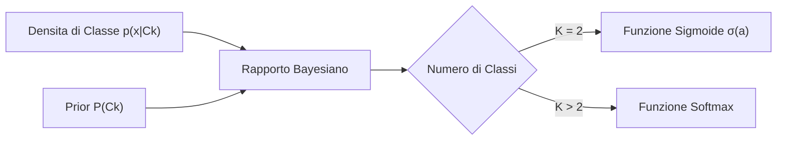

## Densita Condizionate Gaussiane

Quando le feature di ingresso $\mathbf{x} \in \mathbb{R}^{D \times 1}$ sono variabili continue a valori reali, l'assunzione di riferimento consiste nel modellare le densità condizionate di classe mediante distribuzioni Gaussiane multivariate:

$$
p(\mathbf{x} \mid \mathcal{C}_k) = \mathcal{N}(\mathbf{x} \mid \boldsymbol{\mu}_k, \mathbf{\Sigma}_k) = \frac{1}{(2\pi)^{D/2} |\mathbf{\Sigma}_k|^{1/2}} \exp\left( -\frac{1}{2} (\mathbf{x} - \boldsymbol{\mu}_k)^T \mathbf{\Sigma}_k^{-1} (\mathbf{x} - \boldsymbol{\mu}_k) \right)
$$

dove $\boldsymbol{\mu}_k \in \mathbb{R}^{D \times 1}$ rappresenta il baricentro medio della classe $k$-esima e $\mathbf{\Sigma}_k \in \mathbb{R}^{D \times D}$ è la corrispondente matrice di covarianza (simmetrica e definita positiva). La classe di modelli generativi fondata su questa distribuzione prende il nome di __Gaussian Discriminant Analysis (GDA)__.

## Linear Discriminant Analysis

L'assunzione cardine della __Linear Discriminant Analysis (LDA)__ stabilisce che tutte le classi condividano la __medesima matrice di covarianza__:

$$
\mathbf{\Sigma}_k = \mathbf{\Sigma} \quad \forall k \in \{1, \dots, K\}
$$

Sotto tale vincolo, le distribuzioni gaussiane delle differenti classi presentano dispersione, orientamento ed eccentricità identici nello spazio delle feature, differendo unicamente per la collocazione spaziale del rispettivo baricentro $\boldsymbol{\mu}_k$.

### Derivazione del Decision Boundary Lineare nel Caso Binario

Per ricavare il confine di decisione nel caso a due classi ($K = 2$), sviluppiamo l'argomento $a(\mathbf{x})$ della funzione sigmoide:

$$
a(\mathbf{x}) = \ln \frac{p(\mathbf{x} \mid \mathcal{C}_1)}{p(\mathbf{x} \mid \mathcal{C}_2)} + \ln \frac{P(\mathcal{C}_1)}{P(\mathcal{C}_2)}
$$

Sostituendo la densità normale multivariata con covarianza comune $\mathbf{\Sigma}$, i fattori moltiplicativi di normalizzazione $(2\pi)^{-D/2} |\mathbf{\Sigma}|^{-1/2}$ sono identici e si elidono a vicenda nel quoziente:

$$
\ln \frac{p(\mathbf{x} \mid \mathcal{C}_1)}{p(\mathbf{x} \mid \mathcal{C}_2)} = -\frac{1}{2} (\mathbf{x} - \boldsymbol{\mu}_1)^T \mathbf{\Sigma}^{-1} (\mathbf{x} - \boldsymbol{\mu}_1) + \frac{1}{2} (\mathbf{x} - \boldsymbol{\mu}_2)^T \mathbf{\Sigma}^{-1} (\mathbf{x} - \boldsymbol{\mu}_2)
$$

Espandiamo le due forme quadratiche sfruttando la simmetria di $\mathbf{\Sigma}^{-1}$, per cui $\mathbf{x}^T \mathbf{\Sigma}^{-1} \boldsymbol{\mu} = \boldsymbol{\mu}^T \mathbf{\Sigma}^{-1} \mathbf{x}$:

$$
(\mathbf{x} - \boldsymbol{\mu}_1)^T \mathbf{\Sigma}^{-1} (\mathbf{x} - \boldsymbol{\mu}_1) = \mathbf{x}^T \mathbf{\Sigma}^{-1} \mathbf{x} - 2 \boldsymbol{\mu}_1^T \mathbf{\Sigma}^{-1} \mathbf{x} + \boldsymbol{\mu}_1^T \mathbf{\Sigma}^{-1} \boldsymbol{\mu}_1
$$

$$
(\mathbf{x} - \boldsymbol{\mu}_2)^T \mathbf{\Sigma}^{-1} (\mathbf{x} - \boldsymbol{\mu}_2) = \mathbf{x}^T \mathbf{\Sigma}^{-1} \mathbf{x} - 2 \boldsymbol{\mu}_2^T \mathbf{\Sigma}^{-1} \mathbf{x} + \boldsymbol{\mu}_2^T \mathbf{\Sigma}^{-1} \boldsymbol{\mu}_2
$$

Sottraendo le due espressioni, i termini quadratici puri $\mathbf{x}^T \mathbf{\Sigma}^{-1} \mathbf{x}$ si cancellano esattamente:

$$
\ln \frac{p(\mathbf{x} \mid \mathcal{C}_1)}{p(\mathbf{x} \mid \mathcal{C}_2)} = (\boldsymbol{\mu}_1 - \boldsymbol{\mu}_2)^T \mathbf{\Sigma}^{-1} \mathbf{x} - \frac{1}{2} \boldsymbol{\mu}_1^T \mathbf{\Sigma}^{-1} \boldsymbol{\mu}_1 + \frac{1}{2} \boldsymbol{\mu}_2^T \mathbf{\Sigma}^{-1} \boldsymbol{\mu}_2
$$

Sommando il contributo a priori delle classi, l'argomento $a(\mathbf{x})$ si riduce a una combinazione lineare dell'input:

$$
a(\mathbf{x}) = \mathbf{w}^T \mathbf{x} + w_0
$$

dove il vettore dei pesi $\mathbf{w}$ e il termine scalare di bias $w_0$ valgono analiticamente:

$$
\mathbf{w} = \mathbf{\Sigma}^{-1} (\boldsymbol{\mu}_1 - \boldsymbol{\mu}_2)
$$

$$
w_0 = -\frac{1}{2} \boldsymbol{\mu}_1^T \mathbf{\Sigma}^{-1} \boldsymbol{\mu}_1 + \frac{1}{2} \boldsymbol{\mu}_2^T \mathbf{\Sigma}^{-1} \boldsymbol{\mu}_2 + \ln \frac{P(\mathcal{C}_1)}{P(\mathcal{C}_2)}
$$

![[fig_7_1_lda_decision_boundary.svg|center small]] ![[fig_7_2_sigmoide_lda_superficie.svg|center small]]

Poiché la probabilità a posteriori assume la forma $p(\mathcal{C}_1 \mid \mathbf{x}) = \sigma(\mathbf{w}^T \mathbf{x} + w_0)$, la condizione di equi-probabilità decisionale $p(\mathcal{C}_1 \mid \mathbf{x}) = 0.5$ equivale a imporre l'annullamento dell'argomento lineare:

$$
\mathbf{w}^T \mathbf{x} + w_0 = \sigma^{-1}(0.5) = \ln \left( \frac{0.5}{1 - 0.5} \right) = 0
$$

Il confine di separazione di LDA è dunque un __iperpiano rigorosamente lineare__ di dimensione $D - 1$. Il vettore normale $\mathbf{w}$ è orientato lungo la congiungente delle medie ruotata per l'inversa della covarianza $\mathbf{\Sigma}^{-1}(\boldsymbol{\mu}_1 - \boldsymbol{\mu}_2)$. Nel caso in cui le classi siano equiprobabili a priori ($P(\mathcal{C}_1) = P(\mathcal{C}_2)$), il termine logaritmico scompare e l'iperpiano passa esattamente a metà strada tra i due centri nello spazio distorto dalla metrica di Mahalanobis.

### Estensione di LDA al Caso Multi-Classe

Nel contesto a $K > 2$ classi con matrice di covarianza condivisa $\mathbf{\Sigma}$, esaminiamo il logaritmo della densità congiunta di ciascuna classe $a_k(\mathbf{x}) = \ln p(\mathbf{x} \mid \mathcal{C}_k) + \ln P(\mathcal{C}_k)$:

$$
\ln p(\mathbf{x} \mid \mathcal{C}_k) = -\frac{D}{2}\ln(2\pi) - \frac{1}{2}\ln|\mathbf{\Sigma}| - \frac{1}{2}(\mathbf{x} - \boldsymbol{\mu}_k)^T \mathbf{\Sigma}^{-1} (\mathbf{x} - \boldsymbol{\mu}_k)
$$

Espandendo la forma quadratica:

$$
-\frac{1}{2}(\mathbf{x} - \boldsymbol{\mu}_k)^T \mathbf{\Sigma}^{-1} (\mathbf{x} - \boldsymbol{\mu}_k) = -\frac{1}{2}\mathbf{x}^T \mathbf{\Sigma}^{-1} \mathbf{x} + \boldsymbol{\mu}_k^T \mathbf{\Sigma}^{-1} \mathbf{x} - \frac{1}{2} \boldsymbol{\mu}_k^T \mathbf{\Sigma}^{-1} \boldsymbol{\mu}_k
$$

I termini $-\frac{D}{2}\ln(2\pi) - \frac{1}{2}\ln|\mathbf{\Sigma}| - \frac{1}{2}\mathbf{x}^T \mathbf{\Sigma}^{-1} \mathbf{x}$ sono identici per tutte le classi $k \in \{1, \dots, K\}$. Comparendo all'interno della funzione softmax sia a numeratore che a denominatore, si fattorizzano e si cancellano per semplificazione algebrica.

Possiamo quindi definire per ciascuna classe una funzione discriminante lineare:

$$
a_k(\mathbf{x}) = \mathbf{w}_k^T \mathbf{x} + w_{k0}
$$

con parametri determinati da:

$$
\mathbf{w}_k = \mathbf{\Sigma}^{-1} \boldsymbol{\mu}_k
$$

$$
w_{k0} = -\frac{1}{2} \boldsymbol{\mu}_k^T \mathbf{\Sigma}^{-1} \boldsymbol{\mu}_k + \ln P(\mathcal{C}_k)
$$

La regola di decisione ottimale assegna il campione alla classe che massimizza il discriminante:

$$
\hat{\mathcal{C}} = \arg\max_{k \in \{1, \dots, K\}} a_k(\mathbf{x})
$$

Le superfici di separazione a coppie $a_i(\mathbf{x}) = a_j(\mathbf{x})$ si riducono a iperpiani lineari $(\mathbf{w}_i - \mathbf{w}_j)^T \mathbf{x} + (w_{i0} - w_{j0}) = 0$, suddividendo lo spazio $\mathbb{R}^D$ in regioni di decisione convesse poliedriche.

## Quadratic Discriminant Analysis

Rimuovendo l'ipotesi di omogeneità delle matrici di covarianza, otteniamo la __Quadratic Discriminant Analysis (QDA)__. In questo modello ogni classe possiede una matrice di covarianza indipendente $\mathbf{\Sigma}_k$:

$$
p(\mathbf{x} \mid \mathcal{C}_k) = \mathcal{N}(\mathbf{x} \mid \boldsymbol{\mu}_k, \mathbf{\Sigma}_k)
$$

Calcolando la differenza logaritmica nel caso binario, i determinanti $|\mathbf{\Sigma}_1| \neq |\mathbf{\Sigma}_2|$ non si semplificano e le forme quadratiche $\mathbf{x}^T \mathbf{\Sigma}_1^{-1} \mathbf{x}$ e $\mathbf{x}^T \mathbf{\Sigma}_2^{-1} \mathbf{x}$ non si elidono:

$$
a(\mathbf{x}) = -\frac{1}{2} \mathbf{x}^T (\mathbf{\Sigma}_1^{-1} - \mathbf{\Sigma}_2^{-1}) \mathbf{x} + (\mathbf{\Sigma}_1^{-1} \boldsymbol{\mu}_1 - \mathbf{\Sigma}_2^{-1} \boldsymbol{\mu}_2)^T \mathbf{x} - \frac{1}{2} \boldsymbol{\mu}_1^T \mathbf{\Sigma}_1^{-1} \boldsymbol{\mu}_1 + \frac{1}{2} \boldsymbol{\mu}_2^T \mathbf{\Sigma}_2^{-1} \boldsymbol{\mu}_2 - \frac{1}{2} \ln \frac{|\mathbf{\Sigma}_1|}{|\mathbf{\Sigma}_2|} + \ln \frac{P(\mathcal{C}_1)}{P(\mathcal{C}_2)}
$$

Raccogliendo i coefficienti rispetto alla variabile $\mathbf{x}$, l'espressione assume la struttura di una quadrica generale:

$$
a(\mathbf{x}) = \mathbf{x}^T \mathbf{W} \mathbf{x} + \mathbf{w}^T \mathbf{x} + w_0
$$

dove la matrice quadratica $\mathbf{W} = -\frac{1}{2} (\mathbf{\Sigma}_1^{-1} - \mathbf{\Sigma}_2^{-1}) \in \mathbb{R}^{D \times D}$ risulta non nulla.

![[fig_ex_5_lda_vs_qda_confronto.png|center big]]

Il confine decisionale $a(\mathbf{x}) = 0$ non è più un piano, bensì una __superficie quadratica__ (conica in due dimensioni: ellisse, parabola o iperbole).

> [!IMPORTANT] Trade-off Parametrico e Rischio di Overfitting tra LDA e QDA
> La scelta tra LDA e QDA riflette il compromesso operativo tra bias e varianza:
> - __LDA__: stima una sola matrice di covarianza comune, richiedendo $\frac{D(D + 1)}{2}$ parametri indipendenti di dispersione e $K \times D$ parametri per le medie. Presenta una forte regolarità geometrica e varianza ridotta, risultando preferibile quando il numero di campioni è contenuto ($N \approx D$).
> - __QDA__: stima $K$ matrici di covarianza distinte, richiedendo $K \times \frac{D(D + 1)}{2}$ parametri. Offre confini curvi estremamente flessibili a basso bias, ma la complessità parametrica cresce come $\mathcal{O}(K D^2)$. Richiede una numerosità campionaria $N$ molto elevata per evitare che le matrici campionarie diventino singolari e scongiurare l'overfitting.

## Stima di Massima Verosimiglianza per LDA

Per calibrare i parametri di LDA sui dati osservati, applichiamo il principio di __Massima Verosimiglianza (MLE)__.

Consideriamo un dataset di addestramento $\mathcal{D} = \{(\mathbf{x}^{(i)}, t^{(i)})\}_{i=0}^{N-1}$ composto da $N$ campioni i.i.d., dove $\mathbf{x}^{(i)} \in \mathbb{R}^{D \times 1}$ e il target binario vale $t^{(i)} = 1$ per la classe $\mathcal{C}_1$ e $t^{(i)} = 0$ per la classe $\mathcal{C}_2$. Modelliamo il prior delle classi mediante una distribuzione di Bernoulli di parametro $\phi$:

$$
P(\mathcal{C}_1) = \phi, \qquad P(\mathcal{C}_2) = 1 - \phi
$$

La densità congiunta del singolo campione $(\mathbf{x}^{(i)}, t^{(i)})$ si esprime come prodotto tra condizionata e prior:

$$
p(\mathbf{x}^{(i)}, \mathcal{C}_1) = \phi \mathcal{N}_1(\mathbf{x}^{(i)} \mid \boldsymbol{\mu}_1, \mathbf{\Sigma}), \qquad p(\mathbf{x}^{(i)}, \mathcal{C}_2) = (1 - \phi) \mathcal{N}_2(\mathbf{x}^{(i)} \mid \boldsymbol{\mu}_2, \mathbf{\Sigma})
$$

Combinando le due espressioni mediante gli esponenti selettori $t^{(i)}$ e $1 - t^{(i)}$, la verosimiglianza congiunta dell'intero dataset assume la forma:

$$
p(\mathbf{t}, \mathbf{X} \mid \phi, \boldsymbol{\mu}_1, \boldsymbol{\mu}_2, \mathbf{\Sigma}) = \prod_{i=0}^{N-1} \left[ \phi \mathcal{N}_1(\mathbf{x}^{(i)} \mid \boldsymbol{\mu}_1, \mathbf{\Sigma}) \right]^{t^{(i)}} \left[ (1 - \phi) \mathcal{N}_2(\mathbf{x}^{(i)} \mid \boldsymbol{\mu}_2, \mathbf{\Sigma}) \right]^{1 - t^{(i)}}
$$

Calcoliamo la log-verosimiglianza congiunta:

$$
\ln L(\phi, \boldsymbol{\mu}_1, \boldsymbol{\mu}_2, \mathbf{\Sigma}) = \sum_{i=0}^{N-1} \left[ t^{(i)} \left( \ln \phi + \ln \mathcal{N}_1(\mathbf{x}^{(i)} \mid \boldsymbol{\mu}_1, \mathbf{\Sigma}) \right) + (1 - t^{(i)}) \left( \ln(1 - \phi) + \ln \mathcal{N}_2(\mathbf{x}^{(i)} \mid \boldsymbol{\mu}_2, \mathbf{\Sigma}) \right) \right]
$$

### Stima del Prior delle Classi

Isoliamo nella log-verosimiglianza i soli termini dipendenti dal parametro $\phi$ e imponiamo l'annullamento della derivata:

$$
\frac{\partial \ln L}{\partial \phi} = \sum_{i=0}^{N-1} \left( \frac{t^{(i)}}{\phi} - \frac{1 - t^{(i)}}{1 - \phi} \right) = \frac{N_1}{\phi} - \frac{N_0}{1 - \phi} = 0
$$

dove $N_1 = \sum_{i=0}^{N-1} t^{(i)}$ e $N_0 = \sum_{i=0}^{N-1} (1 - t^{(i)}) = N - N_1$ indicano il numero di campioni appartenenti rispettivamente alla classe $\mathcal{C}_1$ e $\mathcal{C}_2$. Risolvendo per $\phi$:

$$
N_1 (1 - \phi) - N_0 \phi = 0 \implies N_1 = (N_1 + N_0) \phi \implies \phi_{\text{ML}} = \frac{N_1}{N}
$$

La stima di massima verosimiglianza del prior corrisponde alla frequenza empirica dei campioni appartenenti a ciascuna categoria nel training set.

### Stima dei Vettori delle Medie

Calcoliamo il gradiente rispetto al vettore medio $\boldsymbol{\mu}_1$. I termini dipendenti da $\boldsymbol{\mu}_1$ risiedono esclusivamente nella forma quadratica della prima normale:

$$
\nabla_{\boldsymbol{\mu}_1} \ln L = \nabla_{\boldsymbol{\mu}_1} \sum_{i=0}^{N-1} t^{(i)} \left( -\frac{1}{2} (\mathbf{x}^{(i)} - \boldsymbol{\mu}_1)^T \mathbf{\Sigma}^{-1} (\mathbf{x}^{(i)} - \boldsymbol{\mu}_1) \right) = \mathbf{0}
$$

Sviluppiamo il prodotto quadratico sfruttando la simmetria di $\mathbf{\Sigma}^{-1}$:

$$
(\mathbf{x}^{(i)} - \boldsymbol{\mu}_1)^T \mathbf{\Sigma}^{-1} (\mathbf{x}^{(i)} - \boldsymbol{\mu}_1) = (\mathbf{x}^{(i)})^T \mathbf{\Sigma}^{-1} \mathbf{x}^{(i)} - 2 (\mathbf{x}^{(i)})^T \mathbf{\Sigma}^{-1} \boldsymbol{\mu}_1 + \boldsymbol{\mu}_1^T \mathbf{\Sigma}^{-1} \boldsymbol{\mu}_1
$$

Derivando rispetto al vettore $\boldsymbol{\mu}_1$, il termine costante rispetto a $\boldsymbol{\mu}_1$ si annulla, mentre la parte lineare e quadratica producono:

$$
\nabla_{\boldsymbol{\mu}_1} \ln L = \sum_{i=0}^{N-1} t^{(i)} \mathbf{\Sigma}^{-1} (\mathbf{x}^{(i)} - \boldsymbol{\mu}_1) = \mathbf{\Sigma}^{-1} \sum_{i=0}^{N-1} t^{(i)} (\mathbf{x}^{(i)} - \boldsymbol{\mu}_1) = \mathbf{0}
$$

Moltiplicando a sinistra per la matrice non singolare $\mathbf{\Sigma}$:

$$
\sum_{i=0}^{N-1} t^{(i)} \mathbf{x}^{(i)} - \boldsymbol{\mu}_1 \sum_{i=0}^{N-1} t^{(i)} = \mathbf{0} \implies \boldsymbol{\mu}_{1, \text{ML}} = \frac{1}{N_1} \sum_{i=0}^{N-1} t^{(i)} \mathbf{x}^{(i)} = \frac{1}{N_1} \sum_{i \in \mathcal{C}_1} \mathbf{x}^{(i)}
$$

Procedendo in modo del tutto identico per $\boldsymbol{\mu}_2$:

$$
\boldsymbol{\mu}_{2, \text{ML}} = \frac{1}{N_0} \sum_{i=0}^{N-1} (1 - t^{(i)}) \mathbf{x}^{(i)} = \frac{1}{N_0} \sum_{i \in \mathcal{C}_2} \mathbf{x}^{(i)}
$$

I vettori delle medie ottimali corrispondono ai baricentri campionari calcolati separatamente sui dati di ciascuna classe.

### Stima della Matrice di Covarianza Condivisa

Isoliamo nella funzione obiettivo i contributi dipendenti dalla matrice di covarianza $\mathbf{\Sigma}$, omettendo i termini dei prior il cui gradiente rispetto a $\mathbf{\Sigma}$ è nullo:

$$
\nabla_{\mathbf{\Sigma}} \ln L = \nabla_{\mathbf{\Sigma}} \sum_{i=0}^{N-1} \left[ t^{(i)} \ln \mathcal{N}_1(\mathbf{x}^{(i)} \mid \boldsymbol{\mu}_1, \mathbf{\Sigma}) + (1 - t^{(i)}) \ln \mathcal{N}_2(\mathbf{x}^{(i)} \mid \boldsymbol{\mu}_2, \mathbf{\Sigma}) \right] = \mathbf{0}
$$

Esplicitiamo la densità normale multivariata separando il termine di scala e l'esponente:

$$
\ln \mathcal{N}(\mathbf{x}^{(i)} \mid \boldsymbol{\mu}, \mathbf{\Sigma}) = -\frac{D}{2} \ln(2\pi) - \frac{1}{2} \ln |\mathbf{\Sigma}| - \frac{1}{2} (\mathbf{x}^{(i)} - \boldsymbol{\mu})^T \mathbf{\Sigma}^{-1} (\mathbf{x}^{(i)} - \boldsymbol{\mu})
$$

Richiamiamo le due identità fondamentali del calcolo differenziale matriciale per matrici simmetriche non singolari:

$$
\nabla_{\mathbf{\Sigma}} \ln |\mathbf{\Sigma}| = (\mathbf{\Sigma}^{-1})^T = \mathbf{\Sigma}^{-1}
$$

$$
\nabla_{\mathbf{\Sigma}} \left( \mathbf{a}^T \mathbf{\Sigma}^{-1} \mathbf{a} \right) = -\mathbf{\Sigma}^{-1} \mathbf{a} \mathbf{a}^T \mathbf{\Sigma}^{-1}
$$

Sostituendo queste relazioni nel gradiente del singolo campione:

$$
\nabla_{\mathbf{\Sigma}} \ln \mathcal{N}(\mathbf{x}^{(i)} \mid \boldsymbol{\mu}, \mathbf{\Sigma}) = -\frac{1}{2} \mathbf{\Sigma}^{-1} + \frac{1}{2} \mathbf{\Sigma}^{-1} (\mathbf{x}^{(i)} - \boldsymbol{\mu})(\mathbf{x}^{(i)} - \boldsymbol{\mu})^T \mathbf{\Sigma}^{-1}
$$

Sostituendo nella sommatoria complessiva ed eliminando il fattore $-\frac{1}{2}$:

$$
\sum_{i=0}^{N-1} \left[ t^{(i)} \mathbf{\Sigma}^{-1} + (1 - t^{(i)}) \mathbf{\Sigma}^{-1} \right] - \mathbf{\Sigma}^{-1} \left[ \sum_{i=0}^{N-1} t^{(i)} (\mathbf{x}^{(i)} - \boldsymbol{\mu}_1)(\mathbf{x}^{(i)} - \boldsymbol{\mu}_1)^T \right] \mathbf{\Sigma}^{-1} - \mathbf{\Sigma}^{-1} \left[ \sum_{i=0}^{N-1} (1 - t^{(i)}) (\mathbf{x}^{(i)} - \boldsymbol{\mu}_2)(\mathbf{x}^{(i)} - \boldsymbol{\mu}_2)^T \right] \mathbf{\Sigma}^{-1} = \mathbf{0}
$$

Poiché $t^{(i)} + (1 - t^{(i)}) = 1$, la prima sommatoria restituisce $N \mathbf{\Sigma}^{-1}$. Introduciamo le matrici di dispersione interne alle due classi:

$$
\mathbf{S}_1 = \sum_{i=0}^{N-1} t^{(i)} (\mathbf{x}^{(i)} - \boldsymbol{\mu}_1)(\mathbf{x}^{(i)} - \boldsymbol{\mu}_1)^T = \sum_{i \in \mathcal{C}_1} (\mathbf{x}^{(i)} - \boldsymbol{\mu}_1)(\mathbf{x}^{(i)} - \boldsymbol{\mu}_1)^T
$$

$$
\mathbf{S}_2 = \sum_{i=0}^{N-1} (1 - t^{(i)}) (\mathbf{x}^{(i)} - \boldsymbol{\mu}_2)(\mathbf{x}^{(i)} - \boldsymbol{\mu}_2)^T = \sum_{i \in \mathcal{C}_2} (\mathbf{x}^{(i)} - \boldsymbol{\mu}_2)(\mathbf{x}^{(i)} - \boldsymbol{\mu}_2)^T
$$

L'uguaglianza si riduce a:

$$
N \mathbf{\Sigma}^{-1} - \mathbf{\Sigma}^{-1} \mathbf{S}_1 \mathbf{\Sigma}^{-1} - \mathbf{\Sigma}^{-1} \mathbf{S}_2 \mathbf{\Sigma}^{-1} = \mathbf{0}
$$

Moltiplicando a sinistra e a destra per la matrice $\mathbf{\Sigma}$:

$$
N \mathbf{\Sigma} - \mathbf{S}_1 - \mathbf{S}_2 = \mathbf{0} \implies \mathbf{\Sigma}_{\text{ML}} = \frac{1}{N} \mathbf{S}_1 + \frac{1}{N} \mathbf{S}_2
$$

Esprimendo le covarianze campionarie individuali come $\mathbf{\Sigma}_1 = \frac{1}{N_1} \mathbf{S}_1$ e $\mathbf{\Sigma}_2 = \frac{1}{N_0} \mathbf{S}_2$:

$$
\mathbf{\Sigma}_{\text{ML}} = \frac{N_1}{N} \mathbf{\Sigma}_1 + \frac{N_0}{N} \mathbf{\Sigma}_2
$$

> [!NOTE] Combinazione Convessa delle Covarianze Interne
> La matrice di covarianza comune $\mathbf{\Sigma}_{\text{ML}}$ coincide con la __combinazione convessa__ delle matrici di covarianza campionarie calcolate internamente a ciascuna classe, ponderata per le rispettive frazioni campionarie $\frac{N_1}{N}$ e $\frac{N_0}{N}$.

## Classificatore Naive Bayes per Feature Discrete

Quando i descrittori in ingresso sono variabili discrete o categoriche, la formulazione gaussiana continua non è più impiegabile.

Consideriamo un vettore di $D$ descrittori binari $\mathbf{x} = [x_0, x_1, \dots, x_{D-1}]^T \in \{0, 1\}^D$. Se volessimo modellare la distribuzione congiunta $p(\mathbf{x} \mid \mathcal{C}_k)$ in forma generale e non strutturata, dovremmo determinare $2^D - 1$ parametri probabilistici indipendenti per ogni classe. In problemi pratici come il filtro anti-spam con un lessico di $D = 50\,000$ lemmi, ciò richiederebbe $2^{50000} - 1$ parametri: una quantità computazionalmente intrattabile che renderebbe impossibile qualsiasi inferenza statistica affidabile.

Per superare la maledizione della dimensionalità, il modello __Naive Bayes__ introduce un'ipotesi semplificatrice radicale: l'__indipendenza condizionale di tutte le feature data la classe__:

$$
p(\mathbf{x} \mid \mathcal{C}_k) = \prod_{j=0}^{D-1} p(x_j \mid \mathcal{C}_k)
$$

Sotto questa assunzione, sebbene due vocaboli come `"gratis"` e `"vincita"` siano fortemente correlati nel parlato quotidiano, una volta nota l'etichetta di classe (ad esempio $t = \text{"spam"}$), l'osservazione di una parola non fornisce alcuna informazione probabilistica addizionale sulla presenza dell'altra.

### Modello di Bernoulli e Stima dei Parametri

Nel caso di feature binarie $x_j \in \{0, 1\}$, ciascuna probabilità condizionata segue una legge di Bernoulli parametrizzata da $\phi_{j \mid k} = P(x_j = 1 \mid \mathcal{C}_k)$:

$$
p(x_j \mid \mathcal{C}_k) = \phi_{j \mid k}^{x_j} (1 - \phi_{j \mid k})^{1 - x_j}
$$

La densità congiunta condizionata della classe si fattorizza nel prodotto univariato:

$$
p(\mathbf{x} \mid \mathcal{C}_k) = \prod_{j=0}^{D-1} \phi_{j \mid k}^{x_j} (1 - \phi_{j \mid k})^{1 - x_j}
$$

Grazie all'indipendenza condizionale, il numero di parametri da stimare per ciascuna classe scende da $2^D - 1$ a soli $D$ parametri $\phi_{j \mid k}$. Includendo il parametro a priori $\phi_t = P(\mathcal{C}_1)$, il modello complessivo richiede unicamente $2D + 1$ valori.

Impostiamo la verosimiglianza su un dataset di $N$ campioni i.i.d.:

$$
p(\mathbf{t} \mid \mathbf{X}, \boldsymbol{\phi}) \propto \prod_{i=0}^{N-1} p(\mathbf{x}^{(i)} \mid t^{(i)}) p(t^{(i)}) = \prod_{i=0}^{N-1} \left[ \prod_{j=0}^{D-1} \phi_{j \mid t^{(i)}}^{x_j^{(i)}} (1 - \phi_{j \mid t^{(i)}})^{1 - x_j^{(i)}} \right] p(t^{(i)})
$$

Passando alla log-verosimiglianza e derivando rispetto al parametro $\phi_{j \mid 1}$:

$$
\frac{\partial \ln L}{\partial \phi_{j \mid 1}} = \sum_{i=0}^{N-1} I(t^{(i)} = 1) \left[ \frac{x_j^{(i)}}{\phi_{j \mid 1}} - \frac{1 - x_j^{(i)}}{1 - \phi_{j \mid 1}} \right] = 0
$$

Risolvendo per $\phi_{j \mid 1}$ e $\phi_{j \mid 0}$, otteniamo le stime di massima verosimiglianza:

$$
\phi_{j \mid 1, \text{ML}} = \frac{\sum_{i=0}^{N-1} I(x_j^{(i)} = 1 \land t^{(i)} = 1)}{\sum_{i=0}^{N-1} I(t^{(i)} = 1)} = \frac{N_{j \mid 1}}{N_1}
$$

$$
\phi_{j \mid 0, \text{ML}} = \frac{\sum_{i=0}^{N-1} I(x_j^{(i)} = 1 \land t^{(i)} = 0)}{\sum_{i=0}^{N-1} I(t^{(i)} = 0)} = \frac{N_{j \mid 0}}{N_0}
$$

Nel caso binario ($K = 2$), calcoliamo il logaritmo delle probabilità a posteriori per verificare la forma della superficie di separazione:

$$
a(\mathbf{x}) = \ln \frac{p(\mathcal{C}_1 \mid \mathbf{x})}{p(\mathcal{C}_2 \mid \mathbf{x})} = \sum_{j=0}^{D-1} \left[ x_j \ln \frac{\phi_{j \mid 1}}{\phi_{j \mid 0}} + (1 - x_j) \ln \frac{1 - \phi_{j \mid 1}}{1 - \phi_{j \mid 0}} \right] + \ln \frac{P(\mathcal{C}_1)}{P(\mathcal{C}_2)}
$$

Riorganizzando i termini:

$$
a(\mathbf{x}) = \sum_{j=0}^{D-1} x_j \ln \left( \frac{\phi_{j \mid 1}(1 - \phi_{j \mid 0})}{\phi_{j \mid 0}(1 - \phi_{j \mid 1})} \right) + \sum_{j=0}^{D-1} \ln \left( \frac{1 - \phi_{j \mid 1}}{1 - \phi_{j \mid 0}} \right) + \ln \frac{P(\mathcal{C}_1)}{P(\mathcal{C}_2)} = \mathbf{w}^T \mathbf{x} + w_0
$$

Anche il classificatore Naive Bayes di Bernoulli genera un __confine di decisione rigorosamente lineare__ rispetto al vettore binario delle feature.

## Correzione di Laplace

L'approccio di massima verosimiglianza per Naive Bayes manifesta una vulnerabilità patologica nota come __problema della frequenza zero__ (_Zero Frequency Problem_).

Se nel dataset di addestramento una determinata parola $j$ non compare mai all'interno dei campioni della classe $\mathcal{C}_1$ ($N_{j \mid 1} = 0$), la stima MLE produce $\phi_{j \mid 1, \text{ML}} = 0$. In fase di test, se un campione contiene la feature $j$ ($x_j = 1$), la probabilità congiunta crolla a zero:

$$
p(\mathbf{x} \mid \mathcal{C}_1) = \prod_{l=0}^{D-1} p(x_l \mid \mathcal{C}_1) = 0
$$

Un singolo fattore moltiplicativo nullo azzera l'intero prodotto, determinando $p(\mathcal{C}_1 \mid \mathbf{x}) = 0$ (oppure conducendo a una forma indeterminata $0/0$ qualora il vocabolo non sia mai apparso in nessuna classe). Il modello esclude categoricamente la classe $\mathcal{C}_1$, rendendo totalmente vano l'apporto informativo favorevole fornito dalle rimanenti $D - 1$ feature.

Per impedire che il modello attribuisca probabilità nulla a eventi non osservati a causa della sola limitatezza del campione, si introduce la __Correzione di Laplace__ (_Laplace Smoothing_).

La tecnica consiste nell'introdurre uno pseudo-conteggio unitario a priori a numeratore e a denominatore:

$$
\phi_{j \mid 1} = \frac{\sum_{i=0}^{N-1} I(x_j^{(i)} = 1 \land t^{(i)} = 1) + 1}{\sum_{i=0}^{N-1} I(t^{(i)} = 1) + 2} = \frac{N_{j \mid 1} + 1}{N_1 + 2}
$$

e per la classe $\mathcal{C}_2$ (associata a $t = 0$):

$$
\phi_{j \mid 0} = \frac{\sum_{i=0}^{N-1} I(x_j^{(i)} = 1 \land t^{(i)} = 0) + 1}{\sum_{i=0}^{N-1} I(t^{(i)} = 0) + 2} = \frac{N_{j \mid 0} + 1}{N_0 + 2}
$$

Nella formulazione generale in cui una variabile categorica può assumere $K$ valori discreti:

$$
\mu_{j, l \mid 1} = \frac{\sum_{i=0}^{N-1} I(x_{j,l}^{(i)} = 1 \land t^{(i)} = 1) + 1}{\sum_{i=0}^{N-1} I(t^{(i)} = 1) + K}
$$

mentre per il prior della classe binaria:

$$
\phi_t = \frac{N_1 + 1}{N + 2}
$$

> [!TIP] Interpretazione Bayesiana di Laplace
> La correzione di Laplace equivale ad adottare un'inferenza bayesiana MAP con un prior uniforme (distribuzione Beta nel caso binario, Dirichlet nel caso multinomiale). In assenza di osservazioni ($N_1 = 0$), la probabilità assume il valore neutro $1/2$; al crescere del campione ($N_1 \to \infty$), il termine correttivo unitario diventa trascurabile e la stima converge asintoticamente al rapporto empirico MLE.

## Modello Bag of Words per la Classificazione Testuale

Il modello __Bag of Words (BoW)__ costituisce la tecnica cardine per convertire documenti di testo non strutturati a lunghezza variabile in vettori di feature a dimensione fissa $D$, rendendoli trattabili dagli algoritmi di classificazione.

![[fig_7_3_bag_of_words_vocabolario.svg|center mid]]

La procedura di vettorizzazione si articola in due passaggi sequenziali:

1. __Costruzione del Vocabolario $\mathcal{V}$__: si analizza il corpus dei documenti di addestramento, estraendo l'insieme delle $D$ parole più rilevanti e frequenti:
   $$
   \mathcal{V} = \{w_0, w_1, \dots, w_{D-1}\}
   $$
   Dalla collezione vengono escluse le parole puramente grammaticali prive di valore discriminante (__Stop-words__, quali congiunzioni, articoli e preposizioni) e si riconducono i termini alla rispettiva radice morfologica tramite tecniche di _Stemming_ o _Lemmatization_.
2. __Rappresentazione Vettoriale del Documento__: ogni testo $d$ viene trasformato in un vettore di dimensione $D$ in cui ciascuna coordinata corrisponde a un lemma del vocabolario:
   - __Codifica Binaria__: $x_j = 1$ se il vocabolo $w_j \in \mathcal{V}$ è presente nel documento, $x_j = 0$ altrimenti (utilizzata da Bernoulli Naive Bayes).
   - __Term Frequency (TF)__: $x_j$ quantifica la frequenza con cui il lemma $w_j$ ricorre all'interno del documento $d$.


### Ponderazione TF-IDF

La semplice frequenza assoluta dei termini presenta due limiti strutturali: tende a favorire i documenti più lunghi e assegna peso elevato a parole generiche ripetute molte volte ma poco discriminanti.

Per calibrare il peso in funzione della specificità informativa di ciascun lemma, si adotta la metrica combinata __TF-IDF__ (_Term Frequency - Inverse Document Frequency_):

$$
\text{TF-IDF}(j, d) = \mathrm{TF}(j, d) \times \mathrm{IDF}(j, \mathcal{D})
$$

La __Term Frequency Normalizzata__ impedisce che i documenti più lunghi ricevano pesi sproporzionati, normalizzando la frequenza grezza del termine $j$ rispetto alla frequenza del termine più comune nel documento $d$:

$$
\mathrm{TF}(j, d) = 0.5 + 0.5 \frac{\#\{j \text{ in } d\}}{\max_{k \in d} \#\{k \text{ in } d\}}
$$

La componente __Inverse Document Frequency__ penalizza i lemmi diffusi in modo ubiquo in tutti i testi e amplifica il peso dei lemmi rari e specifici:

$$
\mathrm{IDF}(j, \mathcal{D}) = \ln \left( \frac{|\mathcal{D}|}{|\{d \in \mathcal{D} : j \in d\}|} \right)
$$

dove $|\mathcal{D}|$ indica il numero totale di documenti nel corpus e il denominatore misura quanti documenti contengono il lemma $j$:
- Se una parola è presente in quasi tutti i documenti (ad esempio `"sistema"` in un archivio informatico), il quoziente interno tende a 1 e il logaritmo annulla l'IDF ($\ln 1 = 0$).
- Se una parola è rara e circoscritta a pochissimi testi (come `"iperpiano"` o `"backpropagation"`), il denominatore è piccolo e l'IDF assume un valore elevato, massimizzando il peso della feature.

### Espansione delle Feature e N-Grammi

Il limite connaturato al modello Bag of Words risiede nella totale perdita dell'ordine sintattico e della struttura sequenziale delle frasi: la stringa `"borsa non bella"` produce lo stesso identico vettore di conteggio di `"bella borsa non"`.

Per preservare le relazioni lessicali locali, si adotta l'__espansione con N-grammi__: anziché considerare unicamente singoli lemmi isolati, si definiscono feature corrispondenti a sequenze ordinate di $n$ vocaboli adiacenti:
- __Unigrammi__ ($n = 1$): singole parole isolate.
- __Bigrammi__ ($n = 2$): coppie di vocaboli contigui (ad esempio `"non male"`, `"carta credito"`).
- __Trigrammi__ ($n = 3$): terne di parole consecutive (ad esempio `"tasso interesse fisso"`).

Questo processo è concettualmente analogo all'espansione polinomiale delle feature nella regressione lineare: incrementa la capacità descrittiva e discriminante del modello a fronte di una crescita combinatoria della dimensionalità $D$, aumentando il rischio di overfitting e rendendo indispensabili opportune tecniche di regolarizzazione o selezione delle feature.


# 6. Metodo dei Moltiplicatori di Lagrange

Mentre l'ottimizzazione libera individua i punti stazionari azzerando direttamente il gradiente della funzione obiettivo, nei modelli avanzati di Machine Learning (Support Vector Machines, Principal Component Analysis, regolarizzazione vincolata Ridge e Lasso) i parametri devono soddisfare precisi vincoli geometrici, fisici o probabilistici sullo spazio di ricerca.

Il __metodo dei moltiplicatori di Lagrange__ fornisce l'infrastruttura analitica per trattare tali problemi, fondando la propria efficacia sull'interpretazione geometrica dell'ortogonalità e del parallelismo dei gradienti, sulla formulazione Lagrangiana per vincoli di uguaglianza e sulla sua estensione alle disuguaglianze mediante le condizioni di Karush-Kuhn-Tucker (KKT).

## Fondamenti dell'Ottimizzazione Vincolata

Inquadriamo il problema generale dell'ottimizzazione vincolata: cerchiamo i punti estremali (massimi o minimi) di una funzione obiettivo scalare $f(\mathbf{x})$ sotto un insieme di $M$ vincoli di uguaglianza:

$$
\min_{\mathbf{x}} \quad (\text{oppure } \max_{\mathbf{x}}) \quad f(\mathbf{x})
$$

sotto le condizioni ammissibili:

$$
h_1(\mathbf{x}) = 0, \quad h_2(\mathbf{x}) = 0, \quad \dots, \quad h_M(\mathbf{x}) = 0
$$

dove $\mathbf{x} \in \mathbb{R}^{D \times 1}$ è il vettore delle variabili da ottimizzare, mentre la funzione obiettivo $f(\mathbf{x})$ e le funzioni vincolo $h_m(\mathbf{x})$ appartengono alla classe $C^2$ (funzioni continue dotate di derivate parziali prime e seconde continue su tutto il dominio).

Un primo approccio elementare consisterebbe nell'utilizzare l'equazione del vincolo per esplicitare una coordinata in funzione delle altre (ad esempio $x_2 = g(x_1)$ in dimensione due), sostituire tale relazione nella funzione obiettivo per ottenere una funzione univariata $f(x_1, g(x_1))$, e procedere alla massimizzazione o minimizzazione non vincolata rispetto a $x_1$.

Questa strategia per sostituzione diretta presenta due gravi limiti operativi:
- Non è sempre agevole, né analiticamente possibile, invertire l'equazione $h(\mathbf{x}) = 0$ in forma chiusa rispetto a una singola coordinata.
- Il metodo tratta le variabili in modo asimmetrico, rompendo la naturale simmetria geometrica insita nel vincolo.

Per superare queste limitazioni introduciamo il parametro scalare ausiliario $\lambda \in \mathbb{R}$, denominato __moltiplicatore di Lagrange__, la cui genesi emerge naturalmente dallo studio della geometria differenziale delle superfici di livello.

## Geometria dei Vincoli di Uguaglianza

Per comprendere il significato fisico del moltiplicatore, partiamo dal caso bidimensionale ($D = 2$) con un singolo vincolo di uguaglianza $h(x_1, x_2) = 0$.

L'equazione $h(x_1, x_2) = 0$ definisce una curva nello spazio $\mathbb{R}^2$ (e in generale un'ipersuperficie di dimensione $D - 1$ in $\mathbb{R}^D$).

### Ortogonalità tra Gradiente e Vettore Tangente

Differenziamo l'equazione del vincolo rispetto a $x_1$ applicando la regola della catena (_Chain Rule_):

$$
\frac{\partial h}{\partial x_1} + \frac{\partial h}{\partial x_2} \frac{\mathrm{d}x_2}{\mathrm{d}x_1} = 0
$$

Possiamo riscrivere questa equazione come il prodotto scalare tra due vettori fondamentali:

$$
\nabla h(\mathbf{x}) = \begin{bmatrix} \frac{\partial h}{\partial x_1} \\[1ex] \frac{\partial h}{\partial x_2} \end{bmatrix}, \qquad \boldsymbol{\epsilon} = \begin{bmatrix} 1 \\[1ex] \frac{\mathrm{d}x_2}{\mathrm{d}x_1} \end{bmatrix}
$$

L'annullamento della derivata si traduce nella condizione di ortogonalità:

$$
(\nabla h)^T \boldsymbol{\epsilon} = 0
$$

Il vettore $\boldsymbol{\epsilon}$ è per definizione parallelo alla tangente alla curva $h(x_1, x_2) = 0$ nel punto $\mathbf{x}$, mentre $\nabla h$ rappresenta il vettore gradiente del vincolo. Ne consegue che il vettore gradiente $\nabla h$ è __rigorosamente ortogonale alla curva del vincolo__ in ogni suo punto.

![[fig_8_1_gradiente_e_tangente_vincolo.svg|center small]] ![[fig_8_2_componente_gradiente_non_nullo.svg|center small]]

Possiamo verificare questa fondamentale proprietà anche attraverso lo sviluppo in serie di Taylor al primo ordine attorno al punto $\mathbf{x}$. Consideriamo un piccolo spostamento $\boldsymbol{\epsilon}$ vincolato a giacere lungo la curva:

$$
h(\mathbf{x} + \boldsymbol{\epsilon}) \approx h(\mathbf{x}) + \boldsymbol{\epsilon}^T \nabla h(\mathbf{x})
$$

Poiché sia $\mathbf{x}$ sia $\mathbf{x} + \boldsymbol{\epsilon}$ appartengono alla curva del vincolo, abbiamo per definizione $h(\mathbf{x}) = 0$ e $h(\mathbf{x} + \boldsymbol{\epsilon}) = 0$. Per spostamenti infinitesimi $\|\boldsymbol{\epsilon}\| \to 0$, l'equazione impone:

$$
\boldsymbol{\epsilon}^T \nabla h(\mathbf{x}) = 0
$$

La direzione di massima variazione $\nabla h$ non possiede alcuna componente lungo la curva di livello: ogni variazione ammissibile deve compiersi ortogonalmente al gradiente del vincolo.

### Condizione di Estremo e Parallelismo dei Gradienti

Consideriamo ora la variazione della funzione obiettivo $f(\mathbf{x})$ quando ci muoviamo lungo la curva del vincolo $h(\mathbf{x}) = 0$.

Se uno spostamento infinitesimo $\boldsymbol{\epsilon}$ lungo la curva produce una variazione non nulla del valore di $f$, significa che il moto possiede una componente proiettata non nulla lungo la direzione di massima pendenza $\nabla f$, ovvero $(\nabla f)^T \boldsymbol{\epsilon} \neq 0$. In tale situazione possiamo scorrere lungo il vincolo (in avanti o all'indietro) per incrementare o ridurre ulteriormente il valore di $f$.

In un punto estremale vincolato $\mathbf{x}^*$ (massimo o minimo locale ammissibile sulla curva), non deve essere più possibile migliorare il valore di $f$ muovendosi lungo la curva ammissibile. La derivata direzionale lungo la direzione tangente $\boldsymbol{\epsilon}$ deve quindi annullarsi identicamente:

$$
(\nabla f)^T \boldsymbol{\epsilon} = 0
$$

Nel punto di ottimo vincolato $\mathbf{x}^*$, il vettore tangente $\boldsymbol{\epsilon}$ è simultaneamente ortogonale sia a $\nabla h(\mathbf{x}^*)$ sia a $\nabla f(\mathbf{x}^*)$. Nello spazio bidimensionale $\mathbb{R}^2$, due vettori perpendicolari alla medesima retta tangente devono necessariamente essere collineari tra loro.

I gradienti $\nabla f$ e $\nabla h$ devono quindi essere __paralleli__ (o antiparalleli). Esiste dunque un coefficiente scalare $\lambda \neq 0$ tale che:

$$
\nabla f(\mathbf{x}^*) + \lambda \nabla h(\mathbf{x}^*) = \mathbf{0} \iff \nabla f(\mathbf{x}^*) = -\lambda \nabla h(\mathbf{x}^*)
$$

![[fig_8_3_parallelismo_gradienti_punto_estremale.svg|center small]] ![[fig_8_4_curve_di_livello_minimo_vincolato.svg|center small]]

L'interpretazione visiva sulle curve di livello chiarisce perfettamente il fenomeno: le curve di livello di $f(\mathbf{x})$ sono definite dagli insiemi $\{\mathbf{x} \in \mathbb{R}^D : f(\mathbf{x}) = c\}$. Nel punto di ottimo vincolato $\mathbf{x}^*$, la curva del vincolo $h(\mathbf{x}) = 0$ è __tangente alla curva di livello__ $f(\mathbf{x}) = c^*$.

Se non vi fosse tangenza, la curva del vincolo taglierebbe trasversalmente la curva di livello: potremmo scivolare lungo il vincolo attraversando curve di livello a quota più elevata (per la massimizzazione) o più bassa (per la minimizzazione). L'estremo vincolato corrisponde al punto in cui il vincolo sfiora l'ultima curva di livello accessibile.

I punti estremali vincolati sono identificati dal sistema congiunto a $D + 1$ equazioni e $D + 1$ incognite:

$$
\begin{cases}
\nabla f(\mathbf{x}) + \lambda \nabla h(\mathbf{x}) = \mathbf{0} \\[1ex]
h(\mathbf{x}) = 0
\end{cases}
$$

## Formulazione della Funzione Lagrangiana

Il metodo dei moltiplicatori di Lagrange trasforma elegantemente un problema vincolato in $\mathbb{R}^D$ in un problema stazionario non vincolato in uno spazio a dimensione aumentata $\mathbb{R}^{D + 1}$.

Definiamo la __funzione Lagrangiana__ associata al problema con vincolo di uguaglianza:

$$
\mathcal{L}(\mathbf{x}, \lambda) = f(\mathbf{x}) + \lambda h(\mathbf{x})
$$

Calcoliamo le derivate parziali di $\mathcal{L}$ rispetto a tutte le variabili primali $\mathbf{x}$ e al moltiplicatore $\lambda$, imponendone l'annullamento:

$$
\nabla_{\mathbf{x}} \mathcal{L}(\mathbf{x}, \lambda) = \nabla f(\mathbf{x}) + \lambda \nabla h(\mathbf{x}) = \mathbf{0}
$$

$$
\frac{\partial \mathcal{L}(\mathbf{x}, \lambda)}{\partial \lambda} = h(\mathbf{x}) = 0
$$

Possiamo esprimere il gradiente complessivo in forma compatta:

$$
\nabla \mathcal{L} = \begin{bmatrix} \nabla_{\mathbf{x}} \mathcal{L} \\[1ex] \frac{\partial \mathcal{L}}{\partial \lambda} \end{bmatrix} = \begin{bmatrix} \nabla f(\mathbf{x}) + \lambda \nabla h(\mathbf{x}) \\[1ex] h(\mathbf{x}) \end{bmatrix} = \mathbf{0}
$$

La derivata rispetto al parametro lagrangiano $\lambda$ ripristina esattamente il vincolo originario $h(\mathbf{x}) = 0$, mentre la derivata rispetto al vettore primale $\mathbf{x}$ impone il parallelismo dei gradienti. La determinazione dei punti stazionari di $\mathcal{L}$ risolve completamente il problema vincolato.

### Esempio Analitico Svolto

Applichiamo il formalismo al problema di determinare il punto stazionario della funzione quadratica:

$$
\max_{x_1, x_2} \quad f(x_1, x_2) = 1 - 2x_1^2 - 2x_2^2
$$

sotto il vincolo lineare di uguaglianza:

$$
h(x_1, x_2) = 2x_1 + 2x_2 - 1 = 0
$$

Costruiamo la funzione Lagrangiana:

$$
\mathcal{L}(x_1, x_2, \lambda) = 1 - 2x_1^2 - 2x_2^2 + \lambda (2x_1 + 2x_2 - 1)
$$

Calcoliamo le derivate parziali e poniamole uguali a zero:

$$
\begin{cases}
\frac{\partial \mathcal{L}}{\partial x_1} = -4x_1 + 2\lambda = 0 \\[1ex]
\frac{\partial \mathcal{L}}{\partial x_2} = -4x_2 + 2\lambda = 0 \\[1ex]
\frac{\partial \mathcal{L}}{\partial \lambda} = 2x_1 + 2x_2 - 1 = 0
\end{cases}
$$

Dalle prime due equazioni ricaviamo le coordinate ottime in funzione del moltiplicatore $\lambda$:

$$
x_1 = \frac{\lambda}{2}, \qquad x_2 = \frac{\lambda}{2}
$$

Sostituendo nella terza equazione (il vincolo ammissibile):

$$
2 \left(\frac{\lambda}{2}\right) + 2 \left(\frac{\lambda}{2}\right) - 1 = 0 \implies 2\lambda = 1 \implies \lambda^* = \frac{1}{2}
$$

Determiniamo le coordinate del punto stazionario ottimale:

$$
x_1^* = \frac{1}{4}, \qquad x_2^* = \frac{1}{4}
$$

Il valore assunto dalla funzione obiettivo nel punto di ottimo vincolato è:

$$
f\left(\frac{1}{4}, \frac{1}{4}\right) = 1 - 2\left(\frac{1}{16}\right) - 2\left(\frac{1}{16}\right) = 1 - \frac{1}{4} = \frac{3}{4}
$$

Osserviamo che il massimo globale non vincolato di $f$ varrebbe $1$ (in corrispondenza dell'origine $(0, 0)$), ma la presenza del vincolo $h(x_1, x_2) = 0$ confina la soluzione sul segmento ammissibile, riducendo il valore massimo raggiungibile a $3/4$.

## Vincoli di Disuguaglianza

Estendiamo ora la formulazione a problemi in cui i vincoli sono espressi mediante disuguaglianze, ovvero della forma:

$$
h(\mathbf{x}) \ge 0 \quad (\text{oppure } h(\mathbf{x}) \le 0)
$$

Il vincolo definisce una __regione ammissibile__ $\mathcal{F} = \{\mathbf{x} \in \mathbb{R}^D : h(\mathbf{x}) \ge 0\}$ delimitata dalla frontiera $\partial \mathcal{F} = \{\mathbf{x} \in \mathbb{R}^D : h(\mathbf{x}) = 0\}$.

![[fig_8_5_vincoli_disuguaglianza_kkt.svg|center mid]]

In questa configurazione si presentano due scenari qualitativamente distinti:
- __Vincolo Inattivo__: l'ottimo non vincolato della funzione obiettivo cade strettamente all'interno della regione ammissibile ($h(\mathbf{x}^*) > 0$). In questo caso il vincolo non limita la ricerca e non influisce sulla posizione della soluzione. La condizione di ottimalità è semplicemente $\nabla f(\mathbf{x}^*) = \mathbf{0}$. Questo scenario corrisponde all'annullamento del moltiplicatore di Lagrange: $\lambda = 0$.
- __Vincolo Attivo__: l'ottimo non vincolato si trova al di fuori della regione ammissibile. La funzione $f$ tenta di spingersi oltre il bordo, ma viene arrestata dal confine della regione ammissibile. La soluzione ottima deve pertanto giacere esattamente sulla frontiera ($h(\mathbf{x}^*) = 0$). In questo caso il vincolo è operante ed esercita una reazione non nulla: $\lambda \neq 0$.

In entrambi i contesti, il prodotto tra il moltiplicatore e il valore del vincolo si annulla identicamente:

$$
\lambda h(\mathbf{x}^*) = 0
$$

Questa relazione essenziale prende il nome di __condizione di slackness complementare__ (_Complementary Slackness_): o il vincolo è inattivo all'interno (per cui $\lambda = 0$ e $h > 0$), oppure il vincolo è attivo sul bordo (per cui $h = 0$ e $\lambda \neq 0$). I due fattori sono reciprocamente esclusivi e non possono mai essere contemporaneamente diversi da zero.

### I Quattro Scenari per il Segno del Moltiplicatore

Nel caso di vincolo attivo ($h(\mathbf{x}) = 0$), il segno del moltiplicatore $\lambda$ non è arbitrario: esso è rigidamente vincolato dalla natura del problema (massimizzazione vs minimizzazione) e dal verso della disuguaglianza.

Dalla condizione di stazionarietà $\nabla f + \lambda \nabla h = \mathbf{0}$, isoliamo la relazione vettoriale:

$$
\nabla f = -\lambda \nabla h
$$

Il segno di $\lambda$ dipende dall'orientamento reciproco dei due gradienti:
- Se $\nabla f$ e $\nabla h$ hanno __versi opposti__ (antiparalleli), allora $-\lambda$ deve essere negativo, imponendo $\lambda > 0$.
- Se $\nabla f$ e $\nabla h$ hanno lo __stesso verso__ (paralleli), allora $-\lambda$ deve essere positivo, imponendo $\lambda < 0$.

Deduciamo fisicamente la direzione dei gradienti nei quattro scenari possibili:

1. __Scenario 1: Massimizzazione con vincolo $h(\mathbf{x}) \ge 0$__:
   - Il gradiente $\nabla h$ punta per definizione verso l'interno della regione ammissibile (direzione in cui $h$ cresce verso valori positivi).
   - Poiché il massimo si trova sulla frontiera, la funzione $f$ deve continuare a crescere muovendosi verso l'esterno; se puntasse verso l'interno, potremmo addentrarci nella regione per aumentare $f$, contraddicendo l'ipotesi che il massimo sia sul bordo. Dunque $\nabla f$ punta verso l'esterno.
   - I gradienti $\nabla f$ e $\nabla h$ sono __antiparalleli__. Poiché $\nabla f = -\lambda \nabla h$, deve valere tassativamente:
     $$
     \lambda > 0
     $$

2. __Scenario 2: Massimizzazione con vincolo $h(\mathbf{x}) \le 0$__:
   - La regione ammissibile corrisponde a $h \le 0$: i valori maggiori di $h$ si trovano all'esterno, quindi $\nabla h$ punta verso l'esterno della regione ammissibile.
   - Trattandosi di un massimo sul bordo, la funzione $f$ deve continuare a salire verso l'esterno: il gradiente $\nabla f$ punta verso l'esterno della regione ammissibile.
   - I gradienti $\nabla f$ e $\nabla h$ hanno lo stesso verso, ovvero sono __paralleli__. Poiché $\nabla f = -\lambda \nabla h$, deve valere:
     $$
     \lambda < 0
     $$

3. __Scenario 3: Minimizzazione con vincolo $h(\mathbf{x}) \ge 0$__:
   - Il gradiente $\nabla h$ punta verso l'interno della regione ammissibile.
   - Poiché cerchiamo un minimo sul bordo, la funzione $f$ deve decrescere muovendosi verso l'esterno (e crescere muovendosi verso l'interno); se decrescesse verso l'interno, potremmo addentrarci nella regione per ridurre $f$. La direzione di massima crescita $\nabla f$ deve quindi puntare verso l'interno della regione ammissibile.
   - I gradienti $\nabla f$ e $\nabla h$ sono entrambi rivolti verso l'interno, ovvero sono __paralleli__. Poiché $\nabla f = -\lambda \nabla h$, otteniamo:
     $$
     \lambda < 0
     $$

4. __Scenario 4: Minimizzazione con vincolo $h(\mathbf{x}) \le 0$__:
   - Il gradiente $\nabla h$ punta verso l'esterno della regione ammissibile.
   - Per lo stesso principio dello Scenario 3, la direzione di massima crescita $\nabla f$ deve puntare verso l'interno della regione ammissibile.
   - I gradienti $\nabla f$ e $\nabla h$ hanno versi opposti, ovvero sono __antiparalleli__. Poiché $\nabla f = -\lambda \nabla h$, deve valere:
     $$
     \lambda > 0
     $$

![[fig_ex_6_kkt_4_scenari_segni_lambda.png|center big]]

La seguente tabella sinottica sintetizza la deduzione fisica per la memorizzazione d'esame:

| Obiettivo Primale | Verso del Vincolo | Direzione $\nabla h$ | Direzione $\nabla f$ | Allineamento | Segno Moltiplicatore |
| :--- | :--- | :--- | :--- | :--- | :---: |
| $\max f(\mathbf{x})$ | $h(\mathbf{x}) \ge 0$ | Verso l'interno | Verso l'esterno | Antiparalleli ($\uparrow \downarrow$) | $\lambda > 0$ |
| $\max f(\mathbf{x})$ | $h(\mathbf{x}) \le 0$ | Verso l'esterno | Verso l'esterno | Paralleli ($\uparrow \uparrow$) | $\lambda < 0$ |
| $\min f(\mathbf{x})$ | $h(\mathbf{x}) \ge 0$ | Verso l'interno | Verso l'interno | Paralleli ($\uparrow \uparrow$) | $\lambda < 0$ |
| $\min f(\mathbf{x})$ | $h(\mathbf{x}) \le 0$ | Verso l'esterno | Verso l'interno | Antiparalleli ($\uparrow \downarrow$) | $\lambda > 0$ |

> [!IMPORTANT] Regola Mnemonica per l'Esame sui Segni di $\lambda$
> Nello studio dei vincoli di disuguaglianza con formulazione della Lagrangiana $\mathcal{L} = f + \lambda h$:
> - Se i vettori $\nabla f$ e $\nabla h$ sono __antiparalleli__ (versi opposti), il moltiplicatore è positivo: $\lambda > 0$.
> - Se i vettori $\nabla f$ e $\nabla h$ sono __paralleli__ (stesso verso), il moltiplicatore è negativo: $\lambda < 0$.
>
> Per il problema canonico del Machine Learning (massimizzazione con $h(\mathbf{x}) \ge 0$, oppure minimizzazione con $g(\mathbf{x}) \le 0$), il segno associato al moltiplicatore duale è sempre non-negativo: $\lambda \ge 0$.

## Condizioni di Karush-Kuhn-Tucker

Raccogliendo tutti i requisiti analitici derivati per il problema di massimizzazione con vincolo di disuguaglianza $h(\mathbf{x}) \ge 0$, la funzione Lagrangiana assume la forma:

$$
\mathcal{L}(\mathbf{x}, \lambda) = f(\mathbf{x}) + \lambda h(\mathbf{x})
$$

Le condizioni necessarie per l'ottimalità del punto $\mathbf{x}^*$ sono riassunte dalle __condizioni di Karush-Kuhn-Tucker (KKT)__:

$$
\begin{cases}
\nabla_{\mathbf{x}} \mathcal{L}(\mathbf{x}, \lambda) = \mathbf{0} \\[1ex]
\frac{\partial \mathcal{L}(\mathbf{x}, \lambda)}{\partial \lambda} = 0 \iff h(\mathbf{x}) = 0 \quad (\text{se vincolo attivo}) \\[1ex]
\lambda h(\mathbf{x}) = 0 \\[1ex]
h(\mathbf{x}) \ge 0 \\[1ex]
\lambda \ge 0
\end{cases}
$$

### Estensione a Vincoli Multipli Misti

Nei problemi reali di ottimizzazione dobbiamo gestire simultaneamente $J$ vincoli di disuguaglianza e $K$ vincoli di uguaglianza:

$$
\max_{\mathbf{x}} \quad f(\mathbf{x}) \quad \text{sotto i vincoli} \quad \begin{cases} h_j(\mathbf{x}) \ge 0, & j = 1, \dots, J \\[1ex] r_k(\mathbf{x}) = 0, & k = 1, \dots, K \end{cases}
$$

Introducendo un moltiplicatore $\lambda_j$ per ciascun vincolo di disuguaglianza e un moltiplicatore $\mu_k$ per ciascun vincolo di uguaglianza, costruiamo la Lagrangiana generalizzata:

$$
\mathcal{L}(\mathbf{x}, \boldsymbol{\lambda}, \boldsymbol{\mu}) = f(\mathbf{x}) + \sum_{j=1}^J \lambda_j h_j(\mathbf{x}) + \sum_{k=1}^K \mu_k r_k(\mathbf{x})
$$

Le condizioni KKT complete per il punto di ottimo assumono la forma:

$$
\begin{cases}
\nabla_{\mathbf{x}} \mathcal{L}(\mathbf{x}, \boldsymbol{\lambda}, \boldsymbol{\mu}) = \mathbf{0} \\[1.5ex]
\frac{\partial \mathcal{L}}{\partial \lambda_j} = 0 \iff h_j(\mathbf{x}) = 0 \quad (\text{se vincolo attivo}), & \forall j \in \{1, \dots, J\} \\[1.5ex]
\frac{\partial \mathcal{L}}{\partial \mu_k} = 0 \iff r_k(\mathbf{x}) = 0, & \forall k \in \{1, \dots, K\} \\[1.5ex]
\lambda_j h_j(\mathbf{x}) = 0, & \forall j \in \{1, \dots, J\} \\[1.5ex]
r_k(\mathbf{x}) = 0, & \forall k \in \{1, \dots, K\} \\[1.5ex]
h_j(\mathbf{x}) \ge 0, & \forall j \in \{1, \dots, J\} \\[1.5ex]
\lambda_j \ge 0, & \forall j \in \{1, \dots, J\}
\end{cases}
$$

I moltiplicatori associati ai vincoli di uguaglianza $\mu_k \in \mathbb{R}$ sono liberi nel segno, poiché il movimento sul vincolo è rigidamente confinato sulla curva bidirezionale e la normale può avere verso concorde o discorde senza violare l'ammissibilità. I moltiplicatori $\lambda_j \ge 0$ associati alle disuguaglianze devono invece rispettare il vincolo di non-negatività per garantire che la forza vincolare agisca esclusivamente verso l'interno della regione ammissibile.

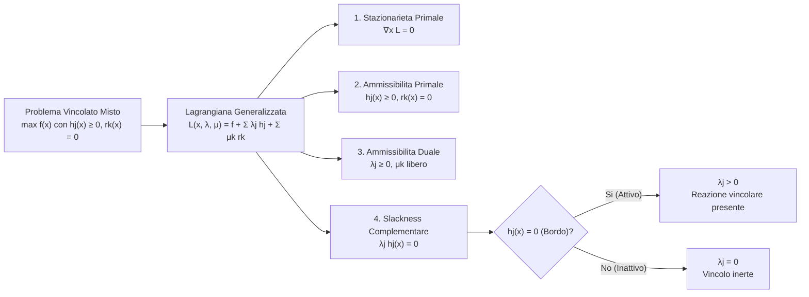

## Rilevanza nei Modelli di Machine Learning

Il formalismo dei moltiplicatori di Lagrange e delle condizioni KKT non rappresenta una parentesi teorica astratta, bensì l'impalcatura matematica portante dei principali modelli di apprendimento supervisionato e non supervisionato:

- __Support Vector Machines (SVM)__: la massimizzazione del margine di separazione tra classi equivale a minimizzare la norma dei pesi $\min_{\mathbf{w}, b} \frac{1}{2}\|\mathbf{w}\|^2$ sotto i vincoli di corretta classificazione $t_i (\mathbf{w}^T \mathbf{x}_i + b) \ge 1$ per ogni campione $i = 0, \dots, N-1$. Scrivendo il vincolo come $h_i(\mathbf{w}, b) = t_i (\mathbf{w}^T \mathbf{x}_i + b) - 1 \ge 0$, la condizione di slackness complementare KKT impone $\lambda_i [t_i (\mathbf{w}^T \mathbf{x}_i + b) - 1] = 0$. La stragrande maggioranza dei campioni cade all'interno della regione corretta ($h_i > 0$) e riceve $\lambda_i = 0$, risultando del tutto ininfluente nella determinazione del bordo di decisione. Solo i campioni giacenti esattamente sul margine soddisfano $h_i = 0$ con $\lambda_i > 0$: essi costituiscono i celebri __vettori di supporto__, gli unici punti del dataset che determinano la posizione dell'iperpiano separatore ottimo.
- __Principal Component Analysis (PCA)__: la ricerca della prima direzione principale $\mathbf{u}_1$ corrisponde a massimizzare la varianza proiettata $\mathbf{u}_1^T \mathbf{S} \mathbf{u}_1$ (dove $\mathbf{S}$ è la matrice di covarianza empirica dei dati) sotto il vincolo di normalizzazione $\mathbf{u}_1^T \mathbf{u}_1 = 1$. Impostando la Lagrangiana $\mathcal{L}(\mathbf{u}_1, \lambda) = \mathbf{u}_1^T \mathbf{S} \mathbf{u}_1 - \lambda(\mathbf{u}_1^T \mathbf{u}_1 - 1)$, la condizione di stazionarietà $\nabla_{\mathbf{u}_1} \mathcal{L} = 2\mathbf{S}\mathbf{u}_1 - 2\lambda \mathbf{u}_1 = \mathbf{0}$ conduce direttamente all'equazione secolare agli autovalori $\mathbf{S}\mathbf{u}_1 = \lambda \mathbf{u}_1$. La varianza proiettata coincide con $\mathbf{u}_1^T \mathbf{S} \mathbf{u}_1 = \lambda$: la direzione a massima varianza è quindi l'autovettore associato al massimo autovalore di $\mathbf{S}$.
- __Regolarizzazione Vincolata (Ridge e Lasso)__: la minimizzazione dell'errore empirico sotto il vincolo sferico $\|\mathbf{w}\|_2^2 \le s$ (Ridge) o sotto il vincolo a politopo $\|\mathbf{w}\|_1 \le s$ (Lasso) conduce, tramite la dualità lagrangiana e le condizioni KKT, all'esatta equivalenza con la forma penalizzata lagrangiana $\min E(\mathbf{w}) + \lambda \Omega(\mathbf{w})$. La geometria del vincolo (la sfera liscia in Ridge contro i vertici cuspidali del politopo in Lasso) determina il punto di tangenza con le curve di livello dell'errore quadratico, spiegando geometricamente perché Lasso annulla esattamente i coefficienti generando modelli sparsi.


# 7. Model Selection e Model Assessment

L'apprendimento supervisionato mira a stimare, a partire dai dati osservati, una funzione in grado di mappare il vettore delle feature $\mathbf{x}$ nella variabile target $t$. Queste due grandezze sono governate da una distribuzione di probabilità congiunta $p(\mathbf{x}, t)$ a noi ignota, di cui possediamo informazioni unicamente attraverso un insieme discreto di realizzazioni campionarie: il dataset di addestramento $\mathcal{D}_{\text{train}} = \{(\mathbf{x}^{(i)}, t^{(i)})\}_{i=0}^{N-1}$.

Il problema metodologico centrale del Machine Learning risiede nella capacità del modello di generalizzare correttamente su campioni mai osservati durante la fase di apprendimento. L'analisi si fonda sulla distinzione concettuale tra __Model Selection__ e __Model Assessment__, sulla derivazione analitica della __decomposizione Bias-Varianza__, sulle proprietà asintotiche per i regressori K-NN e OLS, sui protocolli empirici di validazione (Hold-out, K-Fold Cross-Validation, Leave-One-Out) e sulla dinamica delle curve di apprendimento al variare della numerosità campionaria.

## Obiettivo di Apprendimento ed Errore di Generalizzazione

Indipendentemente dalla specifica strategia adottata (funzione discriminante diretta, modello discriminativo o approccio generativo), il processo di ottimizzazione agisce minimizzando una funzione di costo calcolata sui dati di addestramento. La funzione di perdita (_Loss Function_) $L(t, \hat{t})$ quantifica la discrepanza tra il valore target reale $t$ e la stima $\hat{t} = h_{\mathbf{w}}(\mathbf{x})$ prodotta dal modello.

Abbiamo introdotto, ad esempio, la perdita quadratica per la regressione:

$$
L(t, \hat{t}) = (t - \hat{t})^2 = (t - \mathbf{w}^T \boldsymbol{\phi}(\mathbf{x}))^2
$$

e la perdita basata sulla Cross-Entropy per la classificazione logistica:

$$
L(t, \hat{t}) = - \left[ t \ln \sigma(\mathbf{w}^T \mathbf{x}) + (1 - t) \ln (1 - \sigma(\mathbf{w}^T \mathbf{x})) \right]
$$

Valutando la perdita su tutti i campioni del dataset di addestramento, otteniamo l'__errore di addestramento__ (_Training Error_):

$$
E_{\text{train}} = \frac{1}{N} \sum_{i=0}^{N-1} L(t^{(i)}, h_{\mathbf{w}}( \mathbf{x}^{(i)} ))
$$

Tuttavia, ottenere un errore di training nullo o estremamente ridotto non costituisce il nostro reale traguardo. L'obiettivo primario consiste nel garantire che il modello fornisca previsioni accurate su campioni indipendenti mai visti in fase di addestramento: i campioni di test.

Definiamo l'__errore di test__ (_Test Error_ o Errore di Generalizzazione) come il valore atteso della perdita calcolato sulla distribuzione congiunta dei dati rispetto a un dataset di addestramento fissato:

$$
E_{\text{test}} = \mathbb{E}_{(\mathbf{x}, t) \sim p(\mathbf{x}, t)} \left[ L(t, h_{\mathbf{w}^*}(\mathbf{x})) \mid \mathcal{D}_{\text{train}} \right]
$$

Un modello efficace deve garantire un errore di test contenuto e comparabile all'errore di training. Quando questo equilibrio si spezza, si manifestano due patologie estreme:
- __Underfitting__: il modello manifesta un errore elevato già sui campioni di addestramento ($E_{\text{train}}$ alto). La classe di ipotesi scelta è eccessivamente rigida e non possiede la capacità rappresentativa necessaria per descrivere la struttura del processo generativo.
- __Overfitting__: il modello ottiene un errore di addestramento quasi nullo ($E_{\text{train}} \approx 0$), ma manifesta un errore elevato sui dati di test ($E_{\text{test}} \gg E_{\text{train}}$). L'algoritmo ha memorizzato le peculiarità e il rumore stocastico del campione specifico, perdendo la capacità di estrapolazione.

## Complessità del Modello e Gradi di Libertà

Mentre l'algoritmo di ottimizzazione calibra automaticamente i parametri addestrabili $\mathbf{w}$, noi progettisti controlliamo la struttura dell'ipotesi $h_{\mathbf{w}}(\mathbf{x})$ agendo sulle scelte architetturali e sugli iperparametri. Questi fattori governano la __complessità__ complessiva o i __gradi di libertà__ (_Degrees of Freedom_, DoF) del modello:
- La forma funzionale dell'ipotesi (modello lineare, rete neurale profonda, albero di decisione);
- Il grado di espansione polinomiale $M$;
- Il numero, la scala e la tipologia delle funzioni base $\phi_j(\mathbf{x})$;
- L'intensità del coefficiente di regolarizzazione $\lambda$ (come in Ridge e Lasso);
- Il numero di vicini $K$ nel classificatore o regressore K-NN;
- La parametrizzazione delle matrici di covarianza nei modelli generativi gaussiani (covarianza condivisa in LDA vs covarianze distinte in QDA).

![[fig_9_1_curve_errore_complessita_modello.svg|center mid]]

Incrementando i gradi di libertà, il modello acquisisce maggiore flessibilità: l'errore di addestramento $E_{\text{train}}$ decresce in modo strettamente monotono, poiché l'ottimizzatore dispone di un numero maggiore di parametri liberi per interpolare i campioni noti.

L'errore di test $E_{\text{test}}$, al contrario, segue una curva a U: inizialmente diminuisce attenuando l'underfitting, raggiunge un punto di minimo in corrispondenza del modello ottimo, e successivamente risale bruscamente entrando nel regime di overfitting.

![[fig_9_3_tradeoff_underfitting_overfitting_best_model.svg|center big]]

## Decomposizione Bias-Varianza

Per comprendere analiticamente le forze matematiche che guidano la traiettoria a U dell'errore di generalizzazione, sviluppiamo la __decomposizione Bias-Varianza__ per problemi di regressione con perdita quadratica.

Assumiamo che la variabile target $t$ sia generata da un processo fisico deterministico sottostante $f(\mathbf{x})$, corrotto da rumore additivo a media nulla e varianza finita:

$$
t = f(\mathbf{x}) + \epsilon, \qquad \mathbb{E}[\epsilon] = 0, \quad \mathrm{Var}[\epsilon] = \sigma_\epsilon^2
$$

con rumore $\epsilon$ indipendente dalle feature $\mathbf{x}$. I primi due momenti statistici del target condizionato valgono:

$$
\mathbb{E}[t \mid \mathbf{x}] = f(\mathbf{x})
$$

$$
\mathrm{Var}[t \mid \mathbf{x}] = \mathbb{E}[(t - f(\mathbf{x}))^2 \mid \mathbf{x}] = \sigma_\epsilon^2
$$

Fissiamo ora un punto di test arbitrario $\mathbf{x}_0$ e indichiamo con $h_{\mathbf{w}^*}(\mathbf{x}_0)$ la predizione prodotta dal nostro modello, addestrato su un generico dataset $\mathcal{D}$. Poiché il dataset $\mathcal{D}$ è una realizzazione campionaria casuale, il vettore dei parametri ottimali stimati $\mathbf{w}^*$ e la predizione $h_{\mathbf{w}^*}(\mathbf{x}_0)$ sono a loro volta variabili aleatorie.

Vogliamo calcolare l'errore quadratico atteso su $\mathbf{x}_0$, mediando congiuntamente rispetto alle realizzazioni del rumore di test $\epsilon$ e rispetto a tutti i possibili dataset di addestramento $\mathcal{D}$:

$$
\mathrm{Err}(\mathbf{x}_0) = \mathbb{E}_{\mathcal{D}, \epsilon} \left[ (t - h_{\mathbf{w}^*}(\mathbf{x}_0))^2 \right]
$$

### Derivazione Analitica della Decomposizione

Sviluppiamo il quadrato del binomio all'interno del valore atteso:

$$
\mathrm{Err}(\mathbf{x}_0) = \mathbb{E}_{\mathcal{D}, \epsilon} \left[ t^2 - 2 t \, h_{\mathbf{w}^*}(\mathbf{x}_0) + h_{\mathbf{w}^*}(\mathbf{x}_0)^2 \right]
$$

Per linearità del valore atteso, scomponiamo l'espressione in tre componenti distinte:

$$
\mathrm{Err}(\mathbf{x}_0) = \mathbb{E}[t^2] - 2 \mathbb{E}[t \, h_{\mathbf{w}^*}(\mathbf{x}_0)] + \mathbb{E}[h_{\mathbf{w}^*}(\mathbf{x}_0)^2]
$$

Analizziamo ora l'origine probabilistica di ciascuno dei tre addendi:

1. __Momento secondo del target $\mathbb{E}[t^2]$__:
   Ricordiamo la definizione fondamentale di varianza per una variabile aleatoria $Z$, $\mathrm{Var}[Z] = \mathbb{E}[Z^2] - (\mathbb{E}[Z])^2$, da cui ricaviamo $\mathbb{E}[Z^2] = (\mathbb{E}[Z])^2 + \mathrm{Var}[Z]$. Applicando questa scomposizione a $t = f(\mathbf{x}_0) + \epsilon$ condizionato a $\mathbf{x}_0$, dove $\mathbb{E}[t] = f(\mathbf{x}_0)$ e $\mathrm{Var}[t] = \sigma_\epsilon^2$:

   $$
   \mathbb{E}[t^2] = (\mathbb{E}[t])^2 + \mathrm{Var}[t] = f(\mathbf{x}_0)^2 + \sigma_\epsilon^2
   $$

2. __Termine di correlazione incrociata $\mathbb{E}[t \, h_{\mathbf{w}^*}(\mathbf{x}_0)]$__:
   Il target $t = f(\mathbf{x}_0) + \epsilon$ dipende dal rumore stocastico $\epsilon$ associato alla specifica misurazione di test in $\mathbf{x}_0$. Al contrario, la funzione stimata $h_{\mathbf{w}^*}(\mathbf{x}_0)$ dipende esclusivamente dai campioni del dataset di addestramento $\mathcal{D}$ impiegati per ottimizzare i pesi $\mathbf{w}^*$.
   Poiché il punto di test è campionato in modo indipendente dal training set, il rumore $\epsilon$ e l'ipotesi $h_{\mathbf{w}^*}(\mathbf{x}_0)$ sono stocasticamente indipendenti condizionatamente a $\mathbf{x}_0$. Il valore atteso del loro prodotto si fattorizza quindi nel prodotto dei singoli valori attesi:

   $$
   \mathbb{E}[t \, h_{\mathbf{w}^*}(\mathbf{x}_0)] = \mathbb{E}[t] \, \mathbb{E}[h_{\mathbf{w}^*}(\mathbf{x}_0)] = f(\mathbf{x}_0) \, \mathbb{E}[h_{\mathbf{w}^*}(\mathbf{x}_0)]
   $$

3. __Momento secondo della predizione $\mathbb{E}[h_{\mathbf{w}^*}(\mathbf{x}_0)^2]$__:
   Applicando nuovamente la scomposizione della varianza alla variabile aleatoria $h_{\mathbf{w}^*}(\mathbf{x}_0)$, la cui aleatorietà è indotta dall'estrazione campionaria del dataset $\mathcal{D}$:

   $$
   \mathbb{E}[h_{\mathbf{w}^*}(\mathbf{x}_0)^2] = (\mathbb{E}[h_{\mathbf{w}^*}(\mathbf{x}_0)])^2 + \mathrm{Var}[h_{\mathbf{w}^*}(\mathbf{x}_0)]
   $$

Sostituiamo ora i tre risultati nell'espressione dell'errore atteso:

$$
\mathrm{Err}(\mathbf{x}_0) = \sigma_\epsilon^2 + f(\mathbf{x}_0)^2 - 2 f(\mathbf{x}_0) \mathbb{E}[h_{\mathbf{w}^*}(\mathbf{x}_0)] + (\mathbb{E}[h_{\mathbf{w}^*}(\mathbf{x}_0)])^2 + \mathrm{Var}[h_{\mathbf{w}^*}(\mathbf{x}_0)]
$$

Riconosciamo immediatamente lo sviluppo del quadrato di un binomio nei tre termini centrali:

$$
f(\mathbf{x}_0)^2 - 2 f(\mathbf{x}_0) \mathbb{E}[h_{\mathbf{w}^*}(\mathbf{x}_0)] + (\mathbb{E}[h_{\mathbf{w}^*}(\mathbf{x}_0)])^2 = \left( \mathbb{E}[h_{\mathbf{w}^*}(\mathbf{x}_0)] - f(\mathbf{x}_0) \right)^2
$$

Giungiamo così alla celebre formulazione canonica:

$$
\mathrm{Err}(\mathbf{x}_0) = \sigma_\epsilon^2 + \left( \mathbb{E}[h_{\mathbf{w}^*}(\mathbf{x}_0)] - f(\mathbf{x}_0) \right)^2 + \mathrm{Var}[h_{\mathbf{w}^*}(\mathbf{x}_0)]
$$

L'errore quadratico atteso totale su un punto non visto si scompone rigorosamente nella somma di tre componenti non negative ortogonali:

$$
\mathrm{Err}(\mathbf{x}_0) = \underbrace{\sigma_\epsilon^2}_{\text{Errore Irriducibile}} + \underbrace{\left( \mathbb{E}[h_{\mathbf{w}^*}(\mathbf{x}_0)] - f(\mathbf{x}_0) \right)^2}_{\text{Bias}^2} + \underbrace{\mathrm{Var}[h_{\mathbf{w}^*}(\mathbf{x}_0)]}_{\text{Varianza}}
$$

![[fig_ex_7_scomposizione_bias_varianza_tradeoff.png|center big]]

### Significato Fisico dei Tre Addendi

- __Errore Irriducibile ($\sigma_\epsilon^2$)__: quantifica la varianza intrinseca del rumore di misura del processo reale. Costituisce un asintoto inferiore invalicabile da qualsiasi algoritmo di apprendimento, a prescindere dalla complessità del modello o dalla disponibilità di infiniti dati.
- __Bias al Quadrato ($\text{Bias}^2$)__: misura la discrepanza sistematica tra la predizione media del modello (calcolata su infiniti possibili dataset) e il valore deterministico vero $f(\mathbf{x}_0)$. Nasce da assunzioni strutturali restrittive o semplificative a priori (ad esempio approssimare con una retta una legge fisica non lineare). Decresce all'aumentare dei gradi di libertà.
- __Varianza ($\mathrm{Var}$)__: misura la sensibilità della funzione appresa rispetto allo specifico campione di addestramento utilizzato. Quantifica quanto la stima $h_{\mathbf{w}^*}(\mathbf{x}_0)$ oscillerebbe se ripetessimo l'apprendimento su un dataset $\mathcal{D}'$ alternativo campionato dalla stessa sorgente. Aumenta rapidamente con la complessità dell'ipotesi, poiché modelli molto flessibili interpolano il rumore stocastico locale anziché la sola componente utile.

> [!IMPORTANT] Il Trade-off Fondamentale per l'Esame
> - __Modelli rigidi (bassa complessità, forte regolarizzazione)__: presentano __alto bias__ e __bassa varianza__ $\implies$ rischio primario di __Underfitting__.
> - __Modelli flessibili (alta complessità, debole o nulla regolarizzazione)__: presentano __basso bias__ e __alta varianza__ $\implies$ rischio primario di __Overfitting__.
>
> Il modello ottimo minimizza la somma $\text{Bias}^2 + \mathrm{Var}$, localizzandosi nell'avvallamento della curva di compromesso globale.

## Analisi del Bias-Varianza per Modelli Noti

Esaminiamo ora il comportamento analitico del trade-off bias-varianza in due modelli fondamentali: il regressore non parametrico K-NN e il regressore lineare parametrico OLS.

### Il Regressore K-NN

Nel problema di regressione basato sui $K$ vicini più prossimi, stimiamo il valore del target nel punto di test $\mathbf{x}_0$ calcolando la media aritmetica delle etichette appartenenti al vicinato locale $\mathcal{N}_{\mathbf{x}_0}$:

$$
h(\mathbf{x}_0) = \frac{1}{K} \sum_{i \in \mathcal{N}_{\mathbf{x}_0}} t^{(i)}
$$

Calcoliamo il valore atteso della predizione:

$$
\mathbb{E}[h(\mathbf{x}_0)] = \frac{1}{K} \sum_{i \in \mathcal{N}_{\mathbf{x}_0}} \mathbb{E}[t^{(i)}] = \frac{1}{K} \sum_{i \in \mathcal{N}_{\mathbf{x}_0}} f(\mathbf{x}^{(i)})
$$

Calcoliamo ora la varianza della stima. Poiché i campioni nel dataset sono estratti in modo indipendente condizionatamente alle coordinate spaziali, i target $\{t^{(i)}\}$ sono variabili aleatorie scorrelate, ciascuna con varianza $\sigma_\epsilon^2$:

$$
\mathrm{Var}[h(\mathbf{x}_0)] = \mathrm{Var}\left[ \frac{1}{K} \sum_{i \in \mathcal{N}_{\mathbf{x}_0}} t^{(i)} \right] = \frac{1}{K^2} \sum_{i \in \mathcal{N}_{\mathbf{x}_0}} \mathrm{Var}[t^{(i)}] = \frac{1}{K^2} \sum_{i \in \mathcal{N}_{\mathbf{x}_0}} \sigma_\epsilon^2 = \frac{K \sigma_\epsilon^2}{K^2} = \frac{\sigma_\epsilon^2}{K}
$$

Sostituendo questi termini nella decomposizione generale:

$$
\mathrm{Err}(\mathbf{x}_0) = \sigma_\epsilon^2 + \left( \frac{1}{K} \sum_{i \in \mathcal{N}_{\mathbf{x}_0}} f(\mathbf{x}^{(i)}) - f(\mathbf{x}_0) \right)^2 + \frac{\sigma_\epsilon^2}{K}
$$

Questa relazione evidenzia la natura del parametro $K$:
- __Per $K \to \infty$__: la componente di varianza $\frac{\sigma_\epsilon^2}{K} \to 0$ si azzera, garantendo massima stabilità contro il rumore. Tuttavia, il vicinato si dilata fino a inglobare punti molto distanti da $\mathbf{x}_0$, allontanando la media locale $\frac{1}{K} \sum f(\mathbf{x}^{(i)})$ dalla funzione vera $f(\mathbf{x}_0)$ ed esplodendo il termine di bias al quadrato (underfitting).
- __Per $K = 1$__: il vicinato coincide con il punto più vicino, per cui $f(\mathbf{x}^{(1)}) \approx f(\mathbf{x}_0)$ e il bias locale è minimo. La varianza raggiunge però il valore massimo $\sigma_\epsilon^2$, rendendo l'ipotesi vulnerabile a qualsiasi fluttuazione del rumore campionario (overfitting).

> [!TIP] Regola Mnemonica per K-NN
> Nei modelli basati su istanze, la complessità è __inversamente proporzionale__ a $K$:
> - $K$ piccolo $\implies$ complessità elevata (alta varianza, basso bias).
> - $K$ grande $\implies$ complessità ridotta (bassa varianza, alto bias).

### La Regressione Lineare OLS

Consideriamo ora il modello lineare addestrato mediante minimi quadrati ordinari (OLS/MLE). La predizione sul punto di test $\mathbf{x}_0$ assume l'espressione in forma chiusa:

$$
h_{\mathbf{w}_{\text{ML}}}(\mathbf{x}_0) = \mathbf{x}_0^T \mathbf{w}_{\text{ML}} = \mathbf{x}_0^T (\mathbf{X}^T \mathbf{X})^{-1} \mathbf{X}^T \mathbf{t}
$$

Ipotizziamo che la vera funzione generativa appartenga alla classe dei modelli lineari: $f(\mathbf{x}_0) = \mathbf{x}_0^T \mathbf{w}^*$. Il vettore dei target sul training set è generato da $\mathbf{t} = \mathbf{X} \mathbf{w}^* + \boldsymbol{\epsilon}$, con rumore a media nulla $\mathbb{E}[\boldsymbol{\epsilon}] = \mathbf{0}$ e matrice di covarianza $\mathbb{E}[\boldsymbol{\epsilon} \boldsymbol{\epsilon}^T] = \sigma_\epsilon^2 \mathbf{I}$.

Valutiamo il valore atteso della predizione rispetto alla distribuzione del rumore:

$$
\mathbb{E}_{\mathcal{D}}[h_{\mathbf{w}_{\text{ML}}}(\mathbf{x}_0)] = \mathbf{x}_0^T (\mathbf{X}^T \mathbf{X})^{-1} \mathbf{X}^T \mathbb{E}[\mathbf{t}] = \mathbf{x}_0^T (\mathbf{X}^T \mathbf{X})^{-1} \mathbf{X}^T (\mathbf{X} \mathbf{w}^*) = \mathbf{x}_0^T \mathbf{w}^* = f(\mathbf{x}_0)
$$

Il termine di bias risulta identicamente nullo:

$$
\text{Bias} = f(\mathbf{x}_0) - \mathbb{E}_{\mathcal{D}}[h_{\mathbf{w}_{\text{ML}}}(\mathbf{x}_0)] = \mathbf{x}_0^T \mathbf{w}^* - \mathbf{x}_0^T \mathbf{w}^* = 0
$$

Quando la classe di ipotesi coincide con il processo fisico generatore, lo stimatore dei minimi quadrati è non polarizzato (_Unbiased_).

Calcoliamo ora la varianza della predizione puntuale:

$$
\mathrm{Var}[h_{\mathbf{w}_{\text{ML}}}(\mathbf{x}_0)] = \mathbb{E}\left[ \left( h_{\mathbf{w}_{\text{ML}}}(\mathbf{x}_0) - \mathbb{E}[h_{\mathbf{w}_{\text{ML}}}(\mathbf{x}_0)] \right)^2 \right]
$$

Sostituendo l'espressione dei pesi $\mathbf{w}_{\text{ML}} = \mathbf{w}^* + (\mathbf{X}^T \mathbf{X})^{-1} \mathbf{X}^T \boldsymbol{\epsilon}$, la fluttuazione attorno alla media è data da:

$$
h_{\mathbf{w}_{\text{ML}}}(\mathbf{x}_0) - \mathbb{E}[h_{\mathbf{w}_{\text{ML}}}(\mathbf{x}_0)] = \mathbf{x}_0^T (\mathbf{X}^T \mathbf{X})^{-1} \mathbf{X}^T \boldsymbol{\epsilon}
$$

Esprimendo il quadrato dello scalare come forma quadratica e applicando il valore atteso:

$$
\mathrm{Var}[h_{\mathbf{w}_{\text{ML}}}(\mathbf{x}_0)] = \mathbb{E}\left[ \mathbf{x}_0^T (\mathbf{X}^T \mathbf{X})^{-1} \mathbf{X}^T \boldsymbol{\epsilon} \boldsymbol{\epsilon}^T \mathbf{X} (\mathbf{X}^T \mathbf{X})^{-1} \mathbf{x}_0 \right]
$$

Poiché $\mathbb{E}[\boldsymbol{\epsilon} \boldsymbol{\epsilon}^T] = \sigma_\epsilon^2 \mathbf{I}$, otteniamo la varianza esatta su $\mathbf{x}_0$:

$$
\mathrm{Var}[h_{\mathbf{w}_{\text{ML}}}(\mathbf{x}_0)] = \sigma_\epsilon^2 \, \mathbf{x}_0^T (\mathbf{X}^T \mathbf{X})^{-1} \mathbf{x}_0
$$

Per ricavare la varianza media globale, integriamo rispetto a tutti i punti di test $\mathbf{x}_0$, supponendo che essi condividano la matrice di covarianza campionaria delle feature $\mathbb{E}_{\mathbf{x}_0}[\mathbf{x}_0 \mathbf{x}_0^T] = \boldsymbol{\Sigma}_{\mathbf{x}}$.

Poiché $\mathbf{x}_0^T (\mathbf{X}^T \mathbf{X})^{-1} \mathbf{x}_0$ è uno scalare, applichiamo l'operatore traccia e sfruttiamo la sua proprietà ciclica $\mathrm{Tr}(\mathbf{a}^T \mathbf{B} \mathbf{a}) = \mathrm{Tr}(\mathbf{B} \mathbf{a} \mathbf{a}^T)$:

$$
\mathrm{Var}[h_{\mathbf{w}_{\text{ML}}}(\mathbf{x}_0)] = \sigma_\epsilon^2 \, \mathrm{Tr}\left( (\mathbf{X}^T \mathbf{X})^{-1} \mathbf{x}_0 \mathbf{x}_0^T \right)
$$

Calcolando il valore atteso rispetto a $\mathbf{x}_0$ e scambiando la media con la traccia per linearità:

$$
\mathbb{E}_{\mathbf{x}_0} \left[ \mathrm{Var}[h_{\mathbf{w}_{\text{ML}}}(\mathbf{x}_0)] \right] = \sigma_\epsilon^2 \, \mathrm{Tr}\left( (\mathbf{X}^T \mathbf{X})^{-1} \mathbb{E}_{\mathbf{x}_0}[\mathbf{x}_0 \mathbf{x}_0^T] \right)
$$

Per la legge dei grandi numeri, la matrice di Gram normalizzata converge alla covarianza della popolazione, $\frac{1}{N} \mathbf{X}^T \mathbf{X} \approx \boldsymbol{\Sigma}_{\mathbf{x}}$, per cui $(\mathbf{X}^T \mathbf{X})^{-1} \approx \frac{1}{N} \boldsymbol{\Sigma}_{\mathbf{x}}^{-1}$. Sostituendo:

$$
\mathbb{E}_{\mathbf{x}_0} \left[ \mathrm{Var}[h_{\mathbf{w}_{\text{ML}}}(\mathbf{x}_0)] \right] \approx \sigma_\epsilon^2 \, \mathrm{Tr}\left( \frac{1}{N} \boldsymbol{\Sigma}_{\mathbf{x}}^{-1} \boldsymbol{\Sigma}_{\mathbf{x}} \right) = \frac{\sigma_\epsilon^2}{N} \, \mathrm{Tr}(\mathbf{I}_D) = \sigma_\epsilon^2 \frac{D}{N}
$$

Giungiamo alla fondamentale __legge di scala asintotica__ di OLS:

$$
\mathbb{E}_{\mathbf{x}_0} \left[ \mathrm{Var}[h_{\mathbf{w}_{\text{ML}}}(\mathbf{x}_0)] \right] \approx \sigma_\epsilon^2 \frac{D}{N}
$$

dove $D$ rappresenta il numero di parametri/feature e $N$ è la dimensione del training set. Da questa derivazione discendono due regole cardine dell'apprendimento:
- La varianza scala linearmente con $D$: ogni parametro addizionale incrementa i gradi di libertà del modello e assorbe una quota fissa di varianza stocastica pari a $\frac{\sigma_\epsilon^2}{N}$.
- La varianza decade come $O(1/N)$: per mantenere costante il livello di varianza a fronte dell'aggiunta di nuove feature, dobbiamo espandere la numerosità campionaria in modo direttamente proporzionale a $D$ ($N \propto D$).

## Protocolli Operativi per la Model Selection

Per individuare la combinazione ottimale di iperparametri (come $\lambda$ in Ridge, il grado $M$, o $K$ in K-NN), non possiamo calcolare l'errore sui dati di test: utilizzare il test set per prendere decisioni architetturali causa una dispersione di informazione (_Data Leakage_), distruggendo l'indipendenza statistica necessaria per la stima finale delle prestazioni.

Dobbiamo riservare una porzione distinta dei dati a un insieme dedicato: il __Validation Set__.

![[fig_9_2_partizione_train_val_test.svg|center mid]]

Esaminiamo le tre strategie operative per strutturare la validazione empirica.

![[fig_9_4_strategie_validazione_confronto.svg|center big]]

### Fixed Validation Set (Hold-Out a Tre Vie)

Nel protocollo di partizione statica, suddividiamo il dataset disponibile $\mathcal{D}$ in tre blocchi disgiunti:
- __Training Set__ ($\approx 60\%$): impiegato dall'algoritmo di ottimizzazione per stimare i pesi addestrabili $\mathbf{w}$;
- __Validation Set__ ($\approx 20\%$): impiegato per confrontare le diverse configurazioni di iperparametri e selezionare il modello migliore;
- __Test Set__ ($\approx 20\%$): sigillato e utilizzato una sola volta per la valutazione finale imparziale.

Prima della partizione eseguiamo sempre un rimescolamento casuale (_Shuffle_) dei campioni per distruggere eventuali correlazioni sequenziali o bias di acquisizione temporale.

La procedura algoritmica scansiona una griglia discreta di valori del grado di complessità (ad esempio $\lambda \in \{10^{-3}, 10^{-2}, \dots, 10^3\}$), addestra il modello su $\mathcal{D}_{\text{train}}$, calcola l'errore su $\mathcal{D}_{\text{val}}$, e seleziona l'iperparametro $\lambda^*$ che consegue l'errore di validazione minimo.

Questo schema è computazionalmente economico (richiede un solo ciclo di addestramento per ciascun candidato), ma risulta efficace solo se disponiamo di un numero molto elevato di campioni ($N > 10^5$). Con pochi dati, la stima su un unico validation set statico presenta un'eccessiva variabilità campionaria.

### K-Fold Cross-Validation

Quando la dimensione del dataset è contenuta, sacrificare il 20% dei campioni per un validation set fisso impoverisce la base di apprendimento. Adottiamo allora il protocollo di __K-Fold Cross-Validation__:

1. Separiamo preliminarmente il Test Set (ad esempio il 20% o 30%) e lo isoliamo dall'intero processo di selezione.
2. Partizioniamo i rimanenti campioni di sviluppo in $K$ blocchi disgiunti di uguale dimensione: le __fold__.
3. Per ciascuna configurazione candidata di iperparametri, eseguiamo $K$ iterazioni di addestramento e verifica: alla $k$-esima iterazione, utilizziamo $K - 1$ fold per ottimizzare i parametri e la fold residua come set di validazione per calcolare l'errore $E_{\text{val}}^{(k)}$.
4. Calcoliamo l'errore medio di Cross-Validation mediando le perdite ottenute sulle $K$ fold:

   $$
   \mathrm{CV}_{(K)} = \frac{1}{K} \sum_{k=1}^K E_{\text{val}}^{(k)}
   $$

5. Selezioniamo la configurazione di iperparametri che minimizza $\mathrm{CV}_{(K)}$.

I valori standard impiegati nella pratica sono $K = 5$ oppure $K = 10$. Questa scelta fornisce un compromesso ideale: ciascun modello è addestrato su una frazione consistente dei dati ($\frac{K-1}{K}$, pari all'80% o 90%), limitando il bias pessimistico, mentre il numero contenuto di fold contiene il costo computazionale e mitiga la correlazione tra le stime di errore.

### Leave-One-Out Cross-Validation (LOOCV)

Il protocollo __Leave-One-Out__ costituisce il caso limite della K-Fold Cross-Validation in cui il numero di fold coincide con la totalità dei campioni disponibili: $K = N$.

In ciascuna delle $N$ iterazioni, escludiamo un singolo campione $(\mathbf{x}^{(i)}, t^{(i)})$, addestriamo il modello sui rimanenti $N - 1$ dati e ne misuriamo la perdita sull'unico elemento escluso. L'errore aggregato è la media aritmetica degli $N$ errori puntuali:

$$
\mathrm{CV}_{(\text{LOO})} = \frac{1}{N} \sum_{i=0}^{N-1} L(t^{(i)}, h_{\mathbf{w}_{(-i)}}(\mathbf{x}^{(i)}))
$$

Valutiamo il profilo metodologico di LOOCV:
- __Vantaggi__: la stima dell'errore presenta un bias quasi nullo, poiché ogni iterazione sfrutta una porzione pari a $\frac{N-1}{N} \approx 100\%$ dei dati. Il protocollo è deterministico, non dipendendo da alcun rimescolamento o partizione casuale.
- __Svantaggi__: il costo computazionale è elevatissimo, richiedendo $N$ cicli completi di addestramento per ogni configurazione di iperparametri. Inoltre, i modelli stimati nelle varie iterazioni condividono ben $N - 2$ campioni, risultando quasi identici: gli errori di predizione sono fortemente correlati positivamente, determinando un'alta varianza per lo stimatore finale $\mathrm{CV}_{(\text{LOO})}$.

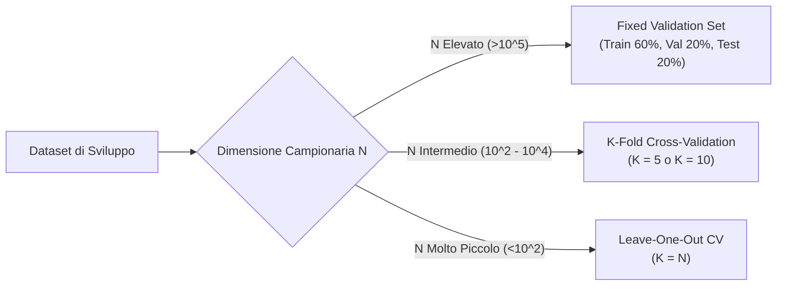

### Grid Search e Scansione Coarse-to-Fine

Quando dobbiamo tarare simultaneamente più iperparametri (ad esempio il grado polinomiale $M$ e il coefficiente di regolarizzazione $\lambda$ in Ridge), eseguiamo una __Grid Search__. Non è consentito ottimizzare i parametri individualmente, poiché essi interagiscono in modo non lineare sulla flessibilità globale del modello.

Poiché lo spazio continuo dei parametri (come $\lambda \in \mathbb{R}^+$) è infinito, adottiamo una strategia a due stadi:
1. __Scansione Coarse__: campioniamo lo spazio su scala logaritmica a passi esponenziali ampi (ad esempio $\lambda \in \{10^{-3}, 10^{-2}, 10^{-1}, 10^0, 10^1, 10^2, 10^3\}$).
2. __Scansione Fine__: individuato l'intervallo con il minimo errore di validazione (ad esempio tra $10^{-2}$ e $10^{-1}$), eseguiamo una scansione a passo lineare denso ristretta a tale finestra per identificare con precisione il valore ottimo $\lambda^*$.

## Dinamica delle Curve di Apprendimento

Oltre alla complessità architetturale dell'ipotesi, la numerosità campionaria $N$ del training set esercita un ruolo decisivo sull'errore empirico e sulla capacità di generalizzazione.

![[fig_9_5_learning_curves_numero_campioni.svg|center big]]

Le __curve di apprendimento__ (_Learning Curves_) descrivono la traiettoria di $E_{\text{train}}$ e $E_{\text{test}}$ al variare di $N$, mantenendo congelata la complessità del modello. Il loro andamento rivela due regimi distinti:
- __Con pochi campioni ($N$ piccolo)__: il modello dispone di gradi di libertà sovrabbondanti rispetto ai vincoli dei dati, riuscendo a interpolare agevolmente tutti i punti ($E_{\text{train}} \approx 0$). Tuttavia, la scarsità di evidenza statistica impedisce di cogliere la struttura reale del fenomeno, causando un collasso predittivo sui dati di test ($E_{\text{test}}$ molto alto). Il divario (_gap_) tra le curve è massimo, segno inequivocabile di overfitting indotto dalla scarsità di dati.
- __Al crescere dei campioni ($N$ grande)__: soddisfare contemporaneamente tutti i vincoli imposti dai dati diventa progressivamente più arduo per l'ottimizzatore, per cui $E_{\text{train}}$ sale lievemente. Al tempo stesso, l'abbondanza di informazione guida i parametri verso la vera funzione $f(\mathbf{x})$, determinando un decremento asintotico di $E_{\text{test}}$.

Al tendere di $N \to \infty$, le due curve convergono asintoticamente verso un valore comune. L'ordinata di convergenza e la velocità con cui viene raggiunta costituiscono il più potente strumento diagnostico per l'ingegnere:
- __Sintomo di Alto Bias (Underfitting)__: le curve convergono rapidamente a un plateau comune caratterizzato da errore elevato, nettamente superiore al rumore intrinseco ($E_{\text{train}} \approx E_{\text{test}} \gg \sigma_\epsilon^2$). Il divario si annulla presto. In questa condizione, raccogliere ulteriori campioni di addestramento è del tutto inutile: il modello ha già esaurito la propria capacità espressiva. L'unica soluzione consiste nell'aumentare la complessità (aggiungere feature polinomiali, architetture più profonde, ridurre la regolarizzazione).
- __Sintomo di Alta Varianza (Overfitting)__: tra $E_{\text{train}}$ ed $E_{\text{test}}$ permane un ampio divario anche per valori considerevoli di $N$, con $E_{\text{train}}$ basso ed $E_{\text{test}}$ alto. In questo regime, aumentare la dimensione del dataset riduce drasticamente l'errore di generalizzazione, sfruttando la legge di abbattimento asintotico della varianza $\mathrm{Var} \propto \frac{D}{N}$. Alternativamente, si riduce la complessità o si incrementa la regolarizzazione.

| Diagnosi | Segnale delle Curve | Causa Primaria | Azione Risolutiva Efficace | Azione Inutile |
| :--- | :--- | :--- | :--- | :--- |
| __Alto Bias (Underfitting)__ | Convergenza precoce con $E_{\text{train}} \approx E_{\text{test}} \gg \sigma_\epsilon^2$ | Ipotesi troppo rigida, pochi DoF | Aumentare feature, elevare grado $M$, ridurre $\lambda$ | Raccogliere più campioni ($N$) |
| __Alta Varianza (Overfitting)__ | Ampio gap permanente ($E_{\text{test}} \gg E_{\text{train}}$) | Ipotesi troppo flessibile per $N$ | Raccogliere più dati ($N$), aumentare $\lambda$, feature selection | Aumentare la complessità del modello |

## Model Assessment

Una volta conclusa la Model Selection e determinata la configurazione ottimale degli iperparametri, procediamo con la fase conclusiva di __Model Assessment__.

Il Model Assessment persegue un traguardo metodologico rigoroso: fornire una stima statisticamente non polarizzata delle prestazioni future che il sistema conseguirà una volta distribuito in ambiente operativo su dati reali mai osservati prima.

La distinzione rispetto alla Model Selection è netta:
- __Model Selection__: confronto tra modelli alternativi e calibrazione degli iperparametri (tuning), condotta esclusivamente su training e validation set.
- __Model Assessment__: collaudo finale e certificazione del modello selezionato, eseguito una sola volta sul test set congelato.

Esaminiamo i due protocolli applicativi in funzione della disponibilità di dati.

### Valutazione con Test Set Statico

Disponendo di volumi ampi di dati, il collaudo segue una procedura lineare:
1. Al termine della selezione su validation set, congeliamo la configurazione ottima degli iperparametri $\lambda^*$.
2. Riaddestriamo il modello sull'unione completa dei dati di addestramento e di validazione ($\mathcal{D}_{\text{train}} \cup \mathcal{D}_{\text{val}}$). In questo modo non sprechiamo i campioni di validazione e forniamo all'algoritmo la massima informazione disponibile per la stima finale dei parametri $\mathbf{w}$.
3. Valutiamo l'errore di generalizzazione una sola volta sul __Test Set__, rimasto sigillato fino a questo momento.

### Nested Cross-Validation (Double Cross-Validation)

Quando la disponibilità campionaria è ridotta e non possiamo permetterci di sacrificare una quota di dati per un test set statico, l'utilizzo della normale Cross-Validation per selezionare e contemporaneamente valutare il modello produrrebbe una stima ottimistica (polarizzata verso il basso) delle prestazioni reali.

Per ottenere un assessment imparziale adottiamo la __Nested Cross-Validation__, strutturata su due cicli concentrici:
- __Ciclo Esterno (Outer Loop - Assessment)__: il dataset complessivo viene partizionato in $K_{\text{out}}$ fold. A rotazione, ciascuna fold esterna funge da test set non visto, mentre le rimanenti $K_{\text{out}} - 1$ fold costituiscono il dataset di sviluppo temporaneo.
- __Ciclo Interno (Inner Loop - Model Selection)__: sui soli dati di sviluppo del ciclo esterno, eseguiamo una K-Fold Cross-Validation interna a $K_{\text{in}}$ fold (o Grid Search) per selezionare la combinazione ottimale di iperparametri $\lambda^*$.
- __Valutazione Imparziale__: addestriamo il modello con gli iperparametri $\lambda^*$ su tutti i dati di sviluppo esterni e ne calcoliamo l'errore sull'outer fold di test.

L'errore finale di Model Assessment corrisponde alla media aritmetica degli errori misurati sulle $K_{\text{out}}$ fold esterne. Poiché nessun dato dell'outer fold ha partecipato, neppure indirettamente, alla scelta di $\lambda^*$, la stima ottenuta è rigorosamente non polarizzata.

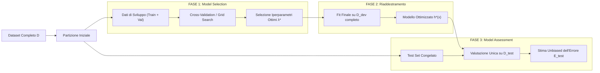

> [!WARNING] Regola Aurea per l'Esame Orale
> Non modificare mai gli iperparametri dopo aver valutato il modello sul test set. Se le prestazioni sul test set risultano insoddisfacenti e si decide di ritarare $\lambda$, il test set diventa a tutti gli effetti un validation set camuffato: l'errore calcolato perde la sua proprietà di stimatore imparziale e subisce data leakage.


# 8. Regressione Ridge e Lasso

Nella regressione lineare stimata mediante i minimi quadrati ordinari (OLS/MLE), la matrice di covarianza delle stime dei parametri $\mathrm{Var}[\mathbf{w}_{\text{ML}}] = \sigma_\epsilon^2 (\mathbf{X}^T \mathbf{X})^{-1}$ e la varianza della predizione $\mathrm{Var}[h(\mathbf{x}_0)] \approx \sigma_\epsilon^2 \frac{D}{N}$ dipendono in modo critico dall'invertibilità e dal condizionamento spettrale della matrice $\mathbf{X}^T \mathbf{X}$. Quando le feature presentano forte multicollinearità o quando la dimensionalità $D$ si avvicina o supera la numerosità campionaria $N$, la varianza esplode e i coefficienti assumono valori arbitrariamente grandi e instabili.

Le tecniche di __regolarizzazione vincolata__ per la regressione risolvono questa vulnerabilità: la __Ridge Regression__ (penalità $L_2$) introduce una contrazione matriciale (_shrinkage_) che garantisce l'invertibilità incondizionata della matrice regolarizzata e riduce sistematicamente la varianza rispetto a OLS; la regressione __Lasso__ (penalità $L_1$) impiega un profilo di contrazione _soft-thresholding_ a cuspidi, conferendo alla soluzione una proprietà strutturale di sparsità per la selezione automatica delle feature.

## Multicollinearità e Vulnerabilità di OLS

Nei minimi quadrati ordinari, la matrice di dispersione campionaria $\mathbf{X}^T \mathbf{X}$ governa direttamente la precisione delle stime parametriche e la stabilità delle previsioni su nuovi campioni:

$$
\mathrm{Var}[\mathbf{w}_{\text{ML}}] = \sigma_\epsilon^2 (\mathbf{X}^T \mathbf{X})^{-1}
$$

$$
\mathrm{Var}[h_{\mathbf{w}_{\text{ML}}}(\mathbf{x}_0)] = \sigma_\epsilon^2 \, \mathbf{x}_0^T (\mathbf{X}^T \mathbf{X})^{-1} \mathbf{x}_0 \approx \sigma_\epsilon^2 \frac{D}{N}
$$

L'incertezza sui parametri cresce al diminuire della dispersione campionaria. Quando la matrice simmetrica $\mathbf{X}^T \mathbf{X} \in \mathbb{R}^{D \times D}$ è singolare o mal condizionata, la sua inversa presenta elementi arbitrariamente grandi che amplificano incontrollabilmente il rumore statistico.

Ricordiamo che una generica matrice quadrata $\mathbf{U} \in \mathbb{R}^{D \times D}$ è singolare (e dunque non invertibile) quando si verifica una delle seguenti condizioni equivalenti:
- Il suo determinante è nullo: $\det(\mathbf{U}) = |\mathbf{U}| = 0$;
- Almeno un suo autovalore è nullo;
- La matrice presenta rango deficitario ($\mathrm{rank}(\mathbf{U}) < D$), ovvero una o più colonne (o righe) sono esprimibili come combinazione lineare delle rimanenti.

Nel contesto della regressione, la matrice dei dati $\mathbf{X} \in \mathbb{R}^{N \times D}$ presenta rango deficitario sulle colonne se una feature è perfettamente esprimibile come combinazione lineare esatta di altre feature.

Negli scenari empirici reali la dipendenza lineare esatta è rara; è invece comunissima la presenza di una correlazione elevata tra variabili predittive (__multicollinearità__). In tale circostanza, le colonne di $\mathbf{X}$ risultano quasi linearmente dipendenti: la matrice $\mathbf{X}^T \mathbf{X}$ diventa mal condizionata, sviluppa autovalori prossimi a zero e la sua inversa produce elementi con ordini di grandezza ingestibili.

La catena logica della degenerazione statistica si sviluppa nella seguente traiettoria:


Dal punto di vista dell'ottimizzazione, quando due feature sono collineari i contorni di livello della funzione di costo quadratica assumono la conformazione di valli paraboloidi piatte ed estremamente allungate.

Lungo la direzione di fondo valle la pendenza è pressoché nulla: variazioni gigantesche nei coefficienti associati alle variabili collineari si compensano reciprocamente purché di segno opposto ($w_i \approx -w_j$ con $|w_i|, |w_j| \gg 0$). Il modello produce predizioni numericamente comparabili sul training set ma con coefficienti privi di significato fisico, rendendo la funzione di regressione ipersensibile a qualsiasi minima perturbazione dei dati di test.

Sebbene sia possibile diagnosticare la collinearità mediante il fattore di inflazione della varianza (_Variance Inflation Factor_, VIF), questo strumento diagnostico richiede l'addestramento di $D$ modelli ausiliari ed è basato su soglie di taglio euristiche.

Per sanare l'instabilità all'origine senza rimuovere arbitrariamente informazioni dal dataset, modifichiamo la formulazione del problema imponendo un vincolo esplicito sull'energia complessiva dei pesi: questa strategia costituisce il fondamento della __regolarizzazione__.

## Formulazione Vincolata di Ridge Regression

La tecnica di __Ridge Regression__ impone un vincolo quadratico sulla norma euclidea ($L_2$) del vettore dei parametri addestrabili.

Formalizziamo il problema di ottimizzazione vincolata primale:

$$
\mathbf{w}_{\text{Ridge}} = \arg\min_{\mathbf{w} \in \mathbb{R}^D} \sum_{i=0}^{N-1} (t^{(i)} - \mathbf{w}^T \mathbf{x}^{(i)})^2 \quad \text{sotto il vincolo} \quad \sum_{j=1}^{D-1} w_j^2 \le l
$$

dove lo scalare $l > 0$ definisce il raggio massimo ammissibile per la sfera nello spazio dei pesi.

> [!IMPORTANT] Due Condizioni Strutturali Tassative
> 1. __Esclusione del termine di bias__: la sommatoria del vincolo parte da $j=1$ ed esclude deliberatamente il parametro di intercetta $w_0$. Se vincolassimo $w_0$, la contrazione del modello dipenderebbe da traslazioni arbitrarie dell'origine dell'asse dei target $t$;
> 2. __Centratura e standardizzazione delle feature__: le coordinate del vettore $\mathbf{x}$ devono essere preliminarmente centrate a media nulla e scalate a varianza unitaria. Poiché la penalità $L_2$ somma indistintamente i quadrati dei coefficienti, una scala eterogenea penalizzerebbe ingiustamente le feature con unità di misura numericamente inferiori.

Sfruttando il metodo dei moltiplicatori di Lagrange per problemi di ottimizzazione convessa con vincoli di disuguaglianza (condizioni KKT), convertiamo il problema vincolato nella minimizzazione di una funzione Lagrangiana non vincolata:

$$
\mathbf{w}_{\text{Ridge}} = \arg\min_{\mathbf{w} \in \mathbb{R}^D} \sum_{i=0}^{N-1} (t^{(i)} - \mathbf{w}^T \mathbf{x}^{(i)})^2 + \lambda \sum_{j=1}^{D-1} w_j^2
$$

A ciascun raggio ammissibile $l > 0$ corrisponde biunivocamente un coefficiente di penalizzazione $\lambda \ge 0$ che individua il medesimo punto di ottimo globale.

## Derivazione Analitica della Soluzione Ridge

Sviluppiamo la soluzione esatta in forma chiusa operando direttamente in notazione matriciale compatta.

Definiamo la matrice dei dati $\mathbf{X} \in \mathbb{R}^{N \times D}$, il vettore colonna dei target $\mathbf{t} \in \mathbb{R}^{N \times 1}$ e il vettore dei pesi $\mathbf{w} \in \mathbb{R}^{D \times 1}$:

$$
\mathbf{X} = \begin{bmatrix} (\mathbf{x}^{(0)})^T \\ (\mathbf{x}^{(1)})^T \\ \vdots \\ (\mathbf{x}^{(N-1)})^T \end{bmatrix}, \qquad \mathbf{t} = \begin{bmatrix} t^{(0)} \\ t^{(1)} \\ \vdots \\ t^{(N-1)} \end{bmatrix}, \qquad \mathbf{w} = \begin{bmatrix} w_0 \\ w_1 \\ \vdots \\ w_{D-1} \end{bmatrix}
$$

Il vettore dei residui di stima corrisponde a $\mathbf{e} = \mathbf{t} - \mathbf{X}\mathbf{w}$. Introducendo il fattore convenzionale $1/2$ per semplificare le derivate successive, la funzione di costo regolarizzata assume la forma:

$$
L(\mathbf{w}) = \frac{1}{2} (\mathbf{t} - \mathbf{X}\mathbf{w})^T (\mathbf{t} - \mathbf{X}\mathbf{w}) + \frac{1}{2} \lambda \mathbf{w}^T \mathbf{w}
$$

Sviluppiamo il prodotto trasposto all'interno del termine di errore quadratico:

$$
L(\mathbf{w}) = \frac{1}{2} \left( \mathbf{t}^T \mathbf{t} - \mathbf{t}^T \mathbf{X} \mathbf{w} - \mathbf{w}^T \mathbf{X}^T \mathbf{t} + \mathbf{w}^T \mathbf{X}^T \mathbf{X} \mathbf{w} \right) + \frac{1}{2} \lambda \mathbf{w}^T \mathbf{w}
$$

Poiché lo scalare $\mathbf{t}^T \mathbf{X} \mathbf{w}$ coincide con il suo trasposto $(\mathbf{t}^T \mathbf{X} \mathbf{w})^T = \mathbf{w}^T \mathbf{X}^T \mathbf{t}$, raggruppiamo i termini misti:

$$
L(\mathbf{w}) = \frac{1}{2} \mathbf{t}^T \mathbf{t} - \mathbf{w}^T \mathbf{X}^T \mathbf{t} + \frac{1}{2} \mathbf{w}^T \mathbf{X}^T \mathbf{X} \mathbf{w} + \frac{1}{2} \lambda \mathbf{w}^T \mathbf{w}
$$

Calcoliamo il gradiente della funzione di costo $L(\mathbf{w})$ rispetto al vettore dei parametri $\mathbf{w}$:

$$
\nabla_{\mathbf{w}} L(\mathbf{w}) = -\mathbf{X}^T \mathbf{t} + \mathbf{X}^T \mathbf{X} \mathbf{w} + \lambda \mathbf{w}
$$

Imponiamo la condizione di stazionarietà $\nabla_{\mathbf{w}} L(\mathbf{w}) = \mathbf{0}$:

$$
\mathbf{X}^T \mathbf{X} \mathbf{w} + \lambda \mathbf{w} = \mathbf{X}^T \mathbf{t}
$$

Raccogliamo il vettore $\mathbf{w}$ introducendo la matrice identità $\mathbf{I} \in \mathbb{R}^{D \times D}$:

$$
(\mathbf{X}^T \mathbf{X} + \lambda \mathbf{I}) \mathbf{w} = \mathbf{X}^T \mathbf{t}
$$

Poiché per ogni $\lambda > 0$ la matrice $(\mathbf{X}^T \mathbf{X} + \lambda \mathbf{I})$ è strettamente definita positiva e pertanto invertibile, isoliamo $\mathbf{w}$ ottenendo la __soluzione esatta di Ridge Regression__:

$$
\mathbf{w}_{\text{Ridge}} = (\mathbf{X}^T \mathbf{X} + \lambda \mathbf{I})^{-1} \mathbf{X}^T \mathbf{t}
$$

### Invertibilità Garantita della Matrice Regolarizzata

Esaminiamo perché la presenza del termine $\lambda \mathbf{I}$ elimina per via algebrica qualsiasi potenziale singolarità, anche nelle condizioni più critiche.

La matrice empirica dei dati $\mathbf{X}^T \mathbf{X} \in \mathbb{R}^{D \times D}$ è simmetrica e semi-definita positiva: per qualunque vettore non nullo $\mathbf{v} \in \mathbb{R}^D \setminus \{\mathbf{0}\}$, vale:

$$
\mathbf{v}^T \mathbf{X}^T \mathbf{X} \mathbf{v} = (\mathbf{X}\mathbf{v})^T (\mathbf{X}\mathbf{v}) = \|\mathbf{X}\mathbf{v}\|_2^2 \ge 0
$$

I suoi autovalori sono dunque tutti non negativi: $d_j^2 \ge 0$. Se $\mathbf{X}$ non è a rango pieno sulle colonne, almeno un autovalore è nullo ($d_j^2 = 0$).

Valutiamo ora la forma quadratica associata alla matrice regolarizzata $(\mathbf{X}^T \mathbf{X} + \lambda \mathbf{I})$ con $\lambda > 0$:

$$
\mathbf{v}^T (\mathbf{X}^T \mathbf{X} + \lambda \mathbf{I}) \mathbf{v} = \mathbf{v}^T \mathbf{X}^T \mathbf{X} \mathbf{v} + \lambda \mathbf{v}^T \mathbf{v} = \|\mathbf{X}\mathbf{v}\|_2^2 + \lambda \|\mathbf{v}\|_2^2
$$

Poiché $\mathbf{v} \neq \mathbf{0}$, la norma euclidea $\|\mathbf{v}\|_2^2 > 0$. Essendo $\|\mathbf{X}\mathbf{v}\|_2^2 \ge 0$ e $\lambda > 0$, concludiamo che:

$$
\mathbf{v}^T (\mathbf{X}^T \mathbf{X} + \lambda \mathbf{I}) \mathbf{v} \ge \lambda \|\mathbf{v}\|_2^2 > 0 \quad \forall \mathbf{v} \neq \mathbf{0}
$$

La matrice $(\mathbf{X}^T \mathbf{X} + \lambda \mathbf{I})$ è __strettamente definita positiva__.

I suoi autovalori risultano traslati rigidamente verso l'alto di una quantità pari a $\lambda$:

$$
\gamma_j = d_j^2 + \lambda \ge \lambda > 0 \quad \forall j \in \{0, \dots, D-1\}
$$

Di conseguenza, il determinante è strettamente positivo:

$$
\det(\mathbf{X}^T \mathbf{X} + \lambda \mathbf{I}) = \prod_{j=0}^{D-1} (d_j^2 + \lambda) \ge \lambda^D > 0
$$

e il numero di condizionamento spettrale risulta limitato superiormente da una quantità finita:

$$
\kappa(\mathbf{X}^T \mathbf{X} + \lambda \mathbf{I}) = \frac{d_{\max}^2 + \lambda}{d_{\min}^2 + \lambda} \le \frac{d_{\max}^2 + \lambda}{\lambda} < \infty
$$

> [!IMPORTANT] Takeaway d'Esame: Invertibilità nel Regime $D > N$
> Nella regressione lineare OLS, quando il numero di feature supera la numerosità campionaria ($D > N$), la matrice $\mathbf{X} \in \mathbb{R}^{N \times D}$ possiede rango al più pari a $N < D$. La matrice quadrata $\mathbf{X}^T \mathbf{X} \in \mathbb{R}^{D \times D}$ ha rango deficitario con almeno $D - N$ autovalori identicamente nulli, rendendo impossibile l'inversione ordinaria.
> Ridge Regression supera questo scoglio: la traslazione di $+\lambda$ sposta gli autovalori degeneri a $\lambda > 0$. Lo stimatore Ridge esiste sempre unico, ben condizionato e invertibile per qualunque $D$ e $N$.

## Numero Effettivo di Parametri e Analisi Spettrale SVD

Per valutare la capacità rappresentativa del modello regolarizzato dobbiamo quantificarne i gradi di libertà effettivi.

A tal fine esaminiamo la matrice cappello (_Hat Matrix_) $\mathbf{H}$, definita come l'operatore di proiezione che trasforma il vettore dei target campionari $\mathbf{t}$ nel vettore delle predizioni sul training set $\hat{\mathbf{t}} = \mathbf{H}\mathbf{t}$.

### Hat Matrix nei Minimi Quadrati Ordinari

Nel modello lineare standard non regolarizzato, la predizione si esprime come $\hat{\mathbf{t}} = \mathbf{X}\mathbf{w}_{\text{ML}} = \mathbf{X}(\mathbf{X}^T\mathbf{X})^{-1}\mathbf{X}^T\mathbf{t}$. La matrice cappello è:

$$
\mathbf{H} = \mathbf{X} (\mathbf{X}^T \mathbf{X})^{-1} \mathbf{X}^T
$$

Questa matrice gode di due proprietà algebriche essenziali:
- __Simmetria__: $\mathbf{H}^T = (\mathbf{X} (\mathbf{X}^T \mathbf{X})^{-1} \mathbf{X}^T)^T = \mathbf{X} (\mathbf{X}^T \mathbf{X})^{-1} \mathbf{X}^T = \mathbf{H}$;
- __Idempotenza__: $\mathbf{H}^2 = \mathbf{H}\mathbf{H} = \mathbf{X} (\mathbf{X}^T \mathbf{X})^{-1} \mathbf{X}^T \mathbf{X} (\mathbf{X}^T \mathbf{X})^{-1} \mathbf{X}^T = \mathbf{X} (\mathbf{X}^T \mathbf{X})^{-1} \mathbf{X}^T = \mathbf{H}$.

Essendo idempotente e simmetrica, $\mathbf{H}$ agisce come una proiezione ortogonale pura sullo spazio generato dalle colonne di $\mathbf{X}$. Calcolandone la traccia mediante la proprietà ciclica $\mathrm{Tr}(\mathbf{A}\mathbf{B}) = \mathrm{Tr}(\mathbf{B}\mathbf{A})$, ricaviamo i gradi di libertà:

$$
\mathrm{Tr}(\mathbf{H}) = \mathrm{Tr}\left( \mathbf{X} (\mathbf{X}^T \mathbf{X})^{-1} \mathbf{X}^T \right) = \mathrm{Tr}\left( \mathbf{X}^T \mathbf{X} (\mathbf{X}^T \mathbf{X})^{-1} \right) = \mathrm{Tr}(\mathbf{I}_D) = D
$$

Nei minimi quadrati ordinari, il numero effettivo di parametri coincide esattamente con il numero nominale di feature $D$.

### Hat Matrix e Gradi di Libertà Effettivi in Ridge

In Ridge Regression, la predizione sui dati di addestramento assume la forma:

$$
\hat{\mathbf{t}} = \mathbf{X} \mathbf{w}_{\text{Ridge}} = \mathbf{X} (\mathbf{X}^T \mathbf{X} + \lambda \mathbf{I})^{-1} \mathbf{X}^T \mathbf{t} = \mathbf{H}_\lambda \mathbf{t}
$$

dove la matrice cappello regolarizzata è data da:

$$
\mathbf{H}_\lambda = \mathbf{X} (\mathbf{X}^T \mathbf{X} + \lambda \mathbf{I})^{-1} \mathbf{X}^T
$$

A causa del termine $\lambda \mathbf{I}$, la matrice $\mathbf{H}_\lambda$ perde l'idempotenza ($\mathbf{H}_\lambda^2 \neq \mathbf{H}_\lambda$): essa non opera più come una proiezione ortogonale, bensì come un operatore di contrazione continua (_Shrinkage_).

Per determinarne gli autovalori e calcolarne la traccia, applichiamo la __Decomposizione a Valori Singolari__ (_Singular Value Decomposition_, SVD) alla matrice dei dati $\mathbf{X} \in \mathbb{R}^{N \times D}$:

$$
\mathbf{X} = \mathbf{U} \mathbf{D} \mathbf{V}^T
$$

dove:
- $\mathbf{U} \in \mathbb{R}^{N \times D}$ è una matrice a colonne ortonormali contenente gli autovettori di $\mathbf{X}\mathbf{X}^T$ ($\mathbf{U}^T\mathbf{U} = \mathbf{I}_D$);
- $\mathbf{V} \in \mathbb{R}^{D \times D}$ è una matrice ortogonale contenente gli autovettori di $\mathbf{X}^T\mathbf{X}$ ($\mathbf{V}^T\mathbf{V} = \mathbf{V}\mathbf{V}^T = \mathbf{I}_D$);
- $\mathbf{D} \in \mathbb{R}^{D \times D}$ è una matrice diagonale i cui elementi $d_j \ge 0$ sono i valori singolari di $\mathbf{X}$, pari alla radice quadrata degli autovalori di $\mathbf{X}^T\mathbf{X}$.

Sostituiamo la decomposizione SVD nel prodotto $\mathbf{X}^T\mathbf{X}$:

$$
\mathbf{X}^T \mathbf{X} = (\mathbf{U} \mathbf{D} \mathbf{V}^T)^T (\mathbf{U} \mathbf{D} \mathbf{V}^T) = \mathbf{V} \mathbf{D} \mathbf{U}^T \mathbf{U} \mathbf{D} \mathbf{V}^T = \mathbf{V} \mathbf{D}^2 \mathbf{V}^T
$$

Riscriviamo la matrice identità come $\mathbf{I}_D = \mathbf{V}\mathbf{V}^T$ e raccogliamo $\mathbf{V}$ a sinistra e a destra nella matrice regolarizzata:

$$
\mathbf{X}^T \mathbf{X} + \lambda \mathbf{I}_D = \mathbf{V} \mathbf{D}^2 \mathbf{V}^T + \lambda \mathbf{V} \mathbf{V}^T = \mathbf{V} (\mathbf{D}^2 + \lambda \mathbf{I}_D) \mathbf{V}^T
$$

Invertiamo il prodotto sfruttando l'identità $(\mathbf{A}\mathbf{B}\mathbf{C})^{-1} = \mathbf{C}^{-1}\mathbf{B}^{-1}\mathbf{A}^{-1}$ e l'ortogonalità $\mathbf{V}^{-1} = \mathbf{V}^T$:

$$
(\mathbf{X}^T \mathbf{X} + \lambda \mathbf{I}_D)^{-1} = (\mathbf{V}^T)^{-1} (\mathbf{D}^2 + \lambda \mathbf{I}_D)^{-1} \mathbf{V}^{-1} = \mathbf{V} (\mathbf{D}^2 + \lambda \mathbf{I}_D)^{-1} \mathbf{V}^T
$$

Sostituiamo l'espressione così ricavata nella definizione della matrice cappello $\mathbf{H}_\lambda$:

$$
\mathbf{H}_\lambda = (\mathbf{U} \mathbf{D} \mathbf{V}^T) \left[ \mathbf{V} (\mathbf{D}^2 + \lambda \mathbf{I}_D)^{-1} \mathbf{V}^T \right] (\mathbf{V} \mathbf{D} \mathbf{U}^T)
$$

Poiché le matrici interne si semplificano grazie all'ortonormalità $\mathbf{V}^T\mathbf{V} = \mathbf{I}_D$, otteniamo la __diagonalizzazione spettrale di $\mathbf{H}_\lambda$__:

$$
\mathbf{H}_\lambda = \mathbf{U} \mathbf{D} (\mathbf{D}^2 + \lambda \mathbf{I}_D)^{-1} \mathbf{D} \mathbf{U}^T = \mathbf{U} \left( \frac{\mathbf{D}^2}{\mathbf{D}^2 + \lambda \mathbf{I}_D} \right) \mathbf{U}^T
$$

La matrice diagonale centrale racchiude gli autovalori di $\mathbf{H}_\lambda$, ciascuno dei quali vale:

$$
\gamma_j = \frac{d_j^2}{d_j^2 + \lambda}
$$

Il __numero effettivo di parametri__ (_Effective Degrees of Freedom_, $\text{df}(\lambda)$) corrisponde alla traccia di $\mathbf{H}_\lambda$. Applicando la proprietà ciclica della traccia e sfruttando l'ortonormalità $\mathbf{U}^T\mathbf{U} = \mathbf{I}_D$:

$$
\text{df}(\lambda) = \mathrm{Tr}(\mathbf{H}_\lambda) = \mathrm{Tr}\left( \mathbf{U} \frac{\mathbf{D}^2}{\mathbf{D}^2 + \lambda\mathbf{I}_D} \mathbf{U}^T \right) = \mathrm{Tr}\left( \mathbf{U}^T\mathbf{U} \frac{\mathbf{D}^2}{\mathbf{D}^2 + \lambda\mathbf{I}_D} \right) = \sum_{j=0}^{D-1} \frac{d_j^2}{d_j^2 + \lambda}
$$

![[fig_ex_8_gradi_di_liberta_svd_shrinkage.png|center big]]

Questa legge algebrica rivela il funzionamento microscopico di Ridge:
- Se $\lambda \to 0$: $\frac{d_j^2}{d_j^2 + 0} = 1 \implies \text{df}(\lambda) \to \sum_{j=0}^{D-1} 1 = D$, ripristinando la complessità massima OLS;
- Se $\lambda \to \infty$: $\frac{d_j^2}{d_j^2 + \lambda} \to 0 \implies \text{df}(\lambda) \to 0$, annullando la capacità descrittiva del modello;
- __Filtraggio selettivo__: per le componenti ad alta varianza ($d_j^2 \gg \lambda$), il fattore di attenuazione vale circa 1 e la proiezione rimane inalterata; per le direzioni con autovalori piccoli ($d_j^2 \ll \lambda$), il fattore crolla verso zero. Ridge comprime selettivamente le direzioni con scarso segnale, tipicamente dominate dal rumore campionario.

## Bias e Varianza dello Stimatore Ridge

Valutiamo il valore atteso e la matrice di covarianza dei coefficienti $\mathbf{w}_{\text{Ridge}}$ condizionatamente alla matrice dei dati $\mathbf{X}$.

Assumiamo che il processo generativo reale sia descritto dal modello lineare $\mathbf{t} = \mathbf{X}\mathbf{w}^* + \boldsymbol{\epsilon}$, dove il rumore soddisfa $\mathbb{E}[\boldsymbol{\epsilon} \mid \mathbf{X}] = \mathbf{0}$ e $\mathrm{Var}[\boldsymbol{\epsilon} \mid \mathbf{X}] = \sigma_\epsilon^2 \mathbf{I}$, da cui segue $\mathbb{E}[\mathbf{t} \mid \mathbf{X}] = \mathbf{X}\mathbf{w}^*$.

### Calcolo del Bias dello Stimatore Ridge

Calcoliamo il valore atteso dei pesi stimati applicando la linearità dell'operatore aspettazione:

$$
\mathbb{E}[\mathbf{w}_{\text{Ridge}} \mid \mathbf{X}] = \mathbb{E}\left[ (\mathbf{X}^T \mathbf{X} + \lambda \mathbf{I})^{-1} \mathbf{X}^T \mathbf{t} \mid \mathbf{X} \right] = (\mathbf{X}^T \mathbf{X} + \lambda \mathbf{I})^{-1} \mathbf{X}^T \mathbb{E}[\mathbf{t} \mid \mathbf{X}]
$$

Sostituendo $\mathbb{E}[\mathbf{t} \mid \mathbf{X}] = \mathbf{X}\mathbf{w}^*$:

$$
\mathbb{E}[\mathbf{w}_{\text{Ridge}} \mid \mathbf{X}] = (\mathbf{X}^T \mathbf{X} + \lambda \mathbf{I})^{-1} \mathbf{X}^T \mathbf{X} \mathbf{w}^*
$$

Per semplificare l'espressione, ricorriamo a un artificio algebrico: sommiamo e sottraiamo $\lambda \mathbf{I}$ al prodotto centrale:

$$
\mathbf{X}^T \mathbf{X} = (\mathbf{X}^T \mathbf{X} + \lambda \mathbf{I}) - \lambda \mathbf{I}
$$

Distribuendo il prodotto matriciale:

$$
\mathbb{E}[\mathbf{w}_{\text{Ridge}} \mid \mathbf{X}] = (\mathbf{X}^T \mathbf{X} + \lambda \mathbf{I})^{-1} \left[ (\mathbf{X}^T \mathbf{X} + \lambda \mathbf{I}) - \lambda \mathbf{I} \right] \mathbf{w}^* = \left[ \mathbf{I} - \lambda (\mathbf{X}^T \mathbf{X} + \lambda \mathbf{I})^{-1} \right] \mathbf{w}^*
$$

Riscrivendo i termini:

$$
\mathbb{E}[\mathbf{w}_{\text{Ridge}} \mid \mathbf{X}] = \mathbf{w}^* - \lambda (\mathbf{X}^T \mathbf{X} + \lambda \mathbf{I})^{-1} \mathbf{w}^*
$$

Il vettore di bias dello stimatore Ridge risulta:

$$
\text{Bias}(\mathbf{w}_{\text{Ridge}}) = \mathbb{E}[\mathbf{w}_{\text{Ridge}} \mid \mathbf{X}] - \mathbf{w}^* = -\lambda (\mathbf{X}^T \mathbf{X} + \lambda \mathbf{I})^{-1} \mathbf{w}^*
$$

Lo stimatore Ridge è __strutturalmente distorto__ (_biased_):
- Per $\lambda = 0$ il bias è nullo ($\text{Bias} = \mathbf{0}$), ricadendo nella correttezza asintotica di OLS;
- Per ogni $\lambda > 0$ la distorsione cresce monotonicamente, contraendo la stima attesa verso l'origine.

### Calcolo della Varianza e Abbattimento dell'Errore

Calcoliamo la matrice di covarianza di $\mathbf{w}_{\text{Ridge}}$ condizionatamente a $\mathbf{X}$:

$$
\mathrm{Var}[\mathbf{w}_{\text{Ridge}} \mid \mathbf{X}] = \mathrm{Var}\left[ (\mathbf{X}^T \mathbf{X} + \lambda \mathbf{I})^{-1} \mathbf{X}^T \mathbf{t} \mid \mathbf{X} \right]
$$

Applicando la proprietà di propagazione della covarianza per trasformazioni lineari $\mathrm{Var}[\mathbf{A}\mathbf{t}] = \mathbf{A} \mathrm{Var}[\mathbf{t}] \mathbf{A}^T$ con $\mathrm{Var}[\mathbf{t} \mid \mathbf{X}] = \sigma_\epsilon^2 \mathbf{I}$:

$$
\mathrm{Var}[\mathbf{w}_{\text{Ridge}} \mid \mathbf{X}] = \sigma_\epsilon^2 (\mathbf{X}^T \mathbf{X} + \lambda \mathbf{I})^{-1} \mathbf{X}^T \mathbf{X} (\mathbf{X}^T \mathbf{X} + \lambda \mathbf{I})^{-1}
$$

Sostituendo la decomposizione SVD $\mathbf{X}^T\mathbf{X} = \mathbf{V}\mathbf{D}^2\mathbf{V}^T$ e $(\mathbf{X}^T\mathbf{X} + \lambda\mathbf{I})^{-1} = \mathbf{V}(\mathbf{D}^2 + \lambda\mathbf{I})^{-1}\mathbf{V}^T$:

$$
\mathrm{Var}[\mathbf{w}_{\text{Ridge}} \mid \mathbf{X}] = \sigma_\epsilon^2 \, \mathbf{V} (\mathbf{D}^2 + \lambda \mathbf{I})^{-1} \mathbf{V}^T \mathbf{V} \mathbf{D}^2 \mathbf{V}^T \mathbf{V} (\mathbf{D}^2 + \lambda \mathbf{I})^{-1} \mathbf{V}^T = \sigma_\epsilon^2 \, \mathbf{V} \frac{\mathbf{D}^2}{(\mathbf{D}^2 + \lambda \mathbf{I})^2} \mathbf{V}^T
$$

La traccia della covarianza quantifica la dispersione scalare complessiva dei parametri:

$$
\mathrm{Tr}\left( \mathrm{Var}[\mathbf{w}_{\text{Ridge}} \mid \mathbf{X}] \right) = \sigma_\epsilon^2 \sum_{j=0}^{D-1} \frac{d_j^2}{(d_j^2 + \lambda)^2}
$$

Confrontiamo questa grandezza con la varianza corrispondente dei minimi quadrati ordinari ($\lambda = 0$):

$$
\mathrm{Tr}\left( \mathrm{Var}[\mathbf{w}_{\text{OLS}} \mid \mathbf{X}] \right) = \sigma_\epsilon^2 \sum_{j=0}^{D-1} \frac{1}{d_j^2}
$$

Poiché per qualsiasi $\lambda > 0$ e per qualunque autovalore strettamente positivo $d_j > 0$ vale la disuguaglianza:

$$
\frac{d_j^2}{(d_j^2 + \lambda)^2} < \frac{d_j^2}{(d_j^2)^2} = \frac{1}{d_j^2}
$$

otteniamo la relazione fondamentale d'ordine stretto:

$$
\mathrm{Tr}\left( \mathrm{Var}[\mathbf{w}_{\text{Ridge}} \mid \mathbf{X}] \right) < \mathrm{Tr}\left( \mathrm{Var}[\mathbf{w}_{\text{OLS}} \mid \mathbf{X}] \right) \quad \forall \lambda > 0
$$

Ridge comprime sistematicamente l'incertezza sui parametri per qualsiasi valore di penalizzazione.

> [!TIP] Takeaway d'Esame: Superamento del Limite di Gauss-Markov
> Il Teorema di Gauss-Markov certifica che OLS è il miglior stimatore lineare corretto (BLUE, _Best Linear Unbiased Estimator_), possedendo la minima varianza possibile nella classe ristretta degli stimatori non distorti ($\text{Bias} = \mathbf{0}$).
> 
> Ridge Regression infrange deliberatamente il vincolo di imparzialità. Poiché la derivata del bias quadratico $\|\text{Bias}\|_2^2$ rispetto a $\lambda$ valutata in $\lambda = 0$ è nulla, mentre la derivata della varianza è strettamente negativa, esiste sempre un valore $\lambda^* > 0$ tale che:
> 
> $$
> \mathrm{MSE}(\mathbf{w}_{\text{Ridge}}) = \|\text{Bias}(\mathbf{w}_{\text{Ridge}})\|_2^2 + \mathrm{Tr}\left(\mathrm{Var}[\mathbf{w}_{\text{Ridge}}]\right) < \mathrm{MSE}(\mathbf{w}_{\text{OLS}})
> $$
> 
> Accettando una quota controllata di bias, Ridge consegue un abbattimento della varianza di entità superiore, riducendo l'errore quadratico medio globale al di sotto del minimo teorico consentito a OLS.

## Lasso Regression e la Proprietà di Sparsità

Sebbene Ridge contragga i coefficienti verso lo zero, non ne annulla mai nessuno per valori finiti di $\lambda < \infty$. Tutte le $D$ feature rimangono incluse nella funzione di decisione, producendo una soluzione densa che non semplifica l'architettura del modello.

Quando l'obiettivo ingegneristico richiede di azzerare selettivamente le variabili ridondanti o irrilevanti per eseguire __selezione automatica delle feature__ (_Feature Selection_), adottiamo il modello __Lasso__ (_Least Absolute Shrinkage and Selection Operator_).

Lasso sostituisce la penalità quadratica $L_2$ con la __norma $L_1$__, corrispondente alla somma dei valori assoluti dei parametri:

$$
\mathbf{w}_{\text{Lasso}} = \arg\min_{\mathbf{w} \in \mathbb{R}^D} \sum_{i=0}^{N-1} (t^{(i)} - \mathbf{w}^T \mathbf{x}^{(i)})^2 \quad \text{sotto il vincolo} \quad \sum_{j=1}^{D-1} |w_j| \le l
$$

dove il termine di bias $w_0$ viene escluso dal vincolo e le feature sono preliminarmente standardizzate.

Convertendo il vincolo in forma Lagrangiana:

$$
\mathbf{w}_{\text{Lasso}} = \arg\min_{\mathbf{w} \in \mathbb{R}^D} \sum_{i=0}^{N-1} (t^{(i)} - \mathbf{w}^T \mathbf{x}^{(i)})^2 + \lambda \sum_{j=1}^{D-1} |w_j|
$$

A differenza della norma euclidea differenziabile, la funzione valore assoluto presenta un punto angoloso non derivabile nell'origine ($|w_j|$ ha una cuspide in $w_j = 0$). Di conseguenza, il gradiente ordinario non è definito su tutto il dominio e Lasso non ammette una soluzione analitica in forma chiusa. La soluzione viene calcolata numericamente mediante algoritmi di ottimizzazione convessa, quali la discesa a coordinate (_Coordinate Descent_) o la programmazione quadratica vincolata.

### Interpretazione Geometrica della Sparsità

La genesi della sparsità in Lasso e la sua assenza in Ridge si comprendono analizzando la geometria differenziale delle rispettive regioni ammissibili nello spazio dei parametri.

![[fig_ex_8_ridge_vs_lasso_geometria_sparsita.png|center big]]

Esaminiamo lo spazio bidimensionale dei coefficienti $(w_1, w_2)$:
- __Contorni di livello OLS__: la funzione di perdita quadratica genera ellissi concentriche centrate attorno alla stima non vincolata $\mathbf{w}_{\text{ML}}$. Il costo cresce monotonicamente allontanandosi dal centro;
- __Regione ammissibile $L_2$ (Ridge)__: il vincolo $w_1^2 + w_2^2 \le l$ definisce un disco circolare perfetto, privo di spigoli e dotato di frontiera differenziabile ovunque. L'ellisse di errore, espandendosi, tocca la sfera in un punto di tangenza liscia che cade quasi certamente all'interno di un quadrante aperto ($w_1 \neq 0$ e $w_2 \neq 0$). I coefficienti vengono ridotti, ma nessuno viene annullato;
- __Regione ammissibile $L_1$ (Lasso)__: il vincolo $|w_1| + |w_2| \le l$ definisce un politopo a rombo (iperottaedro in dimensione superiore) dotato di vertici cuspidali posizionati esattamente lungo gli assi coordinati. Espandendosi, le ellissi incontrano con probabilità quasi unitaria una delle cuspidi sporgenti prima di toccare i lati inclinati. Nel punto di contatto su un asse coordinato, la coordinata ortogonale è rigorosamente pari a zero ($w_1 = 0$ con $w_2 = l$).

Questo meccanismo di contatto sulle cuspidi azzera esattamente i coefficienti delle variabili deboli, rendendo il vettore dei pesi __sparso__ ed eliminando le feature superflue dal modello finale.

### Profili di Contrazione: Shrinkage Lineare vs Soft-Thresholding

La divergenza operativa tra le due regolarizzazioni emerge con rigore analitico esaminando il caso ideale di feature ortonormali ($\mathbf{X}^T\mathbf{X} = \mathbf{I}$). In questa configurazione il problema matriciale si disaccoppia in $D$ sottoproblemi scalari indipendenti per ciascun parametro $w_j$, la cui stima OLS vale $\hat{w}_j^{\text{OLS}} = \mathbf{x}_j^T \mathbf{t}$.

Analizziamo il comportamento delle due funzioni obiettivo scalari:

Per __Ridge Regression ($L_2$)__, minimizziamo la perdita scalare:

$$
\min_{w_j} \frac{1}{2} (w_j - w_j^{\text{OLS}})^2 + \frac{1}{2} \lambda w_j^2
$$

Annullando la derivata prima:

$$
(w_j - w_j^{\text{OLS}}) + \lambda w_j = 0 \implies (1 + \lambda) w_j = w_j^{\text{OLS}} \implies \hat{w}_j^{\text{Ridge}} = \frac{1}{1 + \lambda} w_j^{\text{OLS}}
$$

Ridge applica una contrazione lineare continua (_linear shrinkage_) che riduce proporzionalmente il peso ma non lo annulla mai finché $w_j^{\text{OLS}} \neq 0$.

Per __Lasso Regression ($L_1$)__, minimizziamo la perdita con penalità non differenziabile:

$$
\min_{w_j} \frac{1}{2} (w_j - w_j^{\text{OLS}})^2 + \lambda |w_j|
$$

Applichiamo il calcolo del subgradiente $\partial |w_j|$:

$$
\partial |w_j| = \begin{cases} \{+1\} & \text{se } w_j > 0 \\ [-1, +1] & \text{se } w_j = 0 \\ \{-1\} & \text{se } w_j < 0 \end{cases}
$$

La condizione di stazionarietà $0 \in (w_j - w_j^{\text{OLS}}) + \lambda \partial |w_j|$ individua tre regimi:
- Se $w_j > 0$: $w_j - w_j^{\text{OLS}} + \lambda = 0 \implies w_j = w_j^{\text{OLS}} - \lambda$, valido solo per $w_j^{\text{OLS}} > \lambda$;
- Se $w_j < 0$: $w_j - w_j^{\text{OLS}} - \lambda = 0 \implies w_j = w_j^{\text{OLS}} + \lambda$, valido solo per $w_j^{\text{OLS}} < -\lambda$;
- Se $|w_j^{\text{OLS}}| \le \lambda$: l'intervallo del subgradiente include lo zero, imponendo la soluzione identicamente nulla $w_j = 0$.

Raggruppiamo i tre regimi nell'__operatore di sogliatura morbida__ (_Soft-Thresholding Operator_ $\mathcal{S}_\lambda$):

$$
\hat{w}_j^{\text{Lasso}} = \mathrm{sign}(w_j^{\text{OLS}}) \max(|w_j^{\text{OLS}}| - \lambda, 0)
$$

I pesi la cui stima OLS cade nell'intervallo $[-\lambda, \lambda]$ vengono azzerati all'istante, mentre i pesi eccedenti la soglia vengono traslati verso lo zero di una quantità fissa pari a $\lambda$.

## Quadro Sinottico e Confronto Metodologico

Sintetizziamo la tassonomia dei modelli lineari regolarizzati e le loro proprietà operative:

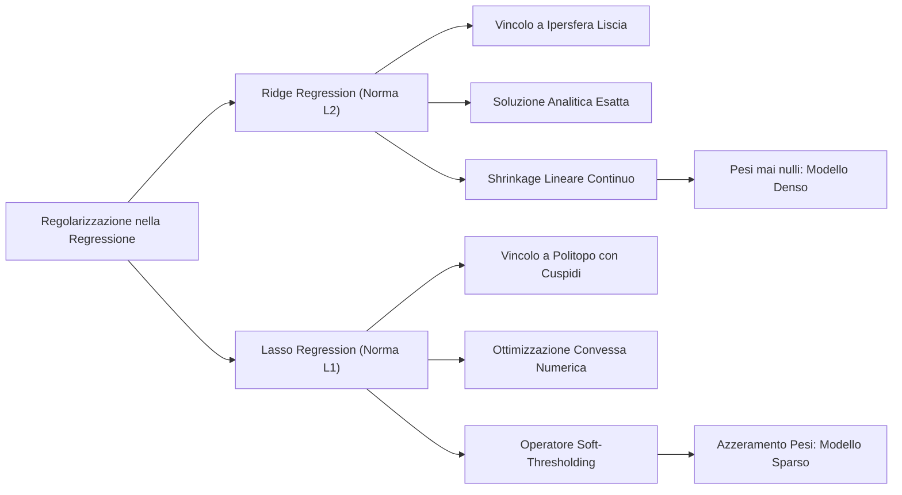

Confrontiamo in dettaglio le caratteristiche distintive delle tre metodologie studiate:

| Proprietà Analitica | Minimi Quadrati Ordinari (OLS) | Ridge Regression ($L_2$) | Lasso Regression ($L_1$) |
| :--- | :--- | :--- | :--- |
| __Termine di Penalità__ | Nessuno ($\lambda = 0$) | $\lambda \sum_{j=1}^{D-1} w_j^2$ | $\lambda \sum_{j=1}^{D-1} \|w_j\|$ |
| __Geometria del Vincolo__ | Spazio aperto non vincolato $\mathbb{R}^D$ | Ipersfera liscia $\sum w_j^2 \le l$ | Iperottaedro a cuspidi $\sum \|w_j\| \le l$ |
| __Soluzione Formale__ | $(\mathbf{X}^T\mathbf{X})^{-1}\mathbf{X}^T\mathbf{t}$ | $(\mathbf{X}^T\mathbf{X} + \lambda\mathbf{I})^{-1}\mathbf{X}^T\mathbf{t}$ | Nessuna forma chiusa (Coordinate Descent / QP) |
| __Gradi di Libertà Effettivi__ | $\text{df} = D$ | $\text{df}(\lambda) = \sum_{j=0}^{D-1} \frac{d_j^2}{d_j^2 + \lambda} < D$ | $\text{df} \approx$ numero di coefficienti non nulli |
| __Profilo di Contrazione__ | Nessuna contrazione | Contrazione lineare: $\frac{1}{1+\lambda} w_j^{\text{OLS}}$ | Soft-thresholding: $\mathrm{sign}(w) \max(\|w\|-\lambda, 0)$ |
| __Proprietà di Sparsità__ | No (tutti i coefficienti attivi) | No (coefficienti attenuati ma mai nulli) | Sì (azzeramento esatto dei coefficienti) |
| __Selezione delle Feature__ | Assente | Assente (tutte le feature permangono) | Automatica ed intrinseca al modello |
| __Comportamento con $D > N$__ | Rango deficitario (non invertibile) | Sempre invertibile ($\gamma_j \ge \lambda > 0$) | Seleziona al più $N$ feature attive |
| __Gestione Multicollinearità__ | Varianza divergente e pesi esplosi | Ripartisce stabilmente i pesi collineari | Tende a selezionare una feature scartando le altre |

> [!TIP] Principio di Applicazione Universale
> Le logiche di regolarizzazione basate su penalità $L_2$ ed $L_1$ costituiscono paradigmi universali nell'apprendimento automatico. La penalità $L_2$ si applica alla regressione logistica e alle reti neurali profonde con la denominazione di _Weight Decay_, mentre la penalità $L_1$ consente di comprimere architetture complesse producendo matrici di pesi a connettività sparsa.


# 9. Support Vector Machines

Nei modelli lineari di classificazione, quali la regressione logistica e il percettrone di Rosenblatt, la superficie di decisione è un iperpiano che separa le classi nello spazio delle feature. Quando un dataset è linearmente separabile, esistono infiniti iperpiani in grado di azzerare l'errore di addestramento: ciascun algoritmo euristico converge a una soluzione diversa guidata dall'inizializzazione dei pesi o dall'ordine di presentazione dei dati, senza alcuna garanzia di robustezza statistica.

Le __Support Vector Machines__ (SVM) risolvono questa indeterminazione fondandosi sul principio di massimizzazione del margine geometrico di separazione. La classificazione a margine rigido (__Hard-Margin SVM__) si formula come un problema di ottimizzazione convessa quadratica vincolata la cui soluzione duale, derivata mediante moltiplicatori di Lagrange e condizioni di Karush-Kuhn-Tucker (KKT), prova la natura sparsa dei coefficienti duali associati ai soli __vettori di supporto__. La metodologia si estende a spazi di feature ad alta o infinita dimensionalità tramite il __Kernel Trick__ e il teorema di Mercer, approdando infine al modello a margine morbido (__Soft-Margin SVM__) variazionalmente equivalente alla regolarizzazione $L_2$ applicata alla funzione di costo __Hinge Loss__.

## Dai Limiti della Regressione Logistica al Concetto di Margine

Nella regressione logistica binaria con etichette $t \in \{0, 1\}$, la funzione di ipotesi modella la probabilità a posteriori della classe positiva mediante la funzione sigmoide applicata alla combinazione lineare delle feature:

$$
p(t = 1 \mid \mathbf{x}, \mathbf{w}) = h_{\mathbf{w}}(\mathbf{x}) = \sigma(\mathbf{w}^T \mathbf{x} + b) = \frac{1}{1 + e^{-(\mathbf{w}^T \mathbf{x} + b)}}
$$

![[fig_11_1_ipotesi_regressione_logistica.png|center mid]]

La curva sigmoide satura asintoticamente verso 1 quando $\mathbf{w}^T \mathbf{x} + b \gg 0$, e decade verso 0 quando $\mathbf{w}^T \mathbf{x} + b \ll 0$. Di conseguenza:
- Se $\mathbf{w}^T \mathbf{x} + b \gg 0$, il modello predice con confidenza quasi certa che il campione appartiene alla classe positiva ($t = 1$);
- Se $\mathbf{w}^T \mathbf{x} + b \ll 0$, il modello predice con confidenza quasi certa che il campione appartiene alla classe negativa ($t = 0$);
- Se $\mathbf{w}^T \mathbf{x} + b \approx 0$, la probabilità stimata è prossima a $0.5$, configurando la massima incertezza decisionale.

La quantità scalare $|\mathbf{w}^T \mathbf{x} + b|$ governa il grado di confidenza della stima: quanto più un punto campionario si allontana dalla superficie di separazione $\mathbf{w}^T \mathbf{x} + b = 0$, tanto più la decisione risulta netta e immune a piccole perturbazioni dei dati.

![[fig_11_2_confidenza_distanza_iperpiano.png|center mid]]

Consideriamo la distribuzione spaziale dei campioni rispetto all'iperpiano. Il punto $A$, situato a notevole distanza dalla retta di separazione, riceve una predizione stabile ad altissima confidenza. Al contrario, il punto $B$, posizionato nelle immediate adiacenze del confine, riceve una classificazione marginale ed estremamente sensibile al rumore di misura.

Se l'insieme dei dati è linearmente separabile, possiamo tracciare una molteplicità infinita di iperpiani che separano perfettamente le classi sul training set, ciascuno caratterizzato da una diversa orientazione nello spazio.

![[fig_11_3_molteplici_iperpiani_separatori.png|center mid]]

Un iperpiano che passa troppo vicino ai campioni di addestramento è intrinsecamente fragile: pur azzerando l'errore empirico, presenta un elevato rischio di overfitting poiché un campione di test leggermente perturbato verrebbe facilmente collocato sul semispazio errato.

L'obiettivo fondamentale consiste dunque nell'individuare l'__iperpiano ottimale__ che massimizza la distanza minima tra la superficie di decisione e i punti più vicini appartenenti a entrambe le classi. Per formulare analiticamente questo principio dobbiamo quantificare rigorosamente la nozione di distanza mediante il __margine funzionale__ e il __margine geometrico__.

> [!IMPORTANT] Obiettivo Fondamentale del Massimo Margine
> Vogliamo determinare la superficie di separazione che massimizza la "fascia di sicurezza" tra le due classi. Massimizzare la distanza minima rispetto ai campioni più vicini garantisce la massima tolleranza al rumore e la minima varianza di generalizzazione sui campioni non visti.

## Margine Funzionale e Margine Geometrico

Per rendere simmetrica e compatta la trattazione algebrica, adottiamo convenzionalmente la codifica binaria con target $t \in \{-1, +1\}$ e separiamo esplicitamente il parametro di bias scalare $b \in \mathbb{R}$ dal vettore dei pesi $\mathbf{w} \in \mathbb{R}^D$. La regola decisionale opera mediante la funzione segno:

$$
h_{\mathbf{w}, b}(\mathbf{x}) = \mathrm{sign}(\mathbf{w}^T \mathbf{x} + b)
$$

### Margine Funzionale

Definiamo il __margine funzionale__ dell'$i$-esimo campione di addestramento $(\mathbf{x}^{(i)}, t^{(i)})$ rispetto ai parametri $(\mathbf{w}, b)$ come la quantità:

$$
\hat{\gamma}^{(i)} = t^{(i)} (\mathbf{w}^T \mathbf{x}^{(i)} + b)
$$

Esaminiamo le proprietà del margine funzionale:
- Se $t^{(i)} = +1$, una classificazione corretta richiede $\mathbf{w}^T \mathbf{x}^{(i)} + b > 0$, da cui segue $\hat{\gamma}^{(i)} > 0$;
- Se $t^{(i)} = -1$, una classificazione corretta richiede $\mathbf{w}^T \mathbf{x}^{(i)} + b < 0$, da cui segue $(-1) \cdot (\mathbf{w}^T \mathbf{x}^{(i)} + b) > 0 \implies \hat{\gamma}^{(i)} > 0$;
- Se il punto è misclassificato, il segno della predizione è discorde dal target e il margine funzionale risulta negativo: $\hat{\gamma}^{(i)} < 0$.

Un margine funzionale positivo ed elevato indica una classificazione corretta accompagnata da un alto grado di confidenza algebrica. Il margine funzionale complessivo dell'intero training set corrisponde al valore minimo riscontrato tra tutti gli $N$ campioni:

$$
\hat{\gamma} = \min_{i \in \{0, \dots, N-1\}} \hat{\gamma}^{(i)}
$$

Tuttavia, il margine funzionale soffre di un'__ambiguità di scala intrinseca__: se moltiplichiamo arbitrariamente i parametri per un fattore costante positivo $c > 0$, sostituendo $(\mathbf{w}, b)$ con $(c\mathbf{w}, cb)$, l'iperpiano decisionale non subisce alcuna alterazione geometrica poiché $c\mathbf{w}^T\mathbf{x} + cb = 0 \iff \mathbf{w}^T\mathbf{x} + b = 0$. Ciononostante, il margine funzionale risulterebbe scalato di $c$:

$$
\hat{\gamma}_{\text{nuovo}}^{(i)} = t^{(i)} (c\mathbf{w}^T \mathbf{x}^{(i)} + cb) = c \, \hat{\gamma}^{(i)}
$$

Possiamo rendere $\hat{\gamma}$ arbitrariamente grande semplicemente aumentando la norma dei coefficienti senza modificare la frontiera di separazione. Per ottenere una metrica fisica invariante dobbiamo normalizzare la grandezza rispetto alla norma euclidea dei pesi.

### Margine Geometrico

Il __margine geometrico__ esprime la distanza euclidea ortogonale effettiva tra il punto $\mathbf{x}^{(i)}$ e l'iperpiano decisionale $\mathcal{H} = \{\mathbf{x} \in \mathbb{R}^D \mid \mathbf{w}^T \mathbf{x} + b = 0\}$.

Ricordiamo che il vettore dei coefficienti $\mathbf{w}$ è ortogonale all'iperpiano. Infatti, presi due generici punti $\mathbf{x}_A, \mathbf{x}_B \in \mathcal{H}$, vale $\mathbf{w}^T \mathbf{x}_A + b = 0$ e $\mathbf{w}^T \mathbf{x}_B + b = 0$. Sottraendo membro a membro otteniamo:

$$
\mathbf{w}^T (\mathbf{x}_A - \mathbf{x}_B) = 0
$$

Il versore normale unitario associato all'iperpiano corrisponde a $\frac{\mathbf{w}}{\|\mathbf{w}\|_2}$.

Sia $\mathbf{x}^{(i)}$ un punto appartenente alla classe positiva ($t^{(i)} = +1$) e sia $\mathbf{x}_{\text{proj}}$ la sua proiezione ortogonale sull'iperpiano decisionale. Possiamo esprimere il vettore $\mathbf{x}^{(i)}$ traslando la sua proiezione lungo la direzione del versore normale di una distanza scalare pari a $\gamma^{(i)}$:

$$
\mathbf{x}^{(i)} = \mathbf{x}_{\text{proj}} + \gamma^{(i)} \frac{\mathbf{w}}{\|\mathbf{w}\|_2}
$$

Poiché $\mathbf{x}_{\text{proj}}$ appartiene per costruzione all'iperpiano, soddisfa l'equazione caratteristica $\mathbf{w}^T \mathbf{x}_{\text{proj}} + b = 0$. Moltiplichiamo entrambi i membri della scomposizione vettoriale per $\mathbf{w}^T$ e sommiamo il termine di bias $b$:

$$
\mathbf{w}^T \mathbf{x}^{(i)} + b = \mathbf{w}^T \left( \mathbf{x}_{\text{proj}} + \gamma^{(i)} \frac{\mathbf{w}}{\|\mathbf{w}\|_2} \right) + b = \underbrace{\mathbf{w}^T \mathbf{x}_{\text{proj}} + b}_{= 0} + \gamma^{(i)} \frac{\mathbf{w}^T \mathbf{w}}{\|\mathbf{w}\|_2}
$$

Essendo $\mathbf{w}^T \mathbf{w} = \|\mathbf{w}\|_2^2$, ricaviamo:

$$
\mathbf{w}^T \mathbf{x}^{(i)} + b = \gamma^{(i)} \frac{\|\mathbf{w}\|_2^2}{\|\mathbf{w}\|_2} = \gamma^{(i)} \|\mathbf{w}\|_2 \implies \gamma^{(i)} = \frac{\mathbf{w}^T \mathbf{x}^{(i)} + b}{\|\mathbf{w}\|_2}
$$

Generalizzando la relazione a entrambe le classi mediante il target $t^{(i)} \in \{-1, +1\}$, otteniamo la definizione universale del __margine geometrico__:

$$
\gamma^{(i)} = t^{(i)} \left( \left(\frac{\mathbf{w}}{\|\mathbf{w}\|_2}\right)^T \mathbf{x}^{(i)} + \frac{b}{\|\mathbf{w}\|_2} \right) = \frac{\hat{\gamma}^{(i)}}{\|\mathbf{w}\|_2}
$$

Il margine geometrico corrisponde al margine funzionale normalizzato mediante la norma $L_2$ del vettore dei pesi. Valutando la trasformazione di scala $(\mathbf{w}, b) \to (c\mathbf{w}, cb)$ con $c > 0$:

$$
\gamma_{\text{nuovo}}^{(i)} = \frac{c \, \hat{\gamma}^{(i)}}{\|c\mathbf{w}\|_2} = \frac{c \, \hat{\gamma}^{(i)}}{c \|\mathbf{w}\|_2} = \gamma^{(i)}
$$

Il margine geometrico è __rigorosamente invariante__ rispetto a qualunque riscalamento dei coefficienti. Il margine geometrico globale del training set è definito come:

$$
\gamma = \min_{i \in \{0, \dots, N-1\}} \gamma^{(i)}
$$

## Formulazione del Problema Primale Hard-Margin

Il principio del massimo margine stabilisce che l'iperpiano separatore ottimale è quello che massimizza il margine geometrico $\gamma$, garantendo che tutti i campioni del dataset si trovino ad una distanza geometrica non inferiore a $\gamma$:

$$
\max_{\gamma, \mathbf{w}, b} \gamma \quad \text{sotto i vincoli} \quad t^{(i)} \left( \left(\frac{\mathbf{w}}{\|\mathbf{w}\|_2}\right)^T \mathbf{x}^{(i)} + \frac{b}{\|\mathbf{w}\|_2} \right) \ge \gamma, \quad \forall i \in \{0, \dots, N-1\}
$$

Poiché $\gamma = \frac{\hat{\gamma}}{\|\mathbf{w}\|_2}$, possiamo riformulare il problema in termini di margine funzionale:

$$
\max_{\hat{\gamma}, \mathbf{w}, b} \frac{\hat{\gamma}}{\|\mathbf{w}\|_2} \quad \text{sotto i vincoli} \quad t^{(i)} (\mathbf{w}^T \mathbf{x}^{(i)} + b) \ge \hat{\gamma}, \quad \forall i \in \{0, \dots, N-1\}
$$

Questo problema presenta una non-linearità complessa nella funzione obiettivo a causa del rapporto $\frac{\hat{\gamma}}{\|\mathbf{w}\|_2}$ e dell'invarianza di scala. Possiamo tuttavia fissare arbitrariamente la scala del margine funzionale imponendo:

$$
\hat{\gamma} = 1
$$

Fissare $\hat{\gamma} = 1$ non introduce alcuna perdita di generalità. Infatti, consideriamo una generica soluzione ammissibile $(\mathbf{w}^*, b^*)$ con margine funzionale $\hat{\gamma}^* > 0$. Riscalando i parametri con la costante $c = \frac{1}{\hat{\gamma}^*}$, definiamo $(\tilde{\mathbf{w}}, \tilde{b}) = (\frac{\mathbf{w}^*}{\hat{\gamma}^*}, \frac{b^*}{\hat{\gamma}^*})$. L'iperpiano decisionale rimane identico, il margine geometrico $\gamma = \frac{\hat{\gamma}^*}{\|\mathbf{w}^*\|_2} = \frac{1}{\|\tilde{\mathbf{w}}\|_2}$ rimane inalterato, e il margine funzionale del punto più vicino diventa esattamente 1:

$$
t^{(i)} (\tilde{\mathbf{w}}^T \mathbf{x}^{(i)} + \tilde{b}) \ge 1
$$

Sostituendo $\hat{\gamma} = 1$, il problema si riduce a massimizzare $\frac{1}{\|\mathbf{w}\|_2}$. Massimizzare il reciproco della norma euclidea equivale a minimizzare la norma $\|\mathbf{w}\|_2$ stessa. Poiché $\|\mathbf{w}\|_2 \ge 0$ e la trasformazione $u \mapsto \frac{1}{2}u^2$ è strettamente monotona crescente per valori non negativi, minimizzare $\|\mathbf{w}\|_2$ equivale esattamente a minimizzare la norma quadra ponderata con il fattore convenzionale $1/2$:

$$
\max_{\mathbf{w}, b} \frac{1}{\|\mathbf{w}\|_2} \iff \min_{\mathbf{w}, b} \|\mathbf{w}\|_2 \iff \min_{\mathbf{w}, b} \frac{1}{2} \|\mathbf{w}\|_2^2
$$

Il fattore moltiplicativo $1/2$ è scelto per pura comodità algebrica: durante il calcolo del gradiente, semplifica l'esponente 2 evitando coefficienti frazionari ($\nabla_{\mathbf{w}} \frac{1}{2} \|\mathbf{w}\|_2^2 = \mathbf{w}$).

Perveniamo così alla __formulazione canonica del problema primale di Hard-Margin SVM__:

$$
\min_{\mathbf{w}, b} \frac{1}{2} \|\mathbf{w}\|_2^2 \quad \text{sotto i vincoli} \quad t^{(i)} (\mathbf{w}^T \mathbf{x}^{(i)} + b) \ge 1, \quad \forall i \in \{0, \dots, N-1\}
$$

![[fig_ex_9_geometria_svm_margine_support_vectors.png|center big]]

La regione di sicurezza tra le due classi è delimitata dai due iperpiani marginali canonici:
- Margine positivo: $\mathbf{w}^T \mathbf{x} + b = +1$;
- Margine negativo: $\mathbf{w}^T \mathbf{x} + b = -1$.

La distanza ortogonale tra ciascun margine canonico e l'iperpiano decisionale vale $\frac{1}{\|\mathbf{w}\|_2}$, rendendo la larghezza complessiva dell'intervallo di separazione (la fascia di sicurezza) pari a:

$$
\gamma_{\text{tot}} = \frac{2}{\|\mathbf{w}\|_2}
$$

> [!TIP] Spiegazione Rapida d'Esame: Perché $\min \frac{1}{2}\|\mathbf{w}\|^2$
> Fissare $\hat{\gamma} = 1$ sfrutta l'invarianza di scala per eliminare un grado di libertà ridondante senza alterare la geometria. Minimizzare $\frac{1}{2}\|\mathbf{w}\|^2$ massimizza il margine geometrico $\frac{1}{\|\mathbf{w}\|}$, convertendo un problema frazionario non convesso in un problema quadratico convesso standard.

## Fondamenti di Ottimizzazione Convessa

Per comprendere le garanzie teoriche della soluzione SVM, dobbiamo analizzare la struttura convessa del problema formulato.

### Insiemi Convessi

Un sottoinsieme $\mathcal{C} \subseteq \mathbb{R}^D$ si definisce __convesso__ se, per ogni coppia di punti $\mathbf{x}_1, \mathbf{x}_2 \in \mathcal{C}$, il segmento che li congiunge è interamente contenuto all'interno di $\mathcal{C}$:

$$
\theta \mathbf{x}_1 + (1 - \theta) \mathbf{x}_2 \in \mathcal{C}, \quad \forall \theta \in [0, 1]
$$

![[fig_11_4_insiemi_convessi_vs_non_convessi.png|center mid]]

Se un insieme presenta rientranze, fori o concavità, è possibile individuare due punti interni il cui segmento di congiunzione attraversa lo spazio esterno all'insieme, violando la condizione di convessità.

### Funzioni Convesse

Una funzione $f: \mathcal{C} \to \mathbb{R}$ definita su un insieme convesso $\mathcal{C}$ è __convessa__ se, presi comunque due punti $\mathbf{x}_1, \mathbf{x}_2 \in \mathcal{C}$ e uno scalare $\theta \in [0, 1]$, la corda secante che unisce i punti sulla superficie del grafico giace interamente al di sopra della funzione:

$$
f(\theta \mathbf{x}_1 + (1 - \theta) \mathbf{x}_2) \le \theta f(\mathbf{x}_1) + (1 - \theta) f(\mathbf{x}_2)
$$

![[fig_11_5_funzione_convessa.png|center small]] ![[fig_11_6_funzione_non_convessa.png|center small]]

Se la funzione è differenziabile fino al secondo ordine ($C^2$), la convessità equivale a richiedere che la matrice Hessiana $\nabla^2 f(\mathbf{x})$ sia semi-definita positiva su tutto il dominio:

$$
\nabla^2 f(\mathbf{x}) \succeq 0 \iff \mathbf{v}^T \nabla^2 f(\mathbf{x}) \mathbf{v} \ge 0, \quad \forall \mathbf{v} \in \mathbb{R}^D
$$

Se la disuguaglianza vale in forma stretta per qualunque vettore non nullo $\mathbf{v} \neq \mathbf{0}$, la matrice Hessiana è strettamente definita positiva ($\nabla^2 f(\mathbf{x}) \succ 0$) e la funzione è __strettamente convessa__.

### Struttura Convessa di Hard-Margin SVM

Dimostriamo analiticamente la convessità della formulazione primale di SVM esaminando separatamente la funzione obiettivo e i vincoli.

La funzione obiettivo di SVM corrisponde alla forma quadratica:

$$
f(\mathbf{w}) = \frac{1}{2} \|\mathbf{w}\|_2^2 = \frac{1}{2} \mathbf{w}^T \mathbf{w}
$$

Calcoliamo il gradiente e la matrice Hessiana rispetto al vettore dei pesi:

$$
\nabla_{\mathbf{w}} f(\mathbf{w}) = \mathbf{w}, \qquad \nabla_{\mathbf{w}}^2 f(\mathbf{w}) = \mathbf{I}_D
$$

Dato un qualunque vettore non nullo $\mathbf{v} \in \mathbb{R}^D \setminus \{\mathbf{0}\}$, valutiamo la forma quadratica associata all'Hessiana:

$$
\mathbf{v}^T \nabla_{\mathbf{w}}^2 f(\mathbf{w}) \mathbf{v} = \mathbf{v}^T \mathbf{I}_D \mathbf{v} = \|\mathbf{v}\|_2^2 > 0
$$

Tutti gli autovalori della matrice identità $\mathbf{I}_D$ sono pari a $1 > 0$. L'Hessiana è strettamente definita positiva ($\mathbf{I}_D \succ 0$), il che dimostra in modo rigoroso che la funzione obiettivo $f(\mathbf{w})$ è __strettamente convessa__.

Esaminiamo ora i vincoli primali, riscritti nella forma canonica $g_i(\mathbf{w}, b) \le 0$:

$$
g_i(\mathbf{w}, b) = 1 - t^{(i)} (\mathbf{w}^T \mathbf{x}^{(i)} + b) \le 0, \quad \forall i \in \{0, \dots, N-1\}
$$

Ciascuna funzione $g_i(\mathbf{w}, b)$ è una funzione affine nelle variabili decisionali $(\mathbf{w}, b) \in \mathbb{R}^{D+1}$. Poiché la derivata seconda di qualunque funzione affine è identicamente nulla, la matrice Hessiana vale:

$$
\nabla^2 g_i(\mathbf{w}, b) = \mathbf{0} \succeq 0
$$

I vincoli primali sono dunque convessi (in quanto affini). Ciascun vincolo $g_i(\mathbf{w}, b) \le 0$ individua geometricamente un semispazio chiuso convesso in $\mathbb{R}^{D+1}$. L'intersezione di $N$ semispazi convessi chiusi genera una regione ammissibile che costituisce un __politopo convesso__.

La minimizzazione di una funzione strettamente convessa su una regione ammissibile convessa definisce un __problema di Programmazione Quadratica Convessa__ (QP). Questo assetto teorico offre una proprietà fondamentale per l'ingegneria dei modelli: qualunque minimo locale coincide tassativamente con l'__ottimo globale unico__.

![[fig_11_7_sfera_unitaria_palla_convessa.png|center mid]]

Se invece di minimizzare $\frac{1}{2}\|\mathbf{w}\|_2^2$ avessimo mantenuto la massimizzazione diretta del margine geometrico $\frac{1}{\|\mathbf{w}\|_2}$, avremmo dovuto ottimizzare una funzione non convessa (analoga a $\frac{1}{\sqrt{x}}$) su domini non convessi quali la superficie sferica $\|\mathbf{w}\|_2 = 1$, incorrendo in minimi locali spuri e instabilità numerica.

![[fig_11_8_funzione_inversa_radice.png|center mid]]

La trasformazione variazionale $(\max \frac{1}{\|\mathbf{w}\|} \to \min \frac{1}{2}\|\mathbf{w}\|^2)$ è dunque indispensabile per rendere il problema rigorosamente convesso e computazionalmente trattabile tramite solutori QP standard.

## Dualità di Lagrange e Formulazione Duale di Wolfe

Sebbere il problema primale di SVM possa essere risolto mediante solutori generici di programmazione quadratica, il passaggio alla sua __formulazione duale di Wolfe__ offre due vantaggi determinanti:
1. Riduce la complessità computazionale trasferendo la dipendenza dalla dimensionalità dello spazio delle feature $D$ al numero di campioni $N$;
2. Esprime la funzione obiettivo e la regola decisionale esclusivamente mediante prodotti scalari tra campioni, aprendo la strada all'estensione non lineare tramite il Kernel Trick.

### Teoria Generale della Dualità di Lagrange

Consideriamo un generico problema di ottimizzazione primale vincolato:

$$
\min_{\mathbf{w}} f(\mathbf{w}) \quad \text{sotto} \quad g_i(\mathbf{w}) \le 0 \; (i=0, \dots, K-1), \quad h_j(\mathbf{w}) = 0 \; (j=0, \dots, M-1)
$$

Definiamo la __funzione Lagrangiana generalizzata__:

$$
\mathcal{L}(\mathbf{w}, \boldsymbol{\alpha}, \boldsymbol{\beta}) = f(\mathbf{w}) + \sum_{i=0}^{K-1} \alpha_i g_i(\mathbf{w}) + \sum_{j=0}^{M-1} \beta_j h_j(\mathbf{w})
$$

dove $\alpha_i \ge 0$ sono i moltiplicatori di Lagrange associati ai vincoli di disuguaglianza e $\beta_j \in \mathbb{R}$ sono i moltiplicatori associati ai vincoli di uguaglianza.

Definiamo l'__obiettivo primale__:

$$
\theta_P(\mathbf{w}) = \max_{\boldsymbol{\alpha} \ge \mathbf{0}, \boldsymbol{\beta}} \mathcal{L}(\mathbf{w}, \boldsymbol{\alpha}, \boldsymbol{\beta})
$$

Esaminiamo il valore di $\theta_P(\mathbf{w})$:
- Se $\mathbf{w}$ viola uno o più vincoli primali (ovvero $g_i(\mathbf{w}) > 0$ oppure $h_j(\mathbf{w}) \neq 0$), massimizzando rispetto a $\alpha_i \ge 0$ o $\beta_j$ possiamo rendere la sommatoria arbitrariamente grande, ottenendo $\theta_P(\mathbf{w}) = +\infty$;
- Se $\mathbf{w}$ soddisfa tutti i vincoli primali ($g_i(\mathbf{w}) \le 0$ e $h_j(\mathbf{w}) = 0$), il massimo della sommatoria si consegue scegliendo $\alpha_i = 0$ per tutti i vincoli non attivi ($g_i(\mathbf{w}) < 0$), ottenendo esattamente $\theta_P(\mathbf{w}) = f(\mathbf{w})$.

Di conseguenza, il problema di minimizzazione non vincolata di $\theta_P(\mathbf{w})$ coincide perfettamente con il problema vincolato originario:

$$
\min_{\mathbf{w}} \theta_P(\mathbf{w}) = \min_{\mathbf{w}} \max_{\boldsymbol{\alpha} \ge \mathbf{0}, \boldsymbol{\beta}} \mathcal{L}(\mathbf{w}, \boldsymbol{\alpha}, \boldsymbol{\beta}) = p^*
$$

Invertendo l'ordine degli operatori di estremo definiamo l'__obiettivo duale__:

$$
\theta_D(\boldsymbol{\alpha}, \boldsymbol{\beta}) = \min_{\mathbf{w}} \mathcal{L}(\mathbf{w}, \boldsymbol{\alpha}, \boldsymbol{\beta})
$$

Il __problema duale__ consiste nel massimizzare $\theta_D$ rispetto ai moltiplicatori:

$$
\max_{\boldsymbol{\alpha} \ge \mathbf{0}, \boldsymbol{\beta}} \theta_D(\boldsymbol{\alpha}, \boldsymbol{\beta}) = \max_{\boldsymbol{\alpha} \ge \mathbf{0}, \boldsymbol{\beta}} \min_{\mathbf{w}} \mathcal{L}(\mathbf{w}, \boldsymbol{\alpha}, \boldsymbol{\beta}) = d^*
$$

Per la disuguaglianza di min-max, vale sempre la relazione di __dualità debole__:

$$
d^* = \max_{\boldsymbol{\alpha} \ge \mathbf{0}, \boldsymbol{\beta}} \min_{\mathbf{w}} \mathcal{L} \le \min_{\mathbf{w}} \max_{\boldsymbol{\alpha} \ge \mathbf{0}, \boldsymbol{\beta}} \mathcal{L} = p^*
$$

La differenza scalare $p^* - d^* \ge 0$ è detta _duality gap_. Quando $p^* = d^*$, vale la __dualità forte__ e la soluzione del problema duale fornisce l'esatto valore ottimo del problema primale.

Nel caso di problemi convessi (obiettivo convesso e vincoli affini), la condizione di qualificazione dei vincoli di Slater (esistenza di almeno un punto strettamente ammissibile $g_i(\mathbf{w}) < 0$) garantisce la sussistenza della dualità forte. In questo regime, il punto di ottimo primale $\mathbf{w}^*$ e i moltiplicatori ottimi $(\boldsymbol{\alpha}^*, \boldsymbol{\beta}^*)$ soddisfano in modo necessario e sufficiente le __condizioni di Karush-Kuhn-Tucker (KKT)__:

1. __Stazionarietà__: $\nabla_{\mathbf{w}} \mathcal{L}(\mathbf{w}^*, \boldsymbol{\alpha}^*, \boldsymbol{\beta}^*) = \mathbf{0}$;
2. __Ammissibilità Primale__: $g_i(\mathbf{w}^*) \le 0 \quad \forall i, \quad h_j(\mathbf{w}^*) = 0 \quad \forall j$;
3. __Ammissibilità Duale__: $\alpha_i^* \ge 0 \quad \forall i$;
4. __Slackness Complementare__: $\alpha_i^* g_i(\mathbf{w}^*) = 0 \quad \forall i$.

### Derivazione del Duale di Wolfe per Hard-Margin SVM

Applichiamo la teoria della dualità alla formulazione primale di SVM. I vincoli primali hanno la forma:

$$
g_i(\mathbf{w}, b) = 1 - t^{(i)} (\mathbf{w}^T \mathbf{x}^{(i)} + b) \le 0, \quad \forall i \in \{0, \dots, N-1\}
$$

Costruiamo la funzione Lagrangiana associando un moltiplicatore $\alpha_i \ge 0$ a ciascun vincolo:

$$
\mathcal{L}(\mathbf{w}, b, \boldsymbol{\alpha}) = \frac{1}{2} \|\mathbf{w}\|_2^2 - \sum_{i=0}^{N-1} \alpha_i \left[ t^{(i)} (\mathbf{w}^T \mathbf{x}^{(i)} + b) - 1 \right]
$$

Per determinare l'obiettivo duale $\theta_D(\boldsymbol{\alpha}) = \min_{\mathbf{w}, b} \mathcal{L}(\mathbf{w}, b, \boldsymbol{\alpha})$, annulliamo le derivate parziali di $\mathcal{L}$ rispetto alle variabili primali $\mathbf{w}$ e $b$.

Calcoliamo il gradiente rispetto a $\mathbf{w}$:

$$
\nabla_{\mathbf{w}} \mathcal{L}(\mathbf{w}, b, \boldsymbol{\alpha}) = \mathbf{w} - \sum_{i=0}^{N-1} \alpha_i t^{(i)} \mathbf{x}^{(i)} = \mathbf{0} \implies \mathbf{w} = \sum_{i=0}^{N-1} \alpha_i t^{(i)} \mathbf{x}^{(i)}
$$

Questa relazione stabilisce che il vettore dei pesi ottimo $\mathbf{w}$ è esprimibile come combinazione lineare dei campioni di addestramento ponderati dai loro target e dai moltiplicatori duali.

Calcoliamo la derivata parziale rispetto al parametro di bias $b$:

$$
\frac{\partial \mathcal{L}}{\partial b} = -\sum_{i=0}^{N-1} \alpha_i t^{(i)} = 0 \implies \sum_{i=0}^{N-1} \alpha_i t^{(i)} = 0
$$

Questa condizione impone che la somma pesata dei moltiplicatori duali moltiplicati per le rispettive etichette debba bilanciarsi perfettamente a zero.

Riorganizziamo ora la Lagrangiana isolando i termini primali per sostituirvi le relazioni di stazionarietà appena ottenute:

$$
\mathcal{L} = \frac{1}{2} \mathbf{w}^T \mathbf{w} - \mathbf{w}^T \left( \sum_{i=0}^{N-1} \alpha_i t^{(i)} \mathbf{x}^{(i)} \right) - b \left( \sum_{i=0}^{N-1} \alpha_i t^{(i)} \right) + \sum_{i=0}^{N-1} \alpha_i
$$

Analizziamo il destino di ciascun blocco dell'espressione.

Nel blocco contenente il parametro di bias scalare $b$, la condizione di stazionarietà $\sum_{i=0}^{N-1} \alpha_i t^{(i)} = 0$ azzera il prodotto:

$$
-b \left( \sum_{i=0}^{N-1} \alpha_i t^{(i)} \right) = -b \cdot 0 = 0
$$

Il parametro di bias $b$ scompare identicamente dall'obiettivo duale.

Nel termine lineare di accoppiamento, la sostituzione della combinazione lineare restituisce la norma quadra:

$$
-\mathbf{w}^T \left( \sum_{i=0}^{N-1} \alpha_i t^{(i)} \mathbf{x}^{(i)} \right) = -\mathbf{w}^T \mathbf{w} = -\|\mathbf{w}\|_2^2
$$

Combinando ora il termine quadratico primale $\frac{1}{2}\mathbf{w}^T\mathbf{w}$ con il termine lineare appena calcolato:

$$
\frac{1}{2} \mathbf{w}^T \mathbf{w} - \mathbf{w}^T \mathbf{w} = -\frac{1}{2} \|\mathbf{w}\|_2^2
$$

Espandiamo infine il termine $-\frac{1}{2}\|\mathbf{w}\|_2^2$ sostituendo l'espressione di $\mathbf{w} = \sum_{i=0}^{N-1} \alpha_i t^{(i)} \mathbf{x}^{(i)}$:

$$
-\frac{1}{2} \left( \sum_{i=0}^{N-1} \alpha_i t^{(i)} \mathbf{x}^{(i)} \right)^T \left( \sum_{j=0}^{N-1} \alpha_j t^{(j)} \mathbf{x}^{(j)} \right) = -\frac{1}{2} \sum_{i=0}^{N-1} \sum_{j=0}^{N-1} \alpha_i \alpha_j t^{(i)} t^{(j)} (\mathbf{x}^{(i)})^T \mathbf{x}^{(j)}
$$

Perveniamo così alla formulazione analitica del __problema duale di Wolfe per Hard-Margin SVM__:

$$
\max_{\boldsymbol{\alpha}} W(\boldsymbol{\alpha}) = \sum_{i=0}^{N-1} \alpha_i - \frac{1}{2} \sum_{i=0}^{N-1} \sum_{j=0}^{N-1} \alpha_i \alpha_j t^{(i)} t^{(j)} (\mathbf{x}^{(i)})^T \mathbf{x}^{(j)}
$$

sotto i vincoli:

$$
\alpha_i \ge 0, \quad \forall i \in \{0, \dots, N-1\}
$$

$$
\sum_{i=0}^{N-1} \alpha_i t^{(i)} = 0
$$

La funzione obiettivo duale $W(\boldsymbol{\alpha})$ è una forma quadratica concava definita su vincoli lineari semplici: il suo massimo globale è unico ed è calcolabile con estrema efficienza numerica.

### Vettori di Supporto e Sparsità della Soluzione

Esaminiamo la condizione di __slackness complementare__ di Karush-Kuhn-Tucker:

$$
\alpha_i \left[ t^{(i)} (\mathbf{w}^T \mathbf{x}^{(i)} + b) - 1 \right] = 0, \quad \forall i \in \{0, \dots, N-1\}
$$

Affinché il prodotto sia nullo, per ciascun punto del dataset deve verificarsi tassativamente una delle seguenti due circostanze:

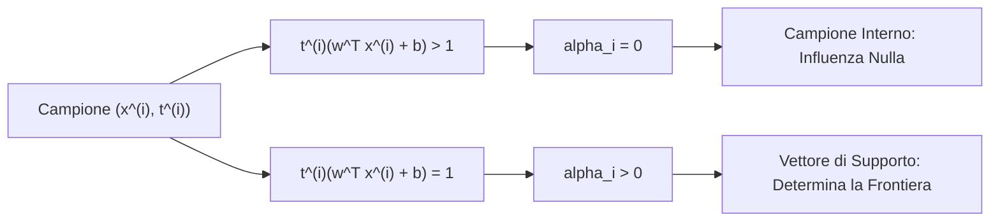

1. __Punti Interni alle Classi__: se il punto si trova ad una distanza strettamente superiore al margine ($t^{(i)}(\mathbf{w}^T \mathbf{x}^{(i)} + b) > 1$), affinché la condizione KKT sia rispettata deve necessariamente valere $\alpha_i = 0$;
2. __Punti sul Margine__: se $\alpha_i > 0$, il termine tra parentesi quadre deve annullarsi identicamente, imponendo $t^{(i)}(\mathbf{w}^T \mathbf{x}^{(i)} + b) = 1$.

I campioni per i quali $\alpha_i > 0$ prendono il nome di __vettori di supporto__ (_Support Vectors_). Essi risiedono esattamente sui margini canonici di separazione.

![[fig_11_9_vettori_di_supporto_margine.png|center mid]]

La totalità dei campioni interni alle classi possiede moltiplicatore duale nullo ($\alpha_i = 0$). Riconsideriamo l'espressione del vettore dei pesi primali ottimi:

$$
\mathbf{w}^* = \sum_{i=0}^{N-1} \alpha_i t^{(i)} \mathbf{x}^{(i)} = \sum_{i \in \text{SV}} \alpha_i t^{(i)} \mathbf{x}^{(i)}
$$

La sommatoria si riduce ai soli vettori di supporto. La soluzione SVM è __strutturalmente sparsa__: rimuovere dal training set o spostare arbitrariamente qualsiasi campione non appartenente all'insieme dei vettori di supporto (purché non oltrepassi il margine canonico) non produce alcuna variazione sull'iperpiano ottimale.

### Calcolo del Parametro di Bias e Funzione di Ipotesi

Una volta determinati i moltiplicatori ottimi $\boldsymbol{\alpha}^*$ mediante ottimizzazione quadratica, possiamo ricavare il valore dell'intercetta di bias $b$. Selezionando un qualunque vettore di supporto $\mathbf{x}^{(k)}$ con $\alpha_k > 0$, vale la condizione esatta:

$$
t^{(k)} (\mathbf{w}^T \mathbf{x}^{(k)} + b) = 1
$$

Moltiplichiamo ambo i membri per $t^{(k)}$ (notando che $(t^{(k)})^2 = 1$ per etichette $\pm 1$):

$$
\mathbf{w}^T \mathbf{x}^{(k)} + b = t^{(k)} \implies b = t^{(k)} - \mathbf{w}^T \mathbf{x}^{(k)}
$$

Sostituendo l'espressione di $\mathbf{w}$:

$$
b = t^{(k)} - \sum_{i \in \text{SV}} \alpha_i t^{(i)} (\mathbf{x}^{(i)})^T \mathbf{x}^{(k)}
$$

Per garantire maggiore stabilità numerica contro le imprecisioni di arrotondamento floating-point dell'algoritmo QP, calcoliamo il valore finale di $b$ mediando la stima su tutti gli $N_{\text{SV}}$ vettori di supporto attivi:

$$
b = \frac{1}{N_{\text{SV}}} \sum_{k \in \text{SV}} \left( t^{(k)} - \sum_{i \in \text{SV}} \alpha_i t^{(i)} (\mathbf{x}^{(i)})^T \mathbf{x}^{(k)} \right)
$$

Infine, la __funzione di classificazione su un nuovo campione di test $\mathbf{x}$__ assume la forma:

$$
h(\mathbf{x}) = \mathrm{sign}(\mathbf{w}^T \mathbf{x} + b) = \mathrm{sign}\left( \sum_{i \in \text{SV}} \alpha_i t^{(i)} (\mathbf{x}^{(i)})^T \mathbf{x} + b \right)
$$

> [!IMPORTANT] Takeaway Fondamentale: Dipendenza Esclusiva dal Prodotto Scalare
> Sia durante la risoluzione del problema duale $W(\boldsymbol{\alpha})$, sia durante il calcolo dell'intercetta $b$, sia infine nella classificazione dei campioni di test $h(\mathbf{x})$, i dati compaiono unicamente sotto forma di __prodotto scalare interno__ $(\mathbf{x}^{(i)})^T \mathbf{x}^{(j)}$. Non è mai richiesta la conoscenza isolata delle coordinate assolute dei vettori.

## Kernel e Trasformazioni di Feature in Spazi ad Alta Dimensione

Quando le classi non sono linearmente separabili nello spazio originario delle feature $\mathbb{R}^D$, la formulazione Hard-Margin fallisce poiché l'insieme dei vincoli ammissibili risulta vuoto.

![[fig_11_10_dataset_linearmente_separabile.png|center mid]]

Per separare distribuzioni a geometria complessa ricorriamo al paradigma della mappatura non lineare: trasformiamo i vettori di input $\mathbf{x} \in \mathbb{R}^D$ in un vettore di feature $\boldsymbol{\phi}(\mathbf{x})$ appartenente a uno spazio a dimensionalità superiore $\mathbb{R}^M$ (con $M \gg D$):

$$
\mathbf{x} \mapsto \boldsymbol{\phi}(\mathbf{x})
$$

![[fig_11_11_trasformazione_feature_non_lineare.png|center big]]

Secondo il teorema di Cover sulla separabilità dei pattern, una distribuzione non linearmente separabile in una bassa dimensione acquisisce con elevata probabilità separabilità lineare se proiettata non linearmente in uno spazio a dimensione sufficientemente elevata.

### Il Kernel Trick

Sostituendo la mappa $\boldsymbol{\phi}(\mathbf{x})$ all'interno del problema duale, il prodotto scalare originario $(\mathbf{x}^{(i)})^T \mathbf{x}^{(j)}$ viene rimpiazzato dal prodotto scalare nello spazio trasformato:

$$
\boldsymbol{\phi}(\mathbf{x}^{(i)})^T \boldsymbol{\phi}(\mathbf{x}^{(j)})
$$

Calcolare esplicitamente la proiezione $\boldsymbol{\phi}(\mathbf{x})$ presenta costi computazionali proibitivi: se lo spazio delle feature ha dimensione $M = 10^6$ o infinita, calcolare e memorizzare i vettori trasformati diventa impraticabile.

Il __Kernel Trick__ supera questo ostacolo: definiamo una funzione nucleo (_Kernel function_) $K: \mathbb{R}^D \times \mathbb{R}^D \to \mathbb{R}$ che calcola il prodotto scalare nello spazio di arrivo operando direttamente sulle coordinate nello spazio di partenza a bassa dimensione:

$$
K(\mathbf{x}, \mathbf{z}) = \boldsymbol{\phi}(\mathbf{x})^T \boldsymbol{\phi}(\mathbf{z})
$$

Questo stratagemma abbatte la complessità computazionale del calcolo del prodotto scalare da $O(M)$ a $O(D)$, rendendo trattabili spazi di proiezione a dimensione arbitrariamente grande o infinita.

### Esempio Analitico: Kernel Polinomiale Quadratico

Consideriamo campioni bidimensionali $\mathbf{x} = [x_1, x_2]^T, \mathbf{z} = [z_1, z_2]^T \in \mathbb{R}^2$ e definiamo la funzione kernel omogenea $K(\mathbf{x}, \mathbf{z}) = (\mathbf{x}^T \mathbf{z})^2$.

Sviluppiamo l'algebra della funzione:

$$
K(\mathbf{x}, \mathbf{z}) = (x_1 z_1 + x_2 z_2)^2 = x_1^2 z_1^2 + 2 x_1 x_2 z_1 z_2 + x_2^2 z_2^2
$$

Riscriviamo la sommatoria come prodotto scalare tra due vettori in $\mathbb{R}^3$:

$$
K(\mathbf{x}, \mathbf{z}) = \begin{bmatrix} x_1^2 \\ \sqrt{2} x_1 x_2 \\ x_2^2 \end{bmatrix}^T \begin{bmatrix} z_1^2 \\ \sqrt{2} z_1 z_2 \\ z_2^2 \end{bmatrix} = \boldsymbol{\phi}(\mathbf{x})^T \boldsymbol{\phi}(\mathbf{z})
$$

dove la funzione di mappatura implicita è:

$$
\boldsymbol{\phi}(\mathbf{x}) = \begin{bmatrix} x_1^2 \\ \sqrt{2} x_1 x_2 \\ x_2^2 \end{bmatrix} \in \mathbb{R}^3
$$

Se invece consideriamo il kernel quadratico disomogeneo $K(\mathbf{x}, \mathbf{z}) = (\mathbf{x}^T \mathbf{z} + 1)^2$, espandendo il quadrato otteniamo:

$$
K(\mathbf{x}, \mathbf{z}) = (\mathbf{x}^T \mathbf{z})^2 + 2 (\mathbf{x}^T \mathbf{z}) + 1 = x_1^2 z_1^2 + 2 x_1 x_2 z_1 z_2 + x_2^2 z_2^2 + 2 x_1 z_1 + 2 x_2 z_2 + 1
$$

Tale espressione corrisponde al prodotto scalare nello spazio a dimensione $M = 6$:

$$
\boldsymbol{\phi}(\mathbf{x}) = \begin{bmatrix} x_1^2 \\ \sqrt{2} x_1 x_2 \\ x_2^2 \\ \sqrt{2} x_1 \\ \sqrt{2} x_2 \\ 1 \end{bmatrix} \in \mathbb{R}^6
$$

Valutare il prodotto scalare calcolando esplicitamente $\boldsymbol{\phi}(\mathbf{x})$ richiede la trasformazione dei dati in vettori a 6 coordinate e una moltiplicazione a 6 operazioni. Con il Kernel Trick, calcoliamo direttamente $(\mathbf{x}^T \mathbf{z} + 1)^2$ operando sui vettori bidimensionali originari in $O(D)$ operazioni elementari.

### Famiglie Fondamentali di Kernel

Ingegnerizzando la funzione di nucleo $K$, possiamo proiettare i dati in spazi di complessità arbitraria.

#### Kernel Lineare

È la funzione identità che preserva lo spazio originario delle feature senza alcuna trasformazione non lineare ($\boldsymbol{\phi}(\mathbf{x}) = \mathbf{x}$):

$$
K(\mathbf{x}, \mathbf{z}) = \mathbf{x}^T \mathbf{z}
$$

Risulta la scelta d'elezione per dataset ad altissima dimensionalità originaria (quali text categorization con Bag-of-Words, filtraggio spam e profilazione genomica), dove il numero elevato di attributi garantisce già la separabilità lineare senza espansioni aggiuntive.

#### Kernel Polinomiale

Genera tutte le combinazioni di monomi fino al grado $d \in \mathbb{N}$, nella variante omogenea ($c = 0$) o disomogenea ($c > 0$):

$$
K(\mathbf{x}, \mathbf{z}) = (\mathbf{x}^T \mathbf{z} + c)^d
$$

Lo spazio di Hilbert associato possiede dimensione combinatoria pari a $M = \binom{D + d}{d}$. Il parametro costante $c > 0$ governa il peso relativo dei termini di grado inferiore rispetto ai monomi di grado massimo $d$.

#### Kernel Gaussiano a Base Radiale (RBF)

Costituisce il kernel universale più diffuso per separare superfici di decisione a geometria non lineare complessa:

$$
K(\mathbf{x}, \mathbf{z}) = \exp\left( -\frac{\|\mathbf{x} - \mathbf{z}\|_2^2}{2\sigma^2} \right) = \exp\left( -\gamma \|\mathbf{x} - \mathbf{z}\|_2^2 \right)
$$

con parametro di dispersione $\gamma = \frac{1}{2\sigma^2} > 0$. Mostriamo analiticamente che il Kernel RBF mappa i dati in uno __spazio di feature a dimensionalità infinita__ ($M = \infty$). Espandiamo la norma quadra della differenza:

$$
\|\mathbf{x} - \mathbf{z}\|_2^2 = \|\mathbf{x}\|_2^2 + \|\mathbf{z}\|_2^2 - 2 \mathbf{x}^T \mathbf{z}
$$

Sostituendo nell'esponenziale:

$$
K(\mathbf{x}, \mathbf{z}) = \exp(-\gamma \|\mathbf{x}\|_2^2) \, \exp(-\gamma \|\mathbf{z}\|_2^2) \, \exp(2\gamma \mathbf{x}^T \mathbf{z})
$$

Sviluppando il termine $\exp(2\gamma \mathbf{x}^T \mathbf{z})$ mediante la serie di Taylor:

$$
\exp(2\gamma \mathbf{x}^T \mathbf{z}) = \sum_{k=0}^{\infty} \frac{(2\gamma)^k}{k!} (\mathbf{x}^T \mathbf{z})^k
$$

Poiché la sommatoria include potenze intere $k \to \infty$, il kernel RBF racchiude prodotti scalari polinomiali di grado arbitrariamente elevato, corrispondenti a uno spazio di Hilbert $\mathbb{R}^{\infty}$.

Il parametro $\gamma$ controlla direttamente l'ampiezza delle campane gaussiane e la complessità del modello:
- Valori piccoli di $\gamma$ (ampia varianza $\sigma$) producono gaussiane larghe e sovrapposte, inducendo una frontiera decisionale liscia e regolare (rischio underfitting);
- Valori elevati di $\gamma$ (piccola varianza $\sigma$) restringono la campana gaussiana, creando isole decisionali isolate attorno ai singoli campioni (rischio severo di overfitting).

### Teorema di Mercer

Per garantire che una funzione candidata $K(\mathbf{x}, \mathbf{z})$ corrisponda effettivamente a un prodotto scalare $\boldsymbol{\phi}(\mathbf{x})^T \boldsymbol{\phi}(\mathbf{z})$ in un qualche spazio vettoriale di Hilbert, dobbiamo verificarne l'ammissibilità algebrica.

Dato un insieme arbitrario di $N$ campioni $\{\mathbf{x}^{(0)}, \dots, \mathbf{x}^{(N-1)}\}$, definiamo la __matrice di Gram o Kernel Matrix__ $\mathbf{K} \in \mathbb{R}^{N \times N}$ i cui elementi sono $K_{ij} = K(\mathbf{x}^{(i)}, \mathbf{x}^{(j)})$.

Se $K$ è un kernel valido, per qualunque vettore non nullo $\mathbf{v} \in \mathbb{R}^N$ valutiamo la forma quadratica:

$$
\mathbf{v}^T \mathbf{K} \mathbf{v} = \sum_{i=0}^{N-1} \sum_{j=0}^{N-1} v_i v_j K(\mathbf{x}^{(i)}, \mathbf{x}^{(j)}) = \sum_{i=0}^{N-1} \sum_{j=0}^{N-1} v_i v_j \boldsymbol{\phi}(\mathbf{x}^{(i)})^T \boldsymbol{\phi}(\mathbf{x}^{(j)})
$$

Riorganizzando i termini:

$$
\mathbf{v}^T \mathbf{K} \mathbf{v} = \left( \sum_{i=0}^{N-1} v_i \boldsymbol{\phi}(\mathbf{x}^{(i)}) \right)^T \left( \sum_{j=0}^{N-1} v_j \boldsymbol{\phi}(\mathbf{x}^{(j)}) \right) = \left\| \sum_{i=0}^{N-1} v_i \boldsymbol{\phi}(\mathbf{x}^{(i)}) \right\|_2^2 \ge 0
$$

La matrice $\mathbf{K}$ deve risultare semi-definita positiva.

> [!NOTE] Teorema di Mercer
> Una funzione simmetrica continua $K: \mathbb{R}^D \times \mathbb{R}^D \to \mathbb{R}$ è un kernel ammissibile se e solo se, per qualunque insieme finito di punti $\{\mathbf{x}^{(0)}, \dots, \mathbf{x}^{(N-1)}\}$, la corrispondente matrice di Kernel $\mathbf{K} \in \mathbb{R}^{N \times N}$ è simmetrica e semi-definita positiva ($\mathbf{K} \succeq 0$, con tutti gli autovalori non negativi).

## Soft-Margin Support Vector Machine e Variabili di Slack

Nonostante l'impiego dei kernel non lineari, negli scenari applicativi reali i dati presentano inevitabilmente rumore di misura, sovrapposizione probabilistica delle classi o presenza di __outlier__.

![[fig_11_12_non_separabile_difficile_kernel.png|center small]] ![[fig_11_13_separabile_con_outlier.png|center small]]

In tali condizioni, pretendere la separabilità lineare rigida conduce a due gravi patologie:
1. Se le classi si sovrappongono fisicamente nello spazio delle feature, l'insieme dei vincoli del problema Hard-Margin è vuoto e il solutore non trova alcuna soluzione ammissibile;
2. Se un singolo outlier si trova isolato in prossimità della classe opposta, il modello primale per includerlo deforma vistosamente l'orientazione dell'iperpiano, contraendo drammaticamente il margine complessivo e provocando un overfitting severo.

Per conferire robustezza al rumore introduciamo la formulazione a margine morbido (__Soft-Margin SVM__).

### Rilassamento dei Vincoli Mediante Variabili di Slack

Allentiamo i vincoli di separazione introducendo un vettore di __variabili di slack__ $\boldsymbol{\xi} = [\xi_0, \dots, \xi_{N-1}]^T$ con vincolo di non negatività $\xi_i \ge 0$:

$$
t^{(i)} (\mathbf{w}^T \mathbf{x}^{(i)} + b) \ge 1 - \xi_i, \quad \forall i \in \{0, \dots, N-1\}
$$

![[fig_11_14_ruolo_variabili_slack.png|center mid]]

La variabile di slack quantifica l'entità della violazione del margine canonico da parte dell'$i$-esimo punto. Si distinguono quattro scenari geometrici fondamentali:
- $\xi_i = 0$: il punto rispetta integralmente il margine canonico, posizionandosi esattamente sul margine ($t^{(i)}(\mathbf{w}^T \mathbf{x}^{(i)} + b) = 1$) o all'esterno di esso nella regione corretta ($t^{(i)}(\mathbf{w}^T \mathbf{x}^{(i)} + b) > 1$);
- $0 < \xi_i < 1$: il punto vìola il margine ideale di sicurezza penetrando all'interno del corridoio inter-classe, ma si trova ancora sul lato corretto dell'iperpiano decisionale ($t^{(i)}(\mathbf{w}^T \mathbf{x}^{(i)} + b) > 0$). La predizione è corretta, seppure a confidenza ridotta;
- $\xi_i = 1$: il punto giace esattamente sulla superficie di decisione $\mathbf{w}^T \mathbf{x}^{(i)} + b = 0$;
- $\xi_i > 1$: il punto attraversa la superficie decisionale e invade il semispazio opposto ($t^{(i)}(\mathbf{w}^T \mathbf{x}^{(i)} + b) < 0$), configurando un effettivo __errore di classificazione__ (_misclassification_).

### Problema Primale di Soft-Margin SVM

Per bilanciare l'ampiezza del margine con il contenimento delle violazioni ammissibili, penalizziamo la somma delle variabili di slack introducendo l'iperparametro di compromesso $C > 0$:

$$
\min_{\mathbf{w}, b, \boldsymbol{\xi}} \frac{1}{2} \|\mathbf{w}\|_2^2 + C \sum_{i=0}^{N-1} \xi_i \quad \text{sotto i vincoli} \quad t^{(i)} (\mathbf{w}^T \mathbf{x}^{(i)} + b) \ge 1 - \xi_i, \quad \xi_i \ge 0, \quad \forall i
$$

Il parametro di costo $C$ governa il trade-off fondamentale tra bias e varianza:
- __Regime $C \to \infty$__: la penalità sulle violazioni domina la perdita. L'ottimizzatore è costretto ad azzerare le variabili di slack ($\xi_i \to 0$), ricadendo esattamente nel modello Hard-Margin. Il modello non tollera violazioni ed è esposto ad alta varianza (overfitting);
- __Regime $C \to 0$__: il termine regolarizzante $\frac{1}{2}\|\mathbf{w}\|_2^2$ domina l'obiettivo. L'ottimizzatore massimizza la larghezza del margine consentendo alle variabili $\xi_i$ di assumere valori positivi. Il modello applica una forte tolleranza ed è esposto ad alto bias (underfitting).

![[fig_ex_9_soft_margin_slack_hinge_loss.png|center big]]

### Riformulazione Variazionale e Hinge Loss

Possiamo isolare analiticamente la variabile di slack dal vincolo primale. Poiché $\xi_i \ge 1 - t^{(i)} (\mathbf{w}^T \mathbf{x}^{(i)} + b)$ e contemporaneamente $\xi_i \ge 0$, il valore minimo ottimale che $\xi_i$ può assumere si esprime in forma chiusa come:

$$
\xi_i = \max\left\{ 0, \, 1 - t^{(i)} (\mathbf{w}^T \mathbf{x}^{(i)} + b) \right\}
$$

Sostituendo questa espressione nell'obiettivo primale, convertiamo il problema vincolato in un problema di minimizzazione non vincolato:

$$
\min_{\mathbf{w}, b} \frac{1}{2} \|\mathbf{w}\|_2^2 + C \sum_{i=0}^{N-1} \max\left\{ 0, \, 1 - t^{(i)} (\mathbf{w}^T \mathbf{x}^{(i)} + b) \right\}
$$

La funzione obiettivo si scompone nella somma canonica di due termini:

$$
\min_{\mathbf{w}, b} \underbrace{\frac{1}{2} \|\mathbf{w}\|_2^2}_{\text{Termine di Regolarizzazione } L_2} + \; C \sum_{i=0}^{N-1} \underbrace{L_{\text{hinge}}\left( t^{(i)}, \mathbf{w}^T \mathbf{x}^{(i)} + b \right)}_{\text{Termine di Errore Empirico}}
$$

La funzione di perdita $L_{\text{hinge}}(t, y) = \max(0, 1 - ty)$ prende il nome di __Hinge Loss__ (_perdita a cerniera_).

Confrontiamo le proprietà della Hinge Loss con le perdite convenzionali:
- __Perdita 0-1__: $L_{0-1}(t, y) = \mathbb{I}(ty < 0)$, non convessa, discontinua con gradiente nullo quasi ovunque (NP-hard da ottimizzare);
- __Hinge Loss__: maggiorante convesso continuo della perdita 0-1. Presenta un punto angoloso non differenziabile in $ty = 1$. Per $ty \ge 1$ la perdita è rigorosamente nulla; per $ty < 1$ la perdita cresce linearmente con pendenza unitaria, penalizzando non solo gli errori ($ty < 0$), ma anche i campioni corretti che cadono all'interno del margine di sicurezza ($0 < ty < 1$);
- __Perdita Logistica__: $\ln(1 + e^{-ty})$, funzione liscia e convessa che assegna una penalità asintotica non nulla anche a campioni posizionati a grande distanza dal margine nel semispazio corretto.

Riconosciamo l'immediato parallelismo strutturale tra Soft-Margin SVM e la regressione Ridge:

$$
\min_{\mathbf{w}} \sum_{i=0}^{N-1} (t^{(i)} - \mathbf{w}^T \mathbf{x}^{(i)})^2 + \lambda \|\mathbf{w}\|_2^2
$$

Dividendo l'obiettivo primale di SVM per la costante $C$:

$$
\min_{\mathbf{w}, b} \sum_{i=0}^{N-1} L_{\text{hinge}}\left( t^{(i)}, \mathbf{w}^T \mathbf{x}^{(i)} + b \right) + \frac{1}{2C} \|\mathbf{w}\|_2^2
$$

La costante di regolarizzazione $\lambda$ e l'iperparametro $C$ risultano legati da una relazione di __proporzionalità inversa__:

$$
\lambda = \frac{1}{2C} \iff C \propto \frac{1}{\lambda}
$$

Aumentare $C$ equivale a ridurre la penalizzazione regolarizzante $\lambda$ (minore regolarizzazione, margine stretto, priorità all'accuratezza sul training set). Al contrario, ridurre $C$ equivale a incrementare $\lambda$ (maggiore regolarizzazione, margine ampio, priorità alla semplicità geometrica).

### Formulazione Duale di Soft-Margin SVM

Costruiamo la funzione Lagrangiana introducendo i moltiplicatori $\alpha_i \ge 0$ per i vincoli di margine rilassati e i moltiplicatori $\mu_i \ge 0$ per i vincoli di non negatività $\xi_i \ge 0$:

$$
\mathcal{L}(\mathbf{w}, b, \boldsymbol{\xi}, \boldsymbol{\alpha}, \boldsymbol{\mu}) = \frac{1}{2} \|\mathbf{w}\|_2^2 + C \sum_{i=0}^{N-1} \xi_i - \sum_{i=0}^{N-1} \alpha_i \left[ t^{(i)} (\mathbf{w}^T \mathbf{x}^{(i)} + b) - 1 + \xi_i \right] - \sum_{i=0}^{N-1} \mu_i \xi_i
$$

Calcoliamo le condizioni di stazionarietà rispetto alle variabili primali $\mathbf{w}, b, \xi_i$:

$$
\nabla_{\mathbf{w}} \mathcal{L} = \mathbf{w} - \sum_{i=0}^{N-1} \alpha_i t^{(i)} \mathbf{x}^{(i)} = \mathbf{0} \implies \mathbf{w} = \sum_{i=0}^{N-1} \alpha_i t^{(i)} \mathbf{x}^{(i)}
$$

$$
\frac{\partial \mathcal{L}}{\partial b} = -\sum_{i=0}^{N-1} \alpha_i t^{(i)} = 0 \implies \sum_{i=0}^{N-1} \alpha_i t^{(i)} = 0
$$

$$
\frac{\partial \mathcal{L}}{\partial \xi_i} = C - \alpha_i - \mu_i = 0 \implies C = \alpha_i + \mu_i
$$

Dato che i moltiplicatori $\mu_i$ devono soddisfare la condizione di ammissibilità duale $\mu_i \ge 0$, la relazione $C = \alpha_i + \mu_i$ impone che $\alpha_i = C - \mu_i \le C$. Raggruppando le condizioni duali otteniamo i cosiddetti __vincoli a scatola__ (_box constraints_):

$$
0 \le \alpha_i \le C, \quad \forall i \in \{0, \dots, N-1\}
$$

Sostituendo le relazioni di stazionarietà nella Lagrangiana, raggruppiamo i termini che dipendono dalle variabili di slack $\xi_i$:

$$
\sum_{i=0}^{N-1} C \xi_i - \sum_{i=0}^{N-1} \alpha_i \xi_i - \sum_{i=0}^{N-1} \mu_i \xi_i = \sum_{i=0}^{N-1} \underbrace{(C - \alpha_i - \mu_i)}_{= 0} \xi_i = 0
$$

I termini contenenti $\xi_i$ e $\mu_i$ si annullano reciprocamente. La funzione obiettivo duale coincide formalmente con quella di Hard-Margin, integrando il Kernel $K(\mathbf{x}^{(i)}, \mathbf{x}^{(j)})$:

$$
\max_{\boldsymbol{\alpha}} W(\boldsymbol{\alpha}) = \sum_{i=0}^{N-1} \alpha_i - \frac{1}{2} \sum_{i=0}^{N-1} \sum_{j=0}^{N-1} \alpha_i \alpha_j t^{(i)} t^{(j)} K(\mathbf{x}^{(i)}, \mathbf{x}^{(j)})
$$

sotto i vincoli:

$$
0 \le \alpha_i \le C, \quad \forall i \in \{0, \dots, N-1\}
$$

$$
\sum_{i=0}^{N-1} \alpha_i t^{(i)} = 0
$$

L'unica differenza rispetto al modello Hard-Margin risiede nella limitazione superiore dei moltiplicatori duali: nessun singolo campione può esercitare un'influenza superiore a $C$, impedendo agli outlier di deformare arbitrariamente la frontiera decisionale.

### Tassonomia dei Campioni in Soft-Margin SVM

Le condizioni KKT di slackness complementare determinano in modo univoco la collocazione fisica dei campioni nello spazio:

1. $\alpha_i \left[ t^{(i)}(\mathbf{w}^T \mathbf{x}^{(i)} + b) - 1 + \xi_i \right] = 0$;
2. $\mu_i \xi_i = 0 \iff (C - \alpha_i) \xi_i = 0$.

Esaminiamo i tre regimi operativi che emergono:

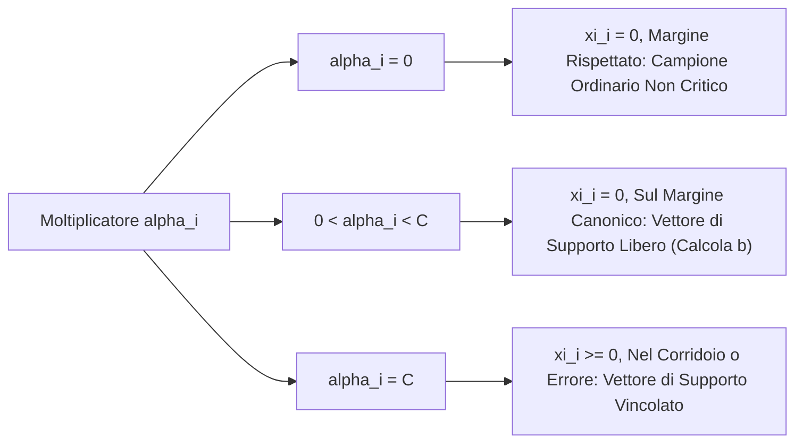

1. __Campioni Interni / Non Critici__ ($\alpha_i = 0$):
   Poiché $\alpha_i = 0$, il coefficiente $(C - \alpha_i) = C > 0$. Affinché valga $(C - \alpha_i)\xi_i = 0$, deve necessariamente risultare $\xi_i = 0$. Il vincolo primale diventa $t^{(i)}(\mathbf{w}^T \mathbf{x}^{(i)} + b) \ge 1 - 0 = 1$ (generalmente $> 1$). Il punto è posizionato correttamente al di fuori del margine di sicurezza. Avendo $\alpha_i = 0$, non contribuisce alla determinazione del vettore dei pesi $\mathbf{w}$;
2. __Vettori di Supporto Liberi__ ($0 < \alpha_i < C$):
   Poiché $\alpha_i < C$, vale $(C - \alpha_i) > 0$, imponendo $\xi_i = 0$. Contemporaneamente, essendo $\alpha_i > 0$, la prima condizione impone $[t^{(i)}(\mathbf{w}^T \mathbf{x}^{(i)} + b) - 1 + \xi_i] = 0$. Sostituendo $\xi_i = 0$, otteniamo la condizione esatta $t^{(i)}(\mathbf{w}^T \mathbf{x}^{(i)} + b) = 1$. Il punto giace esattamente sul margine canonico di sicurezza. Questi campioni prendono il nome di __vettori di supporto liberi__ (_free support vectors_). Poiché $\xi_i = 0$ in modo rigoroso, __sono gli unici punti utilizzabili per calcolare il bias $b$__;
3. __Vettori di Supporto Vincolati__ ($\alpha_i = C$):
   Essendo $\alpha_i = C$, abbiamo $(C - \alpha_i) = 0$, il che soddisfa la complementarietà consentendo alla variabile di slack di assumere un valore positivo $\xi_i \ge 0$. Poiché $\alpha_i > 0$, vale la relazione primale $t^{(i)}(\mathbf{w}^T \mathbf{x}^{(i)} + b) = 1 - \xi_i$. Questi campioni prendono il nome di __vettori di supporto vincolati__ (_bounded support vectors_). A seconda dell'entità della violazione:
   - Se $0 < \xi_i < 1$: il punto è all'interno del corridoio marginale ma sul semispazio corretto;
   - Se $\xi_i = 1$: il punto risiede esattamente sulla frontiera decisionale;
   - Se $\xi_i > 1$: il punto si trova sul lato opposto dell'iperpiano ed è misclassificato.
   I vettori di supporto vincolati __non possono essere impiegati per calcolare il bias $b$__, in quanto l'entità esatta della loro violazione $\xi_i$ non è nota a priori senza conoscere $b$.

| Valore del Moltiplicatore Duale | Condizione di Slack $\xi_i$ | Posizione Geometrica del Punto | Ruolo nel Modello |
| :--- | :--- | :--- | :--- |
| $\alpha_i = 0$ | $\xi_i = 0$ | Esterno al margine ($t^{(i)} y^{(i)} > 1$) | Campione corretto non critico, influenza nulla |
| $0 < \alpha_i < C$ | $\xi_i = 0$ | Esattamente sul margine ($t^{(i)} y^{(i)} = 1$) | __Vettore di supporto libero__, determina la soglia $b$ |
| $\alpha_i = C$ | $\xi_i \ge 0$ | Interno al margine o misclassificato ($t^{(i)} y^{(i)} \le 1$) | __Vettore di supporto vincolato__, violazione o anomalia |

Per calcolare l'intercetta $b$ utilizziamo la media ristretta all'insieme dei vettori di supporto liberi $\mathcal{S}_{\text{free}} = \{k \mid 0 < \alpha_k < C\}$:

$$
b = \frac{1}{|\mathcal{S}_{\text{free}}|} \sum_{k \in \mathcal{S}_{\text{free}}} \left( t^{(k)} - \sum_{i \in \text{SV}} \alpha_i t^{(i)} K(\mathbf{x}^{(i)}, \mathbf{x}^{(k)}) \right)
$$

## Quadro Sinottico delle Architetture SVM

Sintetizziamo la tassonomia strutturale e i passaggi operativi delle Support Vector Machines:

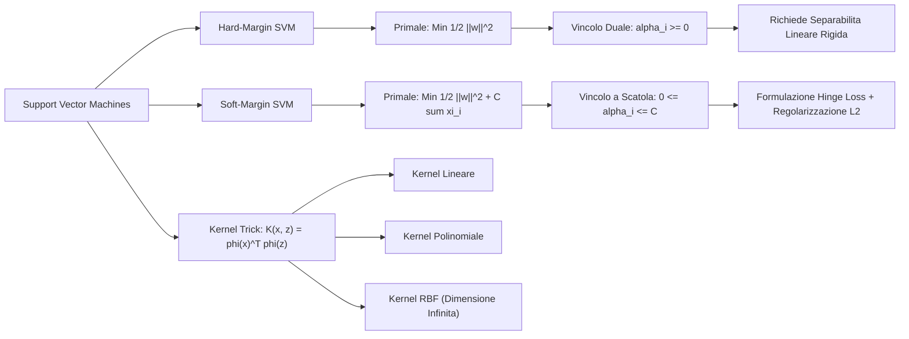

Confrontiamo in dettaglio le caratteristiche distintive delle formulazioni analitiche studiate:

| Proprietà Analitica | Hard-Margin SVM | Soft-Margin SVM (Lineare) | Kernel SVM (Non Lineare) |
| :--- | :--- | :--- | :--- |
| __Condizione sui Dati__ | Perfettamente separabili linearmente | Dati con outlier o rumore moderato | Dati con frontiere decisionali non lineari complesse |
| __Funzione Obiettivo Primale__ | $\frac{1}{2}\|\mathbf{w}\|_2^2$ | $\frac{1}{2}\|\mathbf{w}\|_2^2 + C \sum_{i} \xi_i$ | $\frac{1}{2}\|\mathbf{w}\|_2^2 + C \sum_{i} \xi_i$ in $\mathbb{R}^M$ |
| __Formulazione di Errore__ | Vincolo rigido $\xi_i = 0$ | Hinge Loss: $\max(0, 1 - ty)$ | Hinge Loss su feature $\boldsymbol{\phi}(\mathbf{x})$ |
| __Dominio dei Moltiplicatori__ | $\alpha_i \ge 0$ | $0 \le \alpha_i \le C$ (vincolo a scatola) | $0 \le \alpha_i \le C$ |
| __Complessità Computazionale__ | Dipende da $N$ (numero campioni) | Dipende da $N$ | Indipendente da $M$, dipende da $N$ e dal Kernel |
| __Funzione di Predizione__ | $\mathrm{sign}(\mathbf{w}^T\mathbf{x} + b)$ | $\mathrm{sign}(\mathbf{w}^T\mathbf{x} + b)$ | $\mathrm{sign}\left(\sum_{i \in \text{SV}} \alpha_i t^{(i)} K(\mathbf{x}^{(i)}, \mathbf{x}) + b\right)$ |
| __Iperparametri Chiave__ | Nessuno | Costo di violazione $C \propto 1/\lambda$ | Costo $C$ e parametri del Kernel ($d$ o $\gamma = \frac{1}{2\sigma^2}$) |
| __Sensibilità all'Overfitting__ | Elevata in presenza di rumore | Controllata dall'iperparametro $C$ | Controllata congiuntamente da $C$ e dalla banda del Kernel $\gamma$ |

Le Support Vector Machines costituiscono uno dei pilastri più solidi e teoricamente fondati dell'apprendimento automatico: la combinazione tra massimizzazione del margine, convessità globale, sparsità duale e potenza espressiva degli spazi di Hilbert a nucleo riproducibile fornisce un modello predittivo con eccellenti capacità di generalizzazione statistica.


# A. Reti Neurali

I modelli di apprendimento supervisionato lineari e i metodi a kernel operano combinando parametri o proiettando le feature mediante funzioni predeterminate. Sebbene il Kernel Trick consenta di mappare i dati in spazi a dimensionalità arbitrariamente elevata, la trasformazione di base rimane statica durante l'addestramento: il modello apprende unicamente i coefficienti lineari associati a ciascun vettore di supporto. Quando affrontiamo distribuzioni empiriche complesse ad alta dimensionalità (immagini, segnali audio, testi), progettare a priori la funzione di trasformazione ideale diventa impraticabile.

Le __Reti Neurali Artificiali__ (_Artificial Neural Networks_, ANN) introducono un cambio di paradigma fondamentale: apprendere end-to-end sia la rappresentazione interna delle feature, sia il predittore finale direttamente dai dati. Partendo dall'analisi del percettrone singolo, l'architettura si sviluppa nei percettroni multistrato (__Multi-Layer Perceptron__, MLP) e nella propagazione diretta (__Forward Pass__). L'ottimizzazione fa perno sull'algoritmo di retropropagazione dell'errore (__Backpropagation__) basato sulla regola della catena multivariata, caratterizzato dalla cancellazione esatta del gradiente all'uscita per le principali funzioni di costo (regressione quadratica, entropia incrociata binaria con sigmoide ed entropia incrociata multiclasse con softmax). La generalizzazione è presidiata da strategie di regolarizzazione dedicate: la contrazione dei pesi (__Weight Decay__) e l'arresto anticipato (__Early Stopping__), legate da un'equivalenza asintotica tra passi di discesa del gradiente e penalità quadratica.

## Dal Percettrone Singolo alle Reti Multistrato

Per comprendere la transizione verso le architetture profonde, riconsideriamo il modello classico del __Percettrone di Rosenblatt__:

$$
h_{\mathbf{w}}(\mathbf{x}) = f(\mathbf{w}^T \mathbf{x} + b) = f\left( \sum_{i=1}^D w_i x_i + b \right)
$$

dove $\mathbf{x} \in \mathbb{R}^D$ raccoglie le feature di ingresso, $\mathbf{w} \in \mathbb{R}^D$ rappresenta il vettore dei pesi sinaptici, $b \in \mathbb{R}$ è il parametro di bias (intercetta), e $f(\cdot)$ è una funzione di attivazione a gradino (o funzione segno).

![[fig_12_1_rappresentazione_percettrone.png|center mid]]

Il percettrone elementare calcola una combinazione affine delle variabili di ingresso e produce una decisione binaria netta. Tuttavia, come dimostrato storicamente dal celebre controesempio della funzione logica XOR formulato da Minsky e Papert (1969), un singolo iperpiano di decisione lineare non può separare classi che non siano linearmente separabili nello spazio di partenza.

Per superare questo vincolo strutturale, colleghiamo molteplici neuroni disposti su strati sequenziali in cascata e sostituiamo la discontinua funzione a gradino con funzioni di attivazione non lineari, continue e differenziabili.

### Funzioni di Attivazione Non Lineari

Consideriamo un problema di regressione mirato a stimare il prezzo di un immobile a partire dalla sua superficie abitabile. Se adottassimo una regressione lineare pura, il modello produrrebbe estrapolazioni con valori negativi per metrature prossime allo zero, violando il vincolo fisico fondamentale di non negatività del prezzo.

Risolviamo questa criticità vincolando la combinazione affine mediante una semplice trasformazione non lineare che annulla l'uscita quando l'argomento è negativo:

$$
h_{\mathbf{w}}(x) = \max\{wx + b, \, 0\}
$$

Questa trasformazione definisce la __Rectified Linear Unit__ (__ReLU__):

$$
\mathrm{ReLU}(z) = \max\{0, z\} = \begin{cases} z & \text{se } z \ge 0 \\ 0 & \text{se } z < 0 \end{cases}
$$

![[fig_12_2_funzione_attivazione_relu.png|center small]] ![[fig_12_3_neurone_singolo_rete_neurale.png|center small]]

In generale, una funzione scalare $g: \mathbb{R} \to \mathbb{R}$ che introduce una distorsione non lineare prende il nome di __funzione di attivazione__. L'unità computazionale elementare che riceve il vettore di ingresso, ne calcola la combinazione lineare con i pesi e vi applica la funzione di attivazione costituisce il __neurone artificiale__.

Le funzioni di attivazione standard impiegate nelle reti neurali includono:
- __ReLU__: $\mathrm{ReLU}(z) = \max(0, z)$. Rappresenta la scelta predefinita per gli strati nascosti. La sua derivata unitaria nel semiasse positivo ($z > 0 \implies g'(z) = 1$) evita la saturazione del gradiente, accelera la discesa stocastica e induce sparsità nelle attivazioni interne;
- __Sigmoide Logistica__: $\sigma(z) = \frac{1}{1 + e^{-z}}$. Mappa l'intero asse reale nell'intervallo continuo $(0, 1)$, ideale per modellare probabilità a posteriori nella classificazione binaria;
- __Tangente Iperbolica__: $\tanh(z) = \frac{e^z - e^{-z}}{e^z + e^{-z}} = 2\sigma(2z) - 1$. Mappa i valori nell'intervallo $(-1, 1)$, offrendo il vantaggio di un segnale di uscita a media nulla.

> [!IMPORTANT] Collasso Lineare delle Reti senza Attivazioni
> L'introduzione di attivazioni non lineari è una condizione necessaria e imprescindibile per l'espressività delle reti neurali profonde.
> 
> Se impostassimo funzioni di attivazione lineari (la funzione identità $g(z) = z$), una rete a $r$ strati collasserebbe matematicamente in una banale regressione lineare a strato singolo. Sviluppiamo infatti la composizione a cascata di $r$ trasformazioni affini:
> 
> $$
> \mathbf{a}^{[r]} = \mathbf{W}^{[r]} \left( \mathbf{W}^{[r-1]} \cdots (\mathbf{W}^{[1]} \mathbf{x} + \mathbf{b}^{[1]}) \cdots + \mathbf{b}^{[r-1]} \right) + \mathbf{b}^{[r]} = \mathbf{W}_{\text{eq}} \mathbf{x} + \mathbf{b}_{\text{eq}}
> $$
> 
> dove la matrice dei pesi equivalente è il semplice prodotto matriciale $\mathbf{W}_{\text{eq}} = \mathbf{W}^{[r]} \mathbf{W}^{[r-1]} \cdots \mathbf{W}^{[1]} \in \mathbb{R}^{m_r \times D}$.
> 
> Poiché il prodotto di matrici è ancora una matrice, comporre $100$ strati lineari non estende minimamente lo spazio delle ipotesi rispetto a un singolo strato. Soltanto l'alternanza sistematica tra combinazioni affini e non-linearità consente di piegare lo spazio geometrico e garantisce il Teorema di Approssimazione Universale.

### Reti Multistrato e Rappresentazione Gerarchica

Interconnettendo molteplici neuroni in una struttura a strati, la rete sintetizza autonomamente una gerarchia di concetti astratti non lineari a partire dai dati grezzi.

Consideriamo un modello predittivo immobiliare basato su 4 feature di ingresso: superficie, numero di stanze, codice postale e reddito medio del quartiere.

![[fig_12_4_architettura_rete_neurale_complessa.png|center mid]]

I neuroni intermedi dello strato nascosto non operano su variabili definite a priori dall'ingegnere, bensì estraggono automaticamente fattori latenti ad alto livello di astrazione:
- Il primo neurone correla superficie e numero di stanze per quantificare la capacità abitativa complessiva della famiglia;
- Il secondo neurone elabora il codice postale per stimare la pedonabilità e la concentrazione dei servizi urbani;
- Il terzo neurone incrocia codice postale e reddito medio per inferire il livello di qualità delle scuole locali.

Lo strato di uscita combina linearmente questi fattori sintetici per calcolare la stima finale del valore dell'immobile.

Poiché in problemi complessi non sappiamo a priori quali combinazioni di feature risultino decisive, colleghiamo ogni nodo di ingresso a tutti i neuroni dello strato nascosto, e ogni neurone nascosto a tutti i neuroni del livello successivo. Questi livelli computazionali prendono il nome di __strati densi o completamente connessi__ (_Fully Connected Layers_).

## Architettura del Multi-Layer Perceptron

Analizziamo la formalizzazione algebrica di un __percettrone bistrato__ (avente uno strato nascosto e uno strato di uscita; per convenzione universale lo strato di ingresso non viene conteggiato poiché si limita a distribuire il segnale senza elaborazioni).

![[fig_12_5_rete_due_strati_feedforward.png|center mid]]

Sia $\mathbf{x} \in \mathbb{R}^D$ il vettore delle feature di ingresso e sia $m$ il numero di neuroni dello strato nascosto. Ciascun neurone nascosto $j \in \{1, \dots, m\}$ calcola il potenziale pre-attivazione e la relativa attivazione non lineare:

$$
z_j^{[1]} = (\mathbf{w}_j^{[1]})^T \mathbf{x} + b_j^{[1]}
$$

$$
a_j = \mathrm{ReLU}(z_j^{[1]})
$$

dove $\mathbf{w}_j^{[1]} \in \mathbb{R}^D$ raccoglie i pesi sinaptici afferenti al neurone $j$, $b_j^{[1]} \in \mathbb{R}$ è il suo termine di bias, $z_j^{[1]}$ è il potenziale affine e $a_j$ è l'attivazione non lineare prodotta.

Raccogliendo le attivazioni nello strato nascosto nel vettore $\mathbf{a} = [a_1, \dots, a_m]^T \in \mathbb{R}^m$, lo strato di uscita (avente un singolo neurone per compiti di regressione scalare) combina linearmente le feature latenti estratte:

$$
\hat{t} = h_{\mathbf{w}}(\mathbf{x}) = (\mathbf{w}^{[2]})^T \mathbf{a} + b^{[2]}
$$

dove $\mathbf{w}^{[2]} \in \mathbb{R}^m$ raccoglie i pesi dello strato di uscita e $b^{[2]} \in \mathbb{R}$ rappresenta il bias finale.

### Formulazione Vettoriale per Strati Arbitrari

Generalizziamo la notazione algebrica a una rete neurale profonda avente $r$ strati computazionali ($r-1$ strati nascosti e 1 strato di uscita).

Definiamo per ogni strato $k \in \{1, \dots, r\}$ le matrici dei parametri dei pesi e i vettori di bias:
- $\mathbf{W}^{[k]} \in \mathbb{R}^{m_k \times m_{k-1}}$: matrice dei pesi dello strato $k$, dove $m_k$ indica il numero di neuroni del livello corrente e $m_{k-1}$ il numero di neuroni del livello precedente (fissando $m_0 = D$ per lo strato di ingresso);
- $\mathbf{b}^{[k]} \in \mathbb{R}^{m_k}$: vettore dei bias dello strato $k$.

La sequenza di calcolo della propagazione in avanti (__Forward Pass__) per un generico vettore di ingresso $\mathbf{x}$ si esprime mediante la seguente catena matriciale:

$$
\begin{aligned}
\mathbf{z}^{[1]} &= \mathbf{W}^{[1]} \mathbf{x} + \mathbf{b}^{[1]} \in \mathbb{R}^{m_1}, \qquad &\mathbf{a}^{[1]} &= g_1(\mathbf{z}^{[1]}) \in \mathbb{R}^{m_1} \\
\mathbf{z}^{[2]} &= \mathbf{W}^{[2]} \mathbf{a}^{[1]} + \mathbf{b}^{[2]} \in \mathbb{R}^{m_2}, \qquad &\mathbf{a}^{[2]} &= g_2(\mathbf{z}^{[2]}) \in \mathbb{R}^{m_2} \\
&\;\;\vdots &\;\;\vdots \\
\mathbf{z}^{[r-1]} &= \mathbf{W}^{[r-1]} \mathbf{a}^{[r-2]} + \mathbf{b}^{[r-1]} \in \mathbb{R}^{m_{r-1}}, \qquad &\mathbf{a}^{[r-1]} &= g_{r-1}(\mathbf{z}^{[r-1]}) \in \mathbb{R}^{m_{r-1}} \\
\mathbf{z}^{[r]} &= \mathbf{W}^{[r]} \mathbf{a}^{[r-1]} + \mathbf{b}^{[r]} \in \mathbb{R}^{m_r}, \qquad &\hat{\mathbf{t}} &= g_r(\mathbf{z}^{[r]}) \in \mathbb{R}^{m_r}
\end{aligned}
$$

dove $g_k(\cdot)$ rappresenta la funzione di attivazione applicata elemento per elemento allo strato $k$ (ad esempio ReLU per gli strati intermedi e identità, sigmoide o softmax per lo strato finale).

### Conteggio dei Neuroni e dei Parametri Addestrabili

Per quantificare i gradi di libertà e la complessità spaziale dell'architettura:
- Il __numero totale di neuroni computazionali__ corrisponde alla somma delle dimensioni di tutti gli strati escluso l'input: $N_{\text{neuroni}} = \sum_{k=1}^r m_k$;
- Il __numero totale di parametri liberi addestrabili__ include tutti i coefficienti delle matrici di peso e tutti i bias: $N_{\text{parametri}} = \sum_{k=1}^r (m_{k-1} + 1) m_k = \sum_{k=1}^r (m_k \times m_{k-1} + m_k)$.

> [!EXAMPLE] Calcolo Parametrico di una Rete per Visione
> Consideriamo un MLP per la classificazione di cifre scritte a mano con input $\mathbf{x} \in \mathbb{R}^{784}$ (immagini raster $28 \times 28$), due strati nascosti con $m_1 = 128$ e $m_2 = 64$ neuroni, e uno strato di uscita con $m_3 = 10$ classi:
> - Strato 1: $(784 + 1) \times 128 = 100\,480$ parametri;
> - Strato 2: $(128 + 1) \times 64 = 8\,256$ parametri;
> - Strato 3: $(64 + 1) \times 10 = 650$ parametri;
> - Totale parametri liberi: $100\,480 + 8\,256 + 650 = 109\,386$ pesi da ottimizzare.

## Funzione di Costo e Discesa Stocastica del Gradiente

Dato un dataset supervisionato $\mathcal{D} = \{(\mathbf{x}^{(i)}, \mathbf{t}^{(i)})\}_{i=0}^{N-1}$, l'obiettivo dell'addestramento consiste nell'individuare la configurazione dei pesi $\mathbf{w}$ che minimizza una funzione di costo empirica derivabile $L(\mathbf{w})$:

$$
L(\mathbf{w}) = \frac{1}{N} \sum_{i=0}^{N-1} L^{(i)}(\mathbf{w})
$$

Nel caso della regressione lineare con scarto quadratico, la perdita sul singolo campione assume la forma:

$$
L^{(i)}(\mathbf{w}) = \frac{1}{2} \|h_{\mathbf{w}}(\mathbf{x}^{(i)}) - \mathbf{t}^{(i)}\|_2^2
$$

A causa delle molteplici composizioni non lineari, la funzione di costo $L(\mathbf{w})$ delle reti neurali è fortemente __non convessa__: la superficie di errore presenta una complessa topologia caratterizzata da minimi locali multipli, simmetrie di permutazione tra neuroni, punti di sella e ampi plateaux a gradiente debole. Non esiste alcuna soluzione analitica in forma chiusa (a differenza dei minimi quadrati ordinari o di Ridge Regression).

Dobbiamo quindi ricorrere ad algoritmi iterativi basati sulla discesa lungo il gradiente:

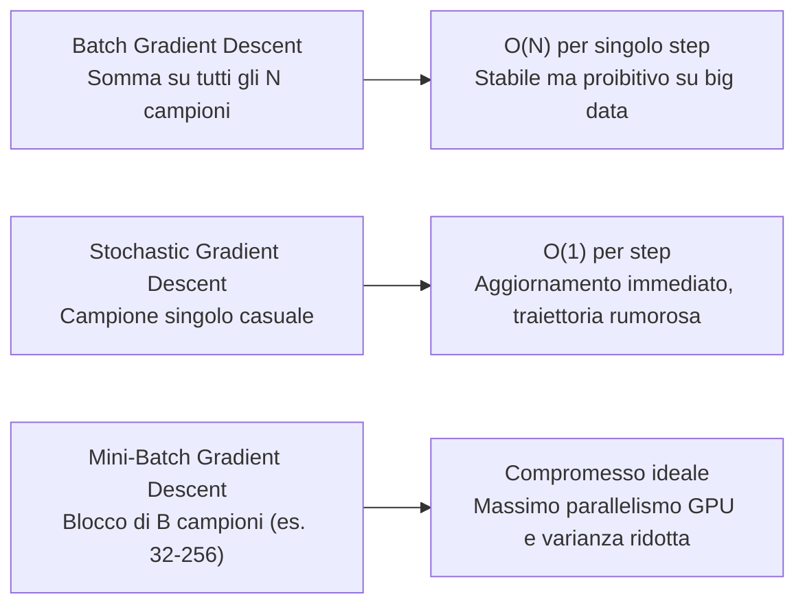

Nella variante della __Discesa Stocastica del Gradiente__ (__SGD__), a ogni iterazione estraiamo casualmente un singolo campione $(\mathbf{x}^{(i)}, \mathbf{t}^{(i)})$ e aggiorniamo il vettore globale dei parametri $\mathbf{w}$ lungo la direzione di massima discesa locale:

$$
\mathbf{w} \leftarrow \mathbf{w} - \alpha \nabla_{\mathbf{w}} L^{(i)}(\mathbf{w})
$$

dove $\alpha > 0$ è il tasso di apprendimento (_learning rate_).

L'intero impianto algoritmico dipende dalla nostra capacità di calcolare il gradiente $\nabla_{\mathbf{w}} L^{(i)}(\mathbf{w})$ in modo esatto ed estremamente rapido. Questo calcolo è svolto dall'algoritmo di __Backpropagation__.

## Teoria e Derivazione Analitica di Backpropagation

L'algoritmo di Backpropagation costituisce un'applicazione sistematica e ricorsiva della regola di derivazione delle funzioni composte (__Chain Rule__) operante all'indietro sul grafo computazionale aciclico della rete.

### Teorema di Complessità della Differenziazione Automatica

La scalabilità delle reti neurali profonde poggia su un pilastro fondamentale della complessità computazionale:

> [!IMPORTANT] Teorema di Complessità della Differenziazione Automatica
> Sia dato un grafo computazionale differenziabile di dimensione $N$ operazioni aritmetiche elementari che calcola una funzione scalare a valori reali. Il gradiente esatto di tale funzione rispetto a tutte le sue variabili di ingresso o parametri può essere calcolato con un costo temporale pari a $O(N)$, impiegando un grafo di retropropagazione avente dimensione $O(N)$.

Il calcolo delle derivate tramite Backpropagation possiede lo stesso identico ordine di complessità asintotica del Forward Pass ($O(N)$).

Confrontiamo questo risultato con l'approssimazione numerica tramite __differenze finite__:

$$
\frac{\partial L}{\partial w_j} \approx \frac{L(\mathbf{w} + \epsilon \mathbf{e}_j) - L(\mathbf{w})}{\epsilon}
$$

Per valutare il gradiente su $P$ parametri liberi, le differenze finite richiedono $P + 1$ valutazioni complete della rete, con un costo complessivo pari a $O(P \cdot N)$. Poiché nelle reti neurali il numero di parametri $P$ è dello stesso ordine di grandezza delle operazioni del forward pass ($P \sim N$), il costo esploderebbe a $O(N^2)$. Su una rete con $10^6$ parametri, le differenze finite impiegherebbero un milione di volte più tempo rispetto a Backpropagation, oltre a introdurre disastrosi errori di cancellazione numerica in virgola mobile.

### Regola della Catena Multivariata

Sia $L$ una funzione scalare differenziabile che dipende da una variabile primaria $w_j$ attraverso un insieme intermedio di $m$ funzioni $g_1(\mathbf{w}), \dots, g_m(\mathbf{w})$:

$$
g_k = g_k(w_1, \dots, w_P), \quad \forall k \in \{1, \dots, m\}
$$

$$
L = L(g_1(\mathbf{w}), \dots, g_m(\mathbf{w}))
$$

La derivata parziale totale di $L$ rispetto a $w_j$ corrisponde alla somma pesata delle derivate lungo tutti i percorsi computazionali indipendenti che collegano $w_j$ alla perdita scalare $L$:

$$
\frac{\partial L}{\partial w_j} = \sum_{k=1}^m \frac{\partial L}{\partial g_k} \frac{\partial g_k}{\partial w_j}
$$

### Derivazione Analitica per Singolo Neurone

Consideriamo il modello elementare di un singolo neurone con attivazione ReLU e funzione di perdita quadratica calcolata sul campione $(\mathbf{x}, t)$ con $\mathbf{x} \in \mathbb{R}^D$:

$$
\begin{aligned}
z &= \mathbf{w}^T \mathbf{x} + b = \sum_{i=0}^{D-1} w_i x_i + b \\
\hat{t} &= \mathrm{ReLU}(z) = \max(0, z) \\
L(\mathbf{w}) &= \frac{1}{2} (\hat{t} - t)^2
\end{aligned}
$$

Vogliamo calcolare analiticamente il gradiente rispetto al generico peso $w_i$. Applichiamo la regola della catena multivariata:

$$
\frac{\partial L}{\partial w_i} = \frac{\partial L}{\partial \hat{t}} \frac{\partial \hat{t}}{\partial z} \frac{\partial z}{\partial w_i}
$$

Calcoliamo separatamente i tre fattori differenziali:
1. Derivata della perdita rispetto alla stima $\hat{t}$: $\frac{\partial L}{\partial \hat{t}} = \frac{\partial}{\partial \hat{t}} \left[ \frac{1}{2}(\hat{t} - t)^2 \right] = \hat{t} - t$;
2. Derivata dell'attivazione ReLU rispetto al potenziale $z$: $\frac{\partial \hat{t}}{\partial z} = \frac{\mathrm{d}}{\mathrm{d}z}\mathrm{ReLU}(z) = \mathbb{I}(z \ge 0)$;
3. Derivata del potenziale pre-attivazione rispetto al peso $w_i$: $\frac{\partial z}{\partial w_i} = \frac{\partial}{\partial w_i} \left( \sum_{j=0}^{D-1} w_j x_j + b \right) = x_i$.

Moltiplicando i tre termini otteniamo il gradiente esatto rispetto al peso:

$$
\frac{\partial L}{\partial w_i} = (\hat{t} - t) \cdot \mathbb{I}(z \ge 0) \cdot x_i
$$

Per il bias $b$, essendo $\frac{\partial z}{\partial b} = 1$:

$$
\frac{\partial L}{\partial b} = \frac{\partial L}{\partial \hat{t}} \frac{\partial \hat{t}}{\partial z} \frac{\partial z}{\partial b} = (\hat{t} - t) \cdot \mathbb{I}(z \ge 0)
$$

### Derivazione Analitica per Rete Bistrato

Estendiamo l'analisi alla rete bistrato con $m$ neuroni nascosti e uscita scalare:

$$
\begin{aligned}
z_j^{[1]} &= (\mathbf{w}_j^{[1]})^T \mathbf{x} + b_j^{[1]}, \quad \forall j \in \{1, \dots, m\} \\
a_j &= \mathrm{ReLU}(z_j^{[1]}) \\
\mathbf{a} &= [a_1, \dots, a_m]^T \in \mathbb{R}^m \\
\hat{t} &= (\mathbf{w}^{[2]})^T \mathbf{a} + b^{[2]} \\
L &= \frac{1}{2} (\hat{t} - t)^2
\end{aligned}
$$

Deriviamo dapprima i gradienti per lo __strato di uscita (layer 2)__.

Rispetto al peso $w_j^{[2]}$ associato all'attivazione nascosta $a_j$:

$$
\frac{\partial L}{\partial w_j^{[2]}} = \frac{\partial L}{\partial \hat{t}} \frac{\partial \hat{t}}{\partial w_j^{[2]}} = (\hat{t} - t) a_j
$$

Rispetto al bias di uscita $b^{[2]}$:

$$
\frac{\partial L}{\partial b^{[2]}} = \frac{\partial L}{\partial \hat{t}} \frac{\partial \hat{t}}{\partial b^{[2]}} = (\hat{t} - t) \cdot 1 = \hat{t} - t
$$

Deriviamo ora i parametri dello __strato nascosto (layer 1)__.

Consideriamo il peso $w_{ji}^{[1]}$, che connette la feature di ingresso $x_i$ al neurone nascosto $j$. La derivata si propaga a ritroso lungo il cammino $L \to \hat{t} \to a_j \to z_j^{[1]} \to w_{ji}^{[1]}$:

$$
\frac{\partial L}{\partial w_{ji}^{[1]}} = \frac{\partial L}{\partial \hat{t}} \frac{\partial \hat{t}}{\partial a_j} \frac{\partial a_j}{\partial z_j^{[1]}} \frac{\partial z_j^{[1]}}{\partial w_{ji}^{[1]}}
$$

Valutiamo i singoli contributi:
- $\frac{\partial L}{\partial \hat{t}} = \hat{t} - t$;
- $\frac{\partial \hat{t}}{\partial a_j} = \frac{\partial}{\partial a_j}\left( \sum_{k=1}^m w_k^{[2]} a_k + b^{[2]} \right) = w_j^{[2]}$;
- $\frac{\partial a_j}{\partial z_j^{[1]}} = \mathbb{I}(z_j^{[1]} \ge 0)$;
- $\frac{\partial z_j^{[1]}}{\partial w_{ji}^{[1]}} = x_i$.

Moltiplicando i fattori otteniamo:

$$
\frac{\partial L}{\partial w_{ji}^{[1]}} = (\hat{t} - t) \cdot w_j^{[2]} \cdot \mathbb{I}(z_j^{[1]} \ge 0) \cdot x_i
$$

Per il bias nascosto $b_j^{[1]}$, essendo $\frac{\partial z_j^{[1]}}{\partial b_j^{[1]}} = 1$:

$$
\frac{\partial L}{\partial b_j^{[1]}} = (\hat{t} - t) \cdot w_j^{[2]} \cdot \mathbb{I}(z_j^{[1]} \ge 0)
$$

Definiamo ora il concetto cardine di __segnale di errore locale__ (o termine delta) del neurone $j$ al livello 1:

$$
\delta_j^{[1]} \triangleq \frac{\partial L}{\partial z_j^{[1]}} = (\hat{t} - t) \cdot w_j^{[2]} \cdot \mathbb{I}(z_j^{[1]} \ge 0)
$$

Grazie alla definizione di $\delta_j^{[1]}$, i gradienti rispetto ai parametri dello strato nascosto si comprimono nella forma:

$$
\frac{\partial L}{\partial w_{ji}^{[1]}} = \delta_j^{[1]} x_i, \qquad \frac{\partial L}{\partial b_j^{[1]}} = \delta_j^{[1]}
$$

Il gradiente di un peso è semplicemente il prodotto tra il segnale di errore del neurone di arrivo e il segnale di attivazione del neurone di partenza.

## Algoritmo Generale di Backpropagation

Generalizziamo la derivazione matriciale a una rete profonda con $r$ strati e dimensioni arbitrarie.

![[fig_ex_A_forward_backward_backpropagation.png|center big]]

Definiamo formalmente il vettore di errore dello strato generico $k$ come la derivata parziale della perdita rispetto al potenziale pre-attivazione $\mathbf{z}^{[k]}$:

$$
\boldsymbol{\delta}^{[k]} \triangleq \frac{\partial L}{\partial \mathbf{z}^{[k]}} \in \mathbb{R}^{m_k}
$$

### Propagazione Ricorsiva del Segnale di Errore

Per lo strato finale $r$, assumendo regressione con perdita quadratica su vettore $\hat{\mathbf{t}} \in \mathbb{R}^{m_r}$:

$$
\boldsymbol{\delta}^{[r]} = \frac{\partial L}{\partial \mathbf{z}^{[r]}} = \frac{\partial L}{\partial \hat{\mathbf{t}}} \frac{\partial \hat{\mathbf{t}}}{\partial \mathbf{z}^{[r]}} = \hat{\mathbf{t}} - \mathbf{t}
$$

Per un generico strato interno $k \in \{r-1, \dots, 1\}$, calcoliamo la derivata rispetto a $\mathbf{z}^{[k]}$ retropropagando l'errore del livello successivo $\boldsymbol{\delta}^{[k+1]}$ tramite la regola della catena vettoriale:

$$
\boldsymbol{\delta}^{[k]} = \frac{\partial L}{\partial \mathbf{z}^{[k]}} = \left( \frac{\partial \mathbf{z}^{[k+1]}}{\partial \mathbf{a}^{[k]}} \right)^T \frac{\partial L}{\partial \mathbf{z}^{[k+1]}} \odot \frac{\partial \mathbf{a}^{[k]}}{\partial \mathbf{z}^{[k]}}
$$

Poiché $\mathbf{z}^{[k+1]} = \mathbf{W}^{[k+1]} \mathbf{a}^{[k]} + \mathbf{b}^{[k+1]}$, la matrice Jacobiana $\frac{\partial \mathbf{z}^{[k+1]}}{\partial \mathbf{a}^{[k]}}$ è esattamente la matrice dei pesi $\mathbf{W}^{[k+1]}$. Otteniamo la fondamentale formula ricorsiva di retropropagazione:

$$
\boldsymbol{\delta}^{[k]} = \left( (\mathbf{W}^{[k+1]})^T \boldsymbol{\delta}^{[k+1]} \right) \odot g'_k(\mathbf{z}^{[k]})
$$

dove $\odot$ denota il prodotto di Hadamard (elemento per elemento) e $g'_k(\mathbf{z}^{[k]})$ è la derivata della funzione di attivazione valutata sui singoli potenziali (per la funzione ReLU, $g'_k(\mathbf{z}^{[k]}) = \mathbb{I}(\mathbf{z}^{[k]} \ge 0)$).

### Calcolo dei Gradienti Matriciali tramite Prodotto Esterno

Una volta determinati i vettori di errore $\boldsymbol{\delta}^{[k]}$, calcoliamo le derivate della funzione di perdita rispetto ai parametri dello strato $k$.

Essendo $\mathbf{z}^{[k]} = \mathbf{W}^{[k]} \mathbf{a}^{[k-1]} + \mathbf{b}^{[k]}$, la derivata parziale rispetto al generico elemento $W_{ij}^{[k]}$ corrisponde a $\delta_i^{[k]} a_j^{[k-1]}$. In forma matriciale compatta, questo coincide con il __prodotto esterno__ tra il vettore di errore locale $\boldsymbol{\delta}^{[k]}$ e il vettore delle attivazioni uscenti dallo strato precedente $(\mathbf{a}^{[k-1]})^T$:

$$
\frac{\partial L}{\partial \mathbf{W}^{[k]}} = \boldsymbol{\delta}^{[k]} (\mathbf{a}^{[k-1]})^T \in \mathbb{R}^{m_k \times m_{k-1}}
$$

$$
\frac{\partial L}{\partial \mathbf{b}^{[k]}} = \boldsymbol{\delta}^{[k]} \in \mathbb{R}^{m_k}
$$

avendo posto per consistenza notazionale $\mathbf{a}^{[0]} = \mathbf{x}$.

### Schema Operativo dell'Algoritmo di Retropropagazione

Sintetizziamo la sequenza computazionale dell'algoritmo di Backpropagation:

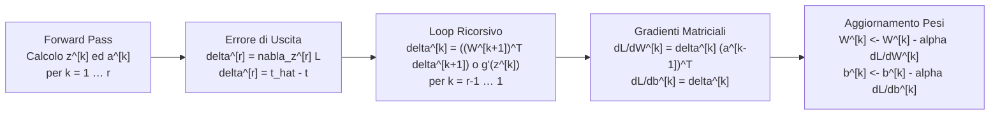

I passaggi operativi si articolano in sequenza rigorosa:
1. __Inizializzazione__: presentiamo il campione di ingresso $\mathbf{x}$ e poniamo $\mathbf{a}^{[0]} = \mathbf{x}$;
2. __Forward Pass__: calcoliamo e memorizziamo nella cache computazionale i potenziali $\mathbf{z}^{[k]} = \mathbf{W}^{[k]}\mathbf{a}^{[k-1]} + \mathbf{b}^{[k]}$ e le attivazioni $\mathbf{a}^{[k]} = g_k(\mathbf{z}^{[k]})$ per tutti gli strati $k = 1, \dots, r$;
3. __Calcolo del Segnale di Errore all'Output__: valutiamo il vettore $\boldsymbol{\delta}^{[r]} = \nabla_{\mathbf{z}^{[r]}} L$;
4. __Backward Pass Ricorsivo__: per ogni livello a ritroso $k = r-1, \dots, 1$, retropropagiamo l'errore calcolando $\boldsymbol{\delta}^{[k]} = \left( (\mathbf{W}^{[k+1]})^T \boldsymbol{\delta}^{[k+1]} \right) \odot g'_k(\mathbf{z}^{[k]})$;
5. __Accumulo dei Gradienti__: ricaviamo i gradienti per ogni strato mediante $\frac{\partial L}{\partial \mathbf{W}^{[k]}} = \boldsymbol{\delta}^{[k]} (\mathbf{a}^{[k-1]})^T$ e $\frac{\partial L}{\partial \mathbf{b}^{[k]}} = \boldsymbol{\delta}^{[k]}$;
6. __Aggiornamento Parametrico__: applichiamo la correzione di discesa del gradiente a pesi e bias.

```pseudo
\begin{algorithm}
\caption{Retropropagazione dell'Errore per Multi-Layer Perceptron (Backpropagation per MLP a $r$ Strati)}
\begin{algorithmic}
\REQUIRE Campione di ingresso $\mathbf{x} \in \mathbb{R}^D$, target $\mathbf{t}$, tasso di apprendimento $\alpha > 0$, pesi correnti $\{\mathbf{W}^{[k]}, \mathbf{b}^{[k]}\}_{k=1}^r$
\ENSURE Pesi e bias aggiornati $\{\mathbf{W}^{[k]}, \mathbf{b}^{[k]}\}_{k=1}^r$
\STATE $\mathbf{a}^{[0]} \leftarrow \mathbf{x}$
\FOR{$k = 1$ \TO $r-1$}
    \STATE $\mathbf{z}^{[k]} \leftarrow \mathbf{W}^{[k]} \mathbf{a}^{[k-1]} + \mathbf{b}^{[k]}$
    \STATE $\mathbf{a}^{[k]} \leftarrow \mathrm{ReLU}(\mathbf{z}^{[k]})$
\ENDFOR
\STATE $\mathbf{z}^{[r]} \leftarrow \mathbf{W}^{[r]} \mathbf{a}^{[r-1]} + \mathbf{b}^{[r]}$
\STATE $\hat{\mathbf{t}} \leftarrow g_r(\mathbf{z}^{[r]})$
\STATE $\boldsymbol{\delta}^{[r]} \leftarrow \hat{\mathbf{t}} - \mathbf{t}$
\FOR{$k = r-1$ \TO $1$ \STEP $-1$}
    \STATE $\boldsymbol{\delta}^{[k]} \leftarrow \left( (\mathbf{W}^{[k+1]})^T \boldsymbol{\delta}^{[k+1]} \right) \odot \mathbb{I}(\mathbf{z}^{[k]} \ge 0)$
    \STATE $\frac{\partial L}{\partial \mathbf{W}^{[k+1]}} \leftarrow \boldsymbol{\delta}^{[k+1]} (\mathbf{a}^{[k]})^T$
    \STATE $\frac{\partial L}{\partial \mathbf{b}^{[k+1]}} \leftarrow \boldsymbol{\delta}^{[k+1]}$
\ENDFOR
\STATE $\frac{\partial L}{\partial \mathbf{W}^{[1]}} \leftarrow \boldsymbol{\delta}^{[1]} \mathbf{x}^T$
\STATE $\frac{\partial L}{\partial \mathbf{b}^{[1]}} \leftarrow \boldsymbol{\delta}^{[1]}$
\FOR{$k = 1$ \TO $r$}
    \STATE $\mathbf{W}^{[k]} \leftarrow \mathbf{W}^{[k]} - \alpha \frac{\partial L}{\partial \mathbf{W}^{[k]}}$
    \STATE $\mathbf{b}^{[k]} \leftarrow \mathbf{b}^{[k]} - \alpha \frac{\partial L}{\partial \mathbf{b}^{[k]}}$
\ENDFOR
\RETURN $\{\mathbf{W}^{[k]}, \mathbf{b}^{[k]}\}_{k=1}^r$
\end{algorithmic}
\end{algorithm}
```

## Funzioni di Costo e Segnali di Errore all'Output

L'algoritmo di Backpropagation retropropaga l'errore a ritroso a partire dal termine di uscita $\boldsymbol{\delta}^{[r]} = \frac{\partial L}{\partial \mathbf{z}^{[r]}}$. Dimostriamo analiticamente che, abbinando correttamente ciascuna funzione di costo alla corrispondente funzione di attivazione canonica, si verifica un'identica proprietà algebrica di cancellazione esatta.

### Regressione Lineare ed Errore Quadratico Medio

Nel problema di regressione scalare o vettoriale continuo adottiamo l'attivazione finale identità $\hat{\mathbf{t}} = g_r(\mathbf{z}^{[r]}) = \mathbf{z}^{[r]}$ e la funzione di costo Mean Squared Error:

$$
L = \frac{1}{2} \|\hat{\mathbf{t}} - \mathbf{t}\|_2^2
$$

Calcoliamo il segnale di errore applicando la regola della catena:

$$
\boldsymbol{\delta}^{[r]} = \frac{\partial L}{\partial \mathbf{z}^{[r]}} = \frac{\partial L}{\partial \hat{\mathbf{t}}} \frac{\partial \hat{\mathbf{t}}}{\partial \mathbf{z}^{[r]}} = (\hat{\mathbf{t}} - \mathbf{t}) \cdot \mathbf{I} = \hat{\mathbf{t}} - \mathbf{t}
$$

### Classificazione Binaria ed Entropia Incrociata con Sigmoide

Nel problema di classificazione binaria con etichetta target $t \in \{0, 1\}$, adottiamo l'attivazione finale sigmoidea $\hat{t} = \sigma(\tilde{t}) = \frac{1}{1 + e^{-\tilde{t}}}$ (avendo posto per brevità $\tilde{t} = z^{[r]}$) e la funzione di costo Binary Cross-Entropy (negativa della log-verosimiglianza di Bernoulli):

$$
L = - \left[ t \ln \hat{t} + (1 - t) \ln(1 - \hat{t}) \right]
$$

Applichiamo la regola della catena per calcolare la derivata parziale rispetto a $\tilde{t}$:

$$
\delta^{[r]} = \frac{\partial L}{\partial \tilde{t}} = \frac{\partial L}{\partial \hat{t}} \frac{\partial \hat{t}}{\partial \tilde{t}}
$$

Valutiamo il primo termine, la derivata della Binary Cross-Entropy rispetto a $\hat{t}$:

$$
\frac{\partial L}{\partial \hat{t}} = -\frac{t}{\hat{t}} + \frac{1 - t}{1 - \hat{t}} = \frac{-t(1 - \hat{t}) + (1 - t)\hat{t}}{\hat{t}(1 - \hat{t})} = \frac{-t + t\hat{t} + \hat{t} - t\hat{t}}{\hat{t}(1 - \hat{t})} = \frac{\hat{t} - t}{\hat{t}(1 - \hat{t})}
$$

Valutiamo il secondo termine, la derivata della funzione sigmoide rispetto all'argomento $\tilde{t}$:

$$
\frac{\mathrm{d}\sigma(\tilde{t})}{\mathrm{d}\tilde{t}} = \frac{\mathrm{d}}{\mathrm{d}\tilde{t}}\left( (1 + e^{-\tilde{t}})^{-1} \right) = -(1 + e^{-\tilde{t}})^{-2} (-e^{-\tilde{t}}) = \frac{1}{1 + e^{-\tilde{t}}} \frac{e^{-\tilde{t}}}{1 + e^{-\tilde{t}}} = \hat{t}(1 - \hat{t})
$$

Moltiplichiamo i due contributi osservando la cancellazione algebrica esatta del denominatore:

$$
\delta^{[r]} = \left( \frac{\hat{t} - t}{\hat{t}(1 - \hat{t})} \right) \cdot \left[ \hat{t}(1 - \hat{t}) \right] = \hat{t} - t
$$

Il termine al denominatore proveniente dalla derivata del logaritmo della loss elide il fattore quadratico della derivata sigmoidea, lasciando come segnale di errore la pura differenza algebrica tra predizione e target.

### Classificazione Multiclasse ed Entropia Incrociata con Softmax

Nel problema di classificazione su $K$ classi mutualmente esclusive con target in codifica one-hot $\mathbf{t} = [t_1, \dots, t_K]^T \in \{0, 1\}^K$ (con vincolo $\sum_{l=1}^K t_l = 1$), adottiamo l'attivazione Softmax sui potenziali di uscita $\tilde{\mathbf{t}} = \mathbf{z}^{[r]} \in \mathbb{R}^K$:

$$
\hat{t}_l = \frac{e^{\tilde{t}_l}}{\sum_{k=1}^K e^{\tilde{t}_k}}, \quad \forall l \in \{1, \dots, K\}
$$

La corrispondente funzione di costo è la Categorical Cross-Entropy:

$$
L = - \sum_{l=1}^K t_l \ln \hat{t}_l
$$

Calcoliamo dapprima la derivata parziale dell'attivazione Softmax $\frac{\partial \hat{t}_l}{\partial \tilde{t}_j}$, distinguendo i due casi possibili:

Nel caso in cui gli indici coincidano ($l = j$):

$$
\frac{\partial \hat{t}_j}{\partial \tilde{t}_j} = \frac{e^{\tilde{t}_j} \left( \sum_k e^{\tilde{t}_k} \right) - e^{\tilde{t}_j} e^{\tilde{t}_j}}{\left( \sum_k e^{\tilde{t}_k} \right)^2} = \hat{t}_j - \hat{t}_j^2 = \hat{t}_j(1 - \hat{t}_j)
$$

Nel caso in cui gli indici differiscano ($l \neq j$):

$$
\frac{\partial \hat{t}_l}{\partial \tilde{t}_j} = \frac{0 \cdot \sum_k e^{\tilde{t}_k} - e^{\tilde{t}_l} e^{\tilde{t}_j}}{\left( \sum_k e^{\tilde{t}_k} \right)^2} = -\hat{t}_l \hat{t}_j
$$

Unifichiamo i due casi tramite il delta di Kronecker $\delta_{lj}$ (pari a $1$ se $l=j$ e $0$ se $l \neq j$):

$$
\frac{\partial \hat{t}_l}{\partial \tilde{t}_j} = \hat{t}_l (\delta_{lj} - \hat{t}_j)
$$

Calcoliamo ora la derivata della perdita totale rispetto al potenziale $\tilde{t}_j$:

$$
\frac{\partial L}{\partial \tilde{t}_j} = \sum_{l=1}^K \frac{\partial L}{\partial \hat{t}_l} \frac{\partial \hat{t}_l}{\partial \tilde{t}_j} = \sum_{l=1}^K \left( -\frac{t_l}{\hat{t}_l} \right) \left[ \hat{t}_l (\delta_{lj} - \hat{t}_j) \right]
$$

I termini $\hat{t}_l$ a numeratore e denominatore si elidono esattamente per ogni classe $l$:

$$
\frac{\partial L}{\partial \tilde{t}_j} = -\sum_{l=1}^K t_l (\delta_{lj} - \hat{t}_j) = -\sum_{l=1}^K t_l \delta_{lj} + \hat{t}_j \sum_{l=1}^K t_l
$$

Sfruttiamo le proprietà del vettore one-hot: la sommatoria $\sum_{l=1}^K t_l \delta_{lj}$ collassa sull'unico termine non nullo $t_j$, mentre la somma di tutte le componenti vale identicamente $\sum_{l=1}^K t_l = 1$:

$$
\frac{\partial L}{\partial \tilde{t}_j} = -t_j + \hat{t}_j \cdot 1 = \hat{t}_j - t_j
$$

Esprimendo il risultato in notazione vettoriale:

$$
\boldsymbol{\delta}^{[r]} = \hat{\mathbf{t}} - \mathbf{t}
$$

> [!TIP] Takeaway Fondamentale d'Esame: Invarianza del Gradiente di Output
> In tutti e tre i compiti standard (regressione con MSE, classificazione binaria con BCE e multiclasse con CCE), il gradiente della funzione di costo rispetto al potenziale pre-attivazione dell'ultimo strato assume la medesima espressione algebrica:
> 
> $$
> \boldsymbol{\delta}^{[r]} = \hat{\mathbf{t}} - \mathbf{t}
> $$
> 
> Questo risultato teorico non è una coincidenza, ma discende dall'accoppiamento canonico tra la funzione di verosimiglianza della famiglia esponenziale e la relativa funzione di collegamento (_link function_).
> 
> Se accoppiassimo impropriamente l'errore quadratico medio (MSE) con la sigmoide o la softmax, il gradiente conterrebbe il termine moltiplicativo di derivata $\hat{t}(1-\hat{t})$. In presenza di un errore macroscopico ma sicuro ($\hat{t} \to 0$ con target $t=1$), la derivata tenderebbe a zero, bloccando l'apprendimento per saturazione del gradiente. L'entropia incrociata compensa la saturazione grazie al polo del logaritmo al denominatore, producendo un segnale di correzione massimale quando l'errore è massimo.

## Model Selection e Regolarizzazione nelle Reti Neurali

La capacità espressiva di un Multi-Layer Perceptron dipende da un numero cospicuo di iperparametri architetturali:
- Numero di strati nascosti (profondità della rete);
- Numero di neuroni per ciascun livello (larghezza della rete);
- Tipologia delle funzioni di attivazione (ReLU, Tanh, Sigmoide).

La taratura sistematica di questi iperparametri tramite K-Fold Cross-Validation esaustiva risulta computazionalmente proibitiva sui modelli profondi a causa dei tempi di addestramento. La prassi dell'ingegneria del machine learning prevede quindi l'impiego di architetture ad elevata capacità (sovraparametrizzate), introducendo mirate tecniche di __regolarizzazione__.

### Regolarizzazione $L_2$ e Decadimento dei Pesi

La prima tecnica estende il principio di Ridge Regression penalizzando la norma euclidea dei parametri della rete. Poiché i diversi strati operano a scale computazionali eterogenee, associamo un coefficiente di penalità $\lambda_k \ge 0$ indipendente a ciascun layer:

$$
L_{\text{WD}}(\mathbf{w}) = L(\mathbf{w}) + \sum_{k=1}^r \frac{\lambda_k}{2} \|\mathbf{W}^{[k]}\|_F^2 = L(\mathbf{w}) + \sum_{k=1}^r \frac{\lambda_k}{2} \mathrm{Tr}\left( (\mathbf{W}^{[k]})^T \mathbf{W}^{[k]} \right)
$$

dove $\|\cdot\|_F$ indica la norma di Frobenius della matrice dei pesi. I vettori di bias $\mathbf{b}^{[k]}$ vengono deliberatamente esclusi dalla penalizzazione: il bias definisce la traslazione spaziale delle ipersuperfici di decisione e penalizzarlo non ridurrebbe la curvatura o la varianza del modello, ma vincolerebbe artificialmente le attivazioni a transitare per l'origine.

Deriviamo la regola di aggiornamento dei pesi durante un passo di discesa del gradiente:

$$
\mathbf{W}^{[k]} \leftarrow \mathbf{W}^{[k]} - \alpha \nabla_{\mathbf{W}^{[k]}} L_{\text{WD}}(\mathbf{w})
$$

Calcoliamo il gradiente della funzione di perdita regolarizzata:

$$
\nabla_{\mathbf{W}^{[k]}} L_{\text{WD}}(\mathbf{w}) = \frac{\partial L}{\partial \mathbf{W}^{[k]}} + \lambda_k \mathbf{W}^{[k]}
$$

Sostituendo nell'equazione di aggiornamento:

$$
\mathbf{W}^{[k]} \leftarrow \mathbf{W}^{[k]} - \alpha \left( \frac{\partial L}{\partial \mathbf{W}^{[k]}} + \lambda_k \mathbf{W}^{[k]} \right) = (1 - \alpha \lambda_k) \mathbf{W}^{[k]} - \alpha \frac{\partial L}{\partial \mathbf{W}^{[k]}}
$$

Questa derivazione motiva la denominazione __Weight Decay__ (_decadimento dei pesi_): prima di applicare la correzione lungo il gradiente dell'errore empirico, la matrice dei pesi subisce una contrazione geometrica per il fattore moltiplicativo $(1 - \alpha \lambda_k) < 1$. I pesi che non ricevono un gradiente utile e persistente vengono progressivamente erosi a ogni epoca, sopprimendo le connessioni sproporzionate responsabili dell'overfitting.

![[fig_ex_A_weight_decay_vs_early_stopping.png|center big]]

### Dinamica dell'Errore e Arresto Anticipato

Una strategia complementare, che non richiede modifiche alla funzione di costo, sfrutta la dinamica temporale dell'ottimizzazione iterativa.

All'aumentare delle epoche di addestramento $\tau$ tramite discesa stocastica del gradiente:
- L'errore sul training set $E_{\text{train}}$ decresce in modo strettamente monotono, tendendo asintoticamente a zero per effetto della sovraparametrizzazione;
- L'errore misurato su un validation set indipendente $E_{\text{val}}$ traccia una tipica curva convessa a U: nella prima fase decresce man mano che la rete apprende i pattern distribuzionali generali, raggiunge un punto di minimo globale all'epoca ottima $\tau^*$, e successivamente risale a causa della memorizzazione opportunistica del rumore specifico del training set.

![[fig_12_6_early_stopping_curve_errore.png|center mid]]

La tecnica di __Early Stopping__ consiste nel monitorare l'errore di validazione durante l'addestramento e interrompere l'ottimizzazione esattamente al punto di minimo $\tau^*$, preservando lo stato dei pesi $\mathbf{w}(\tau^*)$.

### Dimostrazione dell'Equivalenza tra Early Stopping e Weight Decay

Esiste un legame analitico profondo tra il numero di iterazioni di discesa del gradiente e l'intensità della regolarizzazione quadratica $L_2$.

Consideriamo un'approssimazione quadratica locale della funzione di costo attorno al punto di minimo dei dati di addestramento $\mathbf{w}^*$:

$$
L(\mathbf{w}) \approx L(\mathbf{w}^*) + \frac{1}{2} (\mathbf{w} - \mathbf{w}^*)^T \mathbf{H} (\mathbf{w} - \mathbf{w}^*)
$$

dove $\mathbf{H} = \nabla^2 L(\mathbf{w}^*)$ è la matrice Hessiana della perdita, simmetrica e semidefinita positiva, avente autovalori $\sigma_i \ge 0$.

Esaminiamo dapprima la traiettoria della __Discesa del Gradiente__ con learning rate $\alpha$, partendo dall'origine $\mathbf{w}^{(0)} = \mathbf{0}$. L'aggiornamento a ogni epoca è $\mathbf{w}^{(\tau)} = \mathbf{w}^{(\tau-1)} - \alpha \mathbf{H}(\mathbf{w}^{(\tau-1)} - \mathbf{w}^*)$. Proiettando lungo l'autovettore $i$-esimo dell'Hessiana con autovalore $\sigma_i$, l'evoluzione analitica dopo $\tau$ iterazioni vale:

$$
w_i^{(\tau)} = \left[ 1 - (1 - \alpha \sigma_i)^\tau \right] w_i^*
$$

Per passi di apprendimento sufficientemente piccoli ($\alpha \sigma_i \ll 1$), approssimiamo il termine esponenziale $(1 - \alpha \sigma_i)^\tau \approx \exp(-\tau \alpha \sigma_i)$, ottenendo:

$$
w_i^{(\tau)} \approx \left[ 1 - \exp(-\tau \alpha \sigma_i) \right] w_i^*
$$

Esaminiamo ora la soluzione sotto __Weight Decay__ ($L_2$ con coefficiente $\lambda$). Il punto di minimo della perdita regolarizzata soddisfa la condizione di stazionarietà $(\mathbf{H} + \lambda \mathbf{I})\mathbf{w} = \mathbf{H}\mathbf{w}^*$. Proiettando lungo il medesimo autovettore $i$-esimo:

$$
w_i^{(\lambda)} = \left( \frac{\sigma_i}{\sigma_i + \lambda} \right) w_i^* = \left( 1 - \frac{\lambda}{\sigma_i + \lambda} \right) w_i^*
$$

Sviluppando il termine frazionario come $\frac{\lambda}{\sigma_i + \lambda} = \frac{1}{1 + \frac{\sigma_i}{\lambda}} \approx \exp\left( -\frac{\sigma_i}{\lambda} \right)$ per piccoli rapporti $\frac{\sigma_i}{\lambda}$, perveniamo alla forma:

$$
w_i^{(\lambda)} \approx \left[ 1 - \exp\left( -\frac{\sigma_i}{\lambda} \right) \right] w_i^*
$$

Uguagliando gli esponenti dei fattori di contrazione delle due formulazioni:

$$
\tau \alpha \sigma_i \approx \frac{\sigma_i}{\lambda} \implies \tau \alpha \approx \frac{1}{\lambda}
$$

Otteniamo la celebre relazione asintotica fondamentale:

$$
\tau \alpha \propto \frac{1}{\lambda}
$$

> [!IMPORTANT] Significato Operativo dell'Equivalenza $\tau \alpha \propto 1/\lambda$
> Questa equivalenza analitica stabilisce che la durata temporale dell'ottimizzazione svolge esattamente la medesima funzione restrittiva della penalità di norma $L_2$:
> - Arrestare l'addestramento dopo poche epoche ($\tau$ piccolo) corrisponde a imporre una penalità quadratica elevata ($\lambda$ grande), confinando i parametri in un intorno compatto dell'origine;
> - Addestrare la rete a oltranza ($\tau \to \infty$) equivale a rimuovere ogni penalizzazione ($\lambda \to 0$), consentendo ai pesi di espandersi liberamente fino a memorizzare il rumore del training set.
> 
> L'Early Stopping costituisce pertanto una forma di regolarizzazione implicita continua che controlla il volume effettivo dello spazio delle ipotesi a costo computazionale nullo.

## Quadro Sinottico delle Architetture e dei Metodi di Ottimizzazione

Sintetizziamo la concatenazione computazionale tra propagazione diretta, retropropagazione del gradiente e meccanismi di regolarizzazione:

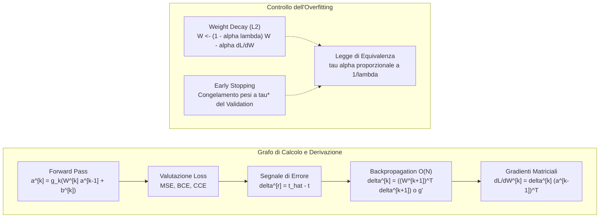

Confrontiamo le proprietà algebriche e computazionali dei regimi di funzionamento esaminati:

| Proprietà Funzionale | Regressione Continua | Classificazione Binaria | Classificazione Multiclasse |
| :--- | :--- | :--- | :--- |
| __Dimensione Uscita $m_r$__ | $m_r = 1$ (o dimensione del target continuo) | $m_r = 1$ | $m_r = K$ (numero di classi) |
| __Attivazione Finale $g_r(z)$__ | Identità: $g(z) = z$ | Sigmoide: $\sigma(z) = \frac{1}{1 + e^{-z}}$ | Softmax: $\frac{e^{z_l}}{\sum_k e^{z_k}}$ |
| __Funzione di Costo Empirica__ | Errore quadratico medio (MSE) | Binary Cross-Entropy (BCE) | Categorical Cross-Entropy (CCE) |
| __Vettore di Errore $\boldsymbol{\delta}^{[r]}$__ | $\hat{\mathbf{t}} - \mathbf{t}$ | $\hat{t} - t$ | $\hat{\mathbf{t}} - \mathbf{t}$ |
| __Cancellazione Algebrica__ | Derivata identità unitaria | $\sigma'(z) = \hat{t}(1-\hat{t})$ elide il denominatore | Jacobiana Softmax elide il denominatore CCE |
| __Regolarizzazione Primaria__ | Weight Decay ($L_2$) + Early Stopping | Weight Decay ($L_2$) + Early Stopping | Weight Decay ($L_2$) + Early Stopping |
| __Complessità Temporale__ | $O(N)$ Forward, $O(N)$ Backward | $O(N)$ Forward, $O(N)$ Backward | $O(N)$ Forward, $O(N)$ Backward |
| __Equivalenza Regolarizzante__ | $\tau\alpha \propto 1/\lambda$ | $\tau\alpha \propto 1/\lambda$ | $\tau\alpha \propto 1/\lambda$ |

Grazie all'efficienza della differenziazione automatica in tempo lineare $O(N)$ e alla robustezza dell'accoppiamento canonico tra perdite e attivazioni, le reti neurali artificiali forniscono un framework universale e rigoroso per l'apprendimento di rappresentazioni ad alta complessità.


# B. Apprendimento Non Supervisionato

In innumerevoli scenari ingegneristici reali, etichettare le osservazioni $(\mathbf{x}^{(i)}, t^{(i)})$ risulta proibitivo in termini di costi, tempi o pura fattibilità sperimentale. Si dispone spesso di enormi volumi di dati descritti da vettori di feature, privi di indicazioni a priori sulle categorie o sulle strutture latenti sottostanti.

L'__Apprendimento Non Supervisionato__ (_Unsupervised Learning_) opera su dataset composti unicamente da campioni non etichettati $\mathcal{D} = \{\mathbf{x}^{(0)}, \dots, \mathbf{x}^{(N-1)}\} \subset \mathbb{R}^D$, con l'obiettivo di ricavare autonomamente la struttura geometrica intrinseca, individuare raggruppamenti naturali o stimare la densità di probabilità generativa dello spazio delle feature.

L'algoritmo cardine di partizione spaziale è il __K-Means__, fondato sulla minimizzazione della funzione di distorsione quadratica $J$ mediante un ciclo a due fasi a convergenza monotona, affiancato da strategie di inizializzazione robusta (__K-Means++__) e selezione del numero di gruppi (__Metodo del Gomito__). La variante __K-Medoids__ estende il clustering a metriche non euclidee arbitrarie garantendo immunità agli outlier. Il clustering probabilistico morbido si realizza infine mediante i __Modelli a Mistura di Gaussiane__ (__Gaussian Mixture Models__, GMM), la cui stima tramite l'algoritmo di __Expectation-Maximization__ (EM) riconduce rigorosamente K-Means come caso limite a varianza isotropa nulla.

## Fondamenti dell'Apprendimento Non Supervisionato

Nel paradigma non supervisionato scompare la variabile supervisiva $t^{(i)}$. Organizziamo il dataset di addestramento nell'insieme delle sole osservazioni continue o discrete:

$$
\mathcal{D} = \left\{ \mathbf{x}^{(0)}, \mathbf{x}^{(1)}, \dots, \mathbf{x}^{(N-1)} \right\}, \qquad \mathbf{x}^{(i)} \in \mathbb{R}^D
$$

In assenza di una verità fondamentale nota (_ground truth_) con cui confrontare le stime, non possiamo calcolare parametri di errore supervisionati convenzionali quali l'errore quadratico medio o la cross-entropy. Il modello deve estrarre l'informazione latente analizzando unicamente le relazioni spaziali e statistiche tra i dati.

Articoliamo i compiti principali dell'apprendimento non supervisionato in due filoni operativi:
- __Clustering (Raggruppamento Spaziale)__: partizionare le $N$ osservazioni in $K$ insiemi omogenei (detti _cluster_), tali per cui campioni assegnati allo stesso gruppo presentino un'elevata somiglianza reciproca, mentre campioni di gruppi distinti risultino marcatamente separati;
- __Stima di Densità e Variabili Latenti__: modellare la densità di probabilità continua $p(\mathbf{x})$ assumendo che ogni osservazione sia generata da uno stato interno non osservabile (variabile nascosta o _latente_).

In entrambi i casi, l'algoritmo individua regolarità matematiche oggettive senza attribuire loro un'etichetta semantica: spetta all'ingegnere interpretare il significato applicativo dei pattern identificati.

## Algoritmo K-Means e Funzione di Distorsione

L'algoritmo __K-Means__ rappresenta la tecnica di partizione più celebre ed efficiente per effettuare clustering di campioni continui nello spazio euclideo $\mathbb{R}^D$.

Fissiamo a priori il numero di raggruppamenti desiderati tramite l'iperparametro intero $K$. Rappresentiamo geometricamente ciascun cluster $k \in \{1, \dots, K\}$ mediante un vettore continuo $\boldsymbol{\mu}_k \in \mathbb{R}^D$, denominato __centroide__ o centro del cluster.

Per formalizzare l'assegnazione esclusiva di ciascun campione introduciamo per ogni osservazione $\mathbf{x}^{(n)}$ un vettore binario indicatore con codifica _1-of-K_:

$$
\mathbf{r}_n = [r_{n1}, r_{n2}, \dots, r_{nK}]^T \in \{0, 1\}^K, \qquad \sum_{k=1}^K r_{nk} = 1
$$

Le componenti binarie assumono il significato:
- $r_{nk} = 1$: il campione $\mathbf{x}^{(n)}$ appartiene al cluster $k$;
- $r_{nk} = 0$: il campione non appartiene al cluster $k$.

Poiché il vincolo impone che un solo elemento del vettore $\mathbf{r}_n$ sia pari a 1 e tutti gli altri siano nulli, ogni osservazione è vincolata a un unico cluster. Definiamo questa configurazione deterministica come __assegnamento rigido__ (_Hard Assignment_).

### Funzione di Distorsione Quadratica

Quantifichiamo la qualità della partizione introducendo la __funzione di costo di distorsione__ (o _inerzia intraclasse_):

$$
J(\mathbf{R}, \mathbf{M}) = \sum_{n=0}^{N-1} \sum_{k=1}^K r_{nk} \|\mathbf{x}^{(n)} - \boldsymbol{\mu}_k\|_2^2
$$

dove $\mathbf{R} \in \{0, 1\}^{N \times K}$ raccoglie gli assegnamenti binari e $\mathbf{M} = [\boldsymbol{\mu}_1, \dots, \boldsymbol{\mu}_K] \in \mathbb{R}^{D \times K}$ raccoglie le coordinate dei $K$ centroidi.

La funzione $J$ calcola la somma complessiva delle distanze euclidee al quadrato tra ciascun punto $\mathbf{x}^{(n)}$ e il centroide $\boldsymbol{\mu}_k$ del gruppo a cui è assegnato. L'obiettivo consiste nel determinare congiuntamente l'assegnamento $\mathbf{R}$ e la matrice dei centroidi $\mathbf{M}$ che minimizzano la distorsione globale:

$$
\min_{\mathbf{R}, \mathbf{M}} J(\mathbf{R}, \mathbf{M}) \quad \text{sotto i vincoli} \quad r_{nk} \in \{0, 1\}, \quad \sum_{k=1}^K r_{nk} = 1, \; \forall n
$$

> [!IMPORTANT] Complessità Combinatoria dell'Ottimizzazione Globale
> Minimizzare simultaneamente $J$ rispetto a $\mathbf{R}$ e $\mathbf{M}$ è un problema combinatorio NP-hard. Esistono infatti $K^N / K!$ possibili partizioni distinte di $N$ punti in $K$ insiemi disgiunti. Una ricerca esaustiva richiederebbe tempi di calcolo proibitivi già con poche decine di osservazioni.

### Ottimizzazione a Blocchi Coordinati

Risolviamo il problema formulando uno schema di __discesa a blocchi coordinati__ (noto come algoritmo di Lloyd): decomponiamo il problema globale in due semipassi alternati, ciascuno dei quali ammette una soluzione analitica esatta in forma chiusa.

![[fig_13_1_iterazione_kmeans_centroidi.svg|center big]]

Visualizziamo la dinamica iterativa del processo:

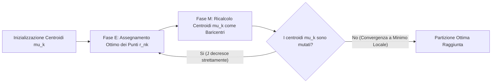

#### Fase di Assegnamento dei Campioni

Nella prima fase (indicata concettualmente come semipasso E o di assegnamento) manteniamo congelata la posizione dei centroidi $\{\boldsymbol{\mu}_k\}$ e ottimizziamo $J$ rispetto alla matrice delle variabili binarie $\{r_{nk}\}$.

Osserviamo che la sommatoria su $n$ in $J(\mathbf{R}, \mathbf{M})$ è a termini additivi disaccoppiati: la scelta dell'assegnamento per il campione $n$ non influenza in alcun modo la funzione di costo relativa agli altri $N-1$ campioni. Possiamo quindi risolvere $N$ problemi di ottimizzazione indipendenti:

$$
\min_{\mathbf{r}_n} \sum_{k=1}^K r_{nk} \|\mathbf{x}^{(n)} - \boldsymbol{\mu}_k\|_2^2 \quad \text{sotto i vincoli} \quad r_{nk} \in \{0, 1\}, \quad \sum_{k=1}^K r_{nk} = 1
$$

Poiché il vincolo impone la selezione di un singolo termine nella somma su $k$, la distorsione minima si realizza assegnando il peso unitario al centroide geometricamente più vicino a $\mathbf{x}^{(n)}$:

$$
r_{nk} = \begin{cases} 1 & \text{se } k = \arg\min_{j \in \{1, \dots, K\}} \|\mathbf{x}^{(n)} - \boldsymbol{\mu}_j\|_2^2 \\ 0 & \text{altrimenti} \end{cases}
$$

In caso di perfetta equiripartizione di distanza tra più centroidi, risolviamo la parità assegnando arbitrariamente l'indice minore. Geometricamente, questo semipasso suddivide lo spazio continuo $\mathbb{R}^D$ in $K$ __celle di Voronoi__, le cui frontiere di separazione sono iperpiani ortogonali ai segmenti congiungenti coppie adiacenti di centroidi.

#### Fase di Aggiornamento dei Centroidi

Nella seconda fase (semipasso M o di aggiornamento) manteniamo congelata la matrice degli assegnamenti $\{r_{nk}\}$ e ottimizziamo $J$ rispetto alle coordinate dei centroidi $\{\boldsymbol{\mu}_k\}$.

La funzione obiettivo $J$ si separa nella somma di $K$ contributi quadratici indipendenti rispetto a ciascun vettore $\boldsymbol{\mu}_k$:

$$
J(\mathbf{R}, \mathbf{M}) = \sum_{k=1}^K J_k(\boldsymbol{\mu}_k), \qquad J_k(\boldsymbol{\mu}_k) = \sum_{n=0}^{N-1} r_{nk} \|\mathbf{x}^{(n)} - \boldsymbol{\mu}_k\|_2^2
$$

Ciascun sottoproblema $J_k(\boldsymbol{\mu}_k)$ è una forma quadratica convessa, differenziabile e limitata inferiormente da zero. Calcoliamo il gradiente di $J$ rispetto al generico vettore $\boldsymbol{\mu}_k$:

$$
\nabla_{\boldsymbol{\mu}_k} J = \sum_{n=0}^{N-1} r_{nk} \nabla_{\boldsymbol{\mu}_k} (\mathbf{x}^{(n)} - \boldsymbol{\mu}_k)^T (\mathbf{x}^{(n)} - \boldsymbol{\mu}_k) = -2 \sum_{n=0}^{N-1} r_{nk} (\mathbf{x}^{(n)} - \boldsymbol{\mu}_k)
$$

Imponiamo la condizione di stazionarietà uguagliando il gradiente al vettore nullo:

$$
-2 \sum_{n=0}^{N-1} r_{nk} (\mathbf{x}^{(n)} - \boldsymbol{\mu}_k) = \mathbf{0} \implies \sum_{n=0}^{N-1} r_{nk} \mathbf{x}^{(n)} = \left( \sum_{n=0}^{N-1} r_{nk} \right) \boldsymbol{\mu}_k
$$

Definiamo $N_k \triangleq \sum_{n=0}^{N-1} r_{nk}$ il numero totale di campioni correntemente assegnati al cluster $k$. Esplicitiamo l'espressione ottimale di $\boldsymbol{\mu}_k$:

$$
\boldsymbol{\mu}_k^* = \frac{\sum_{n=0}^{N-1} r_{nk} \mathbf{x}^{(n)}}{\sum_{n=0}^{N-1} r_{nk}} = \frac{1}{N_k} \sum_{n \in \mathcal{C}_k} \mathbf{x}^{(n)}
$$

dove $\mathcal{C}_k = \{n \in \{0, \dots, N-1\} : r_{nk} = 1\}$.

> [!TIP] Baricentro Aritmetico come Minimo Globale della Varianza
> La media campionaria è l'unico punto dello spazio che minimizza la somma delle distanze euclidee al quadrato da un insieme di punti assegnati. Il centroide ottimale $\boldsymbol{\mu}_k^*$ coincide dunque per costruzione con il __baricentro aritmetico__ dei soli campioni appartenenti al cluster $\mathcal{C}_k$.

### Dimostrazione della Convergenza Monotona

L'alternanza dei due semipassi conferisce all'algoritmo K-Means una proprietà teorica fondamentale di stabilità numerica.

> [!IMPORTANT] Teorema di Convergenza in Tempo Finito
> A ogni semipasso dell'algoritmo la funzione di distorsione $J(\mathbf{R}, \mathbf{M})$ è non crescente:
> 
> $$
> J(\mathbf{R}^{(t+1)}, \mathbf{M}^{(t)}) \le J(\mathbf{R}^{(t)}, \mathbf{M}^{(t)})
> $$
> 
> $$
> J(\mathbf{R}^{(t+1)}, \mathbf{M}^{(t+1)}) \le J(\mathbf{R}^{(t+1)}, \mathbf{M}^{(t)})
> $$
> 
> Ne consegue che la sequenza temporale dei valori di distorsione $J^{(t)} = J(\mathbf{R}^{(t)}, \mathbf{M}^{(t)})$ decresce monotonicamente:
> 
> $$
> J^{(t+1)} \le J^{(t)}
> $$
> 
> Poiché il numero complessivo di partizioni distinte di $N$ punti in $K$ insiemi è strettamente finito (limitato superiormente da $K^N$), e poiché la funzione di distorsione è limitata inferiormente da zero ($J \ge 0$), l'algoritmo converge tassativamente in un numero finito di iterazioni a un __minimo locale__ o punto stazionario.

Dimostriamo formalmente la convergenza analizzando separatamente i due semipassi:
1. Nel semipasso di assegnamento, calcoliamo $\mathbf{R}^{(t+1)} = \arg\min_{\mathbf{R} \in \mathcal{S}_R} J(\mathbf{R}, \mathbf{M}^{(t)})$, dove $\mathcal{S}_R$ è l'insieme finito di tutte le matrici binarie con vincolo _1-of-K_. Poiché minimizziamo esattamente su tutto lo spazio ammissibile mantenendo $\mathbf{M}^{(t)}$ congelato, otteniamo necessariamente $J(\mathbf{R}^{(t+1)}, \mathbf{M}^{(t)}) \le J(\mathbf{R}^{(t)}, \mathbf{M}^{(t)})$;
2. Nel semipasso di aggiornamento, calcoliamo $\mathbf{M}^{(t+1)} = \arg\min_{\mathbf{M} \in \mathbb{R}^{D \times K}} J(\mathbf{R}^{(t+1)}, \mathbf{M})$. Poiché $J$ è strettamente convessa rispetto a $\mathbf{M}$ con matrice Hessiana definita positiva ($2 N_k \mathbf{I} \succ 0$), il baricentro $\mathbf{M}^{(t+1)}$ rappresenta l'unico minimo globale non vincolato per gli assegnamenti correnti. Vale dunque $J(\mathbf{R}^{(t+1)}, \mathbf{M}^{(t+1)}) \le J(\mathbf{R}^{(t+1)}, \mathbf{M}^{(t)})$;
3. Se tra due iterazioni consecutive gli assegnamenti rimangono invariati ($\mathbf{R}^{(t+1)} = \mathbf{R}^{(t)}$), anche i centroidi calcolati risultano identici ($\mathbf{M}^{(t+1)} = \mathbf{M}^{(t)}$): l'algoritmo raggiunge la convergenza e si arresta. Poiché a ogni iterazione attiva la funzione $J$ decresce strettamente, una partizione $\mathbf{R}$ già visitata non può mai ripresentarsi: l'algoritmo termina in al più $K^N$ iterazioni.

```pseudo
\begin{algorithm}
\caption{Algoritmo K-Means (Lloyd's Algorithm)}
\begin{algorithmic}
\REQUIRE Dataset di addestramento $\mathcal{D} = \{\mathbf{x}^{(0)}, \dots, \mathbf{x}^{(N-1)}\} \subset \mathbb{R}^D$, numero di cluster $K$
\ENSURE Centroidi ottimali $\{\boldsymbol{\mu}_k\}_{k=1}^K$, matrice degli assegnamenti $\mathbf{R} \in \{0, 1\}^{N \times K}$
\STATE Inizializzazione casuale o intelligente (K-Means++) dei centroidi $\boldsymbol{\mu}_1, \dots, \boldsymbol{\mu}_K \in \mathbb{R}^D$
\REPEAT
    \STATE \COMMENT{Fase E: Assegnamento ottimo a distanza minima}
    \FOR{$n = 0$ \TO $N-1$}
        \FOR{$k = 1$ \TO $K$}
            \IF{$k = \arg\min_{j \in \{1, \dots, K\}} \|\mathbf{x}^{(n)} - \boldsymbol{\mu}_j\|_2^2$}
                \STATE $r_{nk} \leftarrow 1$
            \ELSE
                \STATE $r_{nk} \leftarrow 0$
            \ENDIF
        \ENDFOR
    \ENDFOR
    \STATE \COMMENT{Fase M: Aggiornamento dei centroidi come baricentri}
    \FOR{$k = 1$ \TO $K$}
        \STATE $N_k \leftarrow \sum_{n=0}^{N-1} r_{nk}$
        \STATE $\boldsymbol{\mu}_k \leftarrow \frac{1}{N_k} \sum_{n=0}^{N-1} r_{nk} \mathbf{x}^{(n)}$
    \ENDFOR
\UNTIL{i centroidi $\{\boldsymbol{\mu}_k\}$ non variano più}
\RETURN $\{\boldsymbol{\mu}_k\}_{k=1}^K, \mathbf{R}$
\end{algorithmic}
\end{algorithm}
```

![[fig_ex_B_kmeans_distortion_elbow_method.png|center big]]

### Inizializzazione Geometrica con K-Means++

Nonostante la convergenza sia garantita in un numero finito di passi, la superficie di costo $J(\mathbf{R}, \mathbf{M})$ è altamente non convessa e densa di minimi locali sub-ottimali. L'esito finale dell'ottimizzazione dipende in modo critico dalle posizioni iniziali assegnate ai centroidi:
- Un'inizializzazione casuale standard può posizionare più centroidi all'interno della medesima concentrazione densa di dati, frammentandola e lasciando scoperti cluster remoti;
- Centroidi collocati in zone a densità quasi nulla possono rimanere privi di campioni ($N_k = 0$), rendendo indefinito il calcolo del baricentro.

Per mitigare la vulnerabilità ai minimi locali sub-ottimali adottiamo due protocolli:
- __Riavvii Multipli Casuali (Random Restarts)__: eseguiamo l'algoritmo per $R$ volte indipendenti ($R \in [10, 50]$), selezionando a posteriori la partizione che consegue la distorsione minima $J^*$;
- __Inizializzazione Probabilistica K-Means++__: distribuiamo preliminarmente i centroidi nello spazio massimizzando la distanza reciproca.

Formalizziamo l'algoritmo K-Means++:
1. Selezioniamo il primo centroide $\boldsymbol{\mu}_1$ estraendolo uniformemente a caso tra i punti del dataset $\mathcal{D}$;
2. Per ciascun punto rimanente $\mathbf{x}^{(n)}$, calcoliamo la distanza euclidea minima rispetto a tutti i centroidi già allocati:

$$
D(\mathbf{x}^{(n)}) = \min_{j \in \{1, \dots, k-1\}} \|\mathbf{x}^{(n)} - \boldsymbol{\mu}_j\|_2
$$

3. Estraiamo il centroide successivo $\boldsymbol{\mu}_k$ dal dataset campionando con probabilità proporzionale al quadrato della distanza minima:

$$
p(\mathbf{x}^{(n)}) = \frac{D(\mathbf{x}^{(n)})^2}{\sum_{i=0}^{N-1} D(\mathbf{x}^{(i)})^2}
$$

4. Ripetiamo i passi 2 e 3 fino all'allocazione completa dei $K$ centroidi iniziali.

> [!TIP] Giustificazione Teorica del Campionamento con $D^2$
> La funzione di distorsione $J$ penalizza le distanze con esponente quadratico. Campionare con probabilità proporzionale a $D(\mathbf{x})^2$ favorisce l'esplorazione di regioni periferiche scarsamente coperte, riducendo drasticamente la comparsa di centroidi ridondanti. Arthur e Vassilvitskii hanno dimostrato che K-Means++ garantisce un limite teorico formale $O(\log K)$ rispetto alla distorsione ottima globale:
> 
> $$
> \mathbb{E}[J] \le 8(\ln K + 2) J_{\text{opt}}
> $$

### Selezione di K e Metodo del Gomito

La determinazione del numero ideale di cluster $K$ costituisce una classica problematica di model selection non supervisionata.

Non possiamo minimizzare direttamente la distorsione $J$ rispetto a $K$: al crescere di $K$, il valore minimo finale $J^*(K)$ decresce in modo strettamente monotono. Nel caso limite $K = N$, ciascun punto coincide con il proprio centroide ($\boldsymbol{\mu}_n = \mathbf{x}^{(n)}$), annullando completamente la distorsione ($J = 0$). Questa condizione corrisponde al massimo grado di overfitting geometrico, privando il clustering di qualsiasi utilità sintetica.

Per individuare il valore ottimale applichiamo il __Metodo del Gomito__ (_Elbow Method_):
1. Eseguiamo K-Means su un intervallo di valori crescenti dell'iperparametro $K \in \{1, 2, \dots, K_{\max}\}$;
2. Grafichiamo la curva della distorsione minima finale $J^*(K)$ in funzione di $K$;
3. Per $K$ inferiore al numero intrinseco di raggruppamenti naturali, l'aggiunta di un centroide assorbe grandi volumi di dispersione spaziale, determinando una ripida caduta del valore di $J^*$;
4. Oltre il numero naturale di cluster, aggiungere ulteriori centri produce un rendimento marginale decrescente ($\Delta J = J^*(K) - J^*(K+1)$ si riduce vistosamente), poiché l'algoritmo si limita a frammentare partizioni già compatte;
5. Individuiamo il "punto di gomito" (_elbow point_), definito come il punto di flesso oltre il quale la curva si appiattisce. Tale valore rappresenta il miglior compromesso tra compattezza geometrica e parsimonia parametrica del modello.

## Variante Robusta K-Medoids

L'algoritmo K-Means convenzionale manifesta un'elevata sensibilità alla presenza di __outlier__ e rumore a code pesanti. Poiché la distorsione impiega la norma euclidea quadratica, un singolo punto anomalo $\mathbf{x}_{\text{out}}$ collocato a grande distanza $R \gg 1$ esercita una forza di attrazione proporzionale a $R$, trascinando sensibilmente il baricentro $\boldsymbol{\mu}_k$ lontano dalla reale concentrazione dei dati.

Per garantire robustezza statistica introduciamo l'algoritmo __K-Medoids__ (implementato tipicamente nella procedura PAM, _Partitioning Around Medoids_):
- Sostituiamo i centroidi continui astratti $\boldsymbol{\mu}_k \in \mathbb{R}^D$ con i __medoidi__ $\mathbf{m}_k \in \mathcal{D}$, vincolando i centri dei cluster a coincidere tassativamente con osservazioni reali del dataset;
- Definiamo una funzione di costo basata su una metrica di dissimilarità arbitraria $\mathcal{V}(\mathbf{x}^{(i)}, \mathbf{x}^{(j)})$, quale ad esempio la norma $L_1$ (distanza di Manhattan $\|\mathbf{x} - \mathbf{y}\|_1$), la dissimilarità del coseno o distanze su grafi;
- Il medoide del cluster $k$ è il campione interno al gruppo che minimizza la somma delle dissimilarità verso tutti gli altri punti assegnati:

$$
\mathbf{m}_k = \arg\min_{\mathbf{x} \in \mathcal{C}_k} \sum_{\mathbf{x}^{(i)} \in \mathcal{C}_k} \mathcal{V}(\mathbf{x}^{(i)}, \mathbf{x})
$$

- Nel semipasso di aggiornamento, valutiamo se scambiare un medoide corrente con un punto non medoide riduca il costo totale, accettando la sostituzione che massimizza il decremento di dissimilarità.

> [!NOTE] Mediana vs Media: Perché K-Medoids è Immune agli Outlier
> Nel calcolo della media $L_2$, l'influenza di un punto cresce linearmente con la sua deviazione: il suo punto di rottura (_breakdown point_) è pari a 0, poiché un singolo valore anomalo arbitrariamente grande può corrompere l'intera stima. K-Medoids con metrica $L_1$ realizza l'equivalente multidimensionale della __mediana campionaria__, che vanta un breakdown point del 50%: la posizione del medoide rimane inalterata finché la maggioranza dei campioni locali preserva la propria configurazione. Lo svantaggio risiede nella complessità computazionale, che scala quadraticamente con la cardinalità dei singoli cluster.

## Modelli a Mistura di Gaussiane

Nonostante la loro efficienza, K-Means e K-Medoids soffrono di due stringenti limitazioni geometriche:
- __Incertezza Oscurata dall'Hard Assignment__: un'osservazione posta esattamente sul confine di decisione tra due cluster riceve un'assegnazione deterministica al 100% verso uno e allo 0% verso l'altro, azzerando l'informazione sul grado di incertezza della classificazione;
- __Isotropia Circolare dello Spazio__: l'uso della distanza euclidea implica l'ipotesi implicita che tutti i cluster abbiano forma sferica e medesima varianza spaziale, fallendo nell'identificare concentrazioni naturali ellissoidali con orientazioni arbitrarie nello spazio delle feature.

Per superare tali vincoli formuliamo un modello probabilistico continuo a densità mista: i __Modelli a Mistura di Gaussiane__ (__Gaussian Mixture Models__, GMM).

![[fig_13_2_mistura_gaussiane_unidimensionale.svg|center mid]]

### Assegnamento Morbido e Limiti Geometrici di K-Means

In un GMM, la distribuzione marginale generatrice dei dati è espressa come la combinazione lineare convessa di $K$ densità normali multivariate, ciascuna caratterizzata da un proprio vettore medio $\boldsymbol{\mu}_k \in \mathbb{R}^D$ e da una propria matrice di covarianza $\boldsymbol{\Sigma}_k \in \mathbb{R}^{D \times D}$:

$$
p(\mathbf{x}) = \sum_{k=1}^K \pi_k \mathcal{N}(\mathbf{x} \mid \boldsymbol{\mu}_k, \boldsymbol{\Sigma}_k)
$$

dove la densità normale multivariata $D$-dimensionale è definita da:

$$
\mathcal{N}(\mathbf{x} \mid \boldsymbol{\mu}_k, \boldsymbol{\Sigma}_k) = \frac{1}{(2\pi)^{D/2} |\boldsymbol{\Sigma}_k|^{1/2}} \exp\left( -\frac{1}{2} (\mathbf{x} - \boldsymbol{\mu}_k)^T \boldsymbol{\Sigma}_k^{-1} (\mathbf{x} - \boldsymbol{\mu}_k) \right)
$$

I coefficienti scalari $\pi_k$ rappresentano i __pesi di mistura__ (o probabilità a priori delle componenti) e soddisfano i vincoli assiomatici di probabilità:

$$
0 \le \pi_k \le 1, \qquad \sum_{k=1}^K \pi_k = 1
$$

Poiché ciascuna campana gaussiana possiede supporto non nullo su tutto $\mathbb{R}^D$, ogni campione possiede una probabilità quantificabile di appartenere a ciascuno dei $K$ gruppi. Sostituiamo così la partizione netta con un __assegnamento morbido__ (_Soft Assignment_).

![[fig_ex_B_hard_vs_soft_clustering_gmm.png|center big]]

### Modello Generativo e Variabili Latenti

Per derivare la struttura statistica di un GMM stabiliamo un collegamento diretto con i modelli generativi supervisionati (quali LDA e QDA).

Nel contesto supervisionato, ogni osservazione è affiancata da una classe $t \in \{1, \dots, K\}$ nota. Nel paradigma non supervisionato, l'informazione su quale componente abbia emesso il campione $\mathbf{x}^{(i)}$ non è accessibile: la trattiamo formalmente come una __variabile casuale latente__ (non osservata).

Introduciamo per ogni osservazione un vettore latente binario $\mathbf{z} \in \{0, 1\}^K$ avente codifica _1-of-K_:

$$
z_k \in \{0, 1\}, \qquad \sum_{k=1}^K z_k = 1
$$

La condizione $z_k = 1$ indica l'evento in cui il dato è stato generato dalla $k$-esima componente Gaussiana.

Definiamo la distribuzione a priori su $\mathbf{z}$ mediante una distribuzione categorica governata dai pesi $\pi_k$:

$$
p(z_k = 1) = \pi_k \iff p(\mathbf{z}) = \prod_{k=1}^K \pi_k^{z_k}
$$

Definiamo la distribuzione condizionata dell'osservazione $\mathbf{x}$ dato il vettore latente $\mathbf{z}$:

$$
p(\mathbf{x} \mid z_k = 1) = \mathcal{N}(\mathbf{x} \mid \boldsymbol{\mu}_k, \boldsymbol{\Sigma}_k) \iff p(\mathbf{x} \mid \mathbf{z}) = \prod_{k=1}^K \left[ \mathcal{N}(\mathbf{x} \mid \boldsymbol{\mu}_k, \boldsymbol{\Sigma}_k) \right]^{z_k}
$$

Esprimiamo la distribuzione congiunta $p(\mathbf{x}, \mathbf{z})$ applicando la regola del prodotto:

$$
p(\mathbf{x}, \mathbf{z}) = p(\mathbf{z}) p(\mathbf{x} \mid \mathbf{z}) = \prod_{k=1}^K \left[ \pi_k \mathcal{N}(\mathbf{x} \mid \boldsymbol{\mu}_k, \boldsymbol{\Sigma}_k) \right]^{z_k}
$$

Ricaviamo la distribuzione marginale dell'osservabile $\mathbf{x}$ sommando rispetto a tutte le $K$ possibili configurazioni ammissibili del vettore latente $\mathbf{z}$:

$$
p(\mathbf{x}) = \sum_{\mathbf{z}} p(\mathbf{x}, \mathbf{z}) = \sum_{k=1}^K p(z_k = 1) p(\mathbf{x} \mid z_k = 1) = \sum_{k=1}^K \pi_k \mathcal{N}(\mathbf{x} \mid \boldsymbol{\mu}_k, \boldsymbol{\Sigma}_k)
$$

> [!NOTE] Natura Marginale del GMM
> La densità di un GMM non è altro che la __distribuzione marginale__ di un modello probabilistico congiunto a variabili nascoste discrete. Poiché osserviamo unicamente $\mathbf{X}$ e non disponiamo dei vettori latenti $\mathbf{z}$, la stima dei parametri deve massimizzare la verosimiglianza marginale delle sole osservazioni visibili.

### Responsabilità a Posteriori e Inversione Bayesiana

Una grandezza cardine nella teoria delle misture è la probabilità a posteriori che il campione $\mathbf{x}^{(i)}$ sia stato originato dalla $k$-esima componente, denominata __responsabilità__ (_Responsibility_):

$$
\gamma(z_k^{(i)}) \triangleq p(z_k^{(i)} = 1 \mid \mathbf{x}^{(i)})
$$

Deriviamo analiticamente l'espressione della responsabilità applicando il Teorema di Bayes:

$$
\gamma(z_k^{(i)}) = \frac{p(z_k^{(i)} = 1) p(\mathbf{x}^{(i)} \mid z_k^{(i)} = 1)}{p(\mathbf{x}^{(i)})} = \frac{p(z_k^{(i)} = 1) p(\mathbf{x}^{(i)} \mid z_k^{(i)} = 1)}{\sum_{j=1}^K p(z_j^{(i)} = 1) p(\mathbf{x}^{(i)} \mid z_j^{(i)} = 1)}
$$

Sostituendo il prior categorico $\pi_k$ e la verosimiglianza gaussiana $\mathcal{N}(\mathbf{x}^{(i)} \mid \boldsymbol{\mu}_k, \boldsymbol{\Sigma}_k)$:

$$
\gamma(z_k^{(i)}) = \frac{\pi_k \mathcal{N}(\mathbf{x}^{(i)} \mid \boldsymbol{\mu}_k, \boldsymbol{\Sigma}_k)}{\sum_{j=1}^K \pi_j \mathcal{N}(\mathbf{x}^{(i)} \mid \boldsymbol{\mu}_j, \boldsymbol{\Sigma}_j)}
$$

Per costruzione, le responsabilità soddisfano le proprietà fondamentali di una distribuzione di probabilità:

$$
0 \le \gamma(z_k^{(i)}) \le 1, \qquad \sum_{k=1}^K \gamma(z_k^{(i)}) = 1, \quad \forall i \in \{0, \dots, N-1\}
$$

La quantità scalare $\gamma(z_k^{(i)})$ esprime la quota frazionaria di appartenenza con cui la componente $k$ partecipa alla spiegazione della genesi dell'osservazione $\mathbf{x}^{(i)}$.

### Log-Verosimiglianza Marginale e Dipendenza Circolare

Per stimare il set complessivo dei parametri del modello $\boldsymbol{\theta} = \{\boldsymbol{\mu}_k, \boldsymbol{\Sigma}_k, \pi_k\}_{k=1}^K$ a partire da $N$ campioni i.i.d., formuliamo la funzione di log-verosimiglianza marginale:

$$
\ln p(\mathbf{X} \mid \boldsymbol{\theta}) = \sum_{i=0}^{N-1} \ln p(\mathbf{x}^{(i)} \mid \boldsymbol{\theta}) = \sum_{i=0}^{N-1} \ln \left( \sum_{k=1}^K \pi_k \mathcal{N}(\mathbf{x}^{(i)} \mid \boldsymbol{\mu}_k, \boldsymbol{\Sigma}_k) \right)
$$

> [!WARNING] Il Blocco Analitico della Somma Interna al Logaritmo
> A differenza dei modelli gaussiani supervisionati, in cui il logaritmo agisce direttamente sul singolo esponenziale trasformandolo in una forma quadratica, nella log-verosimiglianza marginale del GMM la sommatoria sui $K$ cluster si trova __all'interno del logaritmo__. Questa struttura non lineare accoppia tutti i parametri, impedendo la risoluzione diretta del sistema di annullamento del gradiente in forma chiusa.

Analizziamo cosa accade differenziando formalmente $\ln p(\mathbf{X} \mid \boldsymbol{\theta})$ rispetto al vettore delle medie $\boldsymbol{\mu}_k$. Applicando la regola della catena:

$$
\nabla_{\boldsymbol{\mu}_k} \ln p(\mathbf{X} \mid \boldsymbol{\theta}) = \sum_{i=0}^{N-1} \frac{\pi_k \nabla_{\boldsymbol{\mu}_k} \mathcal{N}(\mathbf{x}^{(i)} \mid \boldsymbol{\mu}_k, \boldsymbol{\Sigma}_k)}{\sum_{j=1}^K \pi_j \mathcal{N}(\mathbf{x}^{(i)} \mid \boldsymbol{\mu}_j, \boldsymbol{\Sigma}_j)} = \mathbf{0}
$$

Ricordiamo la derivata del nucleo gaussiano multivariato rispetto alla media:

$$
\nabla_{\boldsymbol{\mu}_k} \mathcal{N}(\mathbf{x} \mid \boldsymbol{\mu}_k, \boldsymbol{\Sigma}_k) = \mathcal{N}(\mathbf{x} \mid \boldsymbol{\mu}_k, \boldsymbol{\Sigma}_k) \boldsymbol{\Sigma}_k^{-1} (\mathbf{x} - \boldsymbol{\mu}_k)
$$

Sostituendo tale espressione nell'equazione del gradiente:

$$
\sum_{i=0}^{N-1} \underbrace{\left[ \frac{\pi_k \mathcal{N}(\mathbf{x}^{(i)} \mid \boldsymbol{\mu}_k, \boldsymbol{\Sigma}_k)}{\sum_{j=1}^K \pi_j \mathcal{N}(\mathbf{x}^{(i)} \mid \boldsymbol{\mu}_j, \boldsymbol{\Sigma}_j)} \right]}_{= \gamma(z_k^{(i)})} \boldsymbol{\Sigma}_k^{-1} (\mathbf{x}^{(i)} - \boldsymbol{\mu}_k) = \mathbf{0}
$$

Riconosciamo al denominatore e al numeratore l'esatta espressione della responsabilità $\gamma(z_k^{(i)})$. Moltiplicando entrambi i membri a sinistra per la matrice di covarianza $\boldsymbol{\Sigma}_k$:

$$
\sum_{i=0}^{N-1} \gamma(z_k^{(i)}) (\mathbf{x}^{(i)} - \boldsymbol{\mu}_k) = \mathbf{0} \implies \sum_{i=0}^{N-1} \gamma(z_k^{(i)}) \mathbf{x}^{(i)} = \boldsymbol{\mu}_k \sum_{i=0}^{N-1} \gamma(z_k^{(i)})
$$

Definiamo la somma complessiva delle responsabilità associate alla componente $k$:

$$
N_k \triangleq \sum_{i=0}^{N-1} \gamma(z_k^{(i)})
$$

La grandezza $N_k$ rappresenta il __numero effettivo di campioni assegnati al cluster $k$__. Isoliamo l'espressione della media ottimale:

$$
\boldsymbol{\mu}_k^* = \frac{1}{N_k} \sum_{i=0}^{N-1} \gamma(z_k^{(i)}) \mathbf{x}^{(i)}
$$

Procedendo in modo analogo per la matrice di covarianza $\boldsymbol{\Sigma}_k$:

$$
\boldsymbol{\Sigma}_k^* = \frac{1}{N_k} \sum_{i=0}^{N-1} \gamma(z_k^{(i)}) (\mathbf{x}^{(i)} - \boldsymbol{\mu}_k^*)(\mathbf{x}^{(i)} - \boldsymbol{\mu}_k^*)^T
$$

Per ricavare la condizione di ottimalità per i pesi di mistura $\pi_k$, dobbiamo incorporare il vincolo di normalizzazione $\sum_{k=1}^K \pi_k = 1$ mediante un moltiplicatore di Lagrange $\lambda$:

$$
\mathcal{L}(\boldsymbol{\pi}, \lambda) = \sum_{i=0}^{N-1} \ln \left( \sum_{k=1}^K \pi_k \mathcal{N}(\mathbf{x}^{(i)} \mid \boldsymbol{\mu}_k, \boldsymbol{\Sigma}_k) \right) + \lambda \left( \sum_{k=1}^K \pi_k - 1 \right)
$$

Differenziamo rispetto al singolo coefficiente $\pi_k$:

$$
\frac{\partial \mathcal{L}}{\partial \pi_k} = \sum_{i=0}^{N-1} \frac{\mathcal{N}(\mathbf{x}^{(i)} \mid \boldsymbol{\mu}_k, \boldsymbol{\Sigma}_k)}{\sum_{j=1}^K \pi_j \mathcal{N}(\mathbf{x}^{(i)} \mid \boldsymbol{\mu}_j, \boldsymbol{\Sigma}_j)} + \lambda = \sum_{i=0}^{N-1} \frac{\gamma(z_k^{(i)})}{\pi_k} + \lambda = 0
$$

Moltiplichiamo per $\pi_k$ ed esplicitiamo la sommatoria:

$$
\sum_{i=0}^{N-1} \gamma(z_k^{(i)}) + \lambda \pi_k = 0 \implies N_k + \lambda \pi_k = 0
$$

Sommiamo tale equazione su tutte le $K$ componenti:

$$
\sum_{k=1}^K N_k + \lambda \sum_{k=1}^K \pi_k = 0 \implies N + \lambda(1) = 0 \implies \lambda = -N
$$

Sostituendo il valore del moltiplicatore $\lambda = -N$ ricaviamo il valore ottimo dei pesi a priori:

$$
\pi_k^* = \frac{N_k}{N}
$$

> [!IMPORTANT] L'Origine della Dipendenza Circolare
> Le equazioni per $\boldsymbol{\mu}_k^*$, $\boldsymbol{\Sigma}_k^*$ e $\pi_k^*$ __non costituiscono una soluzione in forma chiusa__:
> - Per calcolare i parametri ottimi $(\boldsymbol{\mu}_k^*, \boldsymbol{\Sigma}_k^*, \pi_k^*)$ dobbiamo conoscere le responsabilità a posteriori $\gamma(z_k^{(i)})$;
> - Per calcolare le responsabilità a posteriori $\gamma(z_k^{(i)})$ dobbiamo conoscere i parametri $(\boldsymbol{\mu}_k, \boldsymbol{\Sigma}_k, \pi_k)$ delle Gaussiane.
> 
> La presenza di questa reciproca dipendenza circolare impone l'impiego di una procedura iterativa alternata di punto fisso.

## Algoritmo Expectation-Maximization per GMM

L'algoritmo __Expectation-Maximization__ (EM) supera la dipendenza circolare alternando iterativamente due fasi distinte: calcolo delle aspettative delle variabili latenti e aggiornamento dei parametri di massima verosimiglianza.

Visualizziamo l'architettura operativa del ciclo EM:

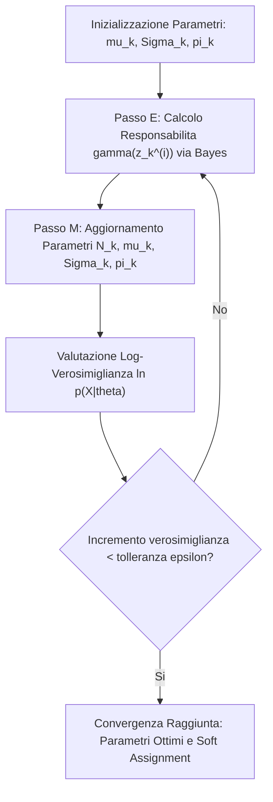

### Derivazione Analitica del Ciclo di Aggiornamento

Formalizziamo la procedura dell'algoritmo Expectation-Maximization per la stima dei GMM:

1. __Inizializzazione dei Parametri__:
   - Inizializziamo i vettori medi $\boldsymbol{\mu}_k$ eseguendo preliminarmente alcune iterazioni di K-Means sul dataset;
   - Inizializziamo le matrici di covarianza $\boldsymbol{\Sigma}_k$ impostandole pari alla covarianza campionaria globale o a matrici diagonali isotrope;
   - Inizializziamo uniformemente i pesi di mistura: $\pi_k = \frac{1}{K}$;
   - Valutiamo la log-verosimiglianza iniziale $\ln p(\mathbf{X} \mid \boldsymbol{\theta}^{(0)})$;

2. __Passo E (Expectation)__:
   - Manteniamo congelati i parametri correnti $\boldsymbol{\theta}^{(t)} = \{\boldsymbol{\mu}_k, \boldsymbol{\Sigma}_k, \pi_k\}$;
   - Calcoliamo le responsabilità a posteriori per ogni campione $i \in \{0, \dots, N-1\}$ e per ciascuna componente $k \in \{1, \dots, K\}$:

$$
\gamma(z_k^{(i)}) = \frac{\pi_k \mathcal{N}(\mathbf{x}^{(i)} \mid \boldsymbol{\mu}_k, \boldsymbol{\Sigma}_k)}{\sum_{j=1}^K \pi_j \mathcal{N}(\mathbf{x}^{(i)} \mid \boldsymbol{\mu}_j, \boldsymbol{\Sigma}_j)}
$$

3. __Passo M (Maximization)__:
   - Manteniamo congelate le responsabilità $\gamma(z_k^{(i)})$ calcolate al passo E;
   - Ricalcoliamo il volume di occupazione effettivo di ciascun cluster:

$$
N_k = \sum_{i=0}^{N-1} \gamma(z_k^{(i)})
$$

   - Aggiorniamo i parametri delle componenti Gaussiane secondo le formule chiuse ricavate:

$$
\boldsymbol{\mu}_k^{\text{nuovo}} = \frac{1}{N_k} \sum_{i=0}^{N-1} \gamma(z_k^{(i)}) \mathbf{x}^{(i)}
$$

$$
\boldsymbol{\Sigma}_k^{\text{nuovo}} = \frac{1}{N_k} \sum_{i=0}^{N-1} \gamma(z_k^{(i)}) (\mathbf{x}^{(i)} - \boldsymbol{\mu}_k^{\text{nuovo}})(\mathbf{x}^{(i)} - \boldsymbol{\mu}_k^{\text{nuovo}})^T
$$

$$
\pi_k^{\text{nuovo}} = \frac{N_k}{N}
$$

4. __Verifica della Convergenza__:
   - Calcoliamo la nuova log-verosimiglianza marginale:

$$
\ln p(\mathbf{X} \mid \boldsymbol{\theta}^{\text{nuovo}}) = \sum_{i=0}^{N-1} \ln \left( \sum_{k=1}^K \pi_k^{\text{nuovo}} \mathcal{N}(\mathbf{x}^{(i)} \mid \boldsymbol{\mu}_k^{\text{nuovo}}, \boldsymbol{\Sigma}_k^{\text{nuovo}}) \right)
$$

   - Verifichiamo il criterio di arresto sulla variazione scalare:

$$
|\ln p(\mathbf{X} \mid \boldsymbol{\theta}^{\text{nuovo}}) - \ln p(\mathbf{X} \mid \boldsymbol{\theta})| < \epsilon
$$

   - Se la condizione non è soddisfatta, poniamo $\boldsymbol{\theta} \leftarrow \boldsymbol{\theta}^{\text{nuovo}}$ e reiteriamo a partire dal passo E.

```pseudo
\begin{algorithm}
\caption{Expectation-Maximization per Modelli a Mistura di Gaussiane (EM per GMM)}
\begin{algorithmic}
\REQUIRE Dataset $\mathcal{D} = \{\mathbf{x}^{(0)}, \dots, \mathbf{x}^{(N-1)}\} \subset \mathbb{R}^D$, numero di componenti $K$, tolleranza $\epsilon$
\ENSURE Parametri ottimi $\{\boldsymbol{\mu}_k, \boldsymbol{\Sigma}_k, \pi_k\}_{k=1}^K$, responsabilità a posteriori $\{\gamma(z_k^{(i)})\}$
\STATE Inizializzazione di $\boldsymbol{\mu}_k$ (es. con K-Means), $\boldsymbol{\Sigma}_k$ e $\pi_k = \frac{1}{K}$ per $k = 1, \dots, K$
\STATE Valutazione log-verosimiglianza iniziale: $\ell \leftarrow \sum_{i=0}^{N-1} \ln \left( \sum_{k=1}^K \pi_k \mathcal{N}(\mathbf{x}^{(i)} \mid \boldsymbol{\mu}_k, \boldsymbol{\Sigma}_k) \right)$
\REPEAT
    \STATE \COMMENT{Passo E: Calcolo delle responsabilità a parametri congelati}
    \FOR{$i = 0$ \TO $N-1$}
        \FOR{$k = 1$ \TO $K$}
            \STATE $\gamma(z_k^{(i)}) \leftarrow \frac{\pi_k \mathcal{N}(\mathbf{x}^{(i)} \mid \boldsymbol{\mu}_k, \boldsymbol{\Sigma}_k)}{\sum_{j=1}^K \pi_j \mathcal{N}(\mathbf{x}^{(i)} \mid \boldsymbol{\mu}_j, \boldsymbol{\Sigma}_j)}$
        \ENDFOR
    \ENDFOR
    \STATE \COMMENT{Passo M: Aggiornamento dei parametri a responsabilità congelate}
    \FOR{$k = 1$ \TO $K$}
        \STATE $N_k \leftarrow \sum_{i=0}^{N-1} \gamma(z_k^{(i)})$
        \STATE $\boldsymbol{\mu}_k \leftarrow \frac{1}{N_k} \sum_{i=0}^{N-1} \gamma(z_k^{(i)}) \mathbf{x}^{(i)}$
        \STATE $\boldsymbol{\Sigma}_k \leftarrow \frac{1}{N_k} \sum_{i=0}^{N-1} \gamma(z_k^{(i)}) (\mathbf{x}^{(i)} - \boldsymbol{\mu}_k)(\mathbf{x}^{(i)} - \boldsymbol{\mu}_k)^T$
        \STATE $\pi_k \leftarrow \frac{N_k}{N}$
    \ENDFOR
    \STATE $\ell_{\text{nuovo}} \leftarrow \sum_{i=0}^{N-1} \ln \left( \sum_{k=1}^K \pi_k \mathcal{N}(\mathbf{x}^{(i)} \mid \boldsymbol{\mu}_k, \boldsymbol{\Sigma}_k) \right)$
    \STATE $\Delta \leftarrow |\ell_{\text{nuovo}} - \ell|$
    \STATE $\ell \leftarrow \ell_{\text{nuovo}}$
\UNTIL{$\Delta < \epsilon$}
\RETURN $\{\boldsymbol{\mu}_k, \boldsymbol{\Sigma}_k, \pi_k\}_{k=1}^K, \{\gamma(z_k^{(i)})\}$
\end{algorithmic}
\end{algorithm}
```

> [!TIP] Monotonia Globale di EM
> Dempster, Laird e Rubin hanno provato che l'algoritmo Expectation-Maximization garantisce a ogni ciclo un miglioramento monotono della verosimiglianza marginale:
> 
> $$
> \ln p(\mathbf{X} \mid \boldsymbol{\theta}^{(t+1)}) \ge \ln p(\mathbf{X} \mid \boldsymbol{\theta}^{(t)})
> $$
> 
> L'uguaglianza si verifica esclusivamente quando l'algoritmo approda a un punto stazionario (minimo locale, punto di sella o massimo locale della superficie di verosimiglianza).

### K-Means come Caso Limite a Varianza Nulla

Esiste una precisa connessione formale che lega GMM a K-Means: quest'ultimo costituisce la versione deterministica e non stocastica del primo.

Ipotizziamo un GMM con le seguenti restrizioni:
1. Le matrici di covarianza di tutte le $K$ componenti sono sferiche, isotrope e identiche, parametrizzate da un unico scalare di varianza $\sigma^2$:

$$
\boldsymbol{\Sigma}_k = \sigma^2 \mathbf{I}, \quad \forall k \in \{1, \dots, K\}
$$

2. I coefficienti di mistura sono equiprobabili a priori:

$$
\pi_k = \frac{1}{K}, \quad \forall k \in \{1, \dots, K\}
$$

Sotto queste ipotesi, la densità della singola componente $k$ diventa:

$$
\mathcal{N}(\mathbf{x}^{(i)} \mid \boldsymbol{\mu}_k, \sigma^2 \mathbf{I}) = \frac{1}{(2\pi \sigma^2)^{D/2}} \exp\left( -\frac{\|\mathbf{x}^{(i)} - \boldsymbol{\mu}_k\|_2^2}{2\sigma^2} \right)
$$

Sostituiamo tale espressione nella formula della responsabilità $\gamma(z_k^{(i)})$:

$$
\gamma(z_k^{(i)}) = \frac{\frac{1}{K (2\pi \sigma^2)^{D/2}} \exp\left( -\frac{\|\mathbf{x}^{(i)} - \boldsymbol{\mu}_k\|_2^2}{2\sigma^2} \right)}{\sum_{j=1}^K \frac{1}{K (2\pi \sigma^2)^{D/2}} \exp\left( -\frac{\|\mathbf{x}^{(i)} - \boldsymbol{\mu}_j\|_2^2}{2\sigma^2} \right)} = \frac{\exp\left( -\frac{\|\mathbf{x}^{(i)} - \boldsymbol{\mu}_k\|_2^2}{2\sigma^2} \right)}{\sum_{j=1}^K \exp\left( -\frac{\|\mathbf{x}^{(i)} - \boldsymbol{\mu}_j\|_2^2}{2\sigma^2} \right)}
$$

Riconosciamo l'operatore Softmax applicato alla metrica delle distanze con fattore di scala inversamente proporzionale alla varianza $\beta = \frac{1}{2\sigma^2}$.

Sia $k^* = \arg\min_{j} \|\mathbf{x}^{(i)} - \boldsymbol{\mu}_j\|_2^2$ l'indice del centroide avente la minima distanza euclidea da $\mathbf{x}^{(i)}$. Dividiamo numeratore e denominatore per il termine dominante $\exp\left( -\frac{\|\mathbf{x}^{(i)} - \boldsymbol{\mu}_{k^*}\|_2^2}{2\sigma^2} \right)$:

$$
\gamma(z_k^{(i)}) = \frac{\exp\left( -\frac{\|\mathbf{x}^{(i)} - \boldsymbol{\mu}_k\|_2^2 - \|\mathbf{x}^{(i)} - \boldsymbol{\mu}_{k^*}\|_2^2}{2\sigma^2} \right)}{1 + \sum_{j \ne k^*} \exp\left( -\frac{\|\mathbf{x}^{(i)} - \boldsymbol{\mu}_j\|_2^2 - \|\mathbf{x}^{(i)} - \boldsymbol{\mu}_{k^*}\|_2^2}{2\sigma^2} \right)}
$$

Poiché per ogni $j \ne k^*$ si ha la disuguaglianza stretta $\|\mathbf{x}^{(i)} - \boldsymbol{\mu}_j\|_2^2 - \|\mathbf{x}^{(i)} - \boldsymbol{\mu}_{k^*}\|_2^2 > 0$, quando la varianza tende asintoticamente a zero ($\sigma^2 \to 0^+$, ovvero $\beta \to +\infty$):

$$
\lim_{\sigma^2 \to 0^+} \exp\left( -\frac{\|\mathbf{x}^{(i)} - \boldsymbol{\mu}_j\|_2^2 - \|\mathbf{x}^{(i)} - \boldsymbol{\mu}_{k^*}\|_2^2}{2\sigma^2} \right) = 0, \quad \forall j \ne k^*
$$

Valutiamo il limite della responsabilità:
- Per $k = k^*$: il numeratore vale $\exp(0) = 1$, mentre a denominatore ogni termine della somma svanisce, fornendo $\gamma(z_{k^*}^{(i)}) \to 1$;
- Per $k \ne k^*$: il numeratore collassa a 0, fornendo $\gamma(z_k^{(i)}) \to 0$.

Otteniamo analiticamente:

$$
\lim_{\sigma^2 \to 0} \gamma(z_k^{(i)}) = \begin{cases} 1 & \text{se } k = \arg\min_{j \in \{1, \dots, K\}} \|\mathbf{x}^{(i)} - \boldsymbol{\mu}_j\|_2^2 \\ 0 & \text{altrimenti} \end{cases} \equiv r_{ik}
$$

> [!IMPORTANT] K-Means come Degenerazione Rigida di EM
> Nel limite di varianza nulla ($\sigma^2 \to 0$):
> 1. Le responsabilità morbide $\gamma(z_k^{(i)})$ convergono esattamente agli assegnamenti rigidi binari $r_{ik}$ del passo E di K-Means;
> 2. Le formule di aggiornamento delle medie nel passo M di GMM collassano sui baricentri aritmetici di K-Means:
>    
>    $$
>    \boldsymbol{\mu}_k = \frac{\sum_i \gamma(z_k^{(i)}) \mathbf{x}^{(i)}}{\sum_i \gamma(z_k^{(i)})} \xrightarrow[\sigma^2 \to 0]{} \frac{1}{N_k} \sum_{i \in \mathcal{C}_k} \mathbf{x}^{(i)}
>    $$
>    
> 3. La log-verosimiglianza marginale riscalata converge alla funzione di distorsione:
>    
>    $$
>    \lim_{\sigma^2 \to 0} \left[ -2\sigma^2 \ln p(\mathbf{X} \mid \boldsymbol{\theta}) \right] = \sum_{i=0}^{N-1} \min_k \|\mathbf{x}^{(i)} - \boldsymbol{\mu}_k\|_2^2 = J(\mathbf{R}, \mathbf{M})
>    $$
>    
> 
> K-Means è formalmente il __caso limite deterministico a varianza isotropa nulla__ dell'algoritmo Expectation-Maximization applicato a una mistura gaussiana.

## Quadro Sinottico delle Metodologie Non Supervisionate

Confrontiamo in modo sistematico le caratteristiche teoriche e computazionali delle metodologie di clustering studiate:

| Criterio di Confronto | K-Means | K-Medoids (PAM) | Gaussian Mixture Models (GMM) |
| :--- | :--- | :--- | :--- |
| __Tipo di Assegnamento__ | Rigido (_Hard_: $r_{nk} \in \{0, 1\}$) | Rigido (_Hard_: $r_{nk} \in \{0, 1\}$) | Morbido (_Soft_: $\gamma(z_k^{(n)}) \in [0, 1]$) |
| __Rappresentante del Gruppo__ | Baricentro continuo $\boldsymbol{\mu}_k \in \mathbb{R}^D$ | Punto reale del dataset $\mathbf{m}_k \in \mathcal{D}$ | Parametri statistici $(\boldsymbol{\mu}_k, \boldsymbol{\Sigma}_k, \pi_k)$ |
| __Metrica di Dissimilarità__ | Distanza Euclidea al quadrato | Metrica arbitraria ($L_1$, $L_2$, Mahalanobis) | Distanza statistica di Mahalanobis |
| __Geometria del Cluster__ | Sferica isotropa a raggio costante | Sferica rispetto alla metrica prescelta | Iperellissoidale con orientazione libera |
| __Forma della Frontiera__ | Partizione a celle di Voronoi lineari | Partizione a tasselli Voronoi generalizzati | Superfici di separazione quadriche |
| __Resistenza agli Outlier__ | Molto bassa (la media $L_2$ ne risente) | Massima (la mediana $L_1$ è immune) | Moderata (la covarianza può risentire) |
| __Funzione Obiettivo__ | Distorsione quadratica $J$ | Dissimilarità assoluta complessiva | Log-verosimiglianza marginale $\ln p(\mathbf{X})$ |
| __Algoritmo Risolutivo__ | Discesa a blocchi coordinati (Lloyd) | Partitioning Around Medoids (PAM) | Expectation-Maximization (EM) |
| __Complessità per Iterazione__ | $O(N \cdot K \cdot D)$ | $O(K \cdot (N - K)^2)$ | $O(N \cdot K \cdot D^3)$ (inversione di $\boldsymbol{\Sigma}_k$) |
| __Numero Parametri Modello__ | $K \cdot D$ | $K$ indici discreti | $K \cdot \left[ 1 + D + \frac{D(D+1)}{2} \right] - 1$ |
| __Garanzia di Convergenza__ | Minimo locale in tempo finito | Minimo locale in tempo finito | Punto stazionario monotono asintotico |

L'apprendimento non supervisionato struttura dati grezzi privi di etichetta estraendone le relazioni spaziali e statistiche dominanti: K-Means massimizza l'efficienza computazionale su partizioni sferiche compatte, K-Medoids preserva la robustezza in presenza di disturbi impulsivi su metriche generiche, mentre i Modelli a Mistura di Gaussiane offrono la massima espressività probabilistica, governando cluster anisotropi, orientazioni spaziali arbitrarie e quantificazione rigorosa dell'incertezza.


# C. PCA e ICA

Nell'ingegneria dei dati moderna e nei sistemi robotici avanzati, i campioni sono frequentemente descritti da vettori ad altissima dimensionalità nello spazio delle feature $\mathbb{R}^D$: immagini sensoriali, matrici di feature estratte da reti neurali profonde o scansioni dense di sensori di bordo. In tali scenari si manifesta la cosiddetta __maledizione della dimensionalità__ (_Curse of Dimensionality_): lo spazio cresce esponenzialmente rispetto al numero di variabili, rendendo i dati estremamente sparsi, amplificando il rumore e moltiplicando a dismisura il costo computazionale e il rischio di overfitting.

La gestione di dataset ad alta dimensionalità richiede metodologie cardine di __riduzione non supervisionata della dimensionalità__: la __Principal Component Analysis__ (__PCA__) e la __Independent Component Analysis__ (__ICA__). La PCA si formula sia come massimizzazione variazionale della varianza proiettata sia come minimizzazione dell'errore quadratico di ricostruzione, convergendo al problema agli autovalori della matrice di covarianza empirica strettamente legato alla decomposizione a valori singolari (SVD). L'ICA risolve il problema della __separazione cieca delle sorgenti__ (_Blind Source Separation_), caratterizzato da tre ambiguità strutturali (permutazione, scala e rotazione gaussiana), richiede la non-gaussianità statistica dei segnali e stima i parametri mediante massima verosimiglianza con ascesa del gradiente.

## Riduzione della Dimensionalità Non Supervisionata

L'obiettivo fondamentale della riduzione della dimensionalità risiede nel mappare un dataset originale $\mathcal{D} = \{\mathbf{x}^{(0)}, \dots, \mathbf{x}^{(N-1)}\} \subset \mathbb{R}^D$ in una rappresentazione a dimensionalità ridotta $\mathcal{Z} = \{\mathbf{z}^{(0)}, \dots, \mathbf{z}^{(N-1)}\} \subset \mathbb{R}^K$, con $K \ll D$.

Tale operazione risponde a esigenze metodologiche e operative imprescindibili nell'ingegneria informatica:
- __Abbattimento della ridondanza informativa__: eliminare la forte correlazione o multicollinearità strutturale tra feature interdipendenti, condensando l'informazione in un numero minimo di assi sintetici;
- __Filtraggio del rumore stocastico__: scartare le direzioni di varianza trascurabile tipicamente dominate dal rumore di misura del sensore;
- __Compressione e scalabilità computazionale__: accelerare l'addestramento e l'inferenza di modelli a valle (es. classificatori o filtri di stima) riducendo le dimensioni dei tensori manipolati;
- __Visualizzazione e interpretazione dei dati__: consentire l'esplorazione geometrica diretta proiettando distribuzioni complesse su spazi bidimensionali ($K = 2$) o tridimensionali ($K = 3$).

> [!NOTE] Tassonomia Metodologica: Supervisionato vs Non Supervisionato
> A differenza di metodologie supervisionate come la Linear Discriminant Analysis (LDA), che sfrutta le etichette di classe per massimizzare la separabilità dei target, PCA e ICA operano in modo puramente non supervisionato: estraggono struttura unicamente dalla geometria e dalle proprietà statistiche intrinseche della matrice dei dati $\mathbf{X} \in \mathbb{R}^{N \times D}$.

## Principal Component Analysis (PCA)

La __Principal Component Analysis__ (PCA) identifica un sottospazio lineare a dimensionalità inferiore che preserva la massima quota possibile di informazione (varianza) dei dati originari, scartando le componenti associate a variazioni marginali o rumore.

Per cogliere l'intuizione fisica dell'algoritmo, consideriamo un dataset $\mathcal{D} = \{\mathbf{x}^{(0)}, \dots, \mathbf{x}^{(N-1)}\}$ contenente i risultati di un'indagine condotta su piloti di elicotteri radiocomandati. Ciascun campione è descritto da due feature continue ($D = 2$): l'abilità tecnica di guida ($x_1$) e il grado di divertimento percepito ($x_2$).

![[fig_14_1_direzione_massima_variazione_pca.svg|center mid]]

Intuitivamente, le due variabili presentano una marcata correlazione positiva: chi si diverte di più tende a esercitarsi con maggiore costanza e a sviluppare un'abilità superiore. Se osserviamo la distribuzione geometrica dei punti, emerge con chiarezza che la direzione di massima variabilità dei dati non corre lungo l'asse $x_1$ né lungo l'asse $x_2$, bensì lungo una retta inclinata definita dal versore $\mathbf{u}_1$. Viceversa, la direzione ortogonale $\mathbf{u}_2$ cattura una frazione minima di dispersione.

Anziché limitarci a rimuovere banalmente una delle due feature dopo aver calcolato la matrice di correlazione, la PCA combina linearmente le coordinate native, individuando un nuovo sistema di riferimento ortonormale orientato secondo gli assi di dispersione dominante.

### Pre-Elaborazione: Centratura e Standardizzazione dei Dati

Prima di applicare la procedura proiettiva, dobbiamo normalizzare le feature del dataset. Definiamo il vettore della media campionaria:

$$
\bar{\mathbf{x}} = \frac{1}{N} \sum_{i=0}^{N-1} \mathbf{x}^{(i)} \in \mathbb{R}^D
$$

Trasliamo ciascun campione sottraendo la media:

$$
\mathbf{x}^{(i)} \leftarrow \mathbf{x}^{(i)} - \bar{\mathbf{x}}
$$

La centratura garantisce che la media campionaria nello spazio trasformato sia rigorosamente nulla: $\sum_{i=0}^{N-1} \mathbf{x}^{(i)} = \mathbf{0}$. Se le feature presentano scale o unità di misura eterogenee (es. metri, secondi, gradi Kelvin), dividiamo ciascuna feature anche per la propria deviazione standard empirica $s_j$:

$$
x_j^{(i)} \leftarrow \frac{x_j^{(i)} - \bar{x}_j}{s_j}, \qquad s_j = \sqrt{\frac{1}{N} \sum_{i=0}^{N-1} (x_j^{(i)} - \bar{x}_j)^2}
$$

> [!WARNING] Regola Operativa di Pre-Elaborazione
> La standardizzazione impedisce che le feature espresse con unità di misura numericamente più elevate dominino artificiosamente la varianza globale a discapito di variabili informative a scala ridotta.

### Massimizzazione della Varianza Proiettata

Assumendo dati centrati con media nulla, consideriamo la proiezione ortogonale di ciascun vettore $\mathbf{x}^{(i)}$ lungo un versore unidirezionale $\mathbf{u} \in \mathbb{R}^D$ avente norma euclidea unitaria:

$$
\|\mathbf{u}\|_2^2 = \mathbf{u}^T \mathbf{u} = 1
$$

![[fig_14_2_proiezione_campione_direzione_variazione.svg|center mid]]

La coordinata scalare della proiezione del generico campione $\mathbf{x}^{(i)}$ lungo il versore $\mathbf{u}$ coincide con il prodotto scalare:

$$
z^{(i)} = (\mathbf{x}^{(i)})^T \mathbf{u} = \mathbf{u}^T \mathbf{x}^{(i)} \in \mathbb{R}
$$

Poiché il dataset è centrato all'origine, la media delle coordinate scalari proiettate si annulla identicamente:

$$
\bar{z} = \frac{1}{N} \sum_{i=0}^{N-1} z^{(i)} = \frac{1}{N} \sum_{i=0}^{N-1} (\mathbf{x}^{(i)})^T \mathbf{u} = \left( \frac{1}{N} \sum_{i=0}^{N-1} \mathbf{x}^{(i)} \right)^T \mathbf{u} = \mathbf{0}^T \mathbf{u} = 0
$$

Calcoliamo la varianza campionaria delle proiezioni scalari lungo $\mathbf{u}$:

$$
\mathrm{Var}(z) = \frac{1}{N} \sum_{i=0}^{N-1} (z^{(i)} - \bar{z})^2 = \frac{1}{N} \sum_{i=0}^{N-1} \left( (\mathbf{x}^{(i)})^T \mathbf{u} \right)^2
$$

Riformuliamo il quadrato dello scalare sfruttando la simmetria del prodotto scalare:

$$
((\mathbf{x}^{(i)})^T \mathbf{u})^2 = (\mathbf{u}^T \mathbf{x}^{(i)}) ((\mathbf{x}^{(i)})^T \mathbf{u}) = \mathbf{u}^T \left( \mathbf{x}^{(i)} (\mathbf{x}^{(i)})^T \right) \mathbf{u}
$$

Sostituendo all'interno della sommatoria e portando i versori $\mathbf{u}$ all'esterno dei termini dipendenti dall'indice $i$:

$$
\mathrm{Var}(z) = \mathbf{u}^T \left( \frac{1}{N} \sum_{i=0}^{N-1} \mathbf{x}^{(i)} (\mathbf{x}^{(i)})^T \right) \mathbf{u}
$$

Riconosciamo tra parentesi tonde la __matrice di covarianza empirica__ $\boldsymbol{\Sigma} \in \mathbb{R}^{D \times D}$ dei campioni:

$$
\boldsymbol{\Sigma} \triangleq \frac{1}{N} \sum_{i=0}^{N-1} \mathbf{x}^{(i)} (\mathbf{x}^{(i)})^T = \frac{1}{N} \mathbf{X}^T \mathbf{X}
$$

La varianza proiettata assume pertanto la forma quadratica compatta:

$$
\mathrm{Var}(z) = \mathbf{u}^T \boldsymbol{\Sigma} \mathbf{u}
$$

Il problema di massimizzazione della varianza si configura come un'ottimizzazione vincolata quadratica:

$$
\max_{\mathbf{u}} \mathbf{u}^T \boldsymbol{\Sigma} \mathbf{u} \qquad \text{sotto il vincolo} \qquad \mathbf{u}^T \mathbf{u} = 1
$$

### Risoluzione Analitica tramite Moltiplicatori di Lagrange

Per risolvere il problema applichiamo il metodo dei moltiplicatori di Lagrange. Costruiamo la funzione Lagrangiana scalare associata al vincolo di uguaglianza:

$$
\mathcal{L}(\mathbf{u}, \lambda) = \mathbf{u}^T \boldsymbol{\Sigma} \mathbf{u} - \lambda (\mathbf{u}^T \mathbf{u} - 1)
$$

Deriviamo la Lagrangiana rispetto al vettore $\mathbf{u}$:

$$
\nabla_{\mathbf{u}} \mathcal{L}(\mathbf{u}, \lambda) = 2 \boldsymbol{\Sigma} \mathbf{u} - 2 \lambda \mathbf{u}
$$

Imponiamo la condizione di stazionarietà annullando il gradiente:

$$
2 \boldsymbol{\Sigma} \mathbf{u} - 2 \lambda \mathbf{u} = \mathbf{0} \implies \boldsymbol{\Sigma} \mathbf{u} = \lambda \mathbf{u}
$$

L'annullamento del gradiente conduce all'equazione secolare agli autovalori. Sostituendo la relazione $\boldsymbol{\Sigma} \mathbf{u} = \lambda \mathbf{u}$ nell'espressione della varianza massimizzata:

$$
\mathrm{Var}(z) = \mathbf{u}^T \boldsymbol{\Sigma} \mathbf{u} = \mathbf{u}^T (\lambda \mathbf{u}) = \lambda \mathbf{u}^T \mathbf{u} = \lambda
$$

La varianza dei campioni proiettati lungo il versore $\mathbf{u}$ coincide esattamente con l'autovalore $\lambda$. Ne consegue che, per ottenere la __massima varianza possibile__, dobbiamo selezionare l'autovettore associato al __massimo autovalore__ della matrice di covarianza:

$$
\lambda_1 = \max_{j} \lambda_j \implies \mathbf{u}_1 = \mathbf{v}_1
$$

Il vettore $\mathbf{u}_1$ prende il nome di __prima componente principale__ (_First Principal Component_).

Deriviamo ora la seconda componente principale $\mathbf{u}_2$. Dobbiamo massimizzare la varianza residua imponendo sia la norma unitaria sia l'ortogonalità rispetto a $\mathbf{u}_1$:

$$
\max_{\mathbf{u}_2} \mathbf{u}_2^T \boldsymbol{\Sigma} \mathbf{u}_2 \qquad \text{s.t.} \qquad \mathbf{u}_2^T \mathbf{u}_2 = 1, \quad \mathbf{u}_2^T \mathbf{u}_1 = 0
$$

Impostiamo la Lagrangiana con due moltiplicatori scalari $\lambda$ e $\phi$:

$$
\mathcal{L}(\mathbf{u}_2, \lambda, \phi) = \mathbf{u}_2^T \boldsymbol{\Sigma} \mathbf{u}_2 - \lambda (\mathbf{u}_2^T \mathbf{u}_2 - 1) - 2 \phi (\mathbf{u}_2^T \mathbf{u}_1)
$$

Annulliamo il gradiente rispetto a $\mathbf{u}_2$:

$$
\nabla_{\mathbf{u}_2} \mathcal{L} = 2 \boldsymbol{\Sigma} \mathbf{u}_2 - 2 \lambda \mathbf{u}_2 - 2 \phi \mathbf{u}_1 = \mathbf{0}
$$

Moltiplichiamo a sinistra l'equazione per $\mathbf{u}_1^T$:

$$
2 \mathbf{u}_1^T \boldsymbol{\Sigma} \mathbf{u}_2 - 2 \lambda \mathbf{u}_1^T \mathbf{u}_2 - 2 \phi \mathbf{u}_1^T \mathbf{u}_1 = 0
$$

Sfruttando la simmetria di $\boldsymbol{\Sigma}$ e il fatto che $\boldsymbol{\Sigma} \mathbf{u}_1 = \lambda_1 \mathbf{u}_1$:

$$
\mathbf{u}_1^T \boldsymbol{\Sigma} \mathbf{u}_2 = (\boldsymbol{\Sigma} \mathbf{u}_1)^T \mathbf{u}_2 = (\lambda_1 \mathbf{u}_1)^T \mathbf{u}_2 = \lambda_1 (\mathbf{u}_1^T \mathbf{u}_2) = 0
$$

Poiché $\mathbf{u}_1^T \mathbf{u}_2 = 0$ per vincolo e $\mathbf{u}_1^T \mathbf{u}_1 = 1$, l'equazione scalare collassa a:

$$
- 2 \phi = 0 \implies \phi = 0
$$

Il vincolo di ortogonalità non aggiunge forze spettrali esterne: la condizione di stazionarietà ritorna a essere $\boldsymbol{\Sigma} \mathbf{u}_2 = \lambda \mathbf{u}_2$. Per massimizzare la varianza residua selezioniamo l'autovettore associato al secondo autovalore in ordine decrescente $\lambda_2$. Per induzione, le $K$ componenti principali corrispondono ai $K$ autovettori associati ai $K$ massimi autovalori ordinati $\lambda_1 \ge \lambda_2 \ge \dots \ge \lambda_K$.

> [!IMPORTANT] Teorema Spettrale e Componenti Principali
> Le componenti principali della PCA coincidono con gli autovettori ortonormali della matrice di covarianza $\boldsymbol{\Sigma}$. Ciascun autovalore $\lambda_j$ quantifica esattamente la quota di varianza catturata dalla rispettiva componente $\mathbf{u}_j$.

### Formulazione Duale: Minimizzazione dell'Errore di Ricostruzione

La PCA ammette un'interpretazione duale perfettamente equivalente: anziché massimizzare la dispersione dei dati proiettati, possiamo formulare l'algoritmo cercando il sottospazio lineare che minimizza la somma degli errori quadratici commessi ricostruendo il dato originario $\mathbf{x}^{(i)}$ a partire dalla sua proiezione ortogonale $\hat{\mathbf{x}}^{(i)}$.

![[fig_ex_C_pca_proiezione_ricostruzione_scree_plot.png|center big]]

Definendo la proiezione unidimensionale $\hat{\mathbf{x}}^{(i)} = z^{(i)} \mathbf{u}_1 = (\mathbf{u}_1^T \mathbf{x}^{(i)}) \mathbf{u}_1$, l'errore di ricostruzione euclideo si esprime come:

$$
J_{\text{ric}}(\mathbf{u}_1) = \frac{1}{N} \sum_{i=0}^{N-1} \|\mathbf{x}^{(i)} - \hat{\mathbf{x}}^{(i)}\|_2^2 = \frac{1}{N} \sum_{i=0}^{N-1} \|\mathbf{x}^{(i)} - (\mathbf{u}_1^T \mathbf{x}^{(i)}) \mathbf{u}_1\|_2^2
$$

Verifichiamo analiticamente l'ortogonalità tra la proiezione $\hat{\mathbf{x}}^{(i)}$ e il vettore errore $(\mathbf{x}^{(i)} - \hat{\mathbf{x}}^{(i)})$:

$$
(\hat{\mathbf{x}}^{(i)})^T (\mathbf{x}^{(i)} - \hat{\mathbf{x}}^{(i)}) = (\mathbf{u}_1^T \mathbf{x}^{(i)}) \mathbf{u}_1^T (\mathbf{x}^{(i)} - (\mathbf{u}_1^T \mathbf{x}^{(i)}) \mathbf{u}_1) = (\mathbf{u}_1^T \mathbf{x}^{(i)}) [ \mathbf{u}_1^T \mathbf{x}^{(i)} - (\mathbf{u}_1^T \mathbf{x}^{(i)})(\mathbf{u}_1^T \mathbf{u}_1) ] = 0
$$

Grazie all'ortogonalità, applichiamo il Teorema di Pitagora al triangolo rettangolo formato dal dato originario, dalla sua proiezione e dall'errore:

$$
\|\mathbf{x}^{(i)}\|_2^2 = \|\hat{\mathbf{x}}^{(i)}\|_2^2 + \|\mathbf{x}^{(i)} - \hat{\mathbf{x}}^{(i)}\|_2^2 = (\mathbf{u}_1^T \mathbf{x}^{(i)})^2 + \|\mathbf{x}^{(i)} - \hat{\mathbf{x}}^{(i)}\|_2^2
$$

Mediando su tutto il dataset composto dagli $N$ campioni:

$$
\frac{1}{N} \sum_{i=0}^{N-1} \|\mathbf{x}^{(i)}\|_2^2 = \mathbf{u}_1^T \boldsymbol{\Sigma} \mathbf{u}_1 + J_{\text{ric}}(\mathbf{u}_1)
$$

Poiché la quantità a primo membro rappresenta la varianza totale dei dati originari (pari alla traccia della matrice di covarianza $\mathrm{Tr}(\boldsymbol{\Sigma}) = \sum_{j=1}^D \lambda_j$, costante fissata a priori dal dataset):

$$
\min_{\mathbf{u}_1} J_{\text{ric}}(\mathbf{u}_1) \iff \max_{\mathbf{u}_1} \mathbf{u}_1^T \boldsymbol{\Sigma} \mathbf{u}_1
$$

Minimizzare l'errore quadratico di ricostruzione equivale tassativamente a massimizzare la varianza proiettata. Estendendo la proiezione a un sottospazio di dimensione $K$ tramite la matrice ortonormale $\mathbf{V}_K = [\mathbf{v}_1, \dots, \mathbf{v}_K]$, la ricostruzione ottimale è $\hat{\mathbf{x}}^{(i)} = \mathbf{V}_K \mathbf{V}_K^T \mathbf{x}^{(i)}$, e l'errore minimo di ricostruzione coincide con la somma degli autovalori scartati:

$$
J_{\text{ric}}(\mathbf{V}_K) = \sum_{j=K+1}^D \lambda_j
$$

> [!TIP] Intuizione Geometrica d'Esame: Pitagora e Dualità
> Massimizzare la varianza catturata e minimizzare l'errore di compressione sono due facce della stessa medaglia: l'energia totale del segnale si scompone ortogonalmente tra lo spazio proiettato e il residuo. L'errore residuo corrisponde esattamente alla varianza associata alle dimensioni scartate.

### Calcolo Numerico tramite Singular Value Decomposition (SVD)

Nel calcolo numerico reale, la determinazione esplicita della matrice di covarianza $\boldsymbol{\Sigma} = \frac{1}{N}\mathbf{X}^T\mathbf{X}$ raddoppia il numero di condizionamento: $\kappa(\mathbf{X}^T \mathbf{X}) = (\kappa(\mathbf{X}))^2$. Questo raddoppio può causare gravi perdite di precisione per cancellazione numerica.

Per preservare la stabilità dell'algoritmo, applichiamo la __Singular Value Decomposition__ (SVD) direttamente sulla matrice dei dati centrati $\mathbf{X} \in \mathbb{R}^{N \times D}$:

$$
\mathbf{X} = \mathbf{U} \mathbf{D} \mathbf{V}^T
$$

dove:
- $\mathbf{U} \in \mathbb{R}^{N \times N}$ è una matrice ortogonale ($\mathbf{U}^T \mathbf{U} = \mathbf{I}_N$) i cui vettori colonna rappresentano gli autovettori di $\mathbf{X}\mathbf{X}^T$;
- $\mathbf{D} \in \mathbb{R}^{N \times D}$ è una matrice diagonale rettangolare contenente i valori singolari non negativi ordinati: $d_1 \ge d_2 \ge \dots \ge d_{\min(N, D)} \ge 0$;
- $\mathbf{V} \in \mathbb{R}^{D \times D}$ è una matrice ortogonale ($\mathbf{V}^T \mathbf{V} = \mathbf{I}_D$) le cui colonne $\mathbf{v}_j$ costituiscono la base ortonormale degli autovettori di $\mathbf{X}^T\mathbf{X}$.

Esplicitiamo la covarianza inserendo la scomposizione SVD:

$$
\boldsymbol{\Sigma} = \frac{1}{N} \mathbf{X}^T \mathbf{X} = \frac{1}{N} (\mathbf{V} \mathbf{D}^T \mathbf{U}^T)(\mathbf{U} \mathbf{D} \mathbf{V}^T) = \frac{1}{N} \mathbf{V} \mathbf{D}^T \mathbf{D} \mathbf{V}^T = \mathbf{V} \left( \frac{1}{N} \mathbf{D}^2 \right) \mathbf{V}^T
$$

Gli autovalori della matrice di covarianza discendono direttamente dai valori singolari $d_j$:

$$
\lambda_j = \frac{d_j^2}{N}
$$

Le componenti principali ricercate coincidono con le colonne della matrice $\mathbf{V} = [\mathbf{v}_1, \dots, \mathbf{v}_D]$. Inoltre, le coordinate proiettate $\mathbf{Z} \in \mathbb{R}^{N \times K}$ si ricavano direttamente senza dover moltiplicare per $\mathbf{V}_K$:

$$
\mathbf{Z} = \mathbf{X} \mathbf{V}_K = (\mathbf{U} \mathbf{D} \mathbf{V}^T) \mathbf{V}_K = \mathbf{U}_K \mathbf{D}_K
$$

### Estensione a K Componenti Principali e Proiezione Matriciale

Quando desideriamo estrarre $K$ direzioni di massima variazione ($K < D$), selezioniamo i primi $K$ autovettori corrispondenti ai $K$ autovalori dominanti $\lambda_1 \ge \lambda_2 \ge \dots \ge \lambda_K$.

Costruiamo la matrice di proiezione rettangolare:

$$
\mathbf{V}_K = [\mathbf{v}_1, \mathbf{v}_2, \dots, \mathbf{v}_K] \in \mathbb{R}^{D \times K}
$$

La proiezione dell'intero dataset $\mathbf{X} \in \mathbb{R}^{N \times D}$ nel nuovo spazio ridotto $\mathbf{Z} \in \mathbb{R}^{N \times K}$ si calcola con un unico prodotto matriciale:

$$
\mathbf{Z} = \mathbf{X} \mathbf{V}_K
$$

Esplicitando la struttura a blocchi di matrici e vettori riga:

$$
\begin{bmatrix}
z_1^{(0)} & z_2^{(0)} & \dots & z_K^{(0)} \\
z_1^{(1)} & z_2^{(1)} & \dots & z_K^{(1)} \\
\vdots & \vdots & \ddots & \vdots \\
z_1^{(N-1)} & z_2^{(N-1)} & \dots & z_K^{(N-1)}
\end{bmatrix}
=
\begin{bmatrix}
(\mathbf{x}^{(0)})^T \\
(\mathbf{x}^{(1)})^T \\
\vdots \\
(\mathbf{x}^{(N-1)})^T
\end{bmatrix}
\begin{bmatrix}
\mathbf{v}_1 & \mathbf{v}_2 & \dots & \mathbf{v}_K
\end{bmatrix}
$$

Le colonne di $\mathbf{Z}$ godono di una proprietà algebrica fondamentale: la loro covarianza incrociata è rigorosamente nulla. Calcoliamo la matrice di covarianza empirica nello spazio trasformato:

$$
\boldsymbol{\Sigma}_Z = \frac{1}{N} \mathbf{Z}^T \mathbf{Z} = \frac{1}{N} \mathbf{V}_K^T \mathbf{X}^T \mathbf{X} \mathbf{V}_K = \mathbf{V}_K^T \boldsymbol{\Sigma} \mathbf{V}_K = \mathrm{diag}(\lambda_1, \lambda_2, \dots, \lambda_K)
$$

Le componenti trasformate risultano pertanto mutuamente incorrelate: $\mathrm{Cov}(z_j, z_l) = 0$ per ogni coppia di indici $j \neq l$.

### Algoritmo Procedurale della PCA

Sintetizziamo la sequenza analitica dei passi operativi dell'algoritmo PCA:

```pseudo
\begin{algorithm}
\caption{Principal Component Analysis (PCA)}
\begin{algorithmic}
\REQUIRE Matrice dei dati osservati $\mathbf{X} \in \mathbb{R}^{N \times D}$, dimensione ridotta desiderata $K \le D$
\ENSURE Matrice dei campioni proiettati $\mathbf{Z} \in \mathbb{R}^{N \times K}$, matrice degli autovettori $\mathbf{V}_K \in \mathbb{R}^{D \times K}$
\STATE Calcolo del vettore medio campionario: $\bar{\mathbf{x}} \leftarrow \frac{1}{N} \sum_{i=0}^{N-1} \mathbf{x}^{(i)}$
\STATE Centratura della matrice dei dati: $\mathbf{X} \leftarrow \mathbf{X} - \mathbf{1}_N \bar{\mathbf{x}}^T$
\STATE Decomposizione a valori singolari (SVD): $\mathbf{X} = \mathbf{U} \mathbf{D} \mathbf{V}^T$
\STATE Estrazione dei primi $K$ vettori colonna: $\mathbf{V}_K \leftarrow [\mathbf{v}_1, \dots, \mathbf{v}_K] \in \mathbb{R}^{D \times K}$
\STATE Calcolo delle coordinate proiettate: $\mathbf{Z} \leftarrow \mathbf{X} \mathbf{V}_K = \mathbf{U}_K \mathbf{D}_K$
\RETURN $\mathbf{Z}, \mathbf{V}_K$
\end{algorithmic}
\end{algorithm}
```

### Selezione del Numero di Componenti e Limiti della PCA

Per selezionare il numero ottimale di componenti $K$ da trattenere senza disperdere informazione rilevante, valutiamo la __frazione di varianza spiegata cumulata__:

$$
\eta(K) = \frac{\sum_{j=1}^K \lambda_j}{\sum_{i=1}^D \lambda_i} = \frac{\sum_{j=1}^K d_j^2}{\sum_{i=1}^D d_i^2} \in [0, 1]
$$

Si fissa comunemente una soglia conservativa (es. $\eta \ge 0.90$ o $0.95$, trattenendo il 90-95% dell'energia informativa originaria) oppure si individua il flesso (_elbow point_) nello __Scree Plot__, scartando gli autovalori oltre il plateau di rendimento marginale.

Sebbene la PCA sia rapida, esatta e risolvibile in forma chiusa, presenta quattro limiti concettuali stringenti:
- __Perdita di interpretabilità delle feature__: ciascuna componente $z_k$ è una combinazione lineare densa di tutte le $D$ variabili originarie, rendendo complessa l'identificazione del significato fisico del singolo predittore;
- __Sensibilità al rumore ad alta varianza__: la PCA assume che l'informazione risieda esclusivamente nell'ampiezza della varianza. Se un sensore introduce rumore stocastico a forte ampiezza, l'algoritmo allocherà una componente principale sul rumore, trascurando segnali utili a bassa ampiezza;
- __Linearità del sottospazio proiettivo__: la PCA opera esclusivamente proiezioni lineari piatte. Se la varietà dei dati possiede topologia curvilinea (es. eliche o Swiss Roll), la proiezione lineare collassa regioni distanti distruggendo la struttura geometrica originaria;
- __Natura puramente non supervisionata__: massimizzare la varianza globale non implica massimizzare la separabilità tra categorie: due classi con medie distinte ma allineate ortogonalmente rispetto alla direzione di massima dispersione globale vengono proiettate sovrapponendosi completamente.

> [!WARNING] Limiti Strutturali della PCA nell'Ingegneria dei Dati
> Nelle applicazioni di classificazione o riconoscimento pattern, una compressione PCA aggressiva può degradare le prestazioni se la direzione discriminante non coincide con la direzione di massima varianza. In tali contesti si prediligono tecniche supervisionate (es. LDA) o non lineari (es. Autoencoder, t-SNE, UMAP).

## Independent Component Analysis (ICA)

Così come la PCA, la __Independent Component Analysis__ (ICA) persegue la scoperta di una nuova rappresentazione dello spazio dei dati. Tuttavia, la finalità teorica è radicalmente diversa: anziché cercare coordinate ortogonali incorrelate che massimizzino la varianza, l'ICA mira a individuare le __sorgenti fisiche indipendenti__ che hanno generato le osservazioni e a disaccoppiarle.

### Il Problema del Cocktail Party e Modello Generativo

Per inquadrare il problema, consideriamo la celebre metafora acustica del __Cocktail Party Problem__: in una stanza sono presenti $D$ persone che parlano contemporaneamente ($D$ sorgenti acustiche indipendenti) e nell'ambiente sono disposti $D$ microfoni in posizioni geometriche differenti.

Ciascun microfono registra una combinazione lineare istantanea delle onde sonore emesse da tutti gli interlocutori, ponderata dalle rispettive distanze e attenuazioni acustiche. L'obiettivo consiste nel separare le singole voci originali operando esclusivamente sui tracciati audio registrati dai microfoni, senza alcuna conoscenza a priori né delle posizioni fisiche né della dinamica temporale dei singoli parlanti. Tale classe di problemi è formalizzata sotto il nome di __Separazione Cieca delle Sorgenti__ (_Blind Source Separation_, BSS).

Formalizziamo il processo definendo i vettori di segnale:
- Indichiamo con $s_j^{(i)} \in \mathbb{R}$ il segnale acustico generato dal $j$-esimo oratore all'istante temporale $i \in \{0, \dots, N-1\}$;
- Organizziamo i segnali delle sorgenti nell'istante $i$ nel vettore colonna $\mathbf{s}^{(i)} = [s_0^{(i)}, \dots, s_{D-1}^{(i)}]^T \in \mathbb{R}^D$;
- Indichiamo con $x_j^{(i)} \in \mathbb{R}$ il segnale campionato dal $j$-esimo microfono all'istante $i$;
- Organizziamo le registrazioni nell'istante $i$ nel vettore colonna $\mathbf{x}^{(i)} = [x_0^{(i)}, \dots, x_{D-1}^{(i)}]^T \in \mathbb{R}^D$.

![[fig_ex_C_ica_cocktail_party_non_gaussianity.png|center big]]

A ogni istante di campionamento, il vettore delle osservazioni $\mathbf{x}^{(i)}$ risulta dalla combinazione lineare istantanea delle sorgenti:

$$
\mathbf{x}^{(i)} = \mathbf{A} \mathbf{s}^{(i)}
$$

dove $\mathbf{A} \in \mathbb{R}^{D \times D}$ è una matrice quadrata invertibile denominata __Mixing Matrix__ (matrice di miscelazione).

Raccogliendo gli $N$ campioni temporali nelle rispettive matrici di dati:

$$
\mathbf{X} = [\mathbf{x}^{(0)}, \dots, \mathbf{x}^{(N-1)}] \in \mathbb{R}^{D \times N}, \qquad \mathbf{S} = [\mathbf{s}^{(0)}, \dots, \mathbf{s}^{(N-1)}] \in \mathbb{R}^{D \times N}
$$

il modello generativo globale si esprime in forma compatta:

$$
\mathbf{X} = \mathbf{A} \mathbf{S}
$$

L'obiettivo dell'ICA consiste nello stimare una matrice $\mathbf{W} \in \mathbb{R}^{D \times D}$, denominata __Unmixing Matrix__ (matrice di demiscelazione), tale da invertire l'effetto della matrice $\mathbf{A}$:

$$
\mathbf{W} \approx \mathbf{A}^{-1}
$$

Determinato $\mathbf{W}$, ricostruiamo le sorgenti originali a partire dalle sole misurazioni microfoniche:

$$
\hat{\mathbf{s}}^{(i)} = \mathbf{W} \mathbf{x}^{(i)} = \mathbf{W} \mathbf{A} \mathbf{s}^{(i)} \approx \mathbf{s}^{(i)}
$$

Esplicitando le righe della matrice di demiscelazione $\mathbf{W} = [\mathbf{w}_0, \mathbf{w}_1, \dots, \mathbf{w}_{D-1}]^T$, ciascun vettore riga $\mathbf{w}_j^T \in \mathbb{R}^{1 \times D}$ isola la singola sorgente $j$-esima:

$$
\hat{s}_j^{(i)} = \mathbf{w}_j^T \mathbf{x}^{(i)}
$$

### Ambiguità Strutturali della Demiscelazione

La matrice $\mathbf{W} = \mathbf{A}^{-1}$ è univocamente determinabile? In assenza di informazioni esterne sulla fisica del mezzo o sulla natura dei segnali, emergono tre ambiguità strutturali ineliminabili.

#### Ambiguità di Permutazione

Consideriamo una matrice di permutazione quadrata $\mathbf{P} \in \{0, 1\}^{D \times D}$, avente un solo elemento unitario per ciascuna riga e colonna e zeri altrove. Moltiplicare una matrice a sinistra per $\mathbf{P}$ equivale a scambiarne l'ordine delle righe.

Se stimiamo una matrice $\mathbf{W}' = \mathbf{P} \mathbf{W}$, i segnali ricostruiti diventano:

$$
\hat{\mathbf{s}}' = \mathbf{W}' \mathbf{x} = \mathbf{P} \mathbf{W} \mathbf{A} \mathbf{s} = \mathbf{P} \mathbf{s}
$$

Le sorgenti estratte coincidono con quelle originali, ma risultano disposte in un ordine differente. Disponendo unicamente dei segnali aggregati $\mathbf{x}$, non esiste alcun criterio matematico per associare l'etichetta "oratore 1" piuttosto che "oratore 2". Nel problema del Cocktail Party tale indeterminazione è del tutto irrilevante: l'obiettivo è isolare ciascuna voce su una traccia audio pulita, indipendentemente dalla traccia su cui essa viene allocata.

#### Ambiguità di Scala e di Segno

Supponiamo di moltiplicare la $j$-esima colonna della matrice di miscelazione $\mathbf{A}$ per uno scalare non nullo $\alpha \in \mathbb{R} \setminus \{0\}$, e contemporaneamente di riscalare la sorgente $s_j$ per il fattore reciproco $\frac{1}{\alpha}$:

$$
\mathbf{x}^{(i)} = (\alpha \mathbf{a}_j) \left( \frac{1}{\alpha} s_j^{(i)} \right) = \mathbf{a}_j s_j^{(i)}
$$

Il segnale rilevato dai microfoni rimane identico. Non possiamo determinare l'ampiezza assoluta delle sorgenti (il loro volume originale) né la polarità della forma d'onda (se $\alpha = -1$). Anche questa limitazione non preclude l'efficacia pratica: in acustica o elaborazione dei segnali, riscalare una sorgente equivale ad applicare un guadagno di amplificazione o invertire la fase di $180^\circ$, preservando integre l'informazione semantica e la fedeltà del messaggio.

#### Ambiguità Rotazionale delle Sorgenti Gaussiane e Obbligo di Non-Gaussianità

La terza ambiguità introduce un limite teorico fondamentale che vincola il dominio di applicabilità dell'ICA.

Ipotizziamo che le $D$ sorgenti originali siano generate da distribuzioni Gaussiane standard indipendenti e identicamente distribuite a media nulla e varianza unitaria:

$$
\mathbf{s}^{(i)} \sim \mathcal{N}(\mathbf{0}, \mathbf{I}_D)
$$

Calcoliamo il valore atteso e la matrice di covarianza dei segnali osservati $\mathbf{x}^{(i)} = \mathbf{A} \mathbf{s}^{(i)}$:

$$
\mathbb{E}[\mathbf{x}^{(i)}] = \mathbb{E}[\mathbf{A} \mathbf{s}^{(i)}] = \mathbf{A} \mathbb{E}[\mathbf{s}^{(i)}] = \mathbf{0}
$$

$$
\mathrm{Cov}[\mathbf{x}^{(i)}] = \mathbb{E}[\mathbf{x}^{(i)} (\mathbf{x}^{(i)})^T] = \mathbb{E}[(\mathbf{A} \mathbf{s}^{(i)}) (\mathbf{A} \mathbf{s}^{(i)})^T] = \mathbf{A} \mathbb{E}[\mathbf{s}^{(i)} (\mathbf{s}^{(i)})^T] \mathbf{A}^T = \mathbf{A} \mathbf{I}_D \mathbf{A}^T = \mathbf{A} \mathbf{A}^T
$$

Essendo una combinazione lineare di variabili congiuntamente normali, la distribuzione delle osservazioni è una Gaussiana multivariata:

$$
\mathbf{x}^{(i)} \sim \mathcal{N}(\mathbf{0}, \mathbf{A} \mathbf{A}^T)
$$

La cui densità di probabilità congiunta è data da:

$$
p_X(\mathbf{x}) = \frac{1}{(2\pi)^{D/2} |\det \mathbf{A}|} \exp\left( -\frac{1}{2} \mathbf{x}^T (\mathbf{A} \mathbf{A}^T)^{-1} \mathbf{x} \right)
$$

Consideriamo ora una generica matrice di rotazione ortogonale $\mathbf{R} \in \mathbb{R}^{D \times D}$, tale che $\mathbf{R} \mathbf{R}^T = \mathbf{I}_D$. Definiamo una matrice di miscelazione ruotata $\mathbf{A}' = \mathbf{A} \mathbf{R}$. Se i dati fossero stati generati con $\mathbf{A}'$, la covarianza dei segnali osservati sarebbe:

$$
\mathrm{Cov}[(\mathbf{x}^{(i)})'] = \mathbf{A}' (\mathbf{A}')^T = (\mathbf{A} \mathbf{R}) (\mathbf{A} \mathbf{R})^T = \mathbf{A} (\mathbf{R} \mathbf{R}^T) \mathbf{A}^T = \mathbf{A} \mathbf{I}_D \mathbf{A}^T = \mathbf{A} \mathbf{A}^T
$$

Inoltre, $|\det \mathbf{A}'| = |\det (\mathbf{A} \mathbf{R})| = |\det \mathbf{A}| \cdot |\det \mathbf{R}| = |\det \mathbf{A}| \cdot 1 = |\det \mathbf{A}|$. La densità di probabilità risultante $(\mathbf{x}^{(i)})' \sim \mathcal{N}(\mathbf{0}, \mathbf{A} \mathbf{A}^T)$ è identica a quella generata da $\mathbf{A}$.

> [!WARNING] Limite Fondamentale di Identificabilità dell'ICA
> Le distribuzioni Gaussiane multivariate con componenti indipendenti sono a simmetria sferica (isotrope): qualsiasi rotazione $\mathbf{R}$ preserva la forma circolare degli isocontorni di probabilità. Di conseguenza, nel caso di sorgenti Gaussiane, risulta impossibile discriminare $\mathbf{A}$ da $\mathbf{A}\mathbf{R}$.
> 
> __Assunzione Tassativa di ICA__: affinché le sorgenti siano identificabili, le componenti indipendenti devono essere rigorosamente __NON GAUSSIANE__ (al più una singola componente può essere Gaussiana).

Il Teorema del Limite Centrale fornisce la giustificazione probabilistica duale: la combinazione lineare di variabili casuali indipendenti produce una distribuzione che tende a essere "più gaussiana" di ciascuna delle componenti singole. Dunque, per demiscelare i segnali dobbiamo percorrere la strada opposta: __cercare la matrice $\mathbf{W}$ che massimizza la non-gaussianità dei segnali estratti__.

### Derivazione Analitica di ICA via Maximum Likelihood Estimation (MLE)

Per determinare i parametri della matrice di demiscelazione $\mathbf{W}$, applichiamo la stima di massima verosimiglianza sfruttando la formula del cambio di variabile per vettori casuali continui.

Consideriamo la trasformazione biunivoca invertibile $\mathbf{x} = \mathbf{A} \mathbf{s}$, da cui $\mathbf{s} = \mathbf{A}^{-1} \mathbf{x} = \mathbf{W} \mathbf{x}$. La densità di probabilità congiunta delle osservazioni si ottiene riscalando la densità delle sorgenti per il modulo del determinante dello Jacobiano della trasformazione inversa $\mathbf{J} = \frac{\partial \mathbf{s}}{\partial \mathbf{x}} = \mathbf{W}$:

$$
p_X(\mathbf{x}) = p_S(\mathbf{W} \mathbf{x}) |\det \mathbf{W}|
$$

In virtù dell'ipotesi di mutua indipendenza statistica tra le $D$ sorgenti generatrici, la densità congiunta $p_S(\mathbf{s})$ fattorizza esattamente nel prodotto delle densità marginali univariate:

$$
p_S(\mathbf{s}) = \prod_{j=0}^{D-1} p_S(s_j)
$$

Sostituendo l'espressione di ciascuna coordinata estratta $s_j = \mathbf{w}_j^T \mathbf{x}$:

$$
p_X(\mathbf{x}) = \left( \prod_{j=0}^{D-1} p_S(\mathbf{w}_j^T \mathbf{x}) \right) |\det \mathbf{W}|
$$

Per modellare la distribuzione non gaussiana delle sorgenti scegliamo come funzione di ripartizione cumulativa (CDF) la funzione sigmoide standard, che cresce monotonicamente da 0 a 1:

$$
F(s) = \sigma(s) = \frac{1}{1 + e^{-s}}
$$

La densità di probabilità (PDF) corrisponde alla derivata prima della CDF:

$$
p_S(s) = F'(s) = \sigma'(s) = \sigma(s)(1 - \sigma(s))
$$

Considerando un dataset di $N$ istanti temporali indipendenti $\mathbf{X} = \{\mathbf{x}^{(0)}, \dots, \mathbf{x}^{(N-1)}\}$, la log-verosimiglianza rispetto alla matrice $\mathbf{W}$ assume l'espressione:

$$
\ell(\mathbf{W}) = \ln \prod_{i=0}^{N-1} p_X(\mathbf{x}^{(i)}) = \sum_{i=0}^{N-1} \left( \sum_{j=0}^{D-1} \ln \sigma'(\mathbf{w}_j^T \mathbf{x}^{(i)}) + \ln |\det \mathbf{W}| \right)
$$

### Calcolo Analitico del Gradiente Matriciale

Per massimizzare $\ell(\mathbf{W})$ calcoliamo il gradiente rispetto al vettore $\mathbf{w}_j$ (che definisce la $j$-esima riga trasposta $\mathbf{w}_j^T$ di $\mathbf{W}$). Consideriamo il primo termine della sommatoria interna applicando la regola della catena:

$$
\nabla_{\mathbf{w}_j} \ln \sigma'(\mathbf{w}_j^T \mathbf{x}^{(i)}) = \frac{1}{\sigma'(\mathbf{w}_j^T \mathbf{x}^{(i)})} \nabla_{\mathbf{w}_j} \sigma'(\mathbf{w}_j^T \mathbf{x}^{(i)})
$$

Calcoliamo la derivata seconda della sigmoide $\sigma''(s)$:

$$
\sigma''(s) = \frac{\mathrm{d}}{\mathrm{d}s} [\sigma(s)(1 - \sigma(s))] = \sigma'(s)(1 - \sigma(s)) - \sigma(s)\sigma'(s) = \sigma'(s)(1 - 2\sigma(s))
$$

Applicando la regola della catena per il gradiente rispetto al vettore $\mathbf{w}_j$:

$$
\nabla_{\mathbf{w}_j} \sigma'(\mathbf{w}_j^T \mathbf{x}^{(i)}) = \sigma''(\mathbf{w}_j^T \mathbf{x}^{(i)}) \mathbf{x}^{(i)} = \sigma'(\mathbf{w}_j^T \mathbf{x}^{(i)})(1 - 2\sigma(\mathbf{w}_j^T \mathbf{x}^{(i)})) \mathbf{x}^{(i)}
$$

Sostituendo nell'espressione del gradiente, il fattore $\sigma'$ a numeratore e denominatore si elide in modo esatto:

$$
\nabla_{\mathbf{w}_j} \ln \sigma'(\mathbf{w}_j^T \mathbf{x}^{(i)}) = \frac{\sigma'(\mathbf{w}_j^T \mathbf{x}^{(i)})(1 - 2\sigma(\mathbf{w}_j^T \mathbf{x}^{(i)}))}{\sigma'(\mathbf{w}_j^T \mathbf{x}^{(i)})} \mathbf{x}^{(i)} = (1 - 2\sigma(\mathbf{w}_j^T \mathbf{x}^{(i)})) \mathbf{x}^{(i)}
$$

Consideriamo ora la derivata del termine di log-determinante rispetto all'intera matrice $\mathbf{W}$. Sfruttando la proprietà differenziale del determinante mediante la formula di Jacobi $\mathrm{d} \ln \det \mathbf{W} = \mathrm{Tr}(\mathbf{W}^{-1} \mathrm{d}\mathbf{W})$:

$$
\nabla_{\mathbf{W}} \ln |\det \mathbf{W}| = (\mathbf{W}^{-1})^T
$$

Riassemblando i due contributi e sommando su tutti gli $N$ campioni temporali e sulle $D$ righe, otteniamo il gradiente matriciale completo:

$$
\nabla_{\mathbf{W}} \ell(\mathbf{W}) = \sum_{i=0}^{N-1} \begin{bmatrix}
(1 - 2\sigma(\mathbf{w}_0^T \mathbf{x}^{(i)})) \\
(1 - 2\sigma(\mathbf{w}_1^T \mathbf{x}^{(i)})) \\
\vdots \\
(1 - 2\sigma(\mathbf{w}_{D-1}^T \mathbf{x}^{(i)}))
\end{bmatrix} (\mathbf{x}^{(i)})^T + N (\mathbf{W}^{-1})^T
$$

Scriviamo l'equazione in forma vettorizzata definendo $\mathbf{y}^{(i)} = \sigma(\mathbf{W} \mathbf{x}^{(i)}) \in \mathbb{R}^D$:

$$
\nabla_{\mathbf{W}} \ell(\mathbf{W}) = \sum_{i=0}^{N-1} (\mathbf{1}_D - 2\mathbf{y}^{(i)}) (\mathbf{x}^{(i)})^T + N (\mathbf{W}^{-1})^T
$$

Raccogliendo l'intero batch dei dati nella matrice $\mathbf{X} \in \mathbb{R}^{D \times N}$ e definendo la matrice delle attivazioni sigmoidee $\mathbf{Y} = \sigma(\mathbf{W} \mathbf{X}) \in \mathbb{R}^{D \times N}$, il gradiente globale assume la forma compatta:

$$
\nabla_{\mathbf{W}} \ell(\mathbf{W}) = (\mathbf{1}_{D \times N} - 2\mathbf{Y}) \mathbf{X}^T + N (\mathbf{W}^{-1})^T
$$

La matrice ottima di demiscelazione $\mathbf{W}$ si stima iterativamente applicando l'algoritmo di ascesa del gradiente (_Gradient Ascent_):

$$
\mathbf{W} \leftarrow \mathbf{W} + \alpha \nabla_{\mathbf{W}} \ell(\mathbf{W})
$$

dove $\alpha > 0$ rappresenta il learning rate.

```pseudo
\begin{algorithm}
\caption{Independent Component Analysis (ICA via Maximum Likelihood)}
\begin{algorithmic}
\REQUIRE Matrice delle osservazioni $\mathbf{X} \in \mathbb{R}^{D \times N}$, tasso di apprendimento $\alpha > 0$, tolleranza di convergenza $\epsilon$
\ENSURE Matrice di demiscelazione $\mathbf{W} \in \mathbb{R}^{D \times D}$, sorgenti ricostruite $\hat{\mathbf{S}} \in \mathbb{R}^{D \times N}$
\STATE Inizializzazione della matrice di demiscelazione $\mathbf{W} \leftarrow \mathbf{I}_D$
\REPEAT
    \STATE Calcolo delle attivazioni sigmoidee: $\mathbf{Y} \leftarrow \sigma(\mathbf{W} \mathbf{X})$
    \STATE Calcolo del gradiente matriciale: $\nabla_{\mathbf{W}} \ell(\mathbf{W}) \leftarrow (\mathbf{1}_{D \times N} - 2\mathbf{Y}) \mathbf{X}^T + N (\mathbf{W}^{-1})^T$
    \STATE Aggiornamento dei pesi: $\mathbf{W}^{\text{nuovo}} \leftarrow \mathbf{W} + \alpha \nabla_{\mathbf{W}} \ell(\mathbf{W})$
    \STATE Calcolo della variazione di Frobenius: $\Delta \leftarrow \|\mathbf{W}^{\text{nuovo}} - \mathbf{W}\|_F$
    \STATE Aggiornamento matrice corrente: $\mathbf{W} \leftarrow \mathbf{W}^{\text{nuovo}}$
\UNTIL{$\Delta < \epsilon$}
\STATE Ricostruzione delle sorgenti stimate: $\hat{\mathbf{S}} \leftarrow \mathbf{W} \mathbf{X}$
\RETURN $\mathbf{W}, \hat{\mathbf{S}}$
\end{algorithmic}
\end{algorithm}
```

## Quadro Sinottico Comparativo: PCA vs ICA

Sintetizziamo le differenze concettuali, algebriche e statistiche che distinguono la Principal Component Analysis dalla Independent Component Analysis attraverso 10 criteri metodologici:

| Criterio Metodologico            | Principal Component Analysis (PCA)                                                   | Independent Component Analysis (ICA)                                                                            |
| :------------------------------- | :----------------------------------------------------------------------------------- | :-------------------------------------------------------------------------------------------------------------- |
| __Obiettivo Primario__           | Massimizzare la varianza proiettata e comprimere le feature                          | Separare e isolare le sorgenti fisiche indipendenti (BSS)                                                       |
| __Modello Generativo__           | Proiezione lineare ortogonale diretta: $\mathbf{z} = \mathbf{V}_K^T \mathbf{x}$      | Modello causale lineare inverso: $\mathbf{x} = \mathbf{A}\mathbf{s} \implies \mathbf{s} = \mathbf{W}\mathbf{x}$ |
| __Relazione Statistica__         | Componenti debolmente __incorrelate__ ($\mathrm{Cov}(z_i, z_j) = 0$)                 | Componenti strettamente __indipendenti__ ($p(\mathbf{s}) = \prod p(s_j)$)                                       |
| __Momenti Statistici Sfruttati__ | Momenti del secondo ordine (matrice di covarianza $\boldsymbol{\Sigma}$)             | Momenti di ordine superiore al secondo (curtosi, informazione mutua)                                            |
| __Geometria delle Basi__         | Assi rigorosamente __ortogonali__ ($\mathbf{u}_i^T \mathbf{u}_j = 0$ per $i \neq j$) | Assi arbitrari __non necessariamente ortogonali__ (direzioni libere)                                            |
| __Ruolo della Gaussianità__      | Ottimale e perfetta per dati congiuntamente gaussiani                                | __Fallisce totalmente__ su dati gaussiani (richiede non-gaussianità)                                            |
| __Ambiguità della Soluzione__    | Solo segno del versore ($\pm \mathbf{u}$) e spazi degeneri per autovalori uguali     | Ambiguità di permutazione delle sorgenti e ambiguità di scala/segno                                             |
| __Metodo di Risoluzione__        | Forma chiusa esatta: autovalori di $\mathbf{X}^T\mathbf{X}$ o SVD di $\mathbf{X}$    | Procedura numerica iterativa (ascesa del gradiente di verosimiglianza)                                          |
| __Dimensionalità Risultante__    | Tipicamente ridotta ($K \ll D$) per compressione                                     | Tipicamente conservata ($D$ sorgenti per $D$ sensori) per separazione                                           |
| __Campi Applicativi Tipici__     | Riduzione rumore, visualizzazione 2D/3D, pre-elaborazione                            | Separazione audio (Cocktail Party), elaborazione segnali EEG/fMRI                                               |

La sinergia tra PCA e ICA rappresenta un pilastro dell'elaborazione avanzata dei dati: la PCA condensa l'energia informativa eliminando le correlazioni lineari del secondo ordine, mentre l'ICA sfrutta la ricchezza statistica dei momenti superiori per svelare i processi generativi latenti che governano il fenomeno fisico osservato.
