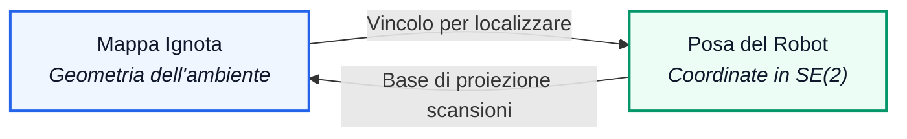
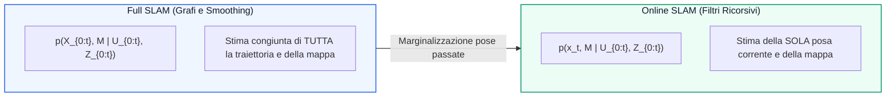

# 10. SLAM ed EKF-SLAM

Nei capitoli precedenti abbiamo affrontato il problema della localizzazione ipotizzando la perfetta disponibilità di una mappa metrica dell'ambiente ([[4. Localizzazione e Filtri di Bayes|Filtri di Bayes]], [[5. Localizzazione con Histogram Filter|Histogram Filter]], [[6. Localizzazione con Particle Filter|Particle Filter]] ed [[9. Localizzazione con Extended Kalman Filter|Extended Kalman Filter]]). Nella realtà operativa della robotica di servizio, spaziale o industriale, disporre a priori di una planimetria geometrica accurata è un'eccezione rara: la mappatura manuale è costosa, lenta e soggetta a errori umani.

In questo capitolo affrontiamo il problema cardine della navigazione autonoma: il __Simultaneous Localization and Mapping (SLAM)__, in cui il veicolo deve costruire la mappa di un ambiente ignoto e contemporaneamente localizzarsi all'interno di essa sfruttando unicamente i propri sensori di bordo. Analizziamo la formulazione probabilistica fondamentale, l'esperimento concettuale sulla genesi fisica delle correlazioni tra robot e landmark, e l'algoritmo classico di riferimento: l'__EKF-SLAM__.

![[slide_19_slam_conceptual_framework_slhb.png|center mid]]

## Il Problema SLAM E Il Dilemma Della Circolarità

Il problema dello SLAM è noto nella letteratura ingegneristica come il classico dilemma dell'uovo e della gallina (_chicken-and-egg problem_):
- Per costruire una mappa metrica coerente dell'ambiente, dobbiamo conoscere istante per istante la posa esatta del robot da cui provengono le scansioni sensoriali;
- Per stimare accuratamente la posa del robot e correggere la deriva odometrica, dobbiamo disporre di una mappa geometrica affidabile rispetto a cui confrontare le misure.

Quando entrambe le grandezze (traiettoria del robot e geometria dell'ambiente) sono incognite a priori, le due sorgenti di incertezza si intrecciano in un unico processo stocastico accoppiato.

La definizione operativa formulata nella robotica probabilistica recita:
> Partendo da una posa iniziale arbitraria, un robot mobile deve esplorare autonomamente un ambiente non strutturato mediante i soli sensori di bordo, interpretare la scena, costruire incrementalmente una mappa metrica appropriata e stimare la propria posizione rispetto a essa.

### Perché l'Odometria Pura Fallisce

Se il robot provasse a mappare l'ambiente affidandosi alla sola integrazione cinematica dell'odometria ([[0. Modelli Cinematici e di Movimento|Modelli Cinematici]]), la deriva stocastica causata da micro-slittamenti ruota-suolo, asimmetrie costruttive e quantizzazione degli encoder farebbe divergere l'errore di posizione in modo monotono crescente.

Dopo pochi metri di navigazione, la proiezione delle scansioni laser produrrebbe pareti duplicate, corridoi deformati e mappe topologicamente incoerenti. Per arrestare la crescita indefinita della covarianza d'errore, il veicolo deve sfruttare la correlazione spaziale tra i punti cospicui dell'ambiente, chiudendo cicli di traiettoria (_loop closure_).

## L'Esperimento Mentale Di Scaramuzza: Nascita Fisica Delle Correlazioni

Per comprendere a fondo la struttura probabilistica dello SLAM analizziamo l'esperimento concettuale proposto da Roland Siegwart e Davide Scaramuzza, che scompone l'evoluzione dell'incertezza in cinque istanti temporali consecutivi.

### Accensione E Definizione Della Terna Mondo ($t = 0$)

All'istante iniziale $t = 0$ il robot si accende in una posizione sconosciuta rispetto all'edificio. Non avendo punti di riferimento esterni, poniamo convenzionalmente l'origine del sistema di riferimento globale (Mondo $W$) coincidente con la posa iniziale del robot:

$$
\mathbf{x}_0 = \begin{bmatrix} x_0 \\ y_0 \\ \theta_0 \end{bmatrix} = \begin{bmatrix} 0 \\ 0 \\ 0 \end{bmatrix}, \quad P_{xx, 0} = \mathbf{0}_{3 \times 3}
$$

Stando fermo nella posa iniziale a incertezza nulla, il robot acquisisce con i sensori esterocettivi (LiDAR o camera) la prima misura relativa del landmark $m_0$:

$$
\mathbf{z}_0 = h(\mathbf{x}_0, m_0) + \mathbf{v}_0
$$

La posizione stimata di $m_0$ nel mondo coincide con la misura proiettata $\hat{m}_0 = g(\mathbf{x}_0, \mathbf{z}_0)$. Poiché la posa iniziale è nota a incertezza nulla ($P_{xx, 0} = \mathbf{0}_{3 \times 3}$), l'incertezza sul landmark $m_0$ dipende unicamente dalla covarianza del rumore di misura del sensore $R$, proiettata nel piano cartesiano tramite lo Jacobiano $G_z = \frac{\partial g}{\partial \mathbf{z}}$:

$$
P_{m_0 m_0} = G_z R G_z^T
$$

_(nel caso ideale in cui il sensore fornisca direttamente misure cartesiane locali disaccoppiate con $G_z = I$, si ha $P_{m_0 m_0} = R$)_.

L'ellisse di confidenza di $m_0$ è illustrata nel pannello di sinistra della figura seguente: le sue dimensioni dipendono esclusivamente dalla precisione strumentale del sensore.

![[slide_19_scaramuzza_step1_initial_observation.png|center small]] ![[slide_19_scaramuzza_step2_motion_uncertainty.png|center small]]

### Primo Spostamento E Incremento Dell'Incertezza Di Posa ($t = 1$)

Il robot riceve un comando di attuazione $\mathbf{u}_1$ e si sposta nella nuova posa nominale $\mathbf{x}_1$. Per effetto del disturbo stocastico di motricità, l'incertezza sulla posa del veicolo cresce secondo la propagazione cinematica al prim'ordine ([[1. Modelli di Movimento Stocastici|Modelli di Movimento Stocastici]]):

$$
P_{xx, 1} = F_x P_{xx, 0} F_x^T + F_u Q_1 F_u^T = F_u Q_1 F_u^T
$$

Nel pannello di destra osserviamo l'ellisse di incertezza del robot (in grigio) che si espande attorno a $\mathbf{x}_1$. Fino a questo istante la mappa contiene solo $m_0$: poiché il robot non ha ancora osservato nuovi landmark dalla posa $\mathbf{x}_1$, la stima della mappa e la stima del robot rimangono statisticamente indipendenti.

### Nuova Misura E Nascita Delle Correlazioni Incrociate ($t = 2$)

Dalla posa incerta $\mathbf{x}_1$, il robot osserva due nuovi landmark ambientali, $m_1$ ed $m_2$. La posizione di questi punti nella terna mondo viene calcolata proiettando le osservazioni sensoriali attraverso la funzione geometrica di misura inversa:

$$
\hat{m}_i = g(\hat{\mathbf{x}}_1, \mathbf{z}_1^i)
$$

L'incertezza totale associata a $m_1$ ed $m_2$ è data dalla somma di due contributi distinti:
1. L'incertezza del sensore esterocettivo (rumore $R$);
2. L'incertezza della posa istantanea del robot da cui è stata scattata la misura ($P_{xx, 1}$).

Le ellissi d'incertezza di $m_1$ ed $m_2$ (pannello di sinistra sotto) risultano visibilmente più ampie di quella di $m_0$, poiché incorporano l'errore cumulato di odometria.

![[slide_19_scaramuzza_step3_correlation_landmark.png|center small]] ![[slide_19_scaramuzza_step4_recursive_localization.png|center small]]

>[!IMPORTANT] La Nascita della Correlazione Statistica Mappa-Robot
>Poiché le coordinate dei landmark $m_1$ ed $m_2$ sono state ricavate a partire dalla medesima posa imperfetta $\mathbf{x}_1$, i loro errori di stima sono correlati tra loro e con la posa del robot:
>
>$$
>P_{x m_i} \ne \mathbf{0}, \quad P_{m_1 m_2} \ne \mathbf{0}
>$$
>
>La mappa non è più un insieme di punti indipendenti: i landmark memorizzano una memoria condivisa della traiettoria del veicolo.

### Navigazione Ricorsiva E Accoppiamento Progressivo

Il robot si muove verso la posa $\mathbf{x}_2$ e riosserva i landmark $m_1$ ed $m_2$ per localizzarsi (pannello di destra sopra). Durante questa fase accadono due fenomeni simultanei:
- L'errore odometrico aumenta ulteriormente la covarianza del veicolo;
- L'uso dei landmark per correggere la traiettoria trasferisce nuova incertezza tra stato e mappa, aumentando monotonamente il grado di correlazione incrociata.

### Chiusura Del Ciclo (Loop Closure) E Collasso Dell'Incertezza

Il robot compie un circuito chiuso e torna in prossimità della posa iniziale, riosservando il landmark $m_0$ la cui posizione era stata battezzata all'inizio con minima incertezza. Questa riosservazione costituisce un evento di __Loop Closure Detection__.

![[slide_19_scaramuzza_step5_loop_closure_shrink.png|center small]] ![[slide_19_slam_loop_closure_idea_thrun.png|center small]]

Quando l'innovazione sensoriale su $m_0$ viene processata:
1. La posa corrente del robot si riaggancia al landmark $m_0$, riducendo istantaneamente l'ellisse di confidenza del veicolo;
2. Attraverso la fitta rete di covarianze incrociate $P_{xm}$ e $P_{m_i m_j}$ accumulate lungo l'intero percorso, l'informazione correttiva si propaga all'indietro a catena: __le ellissi di incertezza di tutti i landmark intermedi ($m_1, m_2$) e di tutte le pose passate si contraggono simultaneamente__.

## Formulazione Matematica Probabilistica Del Problema SLAM

Formalizziamo lo spazio di probabilità dello SLAM definendo le variabili di stato e le sequenze temporali da $t = 0$ all'orizzonte $T$.

### Variabili Di Stato E Notazione Fondamentale

- __Traiettoria del Robot__:
  
  $$
  X_{0:t} := \left\{ \mathbf{x}_0, \mathbf{x}_1, \dots, \mathbf{x}_t \right\}
  $$
  
  dove $\mathbf{x}_\tau = [x_\tau, y_\tau, \theta_\tau]^T \in SE(2)$ rappresenta la posa planare all'istante $\tau$;

- __Sequenza dei Comandi di Controllo__:
  
  $$
  U_{0:t} := \left\{ \mathbf{u}_1, \mathbf{u}_2, \dots, \mathbf{u}_t \right\}
  $$
  
  comprendente le velocità imposte $(\nu_t, \omega_t)$ o le traslazioni/rotazioni registrate dall'odometria ruote;

- __Mappa dell'Ambiente__:
  
  $$
  M := \left\{ \mathbf{m}_1, \mathbf{m}_2, \dots, \mathbf{m}_n \right\}
  $$
  
  costituita da $n$ feature geometriche o landmark puntiformi $\mathbf{m}_i = [m_{i,x}, m_{i,y}]^T$. Assumiamo che la mappa sia __statica__ nel tempo ($\dot{\mathbf{m}}_i = \mathbf{0}, \forall i$);

- __Sequenza delle Misure Sensoriali Esterocettive__:
  
  $$
  Z_{0:t} := \left\{ \mathbf{z}_0, \mathbf{z}_1, \dots, \mathbf{z}_t \right\}
  $$
  
  dove ogni pacchetto $\mathbf{z}_\tau = \{\mathbf{z}_\tau^1, \dots, \mathbf{z}_\tau^{k_\tau}\}$ raccoglie le osservazioni polari o cartesiane estratte dal sensore.

### Dicotomia Fondamentale: Full SLAM Vs Online SLAM

A seconda dell'obiettivo di stima, il problema SLAM si declina in due formulazioni probabilistiche canoniche:

#### Full SLAM

Nel __Full SLAM__ vogliamo calcolare la densità di probabilità a posteriori congiunta sull'intera traiettoria percorsa dal robot e sull'intera mappa:

$$
p\left( X_{0:t}, M \;\middle|\; U_{0:t}, Z_{0:t} \right)
$$

Questa formulazione è alla base dei moderni metodi di ottimizzazione su grafo (_Graph-SLAM_ / _Factor Graphs_). Trattenere tutte le pose nel tempo rende la matrice di informazione estremamente sparsa, consentendo di risolvere problemi su vastissima scala tramite algoritmi di minimizzazione ai minimi quadrati non lineari.

#### Online SLAM

Nell'__Online SLAM__ l'obiettivo computazionale si restringe alla posa istantanea corrente $\mathbf{x}_t$ e alla mappa $M$, marginalizzando via tutte le pose passate:

$$
p\left( \mathbf{x}_t, M \;\middle|\; U_{0:t}, Z_{0:t} \right) = \int \dots \int p\left( X_{0:t}, M \;\middle|\; U_{0:t}, Z_{0:t} \right) \, \mathrm{d}\mathbf{x}_0 \, \mathrm{d}\mathbf{x}_1 \dots \mathrm{d}\mathbf{x}_{t-1}
$$

L'Online SLAM è la formulazione naturale dei filtri ricorsivi bayesiani (EKF-SLAM e Particle Filter), dove le pose pregresse vengono progressivamente scartate per mantenere fisso il vettore di stato temporale.

### Rappresentazione Mediante Reti Bayesiane Dinamiche (DBN)

I modelli grafici probabilistici formalizzano la struttura di indipendenza condizionale dello SLAM:

![[slide_19_online_slam_dbn_graphical_model.png|center small]] ![[slide_19_full_slam_dbn_graphical_model.png|center small]]

Dall'ispezione della DBN emergono tre regole architetturali:
1. Le pose del robot formano una catena di Markov guidata dai comandi $\mathbf{u}_t$: $p(\mathbf{x}_t \mid \mathbf{x}_{t-1}, \mathbf{u}_t)$;
2. La mappa $M$ è un nodo statico a monte che condiziona tutte le osservazioni $z_t$, ma non possiede frecce di transizione temporale proprie ($\mathbf{m}_{i,t} = \mathbf{m}_{i,t-1}$);
3. Le misure $\mathbf{z}_t$ sono condizionatamente indipendenti tra loro data la posa istantanea $\mathbf{x}_t$ e la mappa $M$: $p(\mathbf{z}_t \mid \mathbf{x}_t, M) = \prod_k p(\mathbf{z}_t^k \mid \mathbf{x}_t, \mathbf{m}_{j_k})$.

### Tassonomia Dei Sistemi SLAM Per Tipologia Di Misura

In base alle modalità sensoriali impiegate distinguiamo:
- __Range-and-Bearing SLAM__: il sensore (LiDAR o stereo camera) misura simultaneamente distanza e orientamento angolare del landmark rispetto al robot;
- __Range-Only SLAM__: il sensore misura unicamente la distanza scalare da beacon radio (es. transponder UWB o Wi-Fi), richiedendo manovre cinematiche prolungate per triangolare la posizione delle ancore;
- __Bearing-Only SLAM__: il sensore misura unicamente l'angolo di vista (es. monocular camera in Visual SLAM), dove la profondità e la scala assoluta dell'ambiente sono inizialmente inosservabili e devono essere stimate per parallasse da viste multiple.

## Architettura Standard Nei Moderni Framework: Front-End Vs Back-End

A partire dalla celebre rassegna di Cadena et al. (2016, _"Past, Present, and Future of SLAM"_), tutti i sistemi di SLAM avanzati adottano una decomposizione architetturale modulare a due livelli:

![[slide_19_slam_frontend_backend_architecture.png|center mid]]

### Il Front-End Sensoriale

Il __Front-End__ opera a stretto contatto con i flussi di dati dei sensori e dipende fortemente dall'hardware impiegato:
1. __Elaborazione e Pre-filtering__: campionamento di nuvole di punti LiDAR o tracking di corner/feature visive (FAST, ORB, SIFT);
2. __Data Association Locale__: associazione tra le feature osservate e le tracce temporali recenti;
3. __Visual / LiDAR Odometry__: stima rapida del moto a breve termine tra frame consecutivi;
4. __Loop Closure Detection__: riconoscimento di luoghi già visitati tramite confronto globale di descrittori (es. Bag-of-Words visive DBoW2 o descrittori geometrici di scan matching).

### Il Back-End Di Ottimizzazione

Il __Back-End__ è completamente astratto dalla natura fisica dei sensori e risolve il problema matematico di stima:
1. Riceve dal Front-End vincoli cinematici relativi tra pose successive e vincoli geometrici su landmark o loop closure;
2. Risolve un problema di stima ottima a posteriori (MAP) o un ciclo ricorsivo del filtro di Bayes;
3. Negli approcci a grafo (_Factor Graphs_ come GTSAM) ottimizza congiuntamente l'intera traiettoria tramite algoritmi di Levenberg-Marquardt o Gauss-Newton;
4. Negli approcci ricorsivi mantiene il belief continuo tramite EKF o campionario tramite filtri a particelle (FastSLAM / GMapping).

### Panoramica Dei Principali Framework Industriali E Open Source

| Framework / Package | Sensori Primari | Paradigma Algoritmico | Caratteristiche Distintive |
| :--- | :--- | :--- | :--- |
| __GMapping__ | LiDAR 2D + Odometria | Rao-Blackwellized Particle Filter | Standard storico in ROS 1 per mappe a griglia di occupazione 2D; basato su scan-matching corretto da particelle. |
| __ORB-SLAM (v1, v2, v3)__ | Camere Mono, Stereo, RGB-D | Factor Graph / Bundle Adjustment | Feature ORB invarianti a scala e rotazione, loop closure basato su DBoW2, mappa a punti sparsi estremamente accurata. |
| __hector_slam__ | LiDAR 2D ad alta frequenza | Gauss-Newton Scan Matching | Funziona senza odometria ruote, calcolando la posa dal solo scan matching contro la griglia a risoluzioni multiple. |
| __VINS-Mono / VINS-Fusion__ | Camera monoculare/stereo + IMU | Ottimizzazione non lineare a finestra mobile | State-of-the-art per droni e veicoli aerei; pre-integrazione IMU ad alta frequenza e calibrazione online estrinseca. |
| __LeGO-LOAM / DLO / F-LOAM__ | LiDAR 3D (es. Velodyne VLP-16) | Segmentazione suolo + ICP a due stadi | Ottimizzato per veicoli terrestri; separa punti a terra e ostacoli verticali abbattendo il carico computazionale. |
| __SLAM Toolbox (Nav2)__ | LiDAR 2D su griglia metrica | Pose-Graph Optimization | Package raccomandato ufficiale in ROS 2 / Nav2; supporta mappe estese e serializzazione dinamica a lungo termine. |

## L'Algoritmo EKF-SLAM

L'Extended Kalman Filter è stato il primo metodo storicamente formulato per risolvere in forma chiusa il problema dello SLAM online (Smith, Self e Cheeseman, 1986).

### Vettore Di Stato Aumentato

Nell'EKF-SLAM il vettore di stato non contiene solo le 3 variabili cinematiche del robot, ma viene __aumentato__ concatenando le coordinate cartesiane di tutti gli $n$ landmark presenti nella mappa:

$$
\mathbf{y}_t = \begin{bmatrix} \mathbf{x}_t \\ M \end{bmatrix} = \begin{bmatrix} x_t \\ y_t \\ \theta_t \\ m_{1,x} \\ m_{1,y} \\ \vdots \\ m_{n,x} \\ m_{n,y} \end{bmatrix} \in \mathbb{R}^{3 + 2n}
$$

Lo stato ha dimensione variabile $N = 3 + 2n$, crescendo di 2 componenti ogni volta che un nuovo punto di riferimento viene scoperto e inserito nel filtro.

### Matrice Di Covarianza Aumentata E Blocchi Di Correlazione

La matrice di covarianza dell'errore di stima associata a $\mathbf{y}_t$ assume una struttura a blocchi quadrata di dimensione $(3 + 2n) \times (3 + 2n)$:

$$
P_t = \begin{bmatrix} P_{xx} & P_{xm} \\ P_{mx} & P_{mm} \end{bmatrix} = \begin{bmatrix} 
P_{xx} & P_{xm_1} & \cdots & P_{xm_n} \\ 
P_{m_1 x} & P_{m_1 m_1} & \cdots & P_{m_1 m_n} \\ 
\vdots & \vdots & \ddots & \vdots \\ 
P_{m_n x} & P_{m_n m_1} & \cdots & P_{m_n m_n} 
\end{bmatrix}
$$

Analizziamo il significato fisico di ciascun blocco:
- $P_{xx} \in \mathbb{R}^{3 \times 3}$: covarianza dell'errore sulla posa istantanea del robot;
- $P_{m_i m_i} \in \mathbb{R}^{2 \times 2}$: incertezza marginale sulla posizione assoluta del landmark $m_i$;
- $P_{xm_i} \in \mathbb{R}^{3 \times 2}$: covarianza incrociata tra la posa del robot e il landmark $m_i$;
- $P_{m_i m_j} \in \mathbb{R}^{2 \times 2}$ ($i \ne j$): covarianza incrociata mutua tra due landmark distinti della mappa.

> [!WARNING] Il Ruolo Decisivo dei Termini Fuori Diagonale
> Approssimare $P_t$ trascurando i termini fuori diagonale ($P_{xm} = \mathbf{0}, P_{m_i m_j} = \mathbf{0}$) equivale a considerare robot e mappa come entità indipendenti. Questa semplificazione distrugge la consistenza statistica del filtro, impedisce la propagazione dell'informazione correttiva durante i loop closure e conduce alla divergenza catastrofica dello stimatore.

## Ciclo Operativo Di EKF-SLAM

L'algoritmo ricorsivo di EKF-SLAM si articola nelle canoniche fasi dell'Extended Kalman Filter, opportunamente estese alla dimensione aumentata.

![[slide_19_ekf_slam_step1_prediction.png|center small]] ![[slide_19_ekf_slam_step2_observation.png|center small]]

### Position Prediction E Predizione Della Posa

All'arrivo del comando di movimento $\mathbf{u}_t$, il robot evolve nello spazio mentre i landmark della mappa rimangono rigidamente ancorati al terreno. Il modello cinematico aumentato vale:

$$
\mathbf{y}_{t\mid t-1} = \begin{bmatrix} \hat{\mathbf{x}}_{t\mid t-1} \\ \hat{M}_{t\mid t-1} \end{bmatrix} = \begin{bmatrix} f(\hat{\mathbf{x}}_{t-1\mid t-1}, \mathbf{u}_t) \\ \hat{M}_{t-1\mid t-1} \end{bmatrix}
$$

Lo Jacobiano cinematico aumentato $F_t = \frac{\partial f_e}{\partial \mathbf{y}}$ assume la struttura identità per la parte di mappa:

$$
F_t = \begin{bmatrix} F_x & \mathbf{0}_{3 \times 2n} \\ \mathbf{0}_{2n \times 3} & I_{2n \times 2n} \end{bmatrix}
$$

dove $F_x = \frac{\partial f}{\partial \mathbf{x}} \in \mathbb{R}^{3 \times 3}$ è lo Jacobiano cinematico del solo veicolo (calcolato per Eulero o Runge-Kutta 2).

La matrice di covarianza del rumore di processo aumentata agisce esclusivamente sulle ruote del robot:

$$
Q_t = \begin{bmatrix} Q_{x,t} & \mathbf{0}_{3 \times 2n} \\ \mathbf{0}_{2n \times 3} & \mathbf{0}_{2n \times 2n} \end{bmatrix}
$$

Propagando la covarianza a priori $P_{t\mid t-1} = F_t P_{t-1\mid t-1} F_t^T + Q_t$, otteniamo:

$$
P_{t\mid t-1} = \begin{bmatrix} 
F_x P_{xx} F_x^T + Q_{x,t} & F_x P_{xm} \\ 
(F_x P_{xm})^T & P_{mm} 
\end{bmatrix}
$$

Notiamo che:
1. Il blocco del robot $P_{xx}$ si espande per effetto dell'odometria;
2. Il blocco delle correlazioni $P_{xm}$ viene trasformato dallo Jacobiano $F_x$;
3. __Il blocco puro di mappa $P_{mm}$ rimane invariato__, poiché i muri non si muovono.

### Observation E Acquisizione Delle Misure

I sensori esterocettivi estraggono un insieme di feature polari relative:

$$
\mathbf{z}_t = \left\{ \mathbf{z}_t^1, \mathbf{z}_t^2, \dots, \mathbf{z}_t^k \right\}
$$

con $\mathbf{z}_t^i = [r^i, \alpha^i]^T$ (distanza e bearing nel sistema di coordinate del sensore).

### Measurement Prediction E Predizione Delle Misure Attese

Per ciascun landmark già registrato nella mappa $\hat{\mathbf{m}}_j = [\hat{m}_{j,x}, \hat{m}_{j,y}]^T$, calcoliamo la misura polare teorica attesa rispetto alla posa predetta $\hat{\mathbf{x}}_{t\mid t-1}$:

$$
\hat{\mathbf{z}}_t^j = h(\hat{\mathbf{x}}_{t\mid t-1}, \hat{\mathbf{m}}_j) = \begin{bmatrix} \sqrt{(\hat{m}_{j,x} - \hat{x})^2 + (\hat{m}_{j,y} - \hat{y})^2} \\ \operatorname{atan2}(\hat{m}_{j,y} - \hat{y}, \, \hat{m}_{j,x} - \hat{x}) - \hat{\theta} \end{bmatrix}
$$

Lo Jacobiano di misura aumentato $H_t^j \in \mathbb{R}^{2 \times (3 + 2n)}$ è sparso: ha valori non nulli solo in corrispondenza delle colonne della posa del robot e delle colonne del landmark $j$:

$$
H_t^j = \begin{bmatrix} H_x^j & \mathbf{0} & \dots & \mathbf{0} & H_m^j & \mathbf{0} & \dots & \mathbf{0} \end{bmatrix}
$$

con $H_x^j = \frac{\partial h}{\partial \mathbf{x}} \in \mathbb{R}^{2 \times 3}$ e $H_m^j = \frac{\partial h}{\partial \mathbf{m}_j} \in \mathbb{R}^{2 \times 2}$.

![[slide_19_ekf_slam_step3_measurement_prediction.png|center small]] ![[slide_19_ekf_slam_step4_data_association.png|center small]]

### Data Association E Inizializzazione Di Nuovi Landmark

Per ogni misura osservata $\mathbf{z}_t^i$ e ogni landmark ipotizzato $j$, calcoliamo l'innovazione e la relativa covarianza di innovazione:

$$
\tilde{\mathbf{z}}_t^{i,j} = \begin{bmatrix} r^i - \hat{r}^j \\ \operatorname{atan2}\left(\sin(\alpha^i - \hat{\alpha}^j), \cos(\alpha^i - \hat{\alpha}^j)\right) \end{bmatrix}
$$

$$
\Sigma_t^{i,j} = H_t^j P_{t\mid t-1} (H_t^j)^T + R_t^i
$$

Calcoliamo la distanza di Mahalanobis:

$$
\mu^{i,j} = \left(\tilde{\mathbf{z}}_t^{i,j}\right)^T \left(\Sigma_t^{i,j}\right)^{-1} \tilde{\mathbf{z}}_t^{i,j}
$$

- Se $\min_j \mu^{i,j} \le \gamma$ (soglia di gating dal test $\chi^2$), la misura $\mathbf{z}_t^i$ viene associata al landmark esistente $j^*$;
- Se per tutti i landmark noti $\mu^{i,j} > \gamma$, la lettura viene dichiarata come __nuovo landmark__ da aggiungere alla mappa.

#### Inizializzazione Analitica di un Nuovo Landmark

Per inserire un nuovo punto nella mappa, invertiamo il modello di misura geometrico proiettando l'osservazione polare $\mathbf{z}_t = [r, \alpha]^T$ nel frame globale:

$$
\hat{\mathbf{m}}_{\text{new}} = g(\hat{\mathbf{x}}_{t\mid t-1}, \mathbf{z}_t) = \begin{bmatrix} \hat{x} + r \cos(\hat{\theta} + \alpha) \\ \hat{y} + r \sin(\hat{\theta} + \alpha) \end{bmatrix}
$$

Il vettore di stato aumentato si espande: $\mathbf{y} \leftarrow [\mathbf{y}^T, \, \hat{\mathbf{m}}_{\text{new}}^T]^T \in \mathbb{R}^{3 + 2(n+1)}$.

I Jacobiani di proiezione rispetto alla posa del robot e al vettore di misura valgono rispettivamente:

$$
G_x = \frac{\partial g}{\partial \mathbf{x}} = \begin{bmatrix} 1 & 0 & -r \sin(\hat{\theta} + \alpha) \\ 0 & 1 & r \cos(\hat{\theta} + \alpha) \end{bmatrix} \in \mathbb{R}^{2 \times 3}, \quad G_z = \frac{\partial g}{\partial \mathbf{z}} = \begin{bmatrix} \cos(\hat{\theta} + \alpha) & -r \sin(\hat{\theta} + \alpha) \\ \sin(\hat{\theta} + \alpha) & r \cos(\hat{\theta} + \alpha) \end{bmatrix} \in \mathbb{R}^{2 \times 2}
$$

La matrice di covarianza aumentata viene espansa accodando i blocchi diagonali e le covarianze incrociate ereditate:

$$
P_{\text{new}, \text{new}} = G_x P_{xx} G_x^T + G_z R G_z^T \in \mathbb{R}^{2 \times 2}
$$

$$
P_{x, \text{new}} = P_{xx} G_x^T \in \mathbb{R}^{3 \times 2}, \quad P_{\text{new}, x} = (P_{x, \text{new}})^T = G_x P_{xx}
$$

$$
P_{m, \text{new}} = P_{mx} G_x^T \in \mathbb{R}^{2n \times 2}, \quad P_{\text{new}, m} = (P_{m, \text{new}})^T = G_x P_{xm}
$$

Notiamo che il nuovo landmark eredita immediatamente la correlazione $P_{m, \text{new}}$ con tutti gli altri punti della mappa attraverso la posa corrente del robot $P_{mx}$.

![[slide_19_ekf_slam_step5_correction.png|center small]] ![[slide_19_ekf_slam_loop_closure_covariance_convergence.png|center small]]

### Correction E Aggiornamento Congiunto

Per tutte le misure associate ai landmark preesistenti, componiamo l'innovazione globale $\tilde{\mathbf{z}}_t$, lo Jacobiano aggregato $H_t$ e calcoliamo il guadagno ottimo di Kalman aumentato:

$$
K_t = P_{t\mid t-1} H_t^T \left( H_t P_{t\mid t-1} H_t^T + R_t \right)^{-1}
$$

L'aggiornamento a posteriori corregge congiuntamente robot e mappa:

$$
\hat{\mathbf{y}}_{t\mid t} = \hat{\mathbf{y}}_{t\mid t-1} + K_t \tilde{\mathbf{z}}_t
$$

$$
P_{t\mid t} = \left( I - K_t H_t \right) P_{t\mid t-1}
$$

Nelle implementazioni software reali, per preservare la semidefinita positività numerica contro gli errori di arrotondamento floating point, si adotta la forma stabilizzata di Joseph estesa ([[8. Filtro di Kalman Lineare|Filtro di Kalman Lineare]]):

$$
P_{t\mid t} = \left( I - K_t H_t \right) P_{t\mid t-1} \left( I - K_t H_t \right)^T + K_t R_t K_t^T
$$

## Teoria Della Convergenza Di EKF-SLAM E Loop Closure

Nel 2001, Dissanayake, Newman, Clark, Durrant-Whyte e Csorba pubblicarono un risultato analitico fondamentale sulla convergenza dello SLAM lineare/gaussiano:

![[slide_19_ekf_slam_covariance_correlation_shrinkage.png|center mid]]

Il teorema stabilisce tre proprietà asintotiche universali:
1. __Monotona Crescita delle Correlazioni e Rigidità Relativa__: man mano che il robot naviga ed esegue osservazioni successive, il grado di correlazione tra qualsiasi coppia di feature della mappa cresce monotonamente fino a correlazione completa (i coefficienti scalari di correlazione tendono a 1). Di conseguenza, la covarianza d'errore relativa tra due landmark qualsiasi si annulla asintoticamente:
   
   $$
   \lim_{t \to \infty} \operatorname{Cov}(\mathbf{m}_i - \mathbf{m}_j) = \lim_{t \to \infty} \left( P_{m_i m_i} + P_{m_j m_j} - P_{m_i m_j} - P_{m_j m_i} \right) = \mathbf{0}_{2 \times 2}
   $$
   
   La mappa diventa internamente rigida: le posizioni relative tra i landmark diventano note con certezza geometrica assoluta.

2. __Limite Inferiore dell'Incertezza di Mappa__: la covarianza assoluta di stima di qualsiasi landmark ammette un limite inferiore asintotico non nullo, determinato unicamente dall'incertezza con cui è stata inizializzata la posa iniziale del robot $\mathbf{x}_0$. Nel caso generale planare $SE(2)$, proiettando l'incertezza della terna di partenza si ha:
   
   $$
   \lim_{t \to \infty} P_{m_i m_i} = J_{\mathbf{x}_0}^{m_i} P_{xx, 0} \left(J_{\mathbf{x}_0}^{m_i}\right)^T
   $$
   
   _(nel caso puramente traslazionale con orientamento nominale privo di errore, il limite coincide direttamente con il blocco di posizione iniziale $\lim_{t \to \infty} P_{m_i m_i} = P_{xx,0}^{\text{pos}} \in \mathbb{R}^{2 \times 2}$)_.
   Se la posa di accensione è nota esattamente ($P_{xx,0} = \mathbf{0}_{3 \times 3}$), l'incertezza di ciascun landmark tende a zero; se invece la posa iniziale è affetta da incertezza non nulla, la mappa converge a una struttura rigida che fluttua solidalmente attorno alla terna globale con incertezza residua dettata da $P_{xx,0}$.

3. __Contrazione Globale con Loop Closing__: quando il robot riconosce un'area visitata in precedenza, l'aggiornamento di Kalman trasferisce il guadagno di informazione a tutti i coefficienti di correlazione, provocando una contrazione visibile e permanente delle ellissi di incertezza su tutti i landmark della mappa.

## Limiti Computazionali, Scalabilità E Vulnerabilità

Nonostante la sua eleganza analitica, l'EKF-SLAM presenta criticità teoriche e pratiche che ne limitano l'impiego ad ambienti di medie dimensioni ($n \le 10^3$ landmark):

### Complessità Temporale E Spaziale Quadratica $O(n^2)$

La matrice di covarianza aumentata $P_t$ contiene $(3 + 2n)^2$ elementi float a 64 bit. A ogni passo di aggiornamento:
- L'inversione della matrice di innovazione e il prodotto matriciale $K_t H_t P_t$ richiedono $O(n^2)$ operazioni aritmetiche per ciascuna misura;
- Lo spazio di memoria primario scala come $O(n^2)$.

Con migliaia di feature la frequenza di aggiornamento scende al di sotto dei requisiti real-time su processori embedded.

### Vulnerabilità All'Unimodalità Gaussiana E False Associazioni

L'EKF è uno stimatore strettamente unimodale (rappresenta un unico lobo gaussiano centrato sulla media). Se il veicolo incorre in una falsa chiusura di ciclo (_false positive loop closure_):
- L'innovazione errata sposta irreversibilmente la media $\hat{\mathbf{y}}$ in una configurazione degenere;
- Il filtro riduce drasticamente la covarianza credendo di aver chiuso il ciclo con successo, diventando ipo-arrogante e rigettando tutte le future misure corrette;
- Il filtro diverge irrimediabilmente.

### Errori Di Linearizzazione E Consistenza

Le matrici Jacobiane $F_x$ e $H_t$ dipendono dalla stima corrente $\hat{\theta}$. Se l'incertezza angolare sul robot è elevata, la linearizzazione al primo ordine di Taylor introduce errori sistematici che portano alla sottostima dell'incertezza reale (il filtro dichiara una covarianza inferiore a quella effettiva, perdendo la proprietà di _consistenza statistica_).

## Strumenti Software E Benchmark Sperimentali

La sperimentazione pratica dell'EKF-SLAM si avvale di librerie storiche e moduli moderni:

### Il CAS Robot Navigation Toolbox (KTH)

Sviluppato dal Royal Institute of Technology di Stoccolma (KTH), il toolbox CAS costituisce il benchmark didattico storico per la validazione di filtri SLAM basati su rette e beacon:
- `sjursflatlinesetup`: dataset di prova con estrazione di rette di Hesse;
- `sjursflatbeaconsetup`: navigazione guidata da transponder radio puntiformi;
- `atriumsetup` e `bakery3setup`: rilievi reali in ambienti indoor complessi.

![[slide_19_cas_kth_line_based_slam.png|center small]] ![[slide_19_cas_kth_beacon_based_slam.png|center small]]

I tracciati evidenziano chiaramente la stima contemporanea della traiettoria percorsa dal robot (linea blu continua) e la convergenza geometrica dei landmark o segmenti murari associati.

### Libreria MATLAB `ekfSLAM`

Introdotta nel Navigation Toolbox a partire da MATLAB R2021b, la classe `ekfSLAM` implementa l'architettura canonica a stato aumentato incapsulando i modelli cinetici e sensoriali:

![[slide_19_matlab_ekfslam_simulation_trajectory.png|center mid]]

La configurazione operativa si articola tramite puntatori a funzione standard:
- `StateTransitionFcn`: modello di moto del veicolo (default: `nav.algs.velocityMotionModel`);
- `MeasurementFcn`: modello di misura diretto su range e bearing (`nav.algs.rangeBearingMeasurement`);
- `InverseMeasurementFcn`: modello inverso per l'inizializzazione dei nuovi landmark (`nav.algs.rangeBearingInverseMeasurement`);
- `DataAssociationFcn`: algoritmo di matching basato su massima verosimiglianza e Mahalanobis (`nav.algs.associateMaxLikelihood`);
- Parametri di soglia: `MaxAssociationRange` per limitare il raggio di ricerca geometrico e `MaxNumLandmark` per vincolare la cardinalità dello stato aumentato.

Nelle prossime lezioni supereremo la complessità quadratica e l'unimodalità di EKF-SLAM introducendo i filtri non parametrici a particelle applicati alla mappatura congiunta ([[11. FastSLAM e Rao-Blackwellized Particle Filter|FastSLAM e Rao-Blackwellized Particle Filtering]]).
