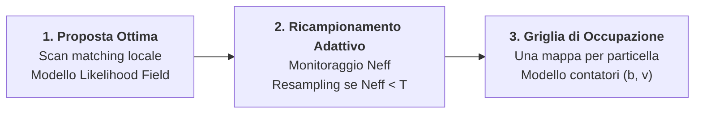
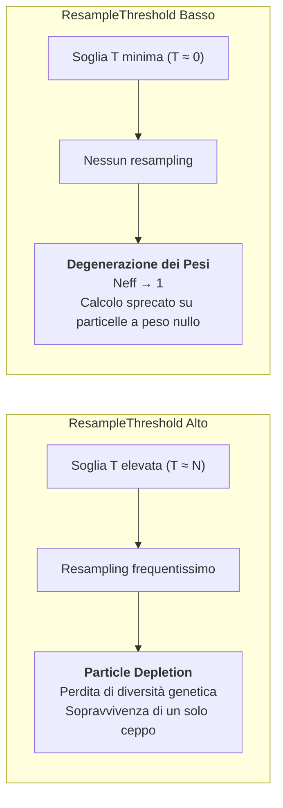
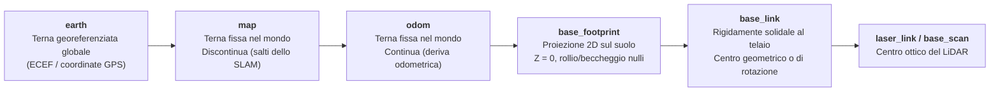

# 12. SLAM con Griglie di Occupazione e GMapping

La formulazione classica del problema di localizzazione e mappatura simultanea affrontata tramite FastSLAM adotta una parametrizzazione a landmark puntiformi discreti. Negli scenari operativi reali al chiuso, quali uffici, corridoi industriali e magazzini logistici, le pareti continue, gli arredi e gli ostacoli complessi non presentano feature geometriche isolate stabili nel tempo. In questi contesti, l'estrazione affidabile di landmark puntiformi fallisce e la rappresentazione naturale dell'ambiente diviene la griglia di occupazione (_Occupancy Grid Map_).

L'integrazione delle griglie di occupazione all'interno di un filtro a particelle Rao-Blackwellizzato pone tuttavia una sfida computazionale e statistica formale: ogni particella deve mantenere la propria mappa bidimensionale ad alta risoluzione. L'algoritmo GMapping (_Grid Mapping_, formalizzato da Giorgio Grisetti, Cyrill Stachniss e Wolfram Burgard nel 2007) risolve questa criticità introducendo una proposta di campionamento ottimizzata via scan matching e un criterio di ricampionamento adattivo governato dalla dimensione campionaria efficace.

![[slide_22_gmapping_algorithm_tro2007.svg|center big]]

## Limiti di FastSLAM su Feature e Passaggio alle Griglie di Occupazione

Nei filtri FastSLAM 1.0 e 2.0 lo stato congiunto comprende la traiettoria del robot $\mathbf{x}_{1:t}$ e un insieme finito di $K$ landmark continui $\mathbf{m}_k \in \mathbb{R}^2$:

$$
p(\mathbf{x}_{1:t}, \mathbf{m}_1, \dots, \mathbf{m}_K \mid \mathbf{z}_{1:t}, \mathbf{u}_{1:t}) = p(\mathbf{x}_{1:t} \mid \mathbf{z}_{1:t}, \mathbf{u}_{1:t}) \prod_{k=1}^K p(\mathbf{m}_k \mid \mathbf{x}_{1:t}, \mathbf{z}_{1:t})
$$

Questa scomposizione sfrutta la proprietà per cui, condizionatamente alla traiettoria nota, le stime dei landmark sono mutuamente indipendenti e aggiornabili con filtri di Kalman estesi (EKF) $2 \times 2$. Tale paradigma mostra tre limitazioni strutturali:
- __Dipendenza da feature estrattibili__: richiede la visibilità continua di punti salienti distintivi (spigoli, cilindri, catarifrangenti);
- __Sensibilità all'associazione dati__: un'errata associazione tra osservazione e indice di landmark corrompe irreversibilmente la stima del filtro di Kalman locale;
- __Assenza di informazione sullo spazio libero__: la mappa non codifica esplicitamente le regioni pervie, impedendo la pianificazione di traiettorie sicure per l'evitamento degli ostacoli.

### Algoritmo FastSLAM 1.0 per Landmark Discreti

La formulazione algoritmica di riferimento per il filtro Rao-Blackwellizzato classico su landmark puntiformi discreti opera sul set campionario di particelle $Y_t$, dove ciascuna particella associa alla traiettoria ipotizzata un banco di filtri di Kalman estesi per gli $N_m$ landmark:

```pseudo
\begin{algorithm}
\caption{FastSLAM 1.0}
\begin{algorithmic}
\REQUIRE $(Y_{t-1}, \mathbf{z}_t, \mathbf{u}_t, \mathbf{c}_t)$
\ENSURE $Y_t$
\FOR{$k = 1$ \TO $M$}
    \STATE \textbf{Retrieve:} estrae la particella $\langle \mathbf{x}_{1:t-1}^k, (\hat{\mathbf{m}}_{1,t-1}, P_{1,t-1})^k, \dots, (\hat{\mathbf{m}}_{N_m,t-1}, P_{N_m,t-1})^k \rangle \leftarrow Y_{t-1}$
    \STATE \textbf{Prediction:} campiona $\mathbf{x}_t^k \sim p(\mathbf{x}_t \mid \mathbf{x}_{t-1}^k, \mathbf{u}_t)$
    \FORALL{$\mathbf{z}_{i,t} \in \mathbf{z}_t$}
        \STATE \textbf{Measurement update:} aggiorna $(\hat{\mathbf{m}}_{i,t}, P_{i,t})$ tramite EKF locale
    \ENDFOR
    \STATE \textbf{Importance weight:} calcola $w_t^k \leftarrow p(\mathbf{z}_t \mid \mathbf{x}_t^k, \hat{\mathbf{m}})$
\ENDFOR
\STATE $Y_t \leftarrow \text{Resample}(Y_{t-1}, \{w_t^k\}_{k=1}^M)$ con probabilità proporzionale a $w_t^k$
\RETURN $Y_t$
\end{algorithmic}
\end{algorithm}
```

Si osservi come i passi 2, 3 e 5 siano formalmente identici a quelli eseguiti dal Particle Filter di sola localizzazione, mentre il passo 4 introduce l'aggiornamento stocastico analitico delle coordinate dei landmark condizionate alla traiettoria.

### Transizione Verso le Griglie di Occupazione

La griglia di occupazione discretizza l'ambiente in celle bidimensionali regolari $m^{x,y}$, ciascuna caratterizzata da una variabile casuale binaria di occupazione. Condizionatamente alla traiettoria completa $\mathbf{x}_{1:t}$ e alle scansioni telemetriche del LiDAR $\mathbf{z}_{1:t}$, le celle della griglia risultano condizionatamente indipendenti. La distribuzione a posteriori congiunta si fattorizza esattamente come:

$$
p(\mathbf{x}_{1:t}, m \mid \mathbf{z}_{1:t}, \mathbf{u}_{1:t}) = p(\mathbf{x}_{1:t} \mid \mathbf{z}_{1:t}, \mathbf{u}_{1:t}) \prod_{x,y} p(m^{x,y} \mid \mathbf{x}_{1:t}, \mathbf{z}_{1:t})
$$

Il filtro particellare stima quindi la densità di traiettoria del veicolo, mentre ciascuna particella $i$ trasporta e aggiorna la propria griglia di occupazione $m^{(i)}$ mediante ray casting.

## I Tre Pilastri Fondamentali di GMapping

L'applicazione diretta del filtro Rao-Blackwellizzato standard a mappe su griglia comporterebbe un fabbisogno proibitivo di particelle ($N \approx 500 \div 1000$) e una rapida degenerazione campionaria a causa del costo computazionale dell'aggiornamento di mappe dense. L'algoritmo GMapping introduce tre estensioni cardine:



- __Distribuzione di proposta migliorata__: invece di campionare la nuova posa dal solo modello cinematico di moto $p(\mathbf{x}_t \mid \mathbf{x}_{t-1}, \mathbf{u}_{t-1})$, GMapping valuta la scansione laser corrente $\mathbf{z}_t$ sulla mappa già costruita dalla particella, sintetizzando una densità di proposta gaussiana locale ad altissima precisione;
- __Ricampionamento adattivo__: il ricampionamento non viene eseguito a ogni passo temporale, ma subordinato al monitoraggio quantitativo del livello di dispersione dei pesi tramite la dimensione campionaria efficace $N_{\text{eff}}$;
- __Rappresentazione su griglia di occupazione con memoria ad albero__: ogni particella mantiene la propria griglia di occupazione bidimensionale aggiornata tramite un modello a contatori interi; per rendere sostenibile l'ingombro in memoria di $N$ mappe dense, le traiettorie e i dati storici sono strutturati in un albero condiviso in cui i rami ancestrali non vengono duplicati.

## Proposta Ottima Tramite Scan Matching e Approssimazione Gaussiana

Nel filtraggio per importanza applicato allo SLAM, la distribuzione target per la posa istantanea della particella $i$-esima è la densità posteriore condizionata a tutte le osservazioni e i comandi:

$$
p(\mathbf{x}_t \mid m_{t-1}^{(i)}, \mathbf{x}_{t-1}^{(i)}, \mathbf{z}_t, \mathbf{u}_{t-1}) = \frac{p(\mathbf{z}_t \mid m_{t-1}^{(i)}, \mathbf{x}_t) \, p(\mathbf{x}_t \mid \mathbf{x}_{t-1}^{(i)}, \mathbf{u}_{t-1})}{p(\mathbf{z}_t \mid m_{t-1}^{(i)}, \mathbf{x}_{t-1}^{(i)}, \mathbf{u}_{t-1})}
$$

Se il sensore esterocettivo ha un'incertezza significativamente inferiore all'errore odometrico (situazione tipica dei telemetri laser LiDAR rispetto allo slittamento ruota-terreno), la verosimiglianza di misura $p(\mathbf{z}_t \mid m_{t-1}^{(i)}, \mathbf{x}_t)$ è estremamente concentrata rispetto alla densità di transizione cinematica $p(\mathbf{x}_t \mid \mathbf{x}_{t-1}^{(i)}, \mathbf{u}_{t-1})$.

Campionare dal modello di moto convenzionale genera particelle che cadono quasi tutte in regioni a verosimiglianza quasi nulla, provocando il collasso immediato dell'efficienza campionaria. GMapping assume che, nell'intorno della stima cinematica a priori, la verosimiglianza sia unimodale e dominata da un picco locale pronunciato.

L'algoritmo calcola inizialmente la stima odometrica deterministica:

$$
\mathbf{x}_t^{\prime (i)} = \mathbf{x}_{t-1}^{(i)} \oplus \mathbf{u}_{t-1}
$$

A partire da tale posa, viene eseguito uno scan matching numerico ad ascesa di gradiente (basato sul modello a campo di verosimiglianza o _Likelihood Field_) per massimizzare la congruenza tra i raggi della scansione $\mathbf{z}_t$ e gli ostacoli della mappa $m_{t-1}^{(i)}$:

$$
\hat{\mathbf{x}}_t^{(i)} = \arg\max_{\mathbf{x}} p(\mathbf{x} \mid m_{t-1}^{(i)}, \mathbf{z}_t, \mathbf{x}_t^{\prime (i)})
$$

Qualora l'algoritmo di scan matching converga con successo a un massimo locale $\hat{\mathbf{x}}_t^{(i)}$ con punteggio di corrispondenza superiore a una soglia prestabilita (`minimumScore`), viene selezionato un insieme discreto di pose $\mathcal{X}^{(i)} = \{\mathbf{x}_j \mid \|\mathbf{x}_j - \hat{\mathbf{x}}_t^{(i)}\| < \Delta\}$ campionate uniformemente in una finestra metrica ristretta attorno al massimo.

Su questo insieme viene costruita per integrazione numerica un'approssimazione gaussiana locale $\mathcal{N}(\boldsymbol{\mu}_t^{(i)}, \Sigma_t^{(i)})$:

$$
\boldsymbol{\mu}_t^{(i)} = \frac{1}{\eta^{(i)}} \sum_{\mathbf{x}_j \in \mathcal{X}^{(i)}} \mathbf{x}_j \cdot p(\mathbf{z}_t \mid m_{t-1}^{(i)}, \mathbf{x}_j) \, p(\mathbf{x}_j \mid \mathbf{x}_{t-1}^{(i)}, \mathbf{u}_{t-1})
$$

$$
\Sigma_t^{(i)} = \frac{1}{\eta^{(i)}} \sum_{\mathbf{x}_j \in \mathcal{X}^{(i)}} p(\mathbf{z}_t \mid m_{t-1}^{(i)}, \mathbf{x}_j) \, p(\mathbf{x}_j \mid \mathbf{x}_{t-1}^{(i)}, \mathbf{u}_{t-1}) \cdot (\mathbf{x}_j - \boldsymbol{\mu}_t^{(i)})(\mathbf{x}_j - \boldsymbol{\mu}_t^{(i)})^T
$$

dove il fattore di normalizzazione locale corrisponde all'integrale marginale di verosimiglianza valutato tramite quadratura su griglia discreta con passo metrico $\Delta x$ (`llsamplestep`) e passo angolare $\Delta \theta$ (`lasamplestep`):

$$
\eta^{(i)} = \sum_{\mathbf{x}_j \in \mathcal{X}^{(i)}} p(\mathbf{z}_t \mid m_{t-1}^{(i)}, \mathbf{x}_j) \, p(\mathbf{x}_j \mid \mathbf{x}_{t-1}^{(i)}, \mathbf{u}_{t-1})
$$

La nuova posa della particella viene estratta campionando direttamente dalla distribuzione di proposta gaussiana:

$$
\mathbf{x}_t^{(i)} \sim \mathcal{N}(\boldsymbol{\mu}_t^{(i)}, \Sigma_t^{(i)})
$$

Se lo scan matching non converge (ad esempio in ambienti privi di feature o corridoi speculari infiniti), il filtro ripiega sul modello di moto classico campionando $\mathbf{x}_t^{(i)} \sim p(\mathbf{x}_t \mid \mathbf{x}_{t-1}^{(i)}, \mathbf{u}_{t-1})$.

Grazie alla distribuzione di proposta ottima, il fattore moltiplicativo di aggiornamento del peso di importanza $w_t^{(i)}$ risulta pari alla costante di normalizzazione marginale della misura:

$$
w_t^{(i)} = w_{t-1}^{(i)} \int p(\mathbf{z}_t \mid m_{t-1}^{(i)}, \mathbf{x}') \, p(\mathbf{x}' \mid \mathbf{x}_{t-1}^{(i)}, \mathbf{u}_{t-1}) \, \mathrm{d}\mathbf{x}' \approx w_{t-1}^{(i)} \cdot \eta^{(i)}
$$

Nel caso di ripiego sul modello di moto, la pesatura coincide con la consueta verosimiglianza puntuale $w_t^{(i)} = w_{t-1}^{(i)} \cdot p(\mathbf{z}_t \mid m_{t-1}^{(i)}, \mathbf{x}_t^{(i)})$.

> [!IMPORTANT]
> L'approssimazione gaussiana locale riduce la varianza dei pesi di importanza di diversi ordini di grandezza rispetto al campionamento puramente odometrico. Questo permette a GMapping di convergere in ambienti chiusi di ampie dimensioni impiegando un numero ridottissimo di particelle (tipicamente $N = 30 \div 50$).

## Ricampionamento Adattivo e Dimensione Campionaria Efficace

Il ricampionamento non condizionato a ogni passo temporale introduce una dispersione stocastica artificiale che distrugge la diversità genetica della popolazione prima che le misure sensoriali possano discriminare le traiettorie corrette.

Per stabilire quando procedere al ricampionamento, GMapping valuta quantitativamente la dispersione della distribuzione dei pesi mediante la dimensione campionaria efficace (_Effective Sample Size_, $N_{\text{eff}}$), introdotta da Kong, Liu e Wong (1994):

$$
N_{\text{eff}} = \frac{1}{\sum_{i=1}^N (\tilde{w}_i)^2}
$$

dove $\tilde{w}_i$ rappresenta il peso normalizzato della particella $i$-esima, vincolato alla somma unitaria:

$$
\tilde{w}_i = \frac{w_t^{(i)}}{\sum_{j=1}^N w_t^{(j)}}, \qquad \sum_{i=1}^N \tilde{w}_i = 1
$$

### Proprietà Statistiche della Dimensione Campionaria Efficace

L'indice $N_{\text{eff}}$ ammette un'interpretazione analitica rigorosa nel dominio discreto $[1, N]$:
- __Equidistribuzione dei pesi__: quando tutte le $N$ particelle possiedono peso identico $\tilde{w}_i = 1/N$, la sommatoria a denominatore vale:

$$
\sum_{i=1}^N \left(\frac{1}{N}\right)^2 = N \cdot \frac{1}{N^2} = \frac{1}{N} \implies N_{\text{eff}} = \frac{1}{1/N} = N
$$

In questa condizione l'insieme campionario esplora uniformemente lo spazio di stato senza concentrazione di informazione;
- __Degenerazione campionaria estrema__: quando il peso si concentra integralmente su una singola particella ($\tilde{w}_1 \to 1$ e $\tilde{w}_{i > 1} \to 0$):

$$
\sum_{i=1}^N (\tilde{w}_i)^2 \to 1^2 + 0 + \dots + 0 = 1 \implies N_{\text{eff}} \to 1
$$

In questo scenario, $N-1$ particelle risultano matematicamente inutili poiché il loro contributo alla media e alla varianza posteriore è nullo.

### Criterio di Decisione e Prevenzione dei Regimi di Guasto

GMapping attiva la routine di ricampionamento (_Low-Variance Resampling_) se e solo se la dimensione campionaria efficace scende al di sotto di una frazione prefissata $T$ della popolazione totale:

$$
N_{\text{eff}} < T = \text{resampleThreshold} \cdot N
$$

Nelle implementazioni standard si imposta $\text{resampleThreshold} = 0.5$, ovvero $T = N/2$. Questo bilanciamento protegge l'algoritmo da due modalità di fallimento opposte:



Quando il ricampionamento viene eseguito, le particelle ad alto peso vengono duplicate proporzionalmente alla loro confidenza, quelle a basso peso eliminate e i pesi normalizzati ripristinati al valore uniforme $\tilde{w}_i = 1/N$, riportando istantaneamente $N_{\text{eff}} = N$.

## Aggiornamento della Mappa per Singola Particella

Ciascuna particella $i$ possiede la propria mappa a griglia di occupazione bidimensionale $m^{(i)}$, costituita da un reticolo di celle discrete $m^{x,y}$.

All'istante $t$, la scansione laser è composta da $K$ raggi telemetrici $\mathbf{z}_t = (z_t^1, \dots, z_t^K)$. Conoscendo la posa campionata del robot $\mathbf{x}_t^{(i)} = [x_t^{(i)}, y_t^{(i)}, \theta_t^{(i)}]^T$, l'estremo cartesiano del raggio $k$-esimo nel sistema di coordinate della mappa globale si ottiene tramite composizione rigida:

$$
\hat{\mathbf{p}}_t^{k,(i)} = \begin{bmatrix} x_t^{(i)} \\ y_t^{(i)} \end{bmatrix} + z_t^k \begin{bmatrix} \cos(\theta_t^{(i)} + \alpha_k) \\ \sin(\theta_t^{(i)} + \alpha_k) \end{bmatrix}
$$

dove $\alpha_k$ è l'angolo di emissione del raggio rispetto all'asse di simmetria longitudinale del sensore.

### Modello di Stato a Due Contatori

Per aggiornare le celle attraversate dal raggio ottico senza incorrere in approssimazioni di discretizzazione logaritmica continua, l'implementazione formale di GMapping adotta per ogni cella $(x,y)$ un modello a due contatori interi $m^{x,y} = (b^{x,y}, v^{x,y})$, dove:
- $b^{x,y}$ (_busy_): numero cumulativo di volte in cui la cella è stata rilevata come punto di impatto (endpoint occupato);
- $v^{x,y}$ (_visited_): numero cumulativo totale di volte in cui la cella è stata attraversata o colpita dal fascio laser.

Dato il segmento congiungente l'origine ottica del LiDAR $\mathbf{x}_t^{(i)}$ con il punto di impatto $\hat{\mathbf{p}}_t^{k,(i)}$, tracciato mediante l'algoritmo di rasterizzazione lineare di Bresenham:
- Tutte le celle intermedie attraversate prima dell'endpoint vengono marcate come libere:

$$
b_{t+1}^{x,y} = b_t^{x,y}, \qquad v_{t+1}^{x,y} = v_t^{x,y} + 1
$$

- La cella terminale contenente l'estremo del raggio viene marcata come occupata:

$$
b_{t+1}^{x,y} = b_t^{x,y} + 1, \qquad v_{t+1}^{x,y} = v_t^{x,y} + 1
$$

La probabilità empirica a posteriori che la cella sia occupata corrisponde al rapporto di frequenza:

$$
p(m_t^{x,y}) = \frac{b_t^{x,y}}{v_t^{x,y}} \in [0, 1]
$$

Se una cella non è mai stata attraversata da alcun raggio ($v^{x,y} = 0$), lo stato di occupazione è indefinito (cella ignota), convenzionalmente rappresentato con probabilità prioritaria $p(m^{x,y}) = 0.5$.

## Algoritmo Completo di Grid-based FastSLAM (GMapping)

Sintetizzando la proposta migliorata via scan matching, la pesatura di importanza marginale, l'aggiornamento a contatori della griglia e il ricampionamento adattivo selettivo governato da $N_{\text{eff}}$, l'intero ciclo iterativo di GMapping (formalizzato da Grisetti et al., IEEE T-RO 2007) si riassume nel seguente algoritmo canonico:

```pseudo
\begin{algorithm}
\caption{Improved RBPF for Map Learning (GMapping)}
\begin{algorithmic}
\REQUIRE $\mathcal{S}_{t-1}$, scansione $\mathbf{z}_t$, odometria $\mathbf{u}_{t-1}$
\ENSURE $\mathcal{S}_t$
\STATE $\mathcal{S}_t \leftarrow \emptyset$
\FORALL{$s_{t-1}^{(i)} = \langle \mathbf{x}_{t-1}^{(i)}, w_{t-1}^{(i)}, m_{t-1}^{(i)} \rangle \in \mathcal{S}_{t-1}$}
    \STATE $\mathbf{x}_t^{\prime (i)} \leftarrow \mathbf{x}_{t-1}^{(i)} \oplus \mathbf{u}_{t-1}$ \COMMENT{Stima odometrica iniziale}
    \STATE $\hat{\mathbf{x}}_t^{(i)} \leftarrow \arg\max_{\mathbf{x}} p(\mathbf{x} \mid m_{t-1}^{(i)}, \mathbf{z}_t, \mathbf{x}_t^{\prime (i)})$ \COMMENT{Scan matching}
    \IF{$\hat{\mathbf{x}}_t^{(i)} = \text{failure}$}
        \STATE $\mathbf{x}_t^{(i)} \sim p(\mathbf{x}_t \mid \mathbf{x}_{t-1}^{(i)}, \mathbf{u}_{t-1})$ \COMMENT{Fallback al modello di moto}
        \STATE $w_t^{(i)} \leftarrow w_{t-1}^{(i)} \cdot p(\mathbf{z}_t \mid m_{t-1}^{(i)}, \mathbf{x}_t^{(i)})$
    \ELSE
        \FOR{$k = 1$ \TO $K$}
            \STATE Campiona $\mathbf{x}_k \sim \{\mathbf{x}_j \mid \|\mathbf{x}_j - \hat{\mathbf{x}}_t^{(i)}\| < \Delta\}$ attorno alla moda
        \ENDFOR
        \STATE $\boldsymbol{\mu}_t^{(i)} \leftarrow (0, 0, 0)^T, \quad \eta^{(i)} \leftarrow 0$
        \FORALL{$\mathbf{x}_j \in \{\mathbf{x}_1, \dots, \mathbf{x}_K\}$}
            \STATE $\boldsymbol{\mu}_t^{(i)} \leftarrow \boldsymbol{\mu}_t^{(i)} + \mathbf{x}_j \cdot p(\mathbf{z}_t \mid m_{t-1}^{(i)}, \mathbf{x}_j) \, p(\mathbf{x}_j \mid \mathbf{x}_{t-1}^{(i)}, \mathbf{u}_{t-1})$
            \STATE $\eta^{(i)} \leftarrow \eta^{(i)} + p(\mathbf{z}_t \mid m_{t-1}^{(i)}, \mathbf{x}_j) \, p(\mathbf{x}_j \mid \mathbf{x}_{t-1}^{(i)}, \mathbf{u}_{t-1})$
        \ENDFOR
        \STATE $\boldsymbol{\mu}_t^{(i)} \leftarrow \boldsymbol{\mu}_t^{(i)} / \eta^{(i)}$
        \STATE $\Sigma_t^{(i)} \leftarrow \mathbf{0}_{3 \times 3}$
        \FORALL{$\mathbf{x}_j \in \{\mathbf{x}_1, \dots, \mathbf{x}_K\}$}
            \STATE $\Sigma_t^{(i)} \leftarrow \Sigma_t^{(i)} + (\mathbf{x}_j - \boldsymbol{\mu}_t^{(i)})(\mathbf{x}_j - \boldsymbol{\mu}_t^{(i)})^T \cdot p(\mathbf{z}_t \mid m_{t-1}^{(i)}, \mathbf{x}_j) \, p(\mathbf{x}_j \mid \mathbf{x}_{t-1}^{(i)}, \mathbf{u}_{t-1})$
        \ENDFOR
        \STATE $\Sigma_t^{(i)} \leftarrow \Sigma_t^{(i)} / \eta^{(i)}$
        \STATE $\mathbf{x}_t^{(i)} \sim \mathcal{N}(\boldsymbol{\mu}_t^{(i)}, \Sigma_t^{(i)})$ \COMMENT{Campionamento da proposta ottima}
        \STATE $w_t^{(i)} \leftarrow w_{t-1}^{(i)} \cdot \eta^{(i)}$ \COMMENT{Aggiornamento peso d'importanza}
    \ENDIF
    \STATE $m_t^{(i)} \leftarrow \text{integrateScan}(m_{t-1}^{(i)}, \mathbf{x}_t^{(i)}, \mathbf{z}_t)$ \COMMENT{Aggiornamento mappa a contatori}
    \STATE $\mathcal{S}_t \leftarrow \mathcal{S}_t \cup \{\langle \mathbf{x}_t^{(i)}, w_t^{(i)}, m_t^{(i)} \rangle\}$
\ENDFOR
\STATE Calcola pesi normalizzati $\tilde{w}_t^{(i)} \leftarrow w_t^{(i)} / \sum_{j=1}^N w_t^{(j)}$
\STATE $N_{\text{eff}} \leftarrow \left( \sum_{i=1}^N (\tilde{w}_t^{(i)})^2 \right)^{-1}$
\IF{$N_{\text{eff}} < T$}
    \STATE $\mathcal{S}_t \leftarrow \text{Low\_Variance\_Resample}(\mathcal{S}_t)$ \COMMENT{Ricampionamento adattivo}
    \FOR{$i = 1$ \TO $N$}
        \STATE $w_t^{(i)} \leftarrow 1/N$ \COMMENT{Reset pesi}
    \ENDFOR
\ENDIF
\RETURN $\mathcal{S}_t$
\end{algorithmic}
\end{algorithm}
```

## Architettura Operativa del Sistema GMapping

L'integrazione efficiente del filtro a particelle con le mappe a griglia richiede diversi accorgimenti architetturali sia teorici sia computazionali.

### Peso Attuale e Peso Cumulativo

In GMapping coesistono due nozioni distinte di peso per ciascuna particella $i$:
1. __Peso attuale ($w_t^{(i)}$)__: accumulato a partire dall'ultimo ricampionamento effettuato. È la quantità che governa il calcolo di $N_{\text{eff}}$ e determina la selezione darwiniana delle particelle duplicate o eliminate nella nuova generazione;
2. __Peso cumulativo (`weightSum`)__: rappresenta la verosimiglianza integrata lungo l'intera traiettoria storica fin dall'istante iniziale $t=0$. Questa variabile __non viene azzerata né alterata dal ricampionamento__. Il peso cumulativo viene utilizzato dal nodo per selezionare la particella migliore da pubblicare sul topic globale `/map` e da utilizzare per la trasmissione della trasformazione rigida di localizzazione.

Una particella che ottiene un punteggio di scan matching elevato sull'ultima scansione potrebbe possedere una storia passata complessivamente mediocre. Selezionare la mappa globale tramite `weightSum` garantisce la stabilità topologica della mappa ed evita oscillazioni continue della visualizzazione.

### Guadagno delle Osservazioni e Addolcimento dei Pesi

Nel calcolo dei pesi normalizzati, una scansione laser ad alta densità angolare (es. 360 o 720 raggi) calcolata come prodotto di verosimiglianze indipendenti produce esponenti logaritmici molto grandi. Senza opportune correzioni, anche minime deviazioni geometriche farebbero collassare il peso di tutte le particelle tranne una.

GMapping applica una costante di addolcimento (_observation gain_, `ogain` o `obsSigmaGain`, con valore standard pari a 3.0) nel calcolo dei pesi normalizzati a partire dal peso logaritmico $\ell_i = \ln w_t^{(i)}$:

$$
\tilde{w}_i = \frac{\exp\left(g \cdot (\ell_i - \ell_{\max})\right)}{\sum_{j=1}^N \exp\left(g \cdot (\ell_j - \ell_{\max})\right)}, \qquad g = \frac{1}{\text{ogain} \cdot N}
$$

dove $\ell_{\max} = \max_j \ell_j$. Il parametro $g$ impedisce a una singola scansione anomala di monopolizzare l'intera massa probabilistica del filtro.

### Mappe Interne ed Esterne

Per ottimizzare il throughput di calcolo, ogni particella mantiene in memoria una __mappa interna__ che memorizza esclusivamente i punti di impatto dei raggi laser (gli endpoint occupati). Tale informazione è pienamente sufficiente per consentire lo scan matching al passo successivo e riduce di oltre l'80% l'accesso in memoria.

La __mappa completa__ dotata di spazio libero e celle trinarie (libero/occupato/ignoto) viene rigenerata dal nodo a cadenza prefissata (`map_update_interval`, tipicamente ogni 5 secondi) unicamente per la particella con peso cumulativo massimo, tracciando i segmenti completi nell'albero delle traiettorie.

### Albero delle Traiettorie e Profondità di Coalescenza

Ogni volta che una particella esegue un aggiornamento, viene allocato un nuovo nodo contenente la posa stimata e il puntatore al nodo genitore precedente. Quando si verifica un ricampionamento, le particelle duplicate puntano allo stesso nodo ancestrale.

Risalendo all'indietro l'albero delle traiettorie, i rami genealogici convergono progressivamente: oltre una certa profondità temporale, tutte le $N$ particelle discendono da un unico e comune antenato. Questo fenomeno, denominato __coalescenza delle traiettorie__, implica che il passato remoto della stima di traiettoria e della mappa diviene deterministicamente certo, mentre l'incertezza probabilistica rimane confinata al tratto operativo recente:

$$
\text{Profondità di Coalescenza} = \min \{ k \in \mathbb{N} \mid \text{antenato}_{t-k}^{(1)} = \dots = \text{antenato}_{t-k}^{(N)} \}
$$

> [!WARNING]
> Se la soglia di ricampionamento è impostata a un valore nullo o troppo basso, il ricampionamento non scatta mai. In assenza di ricampionamento non si verifica alcuna convergenza ad albero e la profondità di coalescenza coincide con l'intera lunghezza temporale della missione.

### Geometria del Laser Centrato

Nelle implementazioni pratiche (ad esempio sui robot della serie TurtleBot3), i telemetri laser LiDAR planari operano con angolo di scansione completo $[0, 2\pi)$. La libreria computazionale GMapping presuppone internamente un "laser centrato", ovvero un sistema di riferimento ottico i cui raggi siano distribuiti simmetricamente rispetto all'asse $x$ positivo, cioè nell'intervallo $[-\pi, \pi)$.

Poiché il centro della campionatura $[0, 2\pi)$ cade a $\pi$, il frame virtuale del laser centrato risulta ruotato di $180^\circ$ all'indietro rispetto al verso di avanzamento del robot. Prima di pubblicare le pose delle particelle o comporle nell'albero di navigazione, è obbligatorio applicare la trasformazione di correzione rigida tra la terna base e la terna ottica centrata:

$$
\mathbf{T}_{\text{map}}^{\text{base}} = \mathbf{T}_{\text{map}}^{\text{laser\_c}} \cdot (\mathbf{T}_{\text{base}}^{\text{laser\_c}})^{-1}
$$

## Struttura dei Sistemi di Riferimento Coordinati in ROS (REP 105)

Il paradigma architetturale ROS per la navigazione e lo SLAM è formalizzato nello standard REP 105 (_Coordinate Frames for Mobile Platforms_). La gerarchia definisce una struttura ad albero aciclico in cui ciascun sistema di coordinate possiede esattamente un unico genitore.

![[slide_22_ros_coordinate_frames_rep105.svg|center mid]]



Le proprietà fisiche e computazionali dei singoli frame sono categorizzate come segue:
- `earth`: sistema di riferimento fisso globale ancorato alla superficie terrestre (WGS84 o coordinate cartografiche UTM/ECEF). Utilizzato per missioni all'aperto con ricevitori GNSS;
- `map`: sistema di riferimento globale fisso nel mondo, con asse $Z$ diretto verso l'alto. La posa della piattaforma in questo frame non presenta deriva a lungo termine poiché viene costantemente corretta rispetto alla mappa ambientale. La trasformazione `map` $\to$ `odom` __non è continua__: ogni qualvolta l'algoritmo SLAM corregge la stima tramite scan matching o chiusura di un ciclo (_loop closure_), la trasformazione subisce salti discreti istantanei;
- `odom`: sistema di riferimento locale fisso nel mondo generato dall'integrazione delle misure odometriche dei sensori propriocettivi (encoder sulle ruote, IMU, odometria visiva). La trasformazione `odom` $\to$ `base_link` è __strettamente continua e differenziabile__ (priva di salti discreti). A causa degli slittamenti e degli errori di misura, l'origine di `odom` accumula una deriva divergente nel tempo. Risulta la terna di riferimento ideale per gli anelli chiusi di controllo dinamico e per la pianificazione locale delle velocità, dove i salti di posizione provocherebbero scatti violenti negli attuatori;
- `base_footprint`: proiezione ortogonale della terna robot sul piano del pavimento ($Z = 0$). Elimina le oscillazioni temporanee di rollio e beccheggio dovute alla conformazione del terreno;
- `base_link`: sistema di riferimento rigidamente solidale al telaio della piattaforma robotica mobile. La sua origine coincide convenzionalmente con il baricentro o con il centro geometrico dell'asse cinematico delle ruote motrici;
- `laser_link` / `base_scan`: coordinate del centro di emissione ottica del sensore LiDAR, collegate a `base_link` tramite trasformata rigida statica (`tf_static`).

> [!IMPORTANT]
> GMapping stima la posa globale del robot e calcola la trasformazione da pubblicare sull'albero TF. Poiché `odom` $\to$ `base_link` è costantemente emessa dal nodo di odometria, GMapping calcola e pubblica la trasformazione tra i frame globali:
> $$
> \mathbf{T}_{\text{map}}^{\text{odom}} = \mathbf{T}_{\text{map}}^{\text{base}} \cdot (\mathbf{T}_{\text{odom}}^{\text{base}})^{-1}
> $$
> In questo modo la composizione $\mathbf{T}_{\text{map}}^{\text{odom}} \cdot \mathbf{T}_{\text{odom}}^{\text{base}}$ fornisce esattamente la posa corretta $\mathbf{T}_{\text{map}}^{\text{base}}$ della particella migliore, rispettando il vincolo per cui ciascun frame ha un solo genitore.

## Struttura e Metadati delle Mappe in ROS

Nell'ecosistema ROS (gestito dal pacchetto `map_server`), una griglia di occupazione salvata su disco è composta da una coppia di file: un'immagine raster (`.png` o `.pgm`) e un file di testo descrittore in formato YAML.

Un tipico descrittore assume la forma:

```yaml
image: mappa_ambiente.png
resolution: 0.05
origin: [-10.0, -10.0, 0.0]
occupied_thresh: 0.65
free_thresh: 0.196
negate: 0
mode: trinary
```

I campi assumono il seguente significato formale:
- `image`: percorso relativo o assoluto del file raster contenente i dati di occupazione pixel per pixel;
- `resolution`: dimensione metrica del lato di ciascuna cella quadrata della griglia, espressa in metri per pixel (es. $0.05\text{ m} = 5\text{ cm}$ per cella);
- `origin`: posa bidimensionale $[x, y, \theta]$ dell'angolo inferiore sinistro dell'immagine nel sistema di riferimento globale `map`;
- `occupied_thresh`: soglia di probabilità oltre la quale una cella viene considerata ostacolo certo (valore scalare normalizzato $p(m) > 0.65$);
- `free_thresh`: soglia di probabilità al di sotto della quale la cella viene interpretata come spazio libero pervio ($p(m) < 0.196$);
- `negate`: inverte la semantica dei livelli di grigio (convenzionalmente il bianco rappresenta spazio libero e il nero rappresenta gli ostacoli);
- `mode`: modalità di quantizzazione dei valori. Il valore standard `trinary` produce una mappa a tre stati discreti ($0$ per spazio libero, $100$ per cella occupata, $-1$ per spazio ignoto).

## Parametri Algoritmici di GMapping e Modello di Rumore Odometrico

Il ciclo operativo di GMapping è regolato da una serie di parametri che modulano la frequenza degli aggiornamenti e l'iniezione del rumore di moto.

### Condizioni di Attivazione del Filtro

GMapping non esegue la pesatura completa, lo scan matching e il ricampionamento a ogni singola scansione laser in arrivo. Il ciclo completo scatta se e solo se è soddisfatta almeno una delle seguenti condizioni spaziotemporali:
- `linearUpdate`: distanza lineare minima percorsa dal robot dall'ultimo aggiornamento (default $1.0\text{ m}$);
- `angularUpdate`: rotazione angolare minima compiuta dal veicolo dall'ultimo aggiornamento (default $0.5\text{ rad} \approx 28.6^\circ$);
- `temporalUpdate`: intervallo temporale massimo trascorso dall'ultimo aggiornamento (in secondi). Se impostato a un valore negativo ($< 0$), l'aggiornamento a tempo è disattivato e il filtro aggiorna solo a seguito di un moto effettivo.

Tra due aggiornamenti consecutivi, le particelle vengono esclusivamente traslate dal modello di moto ad ogni scansione: la nuvola si allarga a ventaglio senza alcuna correzione sensoriale, riducendo l'onere computazionale.

### I Parametri del Modello di Moto Odometrico

Nel codice sorgente di GMapping (`motionmodel.cpp`, funzione `drawFromMotion`), dato l'incremento odometrico $\boldsymbol{\Delta} = [\Delta x, \Delta y, \Delta \theta]^T$ calcolato nel frame locale del robot tra due scansioni successive, viene generato un incremento cinematico disturbato $\boldsymbol{\Delta}' = [\Delta x', \Delta y', \Delta \theta']^T$ campionando le deviazioni standard lineari ed angolari:

$$
\Delta x' = \Delta x + \mathcal{N}(0, \sigma_x), \qquad \sigma_x = \text{srr} \, |\Delta x| + \text{str} \, |\Delta \theta| + 0.3 \, \text{srr} \, |\Delta y|
$$

$$
\Delta y' = \Delta y + \mathcal{N}(0, \sigma_y), \qquad \sigma_y = \text{srr} \, |\Delta y| + \text{str} \, |\Delta \theta| + 0.3 \, \text{srr} \, |\Delta x|
$$

$$
\Delta \theta' = \Delta \theta + \mathcal{N}(0, \sigma_\theta), \qquad \sigma_\theta = \text{stt} \, |\Delta \theta| + \text{srt} \sqrt{\Delta x^2 + \Delta y^2}
$$

dove $\mathcal{N}(0, \sigma)$ denota un campione estratto da una distribuzione normale a media nulla con deviazione standard $\sigma$. La nuova posa predetta della particella si ottiene per composizione rigida nel piano:

$$
\mathbf{x}' = \mathbf{x} \oplus \boldsymbol{\Delta}' = \begin{bmatrix} x + \Delta x' \cos\theta - \Delta y' \sin\theta \\ y + \Delta x' \sin\theta + \Delta y' \cos\theta \\ \theta + \Delta \theta' \end{bmatrix}
$$

con orientamento $\theta'$ ricondotto canonicamente nell'intervallo $[-\pi, \pi)$.

I quattro parametri regolano le seguenti incertezze fisiche:
- `srr`: coefficiente di dispersione traslazionale dovuto a una traslazione del robot;
- `str`: coefficiente di dispersione traslazionale indotto da una rotazione (slittamento laterale durante la sterzata);
- `srt`: coefficiente di dispersione rotazionale indotto da una traslazione (disallineamento o asimmetria nel raggio delle ruote);
- `stt`: coefficiente di dispersione rotazionale dovuto a una rotazione sul posto (slittamento differenziale).

> [!TIP]
> Dal punto di vista dimensionale, i coefficienti `srr` (adimensionale, espresso in $[\text{m}/\text{m}]$) e `stt` (adimensionale, in $[\text{rad}/\text{rad}]$) quantificano la dispersione generata da comandi omogenei, mentre `str` (in metri su radiante $[\text{m}/\text{rad}]$) e `srt` (in radianti su metro $[\text{rad}/\text{m}]$) modellano l'accoppiamento incrociato tra cinematica traslazionale e cinematica rotazionale tipico dei veicoli a guida differenziale su terreni a bassa aderenza.

## Confronto Strutturale: Filtraggio vs Ottimizzazione (GMapping vs Cartographer)

Nel panorama dello SLAM robotico bidimensionale contemporaneo, l'approccio basato su filtri particellari (rappresentato da GMapping) è affiancato dai metodi basati su ottimizzazione a grafo (_Graph-SLAM_ o _Pose Graph Optimization_), di cui Google Cartographer (Hess et al., ICRA 2016) costituisce il principale riferimento ingegneristico.

| Dimensione Architetturale | GMapping (Rao-Blackwellized Particle Filter) | Cartographer (Graph-Based Optimization) |
| :--- | :--- | :--- |
| __Paradigma Matematico__ | Filtraggio bayesiano ricorsivo particellare con stima marginale dello stato | Ottimizzazione non lineare su grafo dei vincoli (Minimi Quadrati non lineari) |
| __Front-End__ | Scan matching locale ad ascesa di gradiente per sintetizzare la proposta gaussiana attorno all'odometria | Scan matching continuo su submap locali probabilistiche tramite libreria Ceres Solver |
| __Chiusura del Ciclo__ | Implicita: particelle incoerenti falliscono il matching, ricevono peso nullo e si estinguono nel resampling | Esplicita: correlatore globale _branch-and-bound_ su submap storiche eseguito in thread separato |
| __Back-End__ | Monitoraggio della dimensione campionaria efficace $N_{\text{eff}}$ e Low-Variance Resampling | Ottimizzazione globale a blocchi sparsi (_Sparse Pose Adjustment_) su pose e submap |
| __Rappresentazione Mappa__ | Una griglia di occupazione indipendente completa per ciascuna particella attiva ($N$ mappe) | Collezione di sottomappe locali rigide assemblate in un'unica griglia globale coerente |
| __Scalabilità Spaziale__ | Limitata: consumo di memoria proporzionale a $N \times \text{area}$, perdita di diversità storica sui loop lunghi | Elevata: la memoria cresce con il numero di submap; il loop closing corregge derive arbitrarie |
| __Sensori Supportati__ | Strettamente vincolato a LiDAR planare 2D e odometria ruote | Integrazione nativa multimodale: LiDAR 2D/3D, IMU con fusione a 6 DoF, odometria e GPS |
| __Complessità di Taratura__ | Pochi parametri intuitivi: numero particelle, rumori odometrici `srr`/`stt`, soglia $N_{\text{eff}}$ | Ampia configurazione dichiarativa in script Lua, con taratura distinta di local e global SLAM |

### Compromessi Computazionali nella Robotica Autonoma

GMapping rappresenta l'apice dell'ingegneria dei filtri particellari: è computazionalmente leggero nelle fasi esplorative su piccola e media scala, non richiede la risoluzione di problemi di algebra lineare a grande dimensione ed è robusto su computer di bordo privi di accelerazione matematica spinta. Tuttavia, su traiettorie ad anello molto estese (loop chiusi dopo decine di minuti di navigazione in ambienti sconosciuti), la coalescenza delle particelle può cancellare l'ipotesi genealogica corretta prima del rientro nella zona iniziale, impedendo la correzione retroattiva del drift accumulato.

Cartographer, strutturato su sottomappe locali e ottimizzazione non lineare su grafo dei fattori, svincola la correzione della mappa dal ricampionamento temporale. L'algoritmo distribuisce il carico computazionale su processi paralleli in background ed esegue correzioni globali retroattive su tutta la storia della traiettoria, affermandosi come lo standard industriale per mappature tridimensionali e aree indoor complesse su vasta scala.

### Riferimenti Didattici e Sperimentali

I dettagli operativi relativi all'implementazione software in ambiente ROS 2 Humble, alla strumentazione per la visualizzazione delle particelle in RViz2, all'iniezione di deriva artificiale e all'esecuzione degli 11 esperimenti sistematici di laboratorio nel mondo simulato ad anello sono trattati in [[zz. Argomenti extra#Laboratorio Sperimentale: Ambiente di Sviluppo ROS 2, Versione Didattica di GMapping (slam_gmapping_didactic) e Chiusura del Ciclo]].
