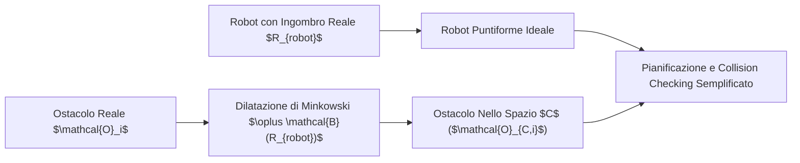
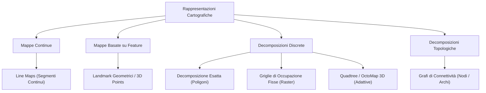
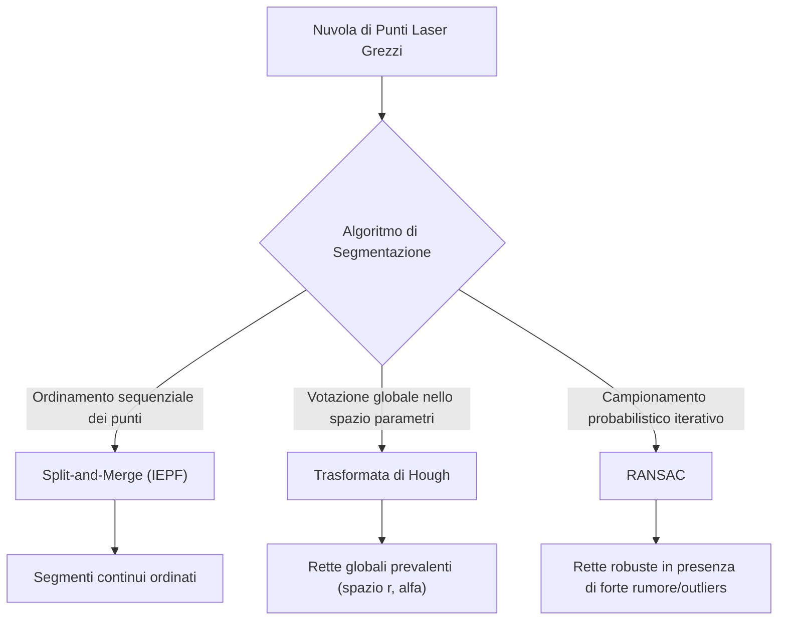
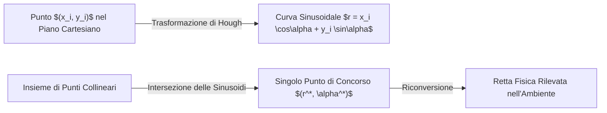

# 3. Rappresentazione dell'Ambiente ed Estrazione di Feature

La capacità di operare autonomamente nello spazio richiede che un robot mobile possieda una rappresentazione strutturata del mondo circostante (__mappa__) e sia in grado di estrarre dai segnali sensoriali grezzi delle entità geometriche o semantiche compatte, stabili e informative (__feature__).

Questo capitolo affronta in modo organico la transizione dai dati grezzi dei sensori di distanza (_range data_, tipicamente da scansioni LiDAR 2D) alla costruzione di modelli ambientali, analizzando:
1. L'inquadramento cinematico e geometrico della percezione ambientale e il concetto di spazio delle configurazioni;
2. La tassonomia formale delle rappresentazioni cartografiche (continue, basate su feature, decomposizioni discrete e grafi topologici);
3. La formulazione matematica del __line fitting__ in coordinate polari e forma normale di Hesse;
4. Gli algoritmi fondamentali di segmentazione geometrica: __Split-and-Merge__, __Trasformata di Hough__ e __RANSAC__.

## Inquadramento Geometrico E Spazio Delle Configurazioni

Per localizzarsi, pianificare traiettorie ed evitare collisioni, il robot deve relazionare le proprie misure sensoriali con un modello geometrico dell'ambiente. A livello teorico e di pianificazione di base, il robot viene spesso trattato come un __punto materiale__ ideale privo di ingombro nello spazio bidimensionale:

$$
\mathbf{p}_r = \begin{bmatrix} x \\ y \end{bmatrix} \in \mathbb{R}^2
$$

Nella realtà operativa, tuttavia, ogni veicolo terrestre possiede una sagoma geometrica finita, definita da un poligono o da un raggio di ingombro $R_{robot}$.



> [!NOTE] Dallo Spazio Fisico allo Spazio delle Configurazioni ($C$-Space)
> Per preservare la semplicità degli algoritmi di navigazione e collision checking considerando il robot puntiforme, si applica la __somma di Minkowski__ ($\oplus$) tra la geometria di ciascun ostacolo $\mathcal{O}_i$ e la geometria del robot $\mathcal{A}$ invertita rispetto all'origine:
>
> $$
> \mathcal{O}_{C,i} = \mathcal{O}_i \oplus (-\mathcal{A})
> $$
>
> Nel caso conservativo in cui il robot sia inscritto in un cerchio di raggio $R_{robot}$, l'operazione coincide con una __dilatazione isotropa degli ostacoli__ di una quantità pari al raggio $R_{robot}$. In questo modo, qualsiasi traiettoria percorsa dal robot puntiforme che non intersechi gli ostacoli dilatati garantisce l'assoluta assenza di collisioni nel mondo reale.

## Tassonomia Delle Rappresentazioni Cartografiche

La scelta del formalismo con cui rappresentare l'ambiente dipende strettamente dal compito assegnato, dalle capacità computazionali di bordo e dai sensori disponibili. La letteratura di riferimento suddivide le mappe in quattro macro-categorie:



### Mappe Continue a Linee (Line-Based Continuous Maps)

Nelle mappe continue, gli elementi strutturali dell'ambiente (muri, pareti, divisori interni) vengono descritti mediante insiemi di primitive geometriche definite su coordinate reali $\mathbb{R}^2$:

$$
\mathcal{M}_{line} = \left\{ \mathbf{l}_1, \mathbf{l}_2, \dots, \mathbf{l}_N \right\}
$$

Ciascun segmento di retta $\mathbf{l}_j$ è caratterizzato dagli estremi cartesiani $\left( (x_{s,j}, y_{s,j}), (x_{e,j}, y_{e,j}) \right)$ oppure dalla forma normale polare con intervallo di estensione.

![[slide_06_map_continuous_vs_linemap_comparison.png|center mid]]

Le proprietà salienti di questa rappresentazione includono:
- __Risoluzione infinita__: non vi è alcuna quantizzazione spaziale indotta da una griglia discreta;
- __Efficienza di memoria__: l'occupazione di memoria non scala con la superficie totale dell'ambiente, bensì è strettamente proporzionale alla __densità degli ostacoli__ (numero di muri $N$);
- __Assunzione di Mondo Chiuso (_Closed-World Assumption_)__: le linee tracciano perimetri continui che racchiudono l'area esplorata; ciò che giace all'esterno del poligono di confini è implicitamente inaccessibile.

> [!WARNING] Limiti delle Mappe Continue a Linee
> Sebbene siano eccellenti per la localizzazione precisa di robot dotati di LiDAR planari in ambienti strutturati (uffici, corridoi), le _line maps_ risultano inadatte per la navigazione in ambienti non strutturati, vegetazione o terreni aperti, e non consentono di rappresentare ostacoli di forma irregolare o parzialmente trasparenti.

### Mappe Basate Su Feature (Landmark-Based Maps)

Invece di descrivere l'intero contorno fisico dell'ambiente, le mappe basate su feature memorizzano unicamente la posizione e i parametri descrittivi di punti salienti o elementi distintivi (_landmarks_):

$$
\mathcal{M}_{feat} = \left\{ \mathbf{f}_1, \mathbf{f}_2, \dots, \mathbf{f}_M \right\}, \quad \mathbf{f}_j = \begin{bmatrix} \mathbf{p}_j \\ \mathbf{d}_j \end{bmatrix}
$$

dove $\mathbf{p}_j$ rappresenta la coordinata spaziale (2D o 3D) e $\mathbf{d}_j$ è un descrittore associato (geometrico o fotometrico).

![[slide_06_map_cas_tool_simulation.png|center small]]

Tra i sistemi più rilevanti basati su questo paradigma troviamo i framework di Visual SLAM come __ORB-SLAM__:
1. __Mappa Sparsa di Keypoint 3D__: l'ambiente è memorizzato come una costellazione di punti tridimensionali triangolati dai fotogrammi chiave;
2. __Grafo delle Pose (Pose Graph / Co-visibility Graph)__: i nodi rappresentano le pose stimate della telecamera nel tempo, mentre gli archi modellano i vincoli di co-visibilità di punti comuni e le trasformazioni relative.

![[slide_06_map_orb_slam_features_and_posegraph.png|center big]]

### Decomposizioni Discrete: Esatta, Fissa E Adattiva

Quando l'obiettivo primario è il motion planning e la verifica istantanea delle collisioni, l'ambiente continuo viene partizionato in regioni elementari (_celle_).

#### Decomposizione Esatta (Exact Cell Decomposition)

L'ambiente libero viene suddiviso geometricamente in un insieme di celle poligonali convesse contigue $\mathcal{C}_1, \dots, \mathcal{C}_K$, tracciando segmenti verticali o estensioni dei vertici degli ostacoli (_trapezoidal decomposition_).

![[slide_06_map_discrete_exact_decomposition.png|center small]]

- All'interno di ciascuna cella convessa, due punti qualsiasi possono essere congiunti da un segmento rettilineo che non tocca alcun ostacolo;
- Il motion planning si riduce alla ricerca su grafo tra celle adiacenti (attraversando i punti medi dei segmenti di confine) partendo dalla cella contenente lo `Start` fino a raggiungere quella del `Goal`.

#### Decomposizione a Griglia Fissa (Occupancy Grid Maps)

La decomposizione a griglia fissa tessella lo spazio bidimensionale in una matrice regolare di celle quadrate di lato fisso $\delta$ (tipicamente da $1\text{ cm}$ a $10\text{ cm}$). Lo stato fisico di ciascuna cella $i$-esima è modellato da una variabile aleatoria binaria:

$$
m_i \in \{0, 1\} \quad (0 = \text{libero}, \; 1 = \text{occupato})
$$

La mappa complessiva $\mathbf{m} = \{ m_i \}$ memorizza la probabilità a posteriori di occupazione calcolata dall'aggiornamento bayesiano:

$$
p(m_i = 1 \mid z_{1:t}, x_{1:t}) \in [0, 1]
$$

- $p(m_i = 1) \approx 1$ (nero): cella occupata da un ostacolo;
- $p(m_i = 1) \approx 0$ (bianco): spazio libero esplorato;
- $p(m_i = 1) = 0.5$ (grigio): cella con stato di occupazione sconosciuto (massima entropia a priori).

![[slide_06_map_discrete_fixed_occupancy_grid.png|center mid]]

- __Vantaggi__: modellazione naturale dell'incertezza dei sensori, aggiornamento ricorsivo bayesiano immediato, indipendenza dalla forma geometrica degli ostacoli;
- __Svantaggi__: l'occupazione di memoria scala con l'area complessiva dell'ambiente ($O(L^2)$ in 2D e $O(L^3)$ in 3D), indipendentemente dal fatto che l'ambiente sia prevalentemente vuoto.

#### Decomposizione Adattiva: Quadtree E OctoMap

Per mitigare l'esplosione dimensionale delle griglie fisse preservando l'accuratezza sui bordi degli ostacoli, si ricorre alla suddivisione gerarchica ad albero:
- In 2D si utilizza un __Quadtree__: se una regione non è omogeneamente libera o occupata, viene divisa ricorsivamente in 4 quadranti (NW, NE, SW, SE); le aree uniformi rimangono memorizzate come blocchi grandi;
- In 3D si estende il concetto a un __Octree__, dando origine a sistemi standard come __OctoMap__.

![[slide_06_map_discrete_adaptive_quadtree.png|center small]] ![[slide_06_map_discrete_3d_octomap.png|center small]]

> [!TIP] Caratteristiche di OctoMap in 3D
> OctoMap permette la modellazione tridimensionale a voxel multirisoluzione, tracciando esplicitamente sia lo spazio occupato che lo spazio libero (essenziale per droni aerei e bracci robotici mobili). L'occupazione di memoria è compressa grazie al raggruppamento dei nodi foglia omogenei (_node pruning_).

### Mappe Topologiche (Topological Maps)

Una mappa topologica astrae completamente la metrica geometrica, descrivendo l'ambiente come un grafo non orientato:

$$
\mathcal{G} = (\mathcal{V}, \mathcal{E})
$$

dove:
- I nodi $\mathcal{V}$ rappresentano luoghi fisici o aree salienti (es. _Stanza A_, _Incrocio Corridoio_, _Atrio_);
- Gli archi $\mathcal{E}$ modellano la connettività e la navigabilità diretta tra i luoghi (porte, corridoi percorribili).

![[slide_06_map_topological_graph_decomposition.png|center small]]

> [!IMPORTANT] Proprietà Metriche delle Mappe Topologiche
> Le mappe topologiche non forniscono informazioni utili per la localizzazione metrica fine del robot. Sebbene risultino estremamente computazionalmente efficienti per la pianificazione globale di percorsi ad alto livello (_symbolic path planning_), esse non contengono riferimenti geometrici di dettaglio: un veicolo autonomo non può stimare con precisione la propria posa metrica $(x, y, \theta)$ basandosi esclusivamente su nodi e archi topologici astratti privi di ancoraggio cartesiano.

## Estrazione Di Linee Da Dati Di Distanza (Line Extraction from Range Data)

La maggior parte dei robot mobili per interni monta sensori di distanza laser (LiDAR planari) che forniscono sequenze di misure polari grezze:

$$
\mathcal{P}_{raw} = \left\{ (\rho_i, \theta_i) \right\}_{i=1}^N
$$

Il problema dell'estrazione di feature consiste nel convertire questa nuvola disordinata di campioni rumorosi in un insieme compatto di primitive geometriche (segmenti di retta).

![[slide_06_feature_range_data_lines_raw.png|center small]]

![[slide_06_feature_laser_scan_lis_lab.png|center mid]]

Il problema si articola formalmente in due sotto-problemi fondamentali:
1. __Data Segmentation__: stabilire quante linee sono presenti e quali punti appartengono a ciascuna linea;
2. __Line Fitting__: dato un sottoinsieme di punti associati a una linea, calcolare i parametri geometrici ottimi della retta minimizzando l'errore di stima.

## Modello Geometrico Di Retta E Line Fitting

### Perché la Forma Normale Di Hesse in Coordinate Polari?

Nel piano cartesiano standard, una retta viene comunemente espressa come:

$$
y = m x + q
$$

Questa parametrizzazione presenta una criticità fatale per i robot mobili: quando una retta o una parete è parallela all'asse $y$ (verticale), il coefficiente angolare diverge ($m \to \infty$), provocando instabilità numerica e singolarità negli algoritmi di ottimizzazione.

Per evitare qualsiasi singolarità dovuta a pendenze verticali e mantenere invarianza rispetto al sistema di coordinate del sensore, si adotta la __forma normale di Hesse__:

$$
x \cos\alpha + y \sin\alpha - r = 0
$$

Esprimendo le coordinate cartesiane in funzione delle misure polari del sensore ($x = \rho \cos\theta, y = \rho \sin\theta$), l'equazione della retta si riscrive identicamente:

$$
\rho \cos\alpha \cos\theta + \rho \sin\alpha \sin\theta - r = \rho \cos(\theta - \alpha) - r = 0
$$

![[slide_06_feature_line_model_polar_hesse.png|center small]]

I parametri geometrici soddisfano le seguenti convenzioni formali per garantire l'univocità della rappresentazione:
- $r \ge 0$: distanza minima ortogonale dall'origine degli assi (posizione del centro sensore) alla retta;
- $\alpha \in [0, 2\pi)$: orientamento angolare del vettore normale condotto dall'origine verso la retta.

Dato un punto generico $P_i = (x_i, y_i) = (\rho_i, \theta_i)$, la __distanza geometrica ortogonale__ tra il punto e la retta candidata vale:

$$
d_i = \left| x_i \cos\alpha + y_i \sin\alpha - r \right| = \left| \rho_i \cos(\theta_i - \alpha) - r \right|
$$

### Incertezza Nei Dati Grezzi Del Sensore

Ciascun raggio laser misura una distanza $\rho_i$ a un angolo $\theta_i$. La conversione in coordinate cartesiane vale:

$$
\begin{cases}
x_i = \rho_i \cos\theta_i \\
y_i = \rho_i \sin\theta_i
\end{cases}
$$

A causa del rumore di misura del sensore, le coordinate polari sono variabili aleatorie con matrice di covarianza:

$$
C_{i}^{\rho\theta} = \begin{bmatrix} \sigma_{\rho,i}^2 & 0 \\ 0 & \sigma_{\theta,i}^2 \end{bmatrix}
$$

![[slide_06_feature_laser_raw_uncertainty_gaussians.png|center small]]

> [!NOTE] Ipotesi di Indipendenza e Matrice a Blocchi Diagonali
> Nel contesto stocastico, la matrice di covarianza congiunta dell'intera scansione di $N$ punti viene modellata come una matrice diagonale a blocchi:
>
> $$
> C_{raw} = \begin{bmatrix}
> C_1^{\rho\theta} & \mathbf{0} & \dots & \mathbf{0} \\
> \mathbf{0} & C_2^{\rho\theta} & \dots & \mathbf{0} \\
> \vdots & \vdots & \ddots & \vdots \\
> \mathbf{0} & \mathbf{0} & \dots & C_N^{\rho\theta}
> \end{bmatrix}
> $$
>
> L'ipotesi che gli errori di misura sui singoli raggi laser siano stocasticamente indipendenti costituisce un'approssimazione ingegneristica: nelle condizioni operative reali sussistono deboli correlazioni spaziali e temporali (dovute alla dinamica di risposta dell'elettronica del fotorilevatore o alla traslazione del robot durante la rotazione dello specchio del LiDAR). Ciononostante, la struttura diagonale a blocchi garantisce un'eccellente accuratezza di stima a fronte di un costo computazionale contenuto.

### Minimi Quadrati Ordinari (OLS) E Minimi Quadrati Pesati (WLS)

Dato un insieme di $n$ misure laser acquisite in coordinate polari $\mathcal{P} = \{ (\rho_i, \theta_i) \}_{i=1}^n$ e associate a una retta, l'obiettivo è determinare i parametri ottimali $(r, \alpha)$ minimizzando la somma dei quadrati delle distanze ortogonali.

Nel contesto stocastico reale, l'incertezza sulla misura radiale aumenta con la distanza (la varianza scala sperimentalmente con il quadrato della distanza, $\sigma_{\rho,i}^2 \propto \rho_i^2$). Si formula pertanto il problema ai __minimi quadrati pesati (WLS)__:

$$
\min_{r, \alpha} S(r, \alpha) = \min_{r, \alpha} \sum_{i=1}^n w_i \left( \rho_i \cos(\theta_i - \alpha) - r \right)^2, \quad w_i = \frac{1}{\sigma_{\rho,i}^2}
$$

Nel caso in cui tutti i punti abbiano identica varianza (OLS non pesato), i pesi sono unitari: $w_i = 1$.

Annullando la derivata parziale rispetto al parametro $r$:

$$
\frac{\partial S}{\partial r} = -2 \sum_{i=1}^n w_i \left( \rho_i \cos(\theta_i - \alpha) - r \right) = 0 \implies r = \frac{\sum_{i=1}^n w_i \rho_i \cos(\theta_i - \alpha)}{\sum_{i=1}^n w_i}
$$

Sostituendo $r$ all'interno di $S$ e annullando la derivata parziale rispetto ad $\alpha$, si ottiene la relazione:

$$
\tan(2\alpha) = \frac{N}{D}
$$

dove $N$ e $D$ sono espressi direttamente in coordinate polari:

$$
N = \sum_{i=1}^n w_i \rho_i^2 \sin(2\theta_i) - \frac{2}{\sum_{k=1}^n w_k} \sum_{i=1}^n \sum_{j=1}^n w_i w_j \rho_i \rho_j \cos\theta_i \sin\theta_j
$$

$$
D = \sum_{i=1}^n w_i \rho_i^2 \cos(2\theta_i) - \frac{1}{\sum_{k=1}^n w_k} \sum_{i=1}^n \sum_{j=1}^n w_i w_j \rho_i \rho_j \cos(\theta_i + \theta_j)
$$

Per garantire che la soluzione stazionaria sia il punto di minimo globale della funzione di costo e discriminare correttamente il quadrante dell'angolo, la stima ottima di $\alpha$ si calcola tramite:

$$
\alpha = \frac{1}{2} \operatorname{atan2}(-N, -D)
$$

Qualora il valore risultante di $r$ sia negativo, si ripristina la convenzione geometrica standard $r \ge 0$ ponendo:
$$
r \leftarrow -r, \quad \alpha \leftarrow (\alpha + \pi) \pmod{2\pi}
$$

> [!TIP] Approfondimento Teorico
> Per la dimostrazione analitica completa delle sommatorie polari, l'equivalenza con le coordinate baricentriche cartesiane e la propagazione dell'incertezza mediante matrice Jacobiana $F_{PQ}$ sulla covarianza $C_{RA}$, si veda [[zz. Argomenti extra#Derivazione Analitica del Line Fitting (OLS e WLS) in Coordinate Polari|zz. Argomenti extra: Derivazione Analitica del Line Fitting]].

## Algoritmi Di Segmentazione

La segmentazione consiste nel partizionare l'insieme totale di punti misurati in sottoinsiemi disgiunti, ciascuno associato a una specifica linea fisica presente nell'ambiente. Vengono analizzati i tre algoritmi fondamentali.



### Split-and-Merge (Iterative-End-Point-Fit)

L'algoritmo __Split-and-Merge__ (nella sua variante canonica _Iterative-End-Point-Fit_, IEPF) sfrutta la natura intrinsecamente ordinata della scansione laser (i punti sono acquisiti sequenzialmente per angoli $\theta$ crescenti).

![[slide_06_feature_split_and_merge_algorithm.png|center big]]

#### Procedura Operativa Passo-Passo

1. __Linea iniziale__: Si traccia un segmento di retta provvisorio congiungente il primo punto $P_1$ e l'ultimo punto $P_N$ della sequenza ordinata di scansione;
2. __Ricerca della massima distanza ortogonale__: Per ciascun punto intermedio $P_i$, si calcola la distanza ortogonale $d_i = \left| \rho_i \cos(\theta_i - \alpha) - r \right|$; sia $d_{\max} = \max_i d_i$ la distanza massima corrispondente al punto $P_k$;
3. __Fase di Split__:
   - Se $d_{\max} > \tau$ (dove $\tau$ è la soglia metrica di tolleranza prestabilita), la sequenza di punti viene suddivisa in due sottoinsiemi: da $P_1$ a $P_k$ e da $P_k$ a $P_N$;
   - Si applica ricorsivamente la procedura su ciascuno dei due sotto-segmenti;
4. __Arresto dello Split__: Quando in un sotto-segmento nessun punto presenta una distanza ortogonale superiore a $\tau$ dal segmento congiungente gli estremi, la suddivisione ricorsiva termina;
5. __Fase di Merge__: I segmenti contigui ottenuti vengono confrontati: se i parametri delle rette associate risultano quasi collineari e la distanza tra i punti di confine è inferiore a una soglia prestabilita, i segmenti vengono fusi in un'unica linea e si esegue un fit WLS/OLS globale su tutti i punti congiunti.

> [!NOTE] Proprietà di Associazione dei Punti in Split-and-Merge
> Poiché opera partizionando ricorsivamente una sequenza indicizzata di campioni laser, l'algoritmo Split-and-Merge garantisce un'associazione esplicita e deterministica tra ogni punto misurato e il rispettivo segmento di linea estratto.

- __Vantaggi__: Estremamente veloce ($O(N \log N)$ nel caso medio), deterministico, eccellente per contorni continui;
- __Svantaggi__: Dipende fortemente dall'ordinamento angolare dei punti e può fallire in presenza di punti sparsi isolati o salti di continuità non filtrati.

### Trasformata Di Hough

La __Trasformata di Hough__ è una tecnica di trasformazione per accumulazione globale introdotta per rilevare forme geometriche parametrizzabili anche in presenza di lacune o forte rumore.

#### Principio Della Dualità Punto-Linea

Nello spazio cartesiano geometrico $(x, y)$, una retta è descritta dalla forma normale di Hesse:

$$
x \cos\alpha + y \sin\alpha = r
$$

Se consideriamo un __singolo punto fissato__ $P_i = (x_i, y_i)$, quali sono tutte le infinite rette che possono passare per quel punto?
Variando l'orientamento $\alpha \in [-\pi, \pi]$, la distanza $r$ necessaria affinché la retta passi per $P_i$ è:

$$
r(\alpha) = x_i \cos\alpha + y_i \sin\alpha
$$

Nello spazio dei parametri $(\alpha, r)$, questa equazione rappresenta una __curva sinusoidale__!

![[slide_06_feature_hough_polar_transform_concept.png|center big]]



> [!NOTE] Principio di Dualità nella Trasformata di Hough
> La trasformazione si fonda su una precisa dualità geometrica:
> 1. Un singolo punto $(x_i, y_i)$ nello spazio geometrico si mappa in una curva sinusoidale $r(\alpha) = x_i \cos\alpha + y_i \sin\alpha$ nello spazio dei parametri $(\alpha, r)$;
> 2. Se un insieme di punti appartiene alla medesima retta fisica, le rispettive curve sinusoidali si intersecano tutte nel punto comune $(r^*, \alpha^*)$ corrispondente ai parametri della retta generatrice;
> 3. L'estrazione di primitive lineari si riduce quindi all'individuazione dei punti di concorso (massimi locali) nello spazio dei parametri.

#### L'Accumulatore Discreto E Il Meccanismo Di Voto

Poiché i computer lavorano su insiemi discreti, lo spazio dei parametri $(\alpha, r)$ viene quantizzato in una matrice bidimensionale detta __accumulatore di Hough__ $H[r_q, \alpha_q]$:

![[slide_06_feature_hough_transform_4quadrants_example.png|center big]]

```pseudo
\begin{algorithm}
\caption{Trasformata di Hough per Rette}
\begin{algorithmic}
\REQUIRE Insieme $\mathcal{P} = \{(x_i, y_i)\}_{i=1}^n$ di punti misurati, soglia di voto $T$
\ENSURE Insieme delle rette dominanti stimate $\{(r_k^*, \alpha_k^*)\}$
\STATE \COMMENT{1. Inizializzazione dell'accumulatore}
\STATE Quantizza lo spazio $(\alpha, r)$ in una griglia $H$ di dimensione $N_r \times N_\alpha$
\STATE $H[r_q, \alpha_q] \leftarrow 0 \quad \forall (r_q, \alpha_q)$
\STATE \COMMENT{2. Fase di Votazione (Voting)}
\FORALL{$(x_i, y_i) \in \mathcal{P}$}
    \FORALL{$\alpha_q \in \mathcal{A}_q$}
        \STATE $r \leftarrow x_i \cos\alpha_q + y_i \sin\alpha_q$
        \STATE Individua l'indice di quantizzazione $r_q$ più vicino a $r$
        \STATE $H[r_q, \alpha_q] \leftarrow H[r_q, \alpha_q] + 1$
    \ENDFOR
\ENDFOR
\STATE \COMMENT{3. Estrazione dei Picchi Locali}
\STATE $\mathcal{R} \leftarrow \{(r_q, \alpha_q) \mid H[r_q, \alpha_q] \ge T \text{ ed è massimo locale}\}$
\RETURN $\mathcal{R}$
\end{algorithmic}
\end{algorithm}
```

> [!WARNING] Limitazione dell'Accumulatore: Associazione dei Punti
> A differenza di Split-and-Merge, la procedura di voto standard nell'accumulatore individua i parametri $(r^*, \alpha^*)$ della retta globale ma __non tiene memoria diretta di quali specifici punti abbiano votato per quella cella__.
> Per recuperare i segmenti fisici ed evitare di unire pareti distanti allineate casualmente:
> 1. Si individuano i parametri $(r^*, \alpha^*)$ del picco nell'accumulatore;
> 2. Si esegue una scansione retroattiva dei dati per trovare i punti la cui distanza ortogonale da quella retta sia minore di una tolleranza $\delta$;
> 3. Si raggruppano i punti in segmenti finiti e si rimuovono dalla lista dei punti per consentire il rilevamento delle rette successive.

### RANSAC (RANdom SAmple Consensus)

__RANSAC__ è un algoritmo non deterministico iterativo concepito specificamente per stimare i parametri di un modello matematico in presenza di un'elevata percentuale di __outliers__ (punti spuri, riflessioni anomale, rumore pesante o ostacoli dinamici non appartenenti al modello).

![[slide_06_feature_ransac_comparison_process.png|center big]]

#### Funzionamento dell'Algoritmo

Per definire univocamente una retta nel piano cartesiano sono necessari al minimo $s = 2$ punti distinti.

```pseudo
\begin{algorithm}
\caption{RANSAC per Line Fitting}
\begin{algorithmic}
\REQUIRE Insieme $\mathcal{P}$ di $n$ punti, soglia di distanza ortogonale $d$, numero minimo inliers $M_{\text{min}}$, iterazioni $N_{\text{iter}}$
\ENSURE Parametri ottimi $(r^*, \alpha^*)$ e consensus set $\mathcal{C}^*$
\STATE $\mathcal{C}^* \leftarrow \emptyset, \quad (r^*, \alpha^*) \leftarrow \emptyset$
\FOR{$k = 1$ \TO $N_{\text{iter}}$}
    \STATE Campiona uniformemente un sottoinsieme minimo di $s = 2$ punti distinti da $\mathcal{P}$
    \STATE Calcola la retta candidata $(\tilde{r}, \tilde{\alpha})$ passante per i 2 punti
    \STATE $\mathcal{C}_{\text{cand}} \leftarrow \emptyset$
    \FORALL{$(x_i, y_i) \in \mathcal{P}$}
        \STATE $d_i \leftarrow |x_i \cos\tilde{\alpha} + y_i \sin\tilde{\alpha} - \tilde{r}|$ \COMMENT{Distanza ortogonale}
        \IF{$d_i < d$}
            \STATE $\mathcal{C}_{\text{cand}} \leftarrow \mathcal{C}_{\text{cand}} \cup \{(x_i, y_i)\}$ \COMMENT{Inlier}
        \ENDIF
    \ENDFOR
    \IF{$|\mathcal{C}_{\text{cand}}| > |\mathcal{C}^*|$}
        \STATE $\mathcal{C}^* \leftarrow \mathcal{C}_{\text{cand}}$
        \STATE $(r^*, \alpha^*) \leftarrow (\tilde{r}, \tilde{\alpha})$
    \ENDIF
\ENDFOR
\IF{$|\mathcal{C}^*| \ge M_{\text{min}}$}
    \STATE $(r^*, \alpha^*) \leftarrow \text{WLS}(\mathcal{C}^*)$ \COMMENT{Ristima a minima varianza su tutti gli inlier}
    \RETURN $(r^*, \alpha^*), \mathcal{C}^*$
\ELSE
    \RETURN $\text{failure}$ \COMMENT{Nessun consenso sufficiente trovato}
\ENDIF
\end{algorithmic}
\end{algorithm}
```

#### Determinazione Analitica del Numero di Iterazioni $N$

Sia $\epsilon = \frac{N_{outliers}}{N_{tot}} \in [0, 1)$ la frazione di outliers presenti nel dataset, e $w = 1 - \epsilon$ la frazione di campioni validi (inliers).

La probabilità che un campione casuale di $s = 2$ punti sia composto esclusivamente da inliers è:

$$
P(\text{campione valido}) = w^s = (1 - \epsilon)^s
$$

La probabilità che almeno uno dei punti estratti sia un outlier (campione corrotto) vale:

$$
P(\text{campione corrotto}) = 1 - (1 - \epsilon)^s
$$

La probabilità che l'algoritmo fallisca in tutte le $N$ iterazioni indipendenti (ovvero che estragga sempre campioni corrotti) è:

$$
P(\text{fallimento su } N \text{ iterazioni}) = \left( 1 - (1 - \epsilon)^s \right)^N
$$

Affinché la probabilità di successo sia almeno pari a un livello di confidenza desiderato $p$ (tipicamente $p = 0.99$):

$$
1 - \left( 1 - (1 - \epsilon)^s \right)^N \ge p \implies \left( 1 - (1 - \epsilon)^s \right)^N \le 1 - p
$$

Applicando il logaritmo naturale a entrambi i membri:

$$
N \ge \frac{\ln(1 - p)}{\ln\left(1 - (1 - \epsilon)^s\right)}
$$

Poiché il numero di iterazioni deve essere un intero positivo, la dimensione analitica ottima del ciclo vale:

$$
N = \left\lceil \frac{\ln(1 - p)}{\ln\left(1 - (1 - \epsilon)^s\right)} \right\rceil
$$

> [!TIP] Esempio Numerico di Dimensionamento RANSAC
> Ipotizzando una frazione di contaminazione da outlier del $50\%$ ($\epsilon = 0.50$, dunque $w = 0.50$) e un livello di confidenza del $99\%$ ($p = 0.99$) per il fit di una retta 2D ($s = 2$):
>
> $$
> N = \left\lceil \frac{\ln(1 - 0.99)}{\ln\left(1 - (1 - 0.5)^2\right)} \right\rceil = \left\lceil \frac{\ln(0.01)}{\ln(0.75)} \right\rceil = \left\lceil \frac{-4.6052}{-0.2877} \right\rceil = \lceil 16.008 \rceil = 17 \text{ iterazioni}
> $$
>
> Sono sufficienti appena $17$ iterazioni casuali per garantire al $99\%$ l'estrazione di almeno una coppia di inliers pulita, indipendentemente dalla numerosità totale $n$ dei punti.

## Tabella Comparativa Degli Algoritmi Di Segmentazione

| Caratteristica | Split-and-Merge (IEPF) | Trasformata di Hough | RANSAC |
| :--- | :--- | :--- | :--- |
| __Input Richiesto__ | Punti con ordinamento angolare sequenziale | Punti sparsi qualsiasi | Punti sparsi qualsiasi |
| __Complessità Temporale__ | $O(N \log N)$ (molto veloce) | $O(N \cdot N_\alpha)$ (dipende dalla risoluzione) | $O(K \cdot N)$ ($K$ limitato) |
| __Tolleranza Outliers__ | Bassa (sensibile a salti di scansione) | Media (i falsi picchi creano artefatti) | __Altissima__ (robusto fino al $50\%\text{--}70\%$ di rumore) |
| __Associazione dei Punti__ | __Nativa ed esplicita__ per ogni segmento | Indiretta (richiede post-processing) | __Esplicita__ (tramite _consensus set_) |
| __Natura dell'Algoritmo__ | Deterministica | Deterministica (su griglia quantizzata) | Probabilistica / Stocastica |
| __Ambito di Elezione__ | Scansioni LiDAR 2D pulite per muri continui | Riconoscimento linee globali e forme note | Dati 3D rumorosi, stereo vision, feature visuali |
