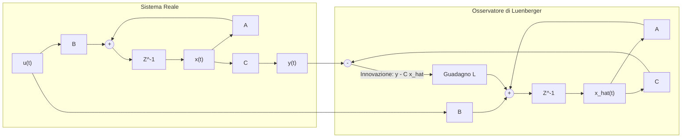
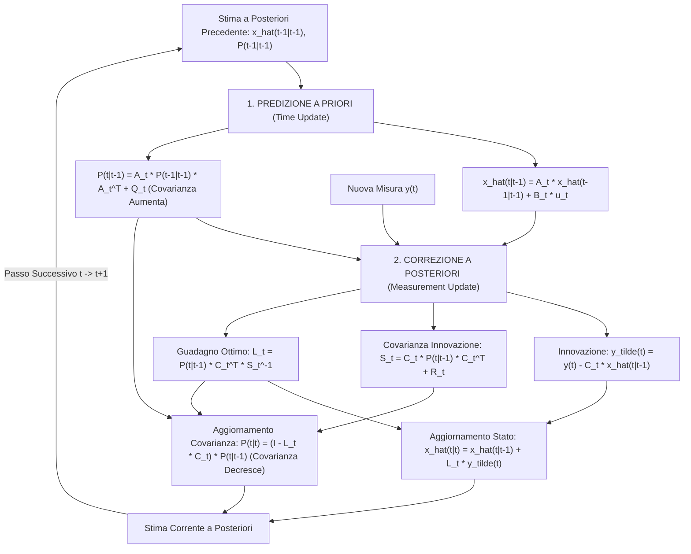

# 8. Filtro Di Kalman Lineare

Nei capitoli precedenti abbiamo esplorato le approssimazioni computazionali non-parametriche del filtro di Bayes: l'[[5. Localizzazione con Histogram Filter|Histogram Filter]] su griglia discreta e il [[6. Localizzazione con Particle Filter|Particle Filter]] stocastico. Entrambi i metodi eccellono nel rappresentare distribuzioni arbitrarie e multimodali (come le ambiguità speculari generate da beacon e pareti), ma richiedono un pesante carico computazionale legato alla granularità delle celle o al numero di campioni $M$.

In questo capitolo introduciamo il __Filtro di Kalman (Kalman Filter - KF)__, che affronta la stima bayesiana da una prospettiva analitica esatta: assumendo dinamiche di moto e di misura lineari corrotte da rumori gaussiani, il filtro di Bayes ammette una soluzione analitica chiusa ed estremamente efficiente in cui l'intero belief è parametrizzato unicamente dal vettore di media e dalla matrice di covarianza.

Trattiamo qui l'architettura teorica fondamentale per sistemi lineari discreti variabili nel tempo, che costituisce il presupposto metodologico irrinunciabile per la successiva estensione non-lineare ([[zz. Argomenti extra#Extended Kalman Filter|Extended Kalman Filter - EKF]]) applicata alla localizzazione robotica.

## Dal Filtro Di Bayes Ai Filtri Gaussiani Analitici

Richiamiamo la forma continua ricorsiva del filtro di Bayes:

$$
\overline{bel}(x_t) = \int p(x_t \mid x_{t-1}, u_t) \, bel(x_{t-1}) \, \mathrm{d}x_{t-1}
$$

$$
bel(x_t) = \eta \, p(y_t \mid x_t) \, \overline{bel}(x_t)
$$

Nel caso generale il calcolo analitico dell'integrale di predizione (integrale di Chapman-Kolmogorov) è intrattabile. Tuttavia, se imponiamo due vincoli strutturali:
1. __Linearità delle trasformazioni__: le equazioni che governano l'evoluzione dello stato e la generazione delle uscite sono combinazioni lineari delle variabili;
2. __Gaussianità dei segnali aleatori__: lo stato iniziale e tutte le perturbazioni esterne sono variabili aleatorie gaussiane a media nulla.

accade una proprietà matematica formidabile: la famiglia delle densità normali è una _famiglia coniugata_ rispetto a trasformazioni lineari. La convoluzione di due gaussiane è ancora una gaussiana, e il prodotto normalizzato di due gaussiane è ancora rigorosamente una gaussiana.

Non occorre quindi approssimare numericamente lo spazio continuo: basta calcolare analiticamente le equazioni ricorsive di aggiornamento dei soli parametri della distribuzione (valore atteso $\hat{x}$ e matrice di covarianza $P$).

## Modellazione Dei Sistemi Dinamici Lineari Stocastici

Consideriamo un processo dinamico a tempo discreto $t \in \mathbb{Z}$ descritto in uno schema di Hidden Markov Model (HMM) continuo:
- Vettore di stato nascosto da stimare: $x_t \in \mathbb{R}^n$;
- Vettore degli ingressi di controllo noti: $u_t \in \mathbb{R}^m$;
- Vettore delle uscite / osservazioni misurate dai sensori: $y_t \in \mathbb{R}^p$.

Il sistema è governato dalle equazioni lineari stocastiche:

$$
x_t = A_t x_{t-1} + B_t u_t + w_t
$$

$$
y_t = C_t x_t + v_t
$$

dove:
- $A_t \in \mathbb{R}^{n \times n}$ è la matrice dinamica di transizione di stato;
- $B_t \in \mathbb{R}^{n \times m}$ è la matrice degli ingressi di controllo;
- $C_t \in \mathbb{R}^{p \times n}$ è la matrice di osservazione o di uscita sensoriale.

>[!NOTE] Il Ruolo del Modello Dinamico nella Stima
>Come evidenziato dal docente a lezione, modellare la dinamica dello stato non significa necessariamente possedere le equazioni fisiche esatte delle forze o della meccanica del veicolo. Se dobbiamo stimare la traiettoria di un punto nello spazio, possiamo semplicemente ipotizzare un modello cinematico a velocità costante ($\dot{x} = v$) o ad accelerazione costante ($\ddot{x} = a$): _"quel punto si muove a velocità costante, perché ci risulta così fisicamente non ci interessa"_. La discrepanza tra il modello semplificato e la complessa realtà fisica viene assorbita statisticamente dal rumore di processo $w_t$.

### Ipotesi Statistiche Sui Rumori

Le sequenze stocastiche che corrompono il sistema soddisfano le seguenti proprietà fondamentali:
1. __Rumore di Processo / Stato ($w_t$)__: sequenza bianca gaussiana a media nulla con matrice di covarianza simmetrica semidefinita (o definita) positiva $Q_t \ge 0$:

   $$
   w_t \sim \mathcal{N}\left(0, Q_t\right), \quad \mathbb{E}[w_t] = 0, \quad \mathbb{E}\left[w_t w_\tau^T\right] = Q_t \, \delta_{t,\tau}
   $$

2. __Rumore di Misura ($v_t$)__: sequenza bianca gaussiana a media nulla con matrice di covarianza definita positiva $R_t > 0$:

   $$
   v_t \sim \mathcal{N}\left(0, R_t\right), \quad \mathbb{E}[v_t] = 0, \quad \mathbb{E}\left[v_t v_\tau^T\right] = R_t \, \delta_{t,\tau}
   $$

3. __Scorrelazione Mutua__: i rumori di processo e di misura sono reciprocamente indipendenti a qualsiasi istante:

   $$
   \mathbb{E}\left[w_t v_\tau^T\right] = 0 \quad \forall t, \tau
   $$

4. __Condizione Iniziale Incerta__: lo stato iniziale $x_0$ è una variabile gaussiana con media $\bar{x}_0$ e covarianza $P_0$, indipendente dai rumori per ogni $t \ge 0$:

   $$
   x_0 \sim \mathcal{N}\left(\bar{x}_0, P_0\right), \quad \mathbb{E}\left[x_0 w_t^T\right] = 0, \quad \mathbb{E}\left[x_0 v_t^T\right] = 0
   $$

>[!WARNING] Convenzione Fondamentale del Corso: Notazione delle Covarianze $Q$ ed $R$
>Prestare la massima attenzione alla notazione utilizzata dal docente a lezione:
>- $Q_t$: matrice di covarianza del rumore di stato/processo $w_t$;
>- $R_t$: matrice di covarianza del rumore di misura $v_t$.
>
>Questa notazione è lo standard universale della __Teoria dei Controlli e del Filtraggio Ottimo__. Si segnala che alcuni testi di robotica (incluso talvolta il testo di Thrun _Probabilistic Robotics_) e librerie software invertono i simboli utilizzando $R$ per il processo e $Q$ per le misure. Nel corso e in questi appunti si adotta rigorosamente la convenzione dei controlli ($Q$ per il processo, $R$ per le misure).

## Il Ponte Con I Controlli Automatici: L'Osservatore Di Luenberger

Per comprendere l'architettura interna del filtro di Kalman consideriamo anzitutto il caso deterministico privo di rumore ($w_t = 0, v_t = 0$):

$$
x_{t+1} = A x_t + B u_t, \quad y_t = C x_t
$$

Poiché lo stato interno $x_t$ non è accessibile per la misura diretta (ad esempio la velocità reale del robot o la corrente di armatura), costruiamo un sistema dinamico ausiliario in grado di ricostruirlo asintoticamente conoscendo solo gli ingressi applicati $u_t$ e le uscite misurate $y_t$. Questo sistema è l'__Osservatore di Stato di Luenberger__:

$$
\hat{x}_{t+1} = A \hat{x}_t + B u_t + L \left( y_t - C \hat{x}_t \right)
$$

L'osservatore si articola in due componenti concettuali:
1. __Replica del Modello ($A \hat{x}_t + B u_t$)__: simula in catena aperta l'evoluzione nominale del sistema sfruttando la conoscenza della dinamica e degli ingressi;
2. __Termine di Correzione in Feedback ($L (y_t - C \hat{x}_t)$)__: calcola l'__innovazione__ (o residuo) $e_t = y_t - C \hat{x}_t$, ossia lo scostamento tra la misura reale $y_t$ e la misura attesa calcolata sulla stima $C \hat{x}_t$, pesandola attraverso la matrice di guadagno $L$.

### Dinamica dell'Errore Di Stima

Definiamo l'errore di stima $\tilde{x}_t = x_t - \hat{x}_t$. Sottraendo l'equazione dell'osservatore da quella del sistema deterministico:

$$
\tilde{x}_{t+1} = x_{t+1} - \hat{x}_{t+1} = \left( A x_t + B u_t \right) - \left( A \hat{x}_t + B u_t + L C (x_t - \hat{x}_t) \right)
$$

$$
\tilde{x}_{t+1} = (A - LC) \tilde{x}_t
$$

L'evoluzione dell'errore è un sistema lineare autonomo governato dalla matrice dinamica $(A - LC)$. Se la coppia $(A, C)$ è __osservabile__, possiamo scegliere ad arbitrio gli autovalori di $(A - LC)$ posizionandoli all'interno del disco unitario del piano complesso ($|\lambda_i| < 1$), garantendo che l'errore converga esponenzialmente a zero indipendentemente dall'errore iniziale:

$$
\lim_{t \to \infty} \tilde{x}_t = 0 \implies \lim_{t \to \infty} \hat{x}_t = x_t
$$

Nel contesto stocastico, tuttavia, la presenza simultanea del rumore di processo $w_t$ e del rumore di misura $v_t$ impedisce una convergenza deterministica a zero. Il __Filtro di Kalman__ risolve esattamente questo trade-off calcolando il guadagno $L_t$ ottimale che bilancia istante per istante la fiducia nella dinamica interna rispetto alla fiducia nei sensori.

## Il Filtro Di Kalman Lineare Time-Varying

Nel caso generale non stazionario le matrici del modello $A_t, B_t, C_t, Q_t, R_t$ possono variare nel tempo.

Adottiamo la notazione standard di filtraggio ottimo a tempo discreto:
- $\hat{x}_{t|t-1}$: stima dello stato all'istante $t$ basata sulle misure disponibili fino all'istante antecedente $t-1$ (__stima a priori__ o predizione);
- $P_{t|t-1}$: matrice di covarianza dell'errore a priori: $\mathbb{E}[ (x_t - \hat{x}_{t|t-1})(x_t - \hat{x}_{t|t-1})^T ]$;
- $\hat{x}_{t|t}$: stima dello stato all'istante $t$ aggiornata con l'osservazione corrente $y_t$ (__stima a posteriori__);
- $P_{t|t}$: matrice di covarianza dell'errore a posteriori: $\mathbb{E}[ (x_t - \hat{x}_{t|t})(x_t - \hat{x}_{t|t})^T ]$.

L'algoritmo opera ciclicamente in due macro-fasi:

### 1. Fase Di Predizione a Priori (Time Update)

Conoscendo la stima passata $\hat{x}_{t-1|t-1}$ e il comando di controllo $u_t$, propaghiamo lo stato nel tempo applicando il modello nominale:

$$
\hat{x}_{t|t-1} = A_t \hat{x}_{t-1|t-1} + B_t u_t
$$

La covarianza dell'errore associata alla predizione è data da:

$$
P_{t|t-1} = A_t P_{t-1|t-1} A_t^T + Q_t
$$

>[!IMPORTANT] La Covarianza Aumenta nella Predizione
>La trasformazione cinematica disperde l'incertezza ($A_t P A_t^T$) e vi somma la covarianza del rumore di processo $Q_t \ge 0$. In assenza di misure sensoriali esterne, l'incertezza cresce a ogni passo temporale: il robot perde progressivamente accuratezza per via del drift odometrico.

### 2. Fase Di Correzione a Posteriori (Measurement Update)

All'istante $t$ acquisiamo la lettura sensoriale $y_t$. Valutiamo lo scostamento rispetto alla misura attesa:

$$
\tilde{y}_t = y_t - C_t \hat{x}_{t|t-1}
$$

Il termine $\tilde{y}_t$ è il processo di __innovazione__: rappresenta la frazione di informazione contenuta nella misura sensoriale che non era già prevedibile a partire dalla storia passata.

La matrice di covarianza dell'innovazione vale:

$$
S_t = C_t P_{t|t-1} C_t^T + R_t
$$

Il __Guadagno Ottimo di Kalman__ (o _Kalman Gain_) $L_t \in \mathbb{R}^{n \times p}$ è calcolato come:

$$
L_t = P_{t|t-1} C_t^T S_t^{-1} = P_{t|t-1} C_t^T \left( C_t P_{t|t-1} C_t^T + R_t \right)^{-1}
$$

Aggiorniamo la stima dello stato correggendo la predizione con l'innovazione pesata da $L_t$:

$$
\hat{x}_{t|t} = \hat{x}_{t|t-1} + L_t \tilde{y}_t
$$

Infine, aggiorniamo la matrice di covarianza dell'errore a posteriori:

$$
P_{t|t} = \left( I - L_t C_t \right) P_{t|t-1}
$$

oppure nella forma esplicita simmetrica Joseph:

$$
P_{t|t} = P_{t|t-1} - L_t S_t L_t^T
$$

>[!IMPORTANT] La Covarianza Decresce nella Correzione
>Poiché $L_t S_t L_t^T$ è una matrice semidefinita positiva, la covarianza a posteriori soddisfa la disuguaglianza matriciale $P_{t|t} \le P_{t|t-1}$. L'incorporazione della misura esterocettiva riduce rigorosamente l'incertezza della stima.

### Corrispondenza Delle Notazioni

| Grandezza Fisica / Concettuale | Notazione Controlli Ottimi (Prof. Valigi) | Notazione Robotica Probabilistica (Thrun) |
| :--- | :---: | :---: |
| Stato stimato a priori (predizione) | $\hat{x}_{t\|t-1}$ | $\bar{\mu}_t$ |
| Covarianza a priori | $P_{t\|t-1}$ | $\bar{\Sigma}_t$ |
| Stato stimato a posteriori | $\hat{x}_{t\|t}$ | $\mu_t$ |
| Covarianza a posteriori | $P_{t\|t}$ | $\Sigma_t$ |
| Matrice dinamica di transizione | $A_t$ | $A_t$ |
| Matrice degli ingressi di controllo | $B_t$ | $B_t$ |
| Matrice di osservazione / misura | $C_t$ | $C_t$ |
| Covarianza rumore di stato / processo | $Q_t$ | $R_t$ _(simbolo invertito!)_ |
| Covarianza rumore di misura | $R_t$ | $Q_t$ _(simbolo invertito!)_ |
| Guadagno di Kalman | $L_t$ | $K_t$ |
| Innovazione / Residuo | $\tilde{y}_t$ | $z_t - C_t \bar{\mu}_t$ |
| Covarianza dell'innovazione | $S_t$ | $C_t \bar{\Sigma}_t C_t^T + Q_t$ |

## Interpretazione Bayesiana Del Filtro Di Kalman

Come evidenziato dal docente (slide 21-22 di `013_2`), le equazioni del filtro di Kalman discendono in modo naturale dall'applicazione del teorema di Bayes a variabili aleatorie gaussiane.

### La Predizione come Convoluzione

Nel filtro di Bayes la predizione è data dall'integrale:

$$
\overline{bel}(x_t) = \int_{\mathbb{R}^n} p(x_t \mid x_{t-1}, u_t) \, bel(x_{t-1}) \, \mathrm{d}x_{t-1}
$$

Dato il modello dinamico lineare $x_t = A_t x_{t-1} + B_t u_t + w_t$, la probabilità di transizione condizionata è una gaussiana traslata:

$$
p(x_t \mid x_{t-1}, u_t) = p_{w_t}(x_t - A_t x_{t-1} - B_t u_t) \sim \mathcal{N}\left(A_t x_{t-1} + B_t u_t, \, Q_t\right)
$$

Poiché sia $bel(x_{t-1}) \sim \mathcal{N}(\hat{x}_{t-1|t-1}, P_{t-1|t-1})$ sia $p_{w_t}$ sono gaussiane, l'integrale è una __convoluzione di funzioni di densità gaussiane__.

La convoluzione di gaussiane genera una densità identicamente gaussiana. Ne calcoliamo valore atteso e varianza applicando l'operatore speranza matematica:

$$
\mathbb{E}[x_t] = \mathbb{E}[A_t x_{t-1} + B_t u_t + w_t] = A_t \hat{x}_{t-1|t-1} + B_t u_t = \hat{x}_{t|t-1}
$$

$$
\text{Cov}(x_t) = \mathbb{E}\left[ (A_t \tilde{x}_{t-1|t-1} + w_t)(A_t \tilde{x}_{t-1|t-1} + w_t)^T \right] = A_t P_{t-1|t-1} A_t^T + Q_t = P_{t|t-1}
$$

Ritroviamo esattamente le equazioni del passo di Time Update.

### La Correzione come Prodotto Bayesiano

Il passo di correzione bayesiana combina la prior e la verosimiglianza:

$$
bel(x_t) = \eta \, p(y_t \mid x_t) \, \overline{bel}(x_t) = \eta \, p_{v_t}(y_t - C_t x_t) \, \overline{bel}(x_t)
$$

Sia la prior $\overline{bel}(x_t) \sim \mathcal{N}(\hat{x}_{t|t-1}, P_{t|t-1})$ sia la verosimiglianza sensoriale $p(y_t \mid x_t) \sim \mathcal{N}(C_t x_t, R_t)$ sono gaussiane.

Il loro prodotto produce all'esponente la somma di due forme quadratiche nelle variabili di stato:

$$
bel(x_t) \propto \exp\left( -\frac{1}{2} \left[ (x_t - \hat{x}_{t|t-1})^T P_{t|t-1}^{-1} (x_t - \hat{x}_{t|t-1}) + (y_t - C_t x_t)^T R_t^{-1} (y_t - C_t x_t) \right] \right)
$$

Espandendo i termini e completando il quadrato matriciale ([[zz. Argomenti extra#Derivazione Formale del Filtro di Kalman Lineare dalla Teoria Bayesiana|zz. Argomenti extra: Derivazione del Prodotto di Gaussiane]]), la distribuzione a posteriori $bel(x_t)$ si ricompone come una singola gaussiana:

$$
bel(x_t) \sim \mathcal{N}\left(\hat{x}_{t|t}, P_{t|t}\right)
$$

con $\hat{x}_{t|t} = \hat{x}_{t|t-1} + L_t (y_t - C_t \hat{x}_{t|t-1})$ e $P_{t|t} = (I - L_t C_t) P_{t|t-1}$.

L'equivalenza tra il Filtro di Bayes ideale e il Filtro di Kalman è perfetta e priva di approssimazioni.

## Proprietà Di Ottimalità E Considerazioni Sulla Stabilità

Il filtro di Kalman gode di formidabili proprietà teoriche che ne spiegano il successo universale nell'ingegneria aerospaziale, robotica e industriale:

1. __BLUE (Best Linear Unbiased Estimator)__:
   - Se i rumori sono rigorosamente gaussiani, il filtro di Kalman è lo __stimatore ottimo assoluto__: minimizza l'errore quadratico medio per qualsiasi combinazione lineare dello stato, massimizza la verosimiglianza e coincide con la stima di massimo a posteriori (MAP);
   - Se i rumori non sono gaussiani ma hanno media nulla e covarianze $Q, R$ note, il filtro di Kalman non è più l'ottimo assoluto tra tutti gli stimatori possibili, ma rimane dimostrabilmente il __miglior stimatore lineare__ a minima varianza.

2. __Stabilità nei Sistemi Variabili nel Tempo (Time-Varying)__:
   - Come sottolineato dal docente a lezione (slide 20 di `013_2`), nel caso a guadagno variabile $L_t$ non possiamo dare per scontata a priori la stabilità esponenziale incondizionata dell'errore di stima: se la matrice $(A_t - L_t C_t)$ perde temporaneamente proprietà di contrazione, la covarianza d'errore può crescere;
   - In robotica mobile, quando il robot attraversa aree povere di feature geometriche (ad esempio un lungo corridoio uniforme privo di ostacoli longitudinali), la matrice $C_t$ non garantisce la completa osservabilità di tutte le componenti di stato; tuttavia, il filtro rimane stabile dal punto di vista operativo e ripristina la convergenza non appena il veicolo interseca nuovi riferimenti sensoriali.

3. __Estensione Stazionaria (Steady-State Kalman Filter)__:
   - Se le matrici del modello sono invarianti nel tempo ($A_t = A, B_t = B, C_t = C, Q_t = Q, R_t = R$), sotto le condizioni di __rilevabilità__ della coppia $(A, C)$ e di __stabilizzabilità__ della coppia $(A, Q^{1/2})$, la matrice di covarianza $P_{t|t-1}$ converge asintoticamente alla matrice costante $P_\infty$, soluzione unica semidefinita positiva dell'__Equazione Algebrica Discreta di Riccati (DARE)__:

     $$
     P_\infty = A P_\infty A^T + Q - A P_\infty C^T \left( C P_\infty C^T + R \right)^{-1} C P_\infty A^T
     $$

   - Di conseguenza, il guadagno di Kalman converge a una matrice statica $L_\infty = P_\infty C^T (C P_\infty C^T + R)^{-1}$, trasformando il filtro in un osservatore asintotico a guadagno costante estremamente leggero da eseguire.

I passaggi algebrici completi della DARE e le dimostrazioni formali della convergenza sono riportati in [[zz. Argomenti extra#Filtro di Kalman Lineare Stazionario ed Equazione Algebrica di Riccati|zz. Argomenti extra: Filtro di Kalman Stazionario]].
