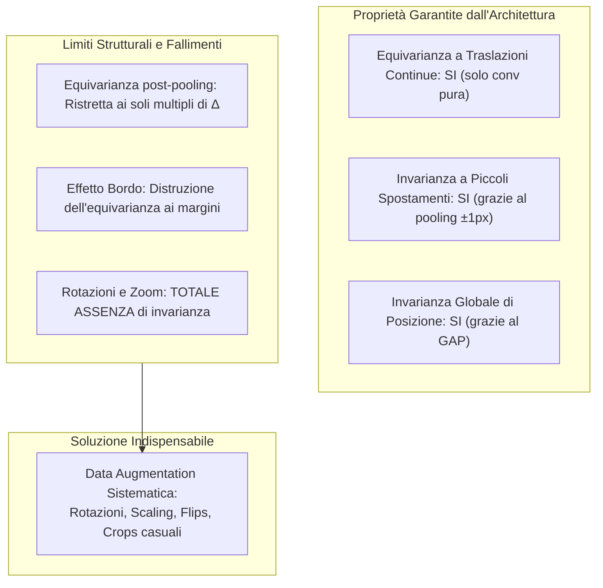

# 10. Anatomia di una CNN, Visualizzazione delle Feature e Convoluzioni Avanzate

Nel capitolo precedente sono stati definiti i singoli stadi operativi di una rete convoluzionale: la convoluzione tridimensionale su volumi tensoriali, il rilevatore non lineare ReLU e l'aggregazione spaziale mediante pooling. Tuttavia, l'efficacia di una rete neurale convoluzionale moderna dipende in modo cruciale dall'integrazione di questi blocchi all'interno di un'architettura coerente, dalla gestione dei layer di normalizzazione e di raccordo finale, e dall'adozione di varianti convoluzionali ad alta efficienza parametrica e computazionale.

In questo capitolo si analizza la formalizzazione della __Batch Normalization__ specifica per tensori di feature map $4\text{D}$, il confronto tra __Flattening__ e __Global Average Pooling__, l'anatomia analitica completa di una rete su immagini CIFAR-10 con tracciamento esatto di pesi e operazioni MAC, le tecniche di __visualizzazione gerarchica__ e di __sensibilità all'occlusione__ (Zeiler & Fergus), le varianti convoluzionali avanzate (__convoluzioni dilatate__ e __depthwise separable__ delle MobileNet), e una valutazione geometrica rigorosa sulle reali garanzie di equivarianza e invarianza dell'architettura.

## Normalizzazione e Layer Conclusivi nelle Reti Convoluzionali

### Batch Normalization per Tensori Convoluzionali 4D

Come introdotto nello studio delle reti completamente connesse, la __Batch Normalization__ (Ioffe & Szegedy, 2015) stabilizza l'addestramento riducendo la dipendenza estrema dall'inizializzazione dei pesi e lisciando la superficie della funzione di perdita (*loss landscape*). Nelle reti convoluzionali, la Batch Normalization deve tuttavia rispettare il principio fondante dell'architettura: l'__omogeneità spaziale__ e la condivisione dei parametri.

Si consideri un mini-batch di attivazioni intermedie rappresentato da un tensore quadridimensionale:

$$Z \in \mathbb{R}^{B \times C \times H \times W}$$

dove $B$ è la dimensione del batch, $C$ è il numero di canali (feature map), $H$ e $W$ sono l'altezza e la larghezza spaziali.

![[slide_12_batch_normalization_in_cnns.png|center mid]]

Se calcolassimo statistiche indipendenti per ciascuna posizione spaziale $(i, j)$ come in un layer denso, assegneremmo parametri di scala e shift diversi a pixel adiacenti della stessa feature map, distruggendo l'equivarianza alla traslazione. Per preservare la coerenza spaziale, la Batch Normalization per CNN opera __per singolo canale__, aggregando congiuntamente tutti i pixel spaziali di tutti i campioni appartenenti al mini-batch.

Per ogni canale $c \in \{1, \dots, C\}$, il numero totale di elementi sui quali vengono stimate la media $\mu_c$ e la varianza $\sigma_c^2$ è pari a:

$$m = B \times H \times W$$

Le equazioni di normalizzazione per il canale $c$ sono formulate come segue:

$$\mu_c = \frac{1}{B \cdot H \cdot W} \sum_{b=1}^{B} \sum_{i=1}^{H} \sum_{j=1}^{W} Z(b, c, i, j)$$

$$\sigma_c^2 = \frac{1}{B \cdot H \cdot W} \sum_{b=1}^{B} \sum_{i=1}^{H} \sum_{j=1}^{W} \left( Z(b, c, i, j) - \mu_c \right)^2$$

Ciascun valore del tensore viene standardizzato e successivamente riscalato tramite una trasformazione affine apprendibile:

$$\hat{Z}(b, c, i, j) = \frac{Z(b, c, i, j) - \mu_c}{\sqrt{\sigma_c^2 + \epsilon}}$$

$$Y(b, c, i, j) = \gamma_c \cdot \hat{Z}(b, c, i, j) + \beta_c$$

dove:
- $\epsilon > 0$ è una costante infinitesima di stabilità numerica (tipicamente $10^{-5}$);
- $\gamma_c, \beta_c \in \mathbb{R}$ sono i parametri affini di __scala__ e __shift__ appresi via discesa del gradiente. Poiché vi è una sola coppia $(\gamma_c, \beta_c)$ per ciascuna feature map, il numero totale di parametri apprendibili introdotti da un layer di `BatchNorm2d` è esattamente:
  $$\text{Parametri BatchNorm} = 2 \times C$$

#### Posizionamento Canonico della Batch Normalization
Nelle architetture classiche, la normalizzazione viene interposta tra la trasformazione lineare e la non-linearità:

$$X \longrightarrow [\text{Conv2d}] \longrightarrow Z \longrightarrow [\text{BatchNorm2d}] \longrightarrow \hat{Y} \longrightarrow [\text{ReLU}] \longrightarrow \dots$$

> [!NOTE] Assorbimento del Bias Convoluzionale
> Quando un layer convoluzionale è seguito immediatamente da Batch Normalization, il termine di bias proprio della convoluzione ($b_{\text{conv}} \in \mathbb{R}^C$) risulta matematicamente ridondante. 
> 
> Infatti, sommando una costante $b$ a $Z$, essa viene sottratta integralmente dal calcolo della media: $(Z + b) - \mu(Z + b) = Z + b - (\mu(Z) + b) = Z - \mu(Z)$. Il grado di libertà della traslazione viene interamente ereditato dal parametro $\beta_c$ della BatchNorm. Per tale motivo, in PyTorch si imposta convenzionalmente `nn.Conv2d(…, bias=False)`.

#### Dinamica a Test Time (Inference Mode)
Durante la fase di inferenza o test, il modello elabora spesso un singolo campione alla volta ($B=1$), rendendo impossibile il calcolo statistico su un batch. 

Come analizzato nella Slide 59, durante l'addestramento la classe `BatchNorm2d` tiene traccia delle statistiche globali della popolazione aggiornando una media mobile esponenziale (*running average*) con fattore di momentum $\eta \in [0, 1]$ (default $\eta = 0,1$ in PyTorch):

$$\mu_{\text{run}} \leftarrow (1 - \eta) \mu_{\text{run}} + \eta \mu_B, \quad \sigma^2_{\text{run}} \leftarrow (1 - \eta) \sigma^2_{\text{run}} + \eta \sigma_B^2$$

In fase di test, $\mu_{\text{run}}$ e $\sigma^2_{\text{run}}$ sono scalari costanti congelati: la normalizzazione si riduce a una trasformazione affine puramente lineare per ogni canale, priva di qualunque stocasticità.

### Raccordo con il Classificatore: Flattening vs Global Average Pooling

Al termine dell'estrattore di feature convoluzionale (dopo molteplici stadi di convoluzione, normalizzazione, attivazione e pooling), il segnale si presenta come un tensore tridimensionale $C_{\text{final}} \times H_{\text{final}} \times W_{\text{final}}$. Per formulare la predizione categoriale delle probabilità di classe tramite uno strato denso lineare ($W_{\text{cls}}, b_{\text{cls}}$) seguito da softmax, è necessario convertire il volume tridimensionale in un vettore monodimensionale $h \in \mathbb{R}^D$.

Esistono due paradigmi architetturali alternativi per realizzare questa transizione:

![[slide_12_maps_to_vector_flatten_vs_gap.png|center mid]]

#### Layer di Flattening (Serializzazione Spaziale)
L'approccio classico (impiegato storicamente da LeNet, AlexNet e VGG) consiste nello srotolare l'intero volume in un singolo vettore monodimensionale mediante concatenazione di tutte le righe di ciascuna feature map:

$$h = \text{vec}(X) \in \mathbb{R}^{D}, \quad \text{con } D = C_{\text{final}} \times H_{\text{final}} \times W_{\text{final}}$$

- __Vantaggi__: preserva integralmente ogni singolo valore di attivazione e la relativa disposizione spaziale all'interno delle mappe finali.
- __Svantaggi__:
  1. __Vincolo rigido sulla risoluzione di ingresso__: poiché la dimensione di input del primo strato denso è $D = C_{\text{final}} \cdot H_{\text{final}} \cdot W_{\text{final}}$, la rete può processare esclusivamente immagini aventi la risoluzione spaziale identica a quella utilizzata in fase di addestramento ($H_{\text{in}} \times W_{\text{in}}$). Un'immagine a risoluzione diversa altererebbe $H_{\text{final}}$ e $W_{\text{final}}$, violando la compatibilità algebrica delle dimensioni matrice-vettore.
  2. __Ipertrofia parametrica e overfitting__: come illustrato nell'analisi di VGG-16, il primo strato denso post-flattening concentra tipicamente oltre il $70\% - 80\%$ dei parametri dell'intera architettura, richiedendo tecniche estreme di regolarizzazione (come un massiccio Dropout) per prevenire la memorizzazione acritica del dataset.

#### Global Average Pooling (GAP)
Introdotto da Lin et al. (2013, *Network In Network*) e adottato da tutte le architetture moderne (GoogLeNet, ResNet, ConvNeXt), il __Global Average Pooling__ collassa ciascuna intera feature map bidimensionale nel suo valore medio aritmetico scalare:

$$h_c = \frac{1}{H \cdot W} \sum_{i=1}^{H} \sum_{j=1}^{W} X(c, i, j), \quad \forall c \in \{1, \dots, C_{\text{final}}\}$$

Il vettore risultante $h = [h_1, h_2, \dots, h_{C_{\text{final}}}]^T$ possiede una dimensionalità pari esattamente al numero di canali $C_{\text{final}}$, indipendentemente dall'estensione spaziale $H \times W$.

![[slide_12_global_average_pooling_operation.png|center mid]]

- __Vantaggi__:
  1. __Totale indipendenza dalla risoluzione di input__: la rete diviene *fully convolutional*; può ricevere in inferenza immagini di qualunque dimensione spaziale, poiché il GAP medierà sempre la mappa su qualunque griglia $H \times W$, producendo invariabilmente un vettore di dimensione $C_{\text{final}}$.
  2. __Zero parametri addizionali__: l'operazione di pooling globale è un operatore fisso a costo parametrico nullo ($\text{Parametri} = 0$).
  3. __Regolarizzazione strutturale__: fungendo da condensatore semantico, impedisce allo strato denso finale di specializzarsi su correlazioni spaziali spurie, contrastando intrinsecamente l'overfitting.
- __Trade-off Funzionale__: il GAP estirpa completamente l'informazione sulla posizione spaziale interna della feature. Due feature map che presentano la stessa intensità media complessiva — ad esempio una con un'attivazione isolata concentrata in un angolo e un'altra con attivazioni diffuse — producono esattamente lo stesso scalare. Se il task di classificazione richiede unicamente di sapere *se* una feature è presente nella scena, il GAP è la soluzione ottimale; se invece il task richiede la preservazione fine della geometria relativa (es. determinare se un pattern si trova sopra o sotto un altro), il flattening o l'impiego di pooling a coordinate spaziali preservate risulta indispensabile.

## Anatomia Completa di una CNN End-to-End

Per consolidare la comprensione di come tutti i componenti interagiscano, analizziamo l'architettura dettagliata layer per layer presentata nelle Slide 63–66 del corso. La rete è progettata per la classificazione di immagini a colori del dataset __CIFAR-10__ ($10$ classi, risoluzione $32 \times 32 \times 3$).

### Il Pattern Strutturale dell'Architettura

La rete segue il pattern consolidato nella letteratura (CS231n):

$$\text{Input} \longrightarrow [\text{Block 1}] \longrightarrow [\text{Block 2}] \longrightarrow [\text{Block 3}] \longrightarrow [\text{Layer 4}] \longrightarrow \text{GAP} \longrightarrow \text{Classifier}$$

Ciascun blocco convoluzionale è strutturato secondo la sequenza:
$$\text{Convoluzione} \longrightarrow \text{BatchNorm} \longrightarrow \text{ReLU} \longrightarrow \text{MaxPool } 2 \times 2$$

L'evoluzione macroscopica rispetta la regola aurea del deep learning visivo:
__Ridurre progressivamente la risoluzione spaziale ($32 \to 16 \to 8 \to 4$) e incrementare progressivamente il numero di canali di feature ($3 \to 32 \to 64 \to 128 \to 256$)__.

### Tracciamento Esatto: Dimensioni, Pesi e Operazioni MAC

La tabella seguente riporta il conteggio analitico esatto dei parametri e delle operazioni moltiplicazione-somma (MAC per singola immagine) per ciascuno stadio della rete (Slide 64):

| Livello / Blocco | Configurazione Operativa | Output Tensoriale | Parametri Pesi | Operazioni MAC |
| :--- | :--- | :--- | :--- | :--- |
| __Input__ | Immagine CIFAR-10 RGB | $3 \times 32 \times 32$ | $0$ | — |
| __Block 1__ | $\text{Conv } 5 \times 5 \text{ (32, pad 2)} \to \text{BN} \to \text{ReLU} \to \text{Pool } 2 \times 2$ | $32 \times 16 \times 16$ | $2.464$ | $2,46 \text{ M}$ |
| __Block 2__ | $\text{Conv } 3 \times 3 \text{ (64, pad 1)} \to \text{BN} \to \text{ReLU} \to \text{Pool } 2 \times 2$ | $64 \times 8 \times 8$ | $18.560$ | $4,72 \text{ M}$ |
| __Block 3__ | $\text{Conv } 3 \times 3 \text{ (128, pad 1)} \to \text{BN} \to \text{ReLU} \to \text{Pool } 2 \times 2$ | $128 \times 4 \times 4$ | $73.984$ | $4,72 \text{ M}$ |
| __Layer 4__ | $\text{Conv } 3 \times 3 \text{ (256, pad 1)} \to \text{BN} \to \text{ReLU (no pool)}$ | $256 \times 4 \times 4$ | $295.424$ | $4,72 \text{ M}$ |
| __GAP__ | Global Average Pooling | $256 \times 1 \times 1$ | $0$ | Trascurabile |
| __Classifier__ | Fully Connected $256 \to 10$ + Softmax | $10$ | $2.570$ | $0,003 \text{ M}$ |
| __Totale Rete__ | | | __$393.002$__ | __$16,6 \text{ M}$__ |

#### Analisi Analitica del Bilanciamento Computazionale
Esaminando attentamente i risultati emergono tre intuizioni teoriche fondamentali:

1. __Equilibrio delle Operazioni MAC nei Blocchi Intermedi__:
   I blocchi 2, 3 e il layer 4 richiedono ciascuno esattamente la medesima quantità di calcolo ($4,72 \text{ milioni}$ di MAC). 
   Questo equilibrio deriva dalla perfetta compensazione dimensionale: ogni operazione di Max Pooling con stride 2 riduce il numero di posizioni spaziali di un fattore $4$ ($H \times W \to \frac{H}{2} \times \frac{W}{2}$); contemporaneamente, il raddoppio dei canali moltiplica la quantità $C_{\text{in}} \times C_{\text{out}}$ esattamente per $4$ ($64 \times 32 \to 128 \times 64 \to 256 \times 128$). Di conseguenza, la complessità computazionale complessiva rimane rigorosamente costante lungo gli stadi intermedi.

2. __Asimmetria nella Distribuzione dei Pesi__:
   Mentre il costo computazionale (MAC) è uniformemente distribuito, i parametri liberi sono concentrati quasi per intero nello stadio finale: il solo Layer 4 contiene ben $295.424$ pesi, pari a oltre il $75\%$ dell'intera rete ($295.424 / 393.002$). Questo fenomeno è intrinseco alle CNN: gli strati iniziali elaborano griglie spaziali estese con pochi canali (basso numero di pesi, alto numero di MAC), mentre gli strati profondi elaborano mappe minuscole ma con un volume elevatissimo di canali (alto numero di pesi, basso numero di ripetizioni spaziali).

3. __Eliminazione del Collo di Bottiglia del Classificatore tramite GAP__:
   Il classificatore lineare finale su 10 classi richiede appena $256 \times 10 + 10 = 2.570$ pesi. Se avessimo adottato il flattening del volume $256 \times 4 \times 4 = 4.096$, il solo strato denso avrebbe richiesto $4.096 \times 10 + 10 = 40.970$ parametri (o centinaia di migliaia nel caso di strati nascosti intermedi densi).

### Implementazione Modulare in PyTorch

Il modello analizzato trova immediata corrispondenza nel codice PyTorch idiomatico (`nn.Module`), come illustrato nella Slide 66:

```python
import torch
import torch.nn as nn

class ConvNetCIFAR(nn.Module):
    def __init__(self, num_classes=10):
        super().__init__()
        
        # Block 1: 3 -> 32 canali, kernel 5x5, pad 2 (preserva 32x32) -> pool a 16x16
        self.block1 = nn.Sequential(
            nn.Conv2d(in_channels=3, out_channels=32, kernel_size=5, padding=2, bias=False),
            nn.BatchNorm2d(32),
            nn.ReLU(inplace=True),
            nn.MaxPool2d(kernel_size=2, stride=2)
        )
        
        # Block 2: 32 -> 64 canali, kernel 3x3, pad 1 (preserva 16x16) -> pool a 8x8
        self.block2 = nn.Sequential(
            nn.Conv2d(in_channels=32, out_channels=64, kernel_size=3, padding=1, bias=False),
            nn.BatchNorm2d(64),
            nn.ReLU(inplace=True),
            nn.MaxPool2d(kernel_size=2, stride=2)
        )
        
        # Block 3: 64 -> 128 canali, kernel 3x3, pad 1 (preserva 8x8) -> pool a 4x4
        self.block3 = nn.Sequential(
            nn.Conv2d(in_channels=64, out_channels=128, kernel_size=3, padding=1, bias=False),
            nn.BatchNorm2d(128),
            nn.ReLU(inplace=True),
            nn.MaxPool2d(kernel_size=2, stride=2)
        )
        
        # Layer 4: 128 -> 256 canali, kernel 3x3, pad 1 (preserva 4x4, nessun pooling)
        self.layer4 = nn.Sequential(
            nn.Conv2d(in_channels=128, out_channels=256, kernel_size=3, padding=1, bias=False),
            nn.BatchNorm2d(256),
            nn.ReLU(inplace=True)
        )
        
        # Global Average Pooling: riduce da (B, 256, 4, 4) a (B, 256, 1, 1)
        self.gap = nn.AdaptiveAvgPool2d((1, 1))
        
        # Classificatore lineare finale: 256 feature -> num_classes logits
        self.classifier = nn.Linear(in_features=256, out_features=num_classes)

    def forward(self, x):
        x = self.block1(x)       # -> (B, 32, 16, 16)
        x = self.block2(x)       # -> (B, 64, 8, 8)
        x = self.block3(x)       # -> (B, 128, 4, 4)
        x = self.layer4(x)       # -> (B, 256, 4, 4)
        x = self.gap(x)          # -> (B, 256, 1, 1)
        x = torch.flatten(x, 1)  # -> (B, 256)
        logits = self.classifier(x) # -> (B, 10)
        return logits
```

## Interpretazione e Visualizzazione delle Rappresentazioni Apprese

Una delle questioni cardine nella comprensione delle reti neurali profonde riguarda l'interpretabilità dei pesi appresi: cosa rappresenta concretamente una feature map all'interno degli strati intermedi?

### La Gerarchia Visiva di Zeiler e Fergus

Nello studio seminale di Zeiler & Fergus (2014, *Visualizing and Understanding Convolutional Networks*), gli autori hanno sviluppato una tecnica basata su de-convoluzioni per mappare le attivazioni dei neuroni interni indietro nello spazio dei pixel dell'immagine, scoprendo l'esistenza di una rigorosa __gerarchia visiva compositiva__:

![[slide_12_feature_visualization_zeiler_fergus_hierarchy.jpg|center mid]]

La gerarchia si articola lungo quattro livelli di astrazione:
1. __Layer 1 (Primitive Spaziali a Bassa Frequenza)__:
   I filtri del primo strato reagiscono esclusivamente a gradienti orientati locali (bordi orizzontali, verticali e inclinati), variazioni cromatiche opponenti (contrasti rosso-verde o giallo-blu) e distribuzioni di frequenza spaziale simili alle cellule semplici della corteccia visiva primaria (V1).
2. __Layer 2 (Pattern Strutturali Intermedi)__:
   Campionando le risposte dei filtri del primo strato all'interno di un campo recettivo allargato, i neuroni del secondo strato si attivano in presenza di combinazioni di bordi: angoli acuti, curve concentriche, giunzioni a T e motivi a texture periodica.
3. __Layer 3 e 4 (Parti Anatomiche e Componenti di Oggetti)__:
   Con l'ulteriore espansione del campo recettivo (grazie a profondità e pooling), le attivazioni si specializzano nel rilevamento di subunità funzionali complesse dotate di specifica semantica: ruote e fanali di veicoli, musi e occhi di quadrupedi, maniglie e tastiere.
4. __Layer Profondi e Classificatore (Concetti di Categoria Invarianti)__:
   Negli strati conclusivi, le feature map astraggono l'intera categoria dell'oggetto in modo invariante rispetto alla posa, allo sfondo o a variazioni locali di illuminazione.

#### Dimostrazione Didattica Compositiva: Il Caso della Casetta

Per visualizzare chiaramente questo principio compositivo (richiesto nelle note didattiche dello studente), si consideri il caso semplificato del riconoscimento di una casetta stilizzata:

![[casetta_hierarchical_cnn_features.svg|center mid]]

- Al __Layer 1__, la rete non possiede alcun filtro in grado di riconoscere la "casetta" o le "mura" nel loro complesso, poiché il campo recettivo è limitato a un patch $3 \times 3$. Tuttavia, i filtri si attivano localmente in corrispondenza delle discontinuità: quattro canali indipendenti generano un picco di attivazione (*hotspot*) rispettivamente sull'angolo superiore sinistro ($TL$), superiore destro ($TR$), inferiore sinistro ($BL$) e inferiore destro ($BR$) della facciata quadrata, mentre un altro canale risponde all'inclinazione a $45^\circ$ del tetto triangolare.
- Al __Layer 2__, ciascun filtro cubico campiona simultaneamente tutte le feature map del primo livello. Il neurone centrale del filtro "Mura" possiede pesi positivi configurati esattamente per correlare con la simultanea presenza dei quattro hotspot ($TL, TR, BL, BR$) distanziati reciprocamente secondo la geometria del rettangolo. Il neurone scatterà con intensità massima se e solo se l'intera configurazione spaziale dei quattro corner è verificata, sintetizzando il concetto semantico di ordine superiore di "parete".

### Mappe di Sensibilità all'Occlusione (Occlusion Sensitivity)

Un metodo empirico ed elegante per determinare con precisione quale porzione dell'immagine guidi la decisione del modello consiste nell'analisi della __sensibilità all'occlusione__ (*Occlusion Sensitivity*, Slide 70).

![[slide_12_occlusion_sensitivity_maps_car.jpg|center mid]]

L'algoritmo opera secondo il seguente protocollo:
1. Si calcola la probabilità iniziale predetta dalla rete per la classe corretta $k^*$:
   $$P_0 = p(y = k^* \mid X)$$
2. Si fa scorrere sistematicamente sull'immagine d'ingresso una maschera opaca quadrata (solitamente di colore grigio neutro o nero, di dimensione pari ad esempio a $16 \times 16$ pixel) centrata sulla coordinata $(i, j)$:
   $$X_{\text{occ}}(i, j)$$
3. Si valuta la nuova probabilità di classe assegnata dal modello:
   $$P_{\text{occ}}(i, j) = p(y = k^* \mid X_{\text{occ}}(i, j))$$
4. Si costruisce la __mappa di sensibilità__ registrando la caduta di confidenza:
   $$\Delta P(i, j) = P_0 - P_{\text{occ}}(i, j)$$

![[slide_12_occlusion_sensitivity_animation.mp4|center mid]]

Se la maschera occlude un pixel appartenente allo sfondo (ad esempio l'asfalto o il cielo), la predizione del modello rimane inalterata ($\Delta P \approx 0$). Al contrario, se la maschera va a coprire una componente semantica determinante (ad esempio il muso, i fari o le ruote dell'automobile), la probabilità della classe crolla drasticamente ($\Delta P \gg 0$). 

Mappando i valori di $\Delta P(i, j)$ in una scala cromatica, si ottiene una localizzazione evidenziata che dimostra inequivocabilmente che la rete non memorizza artefatti periferici, bensì basa la propria classificazione sulle caratteristiche fisiche salienti dell'oggetto.

## Varianti Avanzate dell'Operazione di Convoluzione

Oltre alla convoluzione standard $k \times k$ e al channel mixing $1 \times 1$, la ricerca ha sviluppato varianti specializzate orientate all'ottimizzazione delle risorse e all'espansione del campo recettivo.

### Convoluzioni Dilatate (Dilated / Atrous Convolutions)

Introdotte da Yu & Koltun (2016, *Multi-Scale Context Aggregation by Dilated Convolutions*) e note anche con il termine francese *à trous* (con buchi), le __convoluzioni dilatate__ consentono di ampliare il campo recettivo della rete senza ricorrere a operazioni di sottocampionamento (pooling o stride) e senza aumentare il numero di pesi apprendibili.

![[slide_12_dilated_convolutions_sampling_spacing.png|center mid]]

Nella convoluzione standard, i coefficienti del kernel campionano pixel spazialmente contigui. In una convoluzione con __fattore di dilatazione__ $d \ge 1$, i punti di campionamento del kernel vengono distanziati regolarmente inserendo un passo di salto pari a $d-1$ celle vuote tra due pesi adiacenti:

$$y(i, j) = \sum_{u=1}^{k} \sum_{v=1}^{k} K(u, v) \cdot X(i + d \cdot (u - 1), j + d \cdot (v - 1))$$

Se $d=1$, l'operazione coincide esattamente con la convoluzione standard. Con $d=2$, il kernel campiona un pixel ogni due; con $d=4$, campiona un pixel ogni quattro.

#### Dimensione Effettiva del Supporto e Receptive Field
Un filtro con $k$ pesi e dilatazione $d$ copre un'area quadrata complessiva pari a:

$$k_{\text{eff}} = 1 + (k - 1) \cdot d$$

Ad esempio, un filtro compatto con $k=3$ (avente solo $3 \times 3 = 9$ parametri):
- Con $d=1$: $k_{\text{eff}} = 1 + (3 - 1) \cdot 1 = 3$ (area $3 \times 3$);
- Con $d=2$: $k_{\text{eff}} = 1 + (3 - 1) \cdot 2 = 5$ (area $5 \times 5$);
- Con $d=4$: $k_{\text{eff}} = 1 + (3 - 1) \cdot 4 = 9$ (area $9 \times 9$).

![[slide_12_dilated_convolution_animation.mp4|center mid]]

> [!TIP] Il Vantaggio Cruciale: Ampio Contesto a Risoluzione Piena
> Per osservare un'area $5 \times 5$ con convoluzioni standard senza stride, servirebbe un kernel $5 \times 5$ con ben $25$ parametri, oppure due layer $3 \times 3$ in cascata ($18$ parametri). Con una convoluzione dilatata $d=2$, si osserva un intorno $5 \times 5$ impiegando esclusivamente __9 parametri__.
> 
> A differenza del pooling o dello stride, se lo stride viene mantenuto unitario ($S=1$), la risoluzione spaziale della feature map in uscita non subisce alcuna contrazione ($H_{\text{out}} = H_{\text{in}}$). Questa proprietà rende le convoluzioni dilatate la spina dorsale di compiti di predizione densa, quali la __segmentazione semantica__ (modelli *DeepLab*), la stima della profondità e la sintesi audio (modelli *WaveNet*), dove la perdita di risoluzione spaziale dovuta al pooling degraderebbe irreversibilmente i dettagli fini dei contorni.

### Convoluzioni Depthwise Separable (MobileNets)

Nei layer convoluzionali standard, ciascun filtro compie simultaneamente due operazioni distinte:
1. __Filtraggio spaziale__: correla pixel contigui all'interno del dominio bidimensionale $k \times k$;
2. __Miscelazione dei canali__: combina linearmente tutte le $C_{\text{in}}$ feature map lungo la profondità.

Le __convoluzioni separabili in profondità__ (__Depthwise Separable Convolutions__), formalizzate da Chollet (2017, *Xception*) e poste alla base delle architetture efficienti __MobileNet__ (Howard et al., 2017), decompongono questo processo monolitico in due fasi indipendenti e sequenziali:

![[slide_12_depthwise_separable_convolution_steps.png|center mid]]

#### Stadio Depthwise (Filtraggio Spaziale Isolato)
A ciascun singolo canale di ingresso viene applicato un filtro bidimensionale $k \times k$ dedicato. Non avviene alcuna combinazione tra feature map diverse: ciascun canale viene processato in totale isolamento.

- Numero di filtri: esattamente $C_{\text{in}}$ filtri bidimensionali $k \times k$;
- Output intermedio: un tensore con il medesimo numero di canali d'ingresso ($C_{\text{in}} \times H_{\text{out}} \times W_{\text{out}}$);
- Parametri stadio Depthwise:
  $$\text{Pesi}_{\text{DW}} = C_{\text{in}} \cdot k^2$$

#### Stadio Pointwise (Miscelazione Cross-Canale $1 \times 1$)
Le $C_{\text{in}}$ feature map intermedie prodotte dalla fase depthwise vengono combinate linearmente mediante una convoluzione standard con kernel $1 \times 1$ avente $C_{\text{out}}$ filtri.

- Numero di filtri: $C_{\text{out}}$ filtri tridimensionali $1 \times 1 \times C_{\text{in}}$;
- Output finale: volume con il numero desiderato di canali target ($C_{\text{out}} \times H_{\text{out}} \times W_{\text{out}}$);
- Parametri stadio Pointwise:
  $$\text{Pesi}_{\text{PW}} = C_{\text{out}} \cdot C_{\text{in}} \cdot 1^2 = C_{\text{in}} \cdot C_{\text{out}}$$

Il volume complessivo di parametri della convoluzione depthwise separable è la somma dei due stadi:

$$\text{Pesi}_{\text{Sep}} = C_{\text{in}} \cdot k^2 + C_{\text{in}} \cdot C_{\text{out}} = C_{\text{in}} \cdot (k^2 + C_{\text{out}})$$

#### Dimostrazione Analitica del Guadagno Computazionale

Confrontiamo i parametri e le moltiplicazioni-somme (MAC) della convoluzione standard rispetto alla variante depthwise separable:

$$\text{Rapporto di Costo} = \frac{\text{Costo}_{\text{Sep}}}{\text{Costo}_{\text{Std}}} = \frac{C_{\text{in}} \cdot k^2 + C_{\text{in}} \cdot C_{\text{out}}}{C_{\text{in}} \cdot C_{\text{out}} \cdot k^2}$$

Semplificando per il fattore comune $C_{\text{in}}$:

$$\text{Rapporto di Costo} = \frac{k^2 + C_{\text{out}}}{C_{\text{out}} \cdot k^2} = \frac{1}{C_{\text{out}}} + \frac{1}{k^2}$$

Poiché nelle reti deep il numero di canali di uscita è tipicamente elevato ($C_{\text{out}} \ge 64$, $128$, $256$), il termine $\frac{1}{C_{\text{out}}} \to 0$. Il risparmio computazionale asintotico è dominato da:

$$\text{Rapporto} \approx \frac{1}{k^2}$$

Adottando il kernel canonico $k=3$ ($k^2 = 9$):

$$\text{Rapporto} \approx \frac{1}{9} \approx 0,11$$

__L'impiego delle depthwise separable convolutions riduce sia il numero di pesi che le operazioni MAC di quasi 9 volte ($8,7\times - 9\times$) rispetto alla convoluzione standard!__

#### Esempio Numerico e Valutazione Sperimentale (Slide 76–77)
Consideriamo un layer con $C_{\text{in}} = 2$ e $C_{\text{out}} = 2$ con kernel $3 \times 3$:
- Convoluzione standard: $2 \times 2 \times 3^2 = 36$ pesi;
- Depthwise Separable: $2 \times 3^2 + 2 \times 2 = 18 + 4 = 22$ pesi.

Applicando questa sostituzione ai Blocchi 2, 3 e 4 della rete CIFAR-10 esaminata in precedenza (Slide 77):
- I parametri totali crollano da $393.002$ a soli __$51.402$__ (riduzione di un fattore $7,6\times$);
- Le moltiplicazioni-somme scendono da $16,6 \text{ M}$ a __$4,2 \text{ M}$__ ($4,0\times$ in meno, considerando che il primo strato denso $5 \times 5$ viene mantenuto standard per non perdere informazioni cromatiche grezze);
- L'accuratezza su CIFAR-10 passa dall'$85,0\%$ all'__$80,0\%$__.

La perdita di appena $5$ punti percentuali a fronte di un abbattimento quasi quadruplo delle operazioni rende le depthwise separable lo standard assoluto per modelli edge, robot mobili e smartphone.

## Garanzie Geometriche e Limiti Strutturali dell'Architettura

Al termine del percorso sui layer convoluzionali, è indispensabile formalizzare rigorosamente cosa l'architettura sia in grado di garantire per costruzione algebrica e cosa invece debba essere necessariamente delegato ai dati.



### Equivarianza Limitata ai Multipli dello Stride di Pooling

Come dimostrato nel Capitolo 9, un singolo layer convoluzionale senza stride gode di un'equivarianza rigorosa a qualsiasi traslazione discreta $a \in \mathbb{Z}$: $\phi(T_a x) = T_a \phi(x)$.

Tuttavia, non appena intervengono layer di pooling con stride $s > 1$, la feature map viene campionata a risoluzione ridotta (un valore ogni $s$ pixel). Di conseguenza:
__L'equivarianza formale sussiste esclusivamente per traslazioni che siano multipli esatti del passo di campionamento aggregato $\Delta$__.

![[slide_12_pooling_equivariance_stride_multiples.png|center mid]]

Nella nostra rete CIFAR-10, la cascata di tre strati di Max Pooling $2 \times 2$ genera un fattore di sottocampionamento complessivo pari a:

$$\Delta = 2 \times 2 \times 2 = 8 \text{ pixel}$$

- Se l'immagine trasla di un multiplo esatto di $8$ pixel ($T_{8a}$), la feature map finale si sposta esattamente di $a$ celle intere: l'equivarianza è perfettamente conservata.
- Se l'immagine trasla di un singolo pixel ($1 \text{ px}$), non esiste alcuna mezza cella nella mappa finale: la quantizzazione spaziale altera la dinamica interna, determinando la variazione del $33\%$ delle attivazioni interne anche lontano dai margini.

#### L'Effetto Bordo (Boundary Effect)
L'equivarianza teorica presuppone segnali di estensione infinita. Nelle immagini reali di dimensione finita $H \times W$, i filtri convoluzionali che intersecano il perimetro campionano una combinazione asimmetrica di pixel reali e di zeri aggiunti dal padding. 

Nelle coordinate periferiche, l'equivarianza è irrimediabilmente infranta. Come dimostrato nella Slide 80, considerando le colonne periferiche, ben l'$42\%$ delle attivazioni della feature map muta a fronte di una singola traslazione unitaria.

### Assenza di Invarianza a Rotazioni e Variazioni di Scala (Zoom)

I filtri convoluzionali discreti non ruotano solidalmente con l'immagine né si adattano elasticamente alle variazioni di scala metrica: un filtro addestrato a riconoscere un profilo orizzontale non presenta alcuna risposta quando il medesimo pattern viene ruotato a $90^\circ$.

![[slide_12_rotation_zoom_failure_data_augmentation.png|center mid]]

I dati sperimentali misurati a lezione (Slide 83) dimostrano la gravità di questo limite su una CNN addestrata unicamente con traslazioni e riflessioni orizzontali:
- __Immagine originale (non ruotata)__: accuratezza $85,0\%$;
- __Rotazione rigida di $30^\circ$__: l'accuratezza precipita al __$54\%$__;
- __Rotazione rigida di $90^\circ$__: l'accuratezza collassa al __$31\%$__ (prossima al caso casuale);
- __Zoom out a fattore $0,7\times$__: accuratezza del $73\%$;
- __Zoom in a fattore $1,4\times$__: accuratezza del $62\%$.

### Il Ruolo Fondamentale della Data Augmentation

Poiché l'architettura standard delle CNN non implementa né l'invarianza alle rotazioni né l'invarianza alla scala, tale robustezza __non può essere presupposta a priori__, ma deve essere obbligatoriamente iniettata attraverso i dati mediante __Data Augmentation__:

$$X_{\text{train}} \sim \mathcal{T}_{\text{geom}}(X)$$

Applicando trasformazioni stocastiche affini (rotazioni casuali in $[-\theta_{\text{max}}, +\theta_{\text{max}}]$, scalature isotrope, ritagli casuali e flippaggi orizzontali) conservando l'etichetta semantica di classe $y$, la discesa del gradiente è costretta ad apprendere banchi di filtri multipli per campionare ciascuna variante geometrica, colmando empiricamente il gap dell'induzione architetturale.
