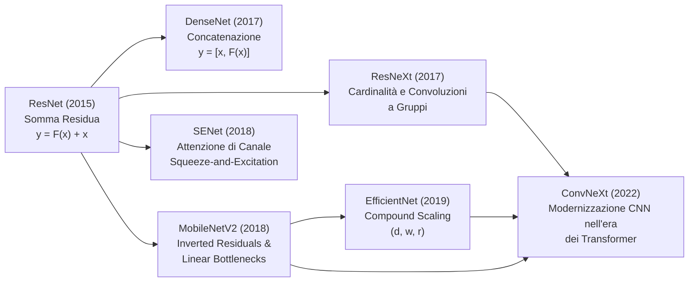
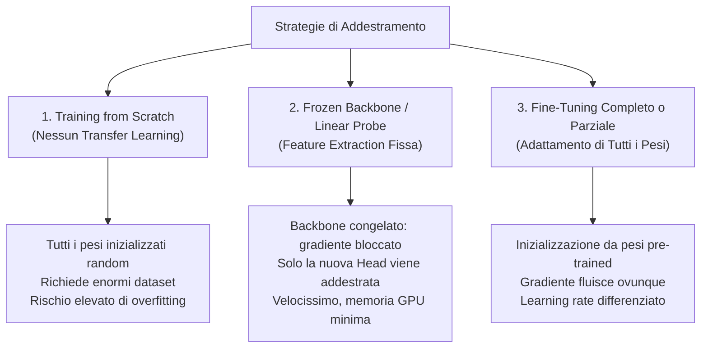

# 12. Architetture CNN Avanzate, Modelli Efficienti e ConvNeXt

Le architetture residuali hanno risolto la patologia del degrado del gradiente, dimostrando che l'aggiunta di scorciatoie consente l'ottimizzazione di modelli con centinaia di strati. Tuttavia, la ricerca sulle reti convoluzionali si è rapidamente orientata verso questioni ingegneristiche più complesse: massimizzare il riutilizzo delle feature estratte, ottimizzare il rapporto tra capacità espressiva e parametri mediante cardinalità e ricalibrazione dinamica, comprimere il carico computazionale per dispositivi con risorse limitate (edge computing e robotica autonoma) e, infine, modernizzare la convoluzione per competere con i modelli basati su auto-attenzione (Vision Transformer).

Questo capitolo analizza l'evoluzione strutturale delle CNN avanzate: dal paradigma a connessione densa di __DenseNet__ alle convoluzioni a gruppi di __ResNeXt__, dalla modulazione di canale in __SENet__ ai modelli ultraleggeri per sistemi embedded (__MobileNetV1/V2__ ed __EfficientNet__), fino alla sintesi moderna rappresentata da __ConvNeXt__ e alle metodologie pratiche di __Transfer Learning__.

## DenseNet e la Connessione Estrema delle Feature

Nonostante l'efficacia di ResNet, l'operazione algebrica di somma elemento per elemento:

$$
y = F(x) + x
$$

presenta un limite intrinseco di condensazione del segnale: sommando il tensore delle feature in ingresso $x$ con il residuo $F(x)$, le caratteristiche estratte dai livelli primari vengono fuse algebricamente con quelle dei livelli successivi. Di conseguenza, il blocco residuo consecutivo ha accesso diretto unicamente al risultato della somma, mentre l'informazione originale dei layer a monte risulta mediata e condensata. Ciò rischia di alterare o rendere irrecuperabili dettagli ad altissima frequenza spaziale (spigoli, texture fini) che potrebbero risultare decisivi nei livelli di classificazione semantica profonda.

Per superare questo limite, __DenseNet__ (Huang et al., 2017) introduce il principio della __connessione densa__: ogni layer riceve in ingresso la concatenazione diretta degli output di tutti i layer che lo precedono all'interno del medesimo blocco, e trasmette a sua volta le proprie feature map a tutti i layer successivi.

![[slide_13_densenet_concatenation_concept.png|center mid]]

### Formulazione Matematica della Concatenazione

In una rete feed-forward tradizionale a $L$ layer vi sono esattamente $L$ connessioni (una tra ciascun layer e il successivo). In DenseNet sono presenti invece connessioni dirette tra ogni coppia di strati:

$$
\frac{L(L + 1)}{2}
$$

Indicando con $x_0, x_1, \dots, x_{l-1}$ gli output prodotti dai layer precedenti, il layer $l$-esimo calcola una trasformazione non lineare $H_l(\cdot)$ applicata non alla sola feature map precedente, ma al tensore ottenuto impilando tutti gli output lungo la dimensione dei canali:

$$
x_l = H_l([x_0, x_1, x_2, \dots, x_{l-1}])
$$

dove $[\dots]$ denota l'operazione di concatenazione tensoriale.

![[densenet_concatenation_block.svg|center big]]

Si consideri il funzionamento intuitivo del meccanismo a partire da un volume in ingresso a tre canali RGB ($x_0 \in \mathbb{R}^{H \times W \times 3}$):
1. Il primo blocco convoluzionale $H_1$ elabora i 3 canali di $x_0$ e produce un insieme di 64 feature map ($x_1 \in \mathbb{R}^{H \times W \times 64}$).
2. Invece di sommare $x_1$ a $x_0$, la rete concatena $x_0$ e $x_1$ lungo la profondità. Il volume che entra nel secondo blocco presenta quindi $3 + 64 = 67$ canali.
3. Il secondo blocco convoluzionale $H_2$ processa questo volume a 67 canali e produce a sua volta 64 nuove feature map ($x_2 \in \mathbb{R}^{H \times W \times 64}$).
4. Il tensore risultante unisce tutti i contributi precedenti: $[x_0, x_1, x_2]$ accumula $3 + 64 + 64 = 131$ feature map, che vengono trasmesse al blocco successivo.

### Autostrada del Gradiente tramite Concatenazione

La concatenazione preserva integralmente l'identità di ciascuna feature map estratta. Dal punto di vista della retropropagazione, l'operazione di concatenazione tensoriale distribuisce il gradiente in ingresso separando le componenti corrispondenti ai singoli canali:

$$
\frac{\partial \mathcal{L}}{\partial [x_0, \dots, x_{l-1}]} = \left[ \frac{\partial \mathcal{L}}{\partial x_0}, \dots, \frac{\partial \mathcal{L}}{\partial x_{l-1}} \right]
$$

Il gradiente della funzione di costo retropropaga direttamente dall'uscita del blocco verso qualsiasi strato intermedio $x_i$ senza dover attraversare obbligatoriamente le convoluzioni dei blocchi successivi. Questo flusso ininterrotto mitiga il vanishing gradient e garantisce una costante supervisione diretta a tutti i livelli dell'architettura.

### Growth Rate e Controllo della Proliferazione dei Canali

Se ogni layer introducesse un numero elevato di canali, la profondità del tensore crescerebbe esponenzialmente, rendendo proibitivo il carico computazionale. DenseNet risolve questo problema introducendo il concetto di __growth rate__ (tasso di crescita), indicato con $k$ (o talvolta $R$): ciascun layer $H_l$ è progettato per produrre un numero molto contenuto di feature map in uscita, tipicamente $k = 32$ o $k = 48$.

Se il tensore di ingresso a un blocco denso possiede $k_0$ canali, l'input per il layer $l$-esimo possiede una profondità di canali pari a:

$$
k_l = k_0 + k \times (l - 1)
$$

Nonostante ogni singolo strato produca pochissime mappe ($k=32$), la rete raggiunge prestazioni all'avanguardia perché i layer successivi non hanno bisogno di ri-apprendere caratteristiche ridondanti: riutilizzano direttamente l'intero catalogo di feature estratte a monte (_feature reuse_).

### Struttura Interna del Dense Block: Il Bottleneck 1x1

All'interno di un blocco denso, ogni trasformazione composita $H_l$ adotta una sequenza di operazioni di tipo pre-activation:

$$
\text{BN} \to \text{ReLU} \to \text{Conv}(1 \times 1) \to \text{BN} \to \text{ReLU} \to \text{Conv}(3 \times 3)
$$

La presenza della convoluzione $1 \times 1$ prima della convoluzione spaziale $3 \times 3$ è fondamentale e funge da __bottleneck__ (collo di bottiglia):
- Poiché nei layer profondi il numero di canali accumulati $k_l$ può superare diverse centinaia, una convoluzione $3 \times 3$ diretta risulterebbe eccessivamente onerosa in termini di parametri ($3 \times 3 \times k_l \times k$).
- La convoluzione $1 \times 1$ proietta preventivamente il tensore accumulato su un numero fisso di canali pari a $4k$ (ad esempio $4 \times 32 = 128$).
- La successiva convoluzione $3 \times 3$ elabora sempre un volume di profondità $4k$ per produrre $k$ canali.

Di conseguenza, il conteggio dei pesi per il kernel $3 \times 3$ rimane __rigorosamente costante__ in tutti i layer del blocco:

$$
\text{Pesi}_{\text{conv } 3 \times 3} = 3 \times 3 \times 4k \times k = 36 \cdot k^2
$$

Per $k = 32$, ogni convoluzione $3 \times 3$ impiega esattamente $36 \times 32^2 = 36.864$ pesi. L'unica componente i cui parametri aumentano linearmente con la profondità all'interno del blocco è la convoluzione $1 \times 1$, che deve mappare $k_l$ canali di ingresso in $4k$ canali intermedi:

$$
\text{Pesi}_{\text{conv } 1 \times 1} = 1 \times 1 \times k_l \times 4k = 4k \cdot k_l
$$

![[slide_13_densenet_dense_block_and_transition_layer.png|center mid]]

### Downsampling e Strati di Transizione

La concatenazione tensoriale richiede che tutte le feature map mantengano identica risoluzione spaziale $H \times W$. Per consentire il pooling e la riduzione dimensionale indispensabile nelle CNN, DenseNet suddivide la rete in molteplici __Dense Block__ separati da __Transition Layer__ (strati di transizione).

Un Transition Layer è composto da:

$$
\text{BN} \to \text{ReLU} \to \text{Conv}(1 \times 1) \to \text{Average Pooling}(2 \times 2, \, \text{stride}=2)
$$

Lo strato di transizione assolve due compiti:
1. __Riduzione Spaziale__: dimezza altezza e larghezza del tensore ($H/2 \times W/2$) tramite l'Average Pooling.
2. __Compressione dei Canali__: la convoluzione $1 \times 1$ comprime il numero di canali del blocco denso precedente mediante un fattore di compressione $\theta \in (0, 1]$ (tipicamente $\theta = 0.5$). Se il blocco precedente emette $C$ canali, la transizione riduce la profondità a $\lfloor \theta C \rfloor = \lfloor C / 2 \rfloor$, impedendo la proliferazione incontrollata dei canali verso gli stadi successivi.

![[slide_13_densenet_121_complete_architecture.png|center mid]]

### L'Architettura DenseNet-121 e il Trade-Off di Memoria

L'architettura classica __DenseNet-121__ è strutturata come segue:
- __Stem iniziale__: Convoluzione $7 \times 7$ con stride 2 (64 filtri), seguita da Max Pooling $3 \times 3$ con stride 2 su immagini $224 \times 224 \times 3$. Restituisce un tensore $56 \times 56 \times 64$.
- __Dense Block 1__: 6 layer bottleneck ($k=32$), canali portati da 64 a $64 + 6 \times 32 = 256$.
- __Transition Layer 1__: Convoluzione $1 \times 1$ che dimezza i canali a $128$, seguita da Average Pooling $2 \times 2$. Risoluzione $28 \times 28$.
- __Dense Block 2__: 12 layer bottleneck ($k=32$), canali portati a $128 + 12 \times 32 = 512$.
- __Transition Layer 2__: Compressione a $256$ canali, risoluzione $14 \times 14$.
- __Dense Block 3__: 24 layer bottleneck ($k=32$), canali portati a $256 + 24 \times 32 = 1024$.
- __Transition Layer 3__: Compressione a $512$ canali, risoluzione $7 \times 7$.
- __Dense Block 4__: 16 layer bottleneck ($k=32$), canali finali $512 + 16 \times 32 = 1024$.
- __Classification Head__: Batch Normalization, ReLU, Global Average Pooling ($7 \times 7 \to 1 \times 1 \times 1024$) e layer Fully Connected lineare terminale da 1000 classi.

DenseNet-121 raggiunge un'accuratezza superiore a ResNet-34 pur impiegando circa un terzo dei parametri (circa 8 milioni contro oltre 21 milioni).

Tuttavia, DenseNet presenta una criticità rilevante: l'__elevato consumo di memoria RAM sulla GPU durante la fase di addestramento__. Poiché le operazioni di concatenazione generano ampi tensori condivisi e la Batch Normalization deve calcolare media e varianza per ciascun canale mantenendo in memoria le attivazioni per la backpropagation, un'implementazione naive alloca tensori intermedi ridondanti. In PyTorch, questo vincolo viene gestito tramite tecniche di memory-efficient checkpointing, che ricalcolano le concatenazioni al volo durante la retropropagazione anziché mantenerle memorizzate.

## ResNeXt e la Dimensione della Cardinalità

Mentre DenseNet esplora la concatenazione come alternativa alla somma, __ResNeXt__ (Xie et al., 2017) propone una riformulazione del blocco residuo basata su una nuova dimensione fondamentale di progettazione: la __cardinalità__ (_cardinality_).

Fino al 2016, il dimensionamento delle reti si basava su due assi primari:
- __Profondità__ (_Depth_): aumento del numero di layer sequenziali in cascata (es. da AlexNet a ResNet-152).
- __Larghezza__ (_Width_): aumento del numero di canali (feature map) per layer.

ResNeXt introduce la cardinalità, definita come la dimensione dell'insieme delle trasformazioni omogenee parallele all'interno del medesimo blocco.

![[slide_13_resnext_32_paths_cardinality_block.png|center mid]]

### Il Principio Split-Transform-Merge

ResNeXt adotta il paradigma concettuale __Split-Transform-Merge__, ispirato ai moduli Inception ma depurato della loro eterogeneità artigianale:
1. __Split__: il vettore di canali in ingresso viene ripartito in $C$ rami paralleli a bassa dimensionalità.
2. __Transform__: ciascun ramo esegue una sequenza identica di trasformazioni (convoluzioni $1 \times 1$ di riduzione e convoluzioni $3 \times 3$).
3. __Merge__: gli output di tutti i percorsi vengono aggregati tramite somma algebrica e ricombinati con la connessione residua originaria.

La trasformazione complessiva del blocco si esprime come:

$$
y = x + \sum_{i=1}^{C} \mathcal{T}_i(x)
$$

dove $C$ è la cardinalità e $\mathcal{T}_i(x)$ è una funzione di trasformazione parametrica operante su uno spazio proiettato a bassa dimensionalità (tipicamente 4 canali per ramo).

### Convoluzioni a Gruppi (Grouped Convolutions)

La novità fondamentale di ResNeXt consiste nel dimostrare che la computazione parallela di $C$ rami indipendenti è matematicamente equivalente a una singola __convoluzione a gruppi__ (_grouped convolution_).

![[slide_13_grouped_convolution_concept.png|center mid]]

In una convoluzione 2D convenzionale con kernel $K \times K$, ciascuno dei $C_{out}$ filtri elabora simultaneamente tutti i $C_{in}$ canali di ingresso. Il costo parametrico è:

$$
\text{Pesi}_{\text{standard}} = K \times K \times C_{in} \times C_{out}
$$

Nella convoluzione a gruppi con parametro $g$:
- I canali di ingresso vengono suddivisi in $g$ gruppi distinti, ciascuno formato da $C_{in} / g$ feature map.
- I filtri di uscita vengono anch'essi suddivisi in $g$ gruppi, ciascuno contenente $C_{out} / g$ filtri.
- Ciascun filtro opera esclusivamente sul rispettivo gruppo di canali in ingresso.

Il numero complessivo di pesi è dato dalla somma dei parametri su tutti i $g$ gruppi:

$$
\text{Pesi}_{\text{grouped}} = g \times \left( K \times K \times \frac{C_{in}}{g} \times \frac{C_{out}}{g} \right) = \frac{K \times K \times C_{in} \times C_{out}}{g}
$$

I parametri e i FLOPs risultano esattamente ridotti di un fattore $g$:

$$
\text{Pesi}_{\text{grouped}} = \frac{\text{Pesi}_{\text{standard}}}{g}
$$

La convoluzione a gruppi definisce uno spettro continuo di connettività tra canali:
- Per $g = 1$, si ricade nella convoluzione densa convenzionale (piena interazione tra canali, costo massimo).
- Per $1 < g < C_{in}$, si ottiene la convoluzione a gruppi di ResNeXt (interazione confinata a sottospazi, costo intermedio).
- Per $g = C_{in}$, si ottiene la __convoluzione depthwise__ (ciascun canale elaborato in completo isolamento, costo minimo).

### Equivalenza Computazionale tra Architettura Multi-Ramo e Convoluzione a Gruppi

Invece di istanziare fisicamente 32 rami separati nel grafo computazionale (operazione inefficiente per la memoria e i kernel GPU), il blocco ResNeXt-50 con cardinalità $C = 32$ viene eseguito in tre strati sequenziali densi:
1. __Convoluzione $1 \times 1$ aggregata__: proietta direttamente i 256 canali di ingresso in $32 \times 4 = 128$ canali intermedi tramite un'unica moltiplicazione matriciale. Ciascun blocco di 4 righe della matrice dei pesi equivale all'estrazione delle feature per uno dei 32 percorsi.
2. __Convoluzione $3 \times 3$ raggruppata__: esegue la convoluzione spaziale con $g = 32$ gruppi, dove ciascun gruppo processa 4 canali in ingresso e produce 4 canali in uscita (`groups=32`).
3. __Convoluzione $1 \times 1$ di espansione__: rimappa i 128 canali intermedi nei 256 canali di uscita del blocco.
4. __Somma residua__: addizione elemento per elemento con l'identità dell'input.

A parità di budget computazionale (stesso numero di parametri e FLOPs di una ResNet-50 standard), ResNeXt-50 ($32 \times 4\text{d}$) ottiene un decremento dell'errore di classificazione top-1 su ImageNet di quasi 2 punti percentuali, dimostrando che __l'aumento della cardinalità è più efficace dell'aumento di profondità o larghezza__.

## Squeeze-and-Excitation Networks (SENet)

Le convoluzioni standard e le convoluzioni a gruppi trattano tutte le feature map con identica importanza: l'operazione di filtraggio fonde informazioni spaziali e di canale applicando pesi fissi determinati dall'addestramento, senza alcuna sensibilità contestuale al contenuto specifico della singola immagine processata.

Le reti __SENet__ (Hu et al., 2018, vincitrici dell'ultima edizione della competizione ILSVRC su ImageNet) introducono il blocco __Squeeze-and-Excitation (SE)__, un meccanismo architetturale plug-and-play che calibra dinamicamente a runtime l'importanza di ciascuna feature map.

![[slide_13_squeeze_and_excitation_block_concept.png|center mid]]

Se la rete elabora l'immagine di un gatto, i canali specializzati nell'individuare tessiture di pelliccia o baffi devono essere esaltati, mentre i filtri dedicati a profili di pneumatici o finestre devono essere silenziati. Il modulo SE calcola un coefficiente scalare di modulazione continua $s_c \in [0, 1]$ per ogni canale.

Il blocco SE si articola in due fasi operative distinte: __Squeeze__ ed __Excitation__.

### Fase di Squeeze: Compressione del Contesto Globale

Dato un tensore di attivazioni intermedie $\mathbf{X} \in \mathbb{R}^{H \times W \times C}$, la fase di __Squeeze__ estrae un descrittore compatto delle statistiche globali di canale aggregando le dimensioni spaziali $H \times W$ mediante un __Global Average Pooling__ (GAP):

$$
z_c = \mathbf{F}_{sq}(\mathbf{u}_c) = \frac{1}{H \times W} \sum_{i=1}^{H} \sum_{j=1}^{W} u_c(i, j), \quad \forall c \in \{1, \dots, C\}
$$

L'output della fase di squeeze è un vettore monodimensionale $\mathbf{z} \in \mathbb{R}^C$ in cui ogni elemento $z_c$ riassume l'energia media e il contesto globale presente nel rispettivo canale.

### Fase di Excitation: Cattura delle Interdipendenze non Lineari

La fase di __Excitation__ mappa il descrittore globale $\mathbf{z}$ in un vettore di pesi $\mathbf{s} \in [0, 1]^C$. Per modellare le correlazioni incrociate non lineari tra i canali senza incorrere in un costo parametrico elevato, si impiega un piccolo Multi-Layer Perceptron (MLP) a collo di bottiglia composto da due strati lineari fully connected:

$$
\mathbf{s} = \mathbf{F}_{ex}(\mathbf{z}, \mathbf{W}) = \sigma \Big( \mathbf{W}_2 \cdot \delta \big( \mathbf{W}_1 \mathbf{z} \big) \Big)
$$

dove:
- $\mathbf{W}_1 \in \mathbb{R}^{\frac{C}{r} \times C}$ è la matrice di proiezione del primo strato denso, che riduce la dimensionalità da $C$ a $C/r$ (con fattore di riduzione tipico $r = 16$).
- $\delta(\cdot)$ è la funzione di attivazione non lineare __ReLU__.
- $\mathbf{W}_2 \in \mathbb{R}^{C \times \frac{C}{r}}$ è la matrice del secondo strato, che riproietta il vettore alla dimensionalità originaria $C$.
- $\sigma(\cdot)$ è la funzione logistica __Sigmoide__: garantisce che ogni coefficiente scalare $s_c$ sia strettamente compreso nell'intervallo continuo $[0, 1]$.

### Channel-wise Scaling (Ricalibrazione)

Il vettore di coefficienti $\mathbf{s}$ viene applicato al tensore di feature map originario $\mathbf{X}$ tramite una moltiplicazione canale per canale (_channel-wise scaling_):

$$
\widetilde{\mathbf{x}}_c = \mathbf{F}_{scale}(\mathbf{u}_c, s_c) = s_c \cdot \mathbf{u}_c
$$

Ciascuna matrice bidimensionale $\mathbf{u}_c \in \mathbb{R}^{H \times W}$ viene moltiplicata per lo scalare $s_c$:
- Se $s_c \to 1$, la feature map viene lasciata inalterata.
- Se $s_c \to 0$, la feature map viene soppressa.
- Per valori intermedi, l'attivazione viene attenuata proporzionalmente.

![[slide_13_squeeze_and_excitation_in_resnet.png|center mid]]

L'integrazione del blocco SE all'interno di un blocco residuo standard (SE-ResNet-50) comporta un incremento di circa il 10% di parametri (da 25.6M a 28.1M, concentrato principalmente nell'ultimo stadio dove i canali raggiungono $C = 2048$), a fronte di un sovraccarico computazionale praticamente trascurabile in termini di calcolo (un aumento di appena lo 0.3% di FLOPs/multiply-adds), determinando un significativo miglioramento della capacità di generalizzazione e dell'accuratezza su compiti visivi complessi.

## Architetture per Dispositivi Embedded: MobileNet e MobileNetV2

La diffusione della computer vision su piattaforme robotizzate, microveicoli aerei autonomi (UAV) e smartphone impone stringenti vincoli di calcolo in tempo reale, consumo energetico e footprint di memoria RAM. I modelli tradizionali (VGG con 138M di pesi o ResNet-50 con oltre 25M di pesi e miliardi di operazioni) risultano inadatti all'edge computing.

### MobileNetV1 e la Convoluzione Depthwise Separabile

__MobileNetV1__ (Howard et al., 2017) scompone la convoluzione standard 2D in due operazioni sequenziali distinte: la __convoluzione depthwise separable__ (convoluzione depthwise seguita da convoluzione pointwise).

Si consideri un tensore di ingresso di dimensioni $H \times W \times C_{in}$ e un layer convoluzionale che produce un volume $H \times W \times C_{out}$ con kernel spaziale $K \times K$:
- __Convoluzione Standard__: esegue contemporaneamente il filtraggio spaziale e la combinazione dei canali. Il costo computazionale in termini di moltiplicazioni e accumuli (MACs) è:

$$
\text{MACs}_{\text{standard}} = H \times W \times K \times K \times C_{in} \times C_{out}
$$

- __Convoluzione Depthwise Separable__:
  1. _Fase Depthwise_: applica un singolo filtro $K \times K$ per ciascun canale di ingresso separatamente ($g = C_{in}$). Non vi è combinazione tra canali. Costo: $H \times W \times K \times K \times C_{in}$.
  2. _Fase Pointwise ($1 \times 1$)_: proietta i $C_{in}$ canali prodotti dalla fase depthwise in $C_{out}$ canali tramite una convoluzione $1 \times 1$. Costo: $H \times W \times 1 \times 1 \times C_{in} \times C_{out}$.

Il costo totale dell'operazione separabile è:

$$
\text{MACs}_{\text{separable}} = H \times W \times C_{in} \times (K^2 + C_{out})
$$

Il rapporto computazionale tra la convoluzione separabile e quella convenzionale evidenzia l'entità del risparmio:

$$
\frac{\text{MACs}_{\text{separable}}}{\text{MACs}_{\text{standard}}} = \frac{H \times W \times C_{in} \times (K^2 + C_{out})}{H \times W \times K^2 \times C_{in} \times C_{out}} = \frac{1}{C_{out}} + \frac{1}{K^2}
$$

Con kernel $3 \times 3$ ($K = 3$) e uno strato con $C_{out} = 128$:

$$
\frac{1}{128} + \frac{1}{9} \approx 0.0078 + 0.1111 \approx 0.1189 \implies \approx \frac{1}{8.4}
$$

L'approccio separabile depthwise abbatte di oltre l'__88%__ il numero di operazioni matematiche ($8\times$–$9\times$ meno MACs) a fronte di una flessione trascurabile dell'accuratezza (circa 1% su ImageNet rispetto a modelli standard equivalenti).

### MobileNetV2: Inverted Residuals e Linear Bottlenecks

__MobileNetV2__ (Sandler et al., 2018) ridefinisce l'architettura attraverso due innovazioni cruciali: i blocchi residui invertiti (_inverted residuals_) e i colli di bottiglia lineari (_linear bottlenecks_).

![[slide_13_mobilenetv2_inverted_residual_block.png|center mid]]

#### Inverted Residual Block: Struttura Narrow-Wide-Narrow

Nel blocco bottleneck classico di ResNet l'organizzazione segue uno schema __Wide-Narrow-Wide__:
- Il tensore in ingresso possiede un numero elevato di canali (es. 256).
- Una convoluzione $1 \times 1$ riduce la dimensionalità a uno spazio compresso (es. 64 canali).
- La convoluzione spaziale $3 \times 3$ opera su questo spazio compresso.
- Un'ulteriore convoluzione $1 \times 1$ riespande i canali a 256.

Al contrario, MobileNetV2 adotta uno schema __Narrow-Wide-Narrow__ (blocco residuo invertito):
- Il segnale in ingresso e in uscita dal blocco viaggia su un canale molto stretto a bassa dimensionalità (es. $k = 24$ o $k = 32$ canali).
- Un layer di espansione pointwise $1 \times 1$ proietta il segnale in uno spazio ad alta dimensionalità moltiplicando i canali per un fattore di espansione $t$ (tipicamente $t = 6$): $t \cdot k = 6 \times 24 = 144$ canali.
- La convoluzione depthwise $3 \times 3$ viene applicata su questo volume espanso.
- Un layer di proiezione pointwise $1 \times 1$ comprime nuovamente il volume riportandolo alla bassa dimensionalità iniziale.
- La connessione residua diretta (shortcut identità) collega l'ingresso a bassa dimensionalità direttamente con l'uscita a bassa dimensionalità.

La ragione ingegneristica dell'inversione risiede nell'efficienza: poiché la convoluzione depthwise è estremamente economica dal punto di vista dei FLOPs, conviene applicarla dove il numero di canali è massimo ($t \cdot k$), delegando la propagazione globale della rete a canali compatti per minimizzare il consumo di memoria durante l'accesso ai buffer di attivazione.

![[slide_13_mobilenetv2_linear_bottleneck_no_relu.png|center mid]]

#### Linear Bottlenecks: Preservazione delle Varietà a Bassa Dimensione

In una rete neurale, l'insieme dei segnali visivi informativi risiede tipicamente su una sottovarietà (_manifold_) a bassa dimensionalità immersa nello spazio ad alta dimensione delle feature map.

L'applicazione della non-linearità ReLU $\max(0, x)$ azzera tutti i valori negativi. Quando un volume viene compresso in uno spazio a pochissimi canali (bassa dimensionalità), il troncamento a zero della ReLU distrugge irreversibilmente porzioni cruciali della varietà geometrica dei dati, collassando il segnale. Al contrario, quando lo spazio possiede molte dimensioni (come nello stadio espanso a $t=6$), l'azzeramento di alcuni quadranti non distrugge l'informazione globale perché la varietà può essere preservata nelle dimensioni restanti.

Per questo motivo, MobileNetV2 elimina completamente la funzione di attivazione ReLU dall'ultimo strato di proiezione $1 \times 1$ del blocco, mantenendo la trasformazione __rigorosamente lineare__ (__Linear Bottleneck__).

#### La Funzione di Attivazione ReLU6 per la Quantizzazione a 8 Bit

Negli strati espansi, MobileNetV2 impiega la variante saturata __ReLU6__:

$$
\text{ReLU6}(x) = \min\big(\max(0, x), \, 6\big)
$$

La saturazione superiore a 6 è motivata dai vincoli di __quantizzazione a punto fisso a 8 bit (INT8)__ sui processori embedded e DSP mobili. Se l'intervallo positivo di ReLU fosse illimitato $[0, +\infty)$, l'allocazione dinamica dei 256 livelli discreti di un intero a 8 bit dovrebbe coprire valori potenzialmente molto grandi, determinando una quantizzazione spaziale molto grossolana con sensibile perdita di precisione per le piccole attivazioni. Fissando l'estremo superiore a 6, i 256 livelli discreti si distribuiscono uniformemente sull'intervallo compatto $[0, 6]$ con un passo di quantizzazione fine:

$$
\Delta = \frac{6}{256} \approx 0.0234
$$

## EfficientNet e il Compound Scaling

Le architetture presentate ottimizzano i blocchi operando su una scala fissa. Quando si desidera incrementare la capacità predittiva di una rete per sfruttare un budget computazionale maggiore, le prassi convenzionali scalavano una singola dimensione del modello:
- __Profondità__ ($d$): aggiunta di layer (es. ResNet-18 $\to$ ResNet-152). Rischio di vanishing gradient e rendimenti decrescenti.
- __Larghezza__ ($w$): aumento dei canali per layer (es. WideResNet). Modelli molto larghi e bassi catturano feature granulari ma faticano a estrarre concetti semantici complessi.
- __Risoluzione__ ($r$): immagini di ingresso più grandi ($224 \times 224 \to 512 \times 512$). Fornisce dettagli più fini, ma il costo in FLOPs scala quadraticamente.

![[slide_13_efficientnet_scaling_dimensions.png|center mid]]

### Il Principio del Compound Scaling

__EfficientNet__ (Tan & Le, 2019) dimostra che le tre dimensioni non sono indipendenti. Se la risoluzione dell'immagine $r$ viene aumentata, la rete richiede più canali ($w$) per catturare pattern visivi a granularità fine, e contemporaneamente necessita di maggiore profondità ($d$) per espandere il campo recettivo e consentire ai livelli profondi di abbracciare l'intera estensione spaziale del campo visivo.

EfficientNet formula il metodo del __Compound Scaling__, coordinando l'espansione di profondità, larghezza e risoluzione mediante un unico coefficiente composito globale $\phi$:

$$\begin{aligned}
\text{Profondità:} \quad & d = \alpha^\phi \\
\text{Larghezza:} \quad & w = \beta^\phi \\
\text{Risoluzione:} \quad & r = \gamma^\phi
\end{aligned}$$

con il vincolo di ottimizzazione:

$$
\alpha \cdot \beta^2 \cdot \gamma^2 \approx 2 \quad \text{con} \quad \alpha \ge 1, \; \beta \ge 1, \; \gamma \ge 1
$$

Il motivo dei coefficienti quadratici $\beta^2$ e $\gamma^2$ è legato al calcolo dei FLOPs:
- Raddoppiare la profondità $d$ raddoppia linearmente i FLOPs ($2\times$).
- Raddoppiare la larghezza dei canali $w$ quadruplica i FLOPs ($4\times$), poiché sia i canali di ingresso che quelli di uscita vengono moltiplicati per 2 ($w \times w$).
- Raddoppiare la risoluzione $r$ quadruplica i pixel dell'immagine ($H \times W$), quadruplicando i FLOPs ($4\times$).

Di conseguenza, per qualsiasi valore del coefficiente $\phi$, i FLOPs complessivi del modello scalano approssimativamente con fattore $2^\phi$:

$$
\text{FLOPs}(\phi) \propto (\alpha \cdot \beta^2 \cdot \gamma^2)^\phi \approx 2^\phi
$$

![[slide_13_efficientnet_compound_scaling_b0_b7.png|center mid]]

### La Famiglia EfficientNet (da B0 a B7)

Il protocollo operativo di EfficientNet si articola in due passi:
1. __Ricerca su Griglia della Baseline (B0)__: partendo da un'architettura ottimizzata tramite Neural Architecture Search (denominata __EfficientNet-B0__, basata su blocchi MBConv con moduli Squeeze-and-Excitation), si fissa $\phi = 1$ (raddoppio del budget FLOPs) e si determina la combinazione ottimale di costanti tramite grid search:

$$
\alpha = 1.20, \quad \beta = 1.10, \quad \gamma = 1.15
$$

2. __Scalatura Congiunta (B1–B7)__: mantenendo costanti i valori ottimali di $\alpha, \beta, \gamma$, si incrementa progressivamente il parametro composto $\phi$ da 1 a 7, generando la famiglia da EfficientNet-B1 fino ad EfficientNet-B7.

EfficientNet-B7 raggiunge l'84.3% di accuratezza top-1 su ImageNet con una riduzione di $8.4\times$ nei parametri e di $6.1\times$ nei FLOPs rispetto alle migliori CNN concorrenti dell'epoca.

![[slide_13_efficientnet_macs_vs_measured_latency.png|center mid]]

### FLOPs Teorici vs Latenza Reale di Esecuzione

Sebbene i conteggi di FLOPs e MACs siano indicatori utili della complessità computazionale, essi non si traducono direttamente in un tempo di inferenza proporzionale (latenza misurata in millisecondi).

Due fattori ingegneristici spiegano questa discrepanza:
- __Memory Access Cost (MAC)__: operazioni come il caricamento di attivazioni intermedie dalla memoria globale della GPU al registro dei chip saturano la larghezza di banda del bus dati prima ancora che le unità aritmetiche (ALU o Tensor Core) siano sature.
- __Parallelismo Hardware__: kernel molto frammentati (come convoluzioni depthwise su canali ristretti) non saturano i multiprocessori di calcolo parallelo delle GPU, registrando una latenza effettiva superiore a convoluzioni dense standard con pari o superiore numero teorico di FLOPs.

## ConvNeXt: La Rinascita delle Reti Convoluzionali nell'Era dei Transformer

Nel 2020 l'avvento dei __Vision Transformer (ViT)__ e l'introduzione dello __Swin Transformer__ (Liu et al., 2021) hanno superato le prestazioni di ResNet sui principali benchmark di visione artificiale, portando parte della comunità scientifica a ipotizzare la progressiva obsolescenza del paradigma convoluzionale.

I Vision Transformer presentano tuttavia svantaggi operativi determinanti:
- Richiedono enormi quantità di memoria RAM per il calcolo delle matrici di attenzione spaziale.
- Presentano una latenza elevata e una difficile implementazione su processori con vincoli di tempo reale critici (robotica autonoma, sistemi di guida).
- Mancano dell'__induttivo bias di località ed equivarianza alla traslazione__, necessitando di volumi mastodontici di dati di pre-addestramento o ricette di regolarizzazione estreme.

Lo studio di __ConvNeXt__ (Liu et al., 2022) si pone una questione metodologica fondamentale: _le prestazioni superiori dei Vision Transformer derivano dall'architettura ad auto-attenzione o dalle moderne tecniche di addestramento e scelte di macro-design introdotte nell'ultimo decennio?_

Partendo da una classica __ResNet-50__, gli autori applicano un processo incrementale di modernizzazione architetturale guidato dal design di Swin-T, verificando le variazioni di accuratezza su ImageNet ad ogni singolo passaggio.

![[slide_13_resnet50_to_convnext_roadmap_steps.png|center mid]]

### La Roadmap di Modernizzazione: Da ResNet-50 a ConvNeXt

Il processo evolutivo si suddivide in cinque fasi sistematiche:

#### Modernizzazione della Ricetta di Addestramento (Training Recipe)

La ResNet-50 originale (2015) veniva addestrata con standard obsoleti (SGD con momentum per 90 epoche, weight decay fisso, data augmentation elementare). Gli autori aggiornano il protocollo adottando le moderne pratiche dei Transformer:
- Ottimizzatore __AdamW__ con learning rate a decadimento cosinusoidale (_Cosine Annealing_) su 300 epoche.
- Data augmentation avanzata: __Mixup__, __CutMix__ e __RandAugment__.
- Regolarizzazione tramite __Stochastic Depth__ e __Label Smoothing__.

Questo solo aggiornamento procedurale innalza le prestazioni della baseline ResNet-50 dal __76.1% al 78.8%__ di accuratezza top-1, senza modificare una singola riga di codice dell'architettura.

![[slide_13_resnet50_modernized_training_recipe.png|center mid]]

#### Macro-Design

- __Rapporto di Profondità degli Stadi__: la distribuzione dei blocchi residui nei 4 stadi di ResNet-50 era $(3, 4, 6, 3)$. Ispirandosi a Swin-T, la proporzione viene riallineata a un rapporto $1:1:3:1$, passando a una sequenza di stadi pari a $(3, 3, 9, 3)$. L'accuratezza sale a 79.4%.
- __Patchify Stem__: lo stem convenzionale di ResNet ($7 \times 7$ con stride 2 + Max Pooling) viene sostituito da un blocco "patchify" analogo a quello dei Transformer: una singola convoluzione non sovrapposta con kernel $4 \times 4$ e stride 4.

#### ResNeXt-ify

- I layer convoluzionali standard $3 \times 3$ vengono sostituiti da __convoluzioni depthwise__ ($g = C_{in}$).
- Il risparmio computazionale ottenuto viene reinvestito aumentando la larghezza dei canali della rete da 64 a 96 canali base nello stadio 1, portando l'accuratezza all'80.5%.

#### Inverted Bottleneck

Il blocco residuo viene ribaltato adottando lo schema a collo di bottiglia invertito (_narrow-wide-narrow_) consolidato da MobileNetV2:
- I canali di ingresso e uscita del blocco passano a una dimensione stretta (96 canali), mentre lo strato intermedio viene espanso di un fattore $4\times$ (384 canali).
- Questa inversione riduce drasticamente la dimensionalità dei tensori scambiati tra blocchi successivi e alleggerisce il costo delle scorciatoie residue $1 \times 1$ negli stadi di transizione (il carico computazionale scende da 5.3 G a 4.6 GFLOPs, con accuratezza all'80.6%).

#### Large Kernel e Spostamento della Convoluzione Depthwise

- __Depthwise First__: la convoluzione depthwise viene spostata dalla parte centrale espansa all'inizio del blocco, elaborando direttamente i 96 canali di ingresso anziché i 384 canali intermedi. Il costo computazionale del layer spaziale si riduce ulteriormente (da 4.6 G a 4.1 GFLOPs).
- __Kernel Spaziale Ampio ($7 \times 7$)__: operando sul volume stretto a 96 canali, l'architettura può permettersi un kernel spaziale ampio senza saturare i parametri ($49 \times 96 = 4.704$ pesi, contro i $49 \times 384 = 18.816$ che sarebbero stati necessari nello strato espanso). Ispirandosi alle finestre di attenzione locale $7 \times 7$ di Swin Transformer, il campo recettivo effettivo di ciascun layer aumenta considerevolmente, raggiungendo l'80.6% di accuratezza.

![[slide_13_convnext_block_vs_resnet_bottleneck.png|center mid]]

#### Micro-Design e Semplificazione dei Blocchi

- __Sostituzione di ReLU con GELU__: la funzione di attivazione ReLU viene sostituita con la __GELU__ (Gaussian Error Linear Unit), utilizzata nei Transformer. La regolarità e differenziabilità continua di GELU su tutto l'asse reale previene il fenomeno dei neuroni morti.
- __Minimizzazione delle Attivazioni e Normalizzazioni__: nei blocchi convenzionali ogni convoluzione è seguita da BN e ReLU. Ispirandosi ai blocchi Transformer, ConvNeXt impiega __una sola funzione di attivazione GELU__ e __un solo strato di normalizzazione per blocco__: la Layer Normalization viene posizionata subito dopo la convoluzione depthwise $7 \times 7$ (prima del blocco di espansione), mentre la singola attivazione GELU viene collocata tra i due layer pointwise $1 \times 1$ (dopo l'espansione e prima della proiezione).
- __Sostituzione di BatchNorm con LayerNorm__: la Batch Normalization viene completamente rimossa in favore della __Layer Normalization__ (LN). Questo elimina le dipendenze tra i campioni del mini-batch e stabilizza l'addestramento.
- __Strati di Downsampling Separati__: il sottocampionamento tra gli stadi non avviene alterando lo stride dei blocchi residui, ma tramite layer dedicati formati da una LayerNorm seguita da una convoluzione $2 \times 2$ con stride 2.

Al termine della roadmap, il modello risultante — denominato __ConvNeXt-T__ (Tiny) — raggiunge l'__82.1%__ di accuratezza top-1 su ImageNet, superando Swin-T (81.3%) con un'architettura puramente convoluzionale, priva di moduli di auto-attenzione, più veloce durante l'inferenza e con un'occupazione di memoria marcatamente inferiore.

## Transfer Learning e Strategie di Adattamento

Nella pratica industriale e di ricerca, le reti neurali profonde non vengono quasi mai addestrate partendo da zero (_from scratch_) con pesi inizializzati casualmente. L'addestramento completo su benchmark mastodontici come ImageNet richiede cluster di GPU e giorni di elaborazione.

Il __Transfer Learning__ consiste nel trasferire la conoscenza visiva astratta acquisita da una rete pre-addestrata su un dataset sorgente di grandi dimensioni ($D_S$, es. ImageNet-1K con 1.28 milioni di immagini e 1000 classi) a un nuovo dataset target ($D_T$) con un dominio semantico o una disponibilità di campioni ridotta.

![[slide_13_transfer_learning_backbone_head_strategies.png|center mid]]

### Anatomia Funzionale: Backbone vs Head

Qualsiasi architettura CNN avanzata può essere concettualmente bipartita in due componenti:
- __Backbone (Estrattore di Feature)__: comprende la totalità degli strati convoluzionali, residuali e di normalizzazione. Il backbone estrae una rappresentazione visiva gerarchica, trasformando la matrice dei pixel in un vettore compatto di feature semantiche:

$$
\mathbf{f} = \text{Backbone}(\mathbf{x}) \in \mathbb{R}^D
$$

Poiché i primi layer estraggono contorni elementari, orientazioni e tessiture (filtri di tipo Gabor), e i layer intermedi compongono forme geometriche, le feature estratte sono largamente universali e riutilizzabili su domini visivi disparati.
- __Head (Classificatore o Regressore Specifico)__: comprende l'eventuale Global Average Pooling e i layer densi terminali deputati alla predizione finale per le $K$ classi del task:

$$
\hat{\mathbf{y}} = \text{Softmax}(\mathbf{W}_h \mathbf{f} + \mathbf{b}_h)
$$

### Le Tre Strategie Operative a Confronto

Quando si adatta un modello pre-addestrato a un task target, si aprono tre possibili approcci:

#### Training from Scratch

Tutti i pesi del backbone e della testa vengono inizializzati casualmente (es. inizializzazione di He o Kaiming) e ottimizzati simultaneamente sul dataset target. Se il dataset target dispone di un numero esiguo di immagini (es. centinaia o poche migliaia), la discesa del gradiente incorre rapidamente in un catastrofico __overfitting__, memorizzando i campioni senza apprendere feature generalizzabili.

#### Feature Extraction con Backbone Congelato (Frozen Backbone / Linear Probe)

I pesi del backbone pre-addestrato vengono caricati e __completamente congelati__ (_frozen_), disattivando il calcolo dei gradienti per tutti i layer convoluzionali:

$$
\nabla_{\mathbf{W}_{\text{backbone}}} \mathcal{L} = 0
$$

La testa terminale originale (es. layer FC da 1000 uscite) viene rimossa e sostituita con una nuova testata inizializzata casualmente con $K_{new}$ neuroni.

Durante l'addestramento, la backpropagation si arresta all'ingresso della testa:
- Non è necessario conservare in memoria i tensori intermedi del grafo di calcolo del backbone per la retropropagazione, riducendo drasticamente l'occupazione di memoria RAM su GPU.
- Il modello converge in pochissime epoche poiché deve calibrare unicamente una regressione lineare/logistica multivariata sui descrittori fissi $\mathbf{f}$.
- È la strategia ottimale in presenza di __dataset target molto piccoli__ e domini visivi affini a quello del pre-addestramento.

#### Fine-Tuning Completo o Parziale

I pesi del backbone pre-addestrato non vengono congelati, ma utilizzati come eccellente punto di partenza nello spazio dei parametri (_warm start_). Durante l'addestramento, il gradiente viene retropropagato lungo l'intera architettura, consentendo ai filtri di adattarsi alle specificità del nuovo dominio.

Per preservare le rappresentazioni pre-addestrate evitando la distruzione catastrofica dei pesi primari causata da gradienti caotici iniziali, si applicano due precauzioni tassative:
- __Learning Rate Differenziato__: si impiega un tasso di apprendimento marcatamente inferiore per il backbone rispetto alla nuova testa (ad esempio $\alpha_{\text{backbone}} \approx 10^{-4}$ o $10^{-5}$, mentre $\alpha_{\text{head}} \approx 10^{-3}$).
- __Fine-Tuning a Stadi__: si addestra preventivamente la nuova testa congelando il backbone per alcune epoche; successivamente si "scongela" (_unfreeze_) il backbone (o solo i suoi stadi finali più profondi) per un raffinamento congiunto a basso learning rate.

![[slide_13_transfer_learning_cifar10_1000_samples_curve.png|center mid]]

### Sample Efficiency del Transfer Learning

L'efficacia empirica del transfer learning emerge analizzando le curve di apprendimento in funzione del volume di campioni disponibili. Si consideri l'esperimento quantitativo di riferimento su ResNet-18 valutato su CIFAR-10 disponendo di un budget ristretto a soli 1000 esempi totali di addestramento (100 immagini per classe):
- L'addestramento da zero (_Scratch_) si arresta al __41.1%__ di accuratezza a causa del severo overfitting indotto dalla scarsità di dati.
- La strategia con backbone congelato (_Frozen Backbone + new Head_) raggiunge il __66.7%__, registrando un guadagno immediato di oltre 25 punti percentuali unicamente grazie alla robustezza dei descrittori visivi universali estratti su ImageNet.
- Il _Fine-Tuning_ calibrato con basso learning rate raggiunge il __75.3%__ (+34 punti rispetto allo scratch), confermando che l'adattamento congiunto dei pesi è la strategia ottimale anche con campionari estremamente ridotti.

## Tassonomia Comparativa delle Architetture CNN

Il quadro comparativo seguente sintetizza l'evoluzione dei modelli convoluzionali esaminati:

| Modello | Anno | Parametri | FLOPs (MACs) | Top-1 (ImageNet) | Innovazione Chiave |
| :--- | :--- | :--- | :--- | :--- | :--- |
| __AlexNet__ | 2012 | 61M | 720M | 63.3% | Convoluzioni su GPU, ReLU, Dropout, Data Augmentation |
| __VGG-16__ | 2014 | 138M | 15.5G | 71.5% | Solo filtri $3 \times 3$, stadi profondi omogenei |
| __GoogLeNet__ | 2014 | 6.8M | 1.5G | 69.8% | Modulo Inception multi-ramo, bottleneck $1 \times 1$, GAP |
| __ResNet-50__ | 2015 | 25.5M | 4.1G | 76.1% | Connessioni residue additive, blocco bottleneck $1 \times 1 \to 3 \times 3 \to 1 \times 1$ |
| __DenseNet-121__ | 2017 | 8.0M | 2.8G | 75.0% | Concatenazione delle feature, riutilizzo del segnale, growth rate |
| __ResNeXt-50__ | 2017 | 25.0M | 4.2G | 77.8% | Convoluzioni a gruppi, dimensione della cardinalità ($C=32$) |
| __SENet-50__ | 2018 | 28.0M | 4.3G | 78.1% | Ricalibrazione dinamica dei canali (Squeeze-and-Excitation) |
| __MobileNetV2__ | 2018 | 3.4M | 300M | 72.0% | Inverted residual, bottleneck lineari, attivazione ReLU6 per INT8 |
| __EfficientNet-B0__| 2019 | 5.3M | 390M | 77.1% | Compound Scaling bilanciato di profondità, larghezza e risoluzione |
| __ConvNeXt-T__ | 2022 | 28.5M | 4.5G | 82.1% | Modernizzazione con kernel $7 \times 7$ depthwise, GELU, LayerNorm |

### Riepilogo Diagnostico sulle Architetture Convoluzionali

A consolidamento dei principi teorici e applicativi presentati nel capitolo, si riportano sei quesiti diagnostici di riferimento con relativa soluzione analitica:

#### Economia Parametrica di DenseNet e Riutilizzo delle Feature
__Perché DenseNet richiede meno parametri di ResNet pur raggiungendo pari o superiore accuratezza?__
DenseNet non sintetizza le feature map tramite somme algebriche distruttive, ma le concatena lungo l'asse della profondità, consentendo a ciascun livello di accedere all'intero patrimonio di feature estratte a monte (_feature reuse_). Ciascun blocco denso genera quindi un numero ridottissimo di nuovi canali (governato dal growth rate $k=32$), evitando la necessità di ri-apprendere filtri ridondanti in strati successivi.

#### Cardinalità e Convoluzioni a Gruppi in ResNeXt
__Qual è il principio alla base di ResNeXt e qual è il vantaggio rispetto a una convoluzione convenzionale?__
ResNeXt introduce la cardinalità ($C=32$), formulando la trasformazione residua come un'aggregazione di rami omogenei implementata tramite convoluzioni a gruppi. La convoluzione raggruppata riduce il numero di parametri e operazioni esattamente di un fattore $g = C$, consentendo a parità di complessità computazionale di esplorare uno spazio di rappresentazione più ricco rispetto a un incremento di profondità o larghezza.

#### Modulazione Dinamica in Squeeze-and-Excitation
__Qual è lo scopo del modulo Squeeze-and-Excitation in SENet?__
Il modulo Squeeze-and-Excitation calibra dinamicamente l'importanza di ciascuna feature map in funzione dello specifico input a runtime. Tramite Global Average Pooling (Squeeze) aggrega il contesto globale di canale, e mediante un MLP a collo di bottiglia con attivazione sigmoide (Excitation) calcola un vettore di pesi continui compresi in $[0, 1]$ che riscalano i canali, enfatizzando le caratteristiche salienti per l'immagine ed estinguendo quelle irrilevanti.

#### Convoluzioni Depthwise Separabili e Abbattimento dei MACs
__Come funziona la convoluzione depthwise separabile e quale risparmio computazionale garantisce?__
Scompone la convoluzione standard in due passaggi sequenziali: una convoluzione depthwise (un filtro $K \times K$ per singolo canale, senza interazione tra canali) seguita da una convoluzione pointwise $1 \times 1$ (combinazione lineare di tutti i canali). Il rapporto computazionale è dato da $\frac{1}{C_{out}} + \frac{1}{K^2}$. Con filtri $3 \times 3$ e 128 canali, consente di abbattere le moltiplicazioni e accumuli (MACs) di un fattore di oltre $8\times$.

#### Linear Bottlenecks e ReLU6 nei Processori Embedded
__Perché MobileNetV2 impiega un Linear Bottleneck e la funzione ReLU6?__
Il linear bottleneck elimina la non-linearità ReLU all'uscita dello strato compresso per non distruggere le varietà a bassa dimensione (_manifold_) dei dati, fenomeno che causerebbe collasso informativo quando il numero di canali è ridotto. La ReLU6 limita l'escursione dinamica a $[0, 6]$ per consentire una quantizzazione a punto fisso a 8 bit (INT8) estremamente precisa su processori embedded ed edge device.

#### Distinzione tra Fine-Tuning e Frozen Backbone
__In cosa consiste la strategia di Fine-Tuning nel Transfer Learning e come si differenzia dal Frozen Backbone?__
Nel Frozen Backbone il blocco convoluzionale di estrazione feature viene completamente congelato e non riceve aggiornamenti di gradiente, addestrando unicamente il classificatore terminale (ideale per dataset piccoli ed economia di calcolo). Nel Fine-Tuning l'intero modello (o parte del backbone) viene aggiornato con la discesa del gradiente a partire dai pesi pre-addestrati, impiegando un learning rate ridotto per il backbone al fine di adattare delicatamente i filtri visivi alle caratteristiche del nuovo dominio senza distruggere la conoscenza pregressa.
