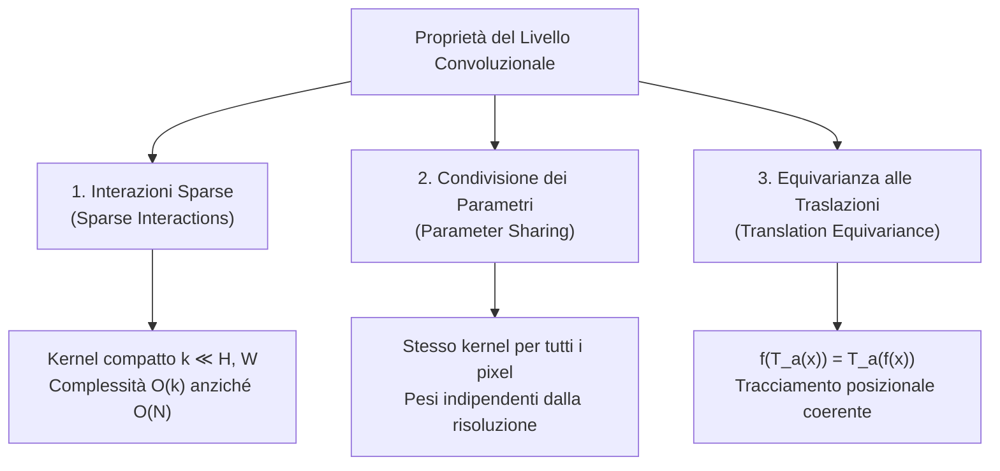

# 9. Reti Convoluzionali: Convoluzione, Receptive Field e Volumi 3D

Nelle architetture neurali studiate fino a questo punto (i __Multi-Layer Perceptron__ o reti completamente connesse), ogni singolo neurone di uno strato riceve connessioni dirette da tutti i neuroni dello strato precedente. Sebbene questo paradigma goda del __Teorema di Approssimazione Universale__, esso manifesta limiti invalicabili non appena applicato all'elaborazione di dati strutturati a griglia bidimensionale, quali le immagini digitali.

Per superare tali limitazioni, le __Reti Neurali Convoluzionali__ (__Convolutional Neural Networks__, __CNN__) introducono uno specifico __bias induttivo spaziale__ (_spatial inductive bias_), vincolando l'apprendimento attraverso tre principi cardine: la __connettività sparsa__, la __condivisione dei parametri__ e l'__equivarianza alle traslazioni__. In questo capitolo si analizzano i fondamenti matematici dell'operazione di convoluzione, la dinamica di espansione del __campo recettivo__ (_receptive field_), la gestione dei volumi tensoriali tridimensionali e il ruolo dello stadio di pooling.

![[slide_12_cnn_common_pattern_blocks.png|center mid]]

## Dal Modello Denso Al Paradigma Convoluzionale

### Limiti Strutturali Dei Layer Completamente Connessi

L'applicazione di strati densi (_Fully Connected_, FC) a dati visivi comporta tre criticità teoriche e computazionali:

1. __Esplosione combinatoria dei parametri liberi__:
   Si consideri un'immagine a colori a risoluzione modesta, ad esempio $224 \times 224 \times 3$ (comune nei benchmark di classificazione come ImageNet). Essa corrisponde a un vettore monodimensionale di ingresso di dimensione:

$$
D = 224 \times 224 \times 3 = 150.528 \text{ ingressi}
$$

   Un singolo strato nascosto completamente connesso dotato di un numero ragionevole di unità (es. $4.096$ neuroni) richiederebbe:

$$
150.528 \times 4.096 \approx 6,16 \times 10^8 \text{ pesi}
$$

   Oltre $600$ milioni di parametri per un singolo livello implicano un costo computazionale proibitivo, un'enorme occupazione di memoria GPU e un rischio catastrofico di __overfitting__, rendendo vano qualsiasi tentativo di generalizzazione in assenza di miliardi di campioni di addestramento.

2. __Distruzione della topologia bidimensionale__:
   L'operazione di __flattening__ (vettorizzazione) serializza i pixel in una sequenza $1\text{D}$. In questa rappresentazione, due pixel adiacenti in verticale lungo la colonna $(i, j)$ e $(i+1, j)$ vengono distanziati nell'array da una lunghezza pari all'intera larghezza dell'immagine $W$. Il layer denso tratta ogni coordinata come una feature astratta scorrelata dalle altre, ignorando la coerenza spaziale e la correlazione locale propria delle immagini naturali.

3. __Assenza di invarianza ed equivarianza posizionale__:
   In una rete densa, ciascun peso $w_{ij}$ è associato a una specifica coordinata assoluta della matrice. Se una feature saliente (ad esempio l'angolo o la ruota di un'automobile) si sposta di pochi pixel a destra, essa stimola un insieme di neuroni completamente disgiunto. La rete deve quindi re-imparare lo stesso pattern visivo per ogni possibile coordinata spaziale dell'immagine, mancando di qualsiasi capacità intrinseca di astrazione traslazionale.

### Il Pattern Canonico Di Una CNN

Per ovviare a questi limiti, l'architettura standard di una rete neurale convoluzionale organizza l'elaborazione mediante una sequenza modulare e ripetuta di quattro stadi fondamentali:

$$
X \longrightarrow [\text{Convoluzione}] \longrightarrow [\text{Normalizzazione (opzionale)}] \longrightarrow [\text{Non-linearità (ReLU)}] \longrightarrow [\text{Pooling (opzionale)}] \longrightarrow \dots
$$

- __Layer Convoluzionale__ (`Conv2d`): estrae feature locali mediante banchi di filtri apprendibili a supporto compatto ($k \times k$).
- __Layer di Normalizzazione__: tipicamente la __Batch Normalization__ per le CNN (o __Layer Normalization__ nelle architetture basate su Vision Transformer), atta a stabilizzare la distribuzione delle attivazioni interne.
- __Rilevatore Non-Lineare__ (`ReLU` o varianti): applica una trasformazione element-wise; la sua presenza è rigorosamente necessaria per prevenire il collasso algebrico di trasformazioni lineari consecutive.
- __Layer di Pooling__ (`MaxPool2d` o `AvgPool2d`): riduce la risoluzione spaziale delle feature map, introducendo robustezza alle piccole traslazioni ed espandendo la porzione di contesto osservata dai livelli successivi.

## L'Operazione Di Convoluzione E Cross-Correlazione Discreta

### Formulazione Matematica Continua E Discreta 1D

Nel dominio dell'analisi matematica e dell'elaborazione dei segnali, la __convoluzione__ tra due funzioni reali $x(t)$ (il segnale di ingresso) e $w(t)$ (la funzione peso o risposta all'impulso, detta __kernel__ o filtro) è definita dall'integrale:

$$
s(t) = (x * w)(t) = \int_{-\infty}^{+\infty} x(\tau) \, w(t - \tau) \, d\tau
$$

Nel caso di segnali discreti (campionati a intervalli regolari), l'integrale è sostituito dalla sommatoria infinita:

$$
s(i) = (x * w)(i) = \sum_{a=-\infty}^{+\infty} x(a) \, w(i - a)
$$

Se il kernel possiede un supporto compatto finito di estensione $k$, la sommatoria si restringe all'intervallo delle celle del kernel.

![[slide_12_convolution_1d_continuous_discrete.png|center mid]]

La convoluzione classica gode della proprietà commutativa, dimostrabile tramite un banale cambio di variabile $\tau' = i - a$:

$$
(x * w)(i) = (w * x)(i) = \sum_{a} x(i - a) \, w(a)
$$

Tale commutatività deriva dalla presenza del segno negativo nell'argomento $(i - a)$, che corrisponde a un __ribaltamento__ (_flip_) del kernel rispetto all'origine prima della traslazione e della moltiplicazione con il segnale.

### Convoluzione 2D Vs Cross-Correlazione 2D

Nel contesto dell'elaborazione di matrici bidimensionali (immagini digitali in scala di grigi $I \in \mathbb{R}^{H \times W}$ e kernel $K \in \mathbb{R}^{k \times k}$), la convoluzione formale bidimensionale richiede il ribaltamento sia orizzontale che verticale del filtro:

$$
(I * K)(i, j) = \sum_{u} \sum_{v} I(i - u, j - v) \, K(u, v) = \sum_{u} \sum_{v} I(u, v) \, K(i - u, j - v)
$$

Al contrario, l'operazione di __cross-correlazione__ (_cross-correlation_) omette il ribaltamento di $180^\circ$, scorrendo il kernel direttamente sulla matrice dei pixel ed eseguendo la moltiplicazione e la somma cella per cella:

$$
(I \star K)(i, j) = \sum_{u} \sum_{v} I(i + u, j + v) \, K(u, v)
$$

![[slide_12_convolution_vs_cross_correlation_2d.png|center mid]]

La relazione geometrica tra le due operazioni è un'inversione centrale dei pesi:

$$
(I * K)(i, j) = (I \star K_{\text{flipped}})(i, j), \quad \text{con } K_{\text{flipped}}(u, v) = K(-u, -v)
$$

> [!IMPORTANT] Implementazione Software nelle Librerie di Deep Learning
> Tutte le principali librerie di deep learning (inclusa la classe `torch.nn.Conv2d` di PyTorch e le primitive cuDNN di NVIDIA) implementano matematicamente la __cross-correlazione__ e non la convoluzione classica con ribaltamento.
>
> Questa scelta è motivata da ragioni di pura efficienza implementativa. Nei sistemi di deep learning, i coefficienti del kernel non sono filtri fissi stabiliti a priori, bensì parametri liberi addestrati via discesa del gradiente a partire da un'inizializzazione casuale. Se il filtro ottimale per estrarre una certa feature fosse $K(u, v)$, l'algoritmo di ottimizzazione apprenderà direttamente la matrice trasposta/ruotata $K(-u, -v)$. Le due formulazioni sono dunque perfettamente isomorfe dal punto di vista della capacità espressiva della rete.

L'operazione eseguita da un singolo filtro su un'immagine $2\text{D}$ consiste quindi nello scorrimento (_sliding window_) della matrice di pesi lungo tutte le posizioni spaziali ammissibili. Ad ogni passo, si calcola il prodotto scalare tra il kernel e il patch sottomatrice locale dell'immagine, generando un singolo valore scalare nella matrice di output, denominata __feature map__ o __mappa di attivazione__.

![[slide_12_convolutional_layer_single_filter.png|center mid]]

### Filtri Tradizionali (Sobel) Vs Filtri Convoluzionali Appresi

Nella visione artificiale classica, l'estrazione delle caratteristiche primitive veniva affidata a filtri differenziali progettati manualmente, come l'__operatore di Sobel__, preposto alla derivazione numerica del gradiente spaziale dell'immagine:

$$
K_{\text{Sobel}, X} = \begin{bmatrix} -1 & 0 & 1 \\ -2 & 0 & 2 \\ -1 & 0 & 1 \end{bmatrix}, \quad K_{\text{Sobel}, Y} = \begin{bmatrix} -1 & -2 & -1 \\ 0 & 0 & 0 \\ 1 & 2 & 1 \end{bmatrix}
$$

Quando si addestra una rete neurale convoluzionale profonda su compiti di classificazione o riconoscimento visivo, i pesi del primo strato convoluzionale partono da valori puramente stocastici (ad esempio estratti da una distribuzione normale secondo l'inizializzazione di Kaiming He).

Guidata unicamente dal segnale di errore retropropagato dalla funzione di perdita (senza alcuna istruzione esplicita sul calcolo delle derivate), la discesa del gradiente converge spontaneamente verso banchi di filtri orientati: filtri di Sobel a varie angolazioni, filtri a gradiente cromatico opponente e __filtri di Gabor__ (rilevatori di bande di frequenza spaziale e orientazione).

![[slide_12_learned_filters_layer1_vs_sobel.png|center big]]

Questo risultato dimostra come il paradigma convoluzionale riscopra in maniera del tutto naturale le rappresentazioni ottimali per l'elaborazione dei bordi e delle variazioni di luminanza, emulate anche dalla corteccia visiva primaria (V1) dei mammiferi.

## Le Tre Proprietà Fondamentali Delle Convoluzioni E l'Inductive Bias

La straordinaria efficienza statistica e computazionale delle CNN poggia su tre proprietà strutturali descritte da Goodfellow et al. (2016):

### Interazioni Sparse (Sparse Interactions)

In una rete densa, la matrice di trasformazione assegna un peso a ogni coppia ingresso-uscita; la dipendenza è globale. In uno strato convoluzionale, la dimensione del kernel $k$ è ingegnerizzata in modo tale da essere ordini di grandezza inferiore alla dimensione spaziale dell'ingresso ($k \ll H, W$, solitamente $k \in \{3, 5, 7\}$).

Di conseguenza, ogni singolo neurone nascosto della feature map interagisce unicamente con un __piccolo intorno__ di pixel adiacenti. Se l'ingresso ha dimensione $N$ e l'uscita ha dimensione $M$, una rete densa comporta un costo di calcolo e di memorizzazione pari a $\mathcal{O}(M \times N)$ operazioni per campione. Al contrario, limitando la connettività a un kernel locale di larghezza $k$, il costo operativo si riduce drasticamente a $\mathcal{O}(M \times k)$, garantendo una riduzione lineare del tempo di inferenza e una drastica regolarizzazione della capacità del modello.

![[slide_12_sparse_interactions_dense_vs_conv.png|center mid]]

Come evidenziato nel diagramma, mentre nel modello denso ogni uscita dipende da tutti i nodi di ingresso, nel livello convoluzionale ciascuna unità riceve segnali solo dai suoi $k$ vicini immediati, realizzando una connettività intrinsecamente sparsa.

### Condivisione Dei Parametri (Parameter Sharing)

La seconda proprietà fondante è la __condivisione dei pesi__ (_weight tying_): lo stesso insieme di coefficienti $K \in \mathbb{R}^{k \times k}$ che compone il kernel viene riutilizzato per calcolare la risposta su ciascun patch dell'intera immagine.

Nel layer completamente connesso, ogni elemento della matrice di peso $W_{ij}$ viene impiegato una e una sola volta per mappare l'ingresso $j$ nell'uscita $i$. Nel layer convoluzionale, ciascun coefficiente del kernel viene applicato ad ogni posizione spaziale della griglia.

![[slide_12_parameter_sharing_connections.png|center mid]]

La giustificazione fisica e statistica di questo vincolo risiede nella __stazionarietà delle statistiche naturali delle immagini__: una caratteristica elementare (un bordo verticale, un angolo acuto a $45^\circ$, una transizione di contrasto) conserva il medesimo significato semantico a prescindere dal fatto che si trovi nell'angolo superiore sinistro, al centro o nel bordo inferiore dell'inquadratura. Non vi è alcun motivo teorico per impiegare pesi disgiunti per rilevare la stessa forma geometrica in coordinate spaziali distinte.

#### Quantificazione Del Risparmio Parametrico

Per comprendere la portata di tale riduzione, consideriamo il confronto dimensionale presentato a lezione (Slide 21):

Si consideri un'immagine $32 \times 32$ elaborata da uno strato con feature map di output $30 \times 30$ ($H_{\text{out}} \times W_{\text{out}} = 900$ unità) e un kernel locale $3 \times 3$ ($k=3$):

- __Modello Completamente Connesso (Dense Layer)__:
  Ciascuna delle $900$ unità di output deve essere collegata a tutti i pixel di ingresso appartenenti al proprio vicinato $3 \times 3$ ($9$ ingressi locali, assumendo connettività localmente limitata ma non condivisa):

$$
\text{Numero di Pesi} = 900 \times 9 = 8.100 \text{ parametri}
$$

  Se la connettività fosse globale ($32 \times 32 = 1.024$ pixel d'ingresso per ogni neurone):

$$
\text{Numero di Pesi} = 900 \times 1.024 = 921.600 \text{ parametri}
$$

- __Modello Convoluzionale con Parameter Sharing__:
  Lo stesso identico kernel $3 \times 3$ viene condiviso e fatto scorrere su tutte le $900$ posizioni spaziali:

$$
\text{Numero di Pesi} = 3 \times 3 = 9 \text{ parametri (più 1 bias scalare)}
$$

![[slide_12_parameter_sharing_image_weights_reduction.png|center mid]]

I parametri da memorizzare e apprendere passano da centinaia di migliaia a un singolo blocco di $9$ scalari. Questo risparmio abbatte la complessità di Rademacher e la dimensione VC del modello, prevenendo l'overfitting e consentendo di destinare il budget di memoria all'aumento della profondità dell'architettura.

### Rappresentazione Matriciale Convoluzionale (Matrici di Toeplitz e BTTB)

L'operazione di convoluzione discreta $1\text{D}$ con kernel compatto può essere formalizzata algebricamente come una moltiplicazione matrice-vettore standard $y = C x$, dove $C$ è una __matrice di Toeplitz__ (matrice con valori costanti lungo ciascuna diagonale discendente).

Per un segnale di ingresso $\mathbf{x} = [x_1, x_2, x_3, x_4, x_5, x_6, x_7]^T$ e un kernel compatto $\mathbf{w} = [w_{-1}, w_0, w_1]^T$, l'operazione di convoluzione discreta senza padding (_valid_, con $H_{\text{out}} = 7 - 3 + 1 = 5$) si formula come prodotto matrice-vettore $\mathbf{z} = \mathbf{W} \mathbf{x}$, dove la matrice convoluzionale $\mathbf{W} \in \mathbb{R}^{5 \times 7}$ assume la struttura di Toeplitz:

$$\begin{bmatrix} z_2 \\ z_3 \\ z_4 \\ z_5 \\ z_6 \end{bmatrix} = \begin{bmatrix}
w_{-1} & w_0 & w_1 & 0 & 0 & 0 & 0 \\
0 & w_{-1} & w_0 & w_1 & 0 & 0 & 0 \\
0 & 0 & w_{-1} & w_0 & w_1 & 0 & 0 \\
0 & 0 & 0 & w_{-1} & w_0 & w_1 & 0 \\
0 & 0 & 0 & 0 & w_{-1} & w_0 & w_1
\end{bmatrix}
\begin{bmatrix} x_1 \\ x_2 \\ x_3 \\ x_4 \\ x_5 \\ x_6 \\ x_7 \end{bmatrix}$$

![[slide_12_convolution_as_sparse_matrix_multiplication.png|center mid]]

In due dimensioni ($2\text{D}$), serializzando l'immagine per righe in un vettore, la matrice di trasformazione lineare assume una struttura a blocchi a due livelli, denominata in letteratura scientifica __matrice a blocchi di Toeplitz con blocchi di Toeplitz__ (in inglese __BTTB__, _Block Toeplitz with Toeplitz Blocks_, o _doubly blocked Toeplitz matrix_):
- A livello macro, la matrice è partizionata in blocchi disposti secondo una simmetria di Toeplitz (costanti lungo le macro-diagonali, riflettendo lo scorrimento del filtro lungo l'asse verticale delle righe);
- A livello micro, ciascun singolo sotto-blocco è a sua volta una matrice di Toeplitz (con diagonali costanti, derivanti dallo scorrimento orizzontale del filtro lungo i pixel di ciascuna riga).

Come riassunto nella Slide 12 (citando Goodfellow et al., 2016, cap. 9: _«in 2D: block Toeplitz, a Toeplitz matrix of Toeplitz blocks»_), questa formulazione evidenzia immediatamente come la convoluzione sia un caso particolare di trasformazione lineare, vincolato da:
1. Una matrice quasi interamente composta da elementi nulli (__sparsità__);
2. Diagonali composte da elementi identici che si ripetono sistematicamente (__condivisione dei parametri__).

### Equivarianza Alle Traslazioni

Una funzione $f$ si dice __equivariante__ rispetto a una trasformazione $T_g$ parametrizzata dal gruppo $g$ se l'applicazione della trasformazione sull'ingresso seguita dalla funzione $f$ equivale ad applicare la funzione $f$ e successivamente la trasformazione $T_g$ sull'uscita:

$$
f(T_g(x)) = T_g(f(x))
$$

Nel caso delle convoluzioni, la classe fondamentale di trasformazioni è il gruppo delle __traslazioni discrete__ $T_a$, dove $T_a(x)(t) = x(t - a)$.

Dimostriamo formalmente che l'operatore di convoluzione commuta con la traslazione:

$$
[(T_a x) * w](t) = \int_{-\infty}^{+\infty} (T_a x)(\tau) \, w(t - \tau) \, d\tau = \int_{-\infty}^{+\infty} x(\tau - a) \, w(t - \tau) \, d\tau
$$

Effettuando la sostituzione di variabile $u = \tau - a \implies \tau = u + a$ (con differenziale $d\tau = du$):

$$
= \int_{-\infty}^{+\infty} x(u) \, w(t - (u + a)) \, du = \int_{-\infty}^{+\infty} x(u) \, w((t - a) - u) \, du = (x * w)(t - a) = T_a([x * w](t))
$$

L'identità è dimostrata: __se l'immagine viene traslata di un vettore $a = (\Delta x, \Delta y)$, la feature map risultante sarà identica alla feature map originaria, ma traslata esattamente dello stesso vettore $a$__.

![[slide_12_equivariance_to_translation_shift.png|center mid]]

> [!NOTE] Distinzione Rigorosa: Equivarianza vs Invarianza
> È comune confondere i concetti di equivarianza e invarianza:
> - __Equivarianza__ (_Equivariance_): $f(T_a(x)) = T_a(f(x))$. Il segnale di uscita cambia nello stesso modo in cui cambia l'ingresso (mantiene l'ancoraggio spaziale). Questo è essenziale per la convoluzione, perché gli strati intermedi devono sapere _dove_ si trovano le feature per aggregarle correttamente nei livelli gerarchici superiori (es. rilevamento di parti, segmentazione semantica, object detection).
> - __Invarianza__ (_Invariance_): $f(T_a(x)) = f(x)$. Il segnale di uscita rimane assolutamente invariato a fronte della trasformazione. L'invarianza spaziale non è prodotta dalla convoluzione, bensì dagli strati successivi di __pooling__ e dal classificatore globale finale (ad esempio per stabilire se un'immagine contiene un cane o un gatto, indipendentemente dalla sua posizione).

#### Mancanza Di Invarianza Ed Equivarianza a Rotazioni E Scalature

La convoluzione standard __non è equivariante né invariante a rotazioni o a variazioni di scala__ (zoom).

Se l'immagine di ingresso subisce una rotazione rigida di $90^\circ$ o $45^\circ$, le sottomatrici locali non coincidono più con l'orientamento dei filtri convoluzionali discreti: la feature map prodotta risulterà drasticamente dissimile e i neuroni deputati a riconoscere pattern orizzontali non scatteranno sui pattern verticalizzati o ruotati.

![[slide_12_convolution_rotation_lack_of_invariance.png|center small]] ![[slide_12_rotation_zoom_failure_data_augmentation.png|center small]]

Per consentire a una CNN di classificare correttamente oggetti ruotati o con scale differenti, non potendo contare su un'equivarianza strutturale cablata nel formalismo matematico, si deve ricorrere al __Data Augmentation__ (rotazioni casuali, zoom stocastici, shearing e ritagli in fase di training), costringendo la discesa del gradiente ad allocare filtri multipli per campionare ciascuna possibile orientazione angolare.

## La Dinamica Del Receptive Field (Campo Recettivo)

### Definizione Di Campo Recettivo Locale E Globale

Il __campo recettivo__ (_Receptive Field_, RF) di un neurone corrisponde alla regione geometrica del segnale di ingresso (pixel dell'immagine originale) che concorre direttamente o indirettamente a determinare l'attivazione scalare di quel neurone.

È opportuno evidenziare una fondamentale distinzione concettuale tra __dimensione del kernel__ (_kernel size_) e __campo recettivo__ (_receptive field_): la dimensione del kernel $k \times k$ coincide con l'ampiezza del campo recettivo __esclusivamente al primo strato nascosto__ ($l=1$). A partire dal secondo strato, grazie alla connettività a cascata della rete profonda, il campo recettivo globale rispetto all'immagine d'ingresso si allarga progressivamente.

![[receptive_field_3layer_7units.svg|center big]]

Nel diagramma sopra riportato, con tre strati da 7 unità e kernel $k=3$:
- Al Layer 2, l'unità centrale $h_{2,4}$ possiede un campo recettivo locale ristretto a $3$ neuroni di input: $\{x_3, x_4, x_5\}$.
- Al Layer 3, l'unità centrale $h_{3,4}$ si collega localmente alle $3$ unità $\{h_{2,3}, h_{2,4}, h_{2,5}\}$. Poiché ciascuna di esse raccoglie a sua volta informazioni da una terna del layer 1, il campo recettivo di $h_{3,4}$ rispetto al layer 1 si espande e copre l'insieme $\{x_2, x_3, x_4, x_5, x_6\}$, per un'ampiezza complessiva di $5$ pixel.

### Espansione Del Receptive Field Con la Profondità

Si consideri una sequenza di $L$ strati convoluzionali unidimensionali, ciascuno avente dimensione del kernel pari a $k$ e stride unitario ($S=1$), senza subsampling.

Al primo livello convoluzionale ($l=1$), il neurone campiona $k$ pixel:

$$
RF_1 = k
$$

Al secondo livello convoluzionale ($l=2$), ogni neurone campiona $k$ attivazioni del livello 1. Ciascuna delle estremità laterali aggiunge $(k - 1)/2$ pixel di contesto per lato rispetto al neurone adiacente:

$$
RF_2 = RF_1 + (k - 1) = k + (k - 1) = 2k - 1
$$

Generalizzando per induzione matematica su $L$ strati convoluzionali consecutivi:

$$
RF_L = 1 + L \cdot (k - 1)
$$

Per verificare analiticamente la formula:
- Se $L=1$ e $k=3$: $RF_1 = 1 + 1 \cdot (3 - 1) = 3$ pixel.
- Se $L=2$ e $k=3$: $RF_2 = 1 + 2 \cdot (3 - 1) = 5$ pixel.
- Se $L=3$ e $k=3$: $RF_3 = 1 + 3 \cdot (3 - 1) = 7$ pixel.

![[receptive_field_pyramid_expansion.svg|center big]]

La piramide di connessioni dimostra visivamente il principio: disponendo di 3 strati composti da 5 neuroni e filtri compatti $k=3$:
- Al Layer 1 (ingresso) abbiamo $x_1, \dots, x_5$.
- Al Layer 2, i neuroni $h_{2,2}, h_{2,3}, h_{2,4}$ coprono rispettivamente le finestre $\{x_1, x_2, x_3\}$, $\{x_2, x_3, x_4\}$ e $\{x_3, x_4, x_5\}$.
- Al Layer 3, il neurone centrale $h_{3,3}$ campiona la terna $\{h_{2,2}, h_{2,3}, h_{2,4}\}$.

Ripercorrendo all'indietro il cono visivo, il neurone centrale al terzo strato osserva l'unione dei tre sottoinsiemi:

$$
RF(h_{3,3}) = \{x_1, x_2, x_3\} \cup \{x_2, x_3, x_4\} \cup \{x_3, x_4, x_5\} = \{x_1, x_2, x_3, x_4, x_5\}
$$

Il neurone profondo ha acquisito una visione globale dell'intero segnale di ingresso, pur continuando a impiegare esclusivamente kernel microscopici $k=3$.

![[slide_12_receptive_field_depth_growth.png|center mid]]

### Campo Recettivo in Presenza Di Stride E Pooling

Qualora nella rete intervengano operazioni di subsampling con stride $S > 1$ (o strati di Max/Average Pooling con stride $S_p$), la crescita del campo recettivo cessa di essere lineare rispetto a $L$ e diventa moltiplicativa.

La formula ricorsiva esatta che governa il campo recettivo $RF_l$ dello strato $l$-esimo rispetto all'immagine d'ingresso è:

$$
RF_l = RF_{l-1} + (k_l - 1) \cdot J_{l-1}
$$

dove $J_{l-1}$ (spesso denominato _jump_ spaziale o _striding cumulato_) rappresenta il prodotto di tutti gli stride introdotti dai livelli precedenti fino allo strato $l-1$:

$$
J_{l-1} = \prod_{i=1}^{l-1} S_i
$$

Questo spiega matematicamente il motivo per cui le architetture deep inseriscono periodicamente strati di pooling o convoluzioni con stride 2: accelerare in modo esponenziale la dilatazione del campo recettivo, permettendo ai layer avanzati di percepire oggetti complessi nella loro globalità.

### Receptive Field Teorico Vs Receptive Field Effettivo

Dal punto di vista puramente combinatorio, il campo recettivo calcolato mediante la formula precedente rappresenta il __Theoretical Receptive Field__ (TRF), ossia la regione rettangolare massima all'interno della quale una variazione di un pixel d'ingresso può teoricamente propagare una perturbazione non nulla all'attivazione del neurone.

Tuttavia, come dimostrato nel celebre studio di Luo et al. (2016, _Understanding the Effective Receptive Field in Deep Convolutional Networks_), non tutti i pixel appartenenti al TRF contribuiscono con lo stesso peso. 

Poiché i pixel centrali del cono di visione sono coinvolti in un numero enormemente superiore di cammini feed-forward rispetto ai pixel periferici (per effetto del teorema del limite centrale applicato alla cascata di convoluzioni discrete), la distribuzione della sensibilità locale assume la forma di una __Gaussiana bidimensionale__:

$$
\frac{\partial y_{\text{center}}}{\partial x_{i, j}} \sim \mathcal{N}(\mu, \Sigma)
$$

L'__Effective Receptive Field__ (ERF) corrisponde a una porzione centrale ristretta del campo recettivo teorico (tipicamente inferiore al $30\% - 40\%$ del TRF), degradando rapidamente verso lo zero non appena ci si allontana dal centro del patch visivo.

## Convoluzioni Su Volumi 3D E Tensori Di Canale

Nel trattamento di immagini a colori o di mappe intermedie, il segnale non è più una matrice piana, bensì un __volume tridimensionale__ caratterizzato da una profondità di canali:

$$
X \in \mathbb{R}^{C_{\text{in}} \times H_{\text{in}} \times W_{\text{in}}}
$$

dove $C_{\text{in}} = 3$ per un'immagine a colori (canali Rosso, Verde, Blu), oppure $C_{\text{in}} \in \{64, 128, 256, 512, \dots\}$ per le feature map intermedie estratte da livelli convoluzionali profondi.

![[slide_12_color_image_3d_stack_channels.png|center mid]]

### Struttura Del Filtro 3D E Integrazione Dei Canali

Il principio fondamentale descritto dal docente a lezione è categorico:
__Un filtro convoluzionale che opera su un volume di canale deve estendersi lungo l'INTERA profondità dell'ingresso__.

Se l'input possiede $C_{\text{in}}$ canali, ciascun singolo filtro $W$ non ha dimensione $k \times k$, bensì dimensione cubica:

$$
W \in \mathbb{R}^{C_{\text{in}} \times k \times k}
$$

![[slide_12_convolutional_layer_on_3d_volume.png|center mid]]

Durante la scansione spaziale, il filtro cubico copre un volumetto $C_{\text{in}} \times k \times k$ dell'ingresso. L'operazione convoluzionale su tale volume esegue il prodotto componente per componente (_Frobenius inner product_) lungo tutti i $C_{\text{in}}$ canali e lungo le $k \times k$ coordinate spaziali, sommando tutti i contributi scalari e aggiungendo un unico bias scalare $b \in \mathbb{R}$:

$$
y(i, j) = \sum_{c=1}^{C_{\text{in}}} \sum_{u=1}^{k} \sum_{v=1}^{k} W(c, u, v) \cdot X(c, i + u - 1, j + v - 1) + b
$$

![[volume_convolution_3d_cube.svg|center mid]]

Come evidenziato chiaramente dallo schema assonometrico e dalle slide, __UN singolo filtro volumetrico $C_{\text{in}} \times k \times k$ produce in output UNA singola feature map bidimensionale $1 \times H_{\text{out}} \times W_{\text{out}}$__. La sommatoria lungo $c$ comprime la profondità dei canali d'ingresso in un unico scalare per ogni posizione spaziale.

![[slide_12_volume_convolution_animation.mp4|center mid]]

### Banchi Di Filtri Multipli: Estrazione Di $C_{\text{out}}$ Feature Map

Poiché un singolo filtro può specializzarsi nel rilevare una sola tipologia di caratteristica visiva (ad esempio un angolo inclinato di $30^\circ$, oppure una variazione di cromatismo specifica), un layer convoluzionale reale impiega un __banco di filtri__ (_filter bank_) composto da $C_{\text{out}}$ filtri tridimensionali indipendenti:

$$
\mathcal{W} = \{ W_1, W_2, \dots, W_{C_{\text{out}}} \}, \quad \text{con } W_m \in \mathbb{R}^{C_{\text{in}} \times k \times k}, \; m=1, \dots, C_{\text{out}}
$$

L'intero tensore dei pesi dello strato convoluzionale assume pertanto rango $4$:

$$
\mathcal{W} \in \mathbb{R}^{C_{\text{out}} \times C_{\text{in}} \times k \times k}, \quad b \in \mathbb{R}^{C_{\text{out}}}
$$

Ciascun filtro $W_m$ genera la propria feature map $2\text{D}$. Impilando ordinatamente queste $C_{\text{out}}$ mappe lungo l'asse dei canali, si ottiene il tensore volumetrico di uscita:

$$
Y \in \mathbb{R}^{C_{\text{out}} \times H_{\text{out}} \times W_{\text{out}}}
$$

![[slide_12_multiple_filters_stack_feature_maps.png|center mid]]

> [!TIP] Isomorfismo Concettuale tra Ingresso e Feature Map
> Come ribadito dal professore a lezione, l'uscita $Y$ di un layer convoluzionale possiede la stessa struttura tensoriale dell'immagine d'ingresso ($C \times H \times W$).
> 
> La differenza sostanziale risiede nel significato semantico dei canali: mentre nell'immagine d'ingresso i canali codificano fotonicamente la luce emessa nelle lunghezze d'onda del visibile ($R, G, B$), nelle feature map intermedie ciascun canale $c \in \{1, \dots, C_{\text{out}}\}$ esprime la presenza quantitativa e la localizzazione spaziale di un pattern geometrico astratto, appreso automaticamente dalla rete durante l'addestramento.

### Geometria Dello Scorrimento: Padding E Stride

Il campionamento della feature map di uscita è regolato da due iperparametri geometrici fondamentali: il __padding__ $P$ e lo __stride__ $S$.

![[slide_12_padding_and_stride_spatial_dimensions.png|center mid]]

#### Padding ($P$)
Lo scorrimento di un kernel $k \times k$ all'interno dei confini fisici di una matrice determina un restringimento spaziale sistematico dovuto alla perdita delle posizioni periferiche:
senza padding, la matrice collasserebbe a ogni strato di $k - 1$ pixel. Inoltre, i pixel posti sui bordi estremi verrebbero campionati molte meno volte rispetto ai pixel centrali, soffrendo di un deficit informativo.

Per contrastare questo effetto, si applica il __padding__, che consiste nell'aggiungere una cornice di pixel (convenzionalmente azzerati, _Zero-Padding_) attorno al perimetro della feature map:
- __Valid Padding__ ($P=0$): nessun bordo aggiunto; la risoluzione si contrae a ogni convoluzione.
- __Same Padding__: il padding viene dimensionato esattamente per preservare intatta la risoluzione spaziale ($H_{\text{out}} = H_{\text{in}}$ quando $S=1$). Per filtri a dimensione dispari ($k = 2m + 1$), la quantità di padding per lato è:

$$
P = \frac{k - 1}{2}
$$

  Ad esempio, per kernel $3 \times 3$, un padding $P=1$ garantisce $H_{\text{out}} = H_{\text{in}}$. Per kernel $5 \times 5$, si imposta $P=2$.

![[slide_12_padding_animation.mp4|center mid]]

#### Stride ($S$)
Lo __stride__ (passo di scorrimento) quantifica l'incremento di indici di cui il kernel avanza lungo le direzioni spaziali (orizzontale e verticale) tra due calcoli consecutivi:
- $S=1$: il kernel scorre di un pixel alla volta (massima densità informativa).
- $S > 1$ (es. $S=2$): il kernel salta sistematicamente $S-1$ pixel ad ogni passo, dimezzando approssimativamente la risoluzione spaziale e operando un subsampling simultaneo all'estrazione delle feature.

![[slide_12_stride_animation.mp4|center mid]]

#### Formula Generale Di Risoluzione Spaziale

Combinando le dimensioni di ingresso, la larghezza del kernel $k$, il padding bilaterale $2P$ e il passo $S$, la risoluzione di uscita è data dalla relazione analitica:

$$
H_{\text{out}} = \left\lfloor \frac{H_{\text{in}} - k + 2P}{S} \right\rfloor + 1, \quad W_{\text{out}} = \left\lfloor \frac{W_{\text{in}} - k + 2P}{S} \right\rfloor + 1
$$

dove $\lfloor \cdot \rfloor$ denota la funzione parte intera inferiore (_floor_).

### Conteggio Analitico Esatto Dei Parametri E Dei MAC

L'analisi computazionale di un layer convoluzionale valuta due metriche cardine: l'occupazione in memoria dei pesi e il volume di operazioni aritmetiche richieste per il forward pass.

![[slide_12_counting_weights_macs_conv_layer.png|center mid]]

1. __Numero Totale di Parametri Apprendibili (Pesi e Bias)__:
   Ciascuno dei $C_{\text{out}}$ filtri è formato da un tensore volumetrico di dimensione $C_{\text{in}} \times k \times k$ e dispone di un unico termine di bias additivo:

$$
\text{Parametri per Filtro} = C_{\text{in}} \cdot k^2 + 1
$$

$$
\text{Parametri Totali del Layer} = C_{\text{out}} \cdot (C_{\text{in}} \cdot k^2 + 1) = C_{\text{out}} \cdot C_{\text{in}} \cdot k^2 + C_{\text{out}}
$$

2. __Numero di Operazioni Moltiplicazione-Somma (MACs)__:
   Il calcolo di ogni singolo pixel all'interno di una delle feature map di uscita richiede un prodotto scalare su $C_{\text{in}} \cdot k^2$ elementi. Poiché l'uscita complessiva è formata da $C_{\text{out}} \times H_{\text{out}} \times W_{\text{out}}$ pixel, il numero totale di operazioni __Multiply-Accumulate__ (MACs) è:

$$
\text{MACs} = H_{\text{out}} \cdot W_{\text{out}} \cdot C_{\text{out}} \cdot C_{\text{in}} \cdot k^2
$$

   (Nel conteggio convenzionale dei FLOPs teorici in virgola mobile, ciascuna operazione MAC corrisponde a 2 FLOPs: 1 moltiplicazione e 1 addizione, per cui $\text{FLOPs} \approx 2 \times \text{MACs}$).

#### Esempio Numerico Applicativo

Si consideri uno strato convoluzionale con le seguenti specifiche:
- Input: $X \in \mathbb{R}^{64 \times 56 \times 56}$ ($C_{\text{in}} = 64, H_{\text{in}} = W_{\text{in}} = 56$);
- Filtri: $C_{\text{out}} = 128$, con kernel $k = 3$, stride $S = 1$, padding $P = 1$.

Calcolo delle dimensioni di uscita:

$$
H_{\text{out}} = \left\lfloor \frac{56 - 3 + 2(1)}{1} \right\rfloor + 1 = 56, \quad W_{\text{out}} = 56
$$

Calcolo dei pesi:

$$
\text{Pesi} = 128 \times (64 \times 3^2 + 1) = 128 \times (576 + 1) = 128 \times 577 = 73.856 \text{ parametri}
$$

Calcolo dei MACs:

$$
\text{MACs} = 56 \times 56 \times 128 \times 64 \times 3^2 = 3.136 \times 128 \times 576 = 231.211.008 \text{ MACs} \approx 231,2 \text{ MMAC}
$$

### Convoluzioni $1 \times 1$ (Channel Mixing E Proiezione Di Collo Di Bottiglia)

Una variante fondamentale introdotta da Lin et al. (2013, _Network In Network_) e resa celebre da GoogLeNet e ResNet è la __convoluzione $1 \times 1$__ ($k=1$).

A prima vista, un filtro di dimensione $1 \times 1$ potrebbe apparire banale, poiché sul piano spaziale moltiplica ogni pixel per uno scalare. Tuttavia, ricordando che il filtro si estende lungo l'intero asse della profondità $C_{\text{in}}$, esso agisce come un vettore di pesi di dimensione:

$$
W \in \mathbb{R}^{C_{\text{out}} \times C_{\text{in}} \times 1 \times 1}
$$

![[slide_12_1x1_convolutions_channel_mixing.png|center mid]]

La convoluzione $1 \times 1$ opera una combinazione lineare (proiezione affine) di tutte le feature map di ingresso per ciascuna posizione spaziale $(i, j)$ in maniera del tutto indipendente:

$$
y_m(i, j) = \sum_{c=1}^{C_{\text{in}}} W_m(c) \cdot x(c, i, j) + b_m
$$

Le funzioni cruciali delle convoluzioni $1 \times 1$ sono:
1. __Channel Pooling / Channel Mixing__: combina cross-canale informazioni distribuite su mappe differenti senza intaccare la risoluzione spaziale ($H \times W$ rimane inalterata).
2. __Riduzione della Dimensionalità (Bottleneck)__: impostando $C_{\text{out}} < C_{\text{in}}$ (es. passando da $256$ a $64$ canali), funge da proiettore compatto che riduce drasticamente il costo computazionale e i parametri degli strati convoluzionali $3 \times 3$ successivi.
3. __Aumento della Non-Linearità__: posizionando una funzione di attivazione ReLU immediatamente dopo la convoluzione $1 \times 1$, si accresce la capacità espressiva e discriminativa della rete senza alterare la dimensione del campo recettivo.

## Lo Stadio Del Rilevatore E Il Pooling

### Il Rilevatore Non-Lineare (ReLU Detector Stage)

Immediatamente dopo il calcolo del volume convoluzionale affine, ciascun coefficiente scalare viene processato da una funzione di attivazione non lineare, tipicamente la __ReLU__ (_Rectified Linear Unit_):

$$
\text{ReLU}(z) = \max(0, z)
$$

![[slide_12_relu_detector_stage_after_convolution.png|center mid]]

Come ribadito nella trascrizione del docente, la ReLU agisce come un __rilevatore di evidenza__:
- Se la correlazione tra il filtro e il patch d'ingresso è negativa ($z < 0$), il pattern cercato non è presente: l'attivazione viene troncata a 0, comunicando ai livelli successivi l'assenza del tratto visivo.
- Se la correlazione è positiva ($z > 0$), la feature è presente con intensità proporzionale a $z$: il valore viene propagato inalterato.

#### Dimostrazione Del Collasso Lineare in Assenza Di Attivazioni

La presenza della non-linearità è una condizione algebricamente indispensabile. Se omettessimo la ReLU tra due strati convoluzionali consecutivi, le due convoluzioni collasserebbero in una singola convoluzione equivalente.

Siano $*$ l'operatore di convoluzione, $w_1$ il kernel del primo layer (dimensione $k_1 \times k_1$) e $w_2$ il kernel del secondo layer (dimensione $k_2 \times k_2$). L'uscita del secondo livello senza non-linearità è:

$$
y = (x * w_1) * w_2
$$

Sfruttando la __proprietà associativa__ della convoluzione lineare:

$$
y = x * (w_1 * w_2) = x * w_{\text{eff}}
$$

dove $w_{\text{eff}} = w_1 * w_2$ è un unico filtro convoluzionale aggregato, avente dimensione spaziale:

$$
k_{\text{eff}} = k_1 + k_2 - 1
$$

Impilare due strati convoluzionali senza interporre una funzione di attivazione non lineare non produce alcun incremento della capacità rappresentazionale della rete: equivale algebricamente a eseguire un solo layer convoluzionale con filtro più largo, sprecando parametri e moltiplicazioni. L'inserimento della ReLU rompe l'associatività lineare, abilitando l'estrazione di gerarchie di feature ad alto livello di astrazione.

### Layer Di Pooling: Max Pooling E Average Pooling

Il __layer di pooling__ è uno stadio opzionale posto a valle del rilevatore non lineare, preposto all'aggregazione statistica delle attivazioni all'interno di un vicinato locale spaziale di dimensione $k_p \times k_p$ (tipicamente $2 \times 2$ con stride $S_p = 2$).

Le due formulazioni standard sono:

1. __Max Pooling__: estrae il valore massimo assoluto all'interno della finestra di pooling:

$$
y_{\text{max}}(i, j) = \max_{(u, v) \in \Omega(i, j)} x(u, v)
$$

   Il Max Pooling agisce come un selettore di dominanza: segnala se una data feature si è manifestata con forte intensità in un qualsiasi punto della finestra locale, disinteressandosi della sua esatta coordinata sub-pixel.

2. __Average Pooling__: calcola il baricentro aritmetico (la media) delle attivazioni:

$$
y_{\text{avg}}(i, j) = \frac{1}{|\Omega|} \sum_{(u, v) \in \Omega(i, j)} x(u, v)
$$

   L'Average Pooling preserva l'energia media del segnale, attenuando le risposte isolate e fornendo una rappresentazione più omogenea e liscia del vicinato.

![[slide_12_max_and_average_pooling_operation.png|center mid]]

> [!IMPORTANT] Proprietà Fondamentale del Pooling: Zero Parametri Apprendibili
> A differenza dei layer convoluzionali e completamente connessi, i layer di pooling convenzionali __non possiedono alcun parametro libero o peso addestrabile__:
>
> $$
> \text{Parametri di Pooling} = 0
> $$
>
> Si tratta di operatori matematici puramente deterministici e fissi.

### Proprietà Del Pooling E Invarianza Alle Traslazioni Locali

Il pooling conferisce all'architettura tre proprietà architetturali decisive:

#### Invarianza Approssimata a Piccoli Scostamenti Spaziali (Approximate Shift Invariance)
Mentre la convoluzione è rigorosamente _equivariante_, l'applicazione del Max Pooling introduce una __parziale invarianza a piccole traslazioni locali__ (spostamenti dell'ordine di $\pm 1$ pixel).

Si consideri una feature fondamentale (ad esempio il bordo di un occhio o il contorno di una ruota). Se l'oggetto trasla di un singolo pixel a causa di un lieve movimento della fotocamera, l'attivazione massima scaturita dalla convoluzione si sposta all'interno del vicinato $2 \times 2$. Poiché l'operatore di Max Pooling seleziona il massimo valore dell'intorno, l'uscita scalare generata dal blocco rimane rigorosamente inalterata.

![[slide_12_pooling_approximate_shift_invariance.png|center mid]]

Questa invarianza è parziale e locale: se la traslazione eccede l'estensione della finestra di pooling o non è allineata con il reticolo dello stride, l'uscita muta.

![[slide_12_pooling_equivariance_stride_multiples.png|center mid]]

#### Riduzione Dimensionale E Contenimento Della Memoria
Configurando un Max Pooling con dimensione $2 \times 2$ e stride $S_p = 2$, l'altezza e la larghezza di ciascuna feature map vengono dimezzate:

$$
H_{\text{out}} = \frac{H_{\text{in}}}{2}, \quad W_{\text{out}} = \frac{W_{\text{in}}}{2}
$$

L'impronta spaziale si contrae a un quarto dell'area d'ingresso ($25\%$). Questo abbattimento riduce drasticamente il volume di attivazioni da mantenere memorizzate in GPU per il calcolo della backpropagation, contenendo il consumo di memoria VRAM e l'onere computazionale degli strati successivi.

#### Moltiplicazione Del Tasso Di Crescita Del Receptive Field
Come analizzato formalmente nella sezione sul campo recettivo, l'introduzione di uno stride di pooling pari a $2$ raddoppia il fattore di incremento spaziale ($J_l = 2 \cdot J_{l-1}$) di tutti gli strati convoluzionali a valle. 

Ogni successivo kernel $3 \times 3$ applicherà i suoi passi su campioni distanziati del doppio dei pixel originari, facendo esplodere il campo recettivo globale a tassi esponenziali e permettendo all'architettura di raggiungere una sintesi semantica ad altissimo livello.

![[slide_12_pooling_receptive_field_growth_rate.png|center mid]]
