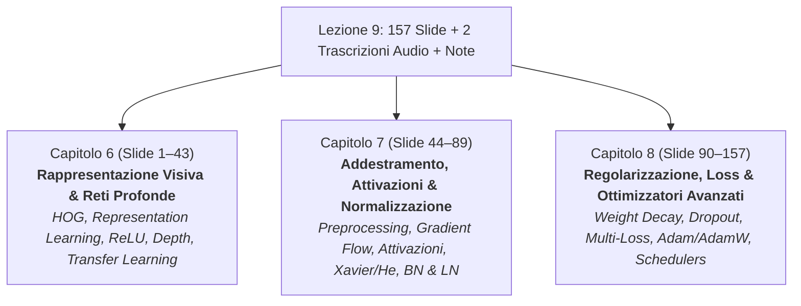

# Piani di Implementazione — Lezione 9: Deep Learning and Visual Representations

> **Corso**: Deep Learning And Robot Perception  
> **Fonti di Riferimento**:
> - Slide Ufficiali: `09_learning_representations_2026 (2).pptx` (157 slide complessive)
> - Trascrizione Audio 1: `Lezione di Deep Learning — trascrizione 1.pdf` (Lezione del 15/10/2026, Slide 1–89)
> - Trascrizione Audio 2: `DEEPLEARNING 2026-10-20 trascrizione 2.txt` (Lezione del 20/10/2026, Slide 90–157)
> - Note dello Studente: `note/lezione_9.md` (con dubbi teorici e richieste di disegni/schemi)
> - Regola Workspace Applicata: `[[.agents/rules/pipeline_trascrizioni_audio_e_macro_argomenti.md|Pipeline Trascrizioni Audio e Macro-Argomenti]]`

---

## 1. Architettura Generale della Lezione e Suddivisione in 3 Capitoli

Data la vastità del materiale (157 slide, oltre 1500 righe di trascrizione e molteplici annotazioni), la lezione viene suddivisa in **tre capitoli tematici omogenei, completi e autosufficienti**:

1. **Capitolo 6**: `6. Rappresentazione Visiva e Reti Neurali Profonde.md`  
   *Perimetro*: Slide 1–43 (Sezioni 1–5). Dalla categorizzazione semantica e descrittori ingegnerizzati (pixel, HOG) al representation learning, profondità, ReLU e transfer learning.
2. **Capitolo 7**: `7. Addestramento di Reti Profonde: Preprocessing, Attivazioni, Inizializzazione e Normalizzazione.md`  
   *Perimetro*: Slide 44–89 (Sezioni 6–8). Ottimizzazione globale, data preprocessing, flusso del gradiente, analisi critica delle funzioni di attivazione, inizializzazione (Xavier/He) e normalizzazione (Batch Normalization e Layer Normalization).
3. **Capitolo 8**: `8. Regolarizzazione, Loss e Ottimizzazione Avanzata per Deep Learning.md`  
   *Perimetro*: Slide 90–157 (Sezioni 9–14). Strategie di regolarizzazione ($L_2$/Weight Decay, Dropout, Data Augmentation), Loss functions, mini-batch, curve di apprendimento, ottimizzatori avanzati (Momentum, RMSProp, Adam, AdamW), learning rate schedules e ricetta complessiva.

---

## 2. Piano di Implementazione — Capitolo 6

### File di Destinazione
`Anno 2/Deep Learning And Robot Perception/6. Rappresentazione Visiva e Reti Neurali Profonde.md`

### Perimetro Slide e Fonti
- **Slide coperte**: Slide 1 – 43 (Parte 1: Sezioni 1, 2, 3, 4, 5)
- **Note corrispondenti**: `note/lezione_9.md`, righe 1 – 75
- **Trascrizione corrispondente**: `trascrizione_1.txt`, prima metà

### Struttura delle Sezioni
1. **Dalla Geometria alla Categorizzazione Semantica**:
   - Transizione concettuale da *"dove"* (geometria 3D, feature matching a due viste) a *"cosa"* (classificazione di categorie visive).
   - Limiti del matching per punti (gatto arancione vs gatto grigio) e fallimento delle regole manuali/if-else.
   - Scomposizione canonica del modello: estrattore di rappresentazione $\phi(x)$ e classificatore lineare $\hat{y} = \arg\max \text{softmax}(W \phi(x) + b)$.
2. **Rappresentazioni Ingegnerizzate: Pixel Raw vs Descrittore HOG**:
   - Rappresentazione a pixel grezzi e fallimento della distanza euclidea $L_2$ (es. immagine di nave più vicina a un gatto rispetto a un altro gatto a causa dello sfondo blu).
   - Il descrittore **HOG (Histogram of Oriented Gradients)** chiarito analiticamente:
     - Calcolo dei gradienti per pixel (magnitudo e direzione non orientata $0^\circ - 180^\circ$).
     - Suddivisione in celle spaziali $8 \times 8$ pixel e accumulo in istogrammi a 9 bin orientati.
     - Raggruppamento in blocchi $2 \times 2$ celle (sovrapposizione del 50%) e normalizzazione $L_2$ per invarianza all'illuminazione.
     - Vettore finale concatenato (dimensione 1764 per patch standard $64 \times 128$).
   - Invarianze catturate (illuminazione, contrasto locale) e limiti invalicabili (invariante al colore, non tollera forti deformazioni non rigide).
3. **Representation Learning: Apprendere le Feature**:
   - Superamento di $\phi$ fisso: introduzione dei parametri addestrabili $\theta$ in $\phi_\theta$.
   - Rete con un singolo hidden layer: $h = \sigma(W_1 x + b_1)$, predizione lineare $W_2 h + b_2$.
   - Formulazione dell'obiettivo di addestramento congiunto $J(\theta, W, b)$ su loss unica, algoritmo di backpropagation e mini-batch gradient descent.
4. **Potere della Profondità e Ruolo della Non-Linearità**:
   - Teorema del collasso lineare: prova analitica che comporre $L$ strati lineari equivale a un unico strato lineare ($W_L \dots W_1 x = W_{\text{equiv}} x$), rendendo vana la profondità.
   - Ruolo geometrico della **ReLU** ($f(x) = \max(0, x)$): *"piegare lo spazio euclideo"* per rendere linearmente separabili classi non convesse (dimostrazione con il problema degli anelli concentrici).
   - Vantaggio computazionale esponenziale della profondità: comporre una funzione complessa a dente di sega richiede $O(L)$ neuroni in una rete profonda contro $2^L$ neuroni in una rete larga a singolo strato.
5. **Proprietà, Metriche e Limiti delle Rappresentazioni Apprese**:
   - Cinque criteri di valutazione: accuratezza, separabilità lineare, vicini semantici nel feature space, robustezza a trasformazioni, efficienza campionaria (sample efficiency).
   - Analisi empirica su CIFAR-10: perché le CNN migliorano con l'aumento dei dati mentre i descrittori fissi saturano rapidamente.
   - **Transfer Learning**: riutilizzo dei pesi della backbone $\phi_\theta$ congelati (*frozen*) come estrattore universale di feature, addestrando unicamente il nuovo classificatore terminale su dataset a limitata disponibilità di dati.

### Asset Grafici Slide Assegnati
- `slide_09_cifar_pixel_distance_failure.png` (Slide 12: confronto cane/nave e distanza pixel)
- `slide_09_hog_cells_blocks_normalization.png` (Slide 15-16: istogrammi di celle e blocchi HOG)
- `slide_09_hog_car_color_limitation.png` (Slide 17-18: invarianza alla luce vs fallimento su auto di colori diversi)
- `slide_09_deep_network_linear_collapse.png` (Slide 29: collasso delle matrici lineari senza attivazione)
- `slide_09_relu_bending_representation_rings.png` (Slide 30-31: separazione degli anelli concentrici con ReLU)
- `slide_09_depth_efficiency_exponential_tooth.png` (Slide 32-33: composizione della funzione dente di sega e confronto $O(L)$ vs $2^L$)
- `slide_09_cifar10_learned_feature_space_neighbors.png` (Slide 37-38: spazio latente appreso e vicini semantici)
- `slide_09_learning_curves_cnn_vs_fixed_features.png` (Slide 40: accuratezza in funzione del numero di campioni)

### Schemi Concettuali Custom (SVG)
1. **`hog_cells_blocks_structure.svg`** (richiesto da `note/lezione_9.md`, riga 38): schema vettoriale che illustra la gerarchia pixel $\to$ cella $8 \times 8$ $\to$ istogramma a 9 bin orientati $\to$ blocco $2 \times 2$ celle con overlap del 50% e normalizzazione.
2. **`transfer_learning_frozen_backbone.svg`** (richiesto da `note/lezione_9.md`, riga 74): schema a blocchi con input $x \to$ blocco feature extractor $\phi_\theta$ con scritta "FROZEN" $\to$ vecchio classificatore con freccia depennata e nuovo classificatore addestrato con nuove classi di output.

---

## 3. Piano di Implementazione — Capitolo 7

### File di Destinazione
`Anno 2/Deep Learning And Robot Perception/7. Addestramento di Reti Profonde: Preprocessing, Attivazioni, Inizializzazione e Normalizzazione.md`

### Perimetro Slide e Fonti
- **Slide coperte**: Slide 44 – 89 (Parte 2: Sezioni 6A, 6B, 7A, 7B, 8)
- **Note corrispondenti**: `note/lezione_9.md`, righe 76 – 113
- **Trascrizione corrispondente**: `trascrizione_1.txt` (seconda metà) + `trascrizione_2.txt` (inizio)

### Struttura delle Sezioni
1. **Il Problema dell'Ottimizzazione Globale nelle Reti Profonde**:
   - Formulazione della loss $J(\Theta)$ su tutti i parametri della rete.
   - Filosofia del deep learning: costruire reti ad altissima capacità rappresentativa (over-parameterized) per poi regolarizzarle; trade-off underfitting vs overfitting e dashboard di monitoraggio.
2. **Data Preprocessing**:
   - Zero-centering: traslazione dei dati con media zero lungo i canali ($x \leftarrow x - \mu$).
   - Normalizzazione di scala / standardizzazione ($x \leftarrow \frac{x - \mu}{\sigma}$).
   - PCA e Whitening: rotazione diagonale e riscalatura della covarianza (e motivazione per cui in computer vision si preferisce zero-centering/scaling).
3. **Flusso del Gradiente attraverso i Layer e Regimi Patologici**:
   - Scomposizione analitica della backpropagation come prodotto continuo di matrici jacobiane e derivate delle attivazioni: $\frac{\partial \mathcal{L}}{\partial h_1} = \prod_{l=1}^L (W_{l+1}^T \sigma'_l)$.
   - Parametro di amplificazione medio $v \approx \|W^T\| \cdot |\sigma'(z)|$:
     - Regime $v < 1$: **Vanishing Gradient** ($v^L \to 0$, i layer iniziali non apprendono).
     - Regime $v > 1$: **Exploding Gradient** ($v^L \to \infty$, overflow e instabilità, risolvibile con *Gradient Clipping*).
     - Condizione ideale: $v \approx 1$.
4. **Analisi Critica delle Funzioni di Attivazione**:
   - **Sigmoide e Tanh**: problema della saturazione dei gradienti alle code ($|\sigma'(z)| \to 0$) con azzeramento del segnale di backpropagation; significato dei valori elevati.
   - **ReLU ($f(x) = \max(0, x)$)**: gradiente unitario per valori positivi, non satura, calcolo istantaneo; insorgenza della patologia *Dying ReLU* (neuroni spenti permanentemente).
   - **Varianti Avanzate di ReLU**:
     - *Leaky-ReLU*: pendenza fissa $\alpha \approx 0.01$ per input negativi.
     - *Parametric ReLU (P-ReLU)*: parametro di pendenza $\alpha$ addestrabile tramite backprop.
     - *GeLU (Gaussian Error Linear Unit)*: attivazione probabilistica $x \cdot \Phi(x)$ standard nei modelli Transformer.
5. **Inizializzazione dei Pesi**:
   - Perché non inizializzare a zero: simmetria dei gradienti e collasso della capacità.
   - Inizializzazione random gaussiana e propagazione della varianza.
   - Formulazione di **Xavier/Glorot** ($\text{Var}(W) = \frac{2}{n_{\text{in}} + n_{\text{out}}}$ per attivazioni lineari e tanh).
   - Formulazione di **He/Kaiming** ($\text{Var}(W) = \frac{2}{n_{\text{in}}}$ per attivazioni ReLU, compensando il dimezzamento della varianza dovuto al troncamento a zero).
6. **Layer di Normalizzazione**:
   - **Batch Normalization (BN)**:
     - Standardizzazione a media 0 e varianza 1 calcolata sul mini-batch.
     - Parametri addestrabili di scala e shift ($\gamma, \beta$) per preservare l'espressività.
     - Differenza operativa cruciale tra fase di *training* (statistiche istantanee del batch) e fase di *inference* (statistiche mobili aggregate `running_mean` e `running_var`).
     - Benefici: flusso del gradiente stabile, immunità all'inizializzazione difettosa, tolleranza a learning rate elevati, regolarizzazione intrinseca.
   - **Layer Normalization (LN)**:
     - Standardizzazione calcolata lungo la dimensione delle feature del singolo campione.
     - Totale indipendenza dalla dimensione del batch; motivo per cui è lo standard assoluto nei Transformer e nei modelli sequenziali.

### Asset Grafici Slide Assegnati
- `slide_09_data_preprocessing_centering_scaling.png` (Slide 51-53: effetto dello zero-centering e scaling)
- `slide_09_vanishing_exploding_gradient_flow.png` (Slide 55: propagazione del segnale con $v < 1$ e $v > 1$)
- `slide_09_activation_functions_saturation_curves.png` (Slide 58: curve e derivate di Sigmoide, Tanh, ReLU, Leaky-ReLU, GeLU)
- `slide_09_weight_initialization_variance_propagation.png` (Slide 68-71: distribuzione delle attivazioni con He vs Xavier)
- `slide_09_batch_normalization_transformation_equations.png` (Slide 75: equazioni di standardizzazione, scala e shift)
- `slide_09_batch_vs_layer_normalization_comparison.png` (Slide 88: confronto geometrico batch dimension vs feature dimension)

### Schemi Concettuali Custom (SVG)
1. **`formal_neuron_corner_detector.svg`** (richiesto da `note/lezione_9.md`, riga 91): schema del neurone artificiale con 3 input $h_{l-1}$, pesi $w$, combinazione affine $w^T h_{l-1} + b$, ingresso ausiliario da visual feature (corner detector di un'immagine) e blocco non-lineare $f(\cdot)$.
2. **`activation_functions_comparison.svg`** (richiesto da `note/lezione_9.md`, riga 94): grafico comparativo a più curve che mostra ReLU, Leaky-ReLU, P-ReLU, GeLU, Sigmoide e Tanh con evidenziazione delle pendenze sui negativi.

---

## 4. Piano di Implementazione — Capitolo 8

### File di Destinazione
`Anno 2/Deep Learning And Robot Perception/8. Regolarizzazione, Loss e Ottimizzazione Avanzata per Deep Learning.md`

### Perimetro Slide e Fonti
- **Slide coperte**: Slide 90 – 157 (Parte 2: Sezioni 9, 10, 11, 12, 13, 14)
- **Note corrispondenti**: `note/lezione_9.md`, righe 114 – 160
- **Trascrizione corrispondente**: `trascrizione_2.txt`, intero documento

### Struttura delle Sezioni
1. **Strategie di Regolarizzazione**:
   - Penalità sui pesi:
     - Regolarizzazione $L_2$ e dimostrazione analitica del **Weight Decay**: $w_{t+1} = (1 - \alpha \lambda) w_t - \alpha \nabla \mathcal{L}_0$, spiegando il decadimento moltiplicativo a ogni iterazione.
     - Regolarizzazione $L_1$ e induzione geometrica di sparsità (vertici del politopo $L_1$).
     - Vincolo Max-Norm (clipping della norma della sfera dei pesi).
   - **Dropout**:
     - Disattivazione stocastica casuale di una frazione $p \approx 0.5$ di neuroni ad ogni forward pass.
     - Interpretazione teorica come addestramento simultaneo di un ensemble esponenziale di sottoreti con condivisione dei pesi.
     - Implementazione mediante **Inverted Dropout** (compensazione $\frac{1}{1-p}$ a training time per mantenere identica l'ampiezza dell'output a test time); gestione in PyTorch con `.train()` ed `.eval()`.
   - **Early Stopping**: monitoraggio della validation loss e salvataggio del miglior checkpoint.
   - **Data Augmentation**: applicazione di trasformazioni casuali (rotazioni, crop, flipping, jittering) sui dati di input tramite transformation layer; regolarizzazione senza ridurre la capacità del modello.
2. **Funzioni di Perdita (Loss Functions)**:
   - Classificazione multi-classe: Softmax, Log-Loss / Negative Log-Likelihood, Cross-Entropy; calcolo del gradiente analitico.
   - Regressione: Mean Squared Error ($L_2$), Mean Absolute Error ($L_1$), Huber Loss / Smooth L1 (robustezza agli outlier).
   - Architetture multi-output con loss ausiliarie nei layer intermedi per iniettare gradienti precoci.
3. **Dinamica del Training e Babysitting**:
   - Dimensione del mini-batch e learning rate $\alpha$; trade-off tra varianza del gradiente stocastico e parallelismo GPU.
   - Diagnostica delle curve di loss (training vs validation loss, identificazione dell'overfitting); monitoraggio del rapporto norm(update)/norm(weight) ($\approx 10^{-3}$).
4. **Algoritmi di Ottimizzazione Avanzati**:
   - Limiti di Vanilla SGD (oscillazioni lungo direzioni ad alta curvatura e lentezza lungo direzioni piatte, stallo nei punti di sella).
   - SGD con Momentum (accumulo della velocità esponenziale smorzata) e Nesterov Accelerated Gradient (NAG, look-ahead del gradiente).
   - Ottimizzatori a passo adattivo per coordinata: AdaGrad (accumulo dei quadrati storici e attenuazione progressiva), RMSProp (media mobile esponenziale dei gradienti al quadrato), Adam (combinazione di primo momento $\beta_1$ e secondo momento $\beta_2$ con correzione analitica del bias iniziale).
   - **AdamW (Loshchilov & Hutter)**: disaccoppiamento tra il decadimento $L_2$ e il momento del gradiente (risoluzione del bug per cui nei pesi con gradienti grandi la regolarizzazione tradizionale veniva soppressa da Adam).
   - Learning Rate Schedules: Step Decay, Cosine Annealing, Linear Warmup.
   - Hyperparameter Optimization: Grid Search vs Random Search su scala logaritmica; Model Ensembling.

### Asset Grafici Slide Assegnati
- `slide_09_l2_weight_decay_geometry.png` (Slide 92: vincolo di regolarizzazione e contorni di loss)
- `slide_09_dropout_training_vs_test.png` (Slide 96-98: schema di dropout tra training e inference)
- `slide_09_early_stopping_validation_loss.png` (Slide 103: curva di validazione e punto di arresto ottimo)
- `slide_09_data_augmentation_examples.png` (Slide 102: esempi di trasformazioni geometriche e cromatiche)
- `slide_09_loss_curves_diagnostics.png` (Slide 120-122: curve di apprendimento e diagnostica del learning rate)
- `slide_09_sgd_momentum_vs_vanilla_ravine.png` (Slide 128-130: traiettoria in una valle stretta con e senza momentum)
- `slide_09_adam_adamw_weight_decay_decoupling.png` (Slide 140: differenza formale tra Adam + L2 e AdamW)
- `slide_09_learning_rate_schedules_comparison.png` (Slide 142-144: step decay vs cosine annealing con warmup)
- `slide_09_random_vs_grid_search_hyperparameters.png` (Slide 152: efficienza di Random Search nello spazio degli iperparametri)

### Schemi Concettuali Custom (SVG)
1. **`dropout_node_architecture.svg`** (richiesto da `note/lezione_9.md`, riga 131): singolo neurone con 4 connessioni in ingresso da neuroni precedenti, di cui 2 piene attive e 2 tratteggiate disattivate.
2. **`multi_loss_deep_network.svg`** (richiesto da `note/lezione_9.md`, riga 148): rete densa a 4 layer con classificazione finale (CE loss), regressione finale ($L_2$ loss) e branch ausiliario intermedio con loss secondaria.

---

## 5. Sintesi dei Dubbi Rilevati nelle Note e Chiarificazioni Teoriche

| Slide / Argomento | Dubbio Annotato nelle Note | Chiarimento Teorico e Didattico |
| :--- | :--- | :--- |
| **Slide 15–16 (HOG)** | *"HOG considera celle 4x4 e calcola il numero di... non ho capito... i blocchi saranno composti da un istogramma 2x2??? vettore 1764"* | HOG divide l'immagine in celle spaziali (tipicamente $8 \times 8$). Per ogni cella accumula un istogramma di orientamenti del gradiente a 9 bin. I blocchi raggruppano $2 \times 2$ celle ($16 \times 16$ pixel) con overlap del 50%. L'istogramma del blocco è la concatenazione dei 4 istogrammi ($4 \times 9 = 36$ valori), normalizzato in norma $L_2$. La concatenazione di tutti i blocchi della patch genera il vettore da 1764 feature. |
| **Slide 25 & 28 (Representation Learning & Backprop)** | *"in una rete a 2 layer il primo hidden layer è quello che si occupa di estrarre le features? nella backpropagation il delta dipende dal delta prima o dopo? il bias è delta?"* | Il primo strato nascosto mappa i pixel nello spazio delle feature $h = \sigma(W_1 x + b_1)$ (representation learning); il secondo strato funge da classificatore lineare su tali feature. Nella backpropagation l'errore $\delta_l$ si propaga **all'indietro** (dall'output verso l'input), quindi $\delta_l$ dipende dal $\delta_{l+1}$ del layer **successivo** moltiplicato per $W_{l+1}^T$ e per la derivata dell'attivazione $\sigma'(z_l)$. Il gradiente rispetto al bias è direttamente $\delta_l$. |
| **Slide 55 (Vanishing & Exploding Gradient)** | *"con v < 1 vanishing gradient... con v > 1 exploding... clipping... si tende a preferire v simile a 1"* | La costante $v \approx \|W^T\| \cdot |\sigma'(z)|$ è il fattore di amplificazione per layer. Con $L$ layer, il gradiente scala come $v^L$: se $v < 1 \implies v^L \to 0$ (vanishing); se $v > 1 \implies v^L \to \infty$ (exploding, controllabile con gradient clipping). L'obiettivo di He/Xavier e BatchNorm è forzare $v \approx 1$. |
| **Slide 93 (L2 & Weight Decay)** | *"in pytorch L2 si chiama weight decay perché... non ho capito dove va a parare... i pesi decadono..."* | Minimizzando $\mathcal{L}_{\text{tot}} = \mathcal{L}_0 + \frac{\lambda}{2} \|w\|^2$, il gradiente è $\nabla \mathcal{L}_0 + \lambda w$. Nel passo di discesa: $w_{t+1} = w_t - \alpha (\nabla \mathcal{L}_0 + \lambda w_t) = (1 - \alpha \lambda) w_t - \alpha \nabla \mathcal{L}_0$. Il fattore $(1 - \alpha \lambda) < 1$ riduce (fa decadere) moltiplicativamente il peso verso lo zero prima dell'aggiornamento. |
| **Slide 134–140 (Adam vs AdamW)** | *"se aggiungiamo weight decay la parte di gradiente va a finire nel momentum... pesi molto grandi non decadono"* | In Adam standard con penalità $L_2$, $\lambda w$ entra nel gradiente e viene diviso per la radice della varianza storica $\sqrt{v_t}$. Pesi con gradienti grandi hanno $v_t$ alto, che attenua la penalità annullando la regolarizzazione. **AdamW** risolve questo disaccoppiando il decadimento del peso dall'aggiornamento basato sui gradienti adattivi. |
