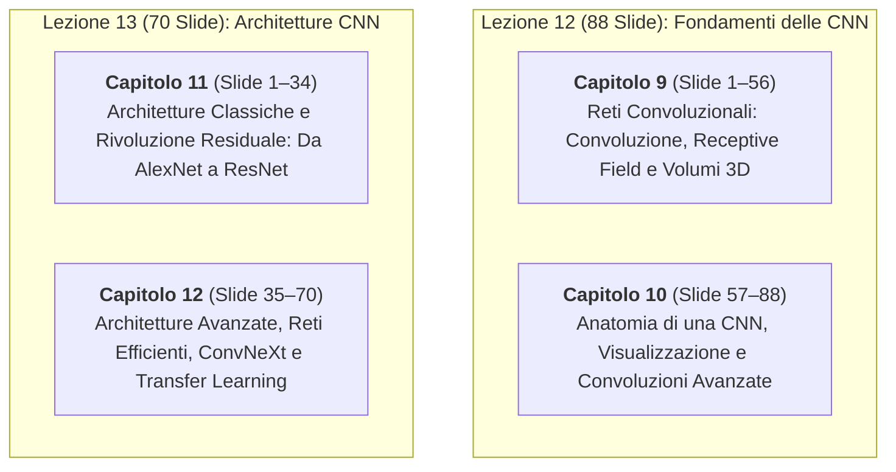

# Piani di Implementazione — Lezioni 12 e 13: Reti Convoluzionali e Architetture CNN

> **Corso**: Deep Learning And Robot Perception  
> **Fonti Ufficiali di Riferimento**:
> - Slide Ufficiali Lezione 12: `12_convolutional_networks_2026_1-2.pptx` (88 slide, Sezioni 1–9)
> - Slide Ufficiali Lezione 13: `13_cnn_architectures_2026_rev4.pptx` (70 slide, Sezioni 1–8)
> - Trascrizioni Audio Tradotte in Italiano (adattate per Deep Learning):
>   - `DL 21-10-2026_it.txt` (Lezione del 21/10/2026: Slide 1–60 di Lezione 12)
>   - `DL-27-10_it.txt` (Lezione del 27/10/2026: Slide 61–88 di Lezione 12 e Slide 1–35 di Lezione 13)
>   - `DL-28-10_it.txt` (Lezione del 28/10/2026: Slide 36–70 di Lezione 13)
> - Note dello Studente:
>   - `note/lezione_12.md` (annotazioni, dubbi e 4 schemi grafici richiesti)
>   - `note/lezione_13.md` (annotazioni, calcoli manuali, dubbi e 1 schema grafico richiesto)
> - Regole di Riferimento:
>   - `[[STRUTTURA_E_GUIDA_APPUNTI.md]]`
>   - `[[.agents/rules/pipeline_trascrizioni_audio_e_macro_argomenti.md|Pipeline Trascrizioni Audio e Macro-Argomenti]]`

---

## 1. Validazione Triangolare Preliminare (Note vs Trascrizione vs Slide)

In conformità alla Fase 3 della pipeline, è stato condotto un rigoroso controllo incrociato a tre vie tra le **slide ufficiali**, le **note dello studente** e le **trascrizioni orali del docente**.

### 1.1 Errori, Inconsistenze e Refusi Rilevati nelle Note dello Studente

1. **Confusione Concettuale tra Kernel Size e Receptive Field a Strati Profondi (`note/lezione_12.md`, riga 16)**:
   - *Nota studente*: *"il numero di neuroni del layer precedente che un neurone vede si chiama recceptive field, o kernel size"*.
   - *Correzione analitica*: Il kernel size $k \times k$ coincide con il receptive field (campo recettivo) **esclusivamente al primo strato**. Negli strati successivi, il receptive field rispetto all'immagine di ingresso cresce progressivamente: per una pila di strati convoluzionali con kernel $k$ e stride 1, il receptive field dopo $L$ layer è:
     $$RF_L = 1 + L(k - 1)$$
     (ad esempio, due strati $3 \times 3$ vedono un'area $5 \times 5$, tre strati vedono $7 \times 7$). Se intervengono pooling o stride $s$, la crescita diventa moltiplicativa:
     $$RF_{l} = RF_{l-1} + (k_l - 1) \cdot \prod_{i=1}^{l-1} s_i$$
     Confondere il receptive field globale con la dimensione locale del kernel è un errore teorico che verrà accuratamente chiarito nel testo.

2. **Grave Refuso nella Formula della Dimensione Spaziale di Output (`note/lezione_13.md`, riga 8)**:
   - *Nota studente*: `$(C_{in}, H_{in}, W_{in}) \to (C_{out}, \frac{H_{in} - k + 2P}{5} + 1, \frac{W_{in} - K + 2P}{5} - 1)$`.
   - *Correzione analitica*: La nota presenta due errori di battitura:
     - Ha sostituito la lettera $S$ (lo stride) con il numero $5$ (perché digitata frettolosamente).
     - Ha inserito un $-1$ finale al posto di $+1$.
     La formula canonica esatta (Slide 37 di Lez. 12 e Slide 9 di Lez. 13) è:
     $$H_{\text{out}} = \left\lfloor \frac{H_{\text{in}} - k + 2P}{S} \right\rfloor + 1, \quad W_{\text{out}} = \left\lfloor \frac{W_{\text{in}} - k + 2P}{S} \right\rfloor + 1$$

3. **Incongruenza Dimensionale nel Flattening di VGG (`note/lezione_13.md`, riga 14)**:
   - *Nota studente*: *"L'ultimo tensore è qualcosa del tipo: $(236, 6, 6)$, che se applicato il flatten diventa $(9216)$..."*.
   - *Correzione analitica*: In AlexNet il tensore pre-flattening è $256 \times 6 \times 6 = 9216$ (e non 236). In VGG-16, l'ultimo stage convoluzionale produce un volume $512 \times 7 \times 7 = 25088$, che moltiplicato per i 4096 neuroni del layer denso FC6 genera da solo ben $25088 \times 4096 \approx 102.7 \times 10^6$ pesi (oltre il $74\%$ dei parametri totali di VGG-16).

4. **Fraintendimento Terminologico su DenseNet (`note/lezione_13.md`, riga 39)**:
   - *Nota studente*: La nota descrive correttamente la concatenazione delle feature map ($3 \to 67 \to 131$), ma definisce impropriamente il blocco come *"residual block"*.
   - *Correzione analitica*: DenseNet adotta una **concatenazione tensoriale** lungo l'asse dei canali $[x_0, x_1, \dots, x_l]$, e non una somma residuale element-wise $x + F(x)$ come ResNet. Questa distinzione è fondamentale: ResNet accumula perturbazioni su un segnale della medesima dimensionalità; DenseNet preserva tutte le feature storiche intatte e allarga continuamente il volume di canale al tasso del *growth rate* $k$.

5. **Natura del Problema del Degrado nelle Reti Profonde (`note/lezione_13.md`, riga 25)**:
   - *Nota studente*: La nota esprime sorpresa per il fatto che una rete a 56 layer abbia prestazioni peggiori di una a 20 layer.
   - *Chiarimento didattico*: Il professore (Slide 18–19) sottolinea che non si tratta di overfitting (in caso di overfitting l'errore di training sarebbe quasi nullo e quello di test alto), bensì di un **problema intrinseco di ottimizzazione**: la rete a 56 layer presenta un errore di *training* sensibilmente superiore a quella da 20 layer perché l'impilamento di layer senza connessioni residue ostacola la convergenza della discesa del gradiente.

---

### 1.2 Errori e Allucinazioni Filtrati nelle Trascrizioni Audio Tradotte

1. **Refusi Fonetici su Nomi e Algoritmi**:
   - I termini tecnici anglofoni nel testo trascritto presentano frequenti imprecisioni fonetiche: _"vgg sixteen"_ / _"vgg sedici"_, _"google net"_ per GoogLeNet, _"resnet"_ pronunciata _"res net"_, _"convnext"_ trascritta come _"con next"_ o _"conv next"_, _"swin transformer"_ come _"swing transformer"_, _"atrous"_ come _"a trous"_.
   - Vengono ripristinati tutti i nomi scientifici originali con citazioni dei paper formali (Krizhevsky et al. 2012, Simonyan & Zisserman 2014, Szegedy et al. 2015, He et al. 2016, Huang et al. 2017, Xie et al. 2017, Hu et al. 2018, Sandler et al. 2018, Tan & Le 2019, Liu et al. 2022).
2. **Confusione tra Correlazione e Convoluzione nelle Librerie Software**:
   - Nella trascrizione orale il docente ripete più volte *"calcoliamo la convoluzione"*, ma nelle slide (Slide 7 di Lez. 12) dimostra che `torch.nn.Conv2d` calcola in realtà la **cross-correlazione** (senza ribaltamento di $180^\circ$ del kernel). Negli appunti formalizzeremo rigorosamente la differenza algebrica spiegando perché per pesi addestrabili le due operazioni sono perfettamente equivalenti a meno di una rotazione dei pesi appresi.
3. **Discrepanza tra Risoluzione Dichiarata e Reale di AlexNet (224 vs 227)**:
   - Nella trascrizione e nel paper originale di AlexNet viene menzionata una risoluzione di ingresso di $224 \times 224$. Tuttavia, come illustrato dal professore nella Slide 9, applicando la formula $\lfloor (224 - 11)/4 \rfloor + 1 = \lfloor 213/4 \rfloor + 1 = 54$, e non $55$. Per ottenere la feature map $55 \times 55$ documentata nel paper, la dimensione reale di ingresso deve essere necessariamente $227 \times 227$.

---

## 2. Decomposizione Modulare in Macro-Argomenti

Le due presentazioni coprono complessivamente **158 slide** ad altissima densità concettuale, con 3 registrazioni complete per oltre 200.000 caratteri di trascrizione tecnica.
Seguendo la regola di modularità e leggibilità del vault, si propongono due opzioni di suddivisione.

### Opzione A (Raccomandata: 4 Capitoli Omogenei ~40 Slide ciascuno)

Questa opzione garantisce un perfetto equilibrio didattico: ciascun capitolo copre un blocco tematico coeso e compatto (35–45 slide), evitando capitoli ipertrofici e facilitando lo studio incrementale.

- **Capitolo 9**: `9. Reti Convoluzionali: Convoluzione, Receptive Field e Volumi 3D.md` (Slide 1–56 di Lezione 12).
- **Capitolo 10**: `10. Anatomia di una CNN, Visualizzazione delle Feature e Convoluzioni Avanzate.md` (Slide 57–88 di Lezione 12).
- **Capitolo 11**: `11. Architetture CNN Classiche e la Rivoluzione Residuale: Da AlexNet a ResNet.md` (Slide 1–34 di Lezione 13).
- **Capitolo 12**: `12. Architetture CNN Avanzate, Modelli Efficienti e ConvNeXt.md` (Slide 35–70 di Lezione 13).

---

### Opzione B (Alternativa: 3 Capitoli)

- **Capitolo 9**: `9. Reti Neurali Convoluzionali: Dalla Convoluzione alle Varianti Avanzate.md` (Slide 1–88 di Lezione 12 intera).
- **Capitolo 10**: `10. Architetture CNN Classiche e Reti Residuali: Da AlexNet a ResNet.md` (Slide 1–34 di Lezione 13).
- **Capitolo 11**: `11. Architetture CNN Avanzate, Modelli Efficienti e ConvNeXt.md` (Slide 35–70 di Lezione 13).

> [!NOTE] Raccomandazione Operativa
> Si raccomanda caldamente l'**Opzione A (4 Capitoli)** per evitare che il Capitolo 9 superi le 900 righe di testo e contenga 36 asset grafici in un singolo documento, mantenendo le dimensioni e i tempi di lettura allineati a quelli ottimali dei Capitoli 6, 7 e 8.

---

## 3. Piani Dettagliati per Capitolo (Struttura Opzione A)

---

### Capitolo 9: Reti Convoluzionali: Convoluzione, Receptive Field e Volumi 3D

#### File di Destinazione
`Anno 2/Deep Learning And Robot Perception/9. Reti Convoluzionali: Convoluzione, Receptive Field e Volumi 3D.md`

#### Perimetro Slide e Fonti
- **Slide coperte**: Slide 1 – 56 di `12_convolutional_networks_2026_1-2.pptx` (Sezioni 1, 2, 3, 4, 5)
- **Note corrispondenti**: `note/lezione_12.md`, righe 1 – 54
- **Trascrizione corrispondente**: `DL 21-10-2026_it.txt` (intero file)

#### Struttura delle Sezioni
1. **Dal Modello Denso al Paradigma Convoluzionale**:
   - Limiti invalicabili dei layer completamente connessi (MLP) sulle immagini: esplosione combinatoria dei parametri, perdita della topologia bidimensionale 2D, assenza di bias induttivo spaziale.
   - Il pattern canonico delle CNN: ripetizione modulare di Convoluzione $\to$ Normalizzazione opzionale $\to$ Non-linearità (ReLU) $\to$ Pooling opzionale.
2. **L'Operazione di Convoluzione e Correlazione Discreta**:
   - Definizione matematica 1D continua e campionata: $s(i) = (x * w)(i) = \sum_a x(a) w(i - a)$. Commutatività per inversione del kernel.
   - Convoluzione 2D vs Cross-Correlazione 2D: il ribaltamento di $180^\circ$ dei pesi ($w(-u, -v)$).
   - Perché i framework (PyTorch `Conv2d`) implementano la correlazione: per pesi appresi la direzione è ininfluente; equivalenza a meno di rotazione.
   - Filtro di Sobel vs Filtri Appresi nel primo layer: come la discesa del gradiente riscopre autonomamente i gradienti spaziali.
3. **Le Tre Proprietà Fondamentali delle Convoluzioni e l'Inductive Bias**:
   - **Interazioni Sparse (Sparse Connectivity)**: ogni neurone riceve connessioni solo da un intorno locale $k \times k$.
   - **Condivisione dei Parametri (Parameter Sharing / Weight Tying)**: lo stesso kernel $w$ scorre su tutta l'immagine. Confronto numerico: 76.800 pesi densi ridotti a 9 pesi convoluzionali.
   - **Equivarianza alla Traslazione**: $\phi(T_a x) = T_a \phi(x)$. Se l'immagine si sposta, la feature map si sposta della medesima quantità. Mancanza di invarianza/equivarianza a rotazioni.
   - Rappresentazione della convoluzione come moltiplicazione per matrice sparsa a blocchi circolanti (Toeplitz).
4. **La Dinamica del Receptive Field (Campo Recettivo)**:
   - Definizione formale di campo recettivo locale vs globale.
   - Espansione del campo recettivo con la profondità: formula analitica $RF_L = 1 + L(k - 1)$.
   - Dimostrazione geometrica della piramide di visione.
   - Campo recettivo teorico vs Campo recettivo effettivo (distribuzione gaussiana di sensibilità attorno al centro del patch).
5. **Convoluzioni su Volumi 3D e Tensori di Canale**:
   - Dalla matrice 2D al volume di feature: canali di ingresso $C_{\text{in}}$ e canali di uscita $C_{\text{out}}$.
   - Struttura del filtro tridimensionale: ciascun filtro ha dimensione $C_{\text{in}} \times k \times k$. Somma lungo i canali e singolo bias per produrre una mappa bidimensionale.
   - Pila di $C_{\text{out}}$ filtri: tensore di pesi $W \in \mathbb{R}^{C_{\text{out}} \times C_{\text{in}} \times k \times k}$.
   - **Padding e Stride**:
     - Padding $P$: *Valid* ($P = 0$) vs *Same* ($P = (k-1)/2$).
     - Stride $S$: sottocampionamento spaziale durante la scansione.
     - Formula chiusa di campionamento: $H_{\text{out}} = \lfloor \frac{H_{\text{in}} - k + 2P}{S} \rfloor + 1$.
   - Conteggio analitico esatto dei parametri e delle operazioni moltiplicazione-somma (MACs):
     $$\text{Pesi} = C_{\text{out}} \cdot (C_{\text{in}} k^2 + 1), \quad \text{MACs} = H_{\text{out}} W_{\text{out}} C_{\text{out}} C_{\text{in}} k^2$$
   - Convoluzioni $1 \times 1$: combinazione lineare dei canali (*channel mixing* / sintesi) senza alterare la risoluzione spaziale.
6. **Lo Stadio del Rilevatore e il Pooling**:
   - Il ruolo della ReLU: perché senza ReLU due convoluzioni consecutive collassano algebricamente in un'unica convoluzione di kernel più ampio ($(x * w_1) * w_2 = x * (w_1 * w_2)$).
   - **Pooling**: Max Pooling vs Average Pooling ($k \times k$, tipicamente $2 \times 2$ stride 2).
   - Proprietà del pooling: riduzione dimensionale, riassunto delle attivazioni dominanti, introduzione di una parziale invarianza a piccoli scostamenti (approximate shift invariance).
   - Accelerazione dell'espansione del receptive field dovuta al pooling.

#### Asset Grafici Assegnati
- `slide_12_cnn_common_pattern_blocks.png` (Slide 4: pattern canonico Conv-Norm-ReLU-Pool)
- `slide_12_convolution_1d_continuous_discrete.png` (Slide 6: convoluzione continua e discreta 1D)
- `slide_12_convolution_vs_cross_correlation_2d.png` (Slide 7: convoluzione vs cross-correlazione 2D)
- `slide_12_convolutional_layer_single_filter.png` (Slide 8: scansione del singolo filtro 2D)
- `slide_12_learned_filters_layer1_vs_sobel.png` (Slide 11: filtri appresi nel layer 1 vs operatori di Sobel)
- `slide_12_convolution_as_sparse_matrix_multiplication.png` (Slide 12: matrice di Toeplitz sparsa)
- `slide_12_sparse_interactions_dense_vs_conv.png` (Slide 14: confronto connessioni dense vs sparse)
- `slide_12_receptive_field_depth_growth.png` (Slide 18: crescita del receptive field su più strati)
- `slide_12_parameter_sharing_connections.png` (Slide 19: condivisione dei pesi lungo la catena)
- `slide_12_parameter_sharing_image_weights_reduction.png` (Slide 21: da 76.800 pesi a 9)
- `slide_12_equivariance_to_translation_shift.png` (Slide 26: dimostrazione dell'equivarianza allo shift)
- `slide_12_convolution_rotation_lack_of_invariance.png` (Slide 28: mancata invarianza alle rotazioni)
- `slide_12_color_image_3d_stack_channels.png` (Slide 31: volume RGB a tre canali)
- `slide_12_convolutional_layer_on_3d_volume.png` (Slide 32: filtro cubico $C_{\text{in}} \times k \times k$ su volume)
- `slide_12_volume_convolution_animation.mp4` (Slide 33: video/animazione della convoluzione 3D)
- `slide_12_multiple_filters_stack_feature_maps.png` (Slide 35: pila di $C_{\text{out}}$ feature map)
- `slide_12_padding_and_stride_spatial_dimensions.png` (Slide 37: calcolo delle dimensioni spaziali con padding e stride)
- `slide_12_padding_animation.mp4` (Slide 38: video dimostrativo del padding)
- `slide_12_stride_animation.mp4` (Slide 39: video dimostrativo dello stride)
- `slide_12_counting_weights_macs_conv_layer.png` (Slide 41: formule di conteggio pesi e MAC)
- `slide_12_1x1_convolutions_channel_mixing.png` (Slide 43: convoluzione $1 \times 1$ come channel mixer)
- `slide_12_relu_detector_stage_after_convolution.png` (Slide 45: rilevatore ReLU post-convoluzione)
- `slide_12_max_and_average_pooling_operation.png` (Slide 48: schema di Max e Average Pooling)
- `slide_12_pooling_approximate_shift_invariance.png` (Slide 49: parziale invarianza a shift di 1 pixel)
- `slide_12_pooling_receptive_field_growth_rate.png` (Slide 53: moltiplicazione del tasso di crescita del receptive field)

#### Schemi Custom SVG da Realizzare
1. **`receptive_field_3layer_7units.svg`** (da `note/lezione_12.md`, riga 18): diagramma a 3 strati da 7 neuroni che evidenzia il receptive field locale e la catena di dipendenza del neurone centrale.
2. **`receptive_field_pyramid_expansion.svg`** (da `note/lezione_12.md`, riga 26): piramide di espansione a 3 layer da 5 neuroni con kernel $k=3$, che dimostra analiticamente perché l'unità centrale del layer 3 vede l'intera griglia di 5 pixel del layer 1.
3. **`volume_convolution_3d_cube.svg`** (da `note/lezione_12.md`, riga 41): disegno assonometrico con volume $3 \times 5 \times 5$, kernel cubico $3 \times 3 \times 3$ e freccia di proiezione scalare su feature map $5 \times 5$.

---

### Capitolo 10: Anatomia di una CNN, Visualizzazione delle Feature e Convoluzioni Avanzate

#### File di Destinazione
`Anno 2/Deep Learning And Robot Perception/10. Anatomia di una CNN, Visualizzazione delle Feature e Convoluzioni Avanzate.md`

#### Perimetro Slide e Fonti
- **Slide coperte**: Slide 57 – 88 di `12_convolutional_networks_2026_1-2.pptx` (Sezioni 6, 7, 8, 9)
- **Note corrispondenti**: `note/lezione_12.md`, righe 45 – 68
- **Trascrizione corrispondente**: `DL-27-10_it.txt`, righe 1 – 96

#### Struttura delle Sezioni
1. **Normalizzazione e Layer Conclusivi nelle Reti Convoluzionali**:
   - Batch Normalization specifica per CNN: normalizzazione per canale calcolata su tutti i pixel e su tutti i campioni del batch (riduzione su $B, H, W$).
   - Posizionamento canonico della BN prima della non-linearità ($z = W*x \to \text{BN}(z) \to \text{ReLU}$).
   - Dalle Feature Map al Vettore di Classe:
     - **Flattening**: appiattimento completo del tensore spaziale; svantaggio del vincolo su risoluzioni fisse e dell'ipertrofia di pesi sul primo layer FC.
     - **Global Average Pooling (GAP)**: media spaziale $H \times W \to 1$ per ciascun canale; zero parametri addizionali e totale indipendenza dalla risoluzione di input.
2. **Anatomia Completa di una CNN End-to-End**:
   - Tracciamento dettagliato layer per layer di una rete completa per immagini CIFAR-10 ($32 \times 32 \times 3$): evoluzione delle dimensioni spaziali, raddoppio dei canali, parametri e moltiplicazioni MAC per blocco.
   - Implementazione in PyTorch (`nn.Module` con blocchi `Conv2d`, `BatchNorm2d`, `ReLU`, `MaxPool2d`, `AdaptiveAvgPool2d`).
3. **Interpretazione e Visualizzazione delle Rappresentazioni Apprese**:
   - A cosa risponde un filtro convoluzionale? La gerarchia visiva di Zeiler & Fergus:
     - Layer 1: primitive a bassa frequenza (bordi orientati, gradienti cromatici, transizioni chiaro/scuro).
     - Layer 2: motivi geometrici intermedi, texture, angoli e intersezioni.
     - Layer 3 e successivi: parti anatomiche di oggetti (ruote, fari, musi, maniglie).
     - Layer profondi: categorizzazione semantica invariante.
   - **Mappe di Sensibilità all'Occlusione (Occlusion Sensitivity Maps)**: far scorrere un quadrato grigio opaco sull'immagine e misurare la caduta del punteggio della classe corretta per localizzare l'evidenza visiva determinante usata dalla rete.
4. **Varianti Avanzate dell'Operazione di Convoluzione**:
   - **Convoluzioni Dilatate (Dilated / Atrous Convolutions - Yu & Koltun, 2016)**:
     - Parametro di dilatazione $d$: spaziatura dei pesi del kernel senza aggiungere zeri memorizzati.
     - Dimensione effettiva del box: $k_{\text{eff}} = 1 + (k - 1)d$.
     - Espansione esponenziale del receptive field preservando la piena risoluzione spaziale (eliminazione della necessità di pooling, fondamentale per segmentazione semantica).
   - **Convoluzioni Depthwise Separable (Howard et al., MobileNets 2017)**:
     - Scomposizione della convoluzione standard in due passaggi sequenziali:
       1. *Depthwise Convolution*: $C_{\text{in}}$ filtri spaziali $k \times k$, ciascuno operante su un singolo canale isolato (nessuna somma tra canali).
       2. *Pointwise Convolution*: convoluzione $1 \times 1$ con $C_{\text{out}}$ filtri che miscela linearmente i canali.
     - Dimostrazione analitica del risparmio computazionale:
       $$\text{Rapporto MAC} = \frac{C_{\text{in}} k^2 + C_{\text{in}} C_{\text{out}}}{C_{\text{in}} C_{\text{out}} k^2} = \frac{1}{C_{\text{out}}} + \frac{1}{k^2}$$
       Per un kernel $3 \times 3$, la complessità si riduce di circa un fattore 9 ($8.7\times$).
5. **Garanzie Geometriche e Limiti Strutturali dell'Architettura**:
   - **Analisi Rigorosa dell'Equivarianza dopo il Pooling**:
     - Dopo un pooling con stride complessivo $\Delta$, l'equivarianza perfetta vale esclusivamente per traslazioni che siano multipli esatti di $\Delta$ pixel.
     - Effetto bordo: le finestre di convoluzione che intersecano i bordi dell'immagine distruggono l'equivarianza teorica.
   - **Assenza di Invarianza a Rotazioni e Zoom**:
     - I filtri convoluzionali standard non ruotano con l'immagine; un modello addestrato su cifre o oggetti dritti fallisce se l'immagine è ruotata di $30^\circ$ o scalata di un fattore $1.4$.
     - Il ruolo essenziale della **Data Augmentation** per iniettare artificialmente le invarianze mancanti.
   - Sintesi delle 9 sezioni: cosa garantisce l'architettura CNN e cosa deve essere fornito dai dati.

#### Asset Grafici Assegnati
- `slide_12_batch_normalization_in_cnns.png` (Slide 58: formulazione di BatchNorm per CNN)
- `slide_12_maps_to_vector_flatten_vs_gap.png` (Slide 60: confronto concettuale Flatten vs GAP)
- `slide_12_global_average_pooling_operation.png` (Slide 61: schema di Global Average Pooling)
- `slide_12_feature_visualization_zeiler_fergus_hierarchy.jpg` (Slide 69: gerarchia delle feature apprese dai primi layer a quelli profondi)
- `slide_12_occlusion_sensitivity_maps_car.jpg` (Slide 70: mappe di sensibilità all'occlusione su automobile)
- `slide_12_occlusion_sensitivity_animation.mp4` (Slide 70: video dell'occlusione dinamica)
- `slide_12_dilated_convolutions_sampling_spacing.png` (Slide 73: convoluzioni dilatate con $d=1, 2, 4$)
- `slide_12_dilated_convolution_animation.mp4` (Slide 73: video della scansione dilatata)
- `slide_12_depthwise_separable_convolution_steps.png` (Slide 75: scomposizione Depthwise + Pointwise)
- `slide_12_pooling_equivariance_stride_multiples.png` (Slide 80: verifica dell'equivarianza limitata ai multipli dello stride)
- `slide_12_rotation_zoom_failure_data_augmentation.png` (Slide 83: caduta delle prestazioni con rotazioni e zoom)

#### Schemi Custom SVG da Realizzare
4. **`casetta_hierarchical_cnn_features.svg`** (da `note/lezione_12.md`, riga 51): schema della gerarchia compositiva visiva con disegno della casetta, rilevamento dei corner nel layer 1 e combinazione dei corner nei muri quadrati e nel tetto triangolare nel layer 2.

---

### Capitolo 11: Architetture CNN Classiche e la Rivoluzione Residuale: Da AlexNet a ResNet

#### File di Destinazione
`Anno 2/Deep Learning And Robot Perception/11. Architetture CNN Classiche e la Rivoluzione Residuale: Da AlexNet a ResNet.md`

#### Perimetro Slide e Fonti
- **Slide coperte**: Slide 1 – 34 di `13_cnn_architectures_2026_rev4.pptx` (Sezioni 1, 2, 3, 4)
- **Note corrispondenti**: `note/lezione_13.md`, righe 1 – 35
- **Trascrizione corrispondente**: `DL-27-10_it.txt`, righe 97 – 374

#### Struttura delle Sezioni
1. **Il Benchmark ImageNet e la Sfida ILSVRC**:
   - Il dataset ImageNet: 1.28 milioni di immagini di training, 1000 classi eterogenee, 50.000 immagini di validazione.
   - Metriche di errore d'esame: **Top-1 Error** vs **Top-5 Error** (perché Top-5 perdona classi tassonomicamente vicine, es. razze di gatti domestici).
   - Cronologia storica degli otto anni di vincitori (2010–2017): dal 28% di errore degli approcci tradizionali al superamento delle prestazioni umane ($<5\%$).
2. **Le Architetture Pioniere (2012–2014): AlexNet, VGG e GoogLeNet**:
   - **AlexNet (Krizhevsky et al., 2012)**:
     - Architettura: 5 layer convoluzionali con kernel ampi (11x11, 5x5, 3x3) e 3 layer densi (FC6–FC8), 61 milioni di parametri.
     - Gli ingredienti che resero possibile l'addestramento profondo: ReLU (6 volte più veloce di Tanh), Dropout ($p=0.5$), Data Augmentation su GPU NVIDIA GTX 580 (3 GB).
     - Calcolo manuale del primo layer: risoluzione effettiva $227 \times 227 \times 3$, 35.000 pesi e 105 milioni di MACs.
   - **VGG (Simonyan & Zisserman, 2014)**:
     - Le due regole di progettazione: solo kernel minimi $3 \times 3$ con stride 1 e pad 1; stadi terminati da max pool $2 \times 2$ con raddoppio dei canali fino a 512.
     - La giustificazione teorica della fattorizzazione: due strati $3 \times 3$ hanno campo recettivo $5 \times 5$ ma con il $28\%$ di parametri in meno ($18 C^2$ vs $25 C^2$); tre strati $3 \times 3$ vedono $7 \times 7$ con il $45\%$ di parametri in meno ($27 C^2$ vs $49 C^2$) e introducono 3 non-linearità ReLU anziché una sola.
     - La patologia dei layer densi di VGG-16: le convoluzioni compiono il $99\%$ delle operazioni MAC, mentre i layer fully connected contengono oltre l'$80\%$ dei parametri (collo di bottiglia di memoria).
   - **GoogLeNet / Inception (Szegedy et al., 2014)**:
     - Il modulo Inception: percorsi paralleli multi-scala ($1 \times 1$, $3 \times 3$, $5 \times 5$, max pool) per catturare contesti visivi eterogenei.
     - Convoluzioni $1 \times 1$ come collo di bottiglia (*bottleneck reduction*): abbattimento drastico dei MACs da 303M a 128M senza perdita di accuratezza.
     - Architettura a 22 layer: eliminazione dei pesanti layer FC in favore del Global Average Pooling; branch ausiliari (*auxiliary classifiers*) a stadi intermedi per contrastare il vanishing gradient.
3. **Il Problema del Degrado nelle Reti Molto Profonde**:
   - Esperimento fondamentale: confronto tra reti "plain" (convoluzioni standard prive di scorciatoie) a 20 e 56 layer.
   - L'evidenza controintuitiva: la rete a 56 layer presenta un errore di training **superiore** alla rete a 20 layer.
   - Perché non è overfitting: in overfitting l'errore di training sarebbe prossimo a zero. Si tratta di un'avaria di ottimizzazione dovuta a gradienti che collassano o diventano caotici attraversando decine di strati affini.
   - Il paradosso teorico: una rete più profonda dovrebbe poter replicare esattamente le funzioni di una meno profonda impostando semplicemente gli strati eccedenti come mappe identità ($H(x) = x$).
4. **ResNet: L'Apprendimento Residuale e l'Autostrada del Gradiente**:
   - Formulazione matematica del blocco residuo (Kaiming He et al., 2015):
     $$y = F(x, \{W_i\}) + x$$
     invece di apprendere la mappa ideale $H(x)$, la rete apprende il residuo $F(x) = H(x) - x$. Se l'identità è ottimale, basta azzerare i pesi $W \to 0 \implies F(x) = 0 \implies y = x$.
   - **L'Autostrada dei Gradienti (Gradient Highway)**:
     $$\frac{\partial \mathcal{L}}{\partial x} = \frac{\partial \mathcal{L}}{\partial y} \frac{\partial y}{\partial x} = \frac{\partial \mathcal{L}}{\partial y} \left( \frac{\partial F}{\partial x} + I \right) = \frac{\partial \mathcal{L}}{\partial y} \frac{\partial F}{\partial x} + \frac{\partial \mathcal{L}}{\partial y}$$
     Il termine $I$ trasmette il segnale di errore direttamente agli strati a monte senza attenuazione moltiplicativa, risolvendo definitivamente il problema del vanishing gradient.
   - Adattamento dimensionale quando $H, W$ dimezzano e $C$ raddoppia: shortcut con convoluzione di proiezione $1 \times 1$ a stride 2.
   - **Il Blocco Bottleneck per Reti Profonde (ResNet-50, 101, 152)**:
     - Sequenza $1 \times 1$ (compressione a $C/4$) $\to 3 \times 3$ $\to 1 \times 1$ (espansione a $C$).
     - Consente di triplicare la profondità a parità di budget computazionale.
   - Interpretazione ad Ensemble di Percorsi Esponenziali (Veit et al., NeurIPS 2016): una ResNet a $N$ blocchi si comporta come un ensemble di $2^N$ cammini di lunghezza variabile; rimuovere un blocco post-addestramento riduce le performance in modo marginale e liscio.
   - Pre-Activation ResNet (He et al., ECCV 2016): spostare BN e ReLU prima delle convoluzioni per mantenere la linea di shortcut completamente "pulita".

#### Asset Grafici Assegnati
- `slide_13_imagenet_samples_and_top1_top5_error.jpg` (Slide 5: dataset ImageNet e distinzione Top-1 vs Top-5)
- `slide_13_eight_years_imagenet_winners_timeline.png` (Slide 6: evoluzione storica dei vincitori dal 2010 al 2017)
- `slide_13_alexnet_architecture_layers.png` (Slide 8: architettura a 8 layer di AlexNet)
- `slide_13_alexnet_layer1_dimensions_macs_calculation.png` (Slide 9: calcolo manuale dimensioni e MAC del layer 1 di AlexNet)
- `slide_13_vgg_architecture_3x3_stages.png` (Slide 10: architettura a blocchi 3x3 di VGG)
- `slide_13_vgg_parameters_vs_macs_dense_conv_split.png` (Slide 11: sbilanciamento tra parametri FC e calcolo convoluzionale in VGG)
- `slide_13_googlenet_naive_inception_module.png` (Slide 12: modulo Inception multi-ramo ingenuo)
- `slide_13_googlenet_dimension_reduction_1x1_bottleneck.png` (Slide 13: riduzione della dimensionalità con convoluzioni 1x1)
- `slide_13_googlenet_full_22_layers_architecture.png` (Slide 14: rete completa GoogLeNet a 22 layer con teste ausiliarie)
- `slide_13_degradation_problem_plain_20_vs_56_layers.png` (Slide 17: il problema del degrado su reti plain)
- `slide_13_degradation_measured_higher_training_error.png` (Slide 18: errore di training maggiore su 56 layer)
- `slide_13_resnet_residual_learning_block_shortcut.png` (Slide 21: schema analitico del blocco residuale e shortcut)
- `slide_13_resnet_identity_mapping_zero_weights.png` (Slide 22: mappa identità con pesi nulli)
- `slide_13_resnet_gradient_flow_unimpeded_highway.png` (Slide 23: autostrada del flusso di gradiente)
- `slide_13_resnet_56_beats_20_training_validation_curves.png` (Slide 25: curve di convergenza di ResNet-56 vs ResNet-20)
- `slide_13_resnet_dimension_change_projection_shortcut.png` (Slide 26: gestione del cambio di dimensione tramite shortcut di proiezione)
- `slide_13_resnet_unrolled_ensemble_exponential_paths.png` (Slide 28: unrolling di ResNet come ensemble di percorsi)
- `slide_13_resnet_bottleneck_block_1x1_3x3_1x1.png` (Slide 30: blocco bottleneck 1x1-3x3-1x1 per ResNet-50/101/152)
- `slide_13_resnet_family_table_imagenet.png` (Slide 31: confronto della famiglia ResNet su ImageNet)
- `slide_13_resnet_pre_activation_clean_shortcut.png` (Slide 33: architettura pre-activation con scorciatoia pulita)

---

### Capitolo 12: Architetture CNN Avanzate, Modelli Efficienti e ConvNeXt

#### File di Destinazione
`Anno 2/Deep Learning And Robot Perception/12. Architetture CNN Avanzate, Modelli Efficienti e ConvNeXt.md`

#### Perimetro Slide e Fonti
- **Slide coperte**: Slide 35 – 70 di `13_cnn_architectures_2026_rev4.pptx` (Sezioni 5, 6, 7, 8)
- **Note corrispondenti**: `note/lezione_13.md`, righe 36 – 44
- **Trascrizione corrispondente**: `DL-28-10_it.txt` (intero file)

#### Struttura delle Sezioni
1. **DenseNet: Concatenazione di Feature e Riutilizzo Estremo**:
   - Principio di DenseNet (Gao Huang et al., CVPR 2017): sostituire la somma residuale con la concatenazione dei tensori:
     $$x_l = H_l([x_0, x_1, \dots, x_{l-1}])$$
   - Parametro cardine: il **Growth Rate** $k$ (numero di canali generati da ciascun layer, tipicamente $k = 32$).
   - Struttura a Blocchi Densi (*Dense Blocks*) e Livelli di Transizione (*Transition Layers*):
     - All'interno del blocco denso la risoluzione spaziale $H \times W$ rimane costante;
     - Il Transition Layer applica una convoluzione $1 \times 1$ con compressione $\theta = 0.5$ seguita da average pooling $2 \times 2$.
   - Analisi comparativa DenseNet vs ResNet: DenseNet-121 raggiunge un'accuratezza superiore a ResNet-34 con quasi un terzo dei parametri, ma richiede una memoria GPU sensibilmente superiore in fase di training per accumulare i buffer di concatenazione.
2. **ResNeXt e le Reti con Attenzione ai Canali (SENet)**:
   - **ResNeXt (Xie et al., CVPR 2017)**:
     - Dalla profondità e larghezza alla **Cardinalità** ($C = 32$): numero di percorsi di trasformazione omogenei paralleli.
     - Equivalenza algebrica tra 32 rami paralleli e una singola **convoluzione raggruppata** (*grouped convolution* con $g = 32$).
     - A parità di complessità computazionale, aumentare la cardinalità produce un calo dell'errore Top-1 maggiore rispetto ad aumentare profondità o larghezza.
   - **Squeeze-and-Excitation Networks (SENet - Hu et al., CVPR 2018)**:
     - Meccanismo di attenzione ai canali per ricalibrare dinamicamente le feature map:
       1. *Squeeze*: compressione globale del contesto spaziale tramite Global Average Pooling:
          $$z_c = \frac{1}{H \times W} \sum_{i=1}^H \sum_{j=1}^W u_c(i, j)$$
       2. *Excitation*: collo di bottiglia con due layer fully connected e non-linearità Sigmoide:
          $$s = \sigma\left( W_2 \cdot \text{ReLU}(W_1 z) \right)$$
       3. *Riscalatura*: moltiplicazione canale per canale $\tilde{X}_c = s_c \cdot X_c$.
     - Applicazione del modulo SE all'interno dei blocchi residui (SE-ResNet) con incremento minimo dei calcoli ($<1\%$).
3. **Architetture Leggere per Robotica e Sistemi Embedded (MobileNet e EfficientNet)**:
   - **MobileNetV2 (Sandler et al., CVPR 2018)**:
     - **Inverted Residual Block**: ribalta la filosofia del bottleneck convenzionale (stretto $\to$ largo $\to$ stretto):
       1. Convoluzione $1 \times 1$ di espansione (canali moltiplicati per il fattore di espansione $t = 6$).
       2. Convoluzione depthwise $3 \times 3$ sul volume allargato.
       3. Convoluzione $1 \times 1$ di proiezione lineare che restringe i canali.
     - **Linear Bottleneck**: divieto tassativo di inserire una ReLU dopo l'ultimo layer $1 \times 1$. Dimostrazione con la spirale: la ReLU proietta a zero le coordinate negative distruggendo irreversibilmente le informazioni quando le feature sono compresse in sottospazi a bassa dimensione.
   - **EfficientNet e il Compound Scaling (Tan & Le, ICML 2019)**:
     - Limiti dello scaling unidimensionale (scalare solo profondità $d$, larghezza $w$ o risoluzione $r$ satura rapidamente).
     - La legge del **Compound Scaling**:
       $$d = \alpha^\phi, \quad w = \beta^\phi, \quad r = \gamma^\phi \quad \text{con } \alpha \cdot \beta^2 \cdot \gamma^2 \approx 2$$
     - La famiglia B0–B7: massimizzazione dell'accuratezza su ImageNet con una frazione dei parametri.
     - **Realtà Hardware in Robotica**: perché il numero teorico di MACs non predice linearmente la latenza reale su CPU/GPU (bandwidth di memoria, parallelismo dei kernel).
4. **ConvNeXt: La Modernizzazione delle CNN Ispirata ai Vision Transformer**:
   - La motivazione storica (Liu et al., CVPR 2022): la supremazia dei Vision Transformer (ViT, Swin Transformer) deriva dalle proprietà del self-attention o da scelte architetturali e di addestramento avanzate?
   - La roadmap di modernizzazione da ResNet-50 a ConvNeXt passo per passo:
     1. *Macro Design*: rapporto tra stadi 3:3:9:3 (come Swin-T) e stem con "patchify" $4 \times 4$ a stride 4.
     2. *ResNeXt-ify*: sostituzione del kernel standard con convoluzioni depthwise e allargamento dei canali.
     3. *Inverted Bottleneck*: blocco invertito (da stretto a largo) con kernel allargato a $7 \times 7$.
     4. *Micro Design*: introduzione di GELU al posto di ReLU, riduzione del numero di funzioni di attivazione e normalizzazione (solo una per blocco), sostituzione di BatchNorm con LayerNorm e layer di downsampling separati.
   - Il risultato: una CNN pura che eguaglia e supera Swin Transformer a parità di FLOPs e parametri ($82.1\%$ top-1).
5. **Transfer Learning Pratico in Robotica e Visione Computazionale**:
   - Scomposizione del modello in **Backbone** (estrattore universale preaddestrato) e **Head** (testa lineare specifica per il task).
   - Tre strategie operative a confronto: Training from scratch vs Frozen Backbone (Linear Probe) vs Fine-Tuning.
   - Evidenza sperimentale con 1.000 immagini CIFAR-10: perché il transfer learning da ImageNet abbatte i tempi di convergenza e previene l'overfitting.
   - **Le 6 Domande Diagnostiche del Docente (Slide 67)**:
     1. Una rete plain da 56 layer ha errore di training superiore a una da 20: è overfitting? (No, problema di ottimizzazione).
     2. Calcolo dei pesi di un blocco residuale invertito $32 \to 192 \to 192 \to 32$.
     3. Conteggio pesi di una convoluzione raggruppata con $g=8$.
     4. Perché MobileNetV2 non inserisce la ReLU dopo l'ultimo layer $1 \times 1$?
     5. MobileNetV2 compie 14 volte meno MACs di ResNet-50: è 14 volte più veloce sul robot? (No, misurare sempre la latenza reale).
     6. Dataset robotico con sole 1.000 immagini etichettate: da dove partire? (Backbone ImageNet preaddestrata con fine-tuning).

#### Asset Grafici Assegnati
- `slide_13_densenet_concatenation_concept.png` (Slide 36: concatenazione al posto della somma in DenseNet)
- `slide_13_densenet_dense_block_and_transition_layer.png` (Slide 37: anatomia del dense block e transition layer)
- `slide_13_densenet_121_complete_architecture.png` (Slide 38: architettura complessiva DenseNet-121)
- `slide_13_grouped_convolution_concept.png` (Slide 40: schema di convoluzione raggruppata)
- `slide_13_resnext_32_paths_cardinality_block.png` (Slide 41: modulo ResNeXt con 32 rami omogenei)
- `slide_13_squeeze_and_excitation_block_concept.png` (Slide 43: meccanismo Squeeze-and-Excitation)
- `slide_13_squeeze_and_excitation_in_resnet.png` (Slide 44: integrazione del modulo SE in ResNet)
- `slide_13_mobilenetv2_inverted_residual_block.png` (Slide 48: blocco residuale invertito di MobileNetV2)
- `slide_13_mobilenetv2_linear_bottleneck_no_relu.png` (Slide 51: dimostrazione della perdita di informazione con ReLU nei canali compressi)
- `slide_13_efficientnet_compound_scaling_b0_b7.png` (Slide 54: compound scaling su profondità, ampiezza e risoluzione)
- `slide_13_efficientnet_macs_vs_measured_latency.png` (Slide 55: discrepanza tra MACs teorici e tempo di inferenza misurato)
- `slide_13_resnet50_modernized_training_recipe.png` (Slide 57: la ricetta di training modernizzata di ResNet-50)
- `slide_13_resnet50_to_convnext_roadmap_steps.png` (Slide 58: i passaggi evolutivi da ResNet-50 a ConvNeXt)
- `slide_13_convnext_block_vs_resnet_bottleneck.png` (Slide 62: confronto ravvicinato blocco ConvNeXt vs blocco ResNet)
- `slide_13_transfer_learning_backbone_head_strategies.png` (Slide 64: le tre modalità d'uso di un modello preaddestrato)
- `slide_13_transfer_learning_cifar10_1000_samples_curve.png` (Slide 65: curve prestazionali su CIFAR-10 con 1000 campioni)

#### Schemi Custom SVG da Realizzare
5. **`densenet_concatenation_block.svg`** (da `note/lezione_13.md`, riga 39): diagramma architetturale di un blocco DenseNet che illustra la concatenazione delle feature map (da 3 canali di input a 67 e successivamente a 131), con evidenziazione dell'autostrada di riutilizzo delle feature e del gradiente.

---

## 4. Riepilogo degli Schemi Concettuali Custom (SVG)

Tutti e 5 gli schemi annotati dallo studente nelle note (`note/lezione_12.md` e `note/lezione_13.md`) verranno prodotti in formato vettoriale SVG ad alta risoluzione conforme al tema di Obsidian e archiviati in `immagini/`:

| File SVG | Capitolo Assegnato | Fonte / Richiesta | Descrizione Visiva |
| :--- | :---: | :--- | :--- |
| `receptive_field_3layer_7units.svg` | Cap. 9 | `note/lezione_12.md` (r. 18) | 3 layer da 7 neuroni con connessioni locali che evidenziano il receptive field del neurone centrale. |
| `receptive_field_pyramid_expansion.svg` | Cap. 9 | `note/lezione_12.md` (r. 26) | Piramide di visione a 3 layer da 5 neuroni che dimostra l'espansione a $5 \times 5$ del campo recettivo con $k=3$. |
| `volume_convolution_3d_cube.svg` | Cap. 9 | `note/lezione_12.md` (r. 41) | Assonometria del volume 3D RGB ($3 \times 5 \times 5$) con filtro cubico $3 \times 3 \times 3$ proiettato su feature map $5 \times 5$. |
| `casetta_hierarchical_cnn_features.svg` | Cap. 10 | `note/lezione_12.md` (r. 51) | Gerarchia delle feature con la casetta: layer 1 rileva i 4 angoli/corner, layer 2 assembla i muri quadrati e il tetto. |
| `densenet_concatenation_block.svg` | Cap. 12 | `note/lezione_13.md` (r. 39) | Blocco denso con concatenazione progressiva dei tensori ($3 \to 67 \to 131$ feature map) e flusso di riutilizzo. |

---

## 5. Workflow Operativo a Più Step per la Stesura

1. **Step 1 — Validazione del Piano**: Ricezione della conferma e dell'opzione preferita da parte dell'utente (Opzione A a 4 capitoli vs Opzione B a 3 capitoli).
2. **Step 2 — Stesura del Capitolo 9**: Redazione di `9. Reti Convoluzionali: Convoluzione, Receptive Field e Volumi 3D.md`, generazione degli SVG `receptive_field_3layer_7units.svg`, `receptive_field_pyramid_expansion.svg`, `volume_convolution_3d_cube.svg` e incorporamento degli asset e video.
3. **Step 3 — Stesura del Capitolo 10**: Redazione di `10. Anatomia di una CNN, Visualizzazione delle Feature e Convoluzioni Avanzate.md`, generazione dell'SVG `casetta_hierarchical_cnn_features.svg` e verifica delle proprietà di equivarianza/invarianza.
4. **Step 4 — Stesura del Capitolo 11**: Redazione di `11. Architetture CNN Classiche e la Rivoluzione Residuale: Da AlexNet a ResNet.md`, analisi comparativa ImageNet, fattorizzazione VGG, Inception e derivazione analitica dell'autostrada del gradiente in ResNet.
5. **Step 5 — Stesura del Capitolo 12**: Redazione di `12. Architetture CNN Avanzate, Modelli Efficienti e ConvNeXt.md`, generazione dell'SVG `densenet_concatenation_block.svg`, trattazione di DenseNet, ResNeXt, SENet, MobileNetV2, EfficientNet, ConvNeXt e Transfer Learning.
6. **Step 6 — Revisione Accademica e Audit di Conformità**: Esecuzione dei controlli automatici di validazione (nessun delimitatore vietato, KaTeX bilanciato, grassetti `__`, asset grafici corretti) e presentazione del resoconto analitico finale.
