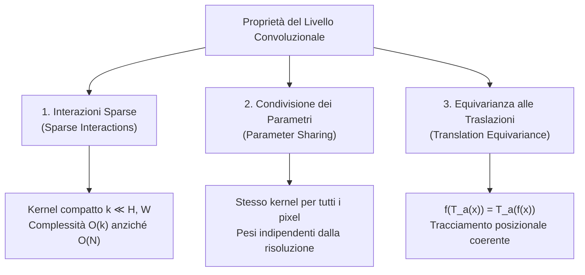
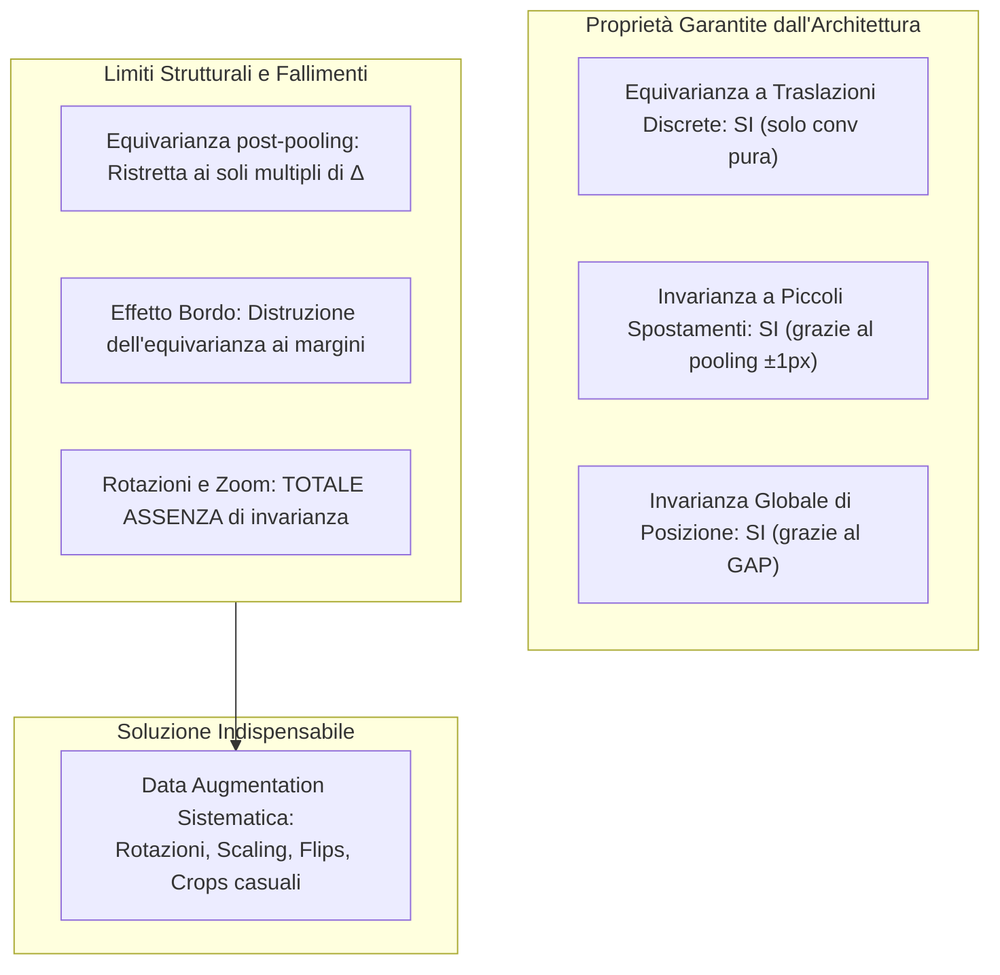
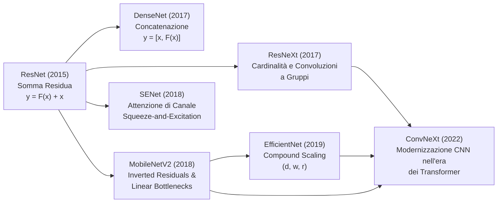
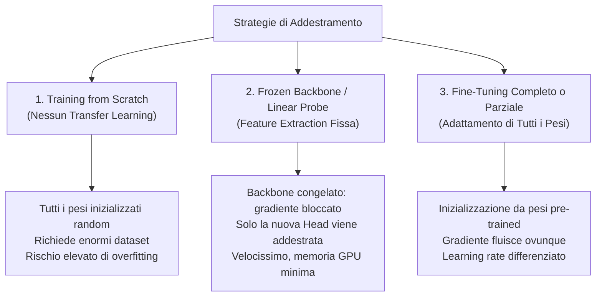

# 0. Immagini, filtri e gradienti

Da un punto di vista matematico un'immagine _in bianco e nero_ è una mappa tra un dominio 2D ad un dominio scalare (intensità della luce), è quindi una __funzione__:

$$
f: R^2\to \mathrm R
$$

![[2.5_immagine_funzione.png|center big]]

L'unica differenza tra un'immagine in bianco e nero e una _a colori_ (RGB) è che ho 3 matrici, si tratta quindi di un __tensore__ di profondità 3, dove ogni canale è un'immagine che rappresenta il livello di intensità dei canali Rosso, Verde e Blu.

>[!NOTE]
>In PyTorch le immagini vengono salvate nella configurazione:
>
>
> $$
> C \times H\times W
> $$
>
>
>Il primo indice sarà quindi il canale, poi l'altezza e infine la larghezza

## Operatori Di Punto E Operatori Locali

Un operatore è una funzione che riceve in input una o più immagini producendo un'altra immagine di output.

![[2.7_operatori.png|center small]]

### Operatori Di Punto

Un operatore di punto trasforma un singolo pixel basandosi __solo sul valore di quel pixel__:

$$
g(i, j) = h(f(i,j))
$$

Vengono utilizzati per gestire il contrasto, la luminosità e tutte le operazioni che consistono nel manipolare la luminosità di ogni singolo pixel indipendentemente.

Nel deep learning si possono utilizzare anche per Thresholding, histogram equalization, input normalization.

#### Gain (Contrasto) E Bias (Luminosità)

L'aumento del contrasto si ottiene moltiplicando la funzione dell'immagine, è quindi un operatore di punto perché ogni pixel viene moltiplicato per uno scalare.
La stessa cosa vale per la luminosità, che si ottiene sommando lo stesso valore ad ogni pixel.

![[2.9_gain_bias.png|center mid]]

#### Histogram Equalization

Se prendiamo un'immagine e analizziamo la distribuzione dei valori possiamo costruire un istogramma che rappresenti la p.d.f. dell'immagine:
![[2.10_istogramma.png|center mid]]

Da questo istogramma possiamo ricavare alcuni dati statistici necessari per analizzare l'immagine, come valore minimo, massimo, media e mediana.

Una volta ottenuto l'istogramma e visualizzata la sua c.d.f. (cumulative distribution function), possiamo schiarire alcuni dei pixel più scuri e scurire alcuni dei pixel più chiari, così da poter utilizzare l'intera gamma dinamica dell'immagine.

Per farlo si crea una funzione $T$ monotona che abbia come p.d.f. uniforme $p_s(s)=1$, questa funzione mappa i pixel nell'intervallo $[r, r+\mathrm dr]$ in $[s, s+\mathrm ds]$ :

$$
p_s(s)\mathrm ds = p_r(r)\mathrm dr
$$

dato che abbiamo $p_s(s) = 1$, possiamo trovare:

$$
\frac {\mathrm ds}{\mathrm dr} = p_r(r) \to s = T(r) = \int_0^rp_r(u)\mathrm du = P_r(r)
$$

Ovvero la c.d.f dell'immagine.

![[2.12_hist_equal.png|center mid]]

>[!NOTE]
>Questa funzione è valida solo nel dominio analogico, in ambiente digitale il risultato non è perfettamente piatto.
>
> #### Versione discreta
> ![[2.13_equal_discre.png|center small]] ![[2.13_risultato.png|center small]]
> Nella versione discreta si avranno pixel con lo stesso valore iniziale, questi avranno sempre lo stesso valore in uscita dalla trasformazione.
> Inoltre il valore minimo non sarà 0, ma sarà la versione normalizzata del valore minimo rappresentato nell'immagine: $c(I_{min}) = h(I_{min}) / N$

#### Utilizzo Nel Deep Learning

![[2.14_usi.png|center mid]]

### Operatori Locali (Neighborhood)

Negli operatori locali la trasformazione di un singolo pixel dipende anche dal __valore__ di un certo numero di __pixel vicini__:

$$
g(i,j) = h(f(k,l), \quad(k,l) \in N(i,j))
$$

Dove $N(i,j)$ indica i pixel vicini al pixel che stiamo trasformando.
La dimensione del vicinato dipende da quanto vogliamo far influenzare il pixel dai suoi vicini.

Questi operatori vengono utilizzati principalmente per filtri come il Gaussian Blur, Mean Filter, Sobel.

Nel deep learning li utilizzeremo inoltre come Median filter; convolutional layers nelle CNN.

#### Riduzione Del Rumore

![[2.15_noise.png|center mid]]

Aumentando il numero di immagini scattate diminuisce il rumore, ma spesso abbiamo una sola immagine.
Per risolvere questo problema si applicano dei filtri per ridurre il rumore bianco associato all'immagine.

Possiamo infatti modellare l'immagine come un segnale con aggiunta una componente di rumore bianco gaussiano avente come media $\mu =0$ e varianza $\sigma^2$:

$$
f(i,j) = s(i,j) + n(i,j)
$$

Per rimuovere il rumore bianco si può fare una media pesata tra il pixel e i suoi vicini, i pesi $h(u,v)$ vengono disposti su una griglia intorno al pixel di dimensione $k\times k$, ed ogni peso avrà valore $h = \frac 1{k^2}$:

$$
g(i,j) = \sum_{u,v}f(i+u,j+v)h(u,v)
$$

Possiamo poi quindi scomporre l'immagine nelle componenti di segnale e rumore:

$$
g(i,j) = \sum_{u,v}{s(i+u,j+v)h(u,v)} + \sum_{u,v}{n(i+u,j+v)h(u,v)}
$$

Il nostro obiettivo è quello di ridurre la componente di rumore il più possibile, e infatti se andiamo ad analizzare il funzionamento della griglia avremo:

$$
Var\left [\sum_{u,v}n(i+u,j+v)h(u,v) \right ] = \sigma^2\sum_{u,v}h(u,v)^2 = \frac{\sigma^2}{k^2}
$$

La varianza si divide per $k^2$, quindi la deviazione standard $\sigma$ si riduce di un fattore __$k$__.

>[!IMPORTANT]
>Anche nella parte di segnale avvengono dei cambiamenti, infatti se all'interno della griglia filtro il segnale non è tutto uguale (sono quindi presenti dei __bordi__ o dei dettagli), questi andranno a finire nella media pesata, generando un __blur__.
>
>![[2.17_blur.png|center small]]
>
>Aumentando la dimensione della finestra diminuisce ulteriormente il rumore, ma aumenta il blur.

#### Filtri Lineari

Un filtro lineare sostituisce ogni pixel con una combinazione lineare dei suoi vicini.

![[2.18_linear.png|center small]]

In questo esempio abbiamo definito noi i pesi, ma nelle CNN questi vengono __individuati con l'addestramento__.

## Cross-correlation E Convoluzione

La cross-correlation e la convoluzione sono due operazioni molto simili, la differenza principale è che il kernel usato in una è capovolto sia orizzontalmente che verticalmente rispetto all'altra.

![[2.19_cross_corr_conv.png|center mid]]

Spesso abbiamo dei kernel simmetrici (es: Gaussian o box), in questo caso sono identici, ma in alcuni casi non lo sono e bisogna flippare la matrice.

A livello matematico si preferisce la __convoluzione__, perché rispetta numerose proprietà matematiche che la cross-correlation non ha:

![[2.21_proprieta_conv.png|center big]]

>[!NOTE]
>Nel deep learning non andiamo a fare distinzioni tra convoluzione e cross-correlation, perché come detto prima i kernel vengono trovati tramite addestramento e avremo quindi la disposizione corretta degli elementi.

### Sistema Lineare Shift-invariante

Un sistema lineare invariante allo shift può essere descritto come la convoluzione di un input con la risposta impulsiva del sistema, possiede inoltre le seguenti proprietà:

$$
g = f *h
$$

![[2.20_lsi.png|center mid]]

Queste proprietà ci torneranno molto utili per risparmiare calcoli complessi in seguito.

### Convoluzione Ai Bordi

Se provo a eseguire la convoluzione su un pixel lungo il bordo di un'immagine avrò come problema che la matrice del kernel andrà fuori dai limiti dell'immagine:

![[kernel_out_of_bounds.svg|center small]]
Inoltre più grande sarà il kernel, più presente sarà questo problema (es: con un kernel 3x3 perdiamo 1px di bordo, con 5x5 2px e così via).

Come risultato avrò che la convoluzione sarà possibile solo lontano dai bordi, generando una matrice di dimensione inferiore rispetto a quella originale:

![[matrice_piccola.svg|center small]]

### Metodi per Calcolare la Convoluzione Ai Bordi

Per raggirare il problema e riuscire a svolgere la convoluzione sui bordi è sufficiente aggiungere una quantità di bordo extra tanti quanti sono i pixel che andrebbero persi.

Ci sono però diverse scelte che si possono fare quando si aggiungono nuovi bordi:

![[2.22_bordi.png|center mid]]

- __Zero padding__: il più usato, aggiunge semplicemente un bordo nero
- __Replicate__: ripete lo stesso valore presente sul bordo
- __Reflect__: specchia i valori
- __Wrap__: ripete i valori nello stesso verso

### Stride

Lo stride indica ogni quanti pixel effettuare la convoluzione:

![[stride.svg|center small]]

Con uno stride maggiore di 1 abbiamo un effetto di downsampling.

>[!EXAMPLE] Calcolare la dimensione della matrice di uscita
>
>
> $$
> N_{out} = \left \lfloor \frac {N_{in} + 2p - k}s \right \rfloor + 1
> $$
>
>
>Dove $N$ indica una delle due dimensioni della matrice ($H , W$), $p$ indica la larghezza del padding, $k$ la dimensione del kernel e $s$ lo stride.

## Filtri Lineari

Non tutti i kernel servono a sfocare l'immagine, alcuni effettuano altri tipi di trasformazioni.

![[2.26_filtri_lineari.png|center mid]]

### Moving Average (o Mean Filter, O Box blur)

Il pixel in output è la media dei pixel vicini:

$$
g(i,j) = \frac 1{k^2} \sum_{u,v}f(i + u, j+v)
$$

![[2.24_moving_average.png|center mid]]

è utile per rimuovere il rumore, ma sfoca tutta l'immagine.

### Filtro Gaussiano

Il filtro gaussiano effettua anch'esso una sfocatura, ma è preferito rispetto al box perché Gauss ha una risposta in frequenza più liscia, il box filter potrebbe inserire degli artefatti nell'immagine rendendola meno pulita.
![[2.27_gauss_vs_box.png|center mid]]

>[!NOTE]
> La risposta in frequenza del box è un sinc, l'attenuazione tende quindi ad oscillare portando alla cancellazione di alcune frequenze e all'esaltazione di altre a causa dei sidelobes (nell'immagine ad un certo punto le bande vengono sfocate, per poi ricomparire con colori invertiti).

![[2.28_gauss.png|center mid]]

Nel filtro gaussiano, la deviazione standard $\sigma$ indica quanto lontano arriva l'influenza di un pixel.

Con una gaussiana a una dimensione il kernel viene tagliato dopo $\pm 3\sigma$ (o quanto è grande il kernel).

Si campiona poi ad ogni passo e si normalizza la funzione facendo la somma di tutti i valori campionati e dividendoli poi per quella somma, così da avere come risultato 1.

>[!NOTE]
>Nella versione a 2 dimensioni la gaussiana è separabile, posso quindi calcolare prima solo l'asse x e poi l'asse y.
>
>
> $$
> G_\sigma(x,y) = g_\sigma(x)g_\sigma(y) \implies f * G_\sigma = (f * g_\sigma(x)) * g_\sigma(y)
> $$
>
>
>Il costo computazionale diminuisce da $k^2$ MACs (Multiply and accumulate) a $2k$ MACs, è quindi estremamente vantaggioso.

Applicare la convoluzione tra 2 gaussiane equivale a generare una gaussiana con varianza la somma delle varianze delle due gaussiane.

![[2.29_gauss_sigma.png|center small]]

### Sharpening

Se vuoi rendere l'immagine più nitida e definita puoi seguire questi passaggi:

- Blur dell'immagine
- Sottrai all'immagine originale quella sfocata
- aggiungi il risultato all'immagine originale

$$
g = f + \alpha(f - f * G_\sigma)
$$

![[2.31_sharpening.png|center small]]

## Filtri Non Lineari

I filtri non lineari non vengono calcolati tramite convoluzione, ma usano formule diverse per ottenere risultati diversi.

Non essendo lineari non supportano nemmeno le proprietà della convoluzione, ma alcuni di loro possono essere shift-invarianti.

### Median Filter

Utile per eliminare gli outlier se sono presenti all'interno del vicinato.

![[2.32_median_outlier.png|center small]]

Può aiutare ad eliminare il salt and pepper noise spesso presente nelle immagini.
A differenza del gaussian blur infatti riesce ad eliminare questo tipo di rumore mantenendo l'immagine più nitida.

![[2.33_salt_pepper.png|center small]]

Non è però molto utile quando incontra più rumore raggruppato vicino, inoltre si perdono le linee e i dettagli sottili che possono rappresentare degli outlier nella griglia.

## Edge Detection

Il nostro obiettivo è capire cosa si nasconde dietro i numeri che rappresentano le immagini, l'elemento più semplice da estrarre è l'edge (il bordo), ovvero il confine tra 2 oggetti diversi all'interno dell'immagine.

![[2.35_edge_cause.png|center mid]]

Per calcolare i bordi possiamo utilizzare la derivata prima, dato che un bordo è un rapido cambiamento nell'immagine.

![[2.36_derivata.png|center small]]

Trovare i bordi ci aiuta perché sono meno sensibili alle variazioni luminose, calcolando il gradiente infatti troviamo che per gain $a$ e bias $b$:

$$
\nabla (a f + b) = a \nabla f
$$

Perdiamo il bias, mentre il gain scala la norma del gradiente, mantenendo l'orientamento (che è quello che ci interessa).

### Step per Il Riconoscimento Dei Bordi

Non sempre i bordi sono ben definiti, per questo dobbiamo sviluppare delle pipeline con dei filtri per poterli accentuare:

1. __Filtrare l'immagine__: il calcolo del gradiente è molto sensibile al rumore, quindi dobbiamo ridurre i suoi effetti filtrando l'immagine.
2. __Miglioramento__: Calcolare i cambiamenti locali dell'intensità (la magnitudine del gradiente), così che i bordi siano più visibili.
3. __Riconoscimento__: Mantieni soltanto i punti dove il gradiente è più forte. Spesso usando un valore di soglia (Canny aggiunge la soppressione dei non massimi e l'isteresi).
4. __Localizzazione__: In alcune applicazioni localizza il bordo con accuratezza sub-pixel e stima il suo orientamento.

### Calcolo Del Gradiente

Il gradiente di un'immagine contiene tutte le derivate parziali per ogni dimensione dell'immagine:

$$
\nabla f = \left [ \frac {\partial f }{\partial x}, \frac {\partial f}{\partial y}\right]
$$

L'intensità (magnitudine) del bordo e la direzione del gradiente sono date dalle formule:

![[2.38_angolo_magnitudine.png|center small]]

Il gradiente è rivolto verso il punto dove avviene il cambiamento di intensità maggiore, è collegato con la direzione del bordo dato che sono perpendicolari tra loro: il bordo è una curva lungo la quale l'__intensità è costante__.

![[gradient_direction.svg|center small]] ![[2.45_gradient_orient.png|center small]]

#### Dominio Digitale

Per calcolare il gradiente nel dominio digitale si può utilizzare una versione discreta della __definizione di derivata__:

$$
\lim_{h\to0}\frac{f(x+h) - f(x)}{h}\quad \xrightarrow[\text{pixel consecutivi}]{h=1} \quad f(x+1) - f(x)
$$

Possiamo calcolare il gradiente come se fosse una convoluzione avente un kernel $1\times2$, ma dato che utilizzare un kernel di dimensione pari può causare confusione su quale pixel si sta controllando, si utilizza un kernel di dimensione $1\times 3$:

![[2.39_gradient_conv.png|center small]]

La nuova formula utilizzata sarà quindi una media tra il pixel precedente e il pixel successivo a quello analizzato:

$$
\frac{\partial f}{\partial x} \approx \frac{f(i, j+1) - f(i, j-1)}2
$$

Ovviamente il gradiente va calcolato sia per l'asse x che per l'asse y.
![[2.40_gradient_result.png|center mid]]

### Filtrare Il Rumore

Come detto in precedenza, calcolare il gradiente su un'immagine affetta da rumore rischia di identificare bordi che non devono essere presenti. Usando un filtro rendiamo meno evidente il bordo, ma rimuove il rumore così da rendere il bordo più riconoscibile.

![[2.41_filter_border.png|center mid]]

Stiamo quindi cercando di calcolare una convoluzione (il filtro gaussiano) per poi calcolare una seconda convoluzione (il gradiente), questo risulta computazionalmente complesso. Esiste però un modo per risparmiare una grossa quantità di calcoli sfruttando le [[#Cross-correlation E Convoluzione|Proprietà della convoluzione]]:

$$
\frac d{dx}(f*G_\sigma) = f * \frac{dG_\sigma}{dx}
$$

Questa proprietà è valida perché se scriviamo la formula estesa della convoluzione troviamo che soltanto il filtro $h$ dipende da $x$, ottenendo quindi la seguente formula:

![[2.42_formula_derivata.png|center small]]

Possiamo quindi avere lo stesso risultato effettuando una singola convoluzione della derivata del filtro gaussiano, che non dobbiamo calcolare durante l'esecuzione perché può essere fatto in anticipo.

![[2.42_deriv_gauss.png|center small]]

Ovviamente la derivata deve essere calcolata sia sull'asse x, che sull'asse y, portando alla creazione dei seguenti kernel:

![[2.43_derivate_gauss.png|center small]]

La formula finale della derivata sarà quindi:

![[2.43_formula_derivate.png|center small]]

### Operatori Prewitt E Sobel

Nella pratica, al posto di calcolare un filtro gaussiano e il gradiente, per trovare i bordi sono stati progettati 2 tipi di kernel, Prewitt e Sobel, che riescono a fornire risultati migliori:

![[2.44_sobel_esempio.png|center mid]]

![[2.44_prewitt_sobel_formule.png|center small]]

L'operatore di Sobel è un'approssimazione su piccola scala della derivata di una Gaussiana.

Ad esempio, il kernel $S_x$ è ottenuto dal prodotto esterno di due filtri 1D:

$$
S_x = \begin{bmatrix} 1 \\ 2 \\ 1 \end{bmatrix} \begin{bmatrix} -1 & 0 & 1 \end{bmatrix} = \begin{bmatrix} -1 & 0 & 1 \\ -2 & 0 & 2 \\ -1 & 0 & 1 \end{bmatrix}
$$

- __Deriva lungo l'asse x__: attraversa i bordi verticali calcolandone la pendenza tramite la differenza centrale $[-1, 0, 1]$.
- __Applica uno smoothing lungo l'asse y__: agisce parallelamente al bordo con il filtro binomiale $[1, 2, 1]^T$ (approssimazione di una Gaussiana) per ridurre il rumore.

Il __kernel di Prewitt__ funziona allo stesso modo, ma usa pesi uniformi $[1, 1, 1]^T$ al posto del filtro binomiale per lo smoothing.

### Derivate Seconde (Laplaciane)

![[2.46_laplaciane.png|center small]]

Per individuare i bordi si possono utilizzare anche le derivate seconde: nel punto dove con la derivata prima troviamo il massimo locale, con la derivata seconda troviamo un cambio di segno.

Con le derivate seconde si possono ottenere risultati più puliti, ma hanno un costo computazionale maggiore.

![[2.46_laplaciano_risultato.png|center small]] ![[2.46_laplace_matrici.png|center small]]

In generale quindi, si cercano i bordi dove è presente una forte risposta del gradiente.

#### Laplaciano Del Gaussiano (LoG)

![[2.47_LoG.png|center small]]

Ovviamente possiamo calcolare direttamente la formula della derivata di secondo ordine della distribuzione normale, dato che rispetta sempre la [[#Filtrare Il Rumore|Proprietà della convoluzione]] che abbiamo visto anche con la derivata prima.

## Canny Edges

L'algoritmo di Canny è il metodo classico di riferimento per l'edge detection, progettato per individuare i contorni in modo ottimale riducendo il rumore, localizzando i bordi con precisione di un singolo pixel ed evitando falsi rilevamenti.

### Step per Il Calcolo Dei Canny Edges

1. __Filtra l'immagine__ con la derivata della Gaussiana: effettua la convoluzione sia sull'asse x che y, questo ci dà sia la pulizia dell'immagine che la differenziazione.
2. __Magnitudine e orientamento__: Calcola la magnitudine del gradiente e l'orientamento dei bordi. Inserire una soglia sulla magnitudine genera bordi troppo spessi.
3. __Soppressione dei non massimi__: Mantieni solo i massimi locali lungo la direzione del gradiente, impostando i restanti a 0, questo assottiglierà i bordi a 1px.
4. __Doppia soglia e isteresi__: usa una doppia soglia per individuare e ricostruire la continuità dei bordi.

### Filtrare L'immagine

![[2.50_smooth_canny.png|center mid]]

>[!NOTE]
>Da notare che in questo esempio usa la derivata prima

>[!IMPORTANT]
> è essenziale impostare adeguatamente la deviazione standard della gaussiana, in quanto da questa dipende il livello di dettaglio dei bordi individuati:
> ![[2.59_canny_sigma.png|center small]]
> Gli __iperparametri__ di Canny sono $\sigma, t_{\text{high}}, t_{\text{low}}$

### Magnitudine E Orientamento

Calcolare la magnitudine del gradiente ci aiuta a individuare dei cambiamenti nell'immagine, ma non riusciamo subito ad individuare il bordo preciso al pixel.

![[2.51_magnitude_orient_canny.png|center mid]]

### Soppressione Dei Non Massimi

Per scegliere 1 solo pixel di bordo ci basiamo sulla __direzione__ del gradiente, compariamo ogni pixel con quelli lungo la stessa direzione e scegliamo quello con la magnitudine più alta.

![[2.52_canny_max.png|center mid]]

Il modo migliore per scegliere la direzione giusta del bordo è quello di prendere la direzione e quantizzarla in 4:
![[2.53_direzione_quant.png|center mid]]

In questo modo posso controllare solo le caselle necessarie della griglia, e scegliere quella con il valore massimo:
![[2.54_canny.png|center mid]]

Come risultato avremo quindi dei bordi tutti di larghezza 1, che avranno più o meno intensità sul pixel:
![[2.55_canny.png|center small]]

### Doppia Soglia E Isteresi

Dato che i bordi individuati hanno tutti intensità variabile, si analizzano per individuare quelli che potrebbero avere un'intensità troppo bassa, e che quindi potrebbero essere rumore.

Si adottano quindi 2 soglie:
- __t_high__: _sopra_ questa soglia tutti i punti vengono accettati automaticamente come bordi
- __t_low__: _sotto_ questa soglia tutti i punti vengono automaticamente scartati

![[5.56_double_thres.png|center mid]]

I punti che invece si trovano nella parte intermedia tra le due soglie vengono definiti __deboli__, e devono seguire il processo di isteresi.

#### Isteresi

Prendendo l'insieme dei punti deboli, se tra questi punti è presente un percorso che li collega ad un punto __forte__ allora vengono __accettati__ come bordo, altrimenti vengono scartati.
![[5.57_isteresi.png|center mid]]

Ogni pixel ha 8 vicini (i pixel intorno) incluse le diagonali, il percorso è valido in qualsiasi direzione così che possa seguire le curve del bordo.

### Usabilità E Limiti

Nonostante si tratti di una tecnologia risalente agli anni '80, i canny edges vengono attualmente utilizzati per molti scopi come ad esempio il lane detection delle strade, la scansione dei documenti o altro.

La limitazione principale risiede nel fatto che i canny rilevano soltanto dei cambi di intensità, che possono essere dati anche da cambi di texture, ombre o specularità sullo stesso oggetto. Allo stesso modo dei cambi poco intensi possono non essere rilevati correttamente.

Nel caso in cui sorgano questi problemi si dovrà ricorrere ad altri tipi di boundary detectors come HED, oppure segmentation models come Mask R-CNN o SAM, che individuano i confini degli oggetti tramite addestramento.

Imparare i Canny Edges è comunque importante in quanto anche questi altri modelli utilizzano internamente il calcolo dei gradienti orientati.

## Dai Filtri Alle Convolutional Neural Network

Un layer convoluzionale filtra l'immagine ed applica la convoluzione, con la differenza che i parametri del filtro vengono ottenuti tramite l'addestramento.

Un layer convoluzionale quindi impara ad estrarre da solo le features.
![[2.62_conv.png|center small]]

![[63.png|center big]]


# 1. Local Features e Harris Corner Detector

Nel deep learning lavoriamo direttamente sui dati grezzi del segnale (i pixel dell'immagine), a differenza del machine learning classico dove le features venivano estratte a mano prima dell'apprendimento.

Anche se nelle reti neurali il compito di estrarre le features viene svolto dai layer convoluzionali in modo end-to-end, capire a fondo la teoria della _feature detection_ classica è fondamentale: costituisce la base geometrica della visione artificiale, ed è essenziale per la robotica autonoma, la stima della posa, l'odometria e la ricostruzione 3D.

## Perché Le Local Features?

Quando abbiamo due o più immagini della stessa scena scattate da angolazioni diverse, nessuno ci dice a priori come le immagini siano traslate, ruotate o scalate tra loro.

Dobbiamo quindi trovare degli elementi visivi in comune (__features__) che possano essere individuati in modo indipendente e preciso in entrambe le viste. Trovando queste corrispondenze possiamo calcolare lo spostamento o la trasformazione geometrica che le lega.

![[casetta_traslata_corrispondenza.svg|center small]]

>[!NOTE] Obiettivo Geometrico
>Riconoscere lo stesso punto fisico della scena $p_1 = (x_1, y_1)$ e $p_2 = (x_2, y_2)$ in due immagini diverse permette di stimare il vettore di spostamento $(\Delta x, \Delta y)$, la rotazione o la matrice di trasformazione tra le due viste.

### Esempio: Panorama Stitching

Nel panorama stitching scattiamo foto parzialmente sovrapposte ruotando la fotocamera:

![[slide_03_panorama_stitching.png|center small]]

Per unire gli scatti in un'unica immagine senza discontinuità si segue una pipeline in tre stadi:
1. __Feature Extraction__: estraiamo i punti salienti in modo indipendente su ogni immagine.
2. __Feature Matching__: colleghiamo i punti corrispondenti tra le viste.
3. __Alignment & Blending__: calcoliamo la trasformazione geometrica e fondiamo le immagini.

![[slide_04_panorama_extract_match.png|center small]]

### Odometria Visuale Ed Errore Di Drift

In robotica usiamo le feature per la __Visual Odometry__ e lo __SLAM__: analizzando i frame consecutivi della telecamera stimiamo la traiettoria del robot nello spazio.

![[slide_06_visual_odometry_drift.png|center mid]]

>[!WARNING] Accumulo dell'Errore (Drift)
>Ogni spostamento è stimato rispetto al frame precedente. Piccole imprecisioni sui punti si sommano nel tempo generando una deriva progressiva (__drift__, ad esempio $3.4\text{ px}$ dopo soli 36 frame). Punti stabili e localizzati con precisione sub-pixel riducono drasticamente questo errore.

## Detector Vs Descriptor

Il problema di trovare corrispondenze si divide in due passaggi distinti:

![[casetta_descriptor_vettori.svg|center mid]]

### Detector: "Dove Si Trova Il Punto?"

Il __detector__ individua le coordinate $(x, y)$ dei punti notevoli sulla singola immagine, in modo completamente indipendente dall'altra vista:
- Deve essere __ripetibile__: lo stesso punto fisico nello spazio 3D deve essere individuato nella stessa posizione su immagini diverse, nonostante cambi di luce, posa o sfocatura.
- Deve essere __ben localizzato__: l'errore sulla posizione deve essere minimo (accuratezza sub-pixel).
- Deve garantire una __buona distribuzione__: i punti devono essere sparsi su tutta l'immagine, evitando che si concentrino tutti nella stessa zona.

### Descriptor: "Cosa C'è Attorno Al Punto?"

Il __descriptor__ prende la regione attorno al punto (la _patch_) e calcola un vettore numerico $\mathbf{f} \in \mathbb{R}^D$ che ne descrive l'aspetto:
- Deve essere __distintivo__: punti diversi devono avere descrittori molto distanti nello spazio dei vettori.
- Deve essere __invariante__: il vettore deve rimanere il più possibile uguale a fronte di rotazioni, cambi di scala, illuminazione o rumore.
- Deve essere __facile da comparare__: confrontando i vettori con la distanza euclidea possiamo trovare rapidamente il punto più simile tra le due immagini.

>[!IMPORTANT]
>L'algoritmo di __Harris & Stephens__ che vediamo in questa lezione è __esclusivamente un detector__: fornisce coordinate $(x, y)$ di angoli, ma non genera alcun vettore descrittore. I descrittori e il matching saranno affrontati nella lezione successiva.

## Criterio Locale: Flat, Edge E Corner

Non possiamo usare singoli pixel isolati per l'allineamento: in zone con colori uniformi ci sono troppi pixel identici, rendendo impossibile capire quale sia quello giusto.

Dobbiamo quindi cercare pixel con caratteristiche inusuali. Per farlo analizziamo come varia l'intensità luminosa quando muoviamo una piccola finestra d'osservazione $W$ attorno al punto:

![[casetta_flat_edge_corner.svg|center mid]]

Prendendo come esempio reale l'immagine della moto:

![[slide_14_moto_flat_edge_corner.png|center small]]

Possiamo distinguere tre situazioni:

1. __Regione Piatta (Flat)__:
   - Spostando la finestra in qualsiasi direzione l'intensità non cambia ($E(u, v) \approx 0$).
   - È impossibile da usare: ogni pixel vicino è identico e ambiguo.

2. __Bordo (Edge)__:
   - Se muoviamo la finestra __lungo il bordo__ l'intensità non cambia ($E \approx 0$).
   - Se la muoviamo __perpendicolarmente al bordo__ c'è un brusco cambiamento ($E \gg 0$).
   - Questo genera il __problema dell'apertura (Aperture Problem)__: la posizione è vincolata solo in 1D, mentre lungo la linea del bordo può scivolare liberamente. Non va bene per una localizzazione 2D.

3. __Angolo (Corner)__:
   - Qualsiasi spostamento in __qualunque direzione 2D__ provoca una variazione netta d'intensità.
   - L'errore cresce rapidamente in ogni direzione assumendo la forma di una "ciotola" (_bowl_).
   - È il punto ideale: la posizione è vincolata univocamente in tutte le direzioni.

![[slide_16_three_moments_shift.png|center small]]

>[!NOTE] Localizzazione Locale vs Unicità Globale
>Harris misura la stabilità locale della posizione, __non l'unicità globale__.
>Su texture ripetitive (come una scacchiera o le finestre di un palazzo), ogni vertice è un ottimo corner a livello locale, ma nell'immagine ce ne sono decine identici:
>
>![[slide_18_checkerboard_local_vs_global.png|center big]]
>
>Un detector locale non può risolvere questa ambiguità: andrà filtrata dopo durante il matching o con vincoli geometrici globali (RANSAC).

## Derivazione Matematica dell'Harris Detector

L'idea è calcolare l'errore generato muovendo la finestra all'interno dell'area circostante.

### Funzione Di Errore $E(u, v)$

Definiamo l'errore di corrispondenza quando la finestra $W$ viene spostata di un vettore $\Delta \mathbf{x} = [u, v]^T$:

$$
E(u, v) = \sum_{(x, y) \in W} w(x, y) \left[ I(x+u, y+v) - I(x, y) \right]^2
$$

Dove:
- $I(x, y)$ è l'intensità dell'immagine in scala di grigi.
- $w(x, y)$ è una finestra di pesi: può essere una finestra rettangolare unitaria, oppure una __gaussiana__ circolare con deviazione standard $\sigma_i$, che dà più peso ai pixel centrali ed evita discontinuità sui bordi della finestra.

![[slide_20_harris_bowl_shift.png|center mid]]

In un corner $E(u, v)$ cresce rapidamente in tutte le direzioni, formando una ciotola ripida.

### Approssimazione Di Taylor Al Primo Ordine

Calcolare $E(u, v)$ spostando fisicamente la finestra in tutte le direzioni richiederebbe troppi calcoli.

Per piccoli spostamenti $(u, v)$ possiamo approssimare l'intensità traslata con lo sviluppo in serie di Taylor al primo ordine:

$$
I(x+u, y+v) \approx I(x, y) + \frac{\partial I}{\partial x} u + \frac{\partial I}{\partial y} v = I(x, y) + \nabla I^T \Delta \mathbf{x}
$$

Dove $\nabla I = [I_x, I_y]^T$ è il gradiente dell'immagine calcolato sul punto $(x, y)$.

La variazione di intensità diventa quindi lineare rispetto allo spostamento:

$$
I(x+u, y+v) - I(x, y) \approx I_x u + I_y v = \nabla I^T \Delta \mathbf{x}
$$

![[slide_23_taylor_1d_error.png|center mid]]

>[!NOTE]
>Fino a circa un pixel di spostamento l'approssimazione lineare è molto accurata. Poiché un corner registra un salto di intensità netto già per frazioni di pixel, il primo ordine di Taylor è più che sufficiente.

### Matrice Dei Secondi Momenti $C$

Sostituendo l'approssimazione lineare nella formula dell'errore quadratico:

$$
E(u, v) \approx \sum_{(x, y) \in W} w(x, y) \left( \nabla I^T \Delta \mathbf{x} \right)^2 = \Delta \mathbf{x}^T \left[ \sum_{(x, y) \in W} w(x, y) \begin{bmatrix} I_x^2 & I_x I_y \\ I_x I_y & I_y^2 \end{bmatrix} \right] \Delta \mathbf{x}
$$

Possiamo riscriverlo in forma compatta:

$$
E(u, v) \approx \Delta \mathbf{x}^T C \, \Delta \mathbf{x}
$$

La matrice simmetrica $2 \times 2$ prende il nome di __matrice di struttura__ o __matrice dei secondi momenti__ $C$:

$$
C = \begin{bmatrix} \sum_W w \, I_x^2 & \sum_W w \, I_x I_y \\ \sum_W w \, I_x I_y & \sum_W w \, I_y^2 \end{bmatrix} = \begin{bmatrix} \langle I_x^2 \rangle & \langle I_x I_y \rangle \\ \langle I_x I_y \rangle & \langle I_y^2 \rangle \end{bmatrix}
$$

#### Calcolo Pratico Tramite Convoluzione 2D

Come abbiamo visto per i [[0. Immagini, filtri e gradienti#Filtri Lineari|Filtri Lineari nella Lezione 0]], nella pratica non si usa un ciclo for sui pixel: fare una media pesata con una finestra gaussiana equivale esattamente a calcolare una __convoluzione 2D__ con un kernel gaussiano $G_{\sigma_i}$.

Il calcolo della matrice $C$ su tutta l'immagine si articola quindi in quattro passaggi:
1. __Calcolo dei gradienti__: calcoliamo $I_x$ e $I_y$ con Sobel o con la convoluzione della derivata di una gaussiana a scala $\sigma_d$ (vedi [[0. Immagini, filtri e gradienti#Operatori Prewitt E Sobel|Lezione 0]]).
2. __Prodotti puntuali__: calcoliamo pixel per pixel tre immagini: $I_x^2$, $I_y^2$ e $I_x I_y$.
3. __Smoothing gaussiano__: applichiamo la convoluzione 2D con filtro gaussiano $G_{\sigma_i}$ su ciascuna delle tre immagini dei prodotti:

$$
\langle I_x^2 \rangle = G_{\sigma_i} * (I_x^2), \quad \langle I_y^2 \rangle = G_{\sigma_i} * (I_y^2), \quad \langle I_x I_y \rangle = G_{\sigma_i} * (I_x I_y)
$$

4. __Mappe di $C$__: per ogni pixel $(x, y)$, i valori delle tre immagini filtrate corrispondono direttamente agli elementi della matrice $C(x, y)$.

>[!IMPORTANT] Perché un Singolo Pixel Non Basta (Rango 1)
>Per un singolo pixel isolato, la matrice $\nabla I \nabla I^T = \begin{bmatrix} I_x^2 & I_x I_y \\ I_x I_y & I_y^2 \end{bmatrix}$ ha determinante nullo:
>
>
> $$
> \det(\nabla I \nabla I^T) = I_x^2 I_y^2 - (I_x I_y)^2 = 0
> $$
>
>
>Ha quindi rango 1: esiste sempre una direzione perpendicolare al gradiente in cui la variazione è nulla. Anche su un angolo, un singolo pixel dà una sola direzione di variazione.
>
>![[slide_26_shift_synthetic_gradients.png|center mid]]
>
>Per avere __rango 2__ (variazione in tutte le direzioni) dobbiamo per forza integrare su una finestra $W$ che contenga gradienti orientati in direzioni diverse.

![[slide_27_sum_products_not_gradients.png|center mid]]

>[!NOTE] Sommare i Prodotti e Non i Gradienti
>- Se sommassimo direttamente i gradienti $(\sum \nabla I)$, su una linea sottile i gradienti con versi opposti sui due lati si cancellerebbero a vicenda ($\sum \nabla I \approx 0$).
>- Sommando invece i prodotti $\sum w \nabla I \nabla I^T$, i segni opposti vengono elevati al quadrato e non si elidono.

### Analisi Degli Autovalori Di $C$

La matrice $C$ ci fornisce direttamente l'andamento dell'errore $E(u, v)$ per qualsiasi direzione di spostamento:

![[slide_30_maps_E_from_C.png|center mid]]

Essendo reale e simmetrica, $C$ ha due autovalori reali non negativi $\lambda_1, \lambda_2 \ge 0$ (con $\lambda_{\max} \ge \lambda_{\min} \ge 0$):
- $\lambda_{\max}$: la variazione nella direzione lungo cui l'immagine cambia più bruscamente.
- $\lambda_{\min}$: la variazione nella direzione perpendicolare, lungo cui l'immagine cambia meno.

![[slide_31_strongest_weakest_change.png|center small]]

![[slide_34_harris_autovalori.png|center mid]]

Analizzando i due autovalori sul piano $(\lambda_{\max}, \lambda_{\min})$ possiamo classificare la regione:
- __Flat__: entrambi vicini a zero ($\lambda_{\max} \approx 0$, $\lambda_{\min} \approx 0$).
- __Edge__: $\lambda_{\max} \gg \lambda_{\min} \approx 0$. Spostandosi lungo il bordo l'errore è nullo.
- __Corner__: entrambi nettamente maggiori di zero ($\lambda_{\min} > \tau$).

![[slide_33_score_weakest_change_curves.png|center small]]

>[!NOTE] Criterio di Shi-Tomasi (1994)
>Shi e Tomasi proposero di usare direttamente il valore del minimo autovalore come punteggio:
>
>
> $$
> \text{Score} = \lambda_{\min}
> $$
>
>
>Se $\lambda_{\min} > \tau$, il punto è un corner. È il criterio usato in OpenCV in `cv2.goodFeaturesToTrack` (con `useHarrisDetector=False`).

### Risposta Di Harris & Stephens ($R$) Senza Calcolare Autovalori

Calcolare esplicitamente gli autovalori per ogni pixel richiede radici quadrate, un'operazione costosa.

Harris e Stephens notarono che possiamo stimare l'entità dei due autovalori usando il determinante e la traccia della matrice $C$, che si calcolano direttamente con semplici moltiplicazioni e somme:
1. __Determinante__: $\det(C) = \lambda_1 \lambda_2 = \langle I_x^2 \rangle \langle I_y^2 \rangle - \langle I_x I_y \rangle^2$
2. __Traccia__: $\operatorname{tr}(C) = \lambda_1 + \lambda_2 = \langle I_x^2 \rangle + \langle I_y^2 \rangle$

Definirono quindi la funzione di risposta del corner $R$:

$$
R = \det(C) - k \left( \operatorname{tr}(C) \right)^2
$$

Dove $k$ è una costante empirica, tipicamente compresa tra $0.04$ e $0.06$.

![[slide_37_harris_stephens_values.png|center big]]

Il comportamento di $R$ rispecchia perfettamente le tre tipologie di regioni:
- __Corner__: $\lambda_1$ e $\lambda_2$ sono entrambi grandi $\implies \det(C)$ domina sul termine quadratico $\implies \mathbf{R > 0}$ (valore positivo alto).
- __Edge__: un autovalore è grande e l'altro è quasi nullo ($\lambda_1 \gg 0, \lambda_2 \approx 0$) $\implies \det(C) \approx 0$, mentre la traccia al quadrato è grande $\implies \mathbf{R < 0}$ (valore marcatamente negativo).
- __Flat__: entrambi gli autovalori sono quasi nulli $\implies \mathbf{R \approx 0}$.

![[slide_39_same_image_two_responses.png|center mid]]

### Soglia E Soppressione Dei Non-Massimi (NMS)

La mappa di risposta $R(x, y)$ produce valori positivi alti per un intero gruppo di pixel attorno a ogni vertice. Per isolare i singoli punti discreti si applicano due filtri:

1. __Soglia Relativa (Thresholding)__: scartiamo i pixel sotto una percentuale del massimo globale: $R(x, y) > \tau \cdot \max R$ (tipicamente $\tau = 0.01 - 0.02$, ovvero l'$1-2\%$).
2. __Soppressione dei Non-Massimi (NMS)__: per evitare di avere risposte multiple sullo stesso angolo, manteniamo un pixel solo se il suo punteggio $R$ è strettamente maggiore di tutti i pixel nel suo vicinato locale (es. finestra $7 \times 7$ o $9 \times 9$), azzerando gli altri.

![[slide_43_nms_checkerboard.png|center small]]

Su immagini reali il blob continuo di risposte viene ridotto dall'NMS al singolo picco geometrico:

![[slide_44_nms_real_corner_3d.png|center small]]

## La Pipeline Di Harris Nella Pratica

L'intero algoritmo viene eseguito sull'immagine combinando operazioni di convoluzione 2D e prodotti puntuali:

![[slide_42_harris_step_by_step.png|center mid]]

![[harris_pipeline_step.svg|center mid]]

### Ruolo Delle Due Scale Gaussiane: $\sigma_d$ E $\sigma_i$

Nell'algoritmo intervengono due gaussiane distinte:

1. __Scala di Derivazione $\sigma_d$__:
   - È la scala del filtro gradiente usato per calcolare $I_x$ e $I_y$.
   - Determina a quali dettagli spaziali risponde il gradiente (rimuove rumore ad alta frequenza).
2. __Scala di Integrazione $\sigma_i$__:
   - È l'ampiezza della finestra gaussiana $w$ che calcola la media pesata dei prodotti nella matrice $C$.
   - Definisce quanto deve essere grande l'intorno per considerare la struttura un angolo.

Aumentando entrambe le scale (regola empirica: $\sigma_i \approx 1.5 - 2 \sigma_d$) avremo meno corner, ma più robusti ed eliminando le micro-oscillazioni:

![[slide_46_effect_sigma_d_sigma_i.png|center mid]]

Il risultato finale sull'immagine della motocicletta con $\sigma_d = 1$, $\sigma_i = 2$, $k = 0.04$, soglia $2\%$ e NMS $9 \times 9$:

![[slide_51_harris_corners_moto.png|center small]]

## Invarianze E Limiti Di Harris

Analizziamo come si comporta il detector di fronte alle trasformazioni dell'immagine:

| Trasformazione | Comportamento di Harris | Perché |
| :--- | :---: | :--- |
| __Traslazione__ | __Covariante__ $\checkmark$ | Se l'immagine si sposta di $\mathbf{t}$, le coordinate dei corner si spostano esattamente di $\mathbf{t}$. |
| __Rotazione__ | __Covariante__ $\checkmark$ | Ruotando l'immagine, la forma quadratica ruota insieme ad essa: gli autovalori $\lambda_1, \lambda_2$ non cambiano, quindi la risposta $R$ rimane identica. |
| __Offset di Luminosità ($I + b$)__ | __Invariante__ $\checkmark$ | Come visto nell'[[0. Immagini, filtri e gradienti#Edge Detection|Edge Detection della Lezione 0]], il calcolo del gradiente elimina le costanti: $\nabla(I + b) = \nabla I$. |
| __Contrasto ($a \cdot I$)__ | __Parzialmente invariante__ $\sim$ | Moltiplicando per $a$ si ha $R' = a^4 R$. Usando una soglia relativa al massimo si compensa in teoria il fattore, ma in pratica si hanno problemi di saturazione (clipping a 255) o perdita di contrasto sotto 1 LSB. |
| __Cambiamento di Scala (Zoom)__ | <mark>__NON Invariante alla scala__</mark> $\times$ | __Limite fondamentale di Harris__: la finestra $\sigma_i$ ha dimensione fissa in pixel. Modificando lo zoom o la distanza, un angolo può sembrare un bordo piatto o fondersi con dettagli vicini. |

### Il Limite Della Scala: Verso Lo Scale-Space

Se ingrandiamo o rimpiccioliamo un'immagine, la finestra d'integrazione copre una porzione fisica diversa della scena:

![[slide_53_scale_change_rounded_corner.png|center small]]

- Guardando uno spigolo arrotondato da vicino (zoom-in), la finestra vede solo un bordo quasi rettilineo ($R < 0$).
- Allontanandoci (zoom-out), la stessa curvatura viene compressa in pochi pixel e comincia a comportarsi come un angolo vivo ($R > 0$).

Misurando sperimentalmente la percentuale di corner ritrovati nella stessa posizione:

![[slide_54_repeatability_rotation_scale.png|center big]]

- Con una rotazione di 45°, la ripetibilità è del __91%__ (la minima perdita è dovuta solo al campionamento discreto dei pixel).
- Con un cambio di scala ($0.48\times$), la ripetibilità crolla al __26%__ (e al __13%__ a $0.3\times$).

>[!IMPORTANT]
>Dato che Harris fissa i parametri $\sigma_d$ e $\sigma_i$ in pixel e non ha un modo per adattare la dimensione della finestra alla scala del dettaglio, __non è invariante al cambio di scala__.
>Per superare questo limite vedremo nella prossima lezione lo __Scale-Space__, il Laplaciano del Gaussiano (LoG / DoG) e l'algoritmo __SIFT__.


# 2. Scale-Space, Descrittori SIFT e Feature Matching

Nella lezione precedente abbiamo visto il detector di [[1. Local Features e Harris Corner Detector#Derivazione Matematica dell'Harris Detector|Harris]], che individua con precisione la posizione $(x, y)$ degli angoli. Abbiamo però scoperto il suo limite principale: la finestra ha una dimensione fissa in pixel e non è in grado di adattarsi se l'immagine subisce variazioni di scala (zoom).

Inoltre Harris è solo un detector: risponde alla domanda _"Dove si trova il punto?"_, ma non ci dice _"Cosa c'è attorno al punto?"_. Per accoppiare due fotografie della stessa scena dobbiamo associare univocamente ogni punto della prima al suo partner nella seconda.

In questa lezione affrontiamo i due passaggi chiave per risolvere il problema:
1. __Invarianza di Scala__: introducendo lo __Scale-Space__ per stimare la dimensione caratteristica di ciascun dettaglio a partire da una singola immagine.
2. __Descrittori Robusti (SIFT) e Matching__: costruire vettori numerici discriminativi invarianti a scala e rotazione, e associarli con il __Lowe's Ratio Test__.

## Dal Punto Di Interesse Al Feature Matching

L'obiettivo fondamentale è trovare punti di interesse unici che possano essere descritti facilmente e associati in modo non ambiguo tra viste differenti.

![[slide_04_p03_matching_goal_moto.png|center mid]]

### Separazione Concettuale: Detector Indipendente Vs Matching

Nelle due immagini il detector lavora in modo completamente indipendente:
- Su ciascuna immagine cerchiamo i punti candidati senza sapere a priori come la seconda vista sia traslata, ruotata o scalata rispetto alla prima.
- Solo dopo aver estratto ed etichettato ciascun punto con un proprio descrittore interveniamo con il confronto (__matching__).

![[slide_04_p05_detector_independent_candidates.png|center big]]

### La Patch Come "Carta d'Identità" Del Punto

La prima idea per descrivere un punto $p = (x, y)$ consiste nel ritagliare una piccola finestra di pixel centrata su di esso (ad esempio $15 \times 15$ pixel), detta __patch__.

Srotolando i pixel riga per riga otteniamo un vettore numerico reale:

$$
\mathbf{f} \in \mathbb{R}^{225} \quad (15 \times 15 = 225 \text{ valori})
$$

![[slide_04_p06_patch_descriptor_vector.png|center small]]

### Confronto Tramite Cross-Correlazione Normalizzata (NCC)

Per confrontare due patch $P_1$ e $P_2$ non possiamo usare la semplice differenza di intensità, perché cambierebbe con variazioni di luce. Usiamo la __Cross-Correlazione Normalizzata__ (NCC):

$$
\mathrm{NCC}(P_1, P_2) = \frac{\sum_i (P_1(i) - \bar{P}_1)(P_2(i) - \bar{P}_2)}{\sqrt{\sum_i (P_1(i) - \bar{P}_1)^2 \sum_i (P_2(i) - \bar{P}_2)^2}}
$$

Dove $\bar{P}_1$ e $\bar{P}_2$ sono le medie di intensità nelle due patch. La metrica vale $+1$ per perfetta coincidenza, $0$ per assenza di correlazione e $-1$ per contrasto opposto.

![[slide_04_p07_ncc_patches_comparison.png|center small]]

Confrontando la patch di riferimento con varie zone dell'altra immagine, dettagli simili ottengono punteggi alti ($\mathrm{NCC} \approx 0.94$), mentre zone diverse danno valori vicini allo zero:

![[slide_04_p08_matching_ncc_candidates.png|center mid]]

## Il Problema Della Scala E Della Rotazione

Il confronto diretto tra patch di pixel grezzi con NCC funziona __solo per pure traslazioni__. Quando la fotocamera si sposta nello spazio compaiono due trasformazioni inevitabili:
1. __Zoom (Scala $s$)__: la fotocamera si avvicina o si allontana, modificando la dimensione apparente in pixel degli oggetti.
2. __Rotazione ($\alpha$)__: la fotocamera ruota attorno all'asse ottico, inducendo una rotazione sul piano dell'immagine.

![[slide_04_p09_zoom_rotation_effects.png|center small]]

### Il Fallimento Del Patch Raw

Se usiamo finestre fisse a $15 \times 15$ pixel con rotazione o zoom, il confronto fallisce completamente:
- Con una rotazione di $30^\circ$, la correlazione tra patch identiche scende a $0.40$.
- Con uno zoom di fattore $s = 0.5$, l'NCC crolla a $-0.01$.

![[slide_04_p10_patch_failure_zoom_rotation.png|center small]]

Il motivo è intuitivo: applicando una finestra fissa $15 \times 15$ sull'immagine rimpicciolita, la finestra copre un'area quattro volte più grande della scena reale, includendo sfondo e dettagli estranei.

![[slide_04_p11_zoom_scale_coverage_comparison.png|center small]]

### Finestra Adattiva E Ricampionamento

Se conoscessimo il fattore di zoom $s$, potremmo restringere la finestra sull'immagine rimpicciolita esattamente dello stesso fattore ($r_2 = s \cdot r_1$), inquadrando la stessa porzione fisica di scena:

![[slide_04_p12_shrink_window_concept.png|center small]]

Per confrontare le patch dobbiamo però produrre vettori della stessa lunghezza. La soluzione è __ricampionare la finestra adattiva su una griglia fissa__ di $15 \times 15$ campioni usando l'__interpolazione bilineare__ per valutare i valori nei punti intermedi:

![[slide_04_p13_resampling_patches_grid.png|center mid]]

In questo modo l'NCC si mantiene quasi costante sopra $0.93$ lungo tutto l'intervallo di zoom:

![[slide_04_p14_fixed_vs_shrunk_window_curve.png|center mid]]

![[slide_04_p15_repeatability_200points_zoom.png|center small]]

### Il Problema Pratico: La Scala Varia Punto per Punto

Nelle scene reali non abbiamo un fattore di zoom globale $s$ noto a priori:
- Per la prospettiva della camera, l'ingrandimento dipende dalla profondità $Z$ di ciascun punto:

$$
x = f \frac{X}{Z}, \quad y = f \frac{Y}{Z}
$$

- Oggetti a distanze diverse hanno scale locali $s_i$ diverse.
- __Dobbiamo quindi misurare la scala in modo autonomo per ogni singolo punto su ciascuna immagine__, prima di qualsiasi confronto.

![[slide_04_p16_depth_independent_scale_schematic.png|center small]]

>[!WARNING] Il Doppio Problema di Scala (Detector vs Descriptor)
>Il problema di scala è presente sia dal lato detector che dal lato descriptor:
>1. __Lato Detector__: se il detector lavora a scala fissa (come Sobel o Harris classico), un angolo che nello zoom diventa troppo piccolo o troppo smussato __non viene nemmeno rilevato__. Se il detector perde il punto, nessun descrittore potrà mai accoppiarlo.
>2. __Lato Descriptor__: anche rilevando il punto, se la finestra non si adatta alla scala locale confronterà regioni di dimensione diversa generando descrittori scorrelati.

![[slide_04_p17_detector_misses_zoomed_corner.png|center mid]]

### Il Canonical Frame Del Keypoint

Per superare questo limite associamo a ciascun punto notevole (__keypoint__) un sistema di riferimento intrinseco detto __Canonical Frame__, definito da quattro parametri:

$$
\mathbf{p} = (x, y, \sigma, \theta)
$$

Dove:
- $(x, y)$ è la __posizione__ nell'immagine.
- $\sigma$ è la __scala caratteristica__ (dimensione del dettaglio).
- $\theta$ è l'__orientamento dominante__ del dettaglio.

![[slide_04_p19_canonical_frame_keypoint.png|center small]]

La pipeline __SIFT (Scale-Invariant Feature Transform)__ sviluppata da David Lowe risolve il problema in quattro fasi:
1. __Scale-Space Extrema Detection__: ricerca di punti cospicui nello spazio delle scale (detector scale-invariant).
2. __Keypoint Localization__: raffinamento della posizione ed eliminazione di bordi instabili con l'Hessiano.
3. __Orientation Assignment__: stima dell'orientamento dominante $\theta$ per l'invarianza a rotazione.
4. __Keypoint Descriptor__: costruzione del vettore a 128 dimensioni basato su istogrammi di gradienti.

![[slide_04_p20_sift_pipeline_overview.png|center big]]

## Selezione Di Scala E Scale-Space (LoG E DoG)

Come facciamo a determinare la dimensione $\sigma$ di un dettaglio lavorando su una sola immagine?

![[slide_04_p22_try_every_size_peak_curve.png|center mid]]

### Il Blur Gaussiano Come Manopola Di Scala

Come visto nei [[0. Immagini, filtri e gradienti#Filtro Gaussiano|Filtri Gaussiani della Lezione 0]], la deviazione standard $\sigma$ agisce da __manopola di scala__:
- Strutture più piccole di $\sigma$ vengono sfocate e rimosse.
- Strutture più grandi di $\sigma$ sopravvivono.
- Un filtro a scala $\sigma$ risponde in modo privilegiato a strutture con dimensione paragonabile a $\sigma$.

![[slide_04_p23_gaussian_blur_scales.png|center mid]]

### Il Principio Della Scala Caratteristica

Se applichiamo una funzione differenziale $f(\sigma)$ all'immagine sfocata a scale crescenti, la funzione risponderà diversamente ad ogni livello: __la scala caratteristica del dettaglio è identificata dal picco massimo della risposta__.

$$
\sigma_{\text{char}} = \arg\max_\sigma |f(\sigma)|
$$

![[slide_04_p24_characteristic_scale_peak_curve.png|center mid]]

Se un'immagine subisce uno zoom $s = 0.5$, rappresentando le risposte su un __asse logaritmico__ ($\log \sigma$), la curva dell'immagine rimpicciolita è identica alla prima ma traslata di $\log(s)$:
- Il picco della risposta si sposta esattamente del rapporto di zoom:

$$
\sigma_2 = s \cdot \sigma_1
$$

![[slide_04_p25_characteristic_scale_zoom_shift.png|center mid]]

![[slide_04_p26_measured_peak_engine_cover.png|center mid]]

Una volta trovata la scala caratteristica $\sigma$, impostiamo il raggio della finestra proporzionalmente ad essa: $r = c \cdot \sigma$ (con $c \approx 3-6$).

![[slide_04_p27_scale_to_window_radius.png|center small]]

### Il Laplaciano Di Gaussiana (LoG)

La funzione $f(\sigma)$ deve avere un __unico massimo ben definito__:
- Fare la media dell'intensità su un cerchio varia troppo lentamente e non dà picchi chiari.
- Serve un __filtro a blob__, sensibile a concentrazioni circolari di luce o buio rispetto allo sfondo.

![[slide_04_p28_blob_filter_peak_comparison.png|center mid]]

Come visto nelle [[0. Immagini, filtri e gradienti#Laplaciano Del Gaussiano (LoG)|Derivate Seconde della Lezione 0]], calcoliamo il Laplaciano dell'immagine sfocata:

$$
\nabla^2 L = L_{xx} + L_{yy} = I * \nabla^2 G_\sigma
$$

Il kernel analitico è il __Laplacian of Gaussian (LoG)__:

$$
\nabla^2 G_\sigma(x, y) = \left(\frac{x^2 + y^2 - 2\sigma^2}{\sigma^4}\right) G_\sigma(x, y)
$$

Cambiando segno ($-\nabla^2 G_\sigma$), il profilo assume la forma a __cappello messicano__ (_Mexican hat_): un centro positivo circondato da un anello negativo a somma nulla.

![[slide_04_p29_laplacian_of_gaussian_profile.png|center mid]]

### Il Problema Del Decadimento $1/\sigma^2$ E La Normalizzazione

Se applichiamo il LoG $\nabla^2 L$ a dischi di raggio crescente ($\rho = 4, 8, 16\text{ px}$), la posizione del picco è corretta ($\sigma \propto \rho$), ma __l'altezza del picco decade proporzionalmente a $1/\sigma^2$__:

![[slide_04_p30_log_response_unnormalized_decay.png|center small]]

Questo accade perché lo smoothing distribuisce le pendenze su un intervallo più largo: le derivate seconde si riducono di un fattore $\sigma^2$. Un blob grande avrebbe quindi un picco piccolissimo rispetto al rumore ad alta frequenza.

Per risolvere introduciamo il __Laplaciano Normalizzato di Scala__, moltiplicando la risposta per $\sigma^2$:

$$
\sigma^2 \nabla^2 L = \sigma^2 (L_{xx} + L_{yy})
$$

Grazie al fattore $\sigma^2$, ogni cerchio produce un picco con la __stessa altezza invariante__, collocato a $\sigma_{\text{char}} = \rho / \sqrt{2}$.

![[slide_04_p31_normalized_log_scale_invariance.png|center mid]]

### Scale-Space 3D E Ricerca Degli Estremi (26 Vicini)

Costruiamo lo __Scale-Space__ discreto come uno stack tridimensionale di immagini, calcolando la risposta del Laplaciano normalizzato a scale a progressione geometrica: $\sigma_n = \sigma_0 \cdot k^n$.

![[slide_04_p32_scale_space_hubble_galaxies.png|center mid]]

Per estrarre i keypoint cerchiamo i punti che sono massimi o minimi locali rispetto all'intorno spaziale e di scala:

![[slide_04_p33_scale_space_3d_extrema_26neighbors.png|center small]]

Ogni punto viene confrontato con i suoi __26 vicini__:
- 8 vicini sullo stesso piano di scala $\sigma$.
- 9 vicini sul livello di scala inferiore ($\sigma / k$).
- 9 vicini sul livello di scala superiore ($k\sigma$).

Se il punto ha valore strettamente superiore (o inferiore) a tutti i 26 vicini e supera una soglia minima di contrasto ($|\sigma^2 \nabla^2 L| > \tau$), viene accettato come keypoint con coordinate $(x, y, \sigma)$.

![[slide_04_p34_blob_detector_hubble_results.png|center mid]]

### Difference Of Gaussians (DoG): L'Approssimazione Veloce Di SIFT

Calcolare il LoG con le derivate seconde su ogni livello di scala richiede molti calcoli.

David Lowe nota che la derivata rispetto a $\sigma$ equivale alla diffusione del calore: $\frac{\partial L}{\partial \sigma} = \sigma \nabla^2 L$. Approssimando con differenze finite tra due livelli adiacenti sfocati a scala $\sigma$ e $k\sigma$:

$$
\frac{L(x, y, k\sigma) - L(x, y, \sigma)}{k\sigma - \sigma} \approx \sigma \nabla^2 L
$$

Moltiplicando per $(k - 1)\sigma$ otteniamo la __Difference of Gaussians (DoG)__:

$$
D(x, y, \sigma) = L(x, y, k\sigma) - L(x, y, \sigma) \approx (k - 1) \sigma^2 \nabla^2 L
$$

Dato che le immagini sfocate $L$ servono già per la piramide delle scale, la DoG elimina del tutto le derivate seconde: ogni livello DoG costa __una sola sottrazione per pixel__.

![[slide_04_p35_difference_of_gaussians_dog_approximation.png|center mid]]

### Eliminazione Dei Bordi Con La Matrice Hessiana

Il DoG risponde non solo sui blob, ma anche lungo i __bordi__.

Lungo un bordo la risposta del DoG forma un crinale (_ridge_). A causa del rumore, il massimo locale nello scale-space cade in punti casuali lungo la linea, rendendo il matching instabile:

![[slide_04_p36_edge_instability_noise.png|center small]]

Per eliminare i punti di bordo, SIFT calcola la __matrice Hessiana 2D__ sulle derivate seconde della DoG:

$$
H = \begin{bmatrix} D_{xx} & D_{xy} \\ D_{xy} & D_{yy} \end{bmatrix}
$$

I due autovalori $\alpha, \beta$ quantificano le curvature:
- In un __blob__, la superficie curva fortemente in entrambe le direzioni ($\alpha, \beta$ dello stesso ordine di grandezza).
- Lungo un __bordo__, la superficie curva perpendicolarmente al bordo ($|\alpha| \gg 0$) ma è piatta lungo il bordo ($|\beta| \approx 0$).

Come fatto per Harris, usiamo traccia e determinante per evitare radici quadrate:

$$
\mathrm{Tr}(H) = D_{xx} + D_{yy} = \alpha + \beta, \quad \det(H) = D_{xx} D_{yy} - D_{xy}^2 = \alpha \beta
$$

Definendo il rapporto tra le curvature $r = \alpha / \beta$:

$$
\frac{\mathrm{Tr}(H)^2}{\det(H)} = \frac{(r + 1)^2}{r}
$$

SIFT impone una soglia massima sul rapporto di curvatura con $r = 10$:

$$
\frac{\mathrm{Tr}(H)^2}{\det(H)} < \frac{(10 + 1)^2}{10} = 12.1
$$

Se $\det(H) \le 0$ (punto di sella) o se il rapporto supera $12.1$, il punto viene scartato come bordo.

![[slide_04_p37_sift_hessian_curvature_edge_test.png|center small]]

Con la scala misurata $\sigma$, la finestra si adatta automaticamente: su dati reali l'accuratezza di matching passa dal $14\%$ (finestra fissa) all'__$86\%$__.

![[slide_04_p38_window_follows_measured_sigma.png|center mid]]

![[slide_04_p39_repeatability_measured_sigma_174points.png|center small]]

## Invarianza Alla Rotazione: Orientamento Canonico

Risolta la scala, dobbiamo gestire la rotazione $\alpha$. Ruotando la finestra sull'angolo corretto, l'NCC torna a $0.98$:

![[slide_04_p41_rotation_canonical_window_alignment.png|center mid]]

Poiché non conosciamo la rotazione a priori, stimiamo un __orientamento canonico $\theta$__ per ciascun keypoint analizzando i gradienti locali:
- Modulo: $m(x, y) = \sqrt{L_x^2 + L_y^2}$
- Direzione: $\phi(x, y) = \mathrm{atan2}(L_y, L_x)$

Ruotando l'immagine, ogni gradiente locale ruota della stessa quantità $\alpha$ mantenendo la propria magnitudine:

![[slide_04_p42_gradient_direction_magnitude_rotation.png|center big]]

### Istogramma Delle Orientazioni A 36 Bin

1. Calcoliamo i gradienti nell'intorno circolare del keypoint (raggio $\propto \sigma$), pesandoli con una gaussiana di deviazione standard $1.5\sigma$.
2. Costruiamo un istogramma a __36 bin da $10^\circ$__ ciascuno: ogni gradiente vota nel bin della propria direzione con peso pari alla sua magnitudine pesata.
3. Il picco massimo dell'istogramma individua l'__orientamento canonico $\theta$__. Se sono presenti picchi secondari sopra l'__$80\%$ del massimo__, creiamo un keypoint duplicato con il secondo angolo per gestire ambiguità e simmetrie.

![[slide_04_p43_orientation_histogram_36bins.png|center small]]

Ruotando il sistema di coordinate dell'angolo $\theta$, le direzioni relative diventano invarianti:

$$
\phi_{\text{rel}} = \phi - \theta \implies (\phi_1 + \alpha) - (\theta_1 + \alpha) = \phi_1 - \theta_1
$$

![[slide_04_p44_relative_gradient_angle_invariance.png|center mid]]

![[slide_04_p45_orientation_histogram_alignment_test.png|center big]]

Ora ogni keypoint dispone del suo Canonical Frame completo $\mathbf{p} = (x, y, \sigma, \theta)$:

![[slide_04_p47_full_frame_scale_orientation.png|center small]]

## Descrittore SIFT: Architettura A 128 Dimensioni

Perché non possiamo confrontare direttamente i pixel grezzi della finestra orientata?

La posizione, la scala e l'angolo stimati non sono mai perfetti. Se la finestra si sposta di appena $0.5\sigma$, l'NCC tra pixel grezzi crolla a $0.70$:

![[slide_04_p49_frame_estimation_error_fragility.png|center mid]]

### Istogrammi Di Gradienti Per Cella

L'idea di Lowe è aggregare statistiche locali:
- Dividiamo la regione in celle e creiamo un istogramma delle direzioni a __8 bin da $45^\circ$__ per ogni cella.
- Se la finestra subisce un piccolo errore di posizionamento, i bordi traslano leggermente dentro la cella ma i gradienti puntano nelle stesse direzioni: l'istogramma della cella rimane quasi identico (similarità $0.999$).

![[slide_04_p50_sift_one_cell_8bin_histogram.png|center mid]]

Usiamo una __griglia di $4 \times 4$ celle__: un singolo istogramma globale perderebbe del tutto la disposizione geometrica delle parti.

![[slide_04_p51_grid_vs_single_histogram_spatial_layout.png|center mid]]

Per evitare salti discontinui quando un gradiente si trova sul bordo tra due celle o tra due bin angolari, SIFT usa l'__interpolazione trilineare__ ripartendo il voto proporzionalmente tra le celle e i bin vicini.

![[slide_04_p52_trilinear_interpolation_shared_votes.png|center mid]]

### Costruzione Del Vettore Descrittore

![[slide_04_p53_building_descriptor_gradient_grid.png|center big]]

![[slide_04_p54_sift_descriptor_architecture_128d.png|center mid]]

1. Campioniamo una griglia $16 \times 16$ di gradienti relativi attorno al punto, pesandoli con una gaussiana decrescente.
2. Dividiamo in $4 \times 4 = 16$ celle, calcolando un istogramma a 8 bin per cella.
3. Concateniamo i 16 istogrammi ottenendo il vettore descrittore finale:

$$
\mathbf{f} \in \mathbb{R}^{128} \quad (16 \text{ celle} \times 8 \text{ bin} = 128 \text{ valori})
$$

4. __Normalizzazione e Clamping__:
   - Normalizziamo a norma euclidea unitaria: $\mathbf{f} \leftarrow \mathbf{f} / \|\mathbf{f}\|_2$.
   - Limitiamo ogni componente a un massimo di __$0.2$__ ($\min(f_i, 0.2)$) per tagliare gradienti anomali dovuti a riflessi speculari.
   - Rinormalizziamo a norma unitaria.

![[slide_04_p56_pixels_vs_sift_drift_curve.png|center big]]

![[slide_04_p58_sift_complete_pipeline_one_slide.png|center big]]

## Feature Matching E Lowe's Ratio Test

Estraendo i vettori $\mathbf{f}_i, \mathbf{g}_j \in \mathbb{R}^{128}$ dalle due immagini, misuriamo la loro similarità con la __distanza euclidea $L_2$__:

$$
d(\mathbf{f}, \mathbf{g}) = \|\mathbf{f} - \mathbf{g}\|_2 = \sqrt{\sum_{k=1}^{128} (f_k - g_k)^2}
$$

![[slide_04_p60_nearest_neighbor_ambiguity_space.png|center small]]

### Il Limite Del Nearest Neighbor Puro

Prendere semplicemente il vicino più prossimo ($d_1 = \min \|\mathbf{f} - \mathbf{g}_j\|$) ha un grosso difetto: fornisce sempre un match, anche quando il punto è uscito dall'inquadratura o è coperto. Su dati reali, l'80% dei match del NN puro sono sbagliati e una soglia fissa su $d_1$ non riesce a separarli:

![[slide_04_p61_distance_vs_ratio_distribution.png|center mid]]

### Lowe's Ratio Test

Lowe confronta la distanza del primo vicino $d_1$ con quella del __secondo vicino più prossimo__ $d_2$:

$$
\text{Ratio} = \frac{d_1}{d_2}
$$

![[slide_04_p62_lowe_ratio_test_comparison.png|center mid]]

L'idea è semplice:
- __Match corretto__: se il punto ha trovato il suo vero partner, $d_1$ è piccolo e qualsiasi altro punto nella scena $d_2$ sarà molto più distante $\implies d_1 / d_2 \ll 1$.
- __Match errato o ambiguo__: se il punto non è presente o si trova su una texture ripetitiva, $d_1$ e $d_2$ sono candidati casuali con distanze simili $\implies d_1 / d_2 \approx 1$.

>[!IMPORTANT] Criterio di Lowe
>Accettiamo il match se e solo se:
>
>
> $$
> \frac{d_1}{d_2} < \tau \quad \text{con } \tau = 0.8
> $$
>

Abbassare la soglia da 1 a 0.8 elimina quasi tutti i match sbagliati perdendo pochissimi match corretti:
- Con $\tau = 1.0$: 419 corretti, 882 errati.
- Con $\tau = 0.8$: __361 corretti, solo 36 errati__.

![[slide_04_p63_ratio_test_motorcycle_results.png|center big]]

I pochi outlier rimasti vengono infine eliminati applicando un vincolo geometrico globale tramite l'algoritmo __RANSAC__, che vedremo nella prossima lezione.

![[slide_04_p64_geometric_consistency_ransac_filter.png|center mid]]

![[slide_04_p65_ransac_hubble_matching_success.png|center small]]

## Approfondimento: Harris-Laplace

SIFT si basa sugli estremi della DoG, che individuano principalmente __blob__. Se invece vogliamo rilevare veri __angoli__ associandoli comunque a una scala caratteristica, possiamo usare __Harris-Laplace__:
1. Usiamo __Harris__ a varie scale $\sigma_n$ per trovare la posizione precisa $(x, y)$ dei vertici.
2. Usiamo il __LoG normalizzato__ lungo la coordinata di scala per trovare il picco $\sigma$.

![[slide_04_p72_harris_laplace_vs_sift_blobs_corners.png|center small]] ![[slide_04_p73_harris_laplace_steps_diagram.png|center small]]

Su strutture rettilinee con rumore, il blob detector genera punti sparsi lungo i bordi (ripetibilità del 36%), mentre Harris-Laplace concentra i punti esattamente sui vertici geometrici (ripetibilità dell'83%):

![[slide_04_p74_edge_instability_blobs_vs_harris_laplace.png|center small]]


# 3. Trasformazioni Geometriche e Allineamento di Immagini

Nelle lezioni precedenti abbiamo visto come manipolare le intensità luminose dei pixel con i filtri e come estrarre punti di interesse invarianti con Harris e [[2. Scale-Space, Descrittori SIFT e Feature Matching#Descrittore SIFT: Architettura A 128 Dimensioni|SIFT]].

Nell'image processing tradizionale la griglia dei pixel rimane fissa: un filtro calcola un nuovo valore di luminosità per il pixel $(x, y)$, lasciando la sua posizione geometrica inalterata:

$$
I'(x, y) = g(I(x, y))
$$

Al contrario, in computer vision (per compiti come la ricostruzione 3D, l'odometria visiva o il panorama stitching) vogliamo compiere il percorso inverso: determinare la __trasformazione geometrica__ $T$ che descrive come si sono spostati i punti tra due immagini diverse:

$$
p' = T(p)
$$

Dove $p = [x, y]^T$ è la coordinata del punto nell'immagine di partenza e $p' = [x', y']^T$ è la sua posizione nell'immagine trasformata.

![[slide_05_p03_mosaics_odometry_applications.png|center small]]

## Differenza Tra Filtering E Warping

È importante distinguere chiaramente i due approcci:
1. __Filtraggio (Filtering)__: modifica i valori numerici di intensità o colore dei pixel (il _range_), lasciando invariata la loro posizione sulla griglia.
2. __Deformazione (Warping)__: modifica la posizione spaziale dei pixel (il _dominio_), lasciando idealmente invariati i loro valori di luminosità.

![[slide_05_p07_filtering_vs_warping_backward.png|center mid]]

### Trasformazioni Globali Vs Locali

In questa lezione assumiamo che le trasformazioni siano __globali__: un'unica regola matematica $T$, governata da un piccolo numero di parametri, descrive lo spostamento di tutti i pixel dell'immagine.

>[!WARNING] Quando la Trasformazione Non è Globale
>Una trasformazione globale non è valida in due casi tipici:
>1. __Oggetti in movimento indipendente__: se un'auto si muove verso destra mentre noi ci spostiamo a sinistra, lo sfondo e l'auto seguiranno due trasformazioni diverse.
>2. __Parallasse 3D__: se la scena ha profondità e la camera trasla, gli oggetti vicini si spostano molto più velocemente rispetto allo sfondo lontano.
>In questi casi servono trasformazioni locali (Optical Flow o geometria epipolare).

![[slide_05_p08_global_transformation_rules.png|center mid]]

### Forward Warping Vs Backward Warping (Il Problema Dei Buchi)

Se proviamo ad applicare la trasformazione direttamente mappando ogni pixel dalla sorgente alla destinazione ($p' = T(p)$), usiamo il cosiddetto __Forward Warping__.

Questo metodo ha due gravi difetti:
- __Formazione di buchi (Holes)__: se ingrandiamo l'immagine (ad esempio raddoppiandola da $3 \times 3$ a $6 \times 6$), i pixel di partenza si allontanano tra loro lasciando molte celle di arrivo vuote.
- __Sovrascritture (Aliasing)__: se comprimiamo l'immagine, più pixel sorgente finiscono nello stesso pixel di destinazione.

![[interpolazione_forward_warping_buchi.svg|center mid]]

Per evitare questi problemi si adotta sempre il __Backward Warping__ (mappatura all'indietro):
1. Scandiamo ogni pixel intero $p' = [x', y']^T$ della griglia di destinazione.
2. Calcoliamo la coordinata di provenienza nell'immagine sorgente tramite la trasformazione inversa:

$$
p = T^{-1}(p')
$$

3. Dato che la coordinata $p$ trovata non sarà quasi mai intera, stimiamo il valore di luminosità tramite __interpolazione spaziale__ tra i pixel vicini:
   - __Nearest Neighbor__: prende il pixel intero più vicino (veloce ma produce scalettature ed aliasing).
   - __Interpolazione Bilineare__: media pesata dei 4 pixel vicini in base alla distanza frazionaria (ottimo compromesso qualità/costo).
   - __Interpolazione Bicubica__: usa una finestra $4 \times 4$ pesata con polinomi cubici (più liscia ma più costosa).
4. Se il punto calcolato cade fuori dai bordi dell'immagine sorgente, impostiamo il pixel a nero (valore 0).

## Trasformazioni Lineari Nel Piano 2D

Una trasformazione $T: \mathbb{R}^2 \to \mathbb{R}^2$ è lineare se rispetta il principio di sovrapposizione ($T(\alpha p_1 + \beta p_2) = \alpha T(p_1) + \beta T(p_2)$). Possiamo esprimerla con una matrice $2 \times 2$:

$$
\begin{bmatrix} x' \\ y' \end{bmatrix} = \begin{bmatrix} m_{11} & m_{12} \\ m_{21} & m_{22} \end{bmatrix} \begin{bmatrix} x \\ y \end{bmatrix}
$$

![[slide_05_p10_linear_transformation_2x2_grid.png|center small]]

Le colonne della matrice rappresentano esattamente le __nuove posizioni assunte dai versori della base canonica__ $[1, 0]^T$ e $[0, 1]^T$ dopo la trasformazione.

### Tipi Fondamentali Di Trasformazioni 2D

#### Scalatura (Scaling)
$$
M_{\text{scale}} = \begin{bmatrix} s_x & 0 \\ 0 & s_y \end{bmatrix} \implies \begin{cases} x' = s_x x \\ y' = s_y y \end{cases}
$$

Se $s_x = s_y$ lo scaling è isotropo (mantiene le proporzioni); se $s_x \ne s_y$ è anisotropo e cambia l'aspect ratio.

![[slide_05_p11_scaling_aspect_ratio_matrix.png|center small]]

#### Rotazione Pura Attorno all'Origine
$$
R(\theta) = \begin{bmatrix} \cos\theta & -\sin\theta \\ \sin\theta & \cos\theta \end{bmatrix}
$$

Matrice ortogonale ($R^T R = I$), determinante $\det(R) = +1$, preserva distanze e angoli.

![[slide_05_p12_rotation_matrix_columns.png|center small]]

#### Riflessione (Mirroring)
Inverte il segno di un asse trasformando coordinate destrorse in sinistrorse (determinante $-1$).

#### Scorrimento (Shear)
Sposta una coordinata in proporzione all'altra, inclinando i rettangoli in parallelogrammi:

$$
M_{\text{shear}, x} = \begin{bmatrix} 1 & s_h \\ 0 & 1 \end{bmatrix} \implies \begin{cases} x' = x + s_h y \\ y' = y \end{cases}
$$

![[slide_05_p13_mirror_and_shear_matrices.png|center small]]

>[!IMPORTANT] Ruolo dello Shear nei Sensori Reali
>Lo shear serve a modellare non-idealità fisiche della cattura:
>- __Rolling Shutter__: nei sensori CMOS le righe dell'immagine non vengono lette simultaneamente ma sequenzialmente dall'alto verso il basso. Se la telecamera o un oggetto si muove rapidamente, ogni riga subisce uno scostamento proporzionale a $y$, generando uno shear evidente.
>- __Skew del sensore__: modella imperfezioni costruttive in cui i pixel non formano angoli retti perfetti di $90^\circ$.

![[slide_05_p14_entries_of_M_deformation.png|center mid]]

### Proprietà Delle Trasformazioni Lineari $2 \times 2$

- __L'origine non si sposta mai__: $M \begin{bmatrix} 0 \\ 0 \end{bmatrix} = \begin{bmatrix} 0 \\ 0 \end{bmatrix}$.
- __Conservano rette e parallelismo__: rette parallele restano parallele dopo la trasformazione.
- __Non sono commutative__: moltiplicare matrici in ordine diverso dà risultati diversi ($M_1 M_2 \ne M_2 M_1$). Applicare prima una rotazione e poi uno shear è diverso dal fare prima lo shear e poi la rotazione!
  ![[slide_05_p16_composition_order_matters.png|center small]]

## Coordinate Omogenee E Trasformazioni Affini

La trasformazione più semplice è la __traslazione__: spostare tutti i punti di un vettore $t = [t_x, t_y]^T$:

$$
\begin{cases} x' = x + t_x \\ y' = y + t_y \end{cases}
$$

Tuttavia la traslazione __sposta l'origine__ ($\begin{bmatrix} 0 \\ 0 \end{bmatrix} + t = t \ne 0$). Dato che una matrice lineare $2 \times 2$ mappa sempre l'origine in se stessa, __è impossibile rappresentare una traslazione con una matrice $2 \times 2$__.

![[slide_05_p17_translation_moves_origin.png|center small]]

### Definizione Di Coordinate Omogenee

Per unificare rotazioni, scalature e traslazioni in una sola moltiplicazione matriciale usiamo le __coordinate omogenee__, aggiungendo una terza componente unitaria al punto:

$$
\tilde{p} = \begin{bmatrix} x \\ y \\ 1 \end{bmatrix}
$$

In questo modo possiamo scrivere la trasformazione con una matrice $3 \times 3$:

$$
\begin{bmatrix} x' \\ y' \\ 1 \end{bmatrix} = \begin{bmatrix} m_{11} & m_{12} & t_x \\ m_{21} & m_{22} & t_y \\ 0 & 0 & 1 \end{bmatrix} \begin{bmatrix} x \\ y \\ 1 \end{bmatrix}
$$

![[slide_05_p18_homogeneous_coordinates_3x3.png|center small]]

### La Trasformazione Affine (6 Gradi Di Libertà)

Una matrice con l'ultima riga fissata a $\begin{bmatrix} 0 & 0 & 1 \end{bmatrix}$:

$$
T_{\text{affine}} = \begin{bmatrix} a_{11} & a_{12} & t_x \\ a_{21} & a_{22} & t_y \\ 0 & 0 & 1 \end{bmatrix}
$$

prende il nome di __trasformazione affine__. Ha esattamente __6 parametri indipendenti (6 DoF)__: 4 per la parte lineare (rotazione, scala, shear) e 2 per la traslazione.

![[slide_05_p19_affine_transformation_matrix.png|center small]]

Con le coordinate omogenee possiamo anche ruotare attorno a un centro arbitrario $c$:
1. Trasliamo il centro all'origine: $T(-c)$
2. Ruotiamo: $R(\theta)$
3. Riportiamo indietro il centro: $T(c)$

$$
M = T(c) R(\theta) T(-c)
$$

![[slide_05_p20_rotation_about_arbitrary_center.png|center mid]]

Le trasformazioni affini mantengono il parallelismo tra le rette, ma __non possono modellare la prospettiva__: in una fotografia reale le rette parallele convergono verso un punto di fuga.

![[slide_05_p22_perspective_ruled_paper_convergence.png|center small]]

## Omografie E Spazio Proiettivo

Quando permettiamo anche all'ultima riga della matrice $3 \times 3$ di assumere valori generici, otteniamo la classe di trasformazioni più generale del piano 2D: l'__Omografia__ (o trasformazione proiettiva):

$$
H = \begin{bmatrix} h_{11} & h_{12} & h_{13} \\ h_{21} & h_{22} & h_{23} \\ h_{31} & h_{32} & h_{33} \end{bmatrix}
$$

Moltiplicando per il punto omogeneo $[x, y, 1]^T$ otteniamo un vettore $[X', Y', W']^T$:

$$
\begin{bmatrix} X' \\ Y' \\ W' \end{bmatrix} = H \begin{bmatrix} x \\ y \\ 1 \end{bmatrix} \implies W' = h_{31} x + h_{32} y + h_{33}
$$

### Divisione Proiettiva

Nelle trasformazioni affini $W' = 1$ sempre. Nell'omografia $W'$ __varia da punto a punto__ a seconda della posizione $(x, y)$.

Per tornare alle coordinate cartesiane dobbiamo fare la __divisione proiettiva__ (dividendo per $W'$):

$$
\begin{cases}
x' = \dfrac{X'}{W'} = \dfrac{h_{11} x + h_{12} y + h_{13}}{h_{31} x + h_{32} y + h_{33}} \\[10pt]
y' = \dfrac{Y'}{W'} = \dfrac{h_{21} x + h_{22} y + h_{23}}{h_{31} x + h_{32} y + h_{33}}
\end{cases}
$$

![[slide_05_p24_homography_division_by_W.png|center small]]

Nei punti in cui $W'$ è grande le coordinate vengono divise per un valore maggiore, provocando un rimpicciolimento: questo emula esattamente l'effetto della prospettiva, dove gli oggetti lontani appaiono più piccoli.

### Ambiguità Di Scala Proiettiva (8 Gradi Di Libertà)

Moltiplicando l'intera matrice $H$ per una costante scalare $\lambda \ne 0$, la divisione proiettiva elimina $\lambda$:

$$
\frac{\lambda X'}{\lambda W'} = \frac{X'}{W'} = x'
$$

Di conseguenza $H \sim \lambda H$: ci sono infinite matrici che producono la stessa identica trasformazione sul piano. La matrice ha 9 elementi ma solo __8 gradi di libertà (8 DoF)__.

Per fissare la scala negli algoritmi si impone una condizione:
- Fissare l'ultimo elemento a 1 ($h_{33} = 1$).
- Oppure imporre norma unitaria sul vettore dei parametri: $\|h\|_2 = 1$ (approccio più robusto usato con la SVD).

![[slide_05_p26_changing_h31_h32_effects.png|center mid]]

### Quando l'Omografia È Esatta

L'omografia 2D tra due immagini rappresenta una relazione geometrica fisicamente esatta se si verifica una di queste tre condizioni:
1. __La scena è planare__: tutti i punti giacciono su un piano, quindi non c'è parallasse.
2. __La telecamera ruota sul proprio centro ottico__: non c'è traslazione ($\Delta C = 0$), solo rotazione pura (è il principio che permette di creare i panorami).
3. __La scena è molto lontana__: le variazioni di profondità sono trascurabili rispetto alla distanza (es. foto aeree o satellitari).

![[slide_05_p28_when_homography_exact_conditions.png|center mid]]

Sotto un'omografia angoli, distanze e parallelismo vengono persi; si conservano però la __collinearità__ (le rette restano rette) e il __Cross-Ratio__ (rapporto d'incrocio) di quattro punti allineati.

### Tabella Riassuntiva Delle Trasformazioni 2D

| Trasformazione | Matrice $3 \times 3$ | DoF | Proprietà Conservate | Punti Minimi |
| :--- | :---: | :---: | :--- | :---: |
| __Traslazione__ | $\begin{bmatrix} 1 & 0 & t_x \\ 0 & 1 & t_y \\ 0 & 0 & 1 \end{bmatrix}$ | 2 | Orientazione, distanze, angoli, parallelismo | 1 punto |
| __Euclidea (Rigida)__ | $\begin{bmatrix} \cos\theta & -\sin\theta & t_x \\ \sin\theta & \cos\theta & t_y \\ 0 & 0 & 1 \end{bmatrix}$ | 3 | Distanze, angoli, aree, parallelismo | 2 punti |
| __Similarità__ | $\begin{bmatrix} s\cos\theta & -s\sin\theta & t_x \\ s\sin\theta & s\cos\theta & t_y \\ 0 & 0 & 1 \end{bmatrix}$ | 4 | Angoli, rapporti di distanze, parallelismo | 2 punti |
| __Affine__ | $\begin{bmatrix} a_{11} & a_{12} & t_x \\ a_{21} & a_{22} & t_y \\ 0 & 0 & 1 \end{bmatrix}$ | 6 | Parallelismo, rapporti di aree | 3 punti |
| __Omografia__ | $\begin{bmatrix} h_{11} & h_{12} & h_{13} \\ h_{21} & h_{22} & h_{23} \\ h_{31} & h_{32} & h_{33} \end{bmatrix}$ | 8 | Collinearità, Cross-Ratio | 4 punti |

![[slide_05_p30_hierarchy_2d_transformations_table.png|center big]]

## Stima Dei Parametri Dalle Corrispondenze

Supponiamo di avere estratto le corrispondenze tra due immagini: $\{(p_i, p_i')\}_{i=1}^n$. Dobbiamo trovare i parametri della trasformazione $T$ che spiegano al meglio lo spostamento di questi punti.

### Traslazione: Perché la Media È la Soluzione Ottima

Se abbiamo un solo match $(p_1, p_1')$:

$$
x_1' = x_1 + t_x \implies t_x = x_1' - x_1
$$

$$
y_1' = y_1 + t_y \implies t_y = y_1' - y_1
$$

Con un solo punto la soluzione è immediata, ma le posizioni dei keypoint hanno sempre un piccolo errore di misura ($\pm 1$ px). Usando un solo punto, quell'errore si trasferirebbe a tutta l'immagine.

![[slide_05_p33_one_match_translation_exact_error.png|center mid]]

Se abbiamo $n$ corrispondenze, ogni match fornisce una stima leggermente diversa dello spostamento. Vogliamo risolvere un problema di ottimizzazione ai minimi quadrati, minimizzando la somma dei residui quadratici:

$$
E(t_x) = \sum_{i=1}^n \left( x_i' - x_i - t_x \right)^2
$$

![[slide_05_p36_squared_residuals_cost_function.png|center small]]

La funzione di costo è una parabola convessa. Per trovare il minimo calcoliamo la derivata prima e la poniamo uguale a zero:

$$
\frac{\mathrm{d}E}{\mathrm{d}t_x} = -2 \sum_{i=1}^n (x_i' - x_i - t_x) = 0 \implies \sum_{i=1}^n (x_i' - x_i) - n \, t_x = 0
$$

Risolvendo per $t_x$:

$$
t_x^* = \frac{1}{n} \sum_{i=1}^n (x_i' - x_i), \quad t_y^* = \frac{1}{n} \sum_{i=1}^n (y_i' - y_i)
$$

Come si nota, dopo tutti i calcoli matematici __il parametro ottimo ai minimi quadrati è esattamente la media degli spostamenti__. Gli errori indipendenti si compensano a vicenda.

![[slide_05_p38_least_squares_calculus_solution.png|center big]]

### Formulazione Matriciale Ed Equazioni Normali

In forma matriciale il sistema di residui per tutte le corrispondenze è $A t \approx b$.

Minimizzando il costo $\|A t - b\|^2$ troviamo le cosiddette __Equazioni Normali__:

$$
(A^T A) t = A^T b \implies t^* = (A^T A)^{-1} A^T b
$$

Dove $(A^T A)^{-1} A^T$ è la __pseudoinversa di Moore-Penrose__.

### Stima Della Trasformazione Affine (6 Parametri)

Per la trasformazione affine abbiamo 6 incognite $m = [a_{11}, a_{12}, t_x, a_{21}, a_{22}, t_y]^T$. Ciascun match fornisce 2 equazioni:

$$
\begin{bmatrix}
x_i & y_i & 1 & 0 & 0 & 0 \\
0 & 0 & 0 & x_i & y_i & 1
\end{bmatrix} m \approx \begin{bmatrix} x_i' \\ y_i' \end{bmatrix}
$$

Servono __almeno 3 corrispondenze non collineari__ (ogni punto dà 2 equazioni, $3 \times 2 = 6$). Con più di 3 punti risolviamo il sistema sovradeterminato con le equazioni normali $m^* = (A^T A)^{-1} A^T b$.

![[slide_05_p42_affine_estimation_6parameters.png|center small]]

Se i punti sono collineari (sulla stessa retta), il sistema perde un grado di libertà e la matrice $A^T A$ diventa singolare ($\det = 0$), non potendo essere invertita.

## Stima Dell'Omografia: Metodo DLT (Direct Linear Transform)

Nel caso dell'omografia le equazioni contengono la divisione proiettiva:

$$
x_i' = \frac{h_{11} x_i + h_{12} y_i + h_{13}}{h_{31} x_i + h_{32} y_i + h_{33}}, \quad y_i' = \frac{h_{21} x_i + h_{22} y_i + h_{23}}{h_{31} x_i + h_{32} y_i + h_{33}}
$$

Queste equazioni non sono lineari nella forma standard. Possiamo però linearizzarle notando che il punto trasformato $H \tilde{p}_i$ e il punto misurato $\tilde{p}_i'$ hanno la stessa direzione nello spazio proiettivo: il loro __prodotto vettoriale deve essere nullo__:

$$
\tilde{p}_i' \times (H \tilde{p}_i) = \mathbf{0}
$$

Sviluppando il prodotto vettoriale otteniamo 2 equazioni lineari indipendenti per ciascun punto:

$$
\begin{bmatrix}
0 & 0 & 0 & -x_i & -y_i & -1 & y_i' x_i & y_i' y_i & y_i' \\
x_i & y_i & 1 & 0 & 0 & 0 & -x_i' x_i & -x_i' y_i & -x_i'
\end{bmatrix} h = \begin{bmatrix} 0 \\ 0 \end{bmatrix}
$$

Impilando $n$ match otteniamo il sistema lineare omogeneo:

$$
A h \approx \mathbf{0}
$$

Poiché $H$ ha 8 DoF e ogni match dà 2 equazioni, servono __almeno 4 corrispondenze a tre a tre non collineari__ (matrice $8 \times 9$).

![[slide_05_p44_homography_cross_product_Ah_zero.png|center small]]

### Risoluzione Tramite Moltiplicatori Di Lagrange E SVD

Il sistema ammette la soluzione banale $h = \mathbf{0}$. Per evitarla imponiamo il vincolo di norma unitaria $\|h\|_2 = 1$ e minimizziamo il residuo $\|A h\|^2 = h^T (A^T A) h$.

Usando i moltiplicatori di Lagrange:

$$
\mathcal{L}(h, \lambda) = h^T (A^T A) h - \lambda (h^T h - 1)
$$

Derivando rispetto a $h$:

$$
(A^T A) h = \lambda h
$$

Il costo minimo residuo coincide con l'autovalore $\lambda$. La soluzione ottima corrisponde quindi all'__autovettore associato al minimo autovalore di $A^T A$__.

Invece di calcolare $A^T A$ (che amplifica gli errori numerici), calcoliamo la decomposizione a valori singolari (__SVD__) della matrice $A$:

$$
A = U \Sigma V^T
$$

La soluzione cercata è semplicemente l'__ultima colonna di $V$__ (corrispondente al valore singolare più piccolo).

![[slide_05_p45_dlt_svd_smallest_singular_value.png|center small]]

### La Normalizzazione Di Hartley

Se applichiamo il DLT direttamente alle coordinate dei pixel (es. $1000 \times 1000$), le coordinate $x, y$ sono dell'ordine di $10^3$, mentre i termini misti $x_i x_i'$ sono dell'ordine di $10^6$. Nel prodotto $A^T A$ i coefficienti spaziano da $1$ a $10^{12}$, rendendo la matrice instabile dal punto di vista numerico.

La soluzione (proposta da Hartley) consiste nel __normalizzare le coordinate__ prima del DLT:
1. Trasliamo i punti in modo che il baricentro sia nell'origine $(0, 0)$.
2. Scaliamo i punti affinché la distanza media dall'origine sia $\sqrt{2}$.
3. Risolviamo il DLT sui punti normalizzati ottenendo $\tilde{H}$.
4. Riportiamo l'omografia nelle coordinate originali denormalizzando:

$$
H = T_2^{-1} \tilde{H} T_1
$$

![[slide_05_p46_hartley_normalization_coordinates.png|center mid]]

Con 4 punti l'errore di misura si propaga provocando distorsioni evidenti sui bordi; con molte corrispondenze (es. 40) il sistema ai minimi quadrati compensa il rumore e l'errore di riproiezione scende sotto 1 pixel:

![[slide_05_p47_4matches_vs_40matches_error.png|center mid]]

## Pipeline Completa Di Allineamento E Composizione

La pipeline completa per comporre un panorama si articola in quattro fasi:

![[slide_05_p50_image_alignment_pipeline_overview.png|center mid]]

1. __Estrazione e Matching__: estraiamo keypoint e descrittori SIFT da entrambe le immagini, poi applichiamo il [[2. Scale-Space, Descrittori SIFT e Feature Matching#Lowe's Ratio Test|Ratio Test di Lowe]] ($d_1 / d_2 < 0.8$).
2. __Stima dell'Omografia__: stimiamo $H$ usando il DLT normalizzato sui punti corrispondenti.
3. __Backward Warping sul Canvas Comune__:
   - Calcoliamo le dimensioni del canvas comune proiettando i quattro angoli di $I_1$ tramite $H$.
   - Scandiamo i pixel del canvas e interpoliamo bilinearmente da $I_1$ usando $H^{-1}$.
4. __Blending__: nelle zone sovrapposte applichiamo una dissolvenza morbida (_alpha blending_) per nascondere i tagli tra le immagini.

![[slide_05_p53_canvas_inverse_warping_blending.png|center small]]

### Il Limite Dei Minimi Quadrati: La Sensibilità Agli Outlier

I minimi quadrati funzionano bene solo se gli errori seguono una distribuzione normale attorno allo zero.

Se tra i match c'è __anche un solo outlier__ (un match completamente sbagliato, ad esempio causato da una simmetria o da un falso rilevamento):
- L'errore di quel punto può essere di centinaia di pixel ($r_i \approx 500$).
- Elevando al quadrato ($500^2 = 250.000$), questo singolo punto sposta da solo l'intera soluzione, rovinando completamente l'allineamento.

![[slide_05_p54_outlier_catastrophic_failure.png|center small]]

>[!IMPORTANT]
>I minimi quadrati hanno un punto di rottura dello $0\%$: basta una sola corrispondenza errata per fallire.
>Nelle applicazioni reali si usa l'algoritmo __RANSAC (Random Sample Consensus)__, che seleziona casualmente campioni minimi di punti per isolare gli inlier ed eliminare tutti gli outlier prima della stima finale.


# 4. Formazione dell'Immagine e Visione Stereo

Nelle lezioni precedenti abbiamo trattato le immagini come matrici bidimensionali di pixel, studiando come estrarre gradienti con [[0. Immagini, filtri e gradienti|Sobel e Canny]], come rilevare punti d'interesse con [[1. Local Features e Harris Corner Detector|Harris]] e [[2. Scale-Space, Descrittori SIFT e Feature Matching|SIFT]], e come stimare [[3. Trasformazioni Geometriche e Allineamento di Immagini|trasformazioni proiettive e omografie]] nel piano.

In tutti questi casi davamo per scontata l'esistenza dell'immagine digitale. Tuttavia, per un robot autonomo o per un sistema di percezione artificiale, l'obiettivo primario è risalire alla struttura tridimensionale dell'ambiente circostante. Dobbiamo quindi capire come la luce emessa dagli oggetti tridimensionali viene catturata dal sensore e proiettata sul piano immagine, e come possiamo invertire questa perdita di informazione attraverso la visione stereoscopica.

## Il Modello Pinhole e la Proiezione Prospettica

Il meccanismo fondamentale alla base di ogni fotocamera è la formazione dell'immagine ottica. Se poniamo semplicemente una superficie fotosensibile (una pellicola o un sensore CMOS/CCD) di fronte a una scena tridimensionale, non otteniamo alcuna immagine riconoscibile, ma solo un bagliore uniforme e completamente sfocato.

Questo accade perché ogni singolo punto della scena irradia raggi luminosi in tutte le direzioni dello spazio: ogni elemento del sensore riceverebbe simultaneamente luce proveniente da centinaia di punti differenti della scena, sovrapponendoli in un miscuglio indistinto.

![[slide_07_pinhole_sensor_no_barrier_blur.png|center small]] ![[slide_07_pinhole_barrier_aperture_concept.png|center small]]

Per catturare un'immagine nitida dobbiamo inserire una barriera opaca dotata di un'apertura microscopica (il foro stenopeico o __pinhole__):
1. La barriera blocca la quasi totalità dei raggi dispersi.
2. Per ogni punto della superficie sensibile passa idealmente un solo raggio rettilineo proveniente da un punto specifico della scena 3D.
3. Si realizza così una corrispondenza uno-a-uno tra i punti del mondo tridimensionale e i punti sul piano del sensore, formando la cosiddetta __camera obscura__.

### Lenti Sottili e Raccolta della Luce

Il foro stenopeico ideale presenta tuttavia un limite fisico insormontabile: per essere perfettamente nitido deve avere un diametro infinitesimo. Un foro così minuscolo lascia però passare pochissimi fotoni, costringendo a tempi di esposizione lunghissimi (inadatti alla robotica mobile in tempo reale). Se viceversa allarghiamo il foro per raccogliere più luce, i raggi tornano a sovrapporsi e l'immagine si sfoca.

La soluzione ottica consiste nell'adottare una __lente convergente__, che raccoglie un intero cono di raggi emessi da un singolo punto della scena e li rifocalizza esattamente su un unico punto del piano sensore.

![[slide_07_thin_lens_gathering_light.png|center mid]]

La relazione ottica è governata dall'equazione delle lenti sottili:

$$
\frac{1}{f} = \frac{1}{z_0} + \frac{1}{z_i}
$$

Dove $f$ è la lunghezza focale della lente, $z_0$ è la distanza dell'oggetto e $z_i$ è la distanza del __piano immagine__ (il sensore) su cui si forma l'immagine a fuoco (il piano focale è unicamente quello posto a distanza $f$ dalla lente, dove convergono i raggi provenienti da un oggetto all'infinito con $z_0 \to \infty$). Nelle ottiche reali gli oggetti a distanze diverse da $z_0$ creano un cerchio di confusione (sfocatura da profondità di campo). Tuttavia, assumendo che gli elementi siano a fuoco o che l'apertura sia sufficientemente piccola, il comportamento geometrico di una camera con lente coincide perfettamente con il modello matematico della camera stenopeica ideale (__Pinhole Camera Model__).

### Geometria della Proiezione Stenopeica

Nel modello pinhole fisico la luce passa attraverso il centro ottico e colpisce il sensore posto a una distanza focale $f$ dietro di esso, proiettando un'immagine capovolta sia in senso verticale che orizzontale.

Per semplificare l'algebra ed evitare di portarsi dietro segni negativi superflui, nella modellazione geometrica si definisce un __piano immagine virtuale__ frontale, collocato a distanza $+f$ davanti al centro di proiezione $O$ (tra la camera e la scena 3D).

![[slide_07_pinhole_camera_model_geometry.png|center mid]]

Fissiamo l'origine del sistema di coordinate della camera nel centro di proiezione $O$. L'asse ottico $Z$ è ortogonale al piano immagine e punta in avanti verso la scena osservata, mentre gli assi $X$ e $Y$ sono paralleli ai bordi del sensore.

Consideriamo un punto generico nello spazio tridimensionale $\mathbf{X} = [X, Y, Z]^T$. Il raggio che unisce $\mathbf{X}$ con il centro ottico $O$ interseca il piano immagine virtuale (situato a coordinata $Z = f$) nel punto 2D $\mathbf{x} = [x, y]^T$.

![[slide_07_perspective_projection_similar_triangles.png|center mid]]

Dalla similitudine dei triangoli rettangoli formati lungo i piani $(X, Z)$ e $(Y, Z)$ ricaviamo istantaneamente le equazioni fondamentali della proiezione prospettica:

$$
\frac{x}{f} = \frac{X}{Z} \implies x = f \frac{X}{Z}
$$

$$
\frac{y}{f} = \frac{Y}{Z} \implies y = f \frac{Y}{Z}
$$

>[!NOTE] La Perdita della Terza Dimensione
>La proiezione prospettica è una trasformazione non invertibile: dividendo le coordinate spaziali per la profondità $Z$, perdiamo in modo irrimediabile la distanza assoluta del punto. Tutti i punti che giacciono sul medesimo raggio proiettivo uscente da $O$ (ossia i punti $\lambda [X, Y, Z]^T$ con $\lambda > 0$) vengono proiettati esattamente sullo stesso identico pixel 2D dell'immagine.

### Lunghezza Focale e Angolo di Campo (FOV)

La lunghezza focale $f$ determina l'ampiezza della porzione di spazio inquadrata dalla telecamera, definita dal __Field of View__ (FOV):

$$
\text{FOV} = 2 \arctan\left(\frac{W}{2f}\right)
$$

Dove $W$ rappresenta la dimensione fisica del sensore.

![[slide_07_focal_length_and_field_of_view.png|center mid]]

Il legame tra focale e campo visivo determina due comportamenti opposti:
- __Focale corta (Grandangolo / Wide-angle)__: $f$ ridotta comporta un FOV molto ampio. Permette di catturare gran parte dell'ambiente circostante, ma accentua le distorsioni prospettiche ai bordi e riduce le dimensioni apparenti degli oggetti distanti.
- __Focale lunga (Teleobiettivo / Telephoto)__: $f$ elevata restringe il FOV. Ingrandisce gli oggetti lontani comprimendo le distanze percepite lungo l'asse ottico (proiezione quasi ortografica).

>[!IMPORTANT] Zoom Ottico vs Avvicinamento Fisico (Effetto Vertigo / Dolly Zoom)
>È fondamentale non confondere l'ingrandimento ottico con il movimento della camera nello spazio:
>1. __Variare la lunghezza focale (Zoom)__: la posizione della camera resta fissa nello spazio. Modificare $f$ applica una pura scalatura omotetica bidimensionale all'immagine attorno al centro ottico: i rapporti dimensionali relativi tra oggetti a distanze diverse rimangono identici.
>2. __Avvicinarsi fisicamente all'oggetto (Traslazione)__: la camera si sposta, alterando la distanza relativa $Z$ dei singoli elementi. Poiché l'ingrandimento scala come $1/Z$, gli oggetti in primo piano crescono molto più rapidamente rispetto allo sfondo, modificando radicalmente la parallasse e le occlusioni.
>La combinazione simultanea di carrellata in avanti e zoom all'indietro (o viceversa) genera il celebre effetto Hitchcock / Dolly Zoom.

### Proprietà della Proiezione Prospettica: Punti di Fuga e Orizzonte

La non-linearità introdotta dalla divisione per $Z$ comporta due proprietà visive fondamentali:
- __Inversione della scala con la distanza__: oggetti fisicamente identici di altezza $H$ proiettano sul sensore altezze apparenti $h = f \frac{H}{Z}$. Più l'oggetto è lontano, più la sua immagine si rimpicciolisce con legge iperbolica $1/Z$.
- __Punti di fuga (Vanishing Points)__: nella realtà euclidea le rette parallele non si intersecano mai. Tuttavia, sotto proiezione prospettica, un fascio di rette parallele nello spazio 3D converge sul piano immagine verso un unico punto comune, detto __punto di fuga__.
- __Linea dell'orizzonte__: l'insieme dei punti di fuga generati da tutti i possibili fasci di rette parallele giacenti su un piano orizzontale forma una retta continua nel piano immagine, detta __linea dell'orizzonte__.

![[slide_07_perspective_scaling_distance.png|center small]] ![[slide_07_vanishing_points_and_horizon_line.png|center small]]

## Dai Piani Immagine ai Pixel Discreti

Le coordinate $(x, y)$ finora ricavate sono grandezze fisiche continue (misurate tipicamente in millimetri) con origine centrata esattamente sull'intersezione tra l'asse ottico e il piano focale.

In un sensore digitale reale, tuttavia, i dati vengono campionati da una matrice discreta di fotositi, la cui origine convenzionale $(u = 0, v = 0)$ si trova nell'angolo in alto a sinistra dell'immagine. Dobbiamo quindi convertire le coordinate fisiche continue nel sistema di riferimento discreto dei pixel.

![[slide_07_image_plane_to_pixel_coordinates.png|center mid]]

Per effettuare questa transizione dobbiamo tenere conto di tre fattori geometrici:
1. __Traslazione dell'origine__: l'intersezione dell'asse ottico con il piano del sensore individua il __punto principale__ $(c_x, c_y)$, espresso in pixel.
2. __Conversione di scala__: se $m_x$ e $m_y$ rappresentano il numero di pixel per unità di lunghezza lungo le direzioni orizzontale e verticale, definiamo le lunghezze focali espresse direttamente in pixel:

   $$f_x = f \cdot m_x, \quad f_y = f \cdot m_y$$

3. __Eventuale fattore di distorsione d'asse (Skew)__: nei sensori moderni i fotositi sono perfettamente ortogonali ($s = 0$), ma in linea generale può esistere un angolo di shear non nullo.

La trasformazione dal punto 3D in coordinate camera $\mathbf{X}_c = [X_c, Y_c, Z_c]^T$ alle coordinate pixel $[u, v]^T$ risulta quindi:

$$
u = f_x \frac{X_c}{Z_c} + s \frac{Y_c}{Z_c} + c_x
$$

$$
v = f_y \frac{Y_c}{Z_c} + c_y
$$

### Coordinate Omogenee e Matrice dei Parametri Intrinseci $K$

La presenza della divisione per $Z_c$ rende la trasformazione non-lineare in coordinate cartesiane euclidee. Per poterla esprimere interamente tramite algebra lineare ed eleganti moltiplicazioni matrice-vettore, adottiamo le __coordinate omogenee__:
- Un punto 3D viene rappresentato da un vettore a 4 componenti: $\tilde{\mathbf{X}}_c = [X_c, Y_c, Z_c, 1]^T$.
- Un pixel 2D viene rappresentato da un vettore a 3 componenti: $\tilde{\mathbf{p}} = [u, v, 1]^T$.

Definiamo la __Matrice dei Parametri Intrinseci__ $K$ (dimensione $3 \times 3$, triangolare superiore, governata da 5 gradi di libertà):

$$
K = \begin{bmatrix}
f_x & s & c_x \\
0 & f_y & c_y \\
0 & 0 & 1
\end{bmatrix}
$$

La proiezione ideale di un punto dello spazio espresso nel riferimento della camera assume la forma matriciale compatta:

$$
Z_c \begin{bmatrix} u \\ v \\ 1 \end{bmatrix} = \begin{bmatrix} f_x & s & c_x \\ 0 & f_y & c_y \\ 0 & 0 & 1 \end{bmatrix} \begin{bmatrix} X_c \\ Y_c \\ Z_c \end{bmatrix} \implies Z_c \tilde{\mathbf{p}} = K \mathbf{X}_c
$$

### Parametri Estrinseci e Matrice di Proiezione Globale $P$

In generale i punti della scena non sono espressi nel sistema di coordinate della camera, bensì in un sistema di riferimento del mondo fisso e arbitrario (World Frame) $\mathbf{X}_w = [X_w, Y_w, Z_w]^T$.

La posa rigida della camera nello spazio è descritta dai suoi __Parametri Estrinseci__:
- Una matrice di rotazione $R \in SO(3)$ di dimensione $3 \times 3$.
- Un vettore di traslazione $\mathbf{t} \in \mathbb{R}^3$ che esprime la posizione dell'origine del mondo rispetto al centro della camera.

![[slide_07_extrinsic_parameters_R_and_t.png|center mid]]

La trasformazione rigida euclidea è:

$$
\mathbf{X}_c = R \mathbf{X}_w + \mathbf{t} = [R \mid \mathbf{t}] \begin{bmatrix} \mathbf{X}_w \\ 1 \end{bmatrix} = [R \mid \mathbf{t}] \tilde{\mathbf{X}}_w
$$

Concatenando i parametri intrinseci ed estrinseci otteniamo la __Matrice di Proiezione della Camera__ $P$ (dimensione $3 \times 4$):

$$
Z_c \tilde{\mathbf{p}} = K [R \mid \mathbf{t}] \tilde{\mathbf{X}}_w = P \tilde{\mathbf{X}}_w
$$

![[slide_07_projection_matrix_P_K_R_t.png|center mid]]

La matrice $P$ possiede complessivamente 11 gradi di libertà:
- 5 parametri intrinseci: $f_x, f_y, c_x, c_y, s$.
- 6 parametri estrinseci: 3 angoli per la rotazione $R$ e 3 componenti di traslazione per $\mathbf{t}$.
- La matrice ha 12 elementi, ma è definita a meno di un fattore di scala globale proiettivo ($12 - 1 = 11$).

### Calibrazione della Camera (Metodo della Scacchiera di Zhang)

Per poter utilizzare una telecamera in applicazioni metriche tridimensionali dobbiamo stimare sperimentalmente la matrice $K$ (e i coefficienti di distorsione radiale della lente).

La procedura standard consiste nella calibrazione mediante un target planare a geometria nota (la classica __scacchiera__):
1. Si acquisiscono molteplici scatti della scacchiera da angolazioni e orientamenti differenti.
2. Si rilevano con precisione sub-pixel gli angoli interni della griglia nel piano immagine (coordinate pixel $u, v$).
3. Conoscendo la dimensione metrica esatta dei quadretti della scacchiera (coordinate 3D del piano target con $Z_w = 0$), ogni vista impone un'omografia $H$ tra il piano della scacchiera e l'immagine.
4. L'algoritmo di Zhang sfrutta i vincoli geometrici sulle omografie per disaccoppiare e calcolare la matrice $K$ mediante minimizzazione lineare seguita da una rifinitura non-lineare ai minimi quadrati (Bundle Adjustment).

![[slide_07_camera_calibration_checkerboard.png|center mid]]

## Geometria Stereo e Triangolazione di Profondità

Come abbiamo visto, da una singola immagine monoculare non è possibile risalire alla distanza $Z$: ogni pixel corrisponde a un intero raggio proiettivo infinito uscente dal centro ottico.

Se però osserviamo la scena tramite due telecamere distinte poste a distanza nota (oppure muovendo una singola camera tra due istanti temporali successivi), otteniamo due raggi proiettivi differenti. Nello spazio 3D questi due raggi si intersecano esattamente nel punto fisico di emissione: questa procedura geometrica è la __triangolazione__.

![[slide_07_stereo_triangulation_two_rays_intersection.png|center mid]]

### Il Rig Stereo Parallelo Ideale

Consideriamo la configurazione canonica ideale di un sistema stereoscopico:
- Due telecamere identiche, aventi la medesima lunghezza focale $f$ e gli stessi parametri intrinseci.
- Centri ottici collocati a quota identica e assi ottici perfettamente paralleli tra loro, ortogonali alla congiungente dei centri.
- I centri ottici sono separati unicamente da una traslazione orizzontale pura lungo l'asse $X$, definita __Baseline__ $B$.

![[slide_07_stereo_parallel_rig_setup.png|center mid]]

Assumiamo come origine del mondo il centro ottico della camera sinistra $O_L = [0, 0, 0]^T$. Il centro ottico della camera destra si troverà quindi in $O_R = [B, 0, 0]^T$.

Un generico punto tridimensionale $\mathbf{X} = [X, Y, Z]^T$ viene proiettato sulle due immagini rispettivamente nelle coordinate:
- Camera sinistra: $x_L = f \frac{X}{Z}, \quad y_L = f \frac{Y}{Z}$
- Camera destra: $x_R = f \frac{X - B}{Z}, \quad y_R = f \frac{Y}{Z}$

Notiamo subito che $y_L = y_R$: le coordinate verticali dei punti proiettati sono rigorosamente identiche.

### Disparità e Ricostruzione della Profondità

Definiamo __Disparità__ $d$ la differenza tra le posizioni orizzontali del punto proiettato nelle due immagini:

$$
d = x_L - x_R
$$

Sostituendo le proiezioni prospettiche:

$$
d = f \frac{X}{Z} - f \frac{X - B}{Z} = \frac{f B}{Z}
$$

![[slide_07_stereo_disparity_depth_triangulation.png|center mid]]

Invertendo la relazione otteniamo la formula cardinale della visione stereoscopica per la ricostruzione della profondità:

$$
Z = \frac{f B}{d}
$$

Da cui ricaviamo anche le coordinate 3D trasversali del punto espresse nel sistema continuo:

$$
X = \frac{x_L \cdot Z}{f} = \frac{x_L \cdot B}{d}, \quad Y = \frac{y_L \cdot Z}{f} = \frac{y_L \cdot B}{d}
$$

In un'applicazione reale, operando direttamente con le coordinate pixel misurate $(u_L, v_L)$ e la disparità in pixel $d_u = u_L - u_R$ (con punto principale $(c_x, c_y)$ e focali in pixel $f_x, f_y$), le coordinate metriche tridimensionali nello spazio risultano:

$$
Z = \frac{f_x B}{d_u}, \quad X = \frac{(u_L - c_x) \cdot B}{d_u}, \quad Y = \frac{(v_L - c_y) \cdot B}{d_u} \cdot \frac{f_x}{f_y}
$$

>[!IMPORTANT] Distinzione Tassativa tra Baseline e Disparità
>È fondamentale non confondere mai queste due grandezze:
>- La __Baseline__ $B$ è un parametro hardware estrinseco fisso: rappresenta la distanza fisica euclidea tra i due centri ottici (espressa in metri o centimetri).
>- La __Disparità__ $d$ è una grandezza ottica variabile da punto a punto: rappresenta lo spostamento apparente della proiezione tra l'immagine sinistra e l'immagine destra (espressa in pixel o millimetri sul sensore).

### Analisi dell'Errore e Risoluzione di Profondità

La relazione tra profondità $Z$ e disparità $d$ è strettamente non-lineare (iperbolica). Differenziando $Z$ rispetto a $d$ otteniamo:

$$
\frac{\partial Z}{\partial d} = -\frac{f B}{d^2} = -\frac{Z^2}{f B}
$$

Esprimendo la variazione in termini di errore assoluto di profondità $|\Delta Z|$ dovuto a un errore di quantizzazione o localizzazione del pixel sulla disparità $|\Delta d|$:

$$
|\Delta Z| \approx \frac{Z^2}{f B} |\Delta d|
$$

Questa equazione evidenzia tre proprietà determinanti per la robotica:
1. __Crescita quadratica dell'errore__: l'incertezza sulla profondità non cresce linearmente con la distanza, ma con il quadrato della distanza $Z^2$. Per oggetti vicini la visione stereo garantisce una precisione millimetrica; per oggetti distanti la sensibilità degrada rapidamente.
2. __Ruolo della focale $f$__: focali maggiori riducono l'errore di profondità a parità di distanza.
3. __Ruolo della Baseline $B$__: una baseline ampia riduce drasticamente l'errore $\Delta Z$, ma introduce un severo trade-off progettuale:
   - _Baseline ampia_: alta precisione a lungo raggio, ma campo visivo comune ridotto a corto raggio ed elevate occlusioni.
   - _Baseline corta_: matching più semplice e compatto, ma pessima risoluzione di profondità per distanze medio-grandi.

![[slide_07_stereo_disparity_map_example.png|center small]] ![[slide_07_disparity_to_3d_point_cloud.png|center small]]

Una volta calcolata la disparità per ogni pixel otteniamo la cosiddetta __Mappa di Disparità__ (in cui intensità chiare corrispondono a disparità elevata e quindi oggetti vicini). Applicando la triangolazione punto a punto, trasformiamo la mappa in una __Nuvola di Punti 3D (Point Cloud)__ metrica.

## Geometria Epipolare e Riduzione dello Spazio di Ricerca

Nel rig stereo parallelo ideale la ricerca della corrispondenza di un pixel avviene comodamente lungo la medesima riga orizzontale. Ma cosa accade se le telecamere sono orientate arbitrariamente nello spazio, con assi convergenti o sfasati?

Senza vincoli a priori, dato un pixel $p$ nella prima immagine, per trovare il suo corrispondente $p'$ nella seconda immagine dovremmo scansionare l'intera matrice bidimensionale dei pixel ($O(W \times H)$ confronti).

La __Geometria Epipolare__ è la geometria proiettiva intrinseca a due viste che permette di ridurre questo problema di ricerca da uno spazio bidimensionale (l'intero piano immagine) a uno spazio unidimensionale (un singolo segmento di retta).

![[slide_07_epipolar_geometry_line_constraint.png|center mid]]

### Il Vincolo Epipolare: Elementi Geometrici

Consideriamo due centri ottici $O_1$ e $O_2$ e un generico punto tridimensionale $\mathbf{X}$ della scena:
- I tre punti non allineati $O_1, O_2, \mathbf{X}$ definiscono univocamente un piano nello spazio: il __Piano Epipolare__.
- Il segmento che unisce i due centri ottici $O_1$ e $O_2$ è la __Baseline__. La baseline appartiene a qualunque piano epipolare.
- La retta congiungente la baseline interseca i due piani immagine in due punti fissi caratteristici: gli __Epipoli__ ($e_1$ o $e$ sulla prima vista, $e_2$ o $e'$ sulla seconda vista). L'epipolo non è altro che la proiezione del centro ottico di una camera sul sensore dell'altra camera.
- L'intersezione tra il piano epipolare e ciascun piano immagine individua una coppia di rette coniugate: le __Linee Epipolari__ ($l$ su $I_1$ e $l'$ su $I_2$).

![[slide_07_epipolar_geometry_definitions_planes_epipoles.png|center mid]]

Il raggio visivo che unisce $O_1$ a $\mathbf{X}$ viene visto dalla seconda telecamera come un segmento proiettato sul proprio piano focale: tale segmento coincide esattamente con la linea epipolare $l'$.

Ne consegue il fondamentale __Vincolo Epipolare__:
Il punto corrispondente $p'$ del punto $p$ deve obbligatoriamente giacere sulla linea epipolare coniugata $l'$. Non potrà mai trovarsi in nessun'altra zona del piano immagine.

![[slide_07_epipolar_lines_meeting_at_epipole.png|center mid]]

Al variare della posizione del punto 3D $\mathbf{X}$ nello spazio, il piano epipolare ruota imperniato attorno alla baseline. L'intersezione di questi infiniti piani genera un fascio di linee epipolari che __convergono tutte invariabilmente nel rispettivo epipolo__.

### Casi Notevoli di Geometria Epipolare

La posizione degli epipoli e la configurazione delle linee dipendono dal moto relativo e dall'orientamento delle due camere:
- __Camere Convergenti__: gli assi ottici si incrociano nella scena. Gli epipoli $e, e'$ cadono all'interno o nei pressi dell'area sensibile dell'immagine; le linee epipolari presentano inclinazioni variabili e convergono vistosamente verso il punto epipolare.
- __Camere Parallele / Moto Parallelo Puro__: i piani immagine sono complanari e la traslazione è puramente orizzontale. La baseline è parallela ai sensori: i due centri ottici non si intersecano a distanza finita con i piani immagine, per cui gli epipoli scivolano all'infinito ($e \to \infty$); il fascio di linee convergenti si trasforma in un fascio di rette perfettamente parallele tra loro.
- __Moto in Avanti (Forward Motion / Pure Translation)__: la telecamera trasla lungo la direzione del proprio asse ottico $Z$. La baseline coincide con l'asse visivo: l'epipolo cade nel centro del piano immagine ed è denominato __Focus of Expansion (FOE)__; tutte le linee epipolari si irraggiano radialmente verso l'esterno a partire dal FOE.

![[slide_07_epipolar_example_converging_cameras.png|center small]] ![[slide_07_epipolar_example_parallel_motion.png|center small]]
![[slide_07_epipolar_example_forward_motion.png|center small]]

## La Matrice Essenziale e la Matrice Fondamentale

Per tradurre il vincolo epipolare in termini computazionali dobbiamo ricavare una relazione algebrica tra le coordinate omogenee dei punti corrispondenti nelle due immagini.

### Coordinate Calibrate e la Matrice Essenziale $E$

Iniziamo assumendo che le camere siano interamente calibrate (parametri intrinseci $K, K'$ noti). Possiamo allora rimuovere l'effetto delle ottiche passando dalle coordinate pixel $\mathbf{p}$ alle __coordinate normalizzate__ della camera $\mathbf{q}$:

$$
\mathbf{q} = K^{-1} \mathbf{p}, \quad \mathbf{q}' = K'^{-1} \mathbf{p}'
$$

Le coordinate $\mathbf{q} = [x, y, 1]^T$ rappresentano versori direzionali uscenti dal centro ottico verso il punto 3D nel frame normalizzato della camera.

Sia $R$ la rotazione e $\mathbf{t}$ la traslazione che trasformano un punto dal sistema di riferimento della prima camera a quello della seconda camera:

$$
\mathbf{X}' = R \mathbf{X} + \mathbf{t}
$$

Dove $R$ ruota le direzioni dalla prima alla seconda camera e $\mathbf{t}$ è il vettore di traslazione espresso direttamente nelle coordinate della seconda camera (la posizione dell'origine della prima camera vista dalla seconda camera).

Consideriamo i tre vettori geometrici espressi nel frame della seconda camera:
1. Il raggio proiettivo verso il punto: $\mathbf{q}'$.
2. Il raggio della prima camera ruotato nel secondo frame: $R \mathbf{q}$.
3. Il vettore di traslazione della baseline nel secondo frame: $\mathbf{t}$.

Poiché questi tre vettori giacciono tutti sul medesimo piano epipolare, sono __complanari__. Il loro prodotto misto (determinante della matrice formata dai tre vettori) deve essere identicamente nullo:

$$
\mathbf{q}'^T \cdot (\mathbf{t} \times (R \mathbf{q})) = 0
$$

Possiamo esprimere il prodotto vettoriale $(\mathbf{t} \times \mathbf{v})$ come il prodotto matrice-vettore per la matrice antisimmetrica (skew-symmetric) $[\mathbf{t}]_\times$:

$$
[\mathbf{t}]_\times = \begin{bmatrix}
0 & -t_z & t_y \\
t_z & 0 & -t_x \\
-t_y & t_x & 0
\end{bmatrix}
$$

Riscriviamo il vincolo di complanarità:

$$
\mathbf{q}'^T [\mathbf{t}]_\times R \mathbf{q} = 0
$$

Definiamo la __Matrice Essenziale__ $E$ (introdotta da Longuet-Higgins nel 1981):

$$
E = [\mathbf{t}]_\times R
$$

Il vincolo epipolare calibrato assume l'espressione:

$$
\mathbf{q}'^T E \mathbf{q} = 0
$$

La matrice $E$ è una matrice $3 \times 3$ con proprietà spettrali peculiari:
- Ha rango 2: possiede un valore singolare nullo ($\det(E) = 0$). Il nucleo destro (kernel) corrisponde all'epipolo della prima camera $\mathbf{e} = R^T \mathbf{t}$ (infatti $E (R^T \mathbf{t}) = [\mathbf{t}]_\times R R^T \mathbf{t} = [\mathbf{t}]_\times \mathbf{t} = \mathbf{0}$), mentre il nucleo sinistro corrisponde all'epipolo della seconda camera $\mathbf{e}' = \mathbf{t}$ (infatti $E^T \mathbf{t} = -R^T [\mathbf{t}]_\times \mathbf{t} = \mathbf{0}$).
- I suoi due valori singolari non nulli sono rigorosamente identici: $\Sigma = \operatorname{diag}(\sigma, \sigma, 0)$.
- Ha solo 5 gradi di libertà (3 per la rotazione e 2 per la direzione della traslazione, essendo definita a meno di scala metrica assoluta).

### Coordinate Pixel e la Matrice Fondamentale $F$

Nel caso generale in cui non conosciamo i parametri intrinseci delle camere (camere non calibrate), non possiamo calcolare le coordinate normalizzate $\mathbf{q}$. Dobbiamo formulare il vincolo epipolare operando direttamente sulle coordinate pixel misurate $\mathbf{p} = [u, v, 1]^T$ e $\mathbf{p}' = [u', v', 1]^T$.

Sostituendo la relazione $\mathbf{q} = K^{-1} \mathbf{p}$ e $\mathbf{q}' = K'^{-1} \mathbf{p}'$ nel vincolo epipolare calibrato:

$$
(K'^{-1} \mathbf{p}')^T E (K^{-1} \mathbf{p}) = 0 \implies \mathbf{p}'^T (K'^{-T} E K^{-1}) \mathbf{p} = 0
$$

Definiamo la __Matrice Fondamentale__ $F$:

$$
F = K'^{-T} E K^{-1}
$$

Otteniamo il fondamentale vincolo epipolare in coordinate pixel:

$$
\mathbf{p}'^T F \mathbf{p} = 0
$$

![[slide_07_fundamental_matrix_pixel_constraint.png|center mid]]

La matrice $F$ mappa punti di una vista in linee dell'altra vista:
- Dato un punto $\mathbf{p}$ nella prima immagine, il vettore della sua linea epipolare coniugata nella seconda immagine è dato da:

  $$\mathbf{l}' = F \mathbf{p}$$

  Infatti la condizione che $\mathbf{p}'$ appartenga a $\mathbf{l}'$ è data dall'equazione della retta in coordinate omogenee $\mathbf{p}'^T \mathbf{l}' = 0$.
- Viceversa, dato un punto $\mathbf{p}'$ nella seconda vista, la corrispondente linea epipolare nella prima vista è:

  $$\mathbf{l} = F^T \mathbf{p}'$$

- Proprietà algebriche di $F$:
  - Matrice $3 \times 3$ con determinante nullo: $\det(F) = 0$ ($\operatorname{rank}(F) = 2$).
  - Possiede 7 gradi di libertà (9 elementi meno 1 per la scala arbitraria meno 1 per il vincolo cubico $\det(F) = 0$).
  - Gli epipoli appartengono al nucleo (null space) di $F$: $F \mathbf{e} = 0$ e $F^T \mathbf{e}' = 0$.

### Stima di $F$: Algoritmo a 8 Punti di Hartley

Poiché ogni coppia di punti corrispondenti $\mathbf{p}_i \leftrightarrow \mathbf{p}'_i$ soddisfa l'equazione scalare $\mathbf{p}'^T_i F \mathbf{p}_i = 0$, possiamo stimare i coefficienti di $F$ direttamente dalle corrispondenze visive tra immagini, senza alcuna calibrazione a priori.

Sviluppando il prodotto matriciale per una singola coppia di punti $\mathbf{p}_i = [u_i, v_i, 1]^T$ e $\mathbf{p}'_i = [u'_i, v'_i, 1]^T$:

$$
\begin{bmatrix} u'_i & v'_i & 1 \end{bmatrix} \begin{bmatrix} f_{11} & f_{12} & f_{13} \\ f_{21} & f_{22} & f_{23} \\ f_{31} & f_{32} & f_{33} \end{bmatrix} \begin{bmatrix} u_i \\ v_i \\ 1 \end{bmatrix} = 0
$$

Otteniamo un'equazione lineare scalare nei 9 elementi incogniti vettorizzati $\mathbf{f} = [f_{11}, f_{12}, \dots, f_{33}]^T$:

$$
u'_i u_i f_{11} + u'_i v_i f_{12} + u'_i f_{13} + v'_i u_i f_{21} + v'_i v_i f_{22} + v'_i f_{23} + u_i f_{31} + v_i f_{32} + f_{33} = 0
$$

Sebbene la matrice fondamentale geometrica possieda 7 gradi di libertà (grazie al vincolo non lineare $\det(F) = 0$), nel primo passo lineare la trattiamo come una matrice generica $3 \times 3$ definita a meno di una costante di scala globale ($9 - 1 = 8$ parametri indipendenti). Servono quindi almeno $N \ge 8$ coppie di punti corrispondenti indipendenti per impostare il sistema lineare omogeneo:

$$
A \mathbf{f} = 0
$$

Dove $A$ ha dimensione $N \times 9$. Si risolve il sistema tramite decomposizione a valori singolari (SVD) di $A = U \Sigma V^T$, scegliendo come soluzione la colonna di $V$ corrispondente al valore singolare nullo (o minimo in presenza di rumore).

![[slide_07_fundamental_matrix_svd_rank2_enforcement.png|center mid]]

>[!IMPORTANT] Forzatura del Rango 2 (Rank-2 Enforcement)
>La soluzione lineare algebrica $\mathbf{f}$ produce una matrice $F_{\text{raw}}$ generica che, a causa del rumore di campionamento e delle approssimazioni nei punti, avrà rango 3 ($\det(F_{\text{raw}}) \ne 0$). Se utilizzassimo questa matrice, le linee epipolari calcolate non convergerebbero in un unico epipolo, violando la fisica della proiezione!
>È imperativo imporre il vincolo di rango 2 proiettando $F_{\text{raw}}$ sulla varietà delle matrici singolari più vicine in norma di Frobenius (Teorema di Eckart-Young):
>1. Si decompone $F_{\text{raw}}$ tramite SVD: $F_{\text{raw}} = U \operatorname{diag}(\sigma_1, \sigma_2, \sigma_3) V^T$ (con $\sigma_1 \ge \sigma_2 \ge \sigma_3$).
>2. Si azzera forzatamente il valore singolare più piccolo: $\Sigma' = \operatorname{diag}(\sigma_1, \sigma_2, 0)$.
>3. Si ricostruisce la matrice fondamentale corretta:
>   $$F = U \Sigma' V^T = U \begin{bmatrix} \sigma_1 & 0 & 0 \\ 0 & \sigma_2 & 0 \\ 0 & 0 & 0 \end{bmatrix} V^T$$

Per evitare che l'algoritmo sia numericamente instabile (i prodotti di coordinate in pixel come $u' u \approx 10^6$ schiacciano le componenti costanti), Hartley ha introdotto la __normalizzazione delle coordinate__: prima di formare la matrice $A$, le coordinate vengono traslate in modo che il baricentro sia l'origine e scalate affinché la distanza media dall'origine sia pari a $\sqrt{2}$. La matrice normalizzata $\hat{F}$ viene stimata sui punti normalizzati $\hat{\mathbf{p}} = T \mathbf{p}$ e $\hat{\mathbf{p}}' = T' \mathbf{p}'$ (dove $T$ e $T'$ sono matrici affini $3 \times 3$ di trasformazione). La matrice fondamentale originale in coordinate pixel fisiche si ottiene quindi per denormalizzazione algebrica esatta:

$$
F = T'^T \hat{F} T
$$

### Filtraggio dei Match Spuri con RANSAC

I descrittori locali ([[2. Scale-Space, Descrittori SIFT e Feature Matching#Feature Matching e Nearest Neighbor Distance Ratio|SIFT matching]]) producono inevitabilmente corrispondenze errate (outliers dovuti a pattern ripetitivi o variazioni di illuminazione). Poiché i minimi quadrati sono sensibilissimi agli outlier, la stima diretta di $F$ fallirebbe.

Si applica quindi la procedura robusta [[3. Trasformazioni Geometriche e Allineamento di Immagini#Stima Robusta dei Parametri con RANSAC|RANSAC]]:
1. Si estraggono a sorte 8 coppie minime di punti.
2. Si calcola il candidato $F$ con l'algoritmo a 8 punti e si impone il rango 2.
3. Si valuta la distanza geometrica di tutti gli altri punti dalle rispettive linee epipolari (distanza simmetrica o errore di Sampson).
4. Si conta il numero di inlier (punti con distanza al di sotto di una soglia $\epsilon \approx 1\text{ px}$).
5. Si itera per $K$ tentativi, conservando il modello con il consenso massimo, e si ricalcola $F$ finale su tutti gli inlier del modello ottimo.

![[slide_07_stereo_matching_outlier_rejection_ransac.png|center mid]]

## Rettificazione Stereo e Corrispondenze Dense

Una volta nota la geometria epipolare (tramite $F$ o la calibrazione estrinseca), la ricerca dei punti corrispondenti per calcolare la disparità si riduce a scorrere lungo le linee epipolari.

Tuttavia, scorrere lungo linee oblique con inclinazioni arbitrarie è computazionalmente inefficiente: richiede campionamenti a coordinate non intere e interpolazioni bilineari costose per ogni pixel della scena.

Per risolvere questo problema si ricorre alla __Rettificazione Stereoscopica__: si applicano due trasformazioni proiettive (omografie $H_1$ e $H_2$) che deformano virtualmente le due immagini come se fossero state acquisite da un rig stereo con assi paralleli.

![[slide_07_stereo_rectification_epipolar_alignment.png|center mid]]

A valle della rettificazione:
1. Gli epipoli vengono spinti all'infinito ($e, e' \to \infty$).
2. Tutte le linee epipolari diventano __perfettamente orizzontali e parallele all'asse $u$__.
3. Le linee epipolari coniugate risiedono sulla __stessa identica riga di scansione__ ($v_L = v_R$).

Il vantaggio è straordinario: per trovare il pixel corrispondente di $p = (u_L, v)$, non dobbiamo fare altro che cercare lungo la riga orizzontale $v$ dell'immagine destra, muovendoci verso sinistra ($u_R \le u_L$ a causa del parallasse naturale).

![[slide_07_dense_correspondence_search_along_row.png|center mid]]

### Metriche di Matching a Finestra (Window-Based Matching)

Per associare i pixel tra l'immagine sinistra e destra lungo la riga di scansione non possiamo confrontare singoli valori di luminosità scalari (soggetti a rumore e ambiguità). Si confrontano invece piccole finestre quadrate di vicinato $W$ di raggio $R$ centrate sui pixel d'interesse.

Per ogni pixel $(x, y)$ dell'immagine di riferimento e per ogni possibile valore di disparità discreto $d \in [0, d_{\max}]$, si valuta una misura di costo di matching:

1. __SAD (Sum of Absolute Differences)__ (computazionalmente rapidissima):

   $$C_{\text{SAD}}(x, y, d) = \sum_{(u, v) \in W} |I_L(x+u, y+v) - I_R(x+u-d, y+v)|$$

2. __SSD (Sum of Squared Differences)__:

   $$C_{\text{SSD}}(x, y, d) = \sum_{(u, v) \in W} \big(I_L(x+u, y+v) - I_R(x+u-d, y+v)\big)^2$$

3. __NCC (Normalized Cross-Correlation)__ (robusta alle variazioni lineari di luminosità tra le camere):

   $$C_{\text{NCC}}(x, y, d) = \frac{\sum_{W} (I_L - \mu_L)(I_R - \mu_R)}{\sqrt{\sum_W (I_L - \mu_L)^2 \cdot \sum_W (I_R - \mu_R)^2}}$$

Nell'approccio locale più semplice, denominato __Winner-Takes-All (WTA)__, per ciascun pixel si seleziona in modo indipendente la disparità ottima. È importante notare la natura opposta delle metriche:
- Per metriche di __costo / dissimilarità__ (SAD e SSD), il match ottimo minimizza la discrepanza:

  $$d^*(x, y) = \arg\min_{d} C(x, y, d)$$

- Per la metrica di __similarità__ (NCC, con valori in $[-1, +1]$), il match ottimo massimizza la correlazione:

  $$d^*(x, y) = \arg\max_{d} C_{\text{NCC}}(x, y, d)$$

  (oppure, definendo un costo di dissimilarità $C(x, y, d) = 1 - C_{\text{NCC}}(x, y, d)$, si torna alla consueta minimizzazione $\arg\min$).

![[slide_07_window_matching_cost_curve_winner_takes_all.png|center mid]]

### Il Trade-Off sulla Dimensione della Finestra

La dimensione della finestra di matching $W$ esercita un impatto decisivo sulla qualità della mappa:
- __Finestra Piccola (es. $3 \times 3$)__: preserva dettagli fini, micro-strutture e bordi di profondità netti. Tuttavia è vulnerabile al rumore e produce mappe bucherellate e rumorose nelle regioni omogenee a basso contrasto (dove finestre piccole appaiono tutte identiche).
- __Finestra Grande (es. $15 \times 15, 25 \times 25$)__: integra molta informazione contestuale, eliminando il rumore nelle zone piatte. D'altro canto provoca il cosiddetto fenomeno di __Edge Fattening__ (sfocatura dei contorni), poiché la finestra a cavallo di un bordo include contemporaneamente superfici a profondità diverse, violando l'ipotesi di disparità costante nella patch.

![[slide_07_stereo_window_size_tradeoff_comparison.png|center mid]]

### Sfide della Corrispondenza Densa e Consistency Check

La visione stereo densa deve superare tre problematiche fisiche tipiche:
1. __Foreshortening__: superfici oblique rispetto all'asse di vista appaiono compresse o dilatate differentemente tra la camera sinistra e destra a causa dell'angolo di visuale.
2. __Occlusioni__: porzioni della scena visibili dalla camera sinistra sono coperte da ostacoli in primo piano nella vista destra. Questi pixel non hanno fisicamente alcun corrispondente nella seconda immagine!
3. __Zone Textureless__: pareti lisce o cieli uniformi non offrono gradienti per discriminare la corretta disparità.

![[slide_07_stereo_foreshortening_slanted_surfaces.png|center small]] ![[slide_07_stereo_occlusions_pixels_without_partner.png|center small]]

Per individuare ed eliminare le corrispondenze errate causate dalle occlusioni si impiega il __Left-Right Consistency Check__:
- Si calcola la mappa di disparità $D_L(x, y)$ considerando l'immagine sinistra come riferimento e cercando a destra.
- Si calcola in parallelo la mappa di disparità inversa $D_R(x', y)$ considerando l'immagine destra come riferimento e cercando a sinistra.
- Un punto è considerato valido se e solo se le due stime sono mutualmente consistenti:

  $$|D_L(x, y) - D_R(x - D_L(x, y), y)| \le \epsilon$$

  (con soglia tipica $\epsilon = 1\text{ pixel}$). Se la differenza è superiore, il pixel viene scartato e marcato come occluso.

![[slide_07_left_right_consistency_check.png|center mid]]

## Ottimizzazione Stereo Globale e Metodi ad Energia

I metodi locali a finestra (WTA) decidono la disparità di ciascun pixel basandosi unicamente sul suo ristretto vicinato, ignorando che nel mondo fisico gli oggetti sono costituiti da superfici coerenti e continue.

Per ottenere mappe dense prive di buchi e rumore si introducono dei vincoli a priori globali:
- __Vincolo di Unicità__: ogni raggio ottico interseca la superficie osservata in un solo punto (un pixel sinistro può corrispondere a un solo pixel destro).
- __Vincolo di Ordinamento (Monotonicità)__: l'ordine sequenziale dei punti lungo la riga epipolare si preserva tra le due viste ($x_1 < x_2 \implies x'_1 < x'_2$), valido per tutte le superfici continue convesse (tranne oggetti sottili disposti a quote spaziali diverse).
- __Vincolo di Continuità (Smoothness)__: i pixel spazialmente adiacenti appartengono generalmente allo stesso oggetto e devono avere disparità identica o molto simile, con salti ammessi solo in corrispondenza dei bordi.

### Programmazione Dinamica (Dynamic Programming Stereo)

Il vincolo di ordinamento consente di formulare il matching stereo come un problema di allineamento globale di sequenze 1D lungo ciascuna riga epipolare.

Costruendo una matrice di costo di transizione tra i pixel della riga sinistra e della riga destra, la __Programmazione Dinamica (DP)__ identifica il cammino a costo minimo con complessità polinomiale $O(W \cdot d_{\max})$.

Sebbene efficiente e ottima per la singola riga, la Programmazione Dinamica soffre di un grave difetto intrinseco: l'__Artefatto di Streaking (striature orizzontali)__. Ottimizzando ogni riga in modo completamente indipendente da quelle adiacenti, le decisioni sui bordi non comunicano verticalmente, provocando vistose rigature orizzontali nella ricostruzione finale.

![[slide_07_stereo_dynamic_programming_grid.png|center small]] ![[slide_07_stereo_dynamic_programming_streaking_artifacts.png|center small]]

### Formulazione ad Energia MRF (Markov Random Fields)

Per imporre la continuità in entrambe le direzioni spaziali (orizzontale e verticale), la stima della mappa di disparità $D = \{d_p\}_{p \in I}$ viene formulata come la minimizzazione di un'energia globale bidimensionale basata su Reti di Markov (MRF):

$$
E(D) = E_{\text{data}}(D) + \lambda E_{\text{smooth}}(D)
$$

L'energia è composta da due contributi:
1. __Termine dei Dati ($E_{\text{data}}$)__: misura quanto l'assegnazione di disparità $d_p$ rispetta le evidenze fotometriche (SAD o SSD):

   $$E_{\text{data}}(D) = \sum_{p \in I} C(p, d_p)$$

2. __Termine di Lisciatura ($E_{\text{smooth}}$)__: penalizza le discrepanze di disparità tra pixel contigui $p, q$ in un vicinato bidimensionale 4-connesso $\mathcal{N}$:

   $$E_{\text{smooth}}(D) = \sum_{(p, q) \in \mathcal{N}} V(d_p, d_q)$$

   Il potenziale $V$ può seguire il modello di Potts ($V = 0$ se $d_p = d_q$, altrimenti $V = 1$) oppure un costo lineare/troncato $\min(|d_p - d_q|, V_{\max})$ per preservare i salti netti di profondità sui bordi.

L'iperparametro di regolarizzazione $\lambda \ge 0$ bilancia il trade-off tra fedeltà al segnale ed eliminazione del rumore:
- $\lambda = 0$: equivale al metodo locale Winner-Takes-All (mappa rumorosa e disomogenea).
- $\lambda$ equilibrato: produce superfici piatte pulite mantenendo bordi nitidi.
- $\lambda$ troppo elevato: causa over-smoothing, cancellando oggetti sottili e arrotondando spigoli reali.

![[slide_07_stereo_smoothness_weight_lambda_effect.png|center mid]]

### Ottimizzazione 2D con Graph Cuts ($\alpha$-Expansion)

La minimizzazione globale di un'energia MRF con etichette multiple su una griglia 2D è un problema computazionalmente NP-hard.

Una soluzione algoritmica brillante consiste nell'algoritmo di __Graph Cuts__ con mossa di $\alpha$-expansion (introdotto da Boykov, Veksler e Zabih):
1. A ogni passo si seleziona una disparità target $\alpha \in [0, d_{\max}]$.
2. Per ogni pixel dell'immagine si pone una scelta binaria: mantenere la disparità attualmente assegnata oppure cambiare la propria etichetta in $\alpha$.
3. Questa transizione simultanea per tutti i pixel dell'immagine può essere mappata esattamente su un grafo con nodi sorgente $S$ e pozzo $T$.
4. La configurazione ottima viene calcolata in tempo polinomiale tramite un algoritmo di __Taglio Minimo / Flusso Massimo (Min-Cut / Max-Flow)__.
5. Ciclando su tutte le possibili etichette $\alpha$ fino a convergenza, l'algoritmo raggiunge un ottimo locale forte con garanzie teoriche di vicinanza all'ottimo globale assoluto.

![[slide_07_stereo_graph_cuts_alpha_expansion_motorcycle.png|center mid]]

### Confronto Metodologico sul Benchmark Middlebury

Confrontando i diversi approcci sulla scena standard di benchmark (dataset Middlebury), emergono con nettezza le differenze prestazionali:

![[slide_07_stereo_methods_comparison_ground_truth.png|center small]] ![[slide_07_stereo_methods_comparison_winner_takes_all.png|center small]]
![[slide_07_stereo_methods_comparison_dynamic_programming.png|center small]] ![[slide_07_stereo_methods_comparison_graph_cuts.png|center small]]

Possiamo riassumere le caratteristiche dei metodi stereo nella seguente tabella comparativa:

| Metodo Stereo | Dominio di Ottimizzazione | Complessità Computazionale (Intera Immagine) | Punti di Forza | Difetti / Artefatti Tipici |
| :--- | :--- | :--- | :--- | :--- |
| __Winner-Takes-All (WTA)__ | Locale (Pixel / Finestra) | $O(H \cdot W \cdot d_{\max})$ (completamente disaccoppiato e parallelizzabile) | Istantaneo, nessuna dipendenza sequenziale, ideale per real-time / GPU | Sensibile a rumore, buchi nelle regioni prive di texture, bordi slabbrati |
| __Dynamic Programming (DP)__ | Globale 1D (Riga di scansione) | $O(H \cdot W \cdot d_{\max})$ (richiede tabelle di programmazione dinamica per riga) | Ottimo globale sulla singola riga, buona velocità computazionale | Striature orizzontali (__streaking__) per assenza di accoppiamento verticale |
| __Graph Cuts ($\alpha$-expansion)__ | Globale 2D (Griglia MRF) | Elevata (itera algoritmi di max-flow su grafi estesi) | Superfici perfettamente omogenee, bordi di profondità nitidissimi, vicina al Ground Truth | Computazionalmente oneroso, non adatto a pipeline embedded ad alto framerate |


# 5. Visual Odometry e Structure from Motion

Nel capitolo [[4. Formazione dell'Immagine e Visione Stereo|precedente]] abbiamo visto come due viste della medesima scena permettano di ricavare la matrice essenziale $E$, estrarre la rotazione $R$ e la direzione della traslazione $\mathbf{t}$, e ricostruire la posizione tridimensionale dei punti tramite triangolazione.

In questo capitolo estendiamo questi strumenti a sequenze continue nel tempo e a intere collezioni di immagini, affrontando due grandi sfide della percezione robotica:
1. __Visual Odometry (VO)__: stimare istante per istante la traiettoria 6-DoF di una telecamera montata su un robot a partire dal flusso video continuo, sommando piccoli movimenti relativi.
2. __Structure from Motion (SfM)__: elaborare collezioni arbitrarie di fotografie scattate da posizioni non ordinate per ricostruire simultaneamente sia le pose di tutte le fotocamere sia il modello tridimensionale della scena.

![[slide_08_overview_vo_and_sfm_three_panels.png|center big]]

## Odometria Visiva: Motivazione e Principio Operativo

Un robot autonomo (un rover, un'automobile a guida autonoma o un drone) ha la necessità primaria di sapere in ogni istante dove si trova nello spazio. In contesti reali non è sempre possibile fare affidamento sui sistemi satellitari o sugli odometri meccanici tradizionali.

![[slide_08_sensor_comparison_gps_wheels_camera.png|center mid]]

Confrontiamo i tre principali sistemi di posizionamento:
- __GPS / GNSS__: è inutilizzabile in ambienti chiusi (indoor), in gallerie sotterranee o su altri corpi celesti (come su Marte con i rover Curiosity e Perseverance). Inoltre, anche all'aperto, il segnale standard non offre la risoluzione centimetrica necessaria per evitare ostacoli ravvicinati.
- __Odometria Meccanica da Ruote__: calcola lo spostamento contando i giri delle ruote tramite encoder ottici. Tuttavia le ruote slittano inevitabilmente su terreni cedevoli come sabbia, ghiaia, fango o superfici bagnate, accumulando errori sistematici; sui droni o sui robot umanoidi le ruote non sono presenti.
- __Telecamera (Visual Odometry)__: un sensore passivo, leggero ed economico che funziona ovunque vi sia illuminazione sufficiente e una minima tessitura visiva nell'ambiente. La Visual Odometry calcola ogni singolo movimento relativo del robot analizzando il flusso di fotogrammi consecutivi acquisiti dalla telecamera.

>[!NOTE] Definizione di Visual Odometry
>La __Visual Odometry__ è il processo algoritmico che stima la posa 6-DoF (posizione e orientamento 3D) di un veicolo integrando incrementalmente il moto relativo dedotto da coppie di fotogrammi successivi nel tempo.

### La Catena dei Moti Incrementali

Il principio operativo fondamentale dell'odometria visiva risiede nella concatenazione di piccoli spostamenti elementari.

Consideriamo un robot che avanza nell'ambiente: a ogni passo il veicolo misura il proprio moto locale rispetto ai propri assi di riferimento (in avanti e verso sinistra). Ad esempio, al passo 4 il robot determina: _"ho ruotato di $20^\circ$ a sinistra e sono avanzato di $0.9\text{ m}$"_.

![[slide_08_vo_chain_of_small_motions_robot.png|center mid]]

Per riportare questo passo sulla mappa globale:
1. Ruotiamo il vettore di avanzamento locale secondo l'orientamento cumulativo finora assunto dal robot (la somma di tutte le rotazioni precedenti).
2. Aggiungiamo la traslazione così ruotata all'ultima posizione nota sulla mappa.
3. Ripetendo questa operazione per ogni fotogramma, la traiettoria globale si sviluppa come una __catena di moti incrementali__, dove ogni posizione dipende rigidamente da tutti i passi precedenti.

## Il Singolo Passo di Odometria: Geometria del Moto 3D

Tra due fotogrammi consecutivi $k-1$ e $k$ la telecamera compie un piccolo spostamento nello spazio, caratterizzato da una rotazione $R \in SO(3)$ e una traslazione $\mathbf{t} \in \mathbb{R}^3$.

Sia $\mathbf{X} = [X, Y, Z]^T$ la coordinata tridimensionale di un punto della scena nel sistema di riferimento della telecamera al fotogramma $k-1$. Lo stesso punto fisico espresso negli assi della telecamera al fotogramma successivo $k$ ha coordinate $\mathbf{X}'$:

$$
\mathbf{X}' = R \mathbf{X} + \mathbf{t}
$$

Dove $R$ rappresenta la rotazione compiuta dalla camera e $\mathbf{t}$ descrive la posizione del vecchio centro ottico osservato dal nuovo sistema di riferimento.

![[slide_08_one_motion_rotation_translation_street.png|center mid]]

### Rappresentazione Matriciale Omogenea $4 \times 4$

Poiché lungo un percorso reale dobbiamo concatenare centinaia o migliaia di movimenti successivi, risulta vantaggioso esprimere ciascun moto con una singola matrice di trasformazione rigida $4 \times 4$ in coordinate omogenee:

$$
\begin{bmatrix} \mathbf{X}' \\ 1 \end{bmatrix} = \begin{bmatrix} R & \mathbf{t} \\ \mathbf{0}^T & 1 \end{bmatrix} \begin{bmatrix} \mathbf{X} \\ 1 \end{bmatrix} = M \begin{bmatrix} \mathbf{X} \\ 1 \end{bmatrix}
$$

La matrice $M \in SE(3)$ racchiude l'intera cinematica rigida 3D:
- Il blocco in alto a sinistra $3 \times 3$ contiene la matrice di rotazione ortogonale $R$ ($\det(R) = +1$, $R^T R = I$).
- L'ultima colonna contiene il vettore di traslazione $\mathbf{t} = [t_x, t_y, t_z]^T$.
- L'ultima riga $[0, 0, 0, 1]$ mantiene il vincolo omogeneo.

![[slide_08_motion_matrix_4x4_composition.png|center mid]]

Due movimenti compiuti in successione si compongono moltiplicando le rispettive matrici nel corretto ordine matriciale:
Se applichiamo prima il moto $M_1$ e successivamente il moto $M_2$, la trasformazione risultante è:

$$
M_{\text{tot}} = M_2 M_1
$$

L'ordine è fondamentale: la matrice più vicina al punto agisce per prima.

### Concatenazione delle Pose Globali

Assumiamo il sistema di coordinate del primo fotogramma ($k = 0$) come sistema di riferimento globale della mappa. La posa iniziale della telecamera è quindi la matrice identità:

$$
T_0 = I_{4 \times 4}
$$

Definiamo la posa globale $T_k$ del fotogramma $k$ come la trasformazione che mappa un punto dalle coordinate del mondo (primo fotogramma) negli assi della telecamera $k$. Se $M_k$ è il moto relativo dal fotogramma $k-1$ al fotogramma $k$, la posa globale si aggiorna ricorsivamente:

$$
T_k = M_k T_{k-1} = M_k M_{k-1} \dots M_1 T_0
$$

![[slide_08_chaining_camera_poses_propagation.png|center mid]]

>[!IMPORTANT] Posizione del Centro Ottico sulla Mappa
>La matrice $T_k = \begin{bmatrix} R_k & \mathbf{t}_k \\ \mathbf{0}^T & 1 \end{bmatrix}$ mappa coordinate dal mondo alla camera corrente. Il centro ottico della camera sulla mappa globale coincide con il punto che $T_k$ invia nell'origine $[0, 0, 0]^T$:
>$$R_k \mathbf{C}_k + \mathbf{t}_k = \mathbf{0} \implies \mathbf{C}_k = -R_k^T \mathbf{t}_k$$
>Il vettore $\mathbf{t}_k$ non rappresenta quindi le coordinate cartesiane della camera nel mondo, ma va proiettato moltiplicandolo a sinistra per $-R_k^T$.

### La Pipeline a 6 Stadi per Ogni Nuovo Frame

A ogni nuovo fotogramma $k$ acquisito dalla telecamera, l'algoritmo di Visual Odometry ripete sistematicamente una sequenza di sei stadi operativi:

![[slide_08_vo_pipeline_six_stages.png|center big]]

1. __Estrazione dei Keypoint__: individuazione dei punti di interesse salienti nel fotogramma $k$ (ad esempio con descrittori [[2. Scale-Space, Descrittori SIFT e Feature Matching|SIFT]] o ORB).
2. __Feature Matching__: ricerca dei punti corrispondenti nel fotogramma precedente $k-1$ mediante nearest neighbor e ratio test di Lowe.
3. __Stima della Matrice Essenziale $E$__: calcolo di $E$ dalle corrispondenze geometricamente coerenti sfruttando il vincolo epipolare calibrato.
4. __Estrazione di $R$ e della Direzione di $\mathbf{t}$__: scomposizione della matrice essenziale per isolare la rotazione e la linea di moto della telecamera.
5. __Determinazione della Scala di $\mathbf{t}$__: stima della lunghezza metrica del passo per garantire coerenza dimensionale con la storia pregressa.
6. __Aggiornamento della Posa Globale__: concatenazione del nuovo passo sulla traiettoria cumulativa: $T_k = M_k T_{k-1}$.

![[slide_08_vo_street_95_frames_evolution.png|center mid]]

Eseguendo questa pipeline su una sequenza video sintetica di 95 fotogrammi lungo un percorso stradale (38 metri complessivi con passi elementari di circa 0.40 m):
- Al fotogramma 1 il matching restituisce 444 corrispondenze valide e 38 outlier scartati; la posa $T_1 = M_1 T_0$ segna il primo passo.
- All'imbocco della curva il veicolo ruota, e i vettori di parallasse dei match sul piano immagine deviano verso destra.
- Dopo 95 fotogrammi e 38 metri di navigazione senza alcuna correzione a posteriori, la posizione stimata dista appena 12 cm dal percorso reale.

## Dettaglio del Singolo Passo: Corrispondenze e le Quattro Soluzioni del Moto

Approfondiamo i passaggi critici che trasformano i pixel grezzi in una stima cinematica affidabile: il matching tra fotogrammi consecutivi e l'estrazione dei parametri rigidi da $E$.

### Corrispondenze tra Frame Consecutivi e Outlier

Nel frame $k-1$ e nel frame $k$ la telecamera si è mossa di una distanza contenuta (circa 0.40 m). La quasi totalità della scena tridimensionale rimane inquadrata in entrambe le viste, generando un elevato numero di match candidati (ad esempio 418 coppie).

Tuttavia, anche applicando il ratio test di Lowe, una frazione di corrispondenze risulta inevitabilmente errata: strutture architettoniche ripetitive (finestre identiche di una facciata, decorazioni simmetriche, texture d'asfalto uniformi) possono far corrispondere due punti fisicamente diversi che presentano descrittori simili.

![[slide_08_consecutive_frames_matching_outliers.png|center mid]]

Un solo match errato introduce un'equazione spuria nella stima di $E$, provocando gravi deviazioni nella rotazione e nella traslazione. Gli outlier vanno quindi eliminati tassativamente mediante stima robusta con [[3. Trasformazioni Geometriche e Allineamento di Immagini#Stima Robusta dei Parametri con RANSAC|RANSAC]].

### Calcolo di $E$ e Convergenza all'Epipolo

Conoscendo la matrice dei parametri intrinseci della telecamera $K$, convertiamo i pixel $\mathbf{p} = [u, v, 1]^T$ in coordinate direzionali calibrate $\mathbf{q} = K^{-1} \mathbf{p}$. Ogni corrispondenza corretta $\mathbf{q} \leftrightarrow \mathbf{q}'$ deve soddisfare il vincolo epipolare:

$$
\mathbf{q}'^T E \mathbf{q} = 0
$$

Ogni coppia di punti impone un'equazione lineare scalare nei 9 coefficienti di $E$. Con centinaia di match inlier si risolve il sistema ai minimi quadrati mediante l'algoritmo a 8 punti, imponendo la singolarità di rango 2 ($\sigma_3 = 0$).

![[slide_08_essential_matrix_epipolar_lines_epipole.png|center mid]]

Geometricamente, la matrice essenziale $E$ descrive come i raggi ottici del primo fotogramma si proiettano nel secondo fotogramma sotto forma di linee epipolari. Ciascuna feature del secondo fotogramma giace con precisione sub-pixel (tipicamente entro 0.1 pixel) sulla rispettiva linea epipolare calcolata, e l'intero fascio di rette converge nell'__epipolo__, che individua esattamente il punto verso cui la telecamera sta avanzando.

### Decomposizione di $E$: Le Quattro Soluzioni Matematiche

Dalla teoria di epipolare sappiamo che la matrice essenziale è legata al moto dalla relazione:

$$
E = [\mathbf{t}]_\times R
$$

Scomponendo $E$ tramite decomposizione a valori singolari (SVD) si possono isolare la rotazione $R$ e la traslazione $\mathbf{t}$. La scomposizione algebrica non fornisce però una soluzione univoca, bensì __quattro combinazioni matematicamente plausibili__:

![[slide_08_four_solutions_from_essential_matrix.png|center big]]

La traslazione può puntare in avanti ($+\mathbf{t}$) o all'indietro ($-\mathbf{t}$), mentre per la rotazione esistono due matrici ortogonali ammissibili $R_1$ e $R_2$, legate dalla relazione geometrica $R_2 = R_{\mathbf{t}}(\pi) R_1$ (ossia una rotazione di $180^\circ$ attorno all'asse della baseline $\mathbf{t}$ congiungente le due camere):
- Configurazione A: coppia $(R_1, +\mathbf{t})$ (traslazione in avanti e rotazione primaria).
- Configurazione B: coppia $(R_1, -\mathbf{t})$ (traslazione opposta e rotazione primaria).
- Configurazione C: coppia $(R_2, +\mathbf{t})$ (traslazione in avanti e rotazione di $180^\circ$ attorno all'asse della baseline).
- Configurazione D: coppia $(R_2, -\mathbf{t})$ (traslazione opposta e rotazione di $180^\circ$ attorno all'asse della baseline).

Tutte e quattro le configurazioni generano la medesima matrice essenziale $E$ e soddisfano identicamente $\mathbf{q}'^T E \mathbf{q} = 0$. Il vincolo algebrico dei match da solo non è quindi in grado di distinguere quale delle quattro sia la configurazione reale.

### Il Controllo di Cheiralità (Punti Davanti alle Telecamere)

Per selezionare l'unica soluzione corretta tra le quattro candidate si ricorre a un vincolo fisico irrinunciabile: una fotocamera reale può registrare luce unicamente dagli oggetti situati nello spazio visibile antistante il sensore.

La profondità tridimensionale $Z$ di un punto fisico deve essere rigorosamente positiva in entrambi i sistemi di riferimento della telecamera:

$$
Z_1 > 0 \quad \text{e} \quad Z_2 > 0
$$

Procediamo triangolando le corrispondenze 2D per ciascuna delle quattro configurazioni candidate e verificando la quota di profondità ottenuta:

![[slide_08_cheirality_check_points_in_front.png|center mid]]

| Candidato | Punti davanti alla Camera 1 | Punti davanti alla Camera 2 | Punti davanti a Entrambe | Esito |
| :---: | :---: | :---: | :---: | :--- |
| __A__ | __271__ | __271__ | __271__ | __Soluzione Fisica Corretta__ |
| __B__ | 0 | 0 | 0 | Entrambe le camere guardano in direzione opposta |
| __C__ | 84 | 187 | 0 | Nessun punto visibile simultaneamente |
| __D__ | 187 | 84 | 0 | Nessun punto visibile simultaneamente |

Nelle configurazioni errate B, C e D i punti 3D cadono alle spalle di una o di entrambe le telecamere (con profondità $Z < 0$). Solo la configurazione __A__ colloca tutti i punti nello spazio positivo antistante entrambe le viste.

Questo test (noto come __Cheirality Check__) seleziona univocamente la rotazione $R$ e la direzione del versore di traslazione $\mathbf{t}$.

## L'Ambiguità di Scala Monoculare e la Propagazione della Lunghezza

Dalla matrice essenziale $E$ ricaviamo la rotazione $R$ e la direzione della traslazione, ma la norma del vettore $\|\mathbf{t}\|$ rimane indeterminata.

### Invarianza di Scala Proiettiva

Consideriamo un esperimento concettuale: se l'intero ambiente circostante (gli edifici, le vetture, gli alberi) e il passo compiuto dalla telecamera raddoppiassero simultaneamente di dimensione ($s = 2$), le immagini acquisite dal sensore cambierebbero?

![[slide_08_scale_ambiguity_world_scaling.png|center mid]]

La risposta è no: confrontando le immagini pixel per pixel per diversi fattori di scala ($s = 0.5, 1.0, 2.0$), la differenza massima di luminosità rilevabile è al massimo di un singolo livello di grigio su 255.

Una telecamera monoculare registra angoli e direzioni di arrivo dei raggi luminosi, ma __è strutturalmente cieca rispetto alle dimensioni assolute__. Da due sole immagini è impossibile stabilire se la telecamera si è mossa di 0.40 m in una stanza reale o di 4.0 m in una replica in scala gigante.

### Dimostrazione Analitica della Cancellazione di Scala

Il motivo analitico di questa invarianza deriva direttamente dalla natura proiettiva della camera stenopeica.

La proiezione prospettica di un punto spaziale $\mathbf{X}$ divide le coordinate fisiche per la profondità $Z$:

$$
\pi(R, \mathbf{t}, \mathbf{X}) \propto \begin{bmatrix} \frac{(R\mathbf{X} + \mathbf{t})_x}{(R\mathbf{X} + \mathbf{t})_z} \\ \frac{(R\mathbf{X} + \mathbf{t})_y}{(R\mathbf{X} + \mathbf{t})_z} \end{bmatrix}
$$

Se moltiplichiamo tutte le distanze della scena e il vettore di traslazione per una costante positiva arbitraria $s > 0$:

$$
\pi(R, s\mathbf{t}, s\mathbf{X}) = \begin{bmatrix} \frac{s(R\mathbf{X} + \mathbf{t})_x}{s(R\mathbf{X} + \mathbf{t})_z} \\ \frac{s(R\mathbf{X} + \mathbf{t})_y}{s(R\mathbf{X} + \mathbf{t})_z} \end{bmatrix} = \begin{bmatrix} \frac{(R\mathbf{X} + \mathbf{t})_x}{(R\mathbf{X} + \mathbf{t})_z} \\ \frac{(R\mathbf{X} + \mathbf{t})_y}{(R\mathbf{X} + \mathbf{t})_z} \end{bmatrix} = \pi(R, \mathbf{t}, \mathbf{X})
$$

![[slide_08_scale_factor_cancellation_projection.png|center mid]]

Il fattore di scala $s$ si semplifica algebricamente sia al numeratore che al denominatore. Nessun algoritmo basato esclusivamente sulle immagini può quindi ricavare la lunghezza euclidea di $\mathbf{t}$. Convenzionalmente si fissa il versore a norma unitaria:

$$
\|\mathbf{t}\| = 1
$$

### L'Errore del Passo Unitario Fisso

Fissare ogni traslazione a norma unitaria $\|\mathbf{t}\| = 1$ introduce un grave problema geometrico se mantenuto lungo tutta la sequenza: ogni coppia di fotogrammi misurerebbe il proprio passo con un proprio fattore di scala indipendente e arbitrario.

Nel mondo reale la telecamera accelera, frena e varia velocità. Se disegnassimo ogni passo della traiettoria con la medesima lunghezza unitaria, la forma complessiva del percorso risulterebbe pesantemente distorta e incompatibile con la realtà:

![[slide_08_unit_step_length_trajectory_distortion.png|center mid]]

Per preservare la geometria corretta della traiettoria è indispensabile che __tutti i passi della catena condividano la medesima unità di misura relativa__, anche se non ne conosciamo il valore assoluto in metri.

### Propagazione della Scala tra Passi Consecutivi (3-View Scale Consistency)

Per trasferire l'unità di misura da un passo al successivo sfruttiamo i punti tridimensionali osservati simultaneamente in almeno tre fotogrammi consecutivi: $k-2$, $k-1$ e $k$.

Ciascun passo stima inizialmente una traslazione a norma unitaria ($\|\mathbf{t}\| = 1$), per cui esprime le profondità triangolate misurandole come multipli della lunghezza del proprio passo elementare.

![[slide_08_scale_propagation_shared_3d_points.png|center mid]]

Consideriamo un punto della scena visto nei tre fotogrammi:
1. La coppia di frame $(k-2, k-1)$ misura la profondità del punto rispetto al centro ottico della camera $k-1$, ottenendo il valore $d_1$ (espresso nelle unità di misura del passo precedente).
2. La successiva coppia di frame $(k-1, k)$ misura la profondità dello stesso identico punto rispetto alla medesima camera condivisa $k-1$, ottenendo il valore $d_2$ (espresso nelle unità del nuovo passo provvisorio).

Poiché la distanza fisica nello spazio è la medesima, il rapporto tra le due stime definisce esattamente il fattore di riscalatura del nuovo passo rispetto a quello precedente:

$$
s = \frac{d_1}{d_2}
$$

A causa del rumore di quantizzazione nei pixel, ogni punto triangolato presenta una lieve fluttuazione. Si adotta quindi la mediana del rapporto calcolata su tutti i punti comuni:

$$
s_{\text{rel}} = \operatorname{median}_{i} \left(\frac{d_{1, i}}{d_{2, i}}\right)
$$

Scalando il vettore di traslazione del nuovo passo per questo fattore ($\mathbf{t}_k \leftarrow s_{\text{rel}} \mathbf{t}_k$), l'intero percorso viene espresso coerentemente nell'unità di misura del primo passo.

### Recupero della Scala Metrica Assoluta

Per convertire l'unità di misura relativa nei metri del Sistema Internazionale è necessario introdurre un'informazione metrica esterna al sensore monoculare:

![[slide_08_absolute_scale_recovery_four_methods.png|center big]]

1. __Visione Stereo (Stereo Camera)__: due telecamere separate da una baseline orizzontale nota $B$ (misurata rigidamente in metri). Ogni triangolazione calcola direttamente quote in metri ($Z = \frac{f B}{d}$).
2. __Sensore Inerziale (IMU)__: gli accelerometri misurano le accelerazioni in $\text{m/s}^2$. Integrando l'accelerazione nel tempo mediante filtri EKF o ottimizzazioni a fattori (Visual-Inertial Odometry, VIO) si ricava la velocità e la scala metrica assoluta.
3. __Odometria da Ruote / Altezza da Terra__: su veicoli terrestri si può sfruttare il conteggio dei primi metri fornito dagli encoder delle ruote, oppure vincolare l'altezza nota della telecamera rispetto al piano stradale (es. $h = 1.5\text{ m}$).
4. __Oggetto di Dimensione Nota__: il rilevamento nell'inquadratura di un target metrico noto (un marker ArUco, una scacchiera di calibrazione, o elementi d'arredo standard come porte o automobili) fissa univocamente la scala.

## L'Accumulo dell'Errore e la Deriva (Drift)

Se eseguiamo la pipeline di Visual Odometry su un circuito chiuso completo (ad esempio percorrendo l'intero isolato di una strada per 121 metri e ritornando esattamente al punto di partenza), ci scontriamo con il limite fisiologico dell'integrazione a catena:

![[slide_08_drift_loop_121m_unclosed_path.png|center mid]]

Al termine dei 121 metri di percorso, la posizione stimata dalla Visual Odometry non coincide con il punto di partenza, ma presenta un errore residuo di __5.1 metri__. L'anello non si chiude.

### Origine e Dinamica della Deriva (Drift)

Questo fenomeno è denominato __Drift__ (deriva odometrica). Ogni singolo fotogramma introduce un errore minuscolo (frazioni di grado sull'angolo e frazioni di millimetro sulla traslazione). Tuttavia, poiché ogni posa è calcolata a partire dalla posa precedente ($T_k = M_k T_{k-1}$), gli errori non hanno modo di compensarsi ma si accumulano sistematicamente nel tempo:
- Un piccolo errore sull'orientamento ($\Delta R$) ruota l'intera traiettoria successiva rispetto alla mappa globale.
- Un piccolo errore sulla propagazione di scala ($d_1 / d_2$) dilata o comprime tutti i passi successivi.

![[slide_08_drift_analysis_heading_vs_scale_shrink.png|center mid]]

Analizzando separatamente le due componenti di errore lungo il percorso dell'isolato:
- __Errore di Orientamento (Heading)__: si mantiene straordinariamente contenuto, oscillando entro un intervallo ristretto di appena $1.2^\circ$ rispetto alla verità a terra.
- __Errore sull'Unità di Lunghezza (Scala)__: subisce una contrazione progressiva sistematica. Verso la fine del circuito, la stima del passo di 0.40 m si riduce a circa 0.30 m (una contrazione di circa il 24%).

La quasi totalità dei 5.1 metri di errore finale deriva dalla progressiva perdita di scala lungo la catena. Poiché la Visual Odometry classica non possiede riferimenti assoluti né memoria a lungo termine, gli errori non possono essere corretti ed evolvono indefinitamente.

### I Due Rimedi Fondamentali Contro il Drift

Per limitare ed eliminare la deriva si adottano due strategie complementari:

![[slide_08_two_remedies_against_drift.png|center mid]]

1. __Rifinitura Congiunta Locale (Local Bundle Adjustment)__: anziché calcolare ciascun passo una sola volta e congelarlo, si ottimizzano simultaneamente le pose degli ultimi $N$ fotogrammi (finestra mobile / sliding window) e le coordinate dei punti 3D osservati, riducendo drasticamente il rumore ad alta frequenza.
2. __Riconoscimento di Luoghi Già Visitati (Loop Closure)__: quando il robot torna in prossimità del punto di partenza, confronta l'immagine corrente con quelle memorizzate all'inizio del percorso. Rilevando la corrispondenza visiva, misura il gap di chiusura e ridistribuisce la correzione lungo l'intero anello mediante ottimizzazione del grafo di posa (trasformando l'odometria in un sistema SLAM completo).

## Structure from Motion (SfM)

Mentre la Visual Odometry elabora flussi video sequenziali ordinati nel tempo per ricavare la traiettoria immediata del veicolo, la __Structure from Motion (SfM)__ affronta un compito più generale: elaborare una collezione disordinata di fotografie scattate da posizioni e angolazioni arbitrarie per ricostruire contemporaneamente la struttura 3D dell'ambiente e le pose di tutti gli scatti.

| Caratteristica | Visual Odometry (VO) | Structure from Motion (SfM) |
| :--- | :--- | :--- |
| __Input__ | Flusso video continuo (immagini ordinate temporalmente, piccoli spostamenti) | Collezione disordinata di fotografie (scattate da qualsiasi angolazione) |
| __Tempistica__ | In tempo reale (online, mentre il robot naviga) | Offline (a posteriori, su tutte le immagini raccolte) |
| __Obiettivo Primario__ | Traiettoria 6-DoF della telecamera | Modello 3D globale dei punti + Pose di tutte le fotocamere |

L'approccio consolidato in computer vision per risolvere la SfM su larga scala è il paradigma __incrementale__ (adottato da software di riferimento come COLMAP), articolato in tre fasi.

### Grafo di Corrispondenza delle Immagini (View Graph)

Avendo a disposizione fotografie fornite in ordine sparso, dobbiamo prima determinare quali immagini condividono porzioni visibili della scena.

Per una collezione di $N$ fotografie (ad esempio 24 scatti eseguiti attorno al monumento di una piazza), confrontiamo tutte le possibili coppie non ordinate:

$$
\frac{N(N - 1)}{2} = \frac{24 \times 23}{2} = 276 \text{ coppie}
$$

Fotografie riprese da lati opposti del monumento inquadrano elementi completamente differenti; tuttavia il matching per vicinato locale produce ugualmente corrispondenze spurie (outlier al 54%).

![[slide_08_sfm_stage1_image_matching_graph.png|center mid]]

Filtrando i match con il vincolo epipolare e conservando solo le coppie che condividono almeno 40 inlier affidabili, costruiamo il __Grafo delle Viste (View Graph)__:
- I nodi rappresentano le fotocamere.
- Gli archi collegano coppie di immagini adiacenti con consistente sovrapposizione visiva (95 coppie collegate nell'esempio della piazza).

### Il Concetto di Traccia Multi-Vista (Track)

Una medesima caratteristica tridimensionale della scena compare tipicamente in più di due fotografie adiacenti.

Se una feature della foto 3 corrisponde a un punto della foto 5, e tale punto della foto 5 corrisponde a una feature della foto 7, per transitività tutte e tre le osservazioni appartengono al medesimo punto fisico della scena.

![[slide_08_sfm_track_concept_multiple_views.png|center mid]]

La catena di corrispondenze collegate definisce una __Traccia (Track)__:
- Ciascuna traccia rappresenta un futuro punto 3D del modello.
- Una traccia funge da vincolo geometrico rigido che collega simultaneamente tutte le telecamere che la osservano. Nel modello della piazza si estraggono circa 5200 tracce, la metà delle quali visibile in tre o più scatti.

### Inizializzazione da Due Viste

La ricostruzione incrementale deve iniziare da un solido nucleo iniziale a due viste:
1. Si seleziona una coppia di immagini fortemente connessa nel View Graph che presenti un elevato numero di match e un angolo di parallasse sufficientemente ampio (un angolo troppo acuto provocherebbe triangolazioni instabili degenerate all'infinito).
2. Si calcola la matrice essenziale $E$, si estrae il moto relativo ($R$ e $\mathbf{t}$) mediante il controllo di cheiralità e si fissa convenzionalmente la distanza tra le due camere a 1 (impostando l'unità di misura dell'intero modello).
3. Si triangolano le tracce comuni alle due immagini, ottenendo il primo nucleo di punti 3D (373 punti nell'esempio).

![[slide_08_sfm_stage2_two_view_initialization.png|center mid]]

### Registrazione di una Nuova Camera con l'Algoritmo PnP

Una volta inizializzato il modello parziale con alcuni punti 3D, consideriamo una terza fotografia. Molti dei suoi keypoint 2D appartengono a tracce che possiedono già una coordinata 3D triangolata nota nello spazio ($\mathbf{X}_i \leftrightarrow \mathbf{p}_i$).

Il problema di calcolare la posa rigida ($R, \mathbf{t}$) di una telecamera a partire da corrispondenze tra punti 3D noti nel mondo e proiezioni 2D nei pixel prende il nome di __Perspective-n-Point (PnP)__:

![[slide_08_pnp_perspective_n_point_pose_estimation.png|center mid]]

L'algoritmo PnP cerca i parametri $R$ e $\mathbf{t}$ che minimizzano la discrepanza quadratica tra le proiezioni teoriche e i pixel rilevati:

$$
\arg\min_{R, \mathbf{t}} \sum_{i} \|\mathbf{p}_i - \pi(R, \mathbf{t}, \mathbf{X}_i)\|^2
$$

>[!IMPORTANT] Vantaggio Strutturale di PnP rispetto a E
>Mentre la matrice essenziale $E$ lavora solo su coppie 2D-2D e produce traslazioni a lunghezza indeterminata ($\|\mathbf{t}\| = 1$), l'algoritmo PnP opera su coppie 2D-3D. Poiché i punti 3D possiedono già coordinate scalate nell'unità del modello, la traslazione $\mathbf{t}$ determinata da PnP possiede sia la direzione corretta sia la corretta lunghezza metrica.

In OpenCV il problema è risolto tramite `cv2.solvePnP`, combinando solutori diretti efficienti (come DLT o EPnP) con filtraggio RANSAC e raffinamento non-lineare di Levenberg-Marquardt.

### Accrescimento Incrementale del Modello

La pipeline di SfM incrementale prosegue espandendo il modello un fotogramma alla volta:

![[slide_08_sfm_stage3_incremental_pipeline.png|center big]]

1. __Selezione del Frame Ottimo__: tra tutte le immagini non ancora registrate, si sceglie quella che osserva il maggior numero di punti 3D già presenti nel modello (garantendo la massima precisione per PnP).
2. __Registrazione con PnP__: si stima la posa della telecamera.
3. __Nuova Triangolazione__: tutte le tracce osservate dalla nuova fotocamera che non avevano ancora una coordinata 3D vengono triangolate con le camere già posizionate.
4. __Iterazione__: si ripete la procedura finché tutte le immagini della collezione non sono state registrate.

![[slide_08_incremental_sfm_square_24_cameras.png|center mid]]

Al termine del processo incrementale sulla piazza di test:
- Tutte le 24 telecamere risultano registrate con successo, generando 5241 punti 3D.
- Allineando il modello ricostruito sul ground truth per confronto metrico, l'errore di posa delle fotocamere risulta di appena 1.6 cm (mediano) e 2.8 cm (nel caso peggiore) su un'estensione di 26 metri.

## Bundle Adjustment: Ottimizzazione Congiunta Globale

Nel modello generato dalla SfM incrementale ogni fotocamera è stata posizionata una sola volta e ogni punto triangolato una sola volta, senza alcuna correzione successiva. I piccoli errori di misura accumulati rimangono impressi nella ricostruzione.

Il __Bundle Adjustment (BA)__ è la procedura di ottimizzazione globale non-lineare che corregge simultaneamente le pose di tutte le fotocamere e le coordinate di tutti i punti 3D per massimizzare la coerenza complessiva con le immagini.

### La Metrica Guida: L'Errore di Riproiezione

In applicazioni reali non disponiamo di una verità a terra (ground truth) per valutare la correttezza del modello. Tuttavia possiamo quantificare in ogni momento quanto il modello 3D sia in grado di spiegare i pixel osservati nelle immagini.

Dato un punto 3D $\mathbf{X}_i$ e una fotocamera $j$ che lo osserva, proiettiamo $\mathbf{X}_i$ sul piano focale della fotocamera $j$ tramite la funzione prospettica $\pi(R_j, \mathbf{t}_j, \mathbf{X}_i)$. Se il punto e la posa della fotocamera fossero perfetti, la proiezione cadrebbe esattamente sulle coordinate del keypoint rilevato $\mathbf{p}_{ij}$.

![[slide_08_reprojection_error_vectors_photo23.png|center mid]]

La distanza euclidea tra la feature rilevata e la proiezione calcolata è l'__Errore di Riproiezione__:

$$
\mathbf{e}_{ij} = \mathbf{p}_{ij} - \pi(R_j, \mathbf{t}_j, \mathbf{X}_i)
$$

L'errore globale viene riassunto dal valore quadratico medio (RMS, Root Mean Square):

$$
\text{RMS} = \sqrt{\frac{1}{N_{\text{obs}}} \sum_{i, j} \|\mathbf{p}_{ij} - \pi(R_j, \mathbf{t}_j, \mathbf{X}_i)\|^2}
$$

Nel modello incrementale della piazza l'RMS è pari a circa 0.38 pixel. La presenza di residui deriva sia dal rumore sub-pixel dei rilevatori di feature sia dalle imprecisioni accumulate nei singoli passi incrementali.

### Formulazione dell'Energia di Bundle Adjustment

Il nome __Bundle Adjustment__ trae origine dai "fasci" (bundles) di raggi ottici rettilinei che connettono i centri di proiezione delle fotocamere ai punti 3D della scena attraverso i fotositi del sensore.

L'algoritmo muove contemporaneamente tutte le fotocamere e tutti i punti 3D nello spazio per far sì che i fasci di raggi convergano con il minimo scostamento sui rispettivi punti fisici:

$$
E\big(\{R_j, \mathbf{t}_j\}_{j=1}^M, \{\mathbf{X}_i\}_{i=1}^N\big) = \sum_{j=1}^M \sum_{i \in \mathcal{V}_j} \|\mathbf{p}_{ij} - \pi(R_j, \mathbf{t}_j, \mathbf{X}_i)\|^2
$$

Dove $\mathcal{V}_j$ rappresenta l'insieme dei punti 3D visibili nella fotocamera $j$.

![[slide_08_bundle_adjustment_rays_and_points.png|center mid]]

Caratteristiche del problema di ottimizzazione:
- __Gradi di Libertà di Gauge (Gauge Freedom in $\text{Sim}(3)$)__: conoscendo la calibrazione interna $K$, l'ambiguità globale della ricostruzione non è proiettiva (che avrebbe 15 DoF), ma coincide con il gruppo delle __trasformazioni di similitudine 3D__ $\text{Sim}(3)$, che possiede esattamente __7 gradi di libertà__ (3 di rotazione globale, 3 di traslazione globale, 1 fattore di scala globale).
  Fissare la prima telecamera nell'origine ($R_1 = I, \mathbf{t}_1 = \mathbf{0}$) elimina unicamente i 6 DoF di posa rigida di $SE(3)$ (rotazione e traslazione). Tuttavia, ciò non vincola la scala: moltiplicando tutte le traslazioni $\{\mathbf{t}_j\}_{j=2}^M$ e tutti i punti 3D $\{\mathbf{X}_i\}_{i=1}^N$ per uno scalare $\alpha > 0$, la prima camera rimane inalterata nell'origine ($\alpha \mathbf{t}_1 = \mathbf{0}$), ma l'intera scena si dilata o contrae senza variare le proiezioni nei pixel!
  Per eliminare tutti e 7 i gradi di libertà di gauge occorre quindi fissare $R_1 = I, \mathbf{t}_1 = \mathbf{0}$ e vincolare un'ulteriore grandezza scalare, ad esempio fissando la norma della traslazione della seconda telecamera ($\|\mathbf{t}_2\| = 1$) oppure la distanza metrica nota tra due punti 3D.
- __Elevata Dimensionalità__: sulla piazza di esempio si contano 24 fotocamere ($23 \times 6 = 138$ parametri di posa incogniti) e 5241 punti 3D ($5241 \times 3 = 15723$ parametri spaziali), per un totale di circa 16.000 incognite e oltre 30.000 equazioni residue.

### Risoluzione Non-Lineare: Gauss-Newton e Levenberg-Marquardt

Poiché la proiezione prospettica $\pi$ divide per la coordinata di profondità $Z$, la funzione di costo non è quadratica e la superficie dell'errore non è un paraboloide perfetto. Non è quindi possibile saltare direttamente al minimo globale con un'unica operazione algebrica matriciale.

Il minimo viene raggiunto iterativamente a piccoli passi:

![[slide_08_nonlinear_optimization_gauss_newton_steps.png|center mid]]

1. Si parte da una stima iniziale dei parametri (fornita dalla SfM incrementale).
2. Attorno alla stima corrente si linearizza la funzione di proiezione tramite la matrice Jacobiana $J = \frac{\partial \pi}{\partial \mathbf{x}}$, approssimando localmente la funzione di costo quadratica con un paraboloide.
3. Si calcola il passo ottimo di aggiornamento $\Delta \mathbf{x}$ risolvendo il sistema delle equazioni normali:

   $$(J^T J) \Delta \mathbf{x} = +J^T \mathbf{e} = J^T (\mathbf{p} - \pi) \quad \text{(Metodo di Gauss-Newton)}$$

   >[!NOTE] Attenzione alla Convenzione dei Segni
   >Poiché abbiamo definito l'errore come $\mathbf{e} = \mathbf{p} - \pi$ (misurato $-$ calcolato), lo Jacobiano dell'errore è $J_e = \frac{\partial \mathbf{e}}{\partial \mathbf{x}} = -J$. Il gradiente della funzione di costo $E = \frac{1}{2}\|\mathbf{e}\|^2$ risulta quindi $\nabla E = J_e^T \mathbf{e} = -J^T \mathbf{e}$, e la direzione di discesa ottima $-\nabla E$ impone il segno positivo $+J^T \mathbf{e}$.
   >Se invece si definisce il residuo invertito $\mathbf{r} = \pi - \mathbf{p}$ (calcolato $-$ misurato), il gradiente è $+J^T \mathbf{r}$ e l'equazione assume la forma simmetrica $(J^T J) \Delta \mathbf{x} = -J^T \mathbf{r}$.

4. Se il passo rischia di divergere a causa di forti non-linearità, l'algoritmo di __Levenberg-Marquardt__ introduce uno smorzamento adattivo diagonale $\lambda$:

   $$(J^T J + \lambda I) \Delta \mathbf{x} = +J^T \mathbf{e}$$

   Quando $\lambda$ è piccolo il metodo si comporta come Gauss-Newton a rapida convergenza quadratica; quando $\lambda$ è grande assume la stabilità del gradiente discendente.

>[!IMPORTANT] Ruolo dell'Inizializzazione
>Il Bundle Adjustment è un algoritmo di ottimizzazione locale: raffina con straordinaria precisione un modello già prossimo alla configurazione reale (come quello prodotto dalla SfM incrementale), ma __non può convergere partendo da stime casuali o errate__, rimanendo intrappolato in minimi locali.

### Convergenza e Risultati sulla Piazza

Applicando il Bundle Adjustment sul modello ricostruito della piazza:

![[slide_08_bundle_adjustment_convergence_results.png|center big]]

- Già alla prima iterazione l'errore quadratico medio di riproiezione RMS su tutti i fotogrammi si dimezza, passando da 0.38 a 0.19 pixel (scendendo al livello del rumore di fondo dei descrittori).
- Sebbene l'algoritmo ottimizzi unicamente la consistenza sui pixel senza conoscere la verità a terra, l'errore metrico effettivo delle fotocamere rispetto al ground truth si riduce da 1.6 cm a soli __0.4 cm (mediano)__.

## Da Visual Odometry a SLAM: Chiusura del Loop (Loop Closure)

Possiamo ora collegare organicamente l'odometria visiva e la Structure from Motion all'interno del paradigma dello __SLAM (Simultaneous Localization and Mapping)__.

La differenza fondamentale risiede nella domanda a cui i due sistemi rispondono:
- La Visual Odometry risponde alla domanda locale: _"Come mi sono mosso negli ultimi istanti?"_.
- Lo SLAM risponde alla domanda globale: _"Dove mi trovo sulla mappa dell'ambiente e come è fatto l'ambiente?"_.

Per trasformare la Visual Odometry in un sistema SLAM completo dobbiamo dotarla di una mappa persistente e del meccanismo di __Chiusura del Loop (Loop Closure)__:

![[slide_08_slam_loop_closure_pose_graph_correction.png|center big]]

Consideriamo il robot che compie il giro dell'isolato stradale di 121 metri:
1. Al fotogramma 300 il robot si ritrova fisicamente in prossimità della posizione iniziale (fotogramma 0).
2. L'algoritmo di matching riconosce che i keypoint del fotogramma 300 corrispondono a quelli osservati all'inizio nel fotogramma 0 (Place Recognition).
3. Poiché le feature del fotogramma 0 possiedono già coordinate 3D triangolate nella mappa globale, applichiamo l'algoritmo __PnP__ per determinare la posa esatta del fotogramma 300 nel sistema di riferimento originale del fotogramma 0.
4. Il confronto tra la posa stimata dall'odometria integrata e la posa calcolata da PnP quantifica esattamente l'errore cumulato di drift (il gap di chiusura).
5. Tramite l'__Ottimizzazione del Grafo di Posa (Pose Graph Optimization)__, questo salto di errore viene ridistribuito all'indietro lungo tutti i passi della traiettoria: ogni segmento viene corretto di una frazione infinitesima, l'anello si chiude perfettamente e la mappa 3D ritorna geometricamente coerente.

## Quadro Riassuntivo e Concetti Chiave

| Argomento | Principio Operativo | Formula / Relazione Chiave | Cosa Ricordare |
| :--- | :--- | :--- | :--- |
| __Visual Odometry (VO)__ | Concatenazione di moti incrementali tra frame consecutivi | $T_k = M_k T_{k-1}, \quad M_k = \begin{bmatrix} R_k & \mathbf{t}_k \\ \mathbf{0}^T & 1 \end{bmatrix}$ | Ogni posa dipende da tutti i passi precedenti; l'origine della camera nel mondo è $\mathbf{C}_k = -R_k^T \mathbf{t}_k$. |
| __Le 4 Soluzioni di $E$__ | La decomposizione SVD di $E = [\mathbf{t}]_\times R$ genera 4 combinazioni matematiche | $E = U \Sigma V^T \implies (R_1, \pm \mathbf{t}), (R_2, \pm \mathbf{t})$ | Si discrimina la soluzione fisica reale verificando la cheiralità ($Z_1 > 0$ e $Z_2 > 0$ davanti a entrambe le camere). |
| __Ambiguità di Scala__ | La proiezione prospettica divide per $Z$, semplificando il fattore di scala | $\pi(R, s\mathbf{t}, s\mathbf{X}) = \pi(R, \mathbf{t}, \mathbf{X})$ | La camera monoculare misura direzioni ma non lunghezze. La scala relativa si propaga con $s = \operatorname{median}(d_1 / d_2)$ su 3 viste; i metri richiedono stereo, IMU o misure note. |
| __Deriva (Drift)__ | Accumulo sistematico dei piccoli errori angolari e di scala | $T_{\text{tot}} = \prod M_k$ | L'orientamento (heading) devia poco; la perdita di scala accumula la quota maggiore dell'errore. Si combatte con local BA e Loop Closure. |
| __Structure from Motion (SfM)__ | Ricostruzione globale di punti e camere da collezioni disordinate | View Graph $\to$ Tracce $\to$ Inizializzazione $\to$ PnP $\to$ Triangolazione | Opera offline. PnP stima la posa di nuove camere da punti 3D noti senza ambiguità di lunghezza sulla traslazione. |
| __Bundle Adjustment (BA)__ | Minimi quadrati non-lineari congiunti su tutte le camere e tutti i punti | $\min \sum_{j} \sum_{i} \|\mathbf{p}_{ij} - \pi(R_j, \mathbf{t}_j, \mathbf{X}_i)\|^2$ | Minimizza l'errore di riproiezione sui pixel tramite Levenberg-Marquardt. Fissa $R_1=I, \mathbf{t}_1=\mathbf{0}$ e un vincolo di scala (es. $\|\mathbf{t}_2\|=1$) per rimuovere i 7 DoF di gauge in $\text{Sim}(3)$; richiede un'ottima inizializzazione. |
| __Da VO a SLAM__ | Chiusura dell'anello tramite riconoscimento di luoghi e PnP | Loop Closure + Pose Graph Optimization | Annulla il drift accumulato distribuendo l'errore residuo lungo l'intero grafo della traiettoria. |


# 6. Rappresentazione Visiva e Reti Neurali Profonde

Nei capitoli precedenti abbiamo esplorato la visione artificiale attraverso una lente prevalentemente geometrica: a partire dalla formazione dell'immagine e dalla geometria epipolare a due viste ([[4. Formazione dell'Immagine e Visione Stereo|Visione Stereo]]), fino alla stima della posa e della struttura 3D nel tempo ([[5. Visual Odometry e Structure from Motion|Visual Odometry e SfM]]). In tutti questi scenari l'obiettivo primario era determinare il _"dove"_: dove si trova un punto nello spazio tridimensionale o dove si è spostata la telecamera.

In questo capitolo compiamo una transizione concettuale decisiva, passando dal _"dove"_ al _"cosa"_: il problema della __categorizzazione semantica__ e del __riconoscimento visivo__. Affrontiamo la sfida di comprendere il contenuto di un'immagine a livello di categoria astratta, analizzando perché i metodi basati su pixel grezzi falliscono, come funzionano i descrittori ingegnerizzati classici (in particolare HOG) e come il paradigma del __Representation Learning__ mediante reti neurali profonde superi i vincoli delle feature fisse grazie alla profondità, alla non-linearità della ReLU e al transfer learning.

## Dalla Geometria alla Categorizzazione Semantica

Nei capitoli dedicati ai descrittori locali ([[2. Scale-Space, Descrittori SIFT e Feature Matching|SIFT]]) e all'allineamento di immagini ([[3. Trasformazioni Geometriche e Allineamento di Immagini|RANSAC e Omografie]]), il matching tra punti cercava corrispondenze tra viste diverse dello __stesso identico oggetto__ o della medesima scena fisica. Due immagini di uno specifico edificio riprese da angolazioni diverse condividono gradienti locali, spigoli e dettagli fotometrici molto simili, rendendo il matching per punti estremamente efficace.

La categorizzazione semantica pone invece una sfida radicalmente differente: non vogliamo riconoscere un singolo oggetto specifico, ma associare un'etichetta di classe ad entità visivamente dissimili che appartengono alla medesima categoria concettuale.

Se proviamo ad associare un gatto grigio europeo a pelo corto con un gatto persiano arancione a pelo lungo, qualsiasi algoritmo di matching punto a punto fallisce. Entrambi sono inequivocabilmente gatti per un osservatore umano, ma a livello di intensità di pixel e di gradienti locali presentano colori, tessiture e distribuzioni spaziali completamente diverse.

### I Limiti delle Regole Manuali e l'Approccio Data-Driven

Un primo tentativo ingenuo per classificare categorie visive potrebbe consistere nello scrivere a mano un insieme di regole logiche esplicite:
- _"Se l'immagine contiene due triangoli in alto (orecchie a punta), un'ellisse al centro con peli (muso con baffi) e una striscia flessibile sul retro (coda), allora è un gatto"_.

Questo approccio basato su regole manuali (_if-then-else_) si rivela totalmente fallimentare nella computer vision reale. Un gatto può essere fotografato di schiena (nascondendo completamente muso e occhi), può essere acciambellato a palla (occultando zampe e coda), o può essere parzialmente nascosto da un mobile. La variabilità intra-classe è dominata da fattori incontrollabili:
- __Variazione del punto di vista e della posa__: l'oggetto ruota liberamente nelle tre dimensioni.
- __Deformazioni non rigide__: gli animali e gli esseri umani assumono posture anatomiche arbitrarie.
- __Variazione di illuminazione e ombre__: un fascio di luce modifica drasticamente i valori numerici di luminosità.
- __Occlusioni parziali e sfondo mimetico (cluttering)__: l'oggetto si confonde con elementi complessi dell'ambiente.

L'unica strategia robusta consiste nell'adottare un paradigma __data-driven__: raccogliere un ampio dataset di immagini annotate per ciascuna classe e addestrare un modello di machine learning affinché impari autonomamente a mappare gli input visivi nelle rispettive classi.

### La Scomposizione Canonica del Modello Visivo

Qualsiasi modello di riconoscimento visivo basato su apprendimento supervisionato può essere formalmente scomposto in una catena a due stadi:

$$
x \xrightarrow{\quad \phi \quad} h \xrightarrow{\quad W, b \quad} s \xrightarrow{\quad \text{softmax} \quad} p \to \hat{y}
$$

Esaminiamo ciascun elemento di questa formulazione:
1. __Input visivo $x$__: l'immagine sorgente rappresentata come un tensore di pixel $x \in \mathbb{R}^D$. Per un'immagine a colori di CIFAR-10 con risoluzione $32 \times 32$ su 3 canali RGB, la dimensione dell'input è $D = 32 \times 32 \times 3 = 3072$ coordinate numeriche normalizzate.
2. __Estrattore di rappresentazione (Feature Extractor) $\phi(x)$__: una trasformazione funzionale $\phi: \mathbb{R}^D \to \mathbb{R}^d$ che mappa l'immagine grezza $x$ in un vettore di caratteristiche (feature vector) $h = \phi(x) \in \mathbb{R}^d$.
3. __Classificatore lineare__: riceve in ingresso il vettore di feature $h$ e calcola un punteggio (score o logit) $s_c$ per ciascuna delle $C$ classi di output tramite una combinazione affine:

$$
s = W h + b
$$

dove $W \in \mathbb{R}^{C \times d}$ è la matrice dei pesi del classificatore e $b \in \mathbb{R}^C$ è il vettore dei bias.
4. __Normalizzazione Softmax__: converte i punteggi continui $s$ in una distribuzione di probabilità normalizzata appartenente al simplesso $\Delta^{C-1}$:

$$
p_c = \frac{e^{s_c}}{\sum_{j=1}^C e^{s_j}}, \quad \forall c \in \{1, \dots, C\}
$$

5. __Predizione finale $\hat{y}$__: la classe predetta corrisponde all'indice avente probabilità a posteriori massima:

$$
\hat{y} = \arg\max_{c \in \{1, \dots, C\}} p_c
$$

>[!NOTE] Il Ruolo Chiave della Rappresentazione $\phi$
>Il classificatore terminale è puramente __lineare__: una combinazione affine seguita da softmax. Un classificatore lineare può separare le classi solamente tramite iperpiani decisionali. Di conseguenza, l'intero successo del modello dipende dalla qualità della rappresentazione $h = \phi(x)$: essa deve distribuire i dati in modo tale che campioni di classi diverse risultino linearmente separabili nello spazio $\mathbb{R}^d$.

### Proprietà di una Rappresentazione Visiva Utile

Cosa rende una rappresentazione $\phi(x)$ realmente utile per la classificazione? Conservare semplicemente tutte le informazioni dell'immagine non è sufficiente. Una funzione $\phi$ efficace deve soddisfare simultaneamente tre requisiti geometrici:
- __Separabilità lineare__: le classi devono essere linearmente separabili tramite iperpiani nello spazio $h \in \mathbb{R}^d$.
- __Tolleranza (Invarianza locale)__: applicando all'immagine una trasformazione ininfluente $\tau$ (una traslazione di pochi pixel, una variazione globale di luminosità, una lieve rotazione), la rappresentazione deve rimanere quasi identica:

$$
\phi(\tau(x)) \approx \phi(x)
$$

- __Non-banalità (Discriminatività)__: immagini $z$ appartenenti a classi semantiche diverse devono essere mappate a grande distanza da $x$:

$$
\|\phi(x) - \phi(z)\| \gg 0
$$

Se considerassimo una funzione banale costante $\phi(x) = \mathbf{c}$, essa risulterebbe infinitamente tollerante a qualsiasi trasformazione, ma fallirebbe totalmente il criterio di discriminatività collassando tutte le classi in un unico punto.

## Rappresentazioni Ingegnerizzate: Pixel Raw vs Descrittore HOG

Per ottenere la mappa $\phi(x)$ esistono storicamente due strade:
1. __Feature Ingegnerizzate (Hand-Crafted)__: progettare analiticamente $\phi$ sfruttando la conoscenza a priori sulla fisica delle immagini e della luce (ad esempio pixel grezzi, filtri di Gabor, SIFT, HOG).
2. __Feature Apprese (Representation Learning)__: parametrizzare $\phi_\theta$ e apprendere sia la rappresentazione sia il classificatore direttamente dai dati mediante discesa del gradiente.

Esaminiamo il comportamento delle feature ingegnerizzate partendo dal caso più elementare.

### Il Fallimento della Distanza Euclidea sui Pixel Grezzi

La scelta più immediata consiste nel non estrarre alcuna feature, impostando la mappa identità sui pixel grezzi: $\phi_{\text{pix}}(x) = x \in \mathbb{R}^{3072}$.

Se misuriamo la somiglianza tra due immagini tramite la classica distanza euclidea $L_2$:

$$
d(x, z) = \|x - z\|_2 = \sqrt{\sum_{k=1}^D (x_k - z_k)^2}
$$

ci imbattiamo in un fallimento concettuale macroscopico, evidenziato chiaramente dall'esperimento mostrato nelle slide del corso su immagini CIFAR-10.

![[slide_09_cifar_pixel_distance_failure.png|center mid]]

Consideriamo un'automobile $x$ da CIFAR-10 e generiamo una copia $x'$ traslata verso destra di soli __3 pixel__.
Per qualsiasi osservatore umano, $x'$ è esattamente la stessa identica automobile. Tuttavia, calcolando la distanza nello spazio dei pixel grezzi:
- La distanza tra l'auto originale $x$ e la copia traslata $x'$ vale $d(x, x') = 28.1$.
- Se cerchiamo l'immagine di un'altra classe nel training set più vicina all'auto originale, troviamo un'immagine di una __nave__ $z$ con una distanza $d(x, z) = 23.4$!

La copia traslata della stessa vettura risulta numericamente più lontana dall'originale rispetto a una nave appartenente a un'altra categoria semantica.

Questo accade perché la distanza euclidea sui pixel confronta valori numerici allocati nelle __medesime coordinate spaziali__ $(i, j)$:
- Traslando l'auto di 3 pixel, i bordi scuri della carrozzeria vanno a sovrapporsi a pixel originariamente chiari dello sfondo, generando una discrepanza quadratica elevata su moltissime coordinate.
- Al contrario, l'immagine della nave presenta casualmente una tonalità di sfondo azzurro-grigio uniforme molto simile al cielo dell'auto e una massa scura centrale posizionata approssimativamente nella medesima area.

Se alimentiamo un classificatore _Nearest Neighbor_ con pixel grezzi, la query dell'automobile trova come vicini più prossimi esclusivamente navi e aerei. Lo spazio dei pixel misura la coincidenza cromatica locale, ignorando completamente la struttura dell'oggetto.

### Il Descrittore HOG (Histogram of Oriented Gradients)

Per superare la fragilità dei pixel grezzi, Navneet Dalal e Bill Triggs introdussero nel 2005 il descrittore __HOG (Histogram of Oriented Gradients)__.

A differenza di SIFT, progettato per individuare keypoint sparsi a densità variabile, HOG calcola una griglia densa e uniforme su tutta l'immagine o su una finestra di rilevamento, producendo un vettore descrittore a __dimensione fissa__, perfetto per alimentare direttamente un classificatore lineare.

L'architettura del descrittore HOG si articola su una gerarchia precisa a quattro livelli: pixel, cella, blocco e vettore concatenato.

![[hog_cells_blocks_structure.svg|center big]]

#### Calcolo dei Gradienti Locali per Pixel

Per ogni pixel $u = (x, y)$ dell'immagine $I$, si calcolano le derivate parziali orizzontale e verticale tramite una convoluzione unidimensionale con il filtro centrale $[-1, 0, 1]$:

$$
G_x(x, y) = I(x + 1, y) - I(x - 1, y)
$$

$$
G_y(x, y) = I(x, y + 1) - I(x, y - 1)
$$

Ne ricaviamo la magnitudo del gradiente $|G(u)|$ e l'angolo di orientazione $\theta(u)$:

$$
|G(u)| = \sqrt{G_x(u)^2 + G_y(u)^2}
$$

$$
\theta(u) = \text{atan2}(G_y(u), G_x(u)) \pmod{180^\circ} \in [0, 180^\circ)
$$

L'impiego della funzione a due argomenti $\text{atan2}$ evita divisioni singolari per $G_x = 0$ (gestendo rigorosamente gradienti verticali $\pm 90^\circ$).
HOG adotta gradienti __non orientati__ (_unsigned gradients_) sull'intervallo $[0, 180^\circ)$, poiché per individuare la sagoma di un oggetto è determinante l'inclinazione spaziale del bordo, non la direzione del passaggio da chiaro a scuro. In contesti dove la polarità chiaro/scuro è informativa (ad es. per identificare facce o targhe con contrasti specifici), è possibile adottare la variante a gradienti orientati (_signed gradients_) su $[0, 360^\circ)$.
Nel caso di immagini a colori a 3 canali RGB, il gradiente viene calcolato separatamente per ogni canale; per ciascun pixel si seleziona il canale che presenta la magnitudo $|G(u)|$ maggiore.

#### Partizionamento in Celle e Istogrammi di Orientazione

L'immagine viene suddivisa spazialmente in piccole regioni adiacenti prive di sovrapposizione chiamate __celle__:
- Nello standard CIFAR-10 ($32 \times 32$ pixel) analizzato nelle slide, le celle misurano $4 \times 4$ pixel, formando una griglia di $\frac{32}{4} \times \frac{32}{4} = 8 \times 8 = 64$ celle.
- Nella formulazione originaria di Dalal & Triggs su patch di pedoni ($64 \times 128$ pixel), le celle misurano $8 \times 8$ pixel.

All'interno di ciascuna cella $C$, l'intervallo angolare $[0^\circ, 180^\circ)$ viene discretizzato in __9 bin di orientazione__ da $20^\circ$ ciascuno:

$$
[0^\circ, 20^\circ), [20^\circ, 40^\circ), [40^\circ, 60^\circ), \dots, [160^\circ, 180^\circ)
$$

Ogni pixel $u \in C$ vota nel bin corrispondente alla propria direzione angolare $\theta(u)$ con un peso proporzionale alla propria magnitudo $|G(u)|$:

$$
H_C(b) = \sum_{u \in C : \theta(u) \in \text{Bin}(b)} |G(u)|
$$

>[!TIP] Interpolazione Trilineare (Antialiasing)
>Per evitare brusche discontinuità quando l'angolo $\theta(u)$ o la coordinata del pixel si trovano vicini al confine tra due bin o tra due celle, l'algoritmo di Dalal & Triggs adotta un'__interpolazione trilineare__: il contributo della magnitudo $|G(u)|$ viene ripartito proporzionalmente tra i due bin angolari più vicini e distribuito bilinearmente tra i centri delle 4 celle adiacenti. In questo modo il descrittore varia in modo perfettamente continuo rispetto a minime rotazioni o traslazioni dell'immagine.

L'istogramma della cella $H_C \in \mathbb{R}^9$ riassume quali direzioni di contorno sono presenti e quanto sono marcate, smarrendo intenzionalmente la posizione esatta dei singoli pixel all'interno della cella. Questo garantisce una prima invarianza a piccole traslazioni locali.

![[slide_09_hog_cells_and_gradient_histograms.png|center small]] ![[slide_09_hog_blocks_normalization_vector.png|center small]]

#### Raggruppamento in Blocchi e Normalizzazione L2-Hys

I gradienti sono sensibili all'intensità dell'illuminazione: un'ombra o una luce diretta amplificano o comprimono artificialmente le magnitudo $|G|$.
Per rendere la descrizione robusta a variazioni fotometriche e di contrasto locale, le celle vengono raggruppate in __blocchi di $2 \times 2$ celle__ sovrapposti:
- Ciascun blocco contiene $2 \times 2 = 4$ celle, accumulando complessivamente $4 \times 9 = 36$ valori numerici:

$$
\mathbf{v} = [H_{C_{1}}, H_{C_{2}}, H_{C_{3}}, H_{C_{4}}]^T \in \mathbb{R}^{36}
$$

- I blocchi si sovrappongono spazialmente con un passo (_stride_) di 1 cella (sovrapposizione del 50%). Su una griglia di $8 \times 8$ celle, il numero di blocchi orizzontali e verticali è pari a:

$$
(8 - 2 + 1) \times (8 - 2 + 1) = 7 \times 7 = 49 \text{ blocchi totali}
$$

Ogni blocco $\mathbf{v}$ viene normalizzato mediante lo schema __L2-Hys (L2-Hysteresis)__:
1. Prima normalizzazione $L_2$ standard con costante di regolarizzazione $\epsilon = 10^{-5}$ per evitare divisioni per zero su regioni uniformi:

$$
\mathbf{v}' = \frac{\mathbf{v}}{\sqrt{\|\mathbf{v}\|_2^2 + \epsilon^2}}
$$

2. Troncamento (clipping) dei valori massimi a $0.2$, impedendo che singoli bordi ad altissimo contrasto polarizzino l'intero descrittore:

$$
v''_k = \min(v'_k, 0.2)
$$

3. Seconda normalizzazione $L_2$ sul vettore troncato:

$$
\mathbf{v}_{\text{norm}} = \frac{\mathbf{v}''}{\sqrt{\|\mathbf{v}''\|_2^2 + \epsilon^2}}
$$

#### Costruzione del Vettore di Feature Finale $h$

Tutti i blocchi normalizzati dell'immagine vengono serializzati e concatenati in un unico vettore monodimensionale $h$:

$$
\dim(h) = 49 \text{ blocchi} \times 36 \frac{\text{valori}}{\text{blocco}} = \mathbf{1764} \text{ dimensioni}
$$

>[!NOTE] Chiarimento sui Parametri HOG
>La dimensione di 1764 feature deriva direttamente dalla configurazione adottata per le immagini CIFAR-10 ($32 \times 32$ pixel):
>- 64 celle da $4 \times 4$ pixel $\to 49$ blocchi da $2 \times 2$ celle con stride 1.
>- Ciascun blocco racchiude 4 celle con 9 bin angolari ciascuna ($4 \times 9 = 36$ valori).
>- $49 \times 36 = 1764$.
>
>Nel paper originale di Dalal & Triggs per pedoni su finestre $64 \times 128$ pixel con celle $8 \times 8$:
>- Si hanno $8 \times 16 = 128$ celle $\to (8 - 2 + 1) \times (16 - 2 + 1) = 7 \times 15 = 105$ blocchi.
>- $105 \times 36 = \mathbf{3780}$ dimensioni complessive.

### Invarianze e Limiti Concettuali di HOG

Il descrittore HOG realizza un eccellente compromesso ingegneristico:
- Garantisce una solida invarianza all'illuminazione globale e al contrasto locale grazie alla normalizzazione a blocchi.
- Tollera deformazioni e traslazioni dell'ordine della dimensione della cella ($4 \times 4$ o $8 \times 8$ pixel) grazie all'accumulo d'istogramma.

Tuttavia, ogni scelta ingegneristica impone un limite insormontabile.

![[slide_09_hog_car_color_limitation.png|center mid]]

HOG scarta totalmente l'informazione cromatica:
- Poiché seleziona per ciascun pixel il canale di colore avente magnitudo di gradiente massima, scambiando i valori del canale rosso e del canale blu di un'automobile (trasformandola visivamente da blu acceso ad arancione vivo), il profilo dei gradienti rimane pressoché inalterato.
- Il descrittore HOG dell'auto blu e quello dell'auto arancione risultano praticamente identici.

Questa invarianza cromatica è vantaggiosa se l'obiettivo è riconoscere genericamente la presenza di un'auto (le automobili esistono in qualsiasi colorazione), ma si rivela disastrosa se il compito richiede di distinguere la mia auto blu dall'auto arancione di un'altra persona o di differenziare un taxi giallo da una volante della polizia.

Con un descrittore ingegnerizzato fisso $\phi = \text{HOG}$, il training set aggiorna unicamente la matrice $W$ e il bias $b$ del classificatore minimizzando $J(W, b)$. L'estrattore $\phi$ non viene minimamente modificato dall'esperienza. Qualsiasi informazione eliminata a monte da HOG è persa per sempre e nessun classificatore sovrastante potrà mai recuperarla.

## Representation Learning: Apprendere le Feature

Il limite strutturale delle feature ingegnerizzate risiede nella loro fissità: la mappa $\phi$ è stata concepita da esseri umani basandosi su assunzioni geometriche generali, rimanendo cieca rispetto allo specifico problema in esame.

Il paradigma del __Representation Learning__ ribalta questa impostazione: invece di fissare aprioristicamente $\phi$, introduciamo un insieme di parametri addestrabili $\theta$ all'interno dell'estrattore di feature:

$$
h = \phi_\theta(x)
$$

Nel deep learning moderno, oltre il 90-95% dei parametri complessivi di un modello appartiene all'estrattore di rappresentazione $\phi_\theta$, mentre il classificatore terminale rimane un semplice strato lineare.

### Rete Neurale a Singolo Strato Nascosto

Consideriamo l'architettura più elementare capace di eseguire representation learning: una rete neurale a due strati (avente un unico strato nascosto).

L'elaborazione si articola in due passaggi sequenziali:
1. __Strato Nascosto (Representation Learning)__: trasforma l'input grezzo $x \in \mathbb{R}^D$ tramite una trasformazione affine seguita da una funzione di attivazione non-lineare componente per componente $\sigma$:

$$
z_1 = W_1 x + b_1
$$

$$
h = \sigma(z_1) = \sigma(W_1 x + b_1)
$$

dove $W_1 \in \mathbb{R}^{d \times D}$ rappresenta la matrice dei pesi del primo strato e $b_1 \in \mathbb{R}^d$ il vettore di bias. Il vettore $h \in \mathbb{R}^d$ costituisce la __rappresentazione appresa__ dell'immagine.
2. __Strato di Output (Classificatore Lineare)__: riceve la rappresentazione $h$ e genera i logit delle classi tramite una seconda mappa affine:

$$
s = W_2 h + b_2
$$

dove $W_2 \in \mathbb{R}^{C \times d}$ e $b_2 \in \mathbb{R}^C$. I logit vengono infine trasformati in probabilità predette tramite la softmax:

$$
p = \text{softmax}(s), \quad p_c = \frac{e^{s_c}}{\sum_{j=1}^C e^{s_j}}
$$

Il primo strato funge da estrattore di feature parametrico $\phi_\theta(x) = \sigma(W_1 x + b_1)$ con parametri $\theta = \{W_1, b_1\}$, mentre il secondo strato funge da classificatore lineare con parametri $\{W_2, b_2\}$.

### Ottimizzazione Congiunta End-to-End e Backpropagation

A differenza della pipeline classica con HOG, in cui $W$ e $b$ venivano addestrati su feature immutabili, in una rete neurale l'intero sistema viene ottimizzato congiuntamente minimizzando un'unica funzione di perdita globale.

Per una coppia campione-etichetta $(x, y)$, la perdita di Cross-Entropy (Negative Log-Likelihood) vale:

$$
\ell(p, y) = -\log p_y
$$

dove $y \in \{1, \dots, C\}$ è la classe target corretta.
L'obiettivo empirico da minimizzare sull'intero dataset (o su un mini-batch $\mathcal{B}$) è la media delle perdite:

$$
J(\theta, W_2, b_2) = \frac{1}{|\mathcal{B}|} \sum_{i \in \mathcal{B}} \ell(p^{(i)}, y^{(i)})
$$

Poiché sia il classificatore sia l'estrattore di feature influenzano le probabilità $p$, la discesa del gradiente aggiorna simultaneamente tutti i pesi della rete propagando i gradienti a ritroso tramite l'algoritmo di __Backpropagation__.

#### La Propagazione dei Gradienti: Catena dei Delta

Risolviamo analiticamente il flusso dei gradienti, chiarendo come si propaga l'errore tra i vari strati.

1. __Gradiente sul Layer di Output__:
Derivando la Cross-Entropy rispetto ai logit $s$, otteniamo il vettore di errore del classificatore:

$$
\delta_s = \frac{\partial \ell}{\partial s} = p - \mathbf{y} \in \mathbb{R}^C
$$

dove $\mathbf{y} \in \mathbb{R}^C$ è il vettore one-hot che vale 1 nella coordinata $y$ e 0 altrove.
I gradienti rispetto ai parametri del secondo strato sono:

$$
\frac{\partial \ell}{\partial W_2} = \delta_s h^T \in \mathbb{R}^{C \times d}
$$

$$
\frac{\partial \ell}{\partial b_2} = \delta_s \in \mathbb{R}^C
$$

2. __Propagazione all'Indietro verso lo Strato Nascosto__:
L'errore deve ora attraversare la connessione sinaptica $W_2$ per raggiungere lo strato di feature $h$. Applicando la regola della catena:

$$
\frac{\partial \ell}{\partial h} = W_2^T \delta_s \in \mathbb{R}^d
$$

Il vettore di errore rispetto alle attivazioni pre-non-linearità $z_1$ viene calcolato moltiplicando per la derivata della funzione di attivazione:

$$
\delta_1 = \frac{\partial \ell}{\partial z_1} = \frac{\partial \ell}{\partial h} \odot \sigma'(z_1) = (W_2^T \delta_s) \odot \sigma'(z_1) \in \mathbb{R}^d
$$

dove $\odot$ indica il prodotto componente per componente (prodotto di Hadamard).

3. __Gradienti dei Parametri dell'Estrattore di Feature__:
Conoscendo $\delta_1$, i gradienti rispetto a $W_1$ e $b_1$ si ottengono direttamente moltiplicando per l'input $x$:

$$
\frac{\partial \ell}{\partial W_1} = \delta_1 x^T \in \mathbb{R}^{d \times D}
$$

$$
\frac{\partial \ell}{\partial b_1} = \delta_1 \in \mathbb{R}^d
$$

>[!IMPORTANT] La Dipendenza Strutturale all'Indietro del Delta e il Ruolo del Bias
>Come emerge chiaramente dalla derivazione:
>1. Nella backpropagation, l'errore $\delta_l$ di un determinato strato $l$ dipende strettamente dal $\delta_{l+1}$ dello strato __successivo__ (a valle, verso l'output), scalato per la matrice trasposta $W_{l+1}^T$ e modulato dalla derivata $\sigma'(z_l)$. Il segnale di errore viaggia in direzione opposta rispetto al flusso dei dati.
>2. Il gradiente della perdita rispetto al vettore di bias $b_l$ coincide __esattamente con il vettore $\delta_l$__ di quello strato:
>
>$$
>\frac{\partial \ell}{\partial b_l} = \delta_l
>$$
>
>poiché la derivata di una trasformazione affine rispetto al proprio termine noto è la matrice identità: $\frac{\partial (W x + b)}{\partial b} = I$.

## Potere della Profondità e Ruolo della Non-Linearità

Avendo compreso come una rete a singolo strato nascosto possa apprendere una rappresentazione $h$, sorge spontanea una domanda fondamentale: cosa accade se impiliamo $L$ strati consecutivi creando una rete profonda? E perché abbiamo assoluta necessità di inserire una funzione di attivazione non-lineare tra uno strato e il successivo?

### Il Teorema del Collasso Lineare

Supponiamo di rimuovere la funzione di attivazione non-lineare da tutti gli strati intermedi, mantenendo esclusivamente trasformazioni affini pure:

$$
h_1 = U_1 x + a_1
$$

$$
h_2 = U_2 h_1 + a_2
$$

$$
\dots
$$

$$
h_L = U_L h_{L-1} + a_L
$$

dove ciascun layer $l$ possiede pesi $U_l \in \mathbb{R}^{n_l \times n_{l-1}}$ e bias $a_l \in \mathbb{R}^{n_l}$.

![[slide_09_deep_network_linear_collapse.png|center mid]]

Sviluppiamo per sostituzione progressiva l'uscita dell'ultimo strato $h_L$:

$$
h_L = U_L (U_{L-1} h_{L-2} + a_{L-1}) + a_L = U_L U_{L-1} h_{L-2} + U_L a_{L-1} + a_L
$$

Iterando la sostituzione fino all'ingresso $x = h_0$, otteniamo la forma esplicita:

$$
h_L = (U_L U_{L-1} \dots U_1) x + \left( a_L + \sum_{l=1}^{L-1} \left( \prod_{k=0}^{L-l-1} U_{L-k} \right) a_l \right)
$$

dove la produttoria matriciale viene valutata rigorosamente procedendo da sinistra verso destra ($U_L U_{L-1} \dots U_{l+1}$).
Poiché la composizione di trasformazioni affini è ancora un'operazione affine, possiamo definire un'unica matrice equivalente $U_{\text{equiv}}$ e un unico vettore di bias equivalente $a_{\text{equiv}}$:

$$
U_{\text{equiv}} = U_L U_{L-1} \dots U_1 \in \mathbb{R}^{n_L \times n_0}
$$

$$
a_{\text{equiv}} = a_L + U_L a_{L-1} + U_L U_{L-1} a_{L-2} + \dots + (U_L \dots U_2) a_1 \in \mathbb{R}^{n_L}
$$

L'intera sequenza di $L$ strati profondi collassa matematicamente in un'unica trasformazione affine:

$$
h_L = U_{\text{equiv}} x + a_{\text{equiv}}
$$

Aggiungendo il classificatore terminale $s = W h_L + b$, i punteggi di classe sono:

$$
s = (W U_{\text{equiv}}) x + (W a_{\text{equiv}} + b) = W_{\text{tot}} x + b_{\text{tot}}
$$

>[!IMPORTANT] Il Teorema del Collasso Lineare e il Vincolo di Rango (Slide 29)
>Questo risultato conduce a due conseguenze fondamentali:
>1. __Inutilità della Profondità Lineare__: una rete profonda a $L$ strati priva di attivazioni non-lineari possiede esattamente la medesima capacità espressiva di un singolo classificatore lineare. Non è in grado di tracciare alcun confine decisionale curvo.
>2. __Il Vincolo di Rango__: l'algebra lineare impone che il rango del prodotto di matrici sia vincolato dal rango minimo dei fattori:
>
>$$
>\text{rank}(U_{\text{equiv}}) \le \min_{l \in \{0, \dots, L\}} n_l
>$$
>
>La profondità senza non-linearità non aggiunge nulla, e uno strato intermedio "stretto" ($n_l < n_0$) può solo degradare la rappresentazione: comprime irreversibilmente il rango, proiettando i dati in un sottospazio di dimensione inferiore.

### Il Ruolo Geometrico della ReLU: Piegare lo Spazio Euclideo

L'introduzione della funzione di attivazione non-lineare spezza il collasso affine. Tra tutte le funzioni di attivazione, la __ReLU (Rectified Linear Unit)__ definita da:

$$
\text{ReLU}(z) = \max(0, z)
$$

è la scelta d'elezione per le reti visive profonde grazie alla sua semplicità computazionale e al suo gradiente non saturante.

Da un punto di vista geometrico, ciascun neurone ReLU compie un'operazione potente: partiziona lo spazio in due semispazi tramite l'iperpiano $w^T x + b = 0$. Il semispazio positivo ($w^T x + b > 0$) viene preservato linearmente con pendenza unitaria, mentre il semispazio negativo ($w^T x + b \le 0$) viene proiettato a zero, piegando lo spazio lungo il confine di attivazione.

![[slide_09_relu_bending_representation_rings.png|center mid]]

Per visualizzare intuitivamente questo fenomeno, consideriamo il celebre esperimento degli __anelli concentrici__ (Slide 30–31):
- La classe 1 (blu) è un disco centrale formato da punti con raggio $r < 1$.
- La classe 2 (rossa) è una corona circolare esterna concentrica di raggio $1 < r < 2$.

In due dimensioni originarie $(x_1, x_2)$, queste due classi non sono separabili da alcuna linea retta: qualsiasi retta tracciata sul piano taglierà inevitabilmente sia il cerchio interno sia l'anello esterno.

Il docente dimostra come una rete neurale avente architettura $2 \to 16 \to 16 \to 2$ (due coordinate in ingresso, due strati nascosti da 16 neuroni con ReLU, e uno strato di feature a 2 coordinate $h = (h_1, h_2) \in \mathbb{R}^2$ privo di ReLU finale) risolva brillantemente il problema:
- I due strati nascosti con ReLU piegano e distorcono progressivamente lo spazio di input durante l'addestramento (_training bends the representation_).
- Nello spazio delle coordinate di feature apprese $h = (h_1, h_2) \in \mathbb{R}^2$, i punti del disco centrale e quelli dell'anello esterno si dischiudono e si riallineano in due insiemi compatti ben distanziati.
- In questo nuovo spazio $h$, una semplice __linea retta__ (iperpiano in $\mathbb{R}^2$) calcolata dal classificatore finale separa perfettamente le due classi con un'accuratezza del 100%.

>[!NOTE] Animazione Dinamica del Piegamento dello Spazio con ReLU
>Il video proiettato a lezione illustra la transizione dinamica del piegamento dello spazio, mostrando come la propagazione attraverso i layer ReLU deformi la nuvola dei punti fino a renderla linearmente scindibile:
>
>![[slide_09_relu_concentric_rings_animation.mp4]]

### Efficienza Esponenziale della Profondità: Reti Profonde vs Reti Larghe

Il celebre __Teorema di Approssimazione Universale__ (Cybenko 1989, Hornik 1991, esteso da Leshno et al. 1993 per attivazioni non-polinomiali come la ReLU) stabilisce che una rete feedforward dotata di un singolo strato nascosto può approssimare con accuratezza arbitraria qualunque funzione continua $f \in C(K)$ definita su un dominio compatto $K \subset \mathbb{R}^d$:

$$
\sup_{x \in K} \left| f(x) - \sum_{j=1}^N \alpha_j \sigma(w_j^T x + b_j) \right| < \epsilon, \quad \forall \epsilon > 0
$$

Tuttavia, come evidenziato dal docente a lezione, questo risultato possiede limitazioni decisive che ne impediscono l'adozione pratica con un solo strato:
1. __Natura non costruttiva__: il teorema garantisce unicamente l'esistenza astratta dei parametri $(W, b, \alpha)$, ma non fornisce alcun algoritmo per trovarli né assicura che l'ottimizzazione tramite discesa del gradiente converga a partire da dati finiti.
2. __Maledizione della Dimensionalità__: per funzioni generali ad alta dimensione (come immagini a migliaia di pixel), il numero di neuroni nascosti $N$ richiesto scala in modo esponenziale rispetto alla dimensione di ingresso ($N = \mathcal{O}(\epsilon^{-d})$).

Per quale motivo, allora, la computer vision adotta reti profonde con decine o centinaia di strati anziché limitarsi a reti larghe a singolo strato?
La risposta risiede nell'__efficienza computazionale esponenziale__ della profondità.

![[slide_09_depth_efficiency_exponential_tooth.png|center mid]]

Per dimostrarlo analiticamente, consideriamo la funzione triangolare simmetrica a "dente di sega" $\Lambda: [0, 1] \to [0, 1]$ studiata da Matus Telgarsky (2016):

$$
\Lambda(x) = \text{ReLU}(2x) - 2\,\text{ReLU}(2x - 1)
$$

Verifichiamone la dinamica sui due semintervalli:
- Per $x \in [0, 0.5]$: $\text{ReLU}(2x) = 2x$, $\text{ReLU}(2x - 1) = 0 \implies \Lambda(x) = 2x$ (pendenza $+2$).
- Per $x \in (0.5, 1]$: $\text{ReLU}(2x) = 2x$, $\text{ReLU}(2x - 1) = 2x - 1 \implies \Lambda(x) = 2x - 2(2x - 1) = 2 - 2x$ (pendenza $-2$).

Questa funzione possiede un singolo picco centrale e 2 tratti lineari, ed è generata esattamente da uno strato con __2 soli neuroni ReLU__:

$$
h = \text{ReLU}\left( \begin{bmatrix} 2 \\ 2 \end{bmatrix} x + \begin{bmatrix} 0 \\ -1 \end{bmatrix} \right), \quad \Lambda(x) = [1, -2] h
$$

Se componiamo la funzione con se stessa:
- $\Lambda^{(2)}(x) = \Lambda(\Lambda(x))$ genera 2 picchi e $2^2 = 4$ segmenti lineari.
- Componendola $L$ volte in sequenza, la funzione $\Lambda^{(L)}(x)$ genera $2^{L-1}$ picchi e $2^L$ segmenti lineari oscillanti tra 0 e 1.

Confrontiamo le due architetture nel generare questa complessa funzione:
- __Rete Profonda a $L$ Strati__: ogni strato implementa una singola composizione $\Lambda$, richiedendo solamente 2 neuroni ReLU per strato. Il numero totale di neuroni necessari scala linearmente con la profondità:

$$
N_{\text{profonda}} = 2 L = \mathcal{O}(L)
$$

- __Rete Larga a Singolo Strato Nascosto__: un singolo strato nascosto dotato di $n_1$ neuroni ReLU può generare una funzione lineare a tratti con al più $n_1 + 1$ segmenti lineari. Per produrre i $2^L$ segmenti della funzione $\Lambda^{(L)}$, il numero di neuroni richiesti deve essere almeno pari a:

$$
n_1 \ge 2^L - 1 = \Omega(2^L)
$$

La differenza numerica è sbalorditiva:
- Per $L = 3$ composizioni: la rete profonda richiede $2 \times 3 = 6$ neuroni; la rete larga ne richiede almeno $2^3 - 1 = 7$ (in pratica 8).
- Per $L = 30$ composizioni: la rete profonda impiega appena $2 \times 30 = 60$ neuroni, mentre una rete larga a singolo strato richiederebbe oltre un miliardo di neuroni ($2^{30} \approx 1.07 \times 10^9$)!

La profondità consente di riutilizzare gerarchicamente le feature apprese nei livelli inferiori: i primi layer estraggono bordi e gradienti locali; i layer intermedi combinano i bordi in motivi, tessiture e angoli; i layer successivi assemblano parti di oggetti (ruote, fari, musi); gli ultimi layer riconoscono oggetti completi e scene semantiche. Questo riutilizzo combinatorio è ciò che rende le reti profonde intrinsecamente superiori alle reti a singolo strato.

## Proprietà, Metriche e Limiti delle Rappresentazioni Apprese

Come possiamo misurare formalmente la qualità di una rappresentazione $h = \phi_\theta(x)$? Non basta osservare se la loss decresce durante l'addestramento.

Nelle slide del corso vengono definiti cinque criteri quantitativi per valutare una rappresentazione:
1. __Test Accuracy__: la frazione di campioni del test set correttamente classificati dal modello $\hat{y} = \arg\max p$.
2. __Separabilità Lineare__: la facilità con cui un semplice iperpiano lineare riesce a dividere le classi nello spazio delle feature $h$, misurabile tramite il margine di separazione o l'accuratezza di una regressione softmax con penalizzazione $L_2$ ridotta.
3. __Vicini Semantici nello Spazio delle Feature (Feature Space Neighbors)__: analizzare i campioni più vicini secondo la distanza euclidea nello spazio latente $\|\phi_\theta(x_1) - \phi_\theta(x_2)\|_2$.
4. __Robustezza a Trasformazioni Specifiche__: accuratezza e consistenza delle predizioni quando l'immagine subisce trasformazioni geometriche o fotometriche controllate $\tau$ (ribaltamento orizzontale, inversione verticale, variazione di scala, blur). Come sottolinea il docente nella Slide 39, __un'elevata accuratezza di test non garantisce affatto la robustezza__: un modello che raggiunge l'80% può fallire catastroficamente se l'immagine viene ruotata di $30^\circ$ o scalata del $10\%$ se tali perturbazioni non sono state viste durante il training (da cui la necessità primaria della Data Augmentation).
5. __Efficienza Campionaria (Sample Efficiency) e Curve di Apprendimento__: la velocità con cui l'accuratezza del modello cresce all'aumentare della cardinalità $N$ del training set.

### L'Analisi dei Vicini Semantici

Il test dei vicini semantici evidenzia il trionfo del representation learning rispetto ai pixel grezzi.

![[slide_09_cifar10_learned_feature_space_neighbors.png|center mid]]

Se prendiamo la medesima immagine di automobile CIFAR-10 che con i pixel grezzi restituiva navi come vicini più prossimi, e ne cerchiamo i vicini più vicini nello spazio delle feature apprese $\phi_\theta(x)$:
- Il primo vicino (1-NN), il secondo vicino (2-NN) e il terzo vicino (3-NN) sono tutte __altre automobili__, ritratte con orientazioni diverse, su sfondi eterogenei e con livree cromatiche differenti.

La rete neurale ha imparato a ignorare lo sfondo blu e la tinta della carrozzeria, proiettando le immagini su coordinate latenti che codificano la morfologia intrinseca del veicolo (il tetto inclinato, i paraurti, le ruote).

### Curve di Apprendimento ed Efficienza dei Dati

Il quinto criterio di valutazione mette a confronto diretto le feature ingegnerizzate con le feature apprese al variare della disponibilità di dati.

![[slide_09_learning_curves_cnn_vs_fixed_features.png|center mid]]

Nell'esperimento sistematico condotto su CIFAR-10 facendo variare il numero di campioni di addestramento da $N = 1000$ a $N = 50000$:
- __Modello con feature fisse (HOG + Colore)__: parte da un'accuratezza del $41.2\%$ a $N = 1000$ e sale fino al $56.8\%$ a $N = 50000$, con un incremento modesto di appena $+15.6$ punti percentuali. Poiché l'estrattore di feature è rigido e immutabile, una volta che il classificatore lineare ha appreso l'orientamento ottimale degli iperpiani, l'aggiunta di ulteriori campioni produce rendimenti decrescenti rapidissimi.
- __Rete con Feature Apprese (Convolutional Neural Network)__: parte già da un livello superiore ($51.4\%$ con soli 1000 campioni) e scala costantemente fino a raggiungere il __$79.6\%$__ a $N = 50000$, registrando un guadagno straordinario di $+28.2$ punti percentuali.

Più dati forniamo a una rete profonda, migliori diventano le feature estratte da $\phi_\theta$, innescando un circolo virtuoso tra qualità della rappresentazione e accuratezza predittiva.

### Il Limite dell'Apprendimento Supervisionato: Correlazioni Spurie

Il representation learning supervisionato non è esente da insidie. La discesa del gradiente minimizza cecamente la funzione di costo $J(\theta, W, b)$ rispetto alle etichette fornite, premiando qualsiasi caratteristica statistica utile a separare le classi nel training set.

Tuttavia, ciò che è statisticamente correlato nel dataset non coincide necessariamente con il concetto semantico che l'essere umano attribuisce alla categoria.

Consideriamo la classe "nave" in CIFAR-10:
- Nella stragrande maggioranza delle fotografie del dataset, le navi compaiono immerse nell'acqua marina blu o grigia.
- Per la rete neurale, un neurone che rileva la presenza di acqua uniforme nella metà inferiore dell'immagine riduce la loss tanto quanto un neurone che identifica la forma dello scafo o l'albero maestro.
- Di conseguenza, la rete tenderà a classificare come "nave" qualsiasi oggetto galleggiante o perfino un'automobile fotografata vicino a uno specchio d'acqua; viceversa, una nave esposta in un cantiere navale all'asciutto o su un carrello stradale verrà con ogni probabilità misclassificata.

Questo fenomeno patologico è noto in letteratura come __correlazione spuria__ o effetto _Clever Hans_ (Beery et al., 2018): il modello adotta scorciatoie statistiche fornite dal contesto ambientale anziché comprendere le proprietà intrinseche dell'oggetto.

### Transfer Learning: Riutilizzare Rappresentazioni Pre-Addestrate

Se l'apprendimento di una rappresentazione profonda $\phi_\theta$ da zero richiede decine di migliaia di immagini e ore o giorni di calcolo GPU, come possiamo procedere quando dobbiamo risolvere un task specifico disponendo soltanto di poche centinaia di esempi?

La soluzione cardine della computer vision moderna è il __Transfer Learning__.

![[transfer_learning_frozen_backbone.svg|center big]]

Il principio operativo del transfer learning sfrutta l'universalità delle feature apprese (formalizzato nel celebre studio di Yosinski et al., NeurIPS 2014, citato nella Slide 42):
1. Una rete profonda (come una ResNet-50) viene inizialmente addestrata su un dataset massivo generalista, tipicamente __ImageNet__ ($1.2$ milioni di fotografie ad alta risoluzione distribuite su $1000$ categorie eterogenee, spaziando da razze canine a veicoli e attrezzi).
2. Durante questo pre-addestramento intensivo, i layer della backbone convergono verso filtri visivi universali: rilevatori di bordi, gradienti cromatici, tessiture e sagome geometriche complesse.
3. Quando dobbiamo affrontare un nuovo problema con pochi dati (ad esempio classificare CIFAR-10 disponendo di appena $N = 1000$ immagini), non addestriamo la rete da zero:
   - Le immagini di CIFAR-10 ($32 \times 32$) vengono ingrandite per interpolazione bilineare (_upsampling_) alla risoluzione canonica $224 \times 224$ pixel attesa dai filtri convoluzionali della ResNet-50.
   - __Congeliamo la Backbone (Frozen Extractor)__: rimuoviamo il vecchio classificatore lineare tarato sulle 1000 classi di ImageNet e blocchiamo i parametri dell'estrattore $\phi_{\theta^*}$ impostando `requires_grad = False`. Nei framework come PyTorch, questa istruzione arresta la retropropagazione all'uscita delle feature $h = \phi(x)$, risparmiando oltre due terzi della memoria e del tempo di calcolo del backward pass. Inoltre, è fondamentale mantenere la backbone in modalità di valutazione (`backbone.eval()`) per evitare che la Batch Normalization aggiorni le proprie statistiche mobili su mini-batch target ridotti.
   - __Addestriamo un Nuovo Classificatore (Linear Probe)__: colleghiamo all'uscita della rappresentazione $h = \phi_{\theta^*}(x) \in \mathbb{R}^{2048}$ un nuovo classificatore lineare $(W_{\text{new}}, b_{\text{new}})$ avente dimensione pari alle classi del target task (ad esempio $C = 10$).
   - Durante il training, la discesa del gradiente calcola ed applica i gradienti esclusivamente sui pesi del nuovo classificatore:

$$
W_{\text{new}} \leftarrow W_{\text{new}} - \eta \frac{\partial J}{\partial W_{\text{new}}}, \quad b_{\text{new}} \leftarrow b_{\text{new}} - \eta \frac{\partial J}{\partial b_{\text{new}}}
$$

>[!TIP] Frozen Backbone vs Fine-Tuning
>A seconda della disponibilità di dati target e della somiglianza con il dominio di pretraining, esistono due strategie di Transfer Learning:
>- __Frozen Feature Extractor (Linear Classifier)__: ideale quando il dataset target è piccolo ($N < 5000$). I layer della backbone rimangono rigorosamente congelati per scongiurare l'overfitting.
>- __Fine-Tuning__: se si dispone di un volume di dati target più consistente ($N \ge 10^4$), dopo una prima fase di stabilizzazione del nuovo classificatore è possibile sbloccare anche gli strati superiori della backbone (`requires_grad = True`), aggiornandoli con un learning rate ridotto ($\eta_{\text{backbone}} \approx 0.1 \times \eta_{\text{head}}$) per adattare i filtri alle peculiarità del nuovo dominio senza distruggere la rappresentazione pregressa.

L'efficacia pratica di questa tecnica è straordinaria: disponendo di soli 1000 campioni CIFAR-10, la rete addestrata da zero si fermava a un modesto $51.4\%$ di accuratezza, mentre la medesima architettura dotata di backbone pre-addestrata su ImageNet e congelata raggiunge istantaneamente il __$75\%$__ di accuratezza.

La rappresentazione pregressa funge da bagaglio a priori visivo: la rete non deve riscoprire cosa siano un bordo, una ruota o un riflesso luminoso, ma deve unicamente imparare a combinare linearmente concetti visivi già consolidati.


# 7. Addestramento di Reti Profonde: Preprocessing, Attivazioni, Inizializzazione e Normalizzazione

Nel capitolo [[6. Rappresentazione Visiva e Reti Neurali Profonde|precedente]] abbiamo stabilito i fondamenti del representation learning: comporre più strati dotati di attivazioni non-lineari consente di piegare lo spazio euclideo, separare configurazioni geometriche complesse ed estrarre rappresentazioni visive gerarchiche con un'efficienza esponenziale rispetto alle reti a singolo strato.

Tuttavia, disporre di un'architettura teoricamente espressiva non garantisce affatto che essa sia addestrabile nella pratica. Quando impiliamo decine o centinaia di strati, ci scontriamo con ostacoli numerici formidabili: gradienti che svaniscono nel nulla o esplodono verso l'infinito, neuroni che smettono definitivamente di attivarsi, simmetrie che impediscono ai neuroni di differenziarsi e dinamiche di ottimizzazione lente ed errabonde.

In questo capitolo affrontiamo l'arsenale metodologico che rende possibile l'addestramento stabile ed efficiente delle reti neurali profonde: il preprocessing dei dati di input, l'analisi del flusso del gradiente, la selezione critica delle funzioni di attivazione, le strategie matematiche di inizializzazione dei pesi (Xavier ed He) e i layer di normalizzazione (Batch Normalization e Layer Normalization).

## Il Problema dell'Ottimizzazione Globale nelle Reti Profonde

Addestrare una rete neurale profonda significa formulare e risolvere un problema di ottimizzazione continua su un numero enorme di variabili. Per la rete convoluzionale CIFAR-10 introdotta nelle lezioni del corso, il vettore complessivo dei parametri raccoglie $\Theta \in \mathbb{R}^{393002}$ pesi e bias distribuiti su molteplici strati.

Il problema di addestramento consiste nel trovare la configurazione ottima $\Theta^*$ che minimizza la perdita empirica media calcolata su tutti gli $N$ esempi del training set:

$$
\Theta^* = \arg\min_\Theta J(\Theta) = \arg\min_\Theta \frac{1}{N} \sum_{i=1}^N \ell(f(x_i; \Theta), y_i)
$$

L'ottimizzazione viene eseguita tramite passi iterativi di discesa del gradiente lungo la direzione opposta al gradiente stimato sul mini-batch $\mathcal{B}$:

$$
\Theta_{t+1} = \Theta_t - \alpha \nabla_\Theta J_{\mathcal{B}}(\Theta_t)
$$

dove $\alpha > 0$ rappresenta il learning rate.

### La Non-Convessità della Superficie di Perdita

A differenza della regressione lineare o delle Support Vector Machines, la funzione di perdita $J(\Theta)$ di una rete neurale profonda è intrinsecamente __non convessa__:
- Se consideriamo due neuroni appartenenti al medesimo strato nascosto e ne scambiamo ordinatamente tutti i pesi in ingresso e in uscita, otteniamo una configurazione di parametri $\Theta' \ne \Theta$ che calcola la medesima funzione predittiva e produce lo stesso identico valore di perdita: $J(\Theta') = J(\Theta)$.
- Questa proprietà di simmetria per permutazione implica che la superficie di perdita possieda una molteplicità combinatoria di minimi equivalenti.
- Se calcoliamo la combinazione convessa tra queste due configurazioni, $\Theta_{\text{mid}} = \frac{1}{2}(\Theta + \Theta')$, il valore della perdita $J(\Theta_{\text{mid}})$ è in generale strettamente superiore rispetto a $J(\Theta)$, violando la definizione stessa di convessità.

Nessun algoritmo basato sul gradiente può garantire la convergenza al minimo globale. L'obiettivo pratico non è trovare l'ottimo assoluto teorico, ma raggiungere un punto nello spazio dei parametri che garantisca un basso errore di generalizzazione su immagini mai viste entro un budget ragionevole di passi di calcolo.

### La Filosofia dell'Addestramento: Dalla Sovra-Parametrizzazione alla Regolarizzazione

Nella computer vision e nel deep learning moderno si adotta una metodologia di sviluppo iterativa consolidata:
1. __Costruire una rete sovra-parametrizzata (Over-Parameterized)__: si progetta inizialmente un modello sufficientemente capiente da andare deliberatamente in __overfitting__ sui dati di addestramento (raggiungendo un'accuratezza prossima al 100% o una perdita prossima a zero sul training set). Questo passaggio iniziale è indispensabile: verifica che la capacità rappresentativa del modello sia adeguata e che l'ottimizzatore, il flusso dei gradienti e il codice di training funzionino correttamente.
2. __Regolarizzare il modello__: una volta verificata la capacità di apprendere, si introducono vincoli e tecniche di regolarizzazione (weight decay, dropout, data augmentation, normalizzazione) per contenere la capacità e colmare il divario con i dati di validazione.

Durante questa procedura, le prestazioni vengono monitorate mediante cruscotti diagnostici in tempo reale che tracciano l'errore di training $E_{\text{train}}$ e l'errore di validazione $E_{\text{val}}$:
- __Underfitting ($E_{\text{train}}$ ed $E_{\text{val}}$ entrambi elevati)__: il modello non è stato in grado di apprendere nemmeno i dati noti. È necessario incrementare la capacità della rete (aggiungere strati, aumentare la larghezza dei canali) o prolungare il numero di epoche di addestramento.
- __Overfitting ($E_{\text{train}}$ molto basso, $E_{\text{val}}$ elevato con ampio gap)__: il modello ha memorizzato il rumore del training set e non generalizza. È necessario aumentare la regolarizzazione o arricchire il dataset.
- __Regime Ottimo ($E_{\text{train}}$ ed $E_{\text{val}}$ entrambi bassi e allineati)__: si interrompe la ricerca degli iperparametri e si valuta il modello una sola volta sul test set finale.

## Data Preprocessing

Prima di iniettare i tensori delle immagini nei layer della rete neurale, è indispensabile applicare una fase di pre-elaborazione numerica sulle coordinate dei dati di ingresso.

![[slide_09_data_preprocessing_centering_scaling.png|center mid]]

### Centratura sullo Zero (Zero-Centering) e Standardizzazione

Sia $x \in \mathbb{R}^D$ il vettore dei pixel dell'immagine grezza. Le due trasformazioni canoniche sono:

1. __Zero-Centering (Sottrazione della Media)__:
Calcoliamo la media campionaria $\mu \in \mathbb{R}^D$ su tutti gli esempi del training set e trasliamo ciascun campione:

$$
x_c = x - \mu
$$

Nel contesto delle immagini, lo zero-centering viene implementato in due modalità:
- Sottrazione dell'immagine media calcolata pixel per pixel su tutto il dataset.
- Sottrazione della media calcolata separatamente lungo ciascuno dei tre canali cromatici RGB. Ad esempio, per __ImageNet__ (con pixel riscalati in $[0, 1]$) le medie e deviazioni standard canoniche sono:

$$
\mu_{\text{ImageNet}} = [0.485, 0.456, 0.406], \quad \sigma_{\text{ImageNet}} = [0.229, 0.224, 0.225]
$$

mentre per il dataset nativo __CIFAR-10__ i valori medi empirici valgono $\mu_{\text{CIFAR}} \approx [0.4914, 0.4822, 0.4465]$ e $\sigma_{\text{CIFAR}} \approx [0.2470, 0.2435, 0.2616]$.

2. __Scaling / Standardizzazione (Varianza Unitaria)__:
Dividiamo ciascuna coordinata per la deviazione standard $\sigma \in \mathbb{R}^D$ calcolata sul training set:

$$
x_{\text{norm}} = \frac{x - \mu}{\sigma}
$$

La trasformazione converte la nube dei dati grezzi (originariamente confinata nell'intervallo positivo $[0, 255]$ o $[0, 1]$) in una distribuzione centrata nell'origine con dispersione unitaria lungo tutti gli assi.

>[!CAUTION] Divieto di Data Leakage: Statistiche dal Solo Training Set (Slide 54)
>Come sottolineato dal docente, le statistiche di normalizzazione $\mu$ e $\sigma$ devono essere calcolate __esclusivamente sui campioni del training set__:
>- Non bisogna __mai__ includere i dati del validation set o del test set nel calcolo di $\mu$ e $\sigma$. Farlo costituirebbe una grave violazione metodologica nota come __Data Leakage__ (fuga di informazioni), poiché le proprietà statistiche del test set verrebbero indebitamente iniettate nel modello prima dell'addestramento, producendo stime di errore ottimistiche e scientificamente nulle.
>- Durante la validazione e l'inferenza, i campioni non visti vengono normalizzati sottraendo la media $\mu_{\text{train}}$ e dividendo per la deviazione standard $\sigma_{\text{train}}$ congelate calcolate sul solo training set.

### La Causa Geometrica: Il Problema del Gradiente a Zigzag

Per quale motivo lo zero-centering è così determinante per la stabilità dell'addestramento? La motivazione risiede nella direzione assunta dai vettori di gradiente durante la backpropagation.

![[slide_09_data_preprocessing_zigzag_gradients.png|center mid]]

Consideriamo un generico neurone che calcola la combinazione affine $s = \sum_j w_j x_j + b = w^T x + b$.
La derivata della perdita $\ell$ rispetto a ciascun peso $w_j$ è data dalla regola della catena:

$$
\frac{\partial \ell}{\partial w_j} = \frac{\partial \ell}{\partial s} \frac{\partial s}{\partial w_j} = \frac{\partial \ell}{\partial s} x_j
$$

Se i dati di input $x$ non vengono centrati sullo zero e rimangono tutti strettamente positivi ($x_j > 0$ per ogni coordinata $j$):
- Il segno di ciascuna derivata parziale $\frac{\partial \ell}{\partial w_j}$ dipende unicamente dal termine scalare comune $\frac{\partial \ell}{\partial s}$.
- Se $\frac{\partial \ell}{\partial s} > 0$, tutti i gradienti $\frac{\partial \ell}{\partial w_j}$ sono simultaneamente positivi, imponendo a tutti i pesi di __diminuire contemporaneamente__.
- Se $\frac{\partial \ell}{\partial s} < 0$, tutti i gradienti sono simultaneamente negativi, imponendo a tutti i pesi di __aumentare contemporaneamente__.

I pesi del neurone sono vincolati a muoversi esclusivamente lungo i quadranti concordi dello spazio dei parametri. Se il vettore di discesa ottimo richiedesse che un peso aumenti e un altro diminuisca, l'ottimizzatore non può procedere in linea retta: è costretto a compiere una lenta traiettoria oscillante a zigzag, degradando pesantemente la velocità di convergenza.

Centrando i dati attorno allo zero, le coordinate $x_j$ assumono valori sia positivi sia negativi, disaccoppiando i segni dei gradienti e consentendo ai pesi di muoversi liberamente in qualsiasi direzione dello spazio parametrico.

### PCA e Whitening: Perché Non si Usano nella Visione Artificiale

In altre discipline del machine learning si applicano trasformazioni lineari più drastiche:
- __Principal Component Analysis (PCA)__: ruota gli assi cartesiani lungo le direzioni di massima varianza, annullando le covarianze tra le variabili.
- __Whitening (Sbiancamento)__: divide le componenti principali per le radici quadrate degli autovalori, rendendo la matrice di covarianza esattamente pari alla matrice identità.

Nel deep learning applicato alla visione artificiale, PCA e Whitening non vengono quasi mai impiegati:
1. __Distruzione della Topologia Spaziale__: la PCA opera una combinazione lineare globale di tutti i pixel, distruggendo la struttura a griglia bidimensionale dell'immagine e compromettendo l'efficacia dei filtri convoluzionali locali.
2. __Complessità Computazionale Eccessiva__: calcolare la decomposizione spettrale su immagini ad alta risoluzione richiede il calcolo della matrice di covarianza $D \times D$ con costo $\mathcal{O}(D^3)$, proibitivo su tensori di milioni di coordinate.
3. Lo zero-centering e la normalizzazione per canale forniscono tutti i benefici di condizionamento numerico necessari senza alterare la struttura geometrica locale.

## Flusso del Gradiente attraverso i Layer e Regimi Patologici

In una rete profonda composta da $L$ strati consecutivi, l'errore calcolato sull'output finale deve percorrere l'intera architettura all'indietro per aggiornare i pesi dei primi strati.

![[slide_09_vanishing_exploding_gradient_flow.png|center mid]]

Sviluppiamo esplicitamente la propagazione del gradiente all'indietro attraverso la rete.
Dalla regola della catena, il vettore di errore $\delta_l = \frac{\partial \ell}{\partial z_l} \in \mathbb{R}^{n_l}$ su un generico strato nascosto $l$ si ottiene moltiplicando l'errore dello strato successivo $\delta_{l+1} \in \mathbb{R}^{n_{l+1}}$ per la matrice dei pesi trasposta $W_{l+1}^T \in \mathbb{R}^{n_l \times n_{l+1}}$ e per la derivata componente per componente dell'attivazione:

$$
\delta_l = \frac{\partial \ell}{\partial z_l} = \text{diag}(\sigma'(z_l)) \frac{\partial \ell}{\partial h_l} = \text{diag}(\sigma'(z_l)) W_{l+1}^T \delta_{l+1}
$$

dove $\text{diag}(\sigma'(z_l)) \in \mathbb{R}^{n_l \times n_l}$ è la matrice diagonale delle derivate parziali delle attivazioni.
Notiamo che il prodotto $\text{diag}(\sigma'(z_l)) W_{l+1}^T$ accosta una matrice $(n_l \times n_l)$ a una matrice $(n_l \times n_{l+1})$, risultando algebricamente ben definito e compatibile con le dimensioni di $\delta_{l+1} \in \mathbb{R}^{n_{l+1}}$.

Iterando questa relazione ricorsiva all'indietro dal layer di output $L$ fino al primo strato nascosto:

$$
\delta_1 = \frac{\partial \ell}{\partial z_1} = \left( \prod_{l=1}^{L-1} \text{diag}(\sigma'(z_l)) W_{l+1}^T \right) \delta_L
$$

dove la produttoria matriciale è ordinata da sinistra a destra per $l = 1, \dots, L-1$.
Analogamente, il gradiente rispetto al vettore delle feature del primo strato nascosto $h_1 \in \mathbb{R}^{n_1}$ è:

$$
\frac{\partial \ell}{\partial h_1} = W_2^T \delta_2 = \left( W_2^T \text{diag}(\sigma'(z_2)) \right) \left( W_3^T \text{diag}(\sigma'(z_3)) \right) \cdots \left( W_{L-1}^T \text{diag}(\sigma'(z_{L-1})) \right) W_L^T \frac{\partial \ell}{\partial s}
$$

con $s = z_L = W_L h_{L-1} + b_L$. Ciascun blocco ha dimensione $(n_{l-1} \times n_l)(n_l \times n_l) = (n_{l-1} \times n_l)$; il concatenamento ordinato $(n_1 \times n_2)(n_2 \times n_3) \cdots (n_{L-1} \times n_L)$ applicato al vettore di errore di output $\frac{\partial \ell}{\partial s} \in \mathbb{R}^{n_L}$ restituisce correttamente un vettore di dimensione coerente $n_1$.

Il segnale di gradiente all'inizio della rete è il risultato di un __prodotto a catena di $L$ matrici jacobiane__, ciascuna formata dalla matrice dei pesi trasposta $W_{l+1}^T$ moltiplicata per la derivata della funzione di attivazione $\sigma'(z_l)$.

Definiamo il fattore medio di amplificazione del segnale per singolo strato come $\nu$:

$$
\nu \approx \|W^T\| \cdot |\sigma'(z)|
$$

Attraversando la catena all'indietro dal layer di output $L$ fino a un generico strato $k$, compaiono esattamente $L - k$ matrici jacobiane. L'ampiezza della norma del vettore di errore scala esponenzialmente come:

$$
\|\delta_k\| \le \nu^{L-k} \|\delta_L\| \implies \|\delta_1\| \le \nu^{L-1} \|\delta_L\|
$$

A seconda del valore assunto dal fattore spettrale medio $\nu$, si manifestano tre regimi dinamici distinti (Slide 56–57):

### Regime 1: Vanishing Gradient ($\nu < 1$)

Se il fattore medio è anche solo moderatamente inferiore all'unità:
- Come mostrato dal docente nella Slide 57, con $L = 15$ strati e $\nu = 0.5$, il segnale che raggiunge il primo strato si attenua di un fattore $\nu^{14} = (0.5)^{14} \approx 6 \cdot 10^{-5}$ (e con attivazioni sigmoidee aventi derivata massima $0.25$ si avrebbe addirittura $(0.25)^{14} \approx 3.7 \cdot 10^{-9}$).
- I gradienti che raggiungono i primi strati della rete diventano infinitesimi.
- I pesi degli strati iniziali (quelli responsabili di estrarre le primitive visive fondamentali come bordi e angoli) non ricevono alcun segnale correttivo e rimangono bloccati sui valori di inizializzazione casuale. La rete smette di apprendere.

### Regime 2: Exploding Gradient ($\nu > 1$)

Se il fattore medio è superiore all'unità (ad esempio $\nu = 1.5$):
- Attraversando 15 strati, il gradiente viene amplificato di un fattore $\nu^{14} = (1.5)^{14} \approx 292$, e con decine di strati cresce esponenzialmente verso l'infinito.
- I passi di discesa del gradiente assumono ampiezze enormi, scagliando i parametri fuori dalle regioni stabili della perdita.
- Le attivazioni e i pesi generano overflow numerico, producendo i noti valori `NaN` (Not a Number) o `Inf` nei framework di deep learning.

>[!TIP] Rimedio Operativo: Gradient Clipping
>L'esplosione dei gradienti è una patologia numerica distruttiva ma semplice da arginare mediante la tecnica del __Gradient Clipping__: se la norma euclidea complessiva del vettore dei gradienti $\|\mathbf{g}\|_2$ supera una soglia massima prestabilita $c$ (ad esempio $c = 1.0$), il vettore viene riscalato preservandone rigorosamente la direzione:
>
>$$
>\mathbf{g} \leftarrow \min\left(1, \frac{c}{\|\mathbf{g}\|_2}\right) \mathbf{g}
>$$
>
>In PyTorch, questa operazione si esegue con un'unica istruzione prima del passo dell'ottimizzatore: `torch.nn.utils.clip_grad_norm_(model.parameters(), max_norm=1.0)`.

### Il Regime Ideale: $\nu \approx 1$

L'obiettivo fondamentale dell'ingegneria delle reti profonde consiste nel configurare le funzioni di attivazione, l'inizializzazione dei pesi e i layer di normalizzazione in modo tale da forzare:

$$
\nu \approx 1
$$

In questo modo il segnale retropropagato preserva la propria varianza e ampiezza lungo tutta la profondità della rete, permettendo a tutti gli strati di apprendere con velocità omogenea.

## Analisi Critica delle Funzioni di Attivazione

Il fattore di scala $\nu$ è composto da due termini moltiplicativi: l'ampiezza dei pesi $\|W\|$ e la derivata della funzione di attivazione $|\sigma'(z)|$. Esaminiamo come la scelta dell'attivazione governa il comportamento numerico del gradiente.

### Il Modello del Neurone Artificiale

Prima di confrontare le curve, richiamiamo la struttura fondamentale del neurone artificiale formale e il suo ruolo nella percezione visiva.

![[formal_neuron_corner_detector.svg|center big]]

Un neurone artificiale riceve un insieme di stimoli $h_{l-1} \in \mathbb{R}^{n_{\text{in}}}$ dallo strato precedente:
1. Calcola la combinazione affine pesata aggiungendo il termine di bias:

$$
z = w^T h_{l-1} + b = \sum_{j=1}^{n_{\text{in}}} w_j h_{l-1, j} + b
$$

2. Applica la funzione scalare non-lineare $f(z)$ per produrre l'attivazione in uscita:

$$
h_l = f(z) = f(w^T h_{l-1} + b)
$$

Nell'elaborazione visiva, ciascun neurone si specializza progressivamente nell'identificare specifici pattern visivi. Ad esempio, regolando opportunamente i pesi sinaptici $w$, il neurone può comportarsi come un rilevatore di angoli (__Corner Detector__), generando un'attivazione elevata quando i pixel sottostanti contengono una giunzione a $L$ tra contorni ortogonali, ricollegandosi direttamente agli operatori analizzati nei capitoli geometrici ([[1. Local Features e Harris Corner Detector|Harris Corner Detector]]).

### Sigmoide e Tangente Iperbolica: Il Problema della Saturazione

Storicamente, le prime reti neurali utilizzavano funzioni di attivazione lisce e limitate mutuate dalla statistica e dalla biologia:

![[slide_09_activation_saturation_sigmoid_tanh.png|center mid]]

1. __Funzione Sigmoide (Logistica)__:

$$
\sigma(z) = \frac{1}{1 + e^{-z}} \in (0, 1)
$$

La sua derivata analitica è:

$$
\sigma'(z) = \sigma(z)(1 - \sigma(z))
$$

Il valore massimo della derivata si raggiunge nel punto di flesso $z = 0$, dove vale appena:

$$
\sigma'(0) = \frac{1}{2} \left(1 - \frac{1}{2}\right) = \frac{1}{4} = 0.25
$$

Questa proprietà comporta conseguenze drammatiche per il flusso del gradiente:
- Anche nella condizione più favorevole possibile ($z = 0$), ciascuno strato sigmoideo moltiplica il gradiente per un fattore pari al più a $0.25$. Dopo 10 strati, l'attenuazione accumulata è $(0.25)^{10} \approx 9.5 \times 10^{-7}$.
- __Saturazione alle code__: per valori $|z| > 4$, la funzione si appiattisce asintoticamente verso $1$ o $0$. In queste regioni la derivata è praticamente nulla ($\sigma'(z) \approx 0$). Se l'output del neurone è grande in valore assoluto, il gradiente viene annullato e la backpropagation si arresta.
- Inoltre, la sigmoide produce uscite strettamente positive ($h_j > 0$), innescando il problema del gradiente a zigzag discusso per i dati non centrati.

2. __Tangente Iperbolica (Tanh)__:

$$
\tanh(z) = \frac{e^z - e^{-z}}{e^z + e^{-z}} \in (-1, 1)
$$

La derivata vale:

$$
\tanh'(z) = 1 - \tanh^2(z)
$$

La tangente iperbolica è centrata sullo zero ($\tanh(0) = 0$) e la sua derivata massima in $z = 0$ è unitaria ($\tanh'(0) = 1$). Risolve quindi il problema del gradiente a zigzag e attenua il vanishing gradient vicino all'origine. Tuttavia, per $|z| > 2$ la curva satura a $\pm 1$, azzerando la derivata locale.

>[!IMPORTANT] Perché la Saturazione è Dannosa per il Segnale Visivo?
>Quando una combinazione lineare produce un valore pre-attivazione $z$ molto elevato, significa che i pesi del neurone sono perfettamente allineati con le feature in ingresso: il neurone ha rilevato una caratteristica fondamentale con altissima confidenza.
>La saturazione della sigmoide e della tanh schiaccia questi valori numerici importanti su un plateau orizzontale piatto a derivata zero. Paradossalmente, proprio i neuroni più certi e informativi vengono privati del gradiente e smettono di aggiornarsi.

### La Svolta della ReLU (Rectified Linear Unit)

Per superare la saturazione, Alex Krizhevsky et al. (ImageNet 2012) adottarono la funzione __ReLU__:

$$
\text{ReLU}(z) = \max(0, z)
$$

La derivata vale:

$$
\text{ReLU}'(z) = \begin{cases} 1 & \text{se } z > 0 \\ 0 & \text{se } z < 0 \end{cases}
$$

I vantaggi della ReLU hanno rivoluzionato l'apprendimento profondo:
- __Gradiente non saturante sul semiasse positivo__: per qualsiasi valore $z > 0$, la derivata è esattamente pari a $1$. Non vi è alcuna attenuazione del segnale, eliminando il vanishing gradient per tutti i neuroni attivi.
- __Efficienza di calcolo estrema__: non richiede esponenziali o divisioni; nei processori e nelle GPU si riduce a una singola istruzione di sogliatura hardware (`max(0, z)`).

#### Le Limitazioni della ReLU: Dying ReLU e Assenza di Zero-Centering

Nonostante l'enorme successo, la ReLU presenta due limitazioni strutturali:
1. __La Patologia della Dying ReLU__: per $z < 0$ l'uscita è zero e la derivata è zero. Se durante l'addestramento un passo di gradiente eccessivamente energico modifica i pesi di un neurone in modo tale che $w^T x + b \le 0$ per tutti gli esempi del dataset, quel neurone emetterà permanentemente $0$ e riceverà permanentemente un gradiente nullo. Il neurone entra in uno stato di coma irreversibile (__Dying ReLU__), spegnendo quella sinapsi e riducendo la capacità effettiva della rete.
2. __Assenza di Zero-Centering negli Strati Interni__: poiché $\text{ReLU}(z) = \max(0, z) \ge 0$, le attivazioni prodotte sono strettamente non-negative. Di conseguenza, per qualsiasi neurone appartenente a strati successivi al primo, gli ingressi $h_{l-1}$ non sono affatto centrati sullo zero: ciò ripropone negli strati profondi la medesima dinamica a zigzag dei gradienti discussa per il preprocessing degli input. Questo limite ha motivato l'introduzione di attivazioni che ammettono escursioni controllate nel semiasse negativo.

### Varianti Avanzate di ReLU e Attivazioni Probabilistiche

Per sanare la patologia della Dying ReLU e migliorare l'espressività sono state introdotte diverse varianti.

![[activation_functions_comparison.svg|center big]]

![[slide_09_activation_functions_saturation_curves.png|center mid]]

Analizziamo le principali varianti:

1. __Leaky ReLU (Maas et al., 2013 - Slide 59)__:
Introduce una pendenza fissa ridotta $\kappa$ (tipicamente $\kappa = 0.01$ o $\kappa = 0.05$) sul semiasse negativo:

$$
\text{Leaky}(z) = \begin{cases} z & \text{se } z \ge 0 \\ \kappa z & \text{se } z < 0 \end{cases}
$$

Adottiamo qui la notazione del docente $\kappa$ per la pendenza, riservando rigorosamente il simbolo $\alpha$ al learning rate dell'ottimizzatore.
La derivata sul ramo negativo vale $\kappa > 0$. Il gradiente non si annulla mai completamente, permettendo ai neuroni con ingressi negativi di continuare a ricevere segnale correttivo e riattivarsi.

2. __Parametric ReLU (PReLU - He et al., 2015 - Slide 60)__:
Invece di fissare $\kappa$ come iperparametro statico a priori, il coefficiente di pendenza $\kappa$ diventa un __parametro addestrabile per canale__ appreso dalla discesa del gradiente:

$$
\text{PReLU}(z) = \begin{cases} z & \text{se } z \ge 0 \\ \kappa z & \text{se } z < 0 \end{cases}
$$

Durante la backpropagation, la derivata della perdita rispetto al parametro $\kappa$ per $z < 0$ vale:

$$
\frac{\partial \ell}{\partial \kappa} = \frac{\partial \ell}{\partial h} \frac{\partial h}{\partial \kappa} = \frac{\partial \ell}{\partial h} z
$$

e il parametro si aggiorna secondo la regola standard con learning rate $\alpha$:

$$
\kappa \leftarrow \kappa - \alpha \frac{\partial \ell}{\partial \kappa}
$$

>[!TIP] Esempio Numerico d'Aula (Slide 60)
>Consideriamo un neurone con ingresso negativo $z = -3$, gradiente retropropagato a monte $\frac{\partial \ell}{\partial h} = 2$ e pendenza iniziale $\kappa = 0.10$.
>Il gradiente rispetto a $\kappa$ vale:
>
>$$
>\frac{\partial \ell}{\partial \kappa} = 2 \cdot (-3) = -6
>$$
>
>Con un learning rate $\alpha = 0.01$, il nuovo valore della pendenza è:
>
>$$
>\kappa' = 0.10 - 0.01 \cdot (-6) = 0.10 + 0.06 = 0.16
>$$
>
>La discesa del gradiente ha incrementato la pendenza $\kappa$, permettendo al neurone di trasmettere una frazione maggiore del segnale negativo.

3. __GELU (Gaussian Error Linear Unit - Hendrycks & Gimpel, 2016)__:
La funzione GELU abbandona la linearità a tratti per adottare una formulazione probabilistica e liscia:

$$
\text{GELU}(z) = z \cdot \Phi(z) = z \cdot P(X \le z), \quad X \sim \mathcal{N}(0, 1)
$$

dove $\Phi(z)$ è la funzione di ripartizione cumulativa della gaussiana standard:

$$
\Phi(z) = \frac{1}{\sqrt{2\pi}} \int_{-\infty}^z e^{-\frac{t^2}{2}} dt
$$

Proprietà fondamentali della GELU:
- All'aumentare di $z$, $\Phi(z) \to 1$ e l'attivazione tende asintoticamente a $z$.
- Per $z \to -\infty$, $\Phi(z) \to 0$ e l'uscita tende a $0$.
- La transizione è continua, derivabile e __non-monotona__: possiede un minimo morbido all'ascissa $z \approx -0.75$ dove assume il valore $\text{GELU}(-0.75) \approx -0.17$.
- A $z = 0$, la derivata vale $\text{GELU}'(0) = \Phi(0) + 0 \cdot \phi(0) = 0.5$.

>[!NOTE] Approssimazione Analitica di Hendrycks & Gimpel (2016)
>Poiché il calcolo numerico esatto dell'integrale della funzione di errore gaussiana è computazionalmente oneroso, nei framework moderni (come PyTorch e nei repository Hugging Face) si impiega l'approssimazione analitica polinomiale:
>
>$$
>\text{GELU}(z) \approx 0.5 z \left( 1 + \tanh\left( \sqrt{\frac{2}{\pi}} \left( z + 0.044715 z^3 \right) \right) \right)
>$$

La GELU pondera l'input in base alla probabilità che un valore casuale sia inferiore a $z$, lasciando passare segnale anche per valori lievemente negativi. È diventata lo __standard universale assoluto nei modelli Transformer__ (BERT, GPT, Vision Transformer ViT).

| Funzione | Formulazione $f(z)$ | Derivata $f'(z)$ | Ramo Negativo | Ambito d'Uso Tipico |
| :--- | :--- | :--- | :--- | :--- |
| __ReLU__ | $\max(0, z)$ | $1$ se $z>0$, $0$ se $z<0$ | Nullo (Dying ReLU) | Reti Convoluzionali (CNN), standard visivo |
| __Leaky ReLU__ | $\max(\kappa z, z)$ | $1$ se $z>0$, $\kappa$ se $z<0$ | Pendenza fissa $\kappa = 0.01$ | CNN quando si riscontra Dying ReLU |
| __PReLU__ | $\max(\kappa z, z)$ | $1$ se $z>0$, $\kappa$ se $z<0$ | Pendenza $\kappa$ addestrabile | Visione ad alte prestazioni (ResNet avanzate) |
| __GELU__ | $z \Phi(z)$ | $\Phi(z) + z \phi(z)$ | Asintotico a 0 per $z \to -\infty$, min in $z \approx -0.75$ (valore $\approx -0.17$) | Transformer (ViT, LLM), standard moderno |
| __Tanh__ | $\frac{e^z - e^{-z}}{e^z + e^{-z}}$ | $1 - \tanh^2(z)$ | Simmetrico, satura a $-1$ | RNN, layer di gating, spazi limitati |
| __Sigmoide__ | $\frac{1}{1 + e^{-z}}$ | $\sigma(z)(1 - \sigma(z))$ | Satura a $0$, max derivata $0.25$ | Probabilità binarie, gating di attenzione |

## Inizializzazione dei Pesi e Propagazione della Varianza

La seconda componente fondamentale del fattore di scala $\nu$ è la magnitudo iniziale dei pesi $W$. Come dobbiamo impostare i valori numerici di $W$ prima di avviare il primo passo di discesa del gradiente?

### Il Trabocchetto dell'Inizializzazione a Zero e la Rottura della Simmetria

La scelta apparentemente più neutra ed elegante per inizializzare un vettore di parametri consiste nell'impostare tutti i pesi a zero: $W = 0$. Nei problemi di regressione lineare o logistica standard questa scelta è valida poiché la funzione di costo è convessa.

Nelle reti neurali con strati nascosti, l'inizializzazione a zero o con valori costanti è una scelta catastrofica.

![[slide_09_weight_initialization_symmetry_breaking.png|center mid]]

Analizziamo formalmente il __Teorema della Rottura della Simmetria__ distinguendo i due casi fondamentali:

1. __Inizializzazione a Zero ($W = 0$) con Attivazioni a Zero nell'Origine (ReLU, Tanh)__:
   Se tutti i pesi della rete vengono impostati esattamente a zero ($W_1 = 0, W_2 = 0$):
   - Nel forward pass, dato un qualsiasi ingresso $x$, ogni neurone del primo strato nascosto calcola $z_1 = 0 \cdot x + 0 = 0$, emettendo $h_1 = \sigma(0) = 0$.
   - Nel backward pass, il gradiente della perdita rispetto ai pesi del secondo strato si annulla istantaneamente:

$$
\frac{\partial \ell}{\partial W_2} = \delta_s h_1^T = \delta_s \cdot \mathbf{0}^T = 0
$$

   - Contemporaneamente, poiché $W_2 = 0$, il segnale di gradiente retropropagato verso il primo strato è nullo:

$$
\frac{\partial \ell}{\partial h_1} = W_2^T \delta_s = \mathbf{0}^T \delta_s = 0 \implies \frac{\partial \ell}{\partial W_1} = 0
$$

   I gradienti rispetto a tutti i pesi della rete risultano identicamente nulli. I pesi non ricevono alcun aggiornamento numerico e rimangono inchiodati a zero per sempre. La rete non apprende affatto.

2. __Inizializzazione Costante Non Nulla ($w_{ji} = c \ne 0$) e Clonazione dei Neuroni__:
   Se inizializziamo tutti i pesi a un valore costante diverso da zero:
   - Nel forward pass, ogni neurone $j$ dello strato nascosto calcola la medesima somma $z_j = c \sum_i x_i + b$, producendo attivazioni identiche: $h_1 = h_2 = \dots = h_{n_l} = \sigma(z_j)$.
   - Nel backward pass, per ragioni di simmetria, ogni neurone $j$ di quello strato riceve lo stesso identico termine di errore scalare $\delta_j = \delta$.
   - La derivata della perdita rispetto al peso $w_{ji}$ che connette l'ingresso $i$ al neurone $j$ vale:

$$
\frac{\partial \ell}{\partial w_{ji}} = \frac{\partial \ell}{\partial z_j} x_i = \delta x_i
$$

   Notiamo che il gradiente $\delta x_i$ dipende dalla coordinata di ingresso $x_i$ (quindi pesi afferenti a ingressi diversi si aggiornano diversamente, $w_{j1} \ne w_{j2}$, poiché in generale $x_1 \ne x_2$), ma è __totalmente indipendente dall'indice del neurone $j$__.
   Di conseguenza, per due qualsiasi neuroni distinti $j$ e $k$ dello stesso strato, il gradiente per ciascun ingresso $i$ è identico: $\frac{\partial \ell}{\partial w_{ji}} = \frac{\partial \ell}{\partial w_{ki}} = \delta x_i$. I due neuroni ricevono lo stesso identico vettore di aggiornamento:

$$
\mathbf{w}_j^{(t+1)} = \mathbf{w}_k^{(t+1)}
$$

I neuroni dello strato rimangono cloni perfetti tra loro ad ogni passo di discesa: l'intero strato si comporta per sempre come se possedesse __un unico neurone__, annullando la capacità rappresentativa della rete.

Per questa ragione, i pesi devono essere obbligatoriamente inizializzati con numeri casuali distinti estratti da una distribuzione continua: l'aleatorietà è lo strumento matematico indispensabile per __rompere la simmetria__ tra i neuroni. I bias $b$, al contrario, possono partire a zero poiché la simmetria tra i neuroni è già spezzata dai pesi.

### L'Illusione dei Numeri Casuali Piccoli

Accertato che i pesi debbano essere casuali, quale deviazione standard dobbiamo scegliere?

Un'euristica storicamente popolare consisteva nell'estrarre i pesi da una normale a varianza molto piccola: $W \sim \mathcal{N}(0, 0.01^2)$.
Consideriamo un neurone con $n_{\text{in}} = 100$ ingressi:
- La varianza della somma pesata vale $\text{Var}(z) = n_{\text{in}} \text{Var}(W) \text{Var}(h) = 100 \times 10^{-4} \text{Var}(h) = 0.01 \text{Var}(h)$.
- Ad ogni strato, la varianza del segnale viene compressa di un fattore $100$.
- In una rete profonda di 10 strati, le attivazioni decadono esponenzialmente a zero: $h_{10} \approx 0$. Analogamente, i gradienti retropropagati collassano a zero e la perdita rimane inchiodata sul valore casuale $J = -\log(1/10) \approx 2.30$.

Se all'opposto scegliamo pesi casuali troppo grandi ($W \sim \mathcal{N}(0, 1)$), le combinazioni $z$ assumono valori assoluti elevati, spingendo le attivazioni nelle zone di saturazione delle non-linearità o scatenando l'esplosione dei gradienti.

### L'Inizializzazione di Xavier / Glorot (per Attivazioni Lineari e Tanh)

Nel 2010, Xavier Glorot e Yoshua Bengio analizzarono matematicamente le condizioni necessarie affinché la varianza del segnale rimanga costante sia nel forward pass sia nel backward pass.

Consideriamo la combinazione lineare di un neurone con $n_{\text{in}}$ ingressi indipendenti a media zero: $z = \sum_{j=1}^{n_{\text{in}}} w_j h_j$.
La varianza di $z$ vale:

$$
\text{Var}(z) = \text{Var}\left(\sum_{j=1}^{n_{\text{in}}} w_j h_j\right) = \sum_{j=1}^{n_{\text{in}}} \text{Var}(w_j h_j) = n_{\text{in}} \text{Var}(W) \text{Var}(h)
$$

Per garantire che la varianza del segnale in uscita sia identica alla varianza del segnale in ingresso ($\text{Var}(z) = \text{Var}(h)$), dobbiamo imporre:

$$
n_{\text{in}} \text{Var}(W) = 1 \implies \text{Var}(W) = \frac{1}{n_{\text{in}}}
$$

Applicando il medesimo ragionamento al backward pass lungo la matrice trasposta $W^T$ (che somma contributi provenienti dagli $n_{\text{out}}$ neuroni dello strato sovrastante), la condizione di conservazione del gradiente richiede:

$$
n_{\text{out}} \text{Var}(W) = 1 \implies \text{Var}(W) = \frac{1}{n_{\text{out}}}
$$

Poiché in generale $n_{\text{in}} \ne n_{\text{out}}$, Glorot e Bengio proposero la media armonica tra le due condizioni:

$$
\text{Var}(W) = \frac{2}{n_{\text{in}} + n_{\text{out}}}
$$

I pesi vengono quindi campionati da una gaussiana $\mathcal{N}\left(0, \frac{2}{n_{\text{in}} + n_{\text{out}}}\right)$ oppure da una distribuzione uniforme $\mathcal{U}\left(-\sqrt{\frac{6}{n_{\text{in}} + n_{\text{out}}}}, +\sqrt{\frac{6}{n_{\text{in}} + n_{\text{out}}}}\right)$.

### L'Inizializzazione di He / Kaiming (per Attivazioni ReLU)

L'inizializzazione di Xavier assume che la funzione di attivazione sia lineare o simmetrica attorno all'origine con derivata unitaria (come la tangente iperbolica vicino a $z = 0$).

Cosa accade se utilizziamo la ReLU?

![[slide_09_weight_initialization_variance_propagation.png|center mid]]

Analizziamo rigorosamente la propagazione della varianza attraverso un neurone dello strato $l$, la cui pre-attivazione vale:

$$
z_l = \sum_{j=1}^{n_{\text{in}}} w_j h_{l-1, j}
$$

dove assumiamo pesi $w_j$ indipendenti, a media zero ($\mathbb{E}[w] = 0$) e varianza $\text{Var}(W) = \sigma_W^2$, indipendenti dagli ingressi $h_{l-1, j}$.

1. __Varianza del Prodotto per Ingressi Non a Media Zero__:
   Poiché $h = \text{ReLU}(z) = \max(0, z) \ge 0$, l'attivazione della ReLU è non-negativa e la sua media è strettamente positiva ($\mathbb{E}[h] > 0$).
   Calcoliamo la varianza del prodotto $w_j h_{l-1, j}$ tra le due variabili casuali indipendenti:

$$
\text{Var}(w_j h_{l-1, j}) = \mathbb{E}[(w_j h_{l-1, j})^2] - (\mathbb{E}[w_j h_{l-1, j}])^2 = \mathbb{E}[w_j^2] \mathbb{E}[h_{l-1, j}^2] - (\mathbb{E}[w_j] \mathbb{E}[h_{l-1, j}])^2
$$

   Poiché $\mathbb{E}[w_j] = 0$, il secondo termine si annulla, lasciando:

$$
\text{Var}(w_j h_{l-1, j}) = \text{Var}(W) \, \mathbb{E}[h_{l-1, j}^2]
$$

   Notiamo un dettaglio statistico cruciale: la varianza della pre-attivazione $z_l$ dipende dal __momento secondo (valore quadratico medio)__ $\mathbb{E}[h_{l-1}^2]$, e __non__ dalla varianza $\text{Var}(h_{l-1})$.
   Sommando sugli $n_{\text{in}}$ ingressi incorrelati:

$$
\text{Var}(z_l) = \sum_{j=1}^{n_{\text{in}}} \text{Var}(w_j h_{l-1, j}) = n_{\text{in}} \text{Var}(W) \, \mathbb{E}[h_{l-1}^2]
$$

2. __Il Dimezzamento del Momento Secondo ad opera della ReLU__:
   Esprimiamo $\mathbb{E}[h_{l-1}^2]$ in funzione della pre-attivazione dello strato precedente $z_{l-1}$.
   Poiché $h_{l-1} = \max(0, z_{l-1})$, assumendo che $z_{l-1}$ abbia una distribuzione simmetrica attorno allo zero con densità di probabilità $p(z)$ (quindi $\mathbb{E}[z_{l-1}] = 0$ e $\text{Var}(z_{l-1}) = \mathbb{E}[z_{l-1}^2]$):

$$
\mathbb{E}[h_{l-1}^2] = \int_{-\infty}^\infty (\max(0, z))^2 p(z) dz = \int_0^\infty z^2 p(z) dz = \frac{1}{2} \int_{-\infty}^\infty z^2 p(z) dz = \frac{1}{2} \text{Var}(z_{l-1})
$$

   La ReLU azzera l'intero semiasse negativo, dimezzando esattamente il momento secondo rispetto alla varianza di $z_{l-1}$.

3. __Condizione di Conservazione della Varianza (He et al., 2015)__:
   Sostituendo l'espressione di $\mathbb{E}[h_{l-1}^2]$ nella varianza di $z_l$, otteniamo la relazione ricorsiva tra strati consecutivi:

$$
\text{Var}(z_l) = n_{\text{in}} \text{Var}(W) \cdot \frac{1}{2} \text{Var}(z_{l-1}) = \left( \frac{n_{\text{in}} \text{Var}(W)}{2} \right) \text{Var}(z_{l-1})
$$

   Attraversando $L$ strati ReLU, la varianza scala con la potenza $\left( \frac{n_{\text{in}} \text{Var}(W)}{2} \right)^{L-1}$.
   Se usassimo l'inizializzazione di Xavier ($\text{Var}(W) = \frac{1}{n_{\text{in}}}$), il fattore varrebbe $\frac{1}{2}$ ad ogni strato, provocando la rapida estinzione esponenziale del segnale.

   Per forzare il fattore di propagazione esattamente pari a $1$ e mantenere costante la dispersione del segnale attraverso qualsiasi profondità, Kaiming He et al. (2015) ricavarono che la varianza dei pesi deve essere raddoppiata:

$$
\frac{n_{\text{in}} \text{Var}(W)}{2} = 1 \implies \text{Var}(W) = \frac{2}{n_{\text{in}}}
$$

I pesi vengono campionati da una distribuzione normale:

$$
W \sim \mathcal{N}\left(0, \sigma^2\right), \quad \sigma = \sqrt{\frac{2}{n_{\text{in}}}}
$$

>[!TIP] L'Esperimento d'Aula sui 30 Strati: La Sensibilità al Fattore $c$ (Slide 71–72)
>Per dimostrare l'importanza della costante esatta $2$, il docente presenta un esperimento su una rete con 30 strati ReLU consecutivi (ciascuno con $n = 256$ neuroni), parametrizzando la varianza iniziale come $\sigma_W^2 = \frac{c}{n_{\text{in}}}$:
>- __$c = 2$ (Inizializzazione di He)__: il fattore vale $1$, la dispersione delle pre-attivazioni rimane perfettamente stabile con deviazione standard $\approx 0.60$ fino al trentesimo strato.
>- __$c = 1$ (Inizializzazione di Xavier applicata a ReLU)__: la varianza si dimezza a ogni layer ($\frac{1}{2}^{29}$); al trentesimo strato la deviazione standard è crollata a $2 \cdot 10^{-5}$ (segnale estinto).
>- __$c = 0.5$__: la deviazione standard collassa a $6 \cdot 10^{-10}$.
>- __$c = 3.5$__: la varianza cresce esponenzialmente ad ogni layer, portando la deviazione standard a esplodere al valore distruttivo di $2700$.
>
>La costante $2$ non è un dettaglio trascurabile: è il punto di equilibrio critico per la stabilità asintotica delle reti profonde.

>[!NOTE] L'Inizializzazione di Default di PyTorch vs Batch Normalization (Slide 46 e 70)
>In PyTorch, il costruttore di `nn.Linear` campiona di default i pesi da una distribuzione uniforme $W \sim \mathcal{U}\left(-\frac{1}{\sqrt{n_{\text{in}}}}, \frac{1}{\sqrt{n_{\text{in}}}}\right)$, avente varianza:
>
>$$
>\text{Var}(W) = \frac{1}{3 n_{\text{in}}}
>$$
>
>Questa varianza è significativamente inferiore al valore ottimale di He ($\frac{2}{n_{\text{in}}}$). Perché, allora, i modelli convoluzionali profondi addestrati a lezione convergono regolarmente anche senza reimpostare manualmente i pesi? La risposta risiede nell'inserimento della __Batch Normalization__, la quale ricalibra attivamente media e varianza a ogni passaggio, sollevando l'ottimizzazione dalla dipendenza estrema dall'inizializzazione.

Con l'inizializzazione di He, la distribuzione delle attivazioni e dei gradienti rimane perfettamente stabile lungo decine di strati consecutivi, consentendo alle reti convoluzionali profonde (come le celebri ResNet) di convergere regolarmente fin dalle prime iterazioni.

## Layer di Normalizzazione

L'inizializzazione meticolosa dei pesi garantisce che la varianza sia ben calibrata al passo iniziale $t = 0$. Tuttavia, man mano che l'addestramento procede, i pesi di tutti gli strati vengono aggiornati contemporaneamente.

Le distribuzioni degli output intermedi cambiano continuamente da un'iterazione all'altra, costringendo ciascuno strato ad adattarsi perpetuamente a distribuzioni di input mutevoli. Questo fenomeno fu originariamente battezzato da Ioffe & Szegedy come __Internal Covariate Shift__ (ICS).
Studi teorici successivi (in particolare il lavoro fondamentale di Santurkar et al., NeurIPS 2018) hanno dimostrato che il reale beneficio della normalizzazione risiede nel __drastico lisciamento della superficie di perdita__: la normalizzazione rende il landscape dell'ottimizzazione Lipschitz-continuo e riduce la varianza locale dei gradienti ($\beta$-smoothness), eliminando i burroni scoscesi e consentendo l'adozione di learning rate molto più aggressivi senza rischio di divergenza.

Per stabilizzare definitivamente la dinamica degli strati intermedi durante l'intero addestramento sono stati introdotti specifici __layer di normalizzazione__.

### Batch Normalization (BN)

Introdotta da Sergey Ioffe e Christian Szegedy nel 2015, la __Batch Normalization__ è uno dei blocchi architetturali più impattanti nella storia del deep learning.

L'idea fondamentale consiste nell'inserire un'operazione di normalizzazione esplicita immediatamente dopo la trasformazione lineare e prima dell'attivazione non-lineare ($x \to W x \to \text{BN} \to \text{ReLU}$).

![[slide_09_batch_normalization_transformation_equations.png|center mid]]

#### L'Algoritmo di Calcolo su Mini-Batch

Dato un mini-batch $\mathcal{B} = \{x_1, \dots, x_B\}$ di $B$ campioni, consideriamo una specifica feature o neurone lungo la dimensione del batch. La trasformazione si articola in quattro passaggi sequenziali:

1. __Calcolo della Media del Mini-Batch__:

$$
\mu_{\mathcal{B}} = \frac{1}{B} \sum_{i=1}^B x_i
$$

2. __Calcolo della Varianza del Mini-Batch__:

$$
\sigma_{\mathcal{B}}^2 = \frac{1}{B} \sum_{i=1}^B (x_i - \mu_{\mathcal{B}})^2
$$

3. __Standardizzazione__:

$$
\hat{x}_i = \frac{x_i - \mu_{\mathcal{B}}}{\sqrt{\sigma_{\mathcal{B}}^2 + \epsilon}}
$$

dove $\epsilon > 0$ (tipicamente $10^{-5}$) è una costante numerica di salvaguardia per prevenire divisioni per zero. I valori standardizzati $\hat{x}_i$ hanno rigorosamente media zero e varianza unitaria sul batch corrente.

4. __Scala e Shift con Parametri Addestrabili__:

$$
y_i = \gamma \hat{x}_i + \beta
$$

dove $\gamma$ (parametro di scala) e $\beta$ (parametro di traslazione o shift) sono __parametri addestrabili__ appresi dalla discesa del gradiente congiuntamente al resto della rete.

>[!NOTE] Il Ruolo Essenziale di $\gamma$ e $\beta$
>Per quale motivo re-introdurre $\gamma$ e $\beta$ dopo aver faticosamente standardizzato il segnale?
>Se la rete fosse vincolata a mantenere rigidamente media 0 e varianza 1, la sua capacità rappresentativa verrebbe limitata: ad esempio, una ReLU riceverebbe solo ingressi centrati a metà, impedendo alla rete di utilizzare la non-linearità in modo asimmetrico o di saturare intenzionalmente quando utile.
>I parametri $\gamma$ e $\beta$ restituiscono alla rete piena libertà espressiva: se la configurazione ottima richiede di ripristinare la distribuzione originaria, l'ottimizzatore può semplicemente apprendere $\gamma = \sqrt{\sigma_{\mathcal{B}}^2 + \epsilon}$ e $\beta = \mu_{\mathcal{B}}$, annullando l'effetto della normalizzazione.

#### Perché il Layer Lineare prima di BN Non Richiede il Bias?

Una conseguenza diretta della formulazione della Batch Normalization riguarda il termine di bias del layer precedente.

Consideriamo un layer lineare con bias: $z = W x + b$.
Quando calcoliamo la standardizzazione:

$$
z - \mu_{\mathcal{B}} = (W x + b) - (\mu_{Wx} + b) = W x - \mu_{Wx}
$$

Il termine di bias $b$ viene algebricamente cancellato dalla sottrazione della media del mini-batch.
Il bias $b$ risulta totalmente ininfluente sul calcolo forward e i suoi gradienti sono nulli. Il ruolo del termine noto viene interamente rilevato dal parametro di shift $\beta$ del layer di Batch Normalization. Nelle reti neurali, qualsiasi layer lineare o convoluzionale immediatamente seguito da BN viene istanziato con `bias=False`.

#### Fase di Addestramento vs Fase di Inferenza (Inference)

La Batch Normalization presenta due modalità operative drasticamente distinte tra la fase di addestramento e la fase di inferenza:

- __Fase di Addestramento (`train` mode)__:
  - Le statistiche $\mu_{\mathcal{B}}$ e $\sigma_{\mathcal{B}}^2$ vengono calcolate istantaneamente sui campioni presenti nel mini-batch corrente.
  - Contemporaneamente, il layer aggiorna e accumula due medie mobili esponenziali (_running statistics_) senza calcolare gradienti. Nei framework come PyTorch, per garantire che la varianza accumulata sia uno stimatore non distorto della popolazione, si applica la correzione campionaria di Bessel con fattore $\frac{B}{B-1}$:

$$
\mu_{\text{run}} \leftarrow (1 - m) \mu_{\text{run}} + m \mu_{\mathcal{B}}
$$

$$
\sigma_{\text{run}}^2 \leftarrow (1 - m) \sigma_{\text{run}}^2 + m \left( \frac{B}{B - 1} \sigma_{\mathcal{B}}^2 \right)
$$

dove $m \in [0, 1]$ (ad esempio $m = 0.1$) è il fattore di momento della media mobile.

- __Fase di Inferenza (`eval` mode)__:
  - Quando il modello è in produzione o in fase di test, deve essere in grado di effettuare predizioni deterministiche su una singola immagine isolata ($B = 1$). Non possiamo né dobbiamo calcolare la media su un batch di prova, altrimenti la predizione su un'immagine dipenderebbe dalle altre immagini presenti casualmente nel batch.
  - In modalità inferenza, $\mu_{\mathcal{B}}$ e $\sigma_{\mathcal{B}}^2$ vengono congelate e sostituite dalle medie mobili storiche accumulate durante il training:

$$
\hat{x}_{\text{test}} = \frac{x_{\text{test}} - \mu_{\text{run}}}{\sqrt{\sigma_{\text{run}}^2 + \epsilon}}
$$

$$
y_{\text{test}} = \gamma \hat{x}_{\text{test}} + \beta
$$

In PyTorch, il passaggio tra le due modalità operative viene gestito esplicitamente tramite le chiamate `model.train()` e `model.eval()`.

>[!TIP] BatchNorm Folding in Inferenza (Zero Overhead Computazionale)
>Nei motori di inferenza embedded e robotica in tempo reale (TensorRT, ONNX Runtime), la Batch Normalization non viene mai eseguita come strato computazionale separato. Poiché sia la trasformazione lineare/convoluzionale sia la BN congelata sono mappe affini, i parametri vengono algebricamente fusi (_folded_):
>
>$$
>y_{\text{test}} = \left( \frac{\gamma}{\sqrt{\sigma_{\text{run}}^2 + \epsilon}} W \right) x + \left( \beta + \frac{\gamma(b - \mu_{\text{run}})}{\sqrt{\sigma_{\text{run}}^2 + \epsilon}} \right) = W_{\text{fused}} x + b_{\text{fused}}
>$$
>
>A tempo di inferenza la Batch Normalization ha costo computazionale e latenza esattamente pari a zero.

#### Benefici Sistemici della Batch Normalization

L'introduzione della Batch Normalization produce quattro benefici fondamentali:
1. __Flusso del gradiente robusto e stabile__: previene la divergenza e il collasso del segnale, mantenendo $\nu \approx 1$.
2. __Immunità alla cattiva inizializzazione__: le reti convergono con successo anche con inizializzazioni casuali sub-ottimali.
3. __Tolleranza a Learning Rate Elevati__: riduce drasticamente la sensibilità della superficie di perdita, consentendo di moltiplicare il learning rate per $5\times$ o $10\times$ e accelerando l'addestramento.
4. __Regolarizzazione Stocastica__: poiché ciascun campione viene normalizzato rispetto alla statistica del proprio mini-batch casuale, ogni immagine riceve una lieve perturbazione stocastica ad ogni epoca, agendo come un regolarizzatore implicito simile a un leggero dropout.

### Layer Normalization (LN)

Nonostante i suoi straordinari meriti nelle reti convoluzionali per computer vision, la Batch Normalization presenta gravi limitazioni strutturali:
- Richiede mini-batch di dimensioni adeguate ($B \ge 16$ o $32$) per stimare accuratamente media e varianza; con batch piccoli ($B = 2$ o $B = 4$) le stime empiriche sono estremamente rumorose e degradano le prestazioni.
- __Non funziona con $B = 1$__: per un singolo campione, la varianza del batch è identicamente zero.
- Si adatta male ai dati a lunghezza sequenziale variabile come l'elaborazione del linguaggio naturale (NLP).

Per superare queste limitazioni, Jimmy Lei Ba, Jamie Ryan Kiros e Geoffrey Hinton proposero nel 2016 la __Layer Normalization__.

![[slide_09_batch_vs_layer_normalization_comparison.png|center mid]]

La Layer Normalization esegue le medesime equazioni di standardizzazione, ma inverte l'asse di aggregazione statistica:
- La Batch Normalization calcola la media e la varianza lungo la __dimensione del batch__ per ciascuna feature (lungo una colonna della matrice dei dati).
- La Layer Normalization calcola la media e la varianza lungo la __dimensione delle feature__ per ciascun singolo campione (lungo una riga della matrice dei dati).

#### Formulazione della Layer Normalization

Dato un campione $i$ avente un vettore di $m$ attivazioni $q_{i1}, q_{i2}, \dots, q_{im}$:

1. Media del singolo campione:

$$
\mu_i = \frac{1}{m} \sum_{j=1}^m q_{ij}
$$

2. Varianza del singolo campione:

$$
\sigma_i^2 = \frac{1}{m} \sum_{j=1}^m (q_{ij} - \mu_i)^2
$$

3. Standardizzazione e proiezione:

$$
y_{ij} = \gamma_j \frac{q_{ij} - \mu_i}{\sqrt{\sigma_i^2 + \epsilon}} + \beta_j
$$

I parametri di scala $\gamma_j$ e shift $\beta_j$ rimangono associati a ciascuna unità $j$ e condivisi tra tutti i campioni, ma le statistiche $\mu_i$ e $\sigma_i^2$ appartengono rigorosamente al singolo elemento.

#### Proprietà Distintive della Layer Normalization

- __Totale Indipendenza dalla Dimensione del Batch__: funziona perfettamente anche con un singolo campione alla volta ($B = 1$).
- __Identità tra Training e Test__: non richiede di accumulare o memorizzare statistiche mobili (`running_mean` e `running_var`). Il calcolo eseguito in fase di inferenza è esattamente identico a quello eseguito in fase di addestramento.
- __Invarianza a Offset e Riscalamento del Campione__: se un intero campione viene traslato di una costante ($q + c$) o riscalato ($c \cdot q$), la Layer Normalization elimina l'offset e la scala complessiva, preservando esclusivamente il pattern relativo tra le feature interne del campione.

Per queste caratteristiche, la Layer Normalization è diventata lo __standard assoluto nei Transformer, nei Large Language Model (LLM) e nelle architetture Vision Transformer (ViT)__.

### Quadro Comparativo: La Tassonomia Tensoriale 4D delle Normalizzazioni

Nel contesto della Computer Vision e della Percezione Robotica, le feature intermedie sono rappresentate da tensori quadrupli $X \in \mathbb{R}^{B \times C \times H \times W}$, dove $B$ è la dimensione del batch, $C$ è il numero di canali, e $H, W$ sono le dimensioni spaziali.
Le quattro strategie canoniche di normalizzazione differiscono esclusivamente per i sottoinsiemi di assi lungo cui vengono calcolate la media $\mu$ e la varianza $\sigma^2$:

1. __Batch Normalization (BN - Ioffe & Szegedy, 2015)__:
   - _Assi di riduzione_: $(B, H, W)$ per ciascun canale $C$.
   - Produce statistiche di canale $\mu_c, \sigma_c^2 \in \mathbb{R}^C$.
   - _Punti di forza e limiti_: eccellente per CNN con batch ampi ($B \ge 32$); soffre severamente se il batch è piccolo ($B \le 4$), comune in robotica e segmentazione ad altissima risoluzione.

2. __Layer Normalization (LN - Ba et al., 2016)__:
   - _Assi di riduzione_: $(C, H, W)$ per ciascun singolo campione $B$.
   - Produce statistiche per istanza $\mu_b, \sigma_b^2 \in \mathbb{R}^B$.
   - _Punti di forza e limiti_: totalmente indipendente dalla dimensione del batch; standard universale in Transformer, ViT e modelli linguistici.

3. __Instance Normalization (IN - Ulyanov et al., 2016)__:
   - _Assi di riduzione_: $(H, W)$ per ciascun canale $C$ e ciascun campione $B$.
   - Produce statistiche per canale-istanza $\mu_{b, c}, \sigma_{b, c}^2 \in \mathbb{R}^{B \times C}$.
   - _Punti di forza_: elimina contrasto, luminosità e stile cromatico specifico dell'immagine preservando intatta la struttura geometrica; utilizzata ampiamente in Neural Style Transfer, GAN e adattamento di dominio.

4. __Group Normalization (GN - Wu & He, 2018)__:
   - _Assi di riduzione_: partiziona i $C$ canali in $G$ gruppi indipendenti (ciascuno con $C/G$ canali) e riduce su $(C_g, H, W)$ per ciascun campione $B$.
   - _Punti di forza_: supera la dipendenza di BN dalla dimensione del batch, eguagliandone le prestazioni anche con $B = 2$ o $B = 1$ in compiti complessi di object detection (es. Mask R-CNN) e modelli generativi.

| Metodo | Assi di Riduzione Statistica | Dipendenza da $B$ | Identità Train/Test | Ambito Tipico | Comando PyTorch |
| :--- | :--- | :--- | :--- | :--- | :--- |
| __Batch Normalization__ | $(B, H, W)$ per canale | Forte (richiede $B \ge 16$) | No (usa running stats a test) | CNN classiche (ResNet, ConvNeXt) | `nn.BatchNorm2d(C)` |
| __Layer Normalization__ | $(C, H, W)$ per campione | Nessuna (funziona con $B=1$) | Sì (stesso calcolo esatto) | Transformer (ViT, LLM) | `nn.LayerNorm([C, H, W])` |
| __Instance Normalization__ | $(H, W)$ per campione-canale | Nessuna (funziona con $B=1$) | Sì (stesso calcolo esatto) | Style Transfer, GAN, Domain Adaptation | `nn.InstanceNorm2d(C)` |
| __Group Normalization__ | $(C_g, H, W)$ per campione-gruppo | Nessuna (funziona con $B=1$) | Sì (stesso calcolo esatto) | Detection, Segmentazione con batch piccoli | `nn.GroupNorm(G, C)` |

>[!TIP] Domande di Verifica e Scenari per la Robotica (Slide 89)
>Nelle conclusioni della lezione, il docente propone due domande di sintesi per verificare la comprensione dei vincoli operativi:
>1. __Perché valutare la perdita di validazione lasciando la rete in modalità `train` è un errore metodologico grave?__
>   - In primo luogo, la predizione su ciascuna immagine di validazione viene condizionata stocasticamente dalle altre immagini estratte casualmente nel mini-batch, violando il principio di indipendenza e determinismo delle valutazioni.
>   - In secondo luogo, la modalità `train` continua ad aggiornare le statistiche mobili `running_mean` e `running_var`: i dati di validazione finiscono per contaminare le statistiche storiche del modello, producendo un fenomeno insidioso di Data Leakage durante il monitoraggio dell'addestramento.
>2. __Un robot mobile naviga in un ambiente ignoto elaborando un singolo fotogramma alla volta ($B = 1$) per la stima in tempo reale del movimento (Visual Odometry). Quale tecnica di normalizzazione si deve impiegare?__
>   - È categoricamente controindicato utilizzare la __Batch Normalization__: con $B = 1$ non vi è eterogeneità campionaria lungo il batch; in compiti di apprendimento online o adattamento continuo, la stima della varianza di batch collassa e la correzione non distorta di Bessel diverge per divisione per zero ($\frac{B}{B-1} = \frac{1}{0}$). Inoltre, in inferenza su flussi video robotici non stazionari, le statistiche mobili storiche (`running_mean` e `running_var`) soffrono pesantemente il continuo domain shift ambientale.
>   - L'architettura deve obbligatoriamente adottare la __Layer Normalization__ (o la Group Normalization), le cui statistiche di normalizzazione vengono calcolate aggregando canali e dimensioni spaziali all'interno del singolo fotogramma in modo del tutto autonomo e indipendente dalla dimensione del batch.


# 8. Regolarizzazione, Loss e Ottimizzazione Avanzata per Deep Learning

Nei due capitoli precedenti abbiamo costruito le fondamenta teoriche e pratiche delle reti profonde: abbiamo compreso come la profondità e le non-linearità della ReLU permettano di apprendere rappresentazioni visive complesse ([[6. Rappresentazione Visiva e Reti Neurali Profonde|Rappresentazione Visiva]]), e abbiamo introdotto le tecniche di preprocessing, inizializzazione (Xavier ed He) e normalizzazione (Batch e Layer Normalization) che rendono il flusso dei gradienti numericamente stabile ([[7. Addestramento di Reti Profonde: Preprocessing, Attivazioni, Inizializzazione e Normalizzazione|Addestramento e Normalizzazione]]).

Tuttavia, una volta che una rete neurale ad altissima capacità è in grado di apprendere, emerge immediatamente la minaccia opposta: l'__overfitting__. Un'architettura profonda possiede una potenza espressiva tale da poter memorizzare integralmente non solo la struttura intrinseca dei dati, ma anche il rumore casuale e gli errori di etichettatura del training set.

In questo capitolo completiamo la trattazione dell'addestramento analizzando l'intero ecosistema metodologico che garantisce la generalizzazione: le strategie di regolarizzazione sui pesi ($L_2$/Weight Decay, $L_1$, Max-Norm), il Dropout e l'Inverted Dropout, la Data Augmentation, la formulazione delle diverse funzioni di costo (Loss) e delle architetture multi-output, la diagnostica delle curve di apprendimento e la transizione dagli ottimizzatori stocastici classici (SGD con Momentum e Nesterov) fino ai moderni algoritmi a passo adattivo (Adam e AdamW).

## Il Problema dell'Overfitting nelle Reti Profonde

Un modello di deep learning sovra-parametrizzato contiene centinaia di migliaia o milioni di pesi liberi. Se il volume di campioni di addestramento è ridotto rispetto alla capacità della rete, l'ottimizzatore minimizza la perdita piegando i confini decisionali attorno a singoli punti spuri.

Nelle slide del corso questo fenomeno viene illustrato con l'esperimento canonico del dataset sintetico __Two Moons__:
- Vengono campionati 100 punti distribuiti su due classi a forma di mezzaluna interlacciata, introducendo deliberatamente un $10\%$ di etichette errate (rumore di etichettatura).
- Una rete con 64 neuroni nascosti ReLU addestrata senza alcuna regolarizzazione raggiunge un errore di training dell'$1.2\%$, ma fa registrare un errore del $18.4\%$ sul validation set.
- I confini di decisione si contorcono nello spazio 2D per isolare minuziosamente ciascun singolo punto errato del training set: il modello ha memorizzato il rumore.

Poiché anche il validation set contiene per costruzione un $10\%$ di etichette rumorose, nessun classificatore ideale potrebbe mai scendere al di sotto di tale soglia minima. L'ampio divario tra l'errore di validazione e l'errore di addestramento misura l'entità dell'__overfitting__.

Definiamo formalmente come __regolarizzazione__ qualsiasi intervento metodologico, matematico o architetturale che riduca l'errore di generalizzazione (test error) di un modello senza ridurne la dimensione o il numero di neuroni.

## Strategie di Regolarizzazione sui Pesi

La prima categoria di regolarizzatori introduce una penalità esplicita all'interno della funzione di perdita globale, disincentivando la crescita incontrollata dei pesi.

### Regolarizzazione L2 e la Geometria dei Pesi Diffusi

La tecnica più consolidata consiste nell'aggiungere alla funzione di perdita sui dati $J_0(w)$ un termine proporzionale al quadrato della norma euclidea del vettore dei pesi $w$:

$$
J_{\text{reg}}(w) = J_0(w) + \frac{\lambda}{2} \sum_k w_k^2 = J_0(w) + \frac{\lambda}{2} \|w\|_2^2
$$

dove $\lambda \ge 0$ è l'iperparametro che governa l'intensità della penalizzazione, condiviso tra tutti gli strati della rete.

![[slide_09_l2_weight_decay_geometry.png|center mid]]

Notiamo due proprietà strutturali della regolarizzazione $L_2$:
1. __Esclusione dei Bias__: la penalità viene applicata rigorosamente solo alle matrici dei pesi $w$, mai ai vettori di bias $b$ (né ai parametri scalari di scala $\gamma$ e traslazione $\beta$ della Normalizzazione). Il bias controlla unicamente la posizione e la soglia di attivazione del singolo neurone senza influenzarne la sensibilità marginale o la pendenza rispetto agli ingressi; penalizzare $b$ conduce a un dannoso underfitting.
   >[!WARNING] Attenzione all'Implementazione Pratica in PyTorch
   >Nei framework come PyTorch, passare banalmente `model.parameters()` all'ottimizzatore (ad es. `torch.optim.SGD(model.parameters(), lr=0.1, weight_decay=1e-4)`) applica __ciecamente__ il weight decay a qualsiasi parametro, inclusi bias e pesi 1D di Normalizzazione. Nella prassi corretta occorre definire gruppi di parametri distinti (`param_groups`), escludendo dal decadimento i tensori con dimensionalità inferiore a 2 (`param.ndim <= 1`).
2. __Preferenza per Pesi Diffusi (Dispersi)__: a parità di combinazione affine $w^T x$, la norma $L_2$ penalizza fortemente i pesi concentrati e premia i pesi piccoli e uniformemente distribuiti. Consideriamo l'input $x = [1, 1, 1, 1]^T$:
   - La configurazione piccata $w_A = [1, 0, 0, 0]^T$ produce $w_A^T x = 1$, ma ha penalità $\frac{1}{2}\|w_A\|_2^2 = 0.5$.
   - La configurazione diffusa $w_B = [0.25, 0.25, 0.25, 0.25]^T$ produce lo stesso valore $w_B^T x = 1$, ma ha penalità $\frac{1}{2}\|w_B\|_2^2 = \frac{1}{2}(4 \times 0.0625) = 0.125$.
   La regolarizzazione $L_2$ incoraggia la rete a utilizzare simultaneamente tutti gli ingressi anziché affidarsi in modo miope a una singola coordinata.

### La Dimostrazione del Weight Decay (Decadimento dei Pesi)

Nei framework di calcolo come PyTorch, la penalità $L_2$ viene storicamente indicata con il parametro `weight_decay`. Esaminiamo la derivazione analitica che spiega l'origine esatta di questa terminologia.

Calcoliamo il gradiente della perdita regolarizzata rispetto a un generico peso $w_k$:

$$
\frac{\partial J_{\text{reg}}}{\partial w_k} = \frac{\partial J_0}{\partial w_k} + \lambda w_k
$$

Sostituendo questo gradiente nella regola di aggiornamento della discesa del gradiente stocastica standard con learning rate $\alpha$:

$$
w_{k}^{(t+1)} = w_k^{(t)} - \alpha \left( \frac{\partial J_0}{\partial w_k} + \lambda w_k^{(t)} \right)
$$

Riorganizzando algebricamente i termini contenenti $w_k^{(t)}$:

$$
w_{k}^{(t+1)} = (1 - \alpha \lambda) w_k^{(t)} - \alpha \frac{\partial J_0}{\partial w_k}
$$

>[!IMPORTANT] Il Significato Analitico del Weight Decay
>L'equazione mostra con trasparenza la dinamica del passo di aggiornamento:
>Ad ogni singola iterazione di ottimizzazione, il valore corrente del peso $w_k^{(t)}$ viene anzitutto moltiplicato per un coefficiente strettamente inferiore a uno:
>
>$$
>(1 - \alpha \lambda) < 1
>$$
>
>e solo successivamente viene applicato il passo di correzione $-\alpha \nabla J_0$ guidato dai dati.
>Se un parametro riceve gradienti nulli dai dati ($\nabla J_0 = 0$), il suo valore subisce una contrazione geometrica verso lo zero:
>
>$$
>w_k^{(t)} = (1 - \alpha \lambda)^t w_k^{(0)}
>$$
>
>Ad esempio, con un learning rate $\alpha = 0.1$ e un parametro $\lambda = 0.01$, il coefficiente moltiplicativo vale $1 - (0.1 \times 0.01) = 0.999$. Dopo 1000 iterazioni prive di spinta dai dati, il peso decade spontaneamente a $(0.999)^{1000} \approx 0.37$ del proprio valore iniziale. Da questo decadimento esponenziale moltiplicativo deriva il nome __Weight Decay__.

### Regolarizzazione L1 e Induzione di Sparsità

La regolarizzazione $L_1$ (Lasso) penalizza la somma dei valori assoluti dei pesi:

$$
J_{\text{reg}}(w) = J_0(w) + \lambda \sum_k |w_k|
$$

La derivata della penalità rispetto a $w_k$ vale:

$$
\frac{\partial}{\partial w_k} (\lambda |w_k|) = \lambda \cdot \text{sign}(w_k)
$$

A differenza della regolarizzazione $L_2$ (la cui forza frenante si attenua linearmente man mano che il peso si avvicina a zero), la penalità $L_1$ esercita una forza costante $\pm \lambda$ indipendentemente dalla grandezza del peso.

Geometricamente, la regione ammissibile di $L_1$ è un politopo romboidale dotato di vertici e spigoli allineati con gli assi coordinati. Il punto di tangenza con i contorni della perdita cade frequentemente su questi vertici, spingendo molti coefficienti verso lo zero. In teoria dell'ottimizzazione convessa (ad esempio con algoritmi prossimali o soft-thresholding), la regolarizzazione $L_1$ induce una __sparsità strutturale__ esatta ($w_k = 0$). Tuttavia, nell'ottimizzazione standard di reti profonde con SGD o Adam tramite semplice sub-gradiente $\pm \lambda$, i pesi non raggiungono quasi mai lo zero numerico assoluto: tendono invece ad oscillare in una fascia stretta $[-\alpha \lambda, +\alpha \lambda]$ attorno all'origine. Per ottenere modelli compressi con veri zeri nei tensori di peso è necessario combinare la penalità $L_1$ con operatori di sogliatura espliciti o procedure di pruning mirate.

### Vincolo Max-Norm

Il vincolo __Max-Norm__ impone un limite rigido alla norma $L_2$ del vettore dei pesi afferente a ciascun singolo neurone:

$$
\|w\|_2 \le c
$$

dove $c$ è una costante (tipicamente $c \in [3, 4]$). Se al termine di un passo di discesa del gradiente la norma eccede la soglia ($\|w\|_2 > c$), il vettore viene proiettato radialmente sulla superficie della sfera:

$$
w \leftarrow \frac{c}{\|w\|_2} w
$$

Questa tecnica impedisce ai pesi di divergere anche quando si impiegano learning rate molto aggressivi.

## Dropout e Inverted Dropout

Introdotto da Nitish Srivastava, Geoffrey Hinton et al. nel 2014, il __Dropout__ è una tecnica di regolarizzazione stocastica specificamente concepita per le reti neurali dense.

![[dropout_node_architecture.svg|center big]]

![[slide_09_dropout_training_vs_test.png|center mid]]

### Il Meccanismo di Disattivazione Casuale

Il funzionamento operativo del dropout si basa su un principio elementare:
- Durante ciascun passaggio in avanti (forward pass) della fase di addestramento, ogni neurone di uno strato nascosto viene mantenuto attivo con probabilità $1 - p$ oppure temporaneamente azzerato (spento) con probabilità $p$ (drop probability, tipicamente $p = 0.5$ per layer densi intermedi).
- L'attivazione di ciascun neurone $j$ viene modulata da una variabile casuale di Bernoulli indipendente $r_j \sim \text{Bernoulli}(1 - p)$:

$$
\tilde{h}_j = r_j \cdot h_j
$$

- Se $r_j = 0$, il neurone viene escluso dal calcolo delle attivazioni a valle e non riceve alcun gradiente durante la retropropagazione di quell'iterazione.
- A ogni batch la maschera binaria viene ricampionata da zero, modificando continuamente la topologia attiva della rete.

### Interpretazione Teorica: L'Ensemble Esponenziale e il Co-Adattamento

Il dropout agisce come un potente regolarizzatore per due motivi complementari:

1. __Addestramento di un Ensemble Esponenziale__:
In una rete composta da $n$ neuroni nascosti, esistono $2^n$ possibili configurazioni di sottoreti ottenibili spegnendo o accendendo i singoli nodi. Ad ogni passo di gradiente viene campionata e aggiornata una diversa sottorete condividendo i medesimi pesi.
Srivastava et al. (2014) hanno dimostrato che per un modello lineare seguito da Softmax, disattivare il dropout a test time equivale matematicamente a calcolare la media geometrica esatta delle distribuzioni predittive di tutte le $2^n$ sottoreti:

$$
P(y = c \mid x) \propto \left( \prod_{m=1}^{2^n} P(y = c \mid x; m) \right)^{1 / 2^n}
$$

Nelle reti profonde multi-strato con non-linearità intermedie (ReLU, GELU), l'operatore di aspettativa non commuta con le non-linearità ($\mathbb{E}[f(z)] \neq f(\mathbb{E}[z])$); la valutazione della rete densa a test time costituisce quindi un'approssimazione estremamente efficace di tale media geometrica, nota nella letteratura scientifica come __weight scaling heuristic__.

2. __Prevenzione del Co-Adattamento (Co-Adaptation)__:
In una rete densa convenzionale, i neuroni tendono a sviluppare dipendenze reciproche patologiche: un neurone può imparare a correggere gli errori sistematici commessi da un neurone vicino, specializzandosi sul rumore dei dati. Con il dropout, nessun neurone può dare per scontata la presenza dei compagni: ciascun nodo è costretto ad apprendere feature intrinsecamente robuste e autosufficienti.

### Inverted Dropout: La Soluzione Moderna per l'Inferenza

Nel dropout originario del 2014, le attivazioni venivano azzerate con probabilità $p$ a training time, e a test time venivano tutte moltiplicate per la probabilità di sopravvivenza $(1 - p)$ per bilanciare l'energia complessiva del segnale. Questo approccio richiedeva di modificare i pesi o riscalare i tensori durante l'inferenza, rallentando la fase di produzione.

Nei framework moderni si adotta universalmente l'__Inverted Dropout__:
- La riscalatura per $\frac{1}{1 - p}$ viene anticipata direttamente all'interno della fase di addestramento:

$$
\hat{h}_j = \begin{cases} \frac{h_j}{1 - p} & \text{se } r_j = 1 \ (\text{con probabilità } 1 - p) \\ 0 & \text{se } r_j = 0 \ (\text{con probabilità } p) \end{cases}
$$

- Calcolando il valore atteso statistico durante il training:

$$
\mathbb{E}[\hat{h}_j] = (1 - p) \cdot \frac{h_j}{1 - p} + p \cdot 0 = h_j
$$

L'energia media del segnale trasmesso allo strato successivo durante il training coincide esattamente con l'energia del segnale a test time.

- Calcolando la varianza dell'attivazione perturbata:

$$
\text{Var}(\hat{h}_j) = \mathbb{E}[\hat{h}_j^2] - (\mathbb{E}[\hat{h}_j])^2 = (1 - p)\left(\frac{h_j}{1 - p}\right)^2 - h_j^2 = \frac{p}{1 - p} h_j^2
$$

Per la scelta canonica $p = 0.5$, la varianza vale esattamente $\text{Var}(\hat{h}_j) = h_j^2$. Questa relazione evidenzia la natura del dropout come iniezione di rumore moltiplicativo dipendente dal segnale stesso: più un'attivazione è grande, maggiore è la varianza del disturbo iniettato, impedendo la formazione di risposte isolate sproporzionate.
- In fase di inferenza (test), il dropout viene semplicemente disattivato: la rete esegue il calcolo identità standard a piena densità senza richiedere alcuna moltiplicazione o riscalatura.

In PyTorch, il comportamento è regolato dalle chiamate di stato:
- `model.train()`: attiva il campionamento della maschera di Bernoulli e il riscalamento per $\frac{1}{1-p}$.
- `model.eval()`: disattiva il dropout, lasciando intatte tutte le connessioni sinaptiche.

>[!TIP] Ambiti di Applicazione del Dropout
>Il dropout è nato per strati densi (Fully Connected) ad altissimo numero di parametri. Nelle reti convoluzionali moderne (CNN) per la visione artificiale si tende a evitarlo nei layer convoluzionali (dove la condivisione dei pesi e la correlazione spaziale ne riducono l'efficacia, preferendo la Batch Normalization), limitandone l'applicazione alla testa di classificazione finale con valori moderati ($p = 0.2$ o $0.5$).

## Early Stopping e Data Augmentation

Oltre ai vincoli algebrici e stocastici sui pesi, esistono due forme primarie di regolarizzazione che agiscono sulla durata dell'addestramento e sui dati di ingresso.

### Early Stopping (Arresto Precoce)

Man mano che le iterazioni di discesa del gradiente avanzano, i pesi della rete si allontanano progressivamente dalla loro configurazione di inizializzazione per conformarsi al rumore specifico del training set.

![[slide_09_early_stopping_validation_loss.png|center mid]]

La tecnica dell'__Early Stopping__ consiste nel monitorare costantemente l'errore o la perdita sul validation set durante il corso delle epoche:
1. Inizialmente sia l'errore di training sia quello di validazione decrescono concordemente.
2. Raggiunto un certo numero di passi, l'errore di validazione tocca un punto di minimo e inizia a risalire, mentre l'errore di training continua asintoticamente a scendere verso zero: la rete è entrata in overfitting.
3. L'algoritmo arresta l'addestramento e ripristina il checkpoint dei pesi memorizzato nel punto di minimo dell'errore di validazione.

Limitare il numero di passi di ottimizzazione impedisce ai pesi di esplorare configurazioni estreme, fungendo da regolarizzatore implicito molto simile a una penalità $L_2$.

### Data Augmentation (Arricchimento Dati)

La __Data Augmentation__ affronta l'overfitting agendo direttamente sulla distribuzione dei dati di ingresso senza intaccare la capacità del modello.

![[slide_09_data_augmentation_examples.png|center mid]]

Consiste nell'applicare trasformazioni casuali che modificano l'aspetto dei pixel preservando inalterata l'etichetta semantica della classe:
- __Riflessione Orizzontale (Horizontal Flip)__: un gatto riflesso specchiarmente rimane inequivocabilmente un gatto. (Al contrario, sui caratteri alfanumerici come i numeri cifrati di MNIST un ribaltamento orizzontale o verticale distrugge il significato semantico, trasformando ad esempio un 6 in un 9).
- __Ritaglio Casuale (Random Crop) e Riscalamento__: simula variazioni di distanza focale e punti di vista.
- __Variazioni Cromatiche (Color Jittering)__: lievi alterazioni casuali di luminosità, contrasto e saturazione per abituare la rete a condizioni di illuminazione mutevoli.
- __Aggiunta di Rumore Gaussiano__: perturba le intensità dei singoli pixel forzando i filtri convoluzionali a estrarre contorni macroscopici robusti.

In PyTorch, queste operazioni vengono applicate al volo durante il caricamento dei mini-batch tramite pipeline dedicate (`torchvision.transforms.v2`), moltiplicando virtualmente la varietà degli esempi senza richiedere spazio di memoria su disco.

## Funzioni di Perdita (Loss Functions) e Architetture Multi-Loss

La funzione di perdita determina la direzione verso cui la discesa del gradiente orienta tutti i parametri della rete. La formulazione della loss deve riflettere la natura matematica del compito da risolvere.

### Classificazione Multi-Classe: Cross-Entropy

Per problemi di classificazione a $C$ classi mutuamente esclusive, i punteggi lineari $s \in \mathbb{R}^C$ vengono normalizzati tramite la funzione softmax nelle probabilità $p_c = \frac{e^{s_c}}{\sum_{j=1}^C e^{s_j}}$.

La funzione di costo standard è la __Cross-Entropy Loss__ (o Negative Log-Likelihood), dove convenzionalmente $\log \equiv \ln$ indica il logaritmo naturale in base $e$:

$$
\mathcal{L}_{\text{CE}}(p, y) = -\log p_y = -s_y + \log\left(\sum_{j=1}^C e^{s_j}\right)
$$

dove $y \in \{1, \dots, C\}$ è l'indice della classe corretta.

>[!TIP] La Regola del Primo Controllo di Sanità (Sanity Check)
>All'avvio dell'addestramento (alla primissima iterazione, prima che i pesi casuali abbiano appreso qualsiasi correlazione), i logit $s_c$ sono tutti simili tra loro. La softmax assegna quindi a ciascuna classe una probabilità pressoché uniforme pari a $p_c \approx \frac{1}{C}$.
>La perdita iniziale deve essere esattamente pari a:
>
>$$
>\mathcal{L}_{\text{init}} \approx -\log\left(\frac{1}{C}\right) = \log C
>$$
>
>Ad esempio, su CIFAR-10 con $C = 10$ classi, la loss iniziale deve valere $\log 10 \approx 2.30$. Se all'avvio il valore calcolato si discosta sensibilmente da $2.30$, il codice presenta quasi certamente un difetto nell'inizializzazione dei pesi o un errore nel caricamento dei target.

### Regressione Continua: L2, L1 e Huber Loss

Quando l'obiettivo del modello è stimare coordinate numeriche continue $\hat{y} \in \mathbb{R}^K$ (come le coordinate 2D/3D di un punto, gli angoli di un giunto robotico o la profondità di un pixel):

1. __Mean Squared Error (MSE / L2 Loss)__:
Normalizzata rispetto al numero di coordinate $K$ (e alla dimensione del batch $B$):

$$
\mathcal{L}_{\text{MSE}}(\hat{y}, y) = \frac{1}{2K} \|\hat{y} - y\|_2^2 = \frac{1}{2K} \sum_{k=1}^K (\hat{y}_k - y_k)^2
$$

Il gradiente rispetto a ciascuna predizione vale $\frac{\partial \mathcal{L}}{\partial \hat{y}_k} = \frac{1}{K} (\hat{y}_k - y_k)$. Poiché il gradiente cresce linearmente con l'ampiezza dell'errore, campioni isolati gravemente errati (outlier) generano gradienti mastodontici che destabilizzano l'ottimizzazione.

2. __Mean Absolute Error (MAE / L1 Loss)__:

$$
\mathcal{L}_{\text{MAE}}(\hat{y}, y) = \frac{1}{K} \|\hat{y} - y\|_1 = \frac{1}{K} \sum_{k=1}^K |\hat{y}_k - y_k|
$$

Il gradiente vale $\frac{\partial \mathcal{L}}{\partial \hat{y}_k} = \frac{1}{K} \text{sign}(\hat{y}_k - y_k)$ per $\hat{y}_k \neq y_k$. Il gradiente ha magnitudo costante indipendente dall'errore, garantendo notevole robustezza contro gli outlier. Tuttavia, nell'origine non è differenziabile e non attenua la propria spinta quando si avvicina al minimo, provocando oscillazioni attorno alla soluzione ottima.

3. __Huber Loss (Smooth L1 Loss)__:
Combina i vantaggi di entrambe le metriche: quadratica nell'intorno dell'origine per garantire convergenza liscia e rapida, lineare per grandi scostamenti per schermare la rete dagli outlier.
Definendo il residuo scalare per la coordinata $k$ come $e_k = \hat{y}_k - y_k$, la formulazione di Peter Huber (1964) parametrata dalla soglia $\delta > 0$ è definita a tratti:

$$
\mathcal{L}_\delta(e_k) = \begin{cases} \frac{1}{2} e_k^2 & \text{se } |e_k| \le \delta \\ \delta \left(|e_k| - \frac{1}{2}\delta\right) & \text{se } |e_k| > \delta \end{cases}
$$

La funzione complessiva per il vettore continuo è la media dimensionale: $\mathcal{L}_{\text{Huber}}(\hat{y}, y) = \frac{1}{K} \sum_{k=1}^K \mathcal{L}_\delta(\hat{y}_k - y_k)$.

Il gradiente della Huber Loss rispetto a ciascuna predizione $\hat{y}_k$ è:

$$
\frac{\partial \mathcal{L}_{\text{Huber}}}{\partial \hat{y}_k} = \frac{1}{K} \frac{\partial \mathcal{L}_\delta}{\partial \hat{y}_k} = \frac{1}{K} \begin{cases} e_k & \text{se } |e_k| \le \delta \\ \delta \cdot \text{sign}(e_k) & \text{se } |e_k| > \delta \end{cases}
$$

__Analisi di Regolarità Differenziale__:
- _Continuità $C^0$_: nei punti di raccordo $e_k = \pm \delta$, il ramo quadratico vale $\frac{1}{2}\delta^2$, mentre il ramo lineare vale $\delta(\delta - \frac{1}{2}\delta) = \frac{1}{2}\delta^2$. Il termine $-\frac{1}{2}\delta^2$ nel ramo lineare è precisamente la costante che elimina qualsiasi gradino o discontinuità.
- _Continuità $C^1$_: calcolando le derivate per $e_k \to \delta^+$ si ha $\delta \cdot (+1) = \delta$, e per $e_k \to \delta^-$ si ha $e_k = \delta$. La derivata prima è continua in ogni punto di $\mathbb{R}$, garantendo un flusso di gradiente fluido senza salti improvvisi.
- _Derivata seconda $C^2$_: la derivata seconda vale $1$ per $|e_k| < \delta$ e $0$ per $|e_k| > \delta$; presenta dunque una discontinuità di salto finito nei punti $\pm \delta$ (la funzione è di classe $C^1$, ma non $C^2$).

In PyTorch, questa funzione è implementata da `torch.nn.SmoothL1Loss(beta=delta)` (con $\delta = 1.0$ di default) ed è lo standard de facto per la regressione di bounding box e landmark facciali/corporei.

>[!WARNING] Il Consiglio di Stanford CS231n sulla Regressione
>Come evidenziato nel corso, i problemi di regressione con loss $L_2$ sono intrinsecamente più fragili e difficili da ottimizzare rispetto alla classificazione. La loss $L_2$ richiede alla rete di indovinare esattamente il valore scalare continuo corretto; la Cross-Entropy su softmax richiede unicamente che il punteggio della classe corretta sia marginalmente superiore a quello delle altre classi.
>Inoltre, non bisogna mai inserire layer di dropout immediatamente prima di una loss $L_2$: il rumore casuale del dropout altera la grandezza esatta dell'output continuo richiesta dalla metrica quadratica.

### Architetture Multi-Loss e Branch Ausiliari

Nelle architetture avanzate di computer vision non esiste una sola testa di output.

![[multi_loss_deep_network.svg|center big]]

Consideriamo due scenari fondamentali:
1. __Task Eterogenei Simultanei (Multi-Task Learning)__: una medesima backbone estrae feature condivise che alimentano simultaneamente una testa di classificazione (con Cross-Entropy) e una testa di regressione per il bounding box dell'oggetto (con Smooth L1), come nei rilevatori di oggetti (YOLO, Faster R-CNN).
2. __Loss Ausiliarie Intermedie (Auxiliary Losses)__: in reti molto profonde, inserire una testa predittiva ausiliaria collegata direttamente a uno strato intermedio (ad esempio al secondo layer) inietta gradienti correttivi freschi $\nabla \mathcal{L}_{\text{aux}}$ a monte della catena. Questa iniezione precoce contrasta il vanishing gradient e forza i layer iniziali ad apprendere rappresentazioni intermedie discriminative fin dalle prime epoche (soluzione introdotta celebremente da GoogLeNet/Inception).

La funzione di costo complessiva ottimizzata congiuntamente è la combinazione lineare ponderata delle singole perdite:

$$
\mathcal{L}_{\text{tot}} = \mathcal{L}_{\text{main}} + \sum_k \lambda_k \mathcal{L}_{\text{aux}, k}
$$

dove i pesi $\lambda_k \ge 0$ bilanciano l'importanza relativa dei diversi obiettivi.

## Dinamica del Training e Babysitting dell'Addestramento

Monitorare l'andamento delle metriche durante le epoche di addestramento (_babysitting_) è essenziale per diagnosticare tempestivamente malfunzionamenti numerici.

![[slide_09_loss_curves_diagnostics.png|center mid]]

### Diagnostica del Learning Rate attraverso la Curva di Loss

Tracciando la perdita in funzione del numero di iterazioni o epoche si identificano immediatamente quattro regimi operativi tipici:
- __Learning Rate Troppo Elevato__: la perdita decresce vertiginosamente nelle prime iterazioni ma diverge rapidamente o esplode verso valori infiniti (`NaN`).
- __Learning Rate Elevato__: la curva scende molto rapidamente all'inizio ma si arresta prematuramente su un plateau elevato, oscillando caoticamente attorno al minimo senza riuscire ad addentrarsi nella valle ottima.
- __Learning Rate Troppo Basso__: la perdita decresce con pendenza costante lentissima e lineare; la rete impiegherebbe centinaia di epoche per convergere.
- __Learning Rate Ottimale__: la curva disegna una traiettoria liscia ed esponenziale che decresce progressivamente stabilizzandosi sul minimo errore possibile.

### Il Monitoraggio del Rapporto di Aggiornamento dei Pesi

Un indicatore diagnostico quantitativo fondamentale per valutare la salute numerica dell'ottimizzazione è il rapporto tra la norma euclidea dell'aggiornamento effettivo dei pesi e la norma dei pesi stessi:

$$
r = \frac{\|w_{t+1} - w_t\|_2}{\|w_t\|_2} = \frac{\|\Delta w_t\|_2}{\|w_t\|_2}
$$

(che per Vanilla SGD coincide con $\frac{\|\alpha g_t\|_2}{\|w_t\|_2}$, mentre per algoritmi con momento o adattivi riflette il passo effettivo $\Delta w_t$ combinato).

- Valore di riferimento ottimale: $r \approx 10^{-3} = 0.001$.
- Se $r \ll 10^{-4}$: i pesi si aggiornano con eccessiva lentezza (learning rate troppo piccolo).
- Se $r \gg 10^{-2}$: i passi sono troppo violenti e rischiano di distruggere le feature precedentemente apprese.

## Algoritmi di Ottimizzazione Avanzati: Da SGD a AdamW

L'algoritmo di ottimizzazione determina la strategia con cui i parametri navigano la superficie di costo.

### I Limiti di Vanilla SGD nelle Valli Strette (Ravines)

La discesa del gradiente stocastica standard (Vanilla SGD) aggiorna i parametri esclusivamente lungo la direzione del gradiente locale istantaneo: $w_{t+1} = w_t - \alpha g_t$.

![[slide_09_sgd_momentum_vs_vanilla_ravine.png|center mid]]

In superfici di perdita reali, la curvatura locale è fortemente anisotropa: le funzioni formano frequentemente __valli strette__ (ravines), caratterizzate da una ripida pendenza lungo una direzione trasversale e una pendenza quasi piatta lungo la direzione longitudinale della valle.

Formalizzando la geometria locale tramite l'espansione al secondo ordine con la matrice Hessiana $H = \nabla^2 J_0(w)$:
- Indichiamo gli autovalori dell'Hessiana con $\lambda_{\max} \ge \dots \ge \lambda_{\min} > 0$.
- Il grado di anisotropia è quantificato dal __numero di condizionamento__ $\kappa = \frac{\lambda_{\max}}{\lambda_{\min}} \gg 1$.
- Per garantire la convergenza lungo la direzione di massima curvatura $\lambda_{\max}$, il learning rate deve soddisfare rigorosamente la condizione di stabilità lineare $\alpha < \frac{2}{\lambda_{\max}}$.
- Sotto questo vincolo stringente, il tasso di contrazione dell'errore per iterazione lungo la direzione più lenta è limitato da $\left( 1 - \frac{2}{\kappa + 1} \right) \approx 1 - \frac{2}{\kappa}$. Quando $\kappa \sim 10^3$ o $10^4$, il progresso verso il minimo lungo la valle è infinitesimo: SGD rimbalza caoticamente da una parete all'altra avanzando con lentezza esasperante.

### SGD con Momentum (Polyak, 1964)

Per superare i rimbalzi oscillatori, Boris Polyak propose di simulare la dinamica newtoniana di una biglia pesante che rotola lungo la superficie di perdita dotata di __inerzia (Momentum)__.

L'algoritmo mantiene un vettore di velocità $m_t$, che rappresenta la somma mobile smorzata dei gradienti storici:

$$
m_t = \beta m_{t-1} + g_t
$$

$$
w_{t+1} = w_t - \alpha m_t
$$

dove $\beta \in [0, 1)$ è il coefficiente di momento (tipicamente $\beta = 0.9$).

Srotolando la ricorsione temporale, il vettore di momento accumula i gradienti passati con pesi geometricamente decrescenti:

$$
m_t = \sum_{k=0}^{t-1} \beta^k g_{t-k}
$$

Con $\beta = 0.9$:
- Lungo la direzione longitudinale della valle, dove i gradienti mantengono costantemente lo stesso segno positivo, i contributi si sommano costruttivamente: la velocità accumulata scala asintoticamente verso $\frac{1}{1 - \beta} = 10$, incrementando la velocità di avanzamento effettivo fino a $10$ volte rispetto a un singolo passo di Vanilla SGD a parità di $\alpha$.
- Lungo la direzione trasversale, dove i gradienti alternano continuamente il segno rimbalzando tra le pareti opposte, i contributi consecutivi si elidono e si cancellano reciprocamente, smorzando drasticamente le oscillazioni parassite.
- __Analisi di Stabilità Lineare__: l'analisi del raggio spettrale del metodo _Heavy Ball_ di Polyak dimostra che la condizione necessaria e sufficiente di convergenza è $\alpha < \frac{2(1 + \beta)}{\lambda_{\max}}$. Con $\beta = 0.9$, la soglia critica diventa $\alpha < \frac{3.8}{\lambda_{\max}}$: il Momentum consente quindi un limite superiore teorico sul learning rate quasi doppio rispetto a Vanilla SGD ($\frac{2}{\lambda_{\max}}$), permettendo nella pratica di addestrare con passi aggressivi (tipicamente $\alpha = 0.1$) preservando la stabilità numerica.

### Nesterov Accelerated Gradient (NAG)

Yurii Nesterov (1983) e Ilya Sutskever et al. (2013) perfezionarono la dinamica introducendo un meccanismo predittivo a sguardo in avanti (_look-ahead_):
- Anziché calcolare il gradiente nella posizione attuale $w_t$, si valuta il gradiente nella posizione che i pesi raggiungerebbero applicando provvisoriamente il solo vettore di inerzia accumulato:

$$
w_{\text{ahead}} = w_t - \alpha \beta m_{t-1}
$$

$$
m_t = \beta m_{t-1} + \nabla J(w_{\text{ahead}})
$$

$$
w_{t+1} = w_t - \alpha m_t
$$

Anticipare la posizione permette all'algoritmo di percepire in anticipo la salita della parete opposta e di frenare tempestivamente prima di incorrere in un violento overshoot.

>[!NOTE] Formulazione Operativa per Framework di Calcolo (PyTorch)
>Valutare analiticamente $\nabla J(w_{\text{ahead}})$ richiederebbe di perturbare fisicamente tutti i tensori del modello prima del forward pass e ripristinarli successivamente, con un costo di memoria e sincronizzazione significativo.
>Sutskever et al. (2013) hanno dimostrato che applicando un cambio di variabile è possibile riscrivere l'algoritmo calcolando il gradiente direttamente sui parametri correnti $w_t$:
>
>$$
>v_t = \beta v_{t-1} + g_t
>$$
>
>$$
>w_{t+1} = w_t - \alpha (g_t + \beta v_t)
>$$
>
>Questa formulazione algebricamente equivalente è esattamente quella implementata in PyTorch con il flag `torch.optim.SGD(…, momentum=0.9, nesterov=True)`.

### Ottimizzatori a Passo Adattivo per Coordinata: AdaGrad e RMSProp

Il metodo ideale di Newton scalerebbe ogni direzione dividendo per la derivata seconda (la matrice Hessiana $H$): $\Delta w = -H^{-1} g$. Poiché calcolare e invertire una matrice Hessiana $10^6 \times 10^6$ richiederebbe terabyte di memoria ad ogni passo, gli ottimizzatori moderni utilizzano una comoda approssimazione diagonale basata sulla storia dei gradienti passati:

1. __AdaGrad (Duchi et al., 2011)__:
Accumula la somma dei quadrati dei gradienti passati per ciascuna coordinata $k$:

$$
v_{t, k} = v_{t-1, k} + g_{t, k}^2
$$

$$
w_{t+1, k} = w_{t, k} - \frac{\alpha}{\sqrt{v_{t, k}} + \epsilon} g_{t, k}
$$

Coordinate con gradienti storici frequenti e intensi ricevono passi piccoli; coordinate con gradienti rari ricevono passi più ampi.
__Difetto critico di AdaGrad__: la variabile accumulata $v_t$ cresce in modo strettamente monotono a ogni passo. Il passo effettivo decade inesorabilmente a zero, spegnendo l'apprendimento prima che la rete abbia raggiunto il minimo.

2. __RMSProp (Geoffrey Hinton, 2012)__:
Risolve il problema di AdaGrad sostituendo la somma cumulativa con una __media mobile esponenziale smorzata__ dei quadrati dei gradienti:

$$
v_t = \beta_2 v_{t-1} + (1 - \beta_2) g_t^2
$$

$$
w_{t+1} = w_t - \frac{\alpha}{\sqrt{v_t} + \epsilon} g_t
$$

con $\beta_2 \approx 0.99$. In questo modo $v_t$ stima la varianza non stazionaria recente del gradiente, permettendo all'algoritmo di accelerare o decelerare dinamicamente senza mai spegnersi.

### Adam (Adaptive Moment Estimation)

Introdotto da Diederik Kingma e Jimmy Ba nel 2015, __Adam__ combina i vantaggi di SGD con Momentum (stima del primo momento della velocità) e di RMSProp (stima del secondo momento della varianza per coordinata).

L'algoritmo calcola le due medie mobili:

$$
m_t = \beta_1 m_{t-1} + (1 - \beta_1) g_t \quad (\text{Primo Momento: Media della Velocità})
$$

$$
v_t = \beta_2 v_{t-1} + (1 - \beta_2) g_t^2 \quad (\text{Secondo Momento: Varianza non centrata})
$$

I valori iperparametrici standard raccomandati universalmente sono:

$$
\beta_1 = 0.9, \quad \beta_2 = 0.999, \quad \epsilon = 10^{-8}
$$

#### La Correzione del Bias Iniziale

All'iterazione iniziale $t = 0$, i vettori dei momenti sono inizializzati a zero: $m_0 = \mathbf{0}, v_0 = \mathbf{0}$.
Nelle prime iterazioni, le medie mobili grezze risultano polarizzate (_biased_) verso lo zero:

$$
\mathbb{E}[m_t] = (1 - \beta_1^t) \mathbb{E}[g_t], \quad \mathbb{E}[v_t] = (1 - \beta_2^t) \mathbb{E}[g_t^2]
$$

Un'analisi superficiale potrebbe far pensare che una stima sottodimensionata provochi passi minuscoli. In realtà, il passo di aggiornamento effettivo è governato dal loro __rapporto__:

$$
\Delta w_t = -\alpha \frac{m_t}{\sqrt{v_t} + \epsilon}
$$

Poiché i coefficienti standard sono sbilanciati ($\beta_2 = 0.999 \gg \beta_1 = 0.9$), il secondo momento $v_t$ collassa verso lo zero molto più rapidamente del numeratore $m_t$. Alla primissima iterazione $t = 1$:
- $m_1 = (1 - 0.9) g_1 = 0.1 g_1$
- $v_1 = (1 - 0.999) g_1^2 = 0.001 g_1^2 \implies \sqrt{v_1} = \sqrt{0.001}|g_1| \approx 0.0316 |g_1|$

Calcolando il passo non corretto:

$$
\Delta w_1^{\text{non-corretto}} \approx -\alpha \frac{0.1 g_1}{0.0316 |g_1|} \approx -3.16 \cdot \alpha \cdot \text{sign}(g_1)
$$

A $t = 10$, il fattore di amplificazione spuria $\frac{1 - \beta_1^{10}}{\sqrt{1 - \beta_2^{10}}} \approx \frac{0.6513}{0.0998} \approx 6.53$.
Senza correzione, nelle prime iterazioni il passo effettivo __esploderebbe fino a oltre 6 volte il learning rate nominale $\alpha$__, provocando violente oscillazioni e divergenze premature!

Per eliminare questa ipertrofia instabile, Kingma & Ba introdussero la correzione esatta del bias dividendo per i fattori $(1 - \beta^t)$:

$$
\hat{m}_t = \frac{m_t}{1 - \beta_1^t}
$$

$$
\hat{v}_t = \frac{v_t}{1 - \beta_2^t}
$$

Alla prima iterazione $t = 1$ si ottiene $\hat{m}_1 = g_1$ e $\hat{v}_1 = g_1^2$, per cui il passo corretto vale rigorosamente $\Delta w_1 = -\alpha \cdot \text{sign}(g_1)$, frenando il passo e mantenendolo ancorato alla scala prefissata $\alpha$.
Per $t \to \infty$, $\beta^t \to 0$ e i fattori di scala tendono naturalmente a $1$.

Il passo finale di aggiornamento dei parametri in Adam è:

$$
w_{t+1} = w_t - \frac{\alpha}{\sqrt{\hat{v}_t} + \epsilon} \hat{m}_t
$$

### AdamW: Il Disaccoppiamento del Decadimento del Peso

Nonostante l'enorme popolarità di Adam, per diversi anni i ricercatori riscontrarono che sui benchmark di visione complessi le reti addestrate con SGD con Momentum ottenevano spesso una generalizzazione migliore rispetto a quelle addestrate con Adam.

Nel 2017, Ilya Loshchilov e Frank Hutter svelarono il mistero: l'implementazione classica di Adam nei framework software conteneva un errore concettuale nell'accoppiamento tra regolarizzazione $L_2$ e momenti adattivi.

![[slide_09_adam_adamw_weight_decay_decoupling.png|center mid]]

Analizziamo il difetto e la soluzione introdotta da __AdamW__:

1. __L'Errore di Adam con L2 Tradizionale__:
In Adam classico, la regolarizzazione $L_2$ veniva aggiunta direttamente alla funzione di perdita, iniettando il termine $\lambda w_t$ all'interno del gradiente calcolato:

$$
g_t \leftarrow \nabla J_0(w_t) + \lambda w_t
$$

Questo gradiente composto veniva poi inserito sia nel primo momento $m_t$ sia nel secondo momento quadratico $v_t$.
Quando l'algoritmo calcola il passo finale dividendo per $\sqrt{\hat{v}_t}$, anche il contributo di regolarizzazione viene diviso per la radice della varianza storica:

$$
\text{Termine di decadimento effettivo in Adam} \propto \frac{\lambda w_t}{\sqrt{\hat{v}_t}}
$$

Per i parametri che possiedono gradienti storici molto ampi, $\hat{v}_t$ assume valori enormi, attenuando e sopprimendo la penalità di regolarizzazione. Paradossalmente, proprio i pesi che avrebbero avuto più bisogno di decadere non ricevevano alcuna regolarizzazione efficace!

2. __La Formulazione Corretta di AdamW__:
AdamW ripristina la purezza del Weight Decay matematico disaccoppiandolo completamente dal calcolo dei momenti dei gradienti:
- I momenti $m_t$ e $v_t$ vengono calcolati esclusivamente sul gradiente dei dati pulito $g_t = \nabla J_0(w_t)$.
- Il decadimento del peso viene sottratto direttamente dai parametri come termine indipendente:

$$
w_{t+1} = (1 - \alpha \lambda) w_t - \frac{\alpha}{\sqrt{\hat{v}_t} + \epsilon} \hat{m}_t
$$

Tutti i pesi decadono con un'intensità uniforme e proporzionale alla loro grandezza, indipendentemente dalla magnitudo dei loro gradienti storici. L'introduzione di AdamW ha colmato integralmente il gap di generalizzazione, diventando lo standard industriale per l'addestramento di Transformer e reti convoluzionali all'avanguardia.

## Learning Rate Schedules e Ricerca degli Iperparametri

La scelta del learning rate $\alpha$ e della sua evoluzione temporale è il fattore più determinante per la convergenza.

![[slide_09_learning_rate_schedules_comparison.png|center mid]]

### Strategie di Decadimento (Schedules)

Mantenere un learning rate costante per tutto l'addestramento è subottimale: all'inizio sono necessari passi ampi per esplorare lo spazio; vicino al minimo sono necessari passi microscopici per non rimbalzare sul fondo della valle.

Le tre strategie canoniche sono:
1. __Step Decay__: dimezza il learning rate ad epoche fisse prestabilite (ad esempio moltiplicando per $0.1$ ogni 30 epoche).
2. __Cosine Annealing (Decadimento a Coseno - Loshchilov & Hutter, 2016)__:
Modula il learning rate seguendo una curva armonica morbida da un valore iniziale $\alpha_0$ fino a una soglia minima $\alpha_{\min} \ge 0$ nell'arco di $T$ iterazioni (o periodi di ciclo):

$$
\alpha_t = \alpha_{\min} + \frac{\alpha_0 - \alpha_{\min}}{2} \left( 1 + \cos\left(\frac{t \pi}{T}\right) \right)
$$

Impostare $\alpha_{\min} = 0$ arresta completamente l'apprendimento a fine ciclo; nella prassi si mantiene frequentemente una soglia residua (ad esempio $\alpha_{\min} = 0.01 \alpha_0$ o $10^{-6}$) per consentire micro-assestamenti ottimali dei pesi.

3. __Linear Warmup__:
Nelle primissime iterazioni (ad esempio i primi 500 o 1000 passi), i layer della rete (e le statistiche della Batch Normalization) sono fortemente disallineati. Partire immediatamente con il learning rate massimo rischia di destabilizzare i pesi.
Il Linear Warmup fa crescere linearmente $\alpha$ da zero fino ad $\alpha_0$ durante i primi passi, innestandosi successivamente sul Cosine Annealing.

### Ottimizzazione degli Iperparametri: Random Search vs Grid Search

Come scegliere i valori ottimali degli iperparametri (learning rate $\alpha$, weight decay $\lambda$, drop rate $p$)?

James Bergstra e Yoshua Bengio (2012) dimostrarono la superiorità sistematica della __Random Search__ rispetto alla __Grid Search__.

![[slide_09_random_vs_grid_search_hyperparameters.png|center mid]]

In molti problemi reali di deep learning, le prestazioni del modello sono dominate fortemente da un unico iperparametro critico (ad esempio il learning rate $\alpha$), mentre un secondo iperparametro ha un impatto marginale:
- Se allochiamo un budget di 9 esperimenti con una griglia cartesiana $3 \times 3$ (Grid Search), valutiamo esclusivamente __3 valori distinti__ dell'iperparametro critico (ciascun valore viene testato tre volte con valori diversi del secondo parametro).
- Con la ricerca casuale (Random Search), campionando uniformemente su scala logaritmica i 9 punti, valutiamo __9 valori completamente distinti__ dell'iperparametro primario, esplorando lo spazio delle configurazioni con una densità e un'efficienza esponenzialmente superiori.

>[!TIP] Campionamento su Scala Logaritmica
>Gli iperparametri che governano ordini di grandezza moltiplicativi (come il learning rate $\alpha \in [10^{-5}, 10^{-1}]$ e il weight decay $\lambda \in [10^{-6}, 10^{-2}]$) devono essere obbligatoriamente campionati su __scala logaritmica__, non su scala lineare:
>
>```python
># Corretto: campionamento uniforme sull'esponente
>log_alpha = random.uniform(-5, -1)
>alpha = 10**log_alpha
>```
>
>Campionare linearmente tra $0.0001$ e $0.1$ dedicherebbe il $90\%$ dei test a valori superiori a $0.01$, trascurando completamente l'intervallo fondamentale $[10^{-4}, 10^{-2}]$.

## La Ricetta Completa per l'Addestramento

Raccogliendo tutti gli ingredienti concettuali esaminati nella lezione, possiamo distillare la sequenza operativa canonica raccomandata per addestrare qualsiasi architettura profonda:

1. __Progettare una Rete Capace di Overfittare__: verificare che con un subset ristretto di dati la rete raggiunga un errore di training prossimo allo zero.
2. __Attivazioni e Inizializzazione__: impiegare la ReLU (o GELU) associata rigorosamente all'inizializzazione di __He__ per i pesi e bias posti a zero.
3. __Normalizzazione e Regolarizzazione__: inserire layer di normalizzazione (Batch Normalization per CNN, Layer Normalization per Transformer) dopo ciascuna mappa affine; applicare il Dropout sui layer densi terminali e utilizzare la Data Augmentation per arricchire gli input.
4. __Ottimizzatore e Schedule__: adottare __AdamW__ con $\beta_1 = 0.9, \beta_2 = 0.999$, associato a un ciclo di __Cosine Annealing con Linear Warmup__. Escludere i bias e i parametri $\gamma, \beta$ della normalizzazione dal weight decay.
5. __Arresto e Checkpointing__: applicare l'__Early Stopping__ conservando il checkpoint del modello associato alla minima perdita di validazione.


# 9. Reti Convoluzionali: Convoluzione, Receptive Field e Volumi 3D

Nelle architetture neurali studiate fino a questo punto (i __Multi-Layer Perceptron__ o reti completamente connesse), ogni singolo neurone di uno strato riceve connessioni dirette da tutti i neuroni dello strato precedente. Sebbene questo paradigma goda del __Teorema di Approssimazione Universale__, esso manifesta limiti invalicabili non appena applicato all'elaborazione di dati strutturati a griglia bidimensionale, quali le immagini digitali.

Per superare tali limitazioni, le __Reti Neurali Convoluzionali__ (__Convolutional Neural Networks__, __CNN__) introducono uno specifico __bias induttivo spaziale__ (_spatial inductive bias_), vincolando l'apprendimento attraverso tre principi cardine: la __connettività sparsa__, la __condivisione dei parametri__ e l'__equivarianza alle traslazioni__. In questo capitolo si analizzano i fondamenti matematici dell'operazione di convoluzione, la dinamica di espansione del __campo recettivo__ (_receptive field_), la gestione dei volumi tensoriali tridimensionali e il ruolo dello stadio di pooling.

![[slide_12_cnn_common_pattern_blocks.png|center mid]]

## Dal Modello Denso Al Paradigma Convoluzionale

### Limiti Strutturali Dei Layer Completamente Connessi

L'applicazione di strati densi (_Fully Connected_, FC) a dati visivi comporta tre criticità teoriche e computazionali:

1. __Esplosione combinatoria dei parametri liberi__:
   Si consideri un'immagine a colori a risoluzione modesta, ad esempio $224 \times 224 \times 3$ (comune nei benchmark di classificazione come ImageNet). Essa corrisponde a un vettore monodimensionale di ingresso di dimensione:

$$
D = 224 \times 224 \times 3 = 150.528 \text{ ingressi}
$$

   Un singolo strato nascosto completamente connesso dotato di un numero ragionevole di unità (es. $4.096$ neuroni) richiederebbe:

$$
150.528 \times 4.096 \approx 6,16 \times 10^8 \text{ pesi}
$$

   Oltre $600$ milioni di parametri per un singolo livello implicano un costo computazionale proibitivo, un'enorme occupazione di memoria GPU e un rischio catastrofico di __overfitting__, rendendo vano qualsiasi tentativo di generalizzazione in assenza di miliardi di campioni di addestramento.

2. __Distruzione della topologia bidimensionale__:
   L'operazione di __flattening__ (vettorizzazione) serializza i pixel in una sequenza $1\text{D}$. In questa rappresentazione, due pixel adiacenti in verticale lungo la colonna $(i, j)$ e $(i+1, j)$ vengono distanziati nell'array da una lunghezza pari all'intera larghezza dell'immagine $W$. Il layer denso tratta ogni coordinata come una feature astratta scorrelata dalle altre, ignorando la coerenza spaziale e la correlazione locale propria delle immagini naturali.

3. __Assenza di invarianza ed equivarianza posizionale__:
   In una rete densa, ciascun peso $w_{ij}$ è associato a una specifica coordinata assoluta della matrice. Se una feature saliente (ad esempio l'angolo o la ruota di un'automobile) si sposta di pochi pixel a destra, essa stimola un insieme di neuroni completamente disgiunto. La rete deve quindi re-imparare lo stesso pattern visivo per ogni possibile coordinata spaziale dell'immagine, mancando di qualsiasi capacità intrinseca di astrazione traslazionale.

### Il Pattern Canonico Di Una CNN

Per ovviare a questi limiti, l'architettura standard di una rete neurale convoluzionale organizza l'elaborazione mediante una sequenza modulare e ripetuta di quattro stadi fondamentali:

$$
X \longrightarrow [\text{Convoluzione}] \longrightarrow [\text{Normalizzazione (opzionale)}] \longrightarrow [\text{Non-linearità (ReLU)}] \longrightarrow [\text{Pooling (opzionale)}] \longrightarrow \dots
$$

- __Layer Convoluzionale__ (`Conv2d`): estrae feature locali mediante banchi di filtri apprendibili a supporto compatto ($k \times k$).
- __Layer di Normalizzazione__: tipicamente la __Batch Normalization__ per le CNN (o __Layer Normalization__ nelle architetture basate su Vision Transformer), atta a stabilizzare la distribuzione delle attivazioni interne.
- __Rilevatore Non-Lineare__ (`ReLU` o varianti): applica una trasformazione element-wise; la sua presenza è rigorosamente necessaria per prevenire il collasso algebrico di trasformazioni lineari consecutive.
- __Layer di Pooling__ (`MaxPool2d` o `AvgPool2d`): riduce la risoluzione spaziale delle feature map, introducendo robustezza alle piccole traslazioni ed espandendo la porzione di contesto osservata dai livelli successivi.

## L'Operazione Di Convoluzione E Cross-Correlazione Discreta

### Formulazione Matematica Continua E Discreta 1D

Nel dominio dell'analisi matematica e dell'elaborazione dei segnali, la __convoluzione__ tra due funzioni reali $x(t)$ (il segnale di ingresso) e $w(t)$ (la funzione peso o risposta all'impulso, detta __kernel__ o filtro) è definita dall'integrale:

$$
s(t) = (x * w)(t) = \int_{-\infty}^{+\infty} x(\tau) \, w(t - \tau) \, d\tau
$$

Nel caso di segnali discreti (campionati a intervalli regolari), l'integrale è sostituito dalla sommatoria infinita:

$$
s(i) = (x * w)(i) = \sum_{a=-\infty}^{+\infty} x(a) \, w(i - a)
$$

Se il kernel possiede un supporto compatto finito di estensione $k$, la sommatoria si restringe all'intervallo delle celle del kernel.

![[slide_12_convolution_1d_continuous_discrete.png|center mid]]

La convoluzione classica gode della proprietà commutativa, dimostrabile tramite un banale cambio di variabile $\tau' = i - a$:

$$
(x * w)(i) = (w * x)(i) = \sum_{a} x(i - a) \, w(a)
$$

Tale commutatività deriva dalla presenza del segno negativo nell'argomento $(i - a)$, che corrisponde a un __ribaltamento__ (_flip_) del kernel rispetto all'origine prima della traslazione e della moltiplicazione con il segnale.

### Convoluzione 2D Vs Cross-Correlazione 2D

Nel contesto dell'elaborazione di matrici bidimensionali (immagini digitali in scala di grigi $I \in \mathbb{R}^{H \times W}$ e kernel $K \in \mathbb{R}^{k \times k}$), la convoluzione formale bidimensionale richiede il ribaltamento sia orizzontale che verticale del filtro:

$$
(I * K)(i, j) = \sum_{u} \sum_{v} I(i - u, j - v) \, K(u, v) = \sum_{u} \sum_{v} I(u, v) \, K(i - u, j - v)
$$

Al contrario, l'operazione di __cross-correlazione__ (_cross-correlation_) omette il ribaltamento di $180^\circ$, scorrendo il kernel direttamente sulla matrice dei pixel ed eseguendo la moltiplicazione e la somma cella per cella:

$$
(I \star K)(i, j) = \sum_{u} \sum_{v} I(i + u, j + v) \, K(u, v)
$$

![[slide_12_convolution_vs_cross_correlation_2d.png|center mid]]

La relazione geometrica tra le due operazioni è un'inversione centrale dei pesi:

$$
(I * K)(i, j) = (I \star K_{\text{flipped}})(i, j), \quad \text{con } K_{\text{flipped}}(u, v) = K(-u, -v)
$$

> [!IMPORTANT] Implementazione Software nelle Librerie di Deep Learning
> Tutte le principali librerie di deep learning (inclusa la classe `torch.nn.Conv2d` di PyTorch e le primitive cuDNN di NVIDIA) implementano matematicamente la __cross-correlazione__ e non la convoluzione classica con ribaltamento.
>
> Questa scelta è motivata da ragioni di pura efficienza implementativa. Nei sistemi di deep learning, i coefficienti del kernel non sono filtri fissi stabiliti a priori, bensì parametri liberi addestrati via discesa del gradiente a partire da un'inizializzazione casuale. Se il filtro ottimale per estrarre una certa feature fosse $K(u, v)$, l'algoritmo di ottimizzazione apprenderà direttamente la matrice trasposta/ruotata $K(-u, -v)$. Le due formulazioni sono dunque perfettamente isomorfe dal punto di vista della capacità espressiva della rete.

L'operazione eseguita da un singolo filtro su un'immagine $2\text{D}$ consiste quindi nello scorrimento (_sliding window_) della matrice di pesi lungo tutte le posizioni spaziali ammissibili. Ad ogni passo, si calcola il prodotto scalare tra il kernel e il patch sottomatrice locale dell'immagine, generando un singolo valore scalare nella matrice di output, denominata __feature map__ o __mappa di attivazione__.

![[slide_12_convolutional_layer_single_filter.png|center mid]]

### Filtri Tradizionali (Sobel) Vs Filtri Convoluzionali Appresi

Nella visione artificiale classica, l'estrazione delle caratteristiche primitive veniva affidata a filtri differenziali progettati manualmente, come l'__operatore di Sobel__, preposto alla derivazione numerica del gradiente spaziale dell'immagine:

$$
K_{\text{Sobel}, X} = \begin{bmatrix} -1 & 0 & 1 \\ -2 & 0 & 2 \\ -1 & 0 & 1 \end{bmatrix}, \quad K_{\text{Sobel}, Y} = \begin{bmatrix} -1 & -2 & -1 \\ 0 & 0 & 0 \\ 1 & 2 & 1 \end{bmatrix}
$$

Quando si addestra una rete neurale convoluzionale profonda su compiti di classificazione o riconoscimento visivo, i pesi del primo strato convoluzionale partono da valori puramente stocastici (ad esempio estratti da una distribuzione normale secondo l'inizializzazione di Kaiming He).

Guidata unicamente dal segnale di errore retropropagato dalla funzione di perdita (senza alcuna istruzione esplicita sul calcolo delle derivate), la discesa del gradiente converge spontaneamente verso banchi di filtri orientati: filtri di Sobel a varie angolazioni, filtri a gradiente cromatico opponente e __filtri di Gabor__ (rilevatori di bande di frequenza spaziale e orientazione).

![[slide_12_learned_filters_layer1_vs_sobel.png|center big]]

Questo risultato dimostra come il paradigma convoluzionale riscopra in maniera del tutto naturale le rappresentazioni ottimali per l'elaborazione dei bordi e delle variazioni di luminanza, emulate anche dalla corteccia visiva primaria (V1) dei mammiferi.

## Le Tre Proprietà Fondamentali Delle Convoluzioni E l'Inductive Bias

La straordinaria efficienza statistica e computazionale delle CNN poggia su tre proprietà strutturali descritte da Goodfellow et al. (2016):



### Interazioni Sparse (Sparse Interactions)

In una rete densa, la matrice di trasformazione assegna un peso a ogni coppia ingresso-uscita; la dipendenza è globale. In uno strato convoluzionale, la dimensione del kernel $k$ è ingegnerizzata in modo tale da essere ordini di grandezza inferiore alla dimensione spaziale dell'ingresso ($k \ll H, W$, solitamente $k \in \{3, 5, 7\}$).

Di conseguenza, ogni singolo neurone nascosto della feature map interagisce unicamente con un __piccolo intorno__ di pixel adiacenti. Se l'ingresso ha dimensione $N$ e l'uscita ha dimensione $M$, una rete densa comporta un costo di calcolo e di memorizzazione pari a $\mathcal{O}(M \times N)$ operazioni per campione. Al contrario, limitando la connettività a un kernel locale di larghezza $k$, il costo operativo si riduce drasticamente a $\mathcal{O}(M \times k)$, garantendo una riduzione lineare del tempo di inferenza e una drastica regolarizzazione della capacità del modello.

![[slide_12_sparse_interactions_dense_vs_conv.png|center mid]]

Come evidenziato nel diagramma, mentre nel modello denso ogni uscita dipende da tutti i nodi di ingresso, nel livello convoluzionale ciascuna unità riceve segnali solo dai suoi $k$ vicini immediati, realizzando una connettività intrinsecamente sparsa.

### Condivisione Dei Parametri (Parameter Sharing)

La seconda proprietà fondante è la __condivisione dei pesi__ (_weight tying_): lo stesso insieme di coefficienti $K \in \mathbb{R}^{k \times k}$ che compone il kernel viene riutilizzato per calcolare la risposta su ciascun patch dell'intera immagine.

Nel layer completamente connesso, ogni elemento della matrice di peso $W_{ij}$ viene impiegato una e una sola volta per mappare l'ingresso $j$ nell'uscita $i$. Nel layer convoluzionale, ciascun coefficiente del kernel viene applicato ad ogni posizione spaziale della griglia.

![[slide_12_parameter_sharing_connections.png|center mid]]

La giustificazione fisica e statistica di questo vincolo risiede nella __stazionarietà delle statistiche naturali delle immagini__: una caratteristica elementare (un bordo verticale, un angolo acuto a $45^\circ$, una transizione di contrasto) conserva il medesimo significato semantico a prescindere dal fatto che si trovi nell'angolo superiore sinistro, al centro o nel bordo inferiore dell'inquadratura. Non vi è alcun motivo teorico per impiegare pesi disgiunti per rilevare la stessa forma geometrica in coordinate spaziali distinte.

#### Quantificazione Del Risparmio Parametrico

Per comprendere la portata di tale riduzione, consideriamo il confronto dimensionale presentato a lezione (Slide 21):

Si consideri un'immagine $32 \times 32$ elaborata da uno strato con feature map di output $30 \times 30$ ($H_{\text{out}} \times W_{\text{out}} = 900$ unità) e un kernel locale $3 \times 3$ ($k=3$):

- __Modello Completamente Connesso (Dense Layer)__:
  Ciascuna delle $900$ unità di output deve essere collegata a tutti i pixel di ingresso appartenenti al proprio vicinato $3 \times 3$ ($9$ ingressi locali, assumendo connettività localmente limitata ma non condivisa):

$$
\text{Numero di Pesi} = 900 \times 9 = 8.100 \text{ parametri}
$$

  Se la connettività fosse globale ($32 \times 32 = 1.024$ pixel d'ingresso per ogni neurone):

$$
\text{Numero di Pesi} = 900 \times 1.024 = 921.600 \text{ parametri}
$$

- __Modello Convoluzionale con Parameter Sharing__:
  Lo stesso identico kernel $3 \times 3$ viene condiviso e fatto scorrere su tutte le $900$ posizioni spaziali:

$$
\text{Numero di Pesi} = 3 \times 3 = 9 \text{ parametri (più 1 bias scalare)}
$$

![[slide_12_parameter_sharing_image_weights_reduction.png|center mid]]

I parametri da memorizzare e apprendere passano da centinaia di migliaia a un singolo blocco di $9$ scalari. Questo risparmio abbatte la complessità di Rademacher e la dimensione VC del modello, prevenendo l'overfitting e consentendo di destinare il budget di memoria all'aumento della profondità dell'architettura.

### Rappresentazione Matriciale Convoluzionale (Matrici di Toeplitz e BTTB)

L'operazione di convoluzione discreta $1\text{D}$ con kernel compatto può essere formalizzata algebricamente come una moltiplicazione matrice-vettore standard $y = C x$, dove $C$ è una __matrice di Toeplitz__ (matrice con valori costanti lungo ciascuna diagonale discendente).

Per un segnale di ingresso $\mathbf{x} = [x_1, x_2, x_3, x_4, x_5, x_6, x_7]^T$ e un kernel compatto $\mathbf{w} = [w_{-1}, w_0, w_1]^T$, l'operazione di convoluzione discreta senza padding (_valid_, con $H_{\text{out}} = 7 - 3 + 1 = 5$) si formula come prodotto matrice-vettore $\mathbf{z} = \mathbf{W} \mathbf{x}$, dove la matrice convoluzionale $\mathbf{W} \in \mathbb{R}^{5 \times 7}$ assume la struttura di Toeplitz:

$$\begin{bmatrix} z_2 \\ z_3 \\ z_4 \\ z_5 \\ z_6 \end{bmatrix} = \begin{bmatrix}
w_{-1} & w_0 & w_1 & 0 & 0 & 0 & 0 \\
0 & w_{-1} & w_0 & w_1 & 0 & 0 & 0 \\
0 & 0 & w_{-1} & w_0 & w_1 & 0 & 0 \\
0 & 0 & 0 & w_{-1} & w_0 & w_1 & 0 \\
0 & 0 & 0 & 0 & w_{-1} & w_0 & w_1
\end{bmatrix}
\begin{bmatrix} x_1 \\ x_2 \\ x_3 \\ x_4 \\ x_5 \\ x_6 \\ x_7 \end{bmatrix}$$

![[slide_12_convolution_as_sparse_matrix_multiplication.png|center mid]]

In due dimensioni ($2\text{D}$), serializzando l'immagine per righe in un vettore, la matrice di trasformazione lineare assume una struttura a blocchi a due livelli, denominata in letteratura scientifica __matrice a blocchi di Toeplitz con blocchi di Toeplitz__ (in inglese __BTTB__, _Block Toeplitz with Toeplitz Blocks_, o _doubly blocked Toeplitz matrix_):
- A livello macro, la matrice è partizionata in blocchi disposti secondo una simmetria di Toeplitz (costanti lungo le macro-diagonali, riflettendo lo scorrimento del filtro lungo l'asse verticale delle righe);
- A livello micro, ciascun singolo sotto-blocco è a sua volta una matrice di Toeplitz (con diagonali costanti, derivanti dallo scorrimento orizzontale del filtro lungo i pixel di ciascuna riga).

Come riassunto nella Slide 12 (citando Goodfellow et al., 2016, cap. 9: _«in 2D: block Toeplitz, a Toeplitz matrix of Toeplitz blocks»_), questa formulazione evidenzia immediatamente come la convoluzione sia un caso particolare di trasformazione lineare, vincolato da:
1. Una matrice quasi interamente composta da elementi nulli (__sparsità__);
2. Diagonali composte da elementi identici che si ripetono sistematicamente (__condivisione dei parametri__).

### Equivarianza Alle Traslazioni

Una funzione $f$ si dice __equivariante__ rispetto a una trasformazione $T_g$ parametrizzata dal gruppo $g$ se l'applicazione della trasformazione sull'ingresso seguita dalla funzione $f$ equivale ad applicare la funzione $f$ e successivamente la trasformazione $T_g$ sull'uscita:

$$
f(T_g(x)) = T_g(f(x))
$$

Nel caso delle convoluzioni, la classe fondamentale di trasformazioni è il gruppo delle __traslazioni discrete__ $T_a$, dove $T_a(x)(t) = x(t - a)$.

Dimostriamo formalmente che l'operatore di convoluzione commuta con la traslazione:

$$
[(T_a x) * w](t) = \int_{-\infty}^{+\infty} (T_a x)(\tau) \, w(t - \tau) \, d\tau = \int_{-\infty}^{+\infty} x(\tau - a) \, w(t - \tau) \, d\tau
$$

Effettuando la sostituzione di variabile $u = \tau - a \implies \tau = u + a$ (con differenziale $d\tau = du$):

$$
= \int_{-\infty}^{+\infty} x(u) \, w(t - (u + a)) \, du = \int_{-\infty}^{+\infty} x(u) \, w((t - a) - u) \, du = (x * w)(t - a) = T_a([x * w](t))
$$

L'identità è dimostrata: __se l'immagine viene traslata di un vettore $a = (\Delta x, \Delta y)$, la feature map risultante sarà identica alla feature map originaria, ma traslata esattamente dello stesso vettore $a$__.

![[slide_12_equivariance_to_translation_shift.png|center mid]]

> [!NOTE] Distinzione Rigorosa: Equivarianza vs Invarianza
> È comune confondere i concetti di equivarianza e invarianza:
> - __Equivarianza__ (_Equivariance_): $f(T_a(x)) = T_a(f(x))$. Il segnale di uscita cambia nello stesso modo in cui cambia l'ingresso (mantiene l'ancoraggio spaziale). Questo è essenziale per la convoluzione, perché gli strati intermedi devono sapere _dove_ si trovano le feature per aggregarle correttamente nei livelli gerarchici superiori (es. rilevamento di parti, segmentazione semantica, object detection).
> - __Invarianza__ (_Invariance_): $f(T_a(x)) = f(x)$. Il segnale di uscita rimane assolutamente invariato a fronte della trasformazione. L'invarianza spaziale non è prodotta dalla convoluzione, bensì dagli strati successivi di __pooling__ e dal classificatore globale finale (ad esempio per stabilire se un'immagine contiene un cane o un gatto, indipendentemente dalla sua posizione).

#### Mancanza Di Invarianza Ed Equivarianza a Rotazioni E Scalature

La convoluzione standard __non è equivariante né invariante a rotazioni o a variazioni di scala__ (zoom).

Se l'immagine di ingresso subisce una rotazione rigida di $90^\circ$ o $45^\circ$, le sottomatrici locali non coincidono più con l'orientamento dei filtri convoluzionali discreti: la feature map prodotta risulterà drasticamente dissimile e i neuroni deputati a riconoscere pattern orizzontali non scatteranno sui pattern verticalizzati o ruotati.

![[slide_12_convolution_rotation_lack_of_invariance.png|center small]] ![[slide_12_rotation_zoom_failure_data_augmentation.png|center small]]

Per consentire a una CNN di classificare correttamente oggetti ruotati o con scale differenti, non potendo contare su un'equivarianza strutturale cablata nel formalismo matematico, si deve ricorrere al __Data Augmentation__ (rotazioni casuali, zoom stocastici, shearing e ritagli in fase di training), costringendo la discesa del gradiente ad allocare filtri multipli per campionare ciascuna possibile orientazione angolare.

## La Dinamica Del Receptive Field (Campo Recettivo)

### Definizione Di Campo Recettivo Locale E Globale

Il __campo recettivo__ (_Receptive Field_, RF) di un neurone corrisponde alla regione geometrica del segnale di ingresso (pixel dell'immagine originale) che concorre direttamente o indirettamente a determinare l'attivazione scalare di quel neurone.

È opportuno evidenziare una fondamentale distinzione concettuale tra __dimensione del kernel__ (_kernel size_) e __campo recettivo__ (_receptive field_): la dimensione del kernel $k \times k$ coincide con l'ampiezza del campo recettivo __esclusivamente al primo strato nascosto__ ($l=1$). A partire dal secondo strato, grazie alla connettività a cascata della rete profonda, il campo recettivo globale rispetto all'immagine d'ingresso si allarga progressivamente.

![[receptive_field_3layer_7units.svg|center big]]

Nel diagramma sopra riportato, con tre strati da 7 unità e kernel $k=3$:
- Al Layer 2, l'unità centrale $h_{2,4}$ possiede un campo recettivo locale ristretto a $3$ neuroni di input: $\{x_3, x_4, x_5\}$.
- Al Layer 3, l'unità centrale $h_{3,4}$ si collega localmente alle $3$ unità $\{h_{2,3}, h_{2,4}, h_{2,5}\}$. Poiché ciascuna di esse raccoglie a sua volta informazioni da una terna del layer 1, il campo recettivo di $h_{3,4}$ rispetto al layer 1 si espande e copre l'insieme $\{x_2, x_3, x_4, x_5, x_6\}$, per un'ampiezza complessiva di $5$ pixel.

### Espansione Del Receptive Field Con la Profondità

Si consideri una sequenza di $L$ strati convoluzionali unidimensionali, ciascuno avente dimensione del kernel pari a $k$ e stride unitario ($S=1$), senza subsampling.

Al primo livello convoluzionale ($l=1$), il neurone campiona $k$ pixel:

$$
RF_1 = k
$$

Al secondo livello convoluzionale ($l=2$), ogni neurone campiona $k$ attivazioni del livello 1. Ciascuna delle estremità laterali aggiunge $(k - 1)/2$ pixel di contesto per lato rispetto al neurone adiacente:

$$
RF_2 = RF_1 + (k - 1) = k + (k - 1) = 2k - 1
$$

Generalizzando per induzione matematica su $L$ strati convoluzionali consecutivi:

$$
RF_L = 1 + L \cdot (k - 1)
$$

Per verificare analiticamente la formula:
- Se $L=1$ e $k=3$: $RF_1 = 1 + 1 \cdot (3 - 1) = 3$ pixel.
- Se $L=2$ e $k=3$: $RF_2 = 1 + 2 \cdot (3 - 1) = 5$ pixel.
- Se $L=3$ e $k=3$: $RF_3 = 1 + 3 \cdot (3 - 1) = 7$ pixel.

![[receptive_field_pyramid_expansion.svg|center big]]

La piramide di connessioni dimostra visivamente il principio: disponendo di 3 strati composti da 5 neuroni e filtri compatti $k=3$:
- Al Layer 1 (ingresso) abbiamo $x_1, \dots, x_5$.
- Al Layer 2, i neuroni $h_{2,2}, h_{2,3}, h_{2,4}$ coprono rispettivamente le finestre $\{x_1, x_2, x_3\}$, $\{x_2, x_3, x_4\}$ e $\{x_3, x_4, x_5\}$.
- Al Layer 3, il neurone centrale $h_{3,3}$ campiona la terna $\{h_{2,2}, h_{2,3}, h_{2,4}\}$.

Ripercorrendo all'indietro il cono visivo, il neurone centrale al terzo strato osserva l'unione dei tre sottoinsiemi:

$$
RF(h_{3,3}) = \{x_1, x_2, x_3\} \cup \{x_2, x_3, x_4\} \cup \{x_3, x_4, x_5\} = \{x_1, x_2, x_3, x_4, x_5\}
$$

Il neurone profondo ha acquisito una visione globale dell'intero segnale di ingresso, pur continuando a impiegare esclusivamente kernel microscopici $k=3$.

![[slide_12_receptive_field_depth_growth.png|center mid]]

### Campo Recettivo in Presenza Di Stride E Pooling

Qualora nella rete intervengano operazioni di subsampling con stride $S > 1$ (o strati di Max/Average Pooling con stride $S_p$), la crescita del campo recettivo cessa di essere lineare rispetto a $L$ e diventa moltiplicativa.

La formula ricorsiva esatta che governa il campo recettivo $RF_l$ dello strato $l$-esimo rispetto all'immagine d'ingresso è:

$$
RF_l = RF_{l-1} + (k_l - 1) \cdot J_{l-1}
$$

dove $J_{l-1}$ (spesso denominato _jump_ spaziale o _striding cumulato_) rappresenta il prodotto di tutti gli stride introdotti dai livelli precedenti fino allo strato $l-1$:

$$
J_{l-1} = \prod_{i=1}^{l-1} S_i
$$

Questo spiega matematicamente il motivo per cui le architetture deep inseriscono periodicamente strati di pooling o convoluzioni con stride 2: accelerare in modo esponenziale la dilatazione del campo recettivo, permettendo ai layer avanzati di percepire oggetti complessi nella loro globalità.

### Receptive Field Teorico Vs Receptive Field Effettivo

Dal punto di vista puramente combinatorio, il campo recettivo calcolato mediante la formula precedente rappresenta il __Theoretical Receptive Field__ (TRF), ossia la regione rettangolare massima all'interno della quale una variazione di un pixel d'ingresso può teoricamente propagare una perturbazione non nulla all'attivazione del neurone.

Tuttavia, come dimostrato nel celebre studio di Luo et al. (2016, _Understanding the Effective Receptive Field in Deep Convolutional Networks_), non tutti i pixel appartenenti al TRF contribuiscono con lo stesso peso. 

Poiché i pixel centrali del cono di visione sono coinvolti in un numero enormemente superiore di cammini feed-forward rispetto ai pixel periferici (per effetto del teorema del limite centrale applicato alla cascata di convoluzioni discrete), la distribuzione della sensibilità locale assume la forma di una __Gaussiana bidimensionale__:

$$
\frac{\partial y_{\text{center}}}{\partial x_{i, j}} \sim \mathcal{N}(\mu, \Sigma)
$$

L'__Effective Receptive Field__ (ERF) corrisponde a una porzione centrale ristretta del campo recettivo teorico (tipicamente inferiore al $30\% - 40\%$ del TRF), degradando rapidamente verso lo zero non appena ci si allontana dal centro del patch visivo.

## Convoluzioni Su Volumi 3D E Tensori Di Canale

Nel trattamento di immagini a colori o di mappe intermedie, il segnale non è più una matrice piana, bensì un __volume tridimensionale__ caratterizzato da una profondità di canali:

$$
X \in \mathbb{R}^{C_{\text{in}} \times H_{\text{in}} \times W_{\text{in}}}
$$

dove $C_{\text{in}} = 3$ per un'immagine a colori (canali Rosso, Verde, Blu), oppure $C_{\text{in}} \in \{64, 128, 256, 512, \dots\}$ per le feature map intermedie estratte da livelli convoluzionali profondi.

![[slide_12_color_image_3d_stack_channels.png|center mid]]

### Struttura Del Filtro 3D E Integrazione Dei Canali

Il principio fondamentale descritto dal docente a lezione è categorico:
__Un filtro convoluzionale che opera su un volume di canale deve estendersi lungo l'INTERA profondità dell'ingresso__.

Se l'input possiede $C_{\text{in}}$ canali, ciascun singolo filtro $W$ non ha dimensione $k \times k$, bensì dimensione cubica:

$$
W \in \mathbb{R}^{C_{\text{in}} \times k \times k}
$$

![[slide_12_convolutional_layer_on_3d_volume.png|center mid]]

Durante la scansione spaziale, il filtro cubico copre un volumetto $C_{\text{in}} \times k \times k$ dell'ingresso. L'operazione convoluzionale su tale volume esegue il prodotto componente per componente (_Frobenius inner product_) lungo tutti i $C_{\text{in}}$ canali e lungo le $k \times k$ coordinate spaziali, sommando tutti i contributi scalari e aggiungendo un unico bias scalare $b \in \mathbb{R}$:

$$
y(i, j) = \sum_{c=1}^{C_{\text{in}}} \sum_{u=1}^{k} \sum_{v=1}^{k} W(c, u, v) \cdot X(c, i + u - 1, j + v - 1) + b
$$

![[volume_convolution_3d_cube.svg|center mid]]

Come evidenziato chiaramente dallo schema assonometrico e dalle slide, __UN singolo filtro volumetrico $C_{\text{in}} \times k \times k$ produce in output UNA singola feature map bidimensionale $1 \times H_{\text{out}} \times W_{\text{out}}$__. La sommatoria lungo $c$ comprime la profondità dei canali d'ingresso in un unico scalare per ogni posizione spaziale.

![[slide_12_volume_convolution_animation.mp4|center mid]]

### Banchi Di Filtri Multipli: Estrazione Di $C_{\text{out}}$ Feature Map

Poiché un singolo filtro può specializzarsi nel rilevare una sola tipologia di caratteristica visiva (ad esempio un angolo inclinato di $30^\circ$, oppure una variazione di cromatismo specifica), un layer convoluzionale reale impiega un __banco di filtri__ (_filter bank_) composto da $C_{\text{out}}$ filtri tridimensionali indipendenti:

$$
\mathcal{W} = \{ W_1, W_2, \dots, W_{C_{\text{out}}} \}, \quad \text{con } W_m \in \mathbb{R}^{C_{\text{in}} \times k \times k}, \; m=1, \dots, C_{\text{out}}
$$

L'intero tensore dei pesi dello strato convoluzionale assume pertanto rango $4$:

$$
\mathcal{W} \in \mathbb{R}^{C_{\text{out}} \times C_{\text{in}} \times k \times k}, \quad b \in \mathbb{R}^{C_{\text{out}}}
$$

Ciascun filtro $W_m$ genera la propria feature map $2\text{D}$. Impilando ordinatamente queste $C_{\text{out}}$ mappe lungo l'asse dei canali, si ottiene il tensore volumetrico di uscita:

$$
Y \in \mathbb{R}^{C_{\text{out}} \times H_{\text{out}} \times W_{\text{out}}}
$$

![[slide_12_multiple_filters_stack_feature_maps.png|center mid]]

> [!TIP] Isomorfismo Concettuale tra Ingresso e Feature Map
> Come ribadito dal professore a lezione, l'uscita $Y$ di un layer convoluzionale possiede la stessa struttura tensoriale dell'immagine d'ingresso ($C \times H \times W$).
> 
> La differenza sostanziale risiede nel significato semantico dei canali: mentre nell'immagine d'ingresso i canali codificano fotonicamente la luce emessa nelle lunghezze d'onda del visibile ($R, G, B$), nelle feature map intermedie ciascun canale $c \in \{1, \dots, C_{\text{out}}\}$ esprime la presenza quantitativa e la localizzazione spaziale di un pattern geometrico astratto, appreso automaticamente dalla rete durante l'addestramento.

### Geometria Dello Scorrimento: Padding E Stride

Il campionamento della feature map di uscita è regolato da due iperparametri geometrici fondamentali: il __padding__ $P$ e lo __stride__ $S$.

![[slide_12_padding_and_stride_spatial_dimensions.png|center mid]]

#### Padding ($P$)
Lo scorrimento di un kernel $k \times k$ all'interno dei confini fisici di una matrice determina un restringimento spaziale sistematico dovuto alla perdita delle posizioni periferiche:
senza padding, la matrice collasserebbe a ogni strato di $k - 1$ pixel. Inoltre, i pixel posti sui bordi estremi verrebbero campionati molte meno volte rispetto ai pixel centrali, soffrendo di un deficit informativo.

Per contrastare questo effetto, si applica il __padding__, che consiste nell'aggiungere una cornice di pixel (convenzionalmente azzerati, _Zero-Padding_) attorno al perimetro della feature map:
- __Valid Padding__ ($P=0$): nessun bordo aggiunto; la risoluzione si contrae a ogni convoluzione.
- __Same Padding__: il padding viene dimensionato esattamente per preservare intatta la risoluzione spaziale ($H_{\text{out}} = H_{\text{in}}$ quando $S=1$). Per filtri a dimensione dispari ($k = 2m + 1$), la quantità di padding per lato è:

$$
P = \frac{k - 1}{2}
$$

  Ad esempio, per kernel $3 \times 3$, un padding $P=1$ garantisce $H_{\text{out}} = H_{\text{in}}$. Per kernel $5 \times 5$, si imposta $P=2$.

![[slide_12_padding_animation.mp4|center mid]]

#### Stride ($S$)
Lo __stride__ (passo di scorrimento) quantifica l'incremento di indici di cui il kernel avanza lungo le direzioni spaziali (orizzontale e verticale) tra due calcoli consecutivi:
- $S=1$: il kernel scorre di un pixel alla volta (massima densità informativa).
- $S > 1$ (es. $S=2$): il kernel salta sistematicamente $S-1$ pixel ad ogni passo, dimezzando approssimativamente la risoluzione spaziale e operando un subsampling simultaneo all'estrazione delle feature.

![[slide_12_stride_animation.mp4|center mid]]

#### Formula Generale Di Risoluzione Spaziale

Combinando le dimensioni di ingresso, la larghezza del kernel $k$, il padding bilaterale $2P$ e il passo $S$, la risoluzione di uscita è data dalla relazione analitica:

$$
H_{\text{out}} = \left\lfloor \frac{H_{\text{in}} - k + 2P}{S} \right\rfloor + 1, \quad W_{\text{out}} = \left\lfloor \frac{W_{\text{in}} - k + 2P}{S} \right\rfloor + 1
$$

dove $\lfloor \cdot \rfloor$ denota la funzione parte intera inferiore (_floor_).

### Conteggio Analitico Esatto Dei Parametri E Dei MAC

L'analisi computazionale di un layer convoluzionale valuta due metriche cardine: l'occupazione in memoria dei pesi e il volume di operazioni aritmetiche richieste per il forward pass.

![[slide_12_counting_weights_macs_conv_layer.png|center mid]]

1. __Numero Totale di Parametri Apprendibili (Pesi e Bias)__:
   Ciascuno dei $C_{\text{out}}$ filtri è formato da un tensore volumetrico di dimensione $C_{\text{in}} \times k \times k$ e dispone di un unico termine di bias additivo:

$$
\text{Parametri per Filtro} = C_{\text{in}} \cdot k^2 + 1
$$

$$
\text{Parametri Totali del Layer} = C_{\text{out}} \cdot (C_{\text{in}} \cdot k^2 + 1) = C_{\text{out}} \cdot C_{\text{in}} \cdot k^2 + C_{\text{out}}
$$

2. __Numero di Operazioni Moltiplicazione-Somma (MACs)__:
   Il calcolo di ogni singolo pixel all'interno di una delle feature map di uscita richiede un prodotto scalare su $C_{\text{in}} \cdot k^2$ elementi. Poiché l'uscita complessiva è formata da $C_{\text{out}} \times H_{\text{out}} \times W_{\text{out}}$ pixel, il numero totale di operazioni __Multiply-Accumulate__ (MACs) è:

$$
\text{MACs} = H_{\text{out}} \cdot W_{\text{out}} \cdot C_{\text{out}} \cdot C_{\text{in}} \cdot k^2
$$

   (Nel conteggio convenzionale dei FLOPs teorici in virgola mobile, ciascuna operazione MAC corrisponde a 2 FLOPs: 1 moltiplicazione e 1 addizione, per cui $\text{FLOPs} \approx 2 \times \text{MACs}$).

#### Esempio Numerico Applicativo

Si consideri uno strato convoluzionale con le seguenti specifiche:
- Input: $X \in \mathbb{R}^{64 \times 56 \times 56}$ ($C_{\text{in}} = 64, H_{\text{in}} = W_{\text{in}} = 56$);
- Filtri: $C_{\text{out}} = 128$, con kernel $k = 3$, stride $S = 1$, padding $P = 1$.

Calcolo delle dimensioni di uscita:

$$
H_{\text{out}} = \left\lfloor \frac{56 - 3 + 2(1)}{1} \right\rfloor + 1 = 56, \quad W_{\text{out}} = 56
$$

Calcolo dei pesi:

$$
\text{Pesi} = 128 \times (64 \times 3^2 + 1) = 128 \times (576 + 1) = 128 \times 577 = 73.856 \text{ parametri}
$$

Calcolo dei MACs:

$$
\text{MACs} = 56 \times 56 \times 128 \times 64 \times 3^2 = 3.136 \times 128 \times 576 = 231.211.008 \text{ MACs} \approx 231,2 \text{ MMAC}
$$

### Convoluzioni $1 \times 1$ (Channel Mixing E Proiezione Di Collo Di Bottiglia)

Una variante fondamentale introdotta da Lin et al. (2013, _Network In Network_) e resa celebre da GoogLeNet e ResNet è la __convoluzione $1 \times 1$__ ($k=1$).

A prima vista, un filtro di dimensione $1 \times 1$ potrebbe apparire banale, poiché sul piano spaziale moltiplica ogni pixel per uno scalare. Tuttavia, ricordando che il filtro si estende lungo l'intero asse della profondità $C_{\text{in}}$, esso agisce come un vettore di pesi di dimensione:

$$
W \in \mathbb{R}^{C_{\text{out}} \times C_{\text{in}} \times 1 \times 1}
$$

![[slide_12_1x1_convolutions_channel_mixing.png|center mid]]

La convoluzione $1 \times 1$ opera una combinazione lineare (proiezione affine) di tutte le feature map di ingresso per ciascuna posizione spaziale $(i, j)$ in maniera del tutto indipendente:

$$
y_m(i, j) = \sum_{c=1}^{C_{\text{in}}} W_m(c) \cdot x(c, i, j) + b_m
$$

Le funzioni cruciali delle convoluzioni $1 \times 1$ sono:
1. __Channel Pooling / Channel Mixing__: combina cross-canale informazioni distribuite su mappe differenti senza intaccare la risoluzione spaziale ($H \times W$ rimane inalterata).
2. __Riduzione della Dimensionalità (Bottleneck)__: impostando $C_{\text{out}} < C_{\text{in}}$ (es. passando da $256$ a $64$ canali), funge da proiettore compatto che riduce drasticamente il costo computazionale e i parametri degli strati convoluzionali $3 \times 3$ successivi.
3. __Aumento della Non-Linearità__: posizionando una funzione di attivazione ReLU immediatamente dopo la convoluzione $1 \times 1$, si accresce la capacità espressiva e discriminativa della rete senza alterare la dimensione del campo recettivo.

## Lo Stadio Del Rilevatore E Il Pooling

### Il Rilevatore Non-Lineare (ReLU Detector Stage)

Immediatamente dopo il calcolo del volume convoluzionale affine, ciascun coefficiente scalare viene processato da una funzione di attivazione non lineare, tipicamente la __ReLU__ (_Rectified Linear Unit_):

$$
\text{ReLU}(z) = \max(0, z)
$$

![[slide_12_relu_detector_stage_after_convolution.png|center mid]]

Come ribadito nella trascrizione del docente, la ReLU agisce come un __rilevatore di evidenza__:
- Se la correlazione tra il filtro e il patch d'ingresso è negativa ($z < 0$), il pattern cercato non è presente: l'attivazione viene troncata a 0, comunicando ai livelli successivi l'assenza del tratto visivo.
- Se la correlazione è positiva ($z > 0$), la feature è presente con intensità proporzionale a $z$: il valore viene propagato inalterato.

#### Dimostrazione Del Collasso Lineare in Assenza Di Attivazioni

La presenza della non-linearità è una condizione algebricamente indispensabile. Se omettessimo la ReLU tra due strati convoluzionali consecutivi, le due convoluzioni collasserebbero in una singola convoluzione equivalente.

Siano $*$ l'operatore di convoluzione, $w_1$ il kernel del primo layer (dimensione $k_1 \times k_1$) e $w_2$ il kernel del secondo layer (dimensione $k_2 \times k_2$). L'uscita del secondo livello senza non-linearità è:

$$
y = (x * w_1) * w_2
$$

Sfruttando la __proprietà associativa__ della convoluzione lineare:

$$
y = x * (w_1 * w_2) = x * w_{\text{eff}}
$$

dove $w_{\text{eff}} = w_1 * w_2$ è un unico filtro convoluzionale aggregato, avente dimensione spaziale:

$$
k_{\text{eff}} = k_1 + k_2 - 1
$$

Impilare due strati convoluzionali senza interporre una funzione di attivazione non lineare non produce alcun incremento della capacità rappresentazionale della rete: equivale algebricamente a eseguire un solo layer convoluzionale con filtro più largo, sprecando parametri e moltiplicazioni. L'inserimento della ReLU rompe l'associatività lineare, abilitando l'estrazione di gerarchie di feature ad alto livello di astrazione.

### Layer Di Pooling: Max Pooling E Average Pooling

Il __layer di pooling__ è uno stadio opzionale posto a valle del rilevatore non lineare, preposto all'aggregazione statistica delle attivazioni all'interno di un vicinato locale spaziale di dimensione $k_p \times k_p$ (tipicamente $2 \times 2$ con stride $S_p = 2$).

Le due formulazioni standard sono:

1. __Max Pooling__: estrae il valore massimo assoluto all'interno della finestra di pooling:

$$
y_{\text{max}}(i, j) = \max_{(u, v) \in \Omega(i, j)} x(u, v)
$$

   Il Max Pooling agisce come un selettore di dominanza: segnala se una data feature si è manifestata con forte intensità in un qualsiasi punto della finestra locale, disinteressandosi della sua esatta coordinata sub-pixel.

2. __Average Pooling__: calcola il baricentro aritmetico (la media) delle attivazioni:

$$
y_{\text{avg}}(i, j) = \frac{1}{|\Omega|} \sum_{(u, v) \in \Omega(i, j)} x(u, v)
$$

   L'Average Pooling preserva l'energia media del segnale, attenuando le risposte isolate e fornendo una rappresentazione più omogenea e liscia del vicinato.

![[slide_12_max_and_average_pooling_operation.png|center mid]]

> [!IMPORTANT] Proprietà Fondamentale del Pooling: Zero Parametri Apprendibili
> A differenza dei layer convoluzionali e completamente connessi, i layer di pooling convenzionali __non possiedono alcun parametro libero o peso addestrabile__:
>
> $$
> \text{Parametri di Pooling} = 0
> $$
>
> Si tratta di operatori matematici puramente deterministici e fissi.

### Proprietà Del Pooling E Invarianza Alle Traslazioni Locali

Il pooling conferisce all'architettura tre proprietà architetturali decisive:

#### Invarianza Approssimata a Piccoli Scostamenti Spaziali (Approximate Shift Invariance)
Mentre la convoluzione è rigorosamente _equivariante_, l'applicazione del Max Pooling introduce una __parziale invarianza a piccole traslazioni locali__ (spostamenti dell'ordine di $\pm 1$ pixel).

Si consideri una feature fondamentale (ad esempio il bordo di un occhio o il contorno di una ruota). Se l'oggetto trasla di un singolo pixel a causa di un lieve movimento della fotocamera, l'attivazione massima scaturita dalla convoluzione si sposta all'interno del vicinato $2 \times 2$. Poiché l'operatore di Max Pooling seleziona il massimo valore dell'intorno, l'uscita scalare generata dal blocco rimane rigorosamente inalterata.

![[slide_12_pooling_approximate_shift_invariance.png|center mid]]

Questa invarianza è parziale e locale: se la traslazione eccede l'estensione della finestra di pooling o non è allineata con il reticolo dello stride, l'uscita muta.

![[slide_12_pooling_equivariance_stride_multiples.png|center mid]]

#### Riduzione Dimensionale E Contenimento Della Memoria
Configurando un Max Pooling con dimensione $2 \times 2$ e stride $S_p = 2$, l'altezza e la larghezza di ciascuna feature map vengono dimezzate:

$$
H_{\text{out}} = \frac{H_{\text{in}}}{2}, \quad W_{\text{out}} = \frac{W_{\text{in}}}{2}
$$

L'impronta spaziale si contrae a un quarto dell'area d'ingresso ($25\%$). Questo abbattimento riduce drasticamente il volume di attivazioni da mantenere memorizzate in GPU per il calcolo della backpropagation, contenendo il consumo di memoria VRAM e l'onere computazionale degli strati successivi.

#### Moltiplicazione Del Tasso Di Crescita Del Receptive Field
Come analizzato formalmente nella sezione sul campo recettivo, l'introduzione di uno stride di pooling pari a $2$ raddoppia il fattore di incremento spaziale ($J_l = 2 \cdot J_{l-1}$) di tutti gli strati convoluzionali a valle. 

Ogni successivo kernel $3 \times 3$ applicherà i suoi passi su campioni distanziati del doppio dei pixel originari, facendo esplodere il campo recettivo globale a tassi esponenziali e permettendo all'architettura di raggiungere una sintesi semantica ad altissimo livello.

![[slide_12_pooling_receptive_field_growth_rate.png|center mid]]


# 10. Anatomia di una CNN, Visualizzazione delle Feature e Convoluzioni Avanzate

Nel capitolo precedente sono stati definiti i singoli stadi operativi di una rete convoluzionale: la convoluzione tridimensionale su volumi tensoriali, il rilevatore non lineare ReLU e l'aggregazione spaziale mediante pooling. Tuttavia, l'efficacia di una rete neurale convoluzionale moderna dipende in modo cruciale dall'integrazione di questi blocchi all'interno di un'architettura coerente, dalla gestione dei layer di normalizzazione e di raccordo finale, e dall'adozione di varianti convoluzionali ad alta efficienza parametrica e computazionale.

In questo capitolo si analizza la formalizzazione della __Batch Normalization__ specifica per tensori di feature map $4\text{D}$, il confronto tra __Flattening__ e __Global Average Pooling__, l'anatomia analitica completa di una rete su immagini CIFAR-10 con tracciamento esatto di pesi e operazioni MAC, le tecniche di __visualizzazione gerarchica__ e di __sensibilità all'occlusione__ (Zeiler & Fergus), le varianti convoluzionali avanzate (__convoluzioni dilatate__ e __depthwise separable__ delle MobileNet), e una valutazione geometrica rigorosa sulle reali garanzie di equivarianza e invarianza dell'architettura.

## Normalizzazione e Layer Conclusivi nelle Reti Convoluzionali

### Batch Normalization per Tensori Convoluzionali 4D

Come introdotto nello studio delle reti completamente connesse, la __Batch Normalization__ (Ioffe & Szegedy, 2015) stabilizza l'addestramento riducendo la dipendenza estrema dall'inizializzazione dei pesi e lisciando la superficie della funzione di perdita (_loss landscape_). Nelle reti convoluzionali, la Batch Normalization deve tuttavia rispettare il principio fondante dell'architettura: l'__omogeneità spaziale__ e la condivisione dei parametri.

Si consideri un mini-batch di attivazioni intermedie rappresentato da un tensore quadridimensionale:

$$
Z \in \mathbb{R}^{B \times C \times H \times W}
$$

dove $B$ è la dimensione del batch, $C$ è il numero di canali (feature map), $H$ e $W$ sono l'altezza e la larghezza spaziali.

![[slide_12_batch_normalization_in_cnns.png|center mid]]

Se calcolassimo statistiche indipendenti per ciascuna posizione spaziale $(i, j)$ come in un layer denso, assegneremmo parametri di scala e shift diversi a pixel adiacenti della stessa feature map, distruggendo l'equivarianza alla traslazione. Per preservare la coerenza spaziale, la Batch Normalization per CNN opera __per singolo canale__, aggregando congiuntamente tutti i pixel spaziali di tutti i campioni appartenenti al mini-batch.

Per ogni canale $c \in \{1, \dots, C\}$, il numero totale di elementi sui quali vengono stimate la media $\mu_c$ e la varianza $\sigma_c^2$ è pari a:

$$
m = B \times H \times W
$$

Le equazioni di normalizzazione per il canale $c$ sono formulate come segue:

$$
\mu_c = \frac{1}{B \cdot H \cdot W} \sum_{b=1}^{B} \sum_{i=1}^{H} \sum_{j=1}^{W} Z(b, c, i, j)
$$

$$
\sigma_c^2 = \frac{1}{B \cdot H \cdot W} \sum_{b=1}^{B} \sum_{i=1}^{H} \sum_{j=1}^{W} \left( Z(b, c, i, j) - \mu_c \right)^2
$$

Ciascun valore del tensore viene standardizzato e successivamente riscalato tramite una trasformazione affine apprendibile:

$$
\hat{Z}(b, c, i, j) = \frac{Z(b, c, i, j) - \mu_c}{\sqrt{\sigma_c^2 + \epsilon}}
$$

$$
Y(b, c, i, j) = \gamma_c \cdot \hat{Z}(b, c, i, j) + \beta_c
$$

dove:
- $\epsilon > 0$ è una costante infinitesima di stabilità numerica (tipicamente $10^{-5}$);
- $\gamma_c, \beta_c \in \mathbb{R}$ sono i parametri affini di __scala__ e __shift__ appresi via discesa del gradiente. Poiché vi è una sola coppia $(\gamma_c, \beta_c)$ per ciascuna feature map, il numero totale di parametri apprendibili introdotti da un layer di `BatchNorm2d` è esattamente:

$$
\text{Parametri BatchNorm} = 2 \times C
$$

#### Posizionamento Canonico della Batch Normalization
Nelle architetture classiche, la normalizzazione viene interposta tra la trasformazione lineare e la non-linearità:

$$
X \longrightarrow [\text{Conv2d}] \longrightarrow Z \longrightarrow [\text{BatchNorm2d}] \longrightarrow \hat{Y} \longrightarrow [\text{ReLU}] \longrightarrow \dots
$$

> [!NOTE] Assorbimento del Bias Convoluzionale
> Quando un layer convoluzionale è seguito immediatamente da Batch Normalization, il termine di bias proprio della convoluzione ($b_{\text{conv}} \in \mathbb{R}^C$) risulta matematicamente ridondante. 
> 
> Infatti, sommando una costante $b$ a $Z$, essa viene sottratta integralmente dal calcolo della media: $(Z + b) - \mu(Z + b) = Z + b - (\mu(Z) + b) = Z - \mu(Z)$. Il grado di libertà della traslazione viene interamente ereditato dal parametro $\beta_c$ della BatchNorm. Per tale motivo, in PyTorch si imposta convenzionalmente `nn.Conv2d(…, bias=False)`.

#### Dinamica a Test Time (Inference Mode)
Durante la fase di inferenza o test, il modello elabora spesso un singolo campione alla volta ($B=1$), rendendo impossibile il calcolo statistico su un batch. 

Come analizzato nella Slide 59, durante l'addestramento la classe `BatchNorm2d` tiene traccia delle statistiche globali della popolazione aggiornando una media mobile esponenziale (_running average_) con fattore di momentum $\eta \in [0, 1]$ (default $\eta = 0,1$ in PyTorch):

$$
\mu_{\text{run}} \leftarrow (1 - \eta) \mu_{\text{run}} + \eta \mu_B, \quad \sigma^2_{\text{run}} \leftarrow (1 - \eta) \sigma^2_{\text{run}} + \eta \sigma_B^2
$$

In fase di test, $\mu_{\text{run}}$ e $\sigma^2_{\text{run}}$ sono scalari costanti congelati: la normalizzazione si riduce a una trasformazione affine puramente lineare per ogni canale, priva di qualunque stocasticità.

### Raccordo con il Classificatore: Flattening vs Global Average Pooling

Al termine dell'estrattore di feature convoluzionale (dopo molteplici stadi di convoluzione, normalizzazione, attivazione e pooling), il segnale si presenta come un tensore tridimensionale $C_{\text{final}} \times H_{\text{final}} \times W_{\text{final}}$. Per formulare la predizione categoriale delle probabilità di classe tramite uno strato denso lineare ($W_{\text{cls}}, b_{\text{cls}}$) seguito da softmax, è necessario convertire il volume tridimensionale in un vettore monodimensionale $h \in \mathbb{R}^D$.

Esistono due paradigmi architetturali alternativi per realizzare questa transizione:

![[slide_12_maps_to_vector_flatten_vs_gap.png|center mid]]

#### Layer di Flattening (Serializzazione Spaziale)
L'approccio classico (impiegato storicamente da LeNet, AlexNet e VGG) consiste nello srotolare l'intero volume in un singolo vettore monodimensionale mediante concatenazione di tutte le righe di ciascuna feature map:

$$
h = \text{vec}(X) \in \mathbb{R}^{D}, \quad \text{con } D = C_{\text{final}} \times H_{\text{final}} \times W_{\text{final}}
$$

- __Vantaggi__: preserva integralmente ogni singolo valore di attivazione e la relativa disposizione spaziale all'interno delle mappe finali.
- __Svantaggi__:
  1. __Vincolo rigido sulla risoluzione di ingresso__: poiché la dimensione di input del primo strato denso è $D = C_{\text{final}} \cdot H_{\text{final}} \cdot W_{\text{final}}$, la rete può processare esclusivamente immagini aventi la risoluzione spaziale identica a quella utilizzata in fase di addestramento ($H_{\text{in}} \times W_{\text{in}}$). Un'immagine a risoluzione diversa altererebbe $H_{\text{final}}$ e $W_{\text{final}}$, violando la compatibilità algebrica delle dimensioni matrice-vettore.
  2. __Ipertrofia parametrica e overfitting__: come illustrato nell'analisi di VGG-16, il primo strato denso post-flattening concentra tipicamente oltre il $70\% - 80\%$ dei parametri dell'intera architettura, richiedendo tecniche estreme di regolarizzazione (come un massiccio Dropout) per prevenire la memorizzazione acritica del dataset.

#### Global Average Pooling (GAP)
Introdotto da Lin et al. (2013, _Network In Network_) e adottato da tutte le architetture moderne (GoogLeNet, ResNet, ConvNeXt), il __Global Average Pooling__ collassa ciascuna intera feature map bidimensionale nel suo valore medio aritmetico scalare:

$$
h_c = \frac{1}{H \cdot W} \sum_{i=1}^{H} \sum_{j=1}^{W} X(c, i, j), \quad \forall c \in \{1, \dots, C_{\text{final}}\}
$$

Il vettore risultante $h = [h_1, h_2, \dots, h_{C_{\text{final}}}]^T$ possiede una dimensionalità pari esattamente al numero di canali $C_{\text{final}}$, indipendentemente dall'estensione spaziale $H \times W$.

![[slide_12_global_average_pooling_operation.png|center mid]]

- __Vantaggi__:
  1. __Totale indipendenza dalla risoluzione di input__: la rete diviene _fully convolutional_; può ricevere in inferenza immagini di qualunque dimensione spaziale, poiché il GAP medierà sempre la mappa su qualunque griglia $H \times W$, producendo invariabilmente un vettore di dimensione $C_{\text{final}}$.
  2. __Zero parametri addizionali__: l'operazione di pooling globale è un operatore fisso a costo parametrico nullo ($\text{Parametri} = 0$).
  3. __Regolarizzazione strutturale__: fungendo da condensatore semantico, impedisce allo strato denso finale di specializzarsi su correlazioni spaziali spurie, contrastando intrinsecamente l'overfitting.
- __Trade-off Funzionale__: il GAP estirpa completamente l'informazione sulla posizione spaziale interna della feature. Due feature map che presentano la stessa intensità media complessiva — ad esempio una con un'attivazione isolata concentrata in un angolo e un'altra con attivazioni diffuse — producono esattamente lo stesso scalare. Se il task di classificazione richiede unicamente di sapere _se_ una feature è presente nella scena, il GAP è la soluzione ottimale; se invece il task richiede la preservazione fine della geometria relativa (es. determinare se un pattern si trova sopra o sotto un altro), il flattening o l'impiego di pooling a coordinate spaziali preservate risulta indispensabile.

## Anatomia Completa di una CNN End-to-End

Per consolidare la comprensione di come tutti i componenti interagiscano, analizziamo l'architettura dettagliata layer per layer presentata nelle Slide 63–66 del corso. La rete è progettata per la classificazione di immagini a colori del dataset __CIFAR-10__ ($10$ classi, risoluzione $32 \times 32 \times 3$).

### Il Pattern Strutturale dell'Architettura

La rete segue il pattern consolidato nella letteratura (CS231n):

$$
\text{Input} \longrightarrow [\text{Block 1}] \longrightarrow [\text{Block 2}] \longrightarrow [\text{Block 3}] \longrightarrow [\text{Layer 4}] \longrightarrow \text{GAP} \longrightarrow \text{Classifier}
$$

Ciascun blocco convoluzionale è strutturato secondo la sequenza:

$$
\text{Convoluzione} \longrightarrow \text{BatchNorm} \longrightarrow \text{ReLU} \longrightarrow \text{MaxPool } 2 \times 2
$$

L'evoluzione macroscopica rispetta la regola aurea del deep learning visivo:
__Ridurre progressivamente la risoluzione spaziale ($32 \to 16 \to 8 \to 4$) e incrementare progressivamente il numero di canali di feature ($3 \to 32 \to 64 \to 128 \to 256$)__.

### Tracciamento Esatto: Dimensioni, Pesi e Operazioni MAC

La tabella seguente riporta il conteggio analitico esatto dei parametri e delle operazioni moltiplicazione-somma (MAC per singola immagine) per ciascuno stadio della rete (Slide 64):

| Livello / Blocco | Configurazione Operativa | Output Tensoriale | Parametri Pesi | Operazioni MAC |
| :--- | :--- | :--- | :--- | :--- |
| __Input__ | Immagine CIFAR-10 RGB | $3 \times 32 \times 32$ | $0$ | — |
| __Block 1__ | $\text{Conv } 5 \times 5 \text{ (32, pad 2)} \to \text{BN} \to \text{ReLU} \to \text{Pool } 2 \times 2$ | $32 \times 16 \times 16$ | $2.464$ | $2,46 \text{ M}$ |
| __Block 2__ | $\text{Conv } 3 \times 3 \text{ (64, pad 1)} \to \text{BN} \to \text{ReLU} \to \text{Pool } 2 \times 2$ | $64 \times 8 \times 8$ | $18.560$ | $4,72 \text{ M}$ |
| __Block 3__ | $\text{Conv } 3 \times 3 \text{ (128, pad 1)} \to \text{BN} \to \text{ReLU} \to \text{Pool } 2 \times 2$ | $128 \times 4 \times 4$ | $73.984$ | $4,72 \text{ M}$ |
| __Layer 4__ | $\text{Conv } 3 \times 3 \text{ (256, pad 1)} \to \text{BN} \to \text{ReLU (no pool)}$ | $256 \times 4 \times 4$ | $295.424$ | $4,72 \text{ M}$ |
| __GAP__ | Global Average Pooling | $256 \times 1 \times 1$ | $0$ | Trascurabile |
| __Classifier__ | Fully Connected $256 \to 10$ + Softmax | $10$ | $2.570$ | $0,003 \text{ M}$ |
| __Totale Rete__ | | | __$393.002$__ | __$16,6 \text{ M}$__ |

#### Analisi Analitica del Bilanciamento Computazionale
Esaminando attentamente i risultati emergono tre intuizioni teoriche fondamentali:

1. __Equilibrio delle Operazioni MAC nei Blocchi Intermedi__:
   I blocchi 2, 3 e il layer 4 richiedono ciascuno esattamente la medesima quantità di calcolo ($4,72 \text{ milioni}$ di MAC). 
   Questo equilibrio deriva dalla perfetta compensazione dimensionale: ogni operazione di Max Pooling con stride 2 riduce il numero di posizioni spaziali di un fattore $4$ ($H \times W \to \frac{H}{2} \times \frac{W}{2}$); contemporaneamente, il raddoppio dei canali moltiplica la quantità $C_{\text{in}} \times C_{\text{out}}$ esattamente per $4$ ($64 \times 32 \to 128 \times 64 \to 256 \times 128$). Di conseguenza, la complessità computazionale complessiva rimane rigorosamente costante lungo gli stadi intermedi.

2. __Asimmetria nella Distribuzione dei Pesi__:
   Mentre il costo computazionale (MAC) è uniformemente distribuito, i parametri liberi sono concentrati quasi per intero nello stadio finale: il solo Layer 4 contiene ben $295.424$ pesi, pari a oltre il $75\%$ dell'intera rete ($295.424 / 393.002$). Questo fenomeno è intrinseco alle CNN: gli strati iniziali elaborano griglie spaziali estese con pochi canali (basso numero di pesi, alto numero di MAC), mentre gli strati profondi elaborano mappe minuscole ma con un volume elevatissimo di canali (alto numero di pesi, basso numero di ripetizioni spaziali).

3. __Eliminazione del Collo di Bottiglia del Classificatore tramite GAP__:
   Il classificatore lineare finale su 10 classi richiede appena $256 \times 10 + 10 = 2.570$ pesi. Se avessimo adottato il flattening del volume $256 \times 4 \times 4 = 4.096$, il solo strato denso avrebbe richiesto $4.096 \times 10 + 10 = 40.970$ parametri (o centinaia di migliaia nel caso di strati nascosti intermedi densi).

### Implementazione Modulare in PyTorch

Il modello analizzato trova immediata corrispondenza nel codice PyTorch idiomatico (`nn.Module`), come illustrato nella Slide 66:

```python
import torch
import torch.nn as nn

class ConvNetCIFAR(nn.Module):
    def __init__(self, num_classes=10):
        super().__init__()
        
        # Block 1: 3 -> 32 canali, kernel 5x5, pad 2 (preserva 32x32) -> pool a 16x16
        self.block1 = nn.Sequential(
            nn.Conv2d(in_channels=3, out_channels=32, kernel_size=5, padding=2, bias=False),
            nn.BatchNorm2d(32),
            nn.ReLU(inplace=True),
            nn.MaxPool2d(kernel_size=2, stride=2)
        )
        
        # Block 2: 32 -> 64 canali, kernel 3x3, pad 1 (preserva 16x16) -> pool a 8x8
        self.block2 = nn.Sequential(
            nn.Conv2d(in_channels=32, out_channels=64, kernel_size=3, padding=1, bias=False),
            nn.BatchNorm2d(64),
            nn.ReLU(inplace=True),
            nn.MaxPool2d(kernel_size=2, stride=2)
        )
        
        # Block 3: 64 -> 128 canali, kernel 3x3, pad 1 (preserva 8x8) -> pool a 4x4
        self.block3 = nn.Sequential(
            nn.Conv2d(in_channels=64, out_channels=128, kernel_size=3, padding=1, bias=False),
            nn.BatchNorm2d(128),
            nn.ReLU(inplace=True),
            nn.MaxPool2d(kernel_size=2, stride=2)
        )
        
        # Layer 4: 128 -> 256 canali, kernel 3x3, pad 1 (preserva 4x4, nessun pooling)
        self.layer4 = nn.Sequential(
            nn.Conv2d(in_channels=128, out_channels=256, kernel_size=3, padding=1, bias=False),
            nn.BatchNorm2d(256),
            nn.ReLU(inplace=True)
        )
        
        # Global Average Pooling: riduce da (B, 256, 4, 4) a (B, 256, 1, 1)
        self.gap = nn.AdaptiveAvgPool2d((1, 1))
        
        # Classificatore lineare finale: 256 feature -> num_classes logits
        self.classifier = nn.Linear(in_features=256, out_features=num_classes)

    def forward(self, x):
        x = self.block1(x)       # -> (B, 32, 16, 16)
        x = self.block2(x)       # -> (B, 64, 8, 8)
        x = self.block3(x)       # -> (B, 128, 4, 4)
        x = self.layer4(x)       # -> (B, 256, 4, 4)
        x = self.gap(x)          # -> (B, 256, 1, 1)
        x = torch.flatten(x, 1)  # -> (B, 256)
        logits = self.classifier(x) # -> (B, 10)
        return logits
```

## Interpretazione e Visualizzazione delle Rappresentazioni Apprese

Una delle questioni cardine nella comprensione delle reti neurali profonde riguarda l'interpretabilità dei pesi appresi: cosa rappresenta concretamente una feature map all'interno degli strati intermedi?

### La Gerarchia Visiva di Zeiler e Fergus

Nello studio seminale di Zeiler & Fergus (2014, _Visualizing and Understanding Convolutional Networks_), gli autori hanno sviluppato una tecnica basata su de-convoluzioni per mappare le attivazioni dei neuroni interni indietro nello spazio dei pixel dell'immagine, scoprendo l'esistenza di una rigorosa __gerarchia visiva compositiva__:

![[slide_12_feature_visualization_zeiler_fergus_hierarchy.jpg|center mid]]

La gerarchia si articola lungo quattro livelli di astrazione:
1. __Layer 1 (Primitive Spaziali a Bassa Frequenza)__:
   I filtri del primo strato reagiscono esclusivamente a gradienti orientati locali (bordi orizzontali, verticali e inclinati), variazioni cromatiche opponenti (contrasti rosso-verde o giallo-blu) e distribuzioni di frequenza spaziale simili alle cellule semplici della corteccia visiva primaria (V1).
2. __Layer 2 (Pattern Strutturali Intermedi)__:
   Campionando le risposte dei filtri del primo strato all'interno di un campo recettivo allargato, i neuroni del secondo strato si attivano in presenza di combinazioni di bordi: angoli acuti, curve concentriche, giunzioni a T e motivi a texture periodica.
3. __Layer 3 e 4 (Parti Anatomiche e Componenti di Oggetti)__:
   Con l'ulteriore espansione del campo recettivo (grazie a profondità e pooling), le attivazioni si specializzano nel rilevamento di subunità funzionali complesse dotate di specifica semantica: ruote e fanali di veicoli, musi e occhi di quadrupedi, maniglie e tastiere.
4. __Layer Profondi e Classificatore (Concetti di Categoria Invarianti)__:
   Negli strati conclusivi, le feature map astraggono l'intera categoria dell'oggetto in modo invariante rispetto alla posa, allo sfondo o a variazioni locali di illuminazione.

#### Dimostrazione Didattica Compositiva: Il Caso della Casetta

Per visualizzare chiaramente questo principio compositivo, si consideri il caso stilizzato del riconoscimento di una casetta:

![[casetta_hierarchical_cnn_features.svg|center mid]]

- Al __Layer 1__, la rete non possiede alcun filtro in grado di riconoscere la "casetta" o le "mura" nel loro complesso, poiché il campo recettivo è limitato a un patch $3 \times 3$. Tuttavia, i filtri si attivano localmente in corrispondenza delle discontinuità: quattro canali indipendenti generano un picco di attivazione (_hotspot_) rispettivamente sull'angolo superiore sinistro ($TL$), superiore destro ($TR$), inferiore sinistro ($BL$) e inferiore destro ($BR$) della facciata quadrata, mentre un altro canale risponde all'inclinazione a $45^\circ$ del tetto triangolare.
- Al __Layer 2__, ciascun filtro cubico campiona simultaneamente tutte le feature map del primo livello. Il neurone centrale del filtro "Mura" possiede pesi positivi configurati esattamente per correlare con la simultanea presenza dei quattro hotspot ($TL, TR, BL, BR$) distanziati reciprocamente secondo la geometria del rettangolo. Il neurone scatterà con intensità massima se e solo se l'intera configurazione spaziale dei quattro corner è verificata, sintetizzando il concetto semantico di ordine superiore di "parete".

### Mappe di Sensibilità all'Occlusione (Occlusion Sensitivity)

Un metodo empirico ed elegante per determinare con precisione quale porzione dell'immagine guidi la decisione del modello consiste nell'analisi della __sensibilità all'occlusione__ (_Occlusion Sensitivity_, Slide 70).

![[slide_12_occlusion_sensitivity_maps_car.jpg|center mid]]

L'algoritmo opera secondo il seguente protocollo:
1. Si calcola la probabilità iniziale predetta dalla rete per la classe corretta $k^*$:

$$
P_0 = p(y = k^* \mid X)
$$

2. Si fa scorrere sistematicamente sull'immagine d'ingresso una maschera opaca quadrata (solitamente di colore grigio neutro o nero, di dimensione pari ad esempio a $16 \times 16$ pixel) centrata sulla coordinata $(i, j)$:

$$
X_{\text{occ}}(i, j)
$$

3. Si valuta la nuova probabilità di classe assegnata dal modello:

$$
P_{\text{occ}}(i, j) = p(y = k^* \mid X_{\text{occ}}(i, j))
$$

4. Si costruisce la __mappa di sensibilità__ registrando la caduta di confidenza:

$$
\Delta P(i, j) = P_0 - P_{\text{occ}}(i, j)
$$

![[slide_12_occlusion_sensitivity_animation.mp4|center mid]]

Se la maschera occlude un pixel appartenente allo sfondo (ad esempio l'asfalto o il cielo), la predizione del modello rimane inalterata ($\Delta P \approx 0$). Al contrario, se la maschera va a coprire una componente semantica determinante (ad esempio il muso, i fari o le ruote dell'automobile), la probabilità della classe crolla drasticamente ($\Delta P \gg 0$). 

Mappando i valori di $\Delta P(i, j)$ in una scala cromatica, si ottiene una localizzazione evidenziata che dimostra inequivocabilmente che la rete non memorizza artefatti periferici, bensì basa la propria classificazione sulle caratteristiche fisiche salienti dell'oggetto.

## Varianti Avanzate dell'Operazione di Convoluzione

Oltre alla convoluzione standard $k \times k$ e al channel mixing $1 \times 1$, la ricerca ha sviluppato varianti specializzate orientate all'ottimizzazione delle risorse e all'espansione del campo recettivo.

### Convoluzioni Dilatate (Dilated / Atrous Convolutions)

Introdotte da Yu & Koltun (2016, _Multi-Scale Context Aggregation by Dilated Convolutions_) e note anche con il termine francese _à trous_ (con buchi), le __convoluzioni dilatate__ consentono di ampliare il campo recettivo della rete senza ricorrere a operazioni di sottocampionamento (pooling o stride) e senza aumentare il numero di pesi apprendibili.

![[slide_12_dilated_convolutions_sampling_spacing.png|center mid]]

Nella convoluzione standard, i coefficienti del kernel campionano pixel spazialmente contigui. In una convoluzione con __fattore di dilatazione__ $d \ge 1$, i punti di campionamento del kernel vengono distanziati regolarmente inserendo un passo di salto pari a $d-1$ celle vuote tra due pesi adiacenti:

$$
y(i, j) = \sum_{u=1}^{k} \sum_{v=1}^{k} K(u, v) \cdot X(i + d \cdot (u - 1), j + d \cdot (v - 1))
$$

Se $d=1$, l'operazione coincide esattamente con la convoluzione standard. Con $d=2$, il kernel campiona un pixel ogni due; con $d=4$, campiona un pixel ogni quattro.

#### Dimensione Effettiva del Supporto e Receptive Field
Un filtro con $k$ pesi e dilatazione $d$ copre un'area quadrata complessiva pari a:

$$
k_{\text{eff}} = 1 + (k - 1) \cdot d
$$

Ad esempio, un filtro compatto con $k=3$ (avente solo $3 \times 3 = 9$ parametri):
- Con $d=1$: $k_{\text{eff}} = 1 + (3 - 1) \cdot 1 = 3$ (area $3 \times 3$);
- Con $d=2$: $k_{\text{eff}} = 1 + (3 - 1) \cdot 2 = 5$ (area $5 \times 5$);
- Con $d=4$: $k_{\text{eff}} = 1 + (3 - 1) \cdot 4 = 9$ (area $9 \times 9$).

![[slide_12_dilated_convolution_animation.mp4|center mid]]

> [!TIP] Il Vantaggio Cruciale: Ampio Contesto a Risoluzione Piena
> Per osservare un'area $5 \times 5$ con convoluzioni standard senza stride, servirebbe un kernel $5 \times 5$ con ben $25$ parametri, oppure due layer $3 \times 3$ in cascata ($18$ parametri). Con una convoluzione dilatata $d=2$, si osserva un intorno $5 \times 5$ impiegando esclusivamente __9 parametri__.
> 
> A differenza del pooling o dello stride, se lo stride viene mantenuto unitario ($S=1$), la risoluzione spaziale della feature map in uscita non subisce alcuna contrazione ($H_{\text{out}} = H_{\text{in}}$). Questa proprietà rende le convoluzioni dilatate la spina dorsale di compiti di predizione densa, quali la __segmentazione semantica__ (modelli _DeepLab_), la stima della profondità e la sintesi audio (modelli _WaveNet_), dove la perdita di risoluzione spaziale dovuta al pooling degraderebbe irreversibilmente i dettagli fini dei contorni.

### Convoluzioni Depthwise Separable (MobileNets)

Nei layer convoluzionali standard, ciascun filtro compie simultaneamente due operazioni distinte:
1. __Filtraggio spaziale__: correla pixel contigui all'interno del dominio bidimensionale $k \times k$;
2. __Miscelazione dei canali__: combina linearmente tutte le $C_{\text{in}}$ feature map lungo la profondità.

Le __convoluzioni separabili in profondità__ (__Depthwise Separable Convolutions__), formalizzate da Chollet (2017, _Xception_) e poste alla base delle architetture efficienti __MobileNet__ (Howard et al., 2017), decompongono questo processo monolitico in due fasi indipendenti e sequenziali:

![[slide_12_depthwise_separable_convolution_steps.png|center mid]]

#### Stadio Depthwise (Filtraggio Spaziale Isolato)
A ciascun singolo canale di ingresso viene applicato un filtro bidimensionale $k \times k$ dedicato. Non avviene alcuna combinazione tra feature map diverse: ciascun canale viene processato in totale isolamento.

- Numero di filtri: esattamente $C_{\text{in}}$ filtri bidimensionali $k \times k$;
- Output intermedio: un tensore con il medesimo numero di canali d'ingresso ($C_{\text{in}} \times H_{\text{out}} \times W_{\text{out}}$);
- Parametri stadio Depthwise:

$$
\text{Pesi}_{\text{DW}} = C_{\text{in}} \cdot k^2
$$

#### Stadio Pointwise (Miscelazione Cross-Canale $1 \times 1$)
Le $C_{\text{in}}$ feature map intermedie prodotte dalla fase depthwise vengono combinate linearmente mediante una convoluzione standard con kernel $1 \times 1$ avente $C_{\text{out}}$ filtri.

- Numero di filtri: $C_{\text{out}}$ filtri tridimensionali $1 \times 1 \times C_{\text{in}}$;
- Output finale: volume con il numero desiderato di canali target ($C_{\text{out}} \times H_{\text{out}} \times W_{\text{out}}$);
- Parametri stadio Pointwise:

$$
\text{Pesi}_{\text{PW}} = C_{\text{out}} \cdot C_{\text{in}} \cdot 1^2 = C_{\text{in}} \cdot C_{\text{out}}
$$

Il volume complessivo di parametri della convoluzione depthwise separable è la somma dei due stadi:

$$
\text{Pesi}_{\text{Sep}} = C_{\text{in}} \cdot k^2 + C_{\text{in}} \cdot C_{\text{out}} = C_{\text{in}} \cdot (k^2 + C_{\text{out}})
$$

#### Dimostrazione Analitica del Guadagno Computazionale

Confrontiamo i parametri e le moltiplicazioni-somme (MAC) della convoluzione standard rispetto alla variante depthwise separable:

$$
\text{Rapporto di Costo} = \frac{\text{Costo}_{\text{Sep}}}{\text{Costo}_{\text{Std}}} = \frac{C_{\text{in}} \cdot k^2 + C_{\text{in}} \cdot C_{\text{out}}}{C_{\text{in}} \cdot C_{\text{out}} \cdot k^2}
$$

Semplificando per il fattore comune $C_{\text{in}}$:

$$
\text{Rapporto di Costo} = \frac{k^2 + C_{\text{out}}}{C_{\text{out}} \cdot k^2} = \frac{1}{C_{\text{out}}} + \frac{1}{k^2}
$$

Poiché nelle reti deep il numero di canali di uscita è tipicamente elevato ($C_{\text{out}} \ge 64$, $128$, $256$), il termine $\frac{1}{C_{\text{out}}} \to 0$. Il risparmio computazionale asintotico è dominato da:

$$
\text{Rapporto} \approx \frac{1}{k^2}
$$

Adottando il kernel canonico $k=3$ ($k^2 = 9$):

$$
\text{Rapporto} \approx \frac{1}{9} \approx 0,11
$$

__L'impiego delle depthwise separable convolutions riduce sia il numero di pesi che le operazioni MAC di quasi 9 volte ($8,7\times - 9\times$) rispetto alla convoluzione standard!__

#### Esempio Numerico e Valutazione Sperimentale (Slide 76–77)
Consideriamo un layer con $C_{\text{in}} = 2$ e $C_{\text{out}} = 2$ con kernel $3 \times 3$:
- Convoluzione standard: $2 \times 2 \times 3^2 = 36$ pesi;
- Depthwise Separable: $2 \times 3^2 + 2 \times 2 = 18 + 4 = 22$ pesi.

Applicando questa sostituzione ai Blocchi 2, 3 e 4 della rete CIFAR-10 esaminata in precedenza (Slide 77):
- I parametri totali crollano da $393.002$ a soli __$51.402$__ (riduzione di un fattore $7,6\times$);
- Le moltiplicazioni-somme scendono da $16,6 \text{ M}$ a __$4,2 \text{ M}$__ ($4,0\times$ in meno, considerando che il primo strato convoluzionale $5 \times 5$ viene mantenuto standard per non perdere informazioni cromatiche grezze);
- L'accuratezza su CIFAR-10 passa dall'$85,0\%$ all'__$80,0\%$__.

La perdita di appena $5$ punti percentuali a fronte di un abbattimento quasi quadruplo delle operazioni rende le depthwise separable lo standard assoluto per modelli edge, robot mobili e smartphone.

## Garanzie Geometriche e Limiti Strutturali dell'Architettura

Al termine del percorso sui layer convoluzionali, è indispensabile formalizzare rigorosamente cosa l'architettura sia in grado di garantire per costruzione algebrica e cosa invece debba essere necessariamente delegato ai dati.



### Equivarianza Limitata ai Multipli dello Stride di Pooling

Come dimostrato nel Capitolo 9, un singolo layer convoluzionale senza stride gode di un'equivarianza rigorosa a qualsiasi traslazione discreta $a \in \mathbb{Z}$: $\phi(T_a x) = T_a \phi(x)$.

Tuttavia, non appena intervengono layer di pooling con stride $s > 1$, la feature map viene campionata a risoluzione ridotta (un valore ogni $s$ pixel). Di conseguenza:
__L'equivarianza formale sussiste esclusivamente per traslazioni che siano multipli esatti del passo di campionamento aggregato $\Delta$__.

![[slide_12_pooling_equivariance_stride_multiples.png|center mid]]

Nella nostra architettura CIFAR-10, ciascuno stadio di pooling introduce un fattore di sottocampionamento $s=2$. Come verificato empiricamente al primo stadio di pooling ($16 \times 16$, Slide 80):
- Una traslazione disallineata di un singolo pixel ($1 \text{ px}$) altera il $33\%$ delle attivazioni salienti interne ($5$ su $15$ valori cambiano), poiché la quantizzazione su celle $2 \times 2$ campiona un intorno sfasato;
- Uno scostamento pari a un multiplo esatto dello stride ($2 \text{ px}$) conserva invece l'equivarianza in modo rigoroso ($0$ su $15$ valori mutati, con la mappa traslata esattamente di $1$ cella).

Estendendo l'analisi all'intera cascata dei tre stadi di Max Pooling $2 \times 2$, il fattore di sottocampionamento complessivo aggregato diventa:

$$
\Delta = 2 \times 2 \times 2 = 8 \text{ pixel}
$$

Di conseguenza, la feature map all'uscita del terzo blocco manterrà una perfetta equivarianza traslazionale esclusivamente per spostamenti dell'immagine d'ingresso che siano multipli esatti di $\Delta = 8$ pixel ($T_{8a}$).

#### L'Effetto Bordo (Boundary Effect)
L'equivarianza teorica presuppone segnali di estensione infinita. Nelle immagini reali di dimensione finita $H \times W$, i filtri convoluzionali che intersecano il perimetro campionano una combinazione asimmetrica di pixel reali e di zeri aggiunti dal padding. 

Nelle coordinate periferiche, l'equivarianza è irrimediabilmente infranta. Come dimostrato nella Slide 80, considerando le colonne periferiche, ben l'$42\%$ delle attivazioni della feature map muta a fronte di una singola traslazione unitaria.

### Assenza di Invarianza a Rotazioni e Variazioni di Scala (Zoom)

I filtri convoluzionali discreti non ruotano solidalmente con l'immagine né si adattano elasticamente alle variazioni di scala metrica: un filtro addestrato a riconoscere un profilo orizzontale non presenta alcuna risposta quando il medesimo pattern viene ruotato a $90^\circ$.

![[slide_12_rotation_zoom_failure_data_augmentation.png|center mid]]

I dati sperimentali misurati a lezione (Slide 83) dimostrano la gravità di questo limite su una CNN addestrata unicamente con traslazioni e riflessioni orizzontali:
- __Immagine originale (non ruotata)__: accuratezza $85,0\%$;
- __Rotazione rigida di $30^\circ$__: l'accuratezza precipita al __$54\%$__;
- __Rotazione rigida di $90^\circ$__: l'accuratezza collassa al __$31\%$__ (prossima al caso casuale);
- __Zoom out a fattore $0,7\times$__: accuratezza del $73\%$;
- __Zoom in a fattore $1,4\times$__: accuratezza del $62\%$.

### Il Ruolo Fondamentale della Data Augmentation

Poiché l'architettura standard delle CNN non implementa né l'invarianza alle rotazioni né l'invarianza alla scala, tale robustezza __non può essere presupposta a priori__, ma deve essere obbligatoriamente iniettata attraverso i dati mediante __Data Augmentation__:

$$
X_{\text{train}} \sim \mathcal{T}_{\text{geom}}(X)
$$

Applicando trasformazioni stocastiche affini (rotazioni casuali in $[-\theta_{\text{max}}, +\theta_{\text{max}}]$, scalature isotrope, ritagli casuali e flippaggi orizzontali) conservando l'etichetta semantica di classe $y$, la discesa del gradiente è costretta ad apprendere banchi di filtri multipli per campionare ciascuna variante geometrica, colmando empiricamente il gap dell'induzione architetturale.


# 11. Architetture CNN Classiche e la Rivoluzione Residuale: Da AlexNet a ResNet

La transizione dai modelli di classificazione basati su descrittori artigianali (_handcrafted features_) alle architetture neurali convoluzionali profonde ha rivoluzionato la visione artificiale moderna. Tale evoluzione è stata guidata dall'introduzione di benchmark visivi su larga scala, dalla crescente disponibilità di acceleratori hardware dedicati (GPU) e dalla scoperta di principi architetturali progressivamente più efficienti e scalabili.

In questo capitolo si esaminano le pietre miliari che hanno scandito l'era classica delle CNN (2012–2015): dal punto di svolta storico di __AlexNet__, alla rigorosa modularità geometrica di __VGG__, fino all'elaborazione multi-scala ed efficiente di __GoogLeNet__. Si analizza poi analiticamente il __problema del degrado__ (_degradation problem_) delle reti molto profonde e si illustra la soluzione rivoluzionaria introdotta da __ResNet__: l'apprendimento residuale e la creazione di un'autostrada ininterrotta per il flusso del gradiente.

## Il Benchmark ImageNet e la Sfida ILSVRC

### Il Dataset ImageNet e il Ruolo di Benchmark Globale

Fino al 2011, i modelli di visione artificiale venivano valutati su dataset di scala modesta come MNIST ($70.000$ cifre manoscritte $28 \times 28$, 10 classi) o CIFAR-10 ($60.000$ immagini $32 \times 32$, 10 classi). Sebbene utili per test preliminari, tali benchmark non permettevano di testare l'espressività di reti complesse né di discriminare la robustezza dei modelli a fronte di variazioni naturali di posa, illuminazione, occlusione e contesto.

Il salto di paradigma avvenne con la creazione di __ImageNet__ (Deng et al., 2009) e con l'istituzione della competizione annuale __ILSVRC__ (_ImageNet Large Scale Visual Recognition Challenge_), attiva dal 2010 al 2017:
- __Dati di addestramento__: circa $1,28 \text{ milioni}$ di immagini a colori ad alta risoluzione naturale;
- __Classi semantiche__: $1.000$ categorie eterogenee, organizzate gerarchicamente secondo il grafo lessicale di WordNet (comprendenti veicoli, utensili, piante e oltre 120 razze canine distinte);
- __Dati di validazione e test__: rispettivamente $50.000$ e $100.000$ campioni con etichette congelate.

![[slide_13_imagenet_samples_and_top1_top5_error.jpg|center mid]]

### Metriche di Valutazione: Top-1 vs Top-5 Error

Poiché le $1.000$ classi presentano una forte granularità tassonomica (ad esempio distinguere un _husky siberiano_ da un _malamute dell'Alaska_, oppure razze di terrier quasi indistinguibili anche per un osservatore umano non specializzato), la competizione adottò due metriche ufficiali:

1. __Top-1 Error__:
   La frazione di campioni per cui la classe associata alla massima probabilità predetta dal modello ($\hat{y} = \arg\max_k p_k$) non coincide esattamente con la classe reale $y^*$:

$$
\text{Top-1 Error} = \frac{1}{N} \sum_{i=1}^N \mathbb{I}(\hat{y}_i \neq y_i^*)
$$

2. __Top-5 Error__:
   La frazione di campioni per cui l'etichetta corretta $y^*$ non compare all'interno dell'insieme delle prime 5 classi più probabili stimate dalla rete:

$$
\text{Top-5 Error} = \frac{1}{N} \sum_{i=1}^N \mathbb{I}(y_i^* \notin \text{Top-5}(\mathbf{p}_i))
$$

L'errore Top-5 perdona le ambiguità tassonomiche fini concentrandosi sulla capacità del modello di cogliere la macro-categoria semantica della scena.

### Cronologia Storica dell'ILSVRC (2010–2017)

L'andamento dell'errore Top-5 nell'arco degli otto anni della competizione sintetizza l'ascesa inarrestabile del deep learning:

![[slide_13_eight_years_imagenet_winners_timeline.png|center mid]]

- __2010 (NEC-UIUC, 28,2%)__ e __2011 (Xerox, 25,8%)__: modelli basati sul paradigma classico (descrittori SIFT/HOG, quantizzazione con Fisher Vectors e classificatori SVM lineari). Le prestazioni registrarono una saturazione asintotica.
- __2012 (AlexNet, 16,4%)__: prima rete neurale convoluzionale profonda a vincere la competizione, infliggendo un distacco storico di quasi 10 punti percentuali al secondo classificato ($26,2\%$).
- __2013 (ZFNet, 11,7%)__: affinamento di AlexNet con filtri di primo livello più compatti ($7 \times 7$ invece di $11 \times 11$) guidato dalla visualizzazione delle feature.
- __2014 (GoogLeNet, 6,7% e VGG, 7,3%)__: la profondità sale a 16–22 strati; introduzione di filtri omogenei $3 \times 3$ e blocchi Inception multi-ramo con convoluzioni $1 \times 1$.
- __2015 (ResNet, 3,57%)__: architettura a 152 strati basata su connessioni residuali di shortcut; __per la prima volta una rete neurale supera la soglia della stima dell'accuratezza umana__ (fissata storicamente al $5,1\%$ da Andrej Karpathy su un campione standardizzato).
- __2016–2017 (ResNeXt e SENet, 2,25%)__: introduzione della cardinalità raggruppata e di meccanismi di attenzione dinamica sui canali (_Squeeze-and-Excitation_).

## Le Architetture Pioniere: AlexNet, VGG e GoogLeNet

### AlexNet (Krizhevsky, Sutskever & Hinton, 2012)

AlexNet rappresenta il modello spartiacque che ha dato avvio all'era contemporanea del deep learning visivo.

![[slide_13_alexnet_architecture_layers.png|center mid]]

L'architettura è composta da 8 livelli con pesi apprendibili: 5 strati convoluzionali seguiti da 3 strati completamente connessi (_fully connected_).

#### I Fattori Chiave del Successo di AlexNet
L'addestramento efficace di una rete profonda su 1,28 milioni di immagini fu reso possibile da quattro elementi complementari:
1. __Funzione di Attivazione ReLU__: la sostituzione della classica sigmoide o tangente iperbolica con la ReLU ($\max(0, z)$) accelerò la convergenza della discesa del gradiente stocastica di un fattore $6\times$, prevenendo la saturazione precoce del gradiente sui valori positivi.
2. __Regolarizzazione con Dropout ($p=0,5$)__: applicato sui primi due strati densi (FC6 e FC7), disattivò casualmente metà dei neuroni a ogni passo, impedendo la co-adattazione parassita dei pesi.
3. __Data Augmentation Massiccio__: estrazione di ritagli casuali $224 \times 224$ a partire da immagini riscalate a $256 \times 256$, riflessioni speculari orizzontali e perturbazione cromatica fotometrica basata su PCA dei canali RGB (_PCA color jittering_).
4. __Addestramento Parallelo su GPU__: il modello contava circa $61 \text{ milioni}$ di parametri. Non potendo risiedere nella memoria limitata di una singola scheda grafica dell'epoca, l'architettura fu partizionata orizzontalmente su due GPU NVIDIA GeForce GTX 580 (da 3 GB di VRAM ciascuna), con comunicazione cross-GPU vincolata solo a specifici layer (ad esempio il terzo layer convoluzionale e i layer densi).

#### Calcolo Analitico del Primo Livello (Conv1 e Pool1)
Un'analisi dimensionale rigorosa del primo strato convoluzionale evidenzia i meccanismi di campionamento del modello:

![[slide_13_alexnet_layer1_dimensions_macs_calculation.png|center mid]]

- __Risoluzione Spaziale Reale di Ingresso__: 
  Sebbene il paper originale dichiari convenzionalmente una dimensione di ingresso di $224 \times 224 \times 3$, applicando la formula di campionamento con filtro $k=11$, stride $S=4$ e padding nullo ($P=0$):

$$
H_{\text{out}} = \left\lfloor \frac{224 - 11}{4} \right\rfloor + 1 = \left\lfloor \frac{213}{4} \right\rfloor + 1 = 53 + 1 = 54
$$

  Per ottenere l'esatta risoluzione spaziale $55 \times 55$ documentata nel paper, la dimensione effettiva dell'immagine in ingresso deve essere necessariamente:

$$
H_{\text{in}} = W_{\text{in}} = 227 \quad (\text{a fronte di un volume d'ingresso } 227 \times 227 \times 3) \implies \left\lfloor \frac{227 - 11}{4} \right\rfloor + 1 = \frac{216}{4} + 1 = 55
$$

- __Parametri Apprendibili di Conv1__:
  Il layer impiega 96 filtri di dimensione $11 \times 11 \times 3$:

$$
\text{Pesi} = 96 \times (11 \times 11 \times 3) + 96 = 96 \times 363 + 96 = 34.848 + 96 = 34.944 \text{ parametri}
$$

- __Operazioni Moltiplicazione-Somma (MACs) di Conv1__:
  Il volume di output generato è $55 \times 55 \times 96$:

$$
\text{MACs} = 55 \times 55 \times 96 \times (11 \times 11 \times 3) = 3.025 \times 96 \times 363 = 105.415.200 \text{ MACs} \approx 105,4 \text{ MMAC}
$$

  Notiamo l'effetto della condivisione dei parametri: appena $35 \text{ mila}$ pesi compiono oltre $105 \text{ milioni}$ di operazioni aritmetiche su una singola immagine.

- __Primo Stadio di Pooling (Pool1)__:
  AlexNet introduce il _Max Pooling con sovrapposizione_ (_overlapping pooling_) con finestra $3 \times 3$ e stride $S=2$:

$$
H_{\text{pool}} = \left\lfloor \frac{55 - 3}{2} \right\rfloor + 1 = \frac{52}{2} + 1 = 27 \implies \text{Volume: } 27 \times 27 \times 96
$$

### VGG: La Regola dei Kernel Minimi $3 \times 3$ (Simonyan & Zisserman, 2014)

AlexNet combinava filtri di dimensioni eterogenee ($11 \times 11$, $5 \times 5$, $3 \times 3$), introducendo un'elevata complessità di progettazione. Il modello __VGG__ propose una filosofia radicalmente minimalista e rigorosa: __utilizzare esclusivamente kernel compatti $3 \times 3$ su tutta la profondità della rete__.

![[slide_13_vgg_architecture_3x3_stages.png|center mid]]

#### Le Due Regole Progettuali di VGG
1. __Regola 1 (Convoluzioni Pure)__: tutti i layer convoluzionali adottano dimensione $k = 3 \times 3$, con stride unitario $S = 1$ e same padding $P = 1$. In questo modo, ogni convoluzione preserva rigorosamente inalterata la risoluzione spaziale delle feature map ($H_{\text{out}} = H_{\text{in}}, W_{\text{out}} = W_{\text{in}}$).
2. __Regola 2 (Stadi di Sottocampionamento)__: la rete è articolata in 5 stadi sequenziali. La riduzione della risoluzione è demandata unicamente a strati di Max Pooling $2 \times 2$ con stride $S = 2$ posti al termine di ogni stadio. Al dimezzarsi della dimensione spaziale ($H/2, W/2$), lo stadio successivo __raddoppia esattamente il numero di canali di feature__ ($64 \to 128 \to 256 \to 512$), fino al tetto massimo di 512 canali.

#### Giustificazione Matematica della Fattorizzazione dei Kernel
Perché una pila di piccoli filtri $3 \times 3$ è teoricamente superiore a un singolo filtro più esteso?

Come dimostrato nello studio del campo recettivo (Capitolo 9), la cascata di due strati convoluzionali $3 \times 3$ produce un campo recettivo di estensione $5 \times 5$, mentre una cascata di tre strati $3 \times 3$ ottiene un campo recettivo di $7 \times 7$.

Confrontiamo i costi a parità di canali di ingresso e uscita $C$:
- __Singolo Strato $7 \times 7$__:

$$
\text{Parametri} = 1 \times (7 \times 7 \times C \times C) = 49 C^2
$$

- __Pila di Tre Strati $3 \times 3$__:

$$
\text{Parametri} = 3 \times (3 \times 3 \times C \times C) = 27 C^2
$$

Il risparmio parametrico è pari a:

$$
\frac{49 C^2 - 27 C^2}{49 C^2} = \frac{22}{49} \approx 44,9\% \text{ di parametri in meno}
$$

Inoltre, mentre il filtro monolitico $7 \times 7$ applica una sola non-linearità, la sequenza di tre blocchi $3 \times 3$ interpone __tre funzioni di attivazione ReLU distinte__. La rete acquisisce una capacità espressiva e una discriminatività geometrica molto più elevata a fronte di un costo computazionale quasi dimezzato.

#### Il Paradosso di VGG-16: Sbilanciamento tra Pesi e Calcolo

Analizzando analiticamente la variante più celebre, __VGG-16__ ($138,4 \text{ milioni}$ di parametri e $15,5 \text{ miliardi}$ di MACs), emerge una patologia strutturale:

![[slide_13_vgg_parameters_vs_macs_dense_conv_split.png|center mid]]

- __La Proposizione "Dimezza e Raddoppia"__:
  Con kernel $3 \times 3$, stride 1 e pad 1, dimezzando $H$ e $W$ e raddoppiando i canali $C \to 2C$, il numero di operazioni MAC per blocco rimane identico:

$$
\text{MACs} = \left(\frac{H}{2} \cdot \frac{W}{2}\right) \cdot (2C) \cdot (2C) \cdot 3^2 = \frac{HW}{4} \cdot 4C^2 \cdot 9 = HW \cdot C^2 \cdot 9
$$

  La maggior parte degli strati intermedi di VGG-16 esegue esattamente lo stesso volume di calcolo ($1,85 \text{ GMAC}$ per layer).

- __L'Ipertrofia dei Layer Densi__:
  Al termine del quinto stadio convoluzionale, il volume estratto ha dimensione $7 \times 7 \times 512 = 25.088$.
  Il primo strato completamente connesso (FC6), che mappa questi $25.088$ ingressi in $4.096$ neuroni nascosti, richiede da solo:

$$
25.088 \times 4.096 + 4.096 = 102.764.544 \text{ parametri}
$$

  I tre strati completamente connessi (FC6, FC7, FC8) concentrano complessivamente __oltre l'$89\%$ dei parametri dell'intera architettura__, contribuendo per appena lo __$0,8\%$ dei calcoli MAC totali__! 
  Al contrario, la componente convoluzionale esegue oltre il $99\%$ delle moltiplicazioni impegnando solo l'$11\%$ della memoria dei pesi. Questa patologia ha reso VGG-16 un modello pesante da distribuire, motivando la ricerca verso modelli privi di strati FC ipertrofici.

### GoogLeNet / Inception-v1 (Szegedy et al., 2014)

Vincitrice dell'ILSVRC 2014 con un errore Top-5 del $6,7\%$, __GoogLeNet__ ha dimostrato che è possibile costruire reti profonde ed espressive contenendo drasticamente i parametri: il modello contava appena __$6,8 \text{ milioni}$ di parametri__ (oltre 20 volte meno di VGG-16 e quasi 10 volte meno di AlexNet), raggiungendo un'accuratezza superiore.

#### Il Modulo Inception Ingenuo (Naive Inception)
Nella visione biologica e artificiale, pattern salienti possono presentarsi a scale spaziali molto diverse all'interno della stessa immagine. Invece di dover scegliere a priori se impiegare un filtro $1 \times 1$, $3 \times 3$ o $5 \times 5$, GoogLeNet propone di __eseguirli tutti simultaneamente in parallelo sullo stesso volume d'ingresso__:

![[slide_13_googlenet_naive_inception_module.png|center mid]]

L'output del blocco Inception ingenuo concatena lungo l'asse dei canali le feature map generate da:
1. Convoluzioni $1 \times 1$;
2. Convoluzioni $3 \times 3$ (con pad 1);
3. Convoluzioni $5 \times 5$ (con pad 2);
4. Max Pooling $3 \times 3$ (con stride 1 e pad 1).

Tutti e quattro i rami operano a risoluzione spaziale costante ($H \times W$), permettendo la concatenazione tensoriale finale:

$$
C_{\text{out}} = C_{1\times 1} + C_{3\times 3} + C_{5\times 5} + C_{\text{pool}}
$$

Tuttavia, questo schema ingenuo porta a un'esplosione combinatoria del calcolo: il ramo con kernel $5 \times 5$ su volumi con molti canali richiede centinaia di milioni di operazioni, e lo stadio di pooling preserva l'intero spessore di canale $C_{\text{in}}$, accumulando feature map su feature map fino a rendere la rete intrattabile.

#### Il Collo di Bottiglia con Convoluzioni $1 \times 1$
Per rendere computazionalmente sostenibile il modulo, gli autori introducono le convoluzioni $1 \times 1$ come __riduttori di dimensionalità__ (_bottleneck reductions_):

![[slide_13_googlenet_dimension_reduction_1x1_bottleneck.png|center mid]]

- Prima delle convoluzioni costose $3 \times 3$ e $5 \times 5$, si inserisce una convoluzione $1 \times 1$ che comprime il numero di canali d'ingresso (ad esempio da 192 a 96 o 16);
- Dopo il Max Pooling, si inserisce una convoluzione $1 \times 1$ per ridurre il numero di canali del ramo di pooling;
- Ciascuna proiezione $1 \times 1$ è seguita da una non-linearità ReLU, aumentando la capacità rappresentazionale della rete.

L'effetto quantitativo è radicale: per il primo modulo Inception (3a) con volume d'ingresso $28 \times 28 \times 192$, l'adozione delle riduzioni $1 \times 1$ abbatte le operazioni MAC dell'intero modulo da oltre __$303 \text{ milioni}$ a soli $128 \text{ milioni}$__ (più del $58\%$ di calcolo risparmiato) producendo $256$ canali in uscita anziché $416$, consentendo di impilare fino a 9 moduli Inception consecutivi.

#### Architettura Completa a 22 Strati e Teste Ausiliarie
L'architettura complessiva di GoogLeNet comprende 22 strati con pesi ed elimina i colli di bottiglia parametrici mediante due innovazioni cardine:

![[slide_13_googlenet_full_22_layers_architecture.png|center mid]]

1. __Sostituzione dei Layer Densi con Global Average Pooling (GAP)__:
   Al termine dell'ultimo modulo Inception, il tensore spaziale $7 \times 7 \times 1024$ viene mediato spazialmente su ciascun canale da un layer GAP, generando un vettore compatto di $1.024$ scalari. Il classificatore finale si riduce a un singolo strato lineare da $1.024$ a $1.000$ classi (appena $1 \text{ milione}$ di pesi), abbattendo il rischio di overfitting.
2. __Classificatori Ausiliari (Auxiliary Classifiers)__:
   Nel 2014, prima dell'invenzione della Batch Normalization, una rete a 22 strati soffriva pesantemente del fenomeno del __vanishing gradient__: i gradienti retropropagati dalla funzione di costo finale si attenuavano quasi totalmente prima di raggiungere i primi blocchi.
   GoogLeNet risolve questo problema inserendo due rami di classificazione ausiliari intermedi (a circa un terzo e a due terzi della rete). Ciascun ramo preleva le feature intermedie, applica un piccolo average pooling, una convoluzione $1 \times 1$, un layer denso e un classificatore softmax su 1.000 classi. Durante l'addestramento, la perdita globale è la somma pesata delle tre uscite:

$$
\mathcal{L}_{\text{tot}} = \mathcal{L}_{\text{finale}} + 0,3 \cdot \mathcal{L}_{\text{aux1}} + 0,3 \cdot \mathcal{L}_{\text{aux2}}
$$

   Le teste ausiliarie iniettano direttamente segnale correttivo fresco negli strati inferiori, accelerando la convergenza. In fase di test o inferenza, i due branch ausiliari vengono rimossi senza alcun impatto sulla latenza.

## Il Problema del Degrado nelle Reti Molto Profonde

La traiettoria evolutiva dal 2012 al 2014 dimostrava che aumentare la profondità ($8 \to 16 \to 22$ layer) migliorava costantemente la capacità di estrazione delle feature. Sorvegliati da Batch Normalization e dropout, sembrava logico supporre che fosse sufficiente impilare 50 o 100 strati convenzionali per ottenere risultati ancor più accurati.

Tuttavia, un esperimento empirico condotto da Kaiming He e collaboratori nel 2015 rivelò un fenomeno inaspettato: il __problema del degrado__ (_degradation problem_).

![[slide_13_degradation_problem_plain_20_vs_56_layers.png|center mid]]

### L'Esperimento su Reti Plain: 20 vs 56 Layer

Gli autori confrontarono due architetture convoluzionali "plain" (strutturate come VGG, con pile di convoluzioni $3 \times 3$, BatchNorm e ReLU, prive di connessioni di skip) addestrate su CIFAR-10 e su ImageNet: una rete a 20 strati e una a 56 strati.

L'evidenza empirica fu paradossale:
__La rete a 56 strati evidenziò prestazioni drasticamente inferiori rispetto alla rete a 20 strati, manifestando un errore significativamente più alto__.

![[slide_13_degradation_measured_higher_training_error.png|center mid]]

### Perché il Degrado NON è Overfitting

La prima ipotesi intuitiva per spiegare il fallimento di un modello a 56 strati rispetto a uno a 20 potrebbe essere l'overfitting dovuto all'eccesso di parametri.
Tuttavia, l'analisi delle curve di apprendimento smentisce categoricamente questa ipotesi:
- Se si trattasse di __overfitting__, la rete da 56 layer mostrerebbe un errore di _training_ prossimo allo zero (perfetta memorizzazione dei dati) accompagnato da un errore di _validazione_ molto alto.
- Nei dati reali, invece, la rete a 56 layer presenta un __errore di TRAINING nettamente peggiore__ rispetto alla rete a 20 layer.

Il degrado è dunque un'__avaria di ottimizzazione__: la discesa del gradiente non riesce a minimizzare la funzione di costo quando questa viene retropropagata attraverso una catena eccessivamente lunga di trasformazioni affini e troncamenti non lineari.

### Il Paradosso Teorico dell'Identità

Dal punto di vista della teoria della complessità computazionale, il fenomeno del degrado rappresenta un paradosso formale.

Si consideri un'architettura shallow (es. 20 layer) che ha raggiunto una certa configurazione di pesi ottimali. Si costruisca un'architettura più profonda (es. 56 layer) prendendo la rete a 20 layer e aggiungendo in cascata 36 strati convoluzionali ulteriori.
La rete più profonda possiede uno spazio delle ipotesi che include strettamente quello della rete meno profonda: per ottenere le stesse identiche prestazioni (o superiori), basterebbe che i 36 strati aggiunti apprendessero la __funzione identità__:

$$
H(x) = x
$$

Se i 36 layer eccedenti si comportassero come un passaggio trasparente, la rete a 56 strati copierebbe esattamente l'uscita dei primi 20, conseguendo il medesimo errore di training.

Il fatto che la discesa del gradiente stocastica converga invece verso una soluzione di qualità molto inferiore dimostra che __apprendere una mappatura identità $H(x) = x$ mediante una cascata di trasformazioni lineari e non-linearità ReLU $\sigma(Wx + b)$ è estremamente arduo per i gradienti numerici__.

## ResNet: L'Apprendimento Residuale e l'Autostrada del Gradiente

Per superare l'ostacolo dell'ottimizzazione e consentire l'addestramento di reti di profondità senza precedenti, Kaiming He, Xiangyu Zhang, Shaoqing Ren e Jian Sun (2015, _Deep Residual Learning for Image Recognition_) hanno introdotto le __Reti Residuali__ (__ResNet__).

### Il Concetto di Apprendimento Residuale

Invece di chiedere agli strati convoluzionali di apprendere direttamente la funzione obiettivo complessa $H(x)$, il blocco residuale riformula l'obiettivo di apprendimento.

Si inserisce una __connessione scorciatoia__ (_shortcut connection_ o _skip connection_) che preleva l'ingresso $x$ prima delle trasformazioni convoluzionali e lo somma direttamente all'uscita delle convoluzioni:

$$
y = F(x, \{W_i\}) + x
$$

dove $F(x) = H(x) - x$ rappresenta la cosiddetta __funzione residua__.

![[slide_13_resnet_residual_learning_block_shortcut.png|center mid]]

Il cambio di paradigma è concettualmente profondo:
- Nella rete convenzionale (plain), gli strati devono sintetizzare da zero l'intera mappatura del segnale;
- Nel blocco residuale, gli strati convoluzionali devono apprendere unicamente una __perturbazione correttiva differenziale__ ($F(x)$) da applicare al segnale d'ingresso $x$, che passa intatto per default.

#### Perché l'Identità Diventa Immediata da Raggiungere
Cosa accade se la funzione ottimale da eseguire in un certo punto della rete profonda è l'identità pura ($H(x) = x$)?

![[slide_13_resnet_identity_mapping_zero_weights.png|center mid]]

In un blocco plain, forzare $\sigma(W_2 \sigma(W_1 x + b_1) + b_2) = x$ richiede un delicatissimo e improbabile bilanciamento numerico dei pesi e dei bias.
Nel blocco residuale $y = F(x) + x$, raggiungere l'identità è elementare:
__È sufficiente che la discesa del gradiente spinga i pesi convoluzionali verso zero ($W \to 0$)__.

Con $W \to 0$, l'uscita convoluzionale collassa a zero ($F(x) = 0$), e l'equazione del blocco diventa:

$$
y = 0 + x = x
$$

Poiché le tecniche standard di regolarizzazione (come il __Weight Decay__ o la penalizzazione $L_2$, che aggiungono il termine $\frac{1}{2}\lambda \|W\|^2$ alla funzione di perdita) incoraggiano naturalmente i pesi ad assumere valori vicini allo zero, la rete residuale possiede un bias induttivo ideale: gli strati eccedenti possono "spegnersi" spontaneamente senza degradare le prestazioni globali.

### L'Autostrada dei Gradienti (Gradient Highway)

Il beneficio più determinante delle connessioni residuali riguarda la dinamica di propagazione dell'errore all'indietro durante la backpropagation.

Si consideri un blocco residuale con shortcut identità:

$$
y = F(x) + x
$$

Calcoliamo il gradiente della funzione di perdita scalare $\mathcal{L}$ rispetto all'ingresso del blocco $x$ applicando la regola della catena:

$$
\frac{\partial \mathcal{L}}{\partial x} = \frac{\partial \mathcal{L}}{\partial y} \frac{\partial y}{\partial x} = \frac{\partial \mathcal{L}}{\partial y} \left( \frac{\partial F(x)}{\partial x} + I \right)
$$

Distribuendo il prodotto:

$$
\frac{\partial \mathcal{L}}{\partial x} = \frac{\partial \mathcal{L}}{\partial y} \frac{\partial F(x)}{\partial x} + \frac{\partial \mathcal{L}}{\partial y}
$$

![[slide_13_resnet_gradient_flow_unimpeded_highway.png|center mid]]

Questa espressione rivela l'esistenza di due percorsi di propagazione del gradiente:
1. Il primo termine, $\frac{\partial \mathcal{L}}{\partial y} \frac{\partial F}{\partial x}$, scorre attraverso gli strati convoluzionali, subendo il filtraggio e l'attenuazione delle matrici di peso e delle derivate non lineari;
2. Il secondo termine, $+\frac{\partial \mathcal{L}}{\partial y}$, scorre __direttamente lungo la scorciatoia senza subire alcuna alterazione moltiplicativa__.

Generalizzando su $L$ blocchi residuali concatenati con shortcut identità pura (in cui $x_L = x_l + \sum_{i=l}^{L-1} F_i(x_i)$), il segnale di errore retropropagato da un layer profondo $L$ a un layer iniziale $l$ assume la forma:

$$
\frac{\partial \mathcal{L}}{\partial x_l} = \frac{\partial \mathcal{L}}{\partial x_L} \frac{\partial x_L}{\partial x_l} = \frac{\partial \mathcal{L}}{\partial x_L} \left( I + \frac{\partial}{\partial x_l} \sum_{i=l}^{L-1} F_i(x_i) \right)
$$

La presenza della matrice identità $I$ agisce come un'__autostrada del gradiente__ (_gradient highway_): anche se tutti i termini convoluzionali intermedi dovessero attenuarsi o saturare, il segnale di errore $\frac{\partial \mathcal{L}}{\partial x_L}$ viene trasmesso intatto direttamente fino al layer $l$. Il fenomeno del vanishing gradient viene eliminato alla radice.

Come confermato dai risultati sperimentali su CIFAR-10 (Slide 25), l'aggiunta delle shortcut rovescia completamente le prestazioni: __ResNet-56 converge rapidamente e supera nettamente ResNet-20__, confermando che reti più profonde ottengono prestazioni costantemente superiori.

![[slide_13_resnet_56_beats_20_training_validation_curves.png|center mid]]

### Adattamento Dimensionale: Shortcut con Proiezione

All'interno di ciascuno stadio di una ResNet, le dimensioni spaziali $H \times W$ e il numero di canali $C$ si mantengono costanti, permettendo la somma elemento per elemento $F(x) + x$.

Tuttavia, all'inizio degli stadi successivi, l'architettura dimezza la risoluzione spaziale ($H/2, W/2$) mediante convoluzioni con stride $S=2$ e raddoppia i canali ($C \to 2C$). In questa situazione, il tensore convoluzionale $F(x) \in \mathbb{R}^{2C \times \frac{H}{2} \times \frac{W}{2}}$ e il tensore di ingresso $x \in \mathbb{R}^{C \times H \times W}$ possiedono dimensioni incompatibili e non possono essere sommati algebricamente.

![[slide_13_resnet_dimension_change_projection_shortcut.png|center mid]]

Per risolvere questa incongruenza dimensionale esistono due strategie:

1. __Opzione A (Zero-Padding Shortcut)__:
   Si sottocampiona $x$ prendendo un pixel ogni due ($S=2$) e si concatenano canali composti interamente da zeri fino a raggiungere $2C$. Questa opzione ha il vantaggio di non introdurre alcun parametro aggiuntivo ($\text{Pesi} = 0$).
2. __Opzione B (Shortcut di Proiezione con Convoluzione $1 \times 1$)__:
   Si inserisce lungo la scorciatoia una convoluzione $1 \times 1$ con stride $S=2$, seguita da Batch Normalization:

$$
y = F(x) + W_p x, \quad \text{con } W_p \in \mathbb{R}^{2C \times C \times 1 \times 1}
$$

   La proiezione lineare adatta simultaneamente le dimensioni spaziali e il numero di canali introducendo un numero ridotto di pesi ($C \cdot 2C$).

Nei benchmark su ImageNet, l'Opzione B ottiene un'accuratezza superiore rispetto all'Opzione A (Top-1 error del $24,5\%$ contro $25,0\%$ su ResNet-34). Nelle architetture ResNet ufficiali per ImageNet, la proiezione con convoluzione $1 \times 1$ a stride 2 viene adottata sistematicamente ogni volta che si verifica un cambio di risoluzione o di canali.

### Il Blocco Bottleneck per Reti Profonde (ResNet-50, 101, 152)

Nelle varianti con 18 e 34 strati (ResNet-18 e ResNet-34), i blocchi residuali di base (_Basic Blocks_) sono formati da due convoluzioni consecutive $3 \times 3$.

Quando la rete si estende a 50, 101 o 152 strati, il numero di canali sale a $256$, $512$, $1.024$ e $2.048$. Eseguire due convoluzioni $3 \times 3$ su un volume con $256$ o $512$ canali comporterebbe un'esplosione insostenibile di parametri e moltiplicazioni.

Per risolvere questo problema, Kaiming He et al. hanno progettato il __Blocco Bottleneck__ (_collo di bottiglia_), strutturato su tre convoluzioni sequenziali:

$$
x \longrightarrow [\text{Conv } 1 \times 1 \text{ (riduzione)}] \longrightarrow [\text{Conv } 3 \times 3 \text{ (calcolo compatto)}] \longrightarrow [\text{Conv } 1 \times 1 \text{ (espansione)}] \longrightarrow \oplus \ x
$$

![[slide_13_resnet_bottleneck_block_1x1_3x3_1x1.png|center mid]]

1. __Primo layer $1 \times 1$ (Compressione)__: riduce il numero di canali di un fattore 4 (ad esempio da $256$ a $64$);
2. __Secondo layer $3 \times 3$ (Filtraggio spaziale)__: opera sul volume compresso a 64 canali;
3. __Terzo layer $1 \times 1$ (Ripristino)__: espande nuovamente il numero di canali al valore originale ($64 \to 256$).

#### Confronto Computazionale Analitico
Confrontiamo i pesi richiesti per processare un volume con $C = 256$ canali (Slide 30):
- __Due strati $3 \times 3$ senza bottleneck__ (stile Basic Block su 256 canali):

$$
\text{Pesi} = 2 \times (3 \times 3 \times 256 \times 256) = 2 \times 589.824 = 1.179.648 \text{ parametri}
$$

- __Blocco Bottleneck $1 \times 1 \to 3 \times 3 \to 1 \times 1$__:
  - Primo $1 \times 1$ ($256 \to 64$): $1 \times 1 \times 256 \times 64 = 16.384$
  - Secondo $3 \times 3$ ($64 \to 64$): $3 \times 3 \times 64 \times 64 = 36.864$
  - Terzo $1 \times 1$ ($64 \to 256$): $1 \times 1 \times 64 \times 256 = 16.384$

$$
\text{Pesi Totali Bottleneck} = 16.384 + 36.864 + 16.384 = 69.632 \text{ parametri}
$$

Il blocco bottleneck riduce i pesi di un fattore:

$$
\frac{1.179.648}{69.632} \approx 17\times \text{ meno parametri!}
$$

Grazie a questo design, ResNet-50 raggiunge una profondità sensibilmente superiore rispetto a ResNet-34 (50 strati contro 34, con un incremento di circa il $47\%$ di profondità) consumando quasi la stessa quantità di moltiplicazioni MAC ($4,1 \text{ G}$ contro $3,7 \text{ G}$).

### La Famiglia ResNet su ImageNet

La tabella seguente (Slide 31) riassume la composizione architetturale e le prestazioni delle configurazioni standard su ImageNet:

![[slide_13_resnet_family_table_imagenet.png|center mid]]

| Modello | Stadi di Blocchi | Tipologia Blocco | Parametri | Operazioni MAC | Top-1 Accuracy (Torchvision) |
| :--- | :---: | :---: | :---: | :---: | :---: |
| __ResNet-18__ | [2, 2, 2, 2] | Basic ($3 \times 3$) | $11,7 \text{ M}$ | $1,8 \text{ G}$ | $69,8\%$ |
| __ResNet-34__ | [3, 4, 6, 3] | Basic ($3 \times 3$) | $21,8 \text{ M}$ | $3,7 \text{ G}$ | $73,3\%$ |
| __ResNet-50__ | [3, 4, 6, 3] | Bottleneck ($1\times 1, 3\times 3, 1\times 1$) | $25,6 \text{ M}$ | $4,1 \text{ G}$ | $76,1\%$ |
| __ResNet-101__ | [3, 4, 23, 3] | Bottleneck ($1\times 1, 3\times 3, 1\times 1$) | $44,5 \text{ M}$ | $7,8 \text{ G}$ | $77,4\%$ |
| __ResNet-152__ | [3, 8, 36, 3] | Bottleneck ($1\times 1, 3\times 3, 1\times 1$) | $60,2 \text{ M}$ | $11,5 \text{ G}$ | $78,3\%$ |
| _VGG-16 (rif.)_ | — | — | $138,4 \text{ M}$ | $15,5 \text{ G}$ | $71,6\%$ |

Si noti come __persino ResNet-152__, pur possedendo una profondità dieci volte superiore a VGG-16, richieda __meno moltiplicazioni MAC ($11,5 \text{ G}$ contro $15,5 \text{ G}$) e meno della metà dei parametri ($60,2 \text{ M}$ contro $138,4 \text{ M}$)__, conseguendo un guadagno di accuratezza di oltre 6,7 punti percentuali.

#### Verifica Dimensionale di ResNet-50
Ripercorriamo la progressione dimensionale di ResNet-50 presentata a lezione (Slide 32):
- __Stem iniziale__: Conv $7 \times 7$ (64 filtri, stride 2, padding 3) su $224 \times 224 \times 3$:

$$
H = \left\lfloor \frac{224 + 6 - 7}{2} \right\rfloor + 1 = 112 \implies 112 \times 112 \times 64
$$

- __Max Pooling__: finestra $3 \times 3$, stride 2, padding 1:

$$
H = \left\lfloor \frac{112 + 2 - 3}{2} \right\rfloor + 1 = 56 \implies 56 \times 56 \times 64
$$

- __I 4 Stadi Residuali Bottleneck__:
  - Stadio 1: 3 blocchi bottleneck $\to 56 \times 56 \times 256$
  - Stadio 2: 4 blocchi bottleneck $\to 28 \times 28 \times 512$
  - Stadio 3: 6 blocchi bottleneck $\to 14 \times 14 \times 1.024$
  - Stadio 4: 3 blocchi bottleneck $\to 7 \times 7 \times 2.048$
- __Classificatore Finale__: Global Average Pooling su $7 \times 7 \to 2.048$ feature scalari, seguito da layer lineare $2.048 \to 1.000$ classi ($2.048 \times 1.000 + 1.000 = 2.049.000$ pesi).

I due numeri strutturali da memorizzare sono:
__$224 \to 7 \text{ pixel}$__ (cinque dimezzamenti spaziali successivi) e __$2.048 \text{ feature}$__ in uscita dal backbone prima del classificatore.

### Interpretazione ad Ensemble di Percorsi Esponenziali

Uno studio fondamentale di Veit, Wilber e Belongie (NeurIPS 2016, _Residual Networks Behave Like Ensembles of Relatively Shallow Networks_) ha svelato una prospettiva concettuale inedita sul funzionamento interno di ResNet.

Modellando formalmente ciascun blocco residuo come operatore lineare affine $(I + F_i)$ per evidenziare la struttura combinatoria dei percorsi (Veit et al., NeurIPS 2016; Slide 28), la propagazione in avanti attraverso $n$ blocchi corrisponde al prodotto concatenato:

$$
x_{n+1} = (I + F_n)(I + F_{n-1}) \cdots (I + F_1) x_1
$$

Espandendo algebricamente questo prodotto (_unrolling_ completo), il segnale si decompone in una somma di termini indipendenti:

$$
x_{n+1} = x_1 + \sum_{i=1}^n F_i x_1 + \sum_{1 \le i < j \le n} F_j F_i x_1 + \dots + (F_n F_{n-1} \dots F_1) x_1
$$

Poiché ciascun blocco offre due scelte binarie indipendenti (il passaggio per la scorciatoia identità $I$ o l'attraversamento del ramo residuo $F_i$), lo sviluppo polinomiale genera formalmente una combinazione di:

$$
\sum_{k=0}^n \binom{n}{k} = 2^n \text{ cammini computazionali paralleli}
$$

![[slide_13_resnet_unrolled_ensemble_exponential_paths.png|center mid]]

Di conseguenza, un'architettura ResNet composta da $n$ blocchi residuali è formalmente equivalente a un __ensemble di $2^n$ cammini computazionali paralleli di lunghezze eterogenee__:
- Cammini minimi (lunghezza $0$ o $1$), in cui il segnale attraversa quasi esclusivamente shortcut;
- Cammini intermedi (la maggioranza binomiale, attorno a lunghezza $n/2$);
- Cammino massimale (lunghezza $n$), che attraversa tutti i blocchi convoluzionali.

#### Resilienza alla Rimozione di Blocchi
Questa interpretazione spiega un fenomeno empirico altrimenti inspiegabile (Slide 29):
- In una rete tradizionale plain (a singolo cammino sequenziale), se un blocco intermedio viene escluso a runtime sostituendolo con l'identità, le prestazioni crollano al livello del caso casuale ($11,8\%$ di accuratezza mediana su CIFAR-10 contro il $79,3\%$ della rete integra, Slide 29) poiché l'unico cammino computazionale esistente viene irrimediabilmente interrotto;
- In una ResNet, rimuovere un blocco residuale intermedio dopo l'addestramento __riduce l'accuratezza in modo marginale e liscio__ (la performance cala di pochi punti percentuali). 

Rimuovere un blocco da ResNet lascia intatti esattamente la metà dei $2^n$ cammini alternativi, confermando che i moduli residuali non dipendono in modo rigido e fragile dalla presenza obbligata di ciascun singolo anello della catena.

### Pre-Activation ResNet: La Scorciatoia Pulita (He et al., ECCV 2016)

Nel design residuale originale di ResNet (2015), la funzione di attivazione ReLU è posizionata __dopo la somma__ tra la convoluzione e la shortcut:

$$
y = \text{ReLU}(F(x) + x)
$$

Questa scelta presenta una lieve imperfezione analitica: la ReLU dopo la somma tronca a zero tutte le coordinate negative ($y < 0$), impedendo al segnale sulla shortcut di fluire in modo puramente lineare.

Per preservare l'autostrada dei gradienti nella sua forma ideale, Kaiming He et al. (ECCV 2016, _Identity Mappings in Deep Residual Networks_) hanno introdotto la variante __Pre-Activation ResNet__:

![[slide_13_resnet_pre_activation_clean_shortcut.png|center mid]]

Nel blocco pre-attivato, la sequenza viene riorganizzata collocando Batch Normalization e ReLU __prima delle convoluzioni__:

$$
x \longrightarrow [\text{BatchNorm}] \longrightarrow [\text{ReLU}] \longrightarrow [\text{Conv } 3 \times 3] \longrightarrow [\text{BatchNorm}] \longrightarrow [\text{ReLU}] \longrightarrow [\text{Conv } 3 \times 3] \longrightarrow \oplus \ x
$$

L'uscita del blocco diventa puramente additiva:

$$
y = F(x) + x
$$

La scorciatoia non incontra alcuna operazione non lineare o riscalamento lungo l'intero cammino residuo. Questa architettura "pulita" (_clean shortcut_) facilita ulteriormente la propagazione del gradiente, rendendo agevole l'addestramento stabile di modelli estremi a oltre __1.000 strati__ su CIFAR.

## Le Reti Residuali nella Robotica Moderna

A distanza di oltre un decennio dalla loro formulazione, le architetture residuali rimangono il codificatore visivo (_visual encoder_) predefinito per la maggior parte delle policy di apprendimento robotico per imitazione e rinforzo (Slide 34).

Nelle architetture robotiche contemporanee, modelli compatti come ResNet-18 vengono impiegati per mappare direttamente i flussi visivi delle telecamere montate sul polso o nell'ambiente in comandi d'azione motori:

#### Diffusion Policy (Chi et al., RSS 2023)
Adotta un backbone ResNet-18 addestrato da zero (_from scratch_) per ciascuna telecamera dell'assetto robotico. Per adattarsi alle specificità del controllo robotico vengono operate due modifiche essenziali:
- __Group Normalization__ (Wu & He, ECCV 2018) in sostituzione della Batch Normalization: standardizza i canali all'interno di gruppi prefissati per ciascuna singola immagine, evitando le instabilità legate alla dipendenza dalle statistiche del mini-batch durante il campionamento di traiettorie continue;
- __Spatial Softmax__ in sostituzione del Global Average Pooling (GAP): calcola una distribuzione di probabilità softmax sulle coordinate spaziali $(x, y)$ di ciascuna feature map, estraendone la media ponderata delle posizioni dei punti di massima attivazione. Mentre il GAP comprime l'intero volume distruggendo l'informazione geometrica, la Spatial Softmax restituisce esplicitamente le coordinate bidimensionali dei punti salienti (_keypoint_), fornendo al manipolatore robotico la posizione esatta degli oggetti da afferrare nello spazio operativo.

#### ACT e ALOHA (Zhao et al., RSS 2023)
Impiega backbone ResNet-18 per processare i flussi video $480 \times 640$ delle telecamere stereo ed end-effector, convertendo ciascun frame in una griglia di feature $15 \times 20 \times 512$ che funge da sequenza di token visivi in ingresso a una policy Transformer per la generazione di traiettorie bimanuali ad alta precisione.

#### RT-1 (Robotics Transformer 1, Brohan et al., 2022)
Utilizza blocchi residuali invertiti derivati da EfficientNet-B3 pre-addestrati su ImageNet, condizionando l'estrazione visiva sui comandi in linguaggio naturale impartiti al robot.

Questi sistemi dimostrano come la robotica moderna riutilizzi i backbone residuali classici quasi intatti, intervenendo unicamente sullo strato di normalizzazione (Group Norm) o sulla testa di pooling (Spatial Softmax) per preservare la consapevolezza geometrico-spaziale richiesta dall'interazione fisica.


# 12. Architetture CNN Avanzate, Modelli Efficienti e ConvNeXt

Le architetture residuali hanno risolto la patologia del degrado del gradiente, dimostrando che l'aggiunta di scorciatoie consente l'ottimizzazione di modelli con centinaia di strati. Tuttavia, la ricerca sulle reti convoluzionali si è rapidamente orientata verso questioni ingegneristiche più complesse: massimizzare il riutilizzo delle feature estratte, ottimizzare il rapporto tra capacità espressiva e parametri mediante cardinalità e ricalibrazione dinamica, comprimere il carico computazionale per dispositivi con risorse limitate (edge computing e robotica autonoma) e, infine, modernizzare la convoluzione per competere con i modelli basati su auto-attenzione (Vision Transformer).

Questo capitolo analizza l'evoluzione strutturale delle CNN avanzate: dal paradigma a connessione densa di __DenseNet__ alle convoluzioni a gruppi di __ResNeXt__, dalla modulazione di canale in __SENet__ ai modelli ultraleggeri per sistemi embedded (__MobileNetV1/V2__ ed __EfficientNet__), fino alla sintesi moderna rappresentata da __ConvNeXt__ e alle metodologie pratiche di __Transfer Learning__.



## DenseNet e la Connessione Estrema delle Feature

Nonostante l'efficacia di ResNet, l'operazione algebrica di somma elemento per elemento:

$$
y = F(x) + x
$$

presenta un limite intrinseco di condensazione del segnale: sommando il tensore delle feature in ingresso $x$ con il residuo $F(x)$, le caratteristiche estratte dai livelli primari vengono fuse algebricamente con quelle dei livelli successivi. Di conseguenza, il blocco residuo consecutivo ha accesso diretto unicamente al risultato della somma, mentre l'informazione originale dei layer a monte risulta mediata e condensata. Ciò rischia di alterare o rendere irrecuperabili dettagli ad altissima frequenza spaziale (spigoli, texture fini) che potrebbero risultare decisivi nei livelli di classificazione semantica profonda.

Per superare questo limite, __DenseNet__ (Huang et al., 2017) introduce il principio della __connessione densa__: ogni layer riceve in ingresso la concatenazione diretta degli output di tutti i layer che lo precedono all'interno del medesimo blocco, e trasmette a sua volta le proprie feature map a tutti i layer successivi.

![[slide_13_densenet_concatenation_concept.png|center mid]]

### Formulazione Matematica della Concatenazione

In una rete feed-forward tradizionale a $L$ layer vi sono esattamente $L$ connessioni (una tra ciascun layer e il successivo). In DenseNet sono presenti invece connessioni dirette tra ogni coppia di strati:

$$
\frac{L(L + 1)}{2}
$$

Indicando con $x_0, x_1, \dots, x_{l-1}$ gli output prodotti dai layer precedenti, il layer $l$-esimo calcola una trasformazione non lineare $H_l(\cdot)$ applicata non alla sola feature map precedente, ma al tensore ottenuto impilando tutti gli output lungo la dimensione dei canali:

$$
x_l = H_l([x_0, x_1, x_2, \dots, x_{l-1}])
$$

dove $[\dots]$ denota l'operazione di concatenazione tensoriale.

![[densenet_concatenation_block.svg|center big]]

Si consideri il funzionamento intuitivo del meccanismo a partire da un volume in ingresso a tre canali RGB ($x_0 \in \mathbb{R}^{H \times W \times 3}$):
1. Il primo blocco convoluzionale $H_1$ elabora i 3 canali di $x_0$ e produce un insieme di 64 feature map ($x_1 \in \mathbb{R}^{H \times W \times 64}$).
2. Invece di sommare $x_1$ a $x_0$, la rete concatena $x_0$ e $x_1$ lungo la profondità. Il volume che entra nel secondo blocco presenta quindi $3 + 64 = 67$ canali.
3. Il secondo blocco convoluzionale $H_2$ processa questo volume a 67 canali e produce a sua volta 64 nuove feature map ($x_2 \in \mathbb{R}^{H \times W \times 64}$).
4. Il tensore risultante unisce tutti i contributi precedenti: $[x_0, x_1, x_2]$ accumula $3 + 64 + 64 = 131$ feature map, che vengono trasmesse al blocco successivo.

### Autostrada del Gradiente tramite Concatenazione

La concatenazione preserva integralmente l'identità di ciascuna feature map estratta. Dal punto di vista della retropropagazione, l'operazione di concatenazione tensoriale distribuisce il gradiente in ingresso separando le componenti corrispondenti ai singoli canali:

$$
\frac{\partial \mathcal{L}}{\partial [x_0, \dots, x_{l-1}]} = \left[ \frac{\partial \mathcal{L}}{\partial x_0}, \dots, \frac{\partial \mathcal{L}}{\partial x_{l-1}} \right]
$$

Il gradiente della funzione di costo retropropaga direttamente dall'uscita del blocco verso qualsiasi strato intermedio $x_i$ senza dover attraversare obbligatoriamente le convoluzioni dei blocchi successivi. Questo flusso ininterrotto mitiga il vanishing gradient e garantisce una costante supervisione diretta a tutti i livelli dell'architettura.

### Growth Rate e Controllo della Proliferazione dei Canali

Se ogni layer introducesse un numero elevato di canali, la profondità del tensore crescerebbe esponenzialmente, rendendo proibitivo il carico computazionale. DenseNet risolve questo problema introducendo il concetto di __growth rate__ (tasso di crescita), indicato con $k$ (o talvolta $R$): ciascun layer $H_l$ è progettato per produrre un numero molto contenuto di feature map in uscita, tipicamente $k = 32$ o $k = 48$.

Se il tensore di ingresso a un blocco denso possiede $k_0$ canali, l'input per il layer $l$-esimo possiede una profondità di canali pari a:

$$
k_l = k_0 + k \times (l - 1)
$$

Nonostante ogni singolo strato produca pochissime mappe ($k=32$), la rete raggiunge prestazioni all'avanguardia perché i layer successivi non hanno bisogno di ri-apprendere caratteristiche ridondanti: riutilizzano direttamente l'intero catalogo di feature estratte a monte (_feature reuse_).

### Struttura Interna del Dense Block: Il Bottleneck 1x1

All'interno di un blocco denso, ogni trasformazione composita $H_l$ adotta una sequenza di operazioni di tipo pre-activation:

$$
\text{BN} \to \text{ReLU} \to \text{Conv}(1 \times 1) \to \text{BN} \to \text{ReLU} \to \text{Conv}(3 \times 3)
$$

La presenza della convoluzione $1 \times 1$ prima della convoluzione spaziale $3 \times 3$ è fondamentale e funge da __bottleneck__ (collo di bottiglia):
- Poiché nei layer profondi il numero di canali accumulati $k_l$ può superare diverse centinaia, una convoluzione $3 \times 3$ diretta risulterebbe eccessivamente onerosa in termini di parametri ($3 \times 3 \times k_l \times k$).
- La convoluzione $1 \times 1$ proietta preventivamente il tensore accumulato su un numero fisso di canali pari a $4k$ (ad esempio $4 \times 32 = 128$).
- La successiva convoluzione $3 \times 3$ elabora sempre un volume di profondità $4k$ per produrre $k$ canali.

Di conseguenza, il conteggio dei pesi per il kernel $3 \times 3$ rimane __rigorosamente costante__ in tutti i layer del blocco:

$$
\text{Pesi}_{\text{conv } 3 \times 3} = 3 \times 3 \times 4k \times k = 36 \cdot k^2
$$

Per $k = 32$, ogni convoluzione $3 \times 3$ impiega esattamente $36 \times 32^2 = 36.864$ pesi. L'unica componente i cui parametri aumentano linearmente con la profondità all'interno del blocco è la convoluzione $1 \times 1$, che deve mappare $k_l$ canali di ingresso in $4k$ canali intermedi:

$$
\text{Pesi}_{\text{conv } 1 \times 1} = 1 \times 1 \times k_l \times 4k = 4k \cdot k_l
$$

![[slide_13_densenet_dense_block_and_transition_layer.png|center mid]]

### Downsampling e Strati di Transizione

La concatenazione tensoriale richiede che tutte le feature map mantengano identica risoluzione spaziale $H \times W$. Per consentire il pooling e la riduzione dimensionale indispensabile nelle CNN, DenseNet suddivide la rete in molteplici __Dense Block__ separati da __Transition Layer__ (strati di transizione).

Un Transition Layer è composto da:

$$
\text{BN} \to \text{ReLU} \to \text{Conv}(1 \times 1) \to \text{Average Pooling}(2 \times 2, \, \text{stride}=2)
$$

Lo strato di transizione assolve due compiti:
1. __Riduzione Spaziale__: dimezza altezza e larghezza del tensore ($H/2 \times W/2$) tramite l'Average Pooling.
2. __Compressione dei Canali__: la convoluzione $1 \times 1$ comprime il numero di canali del blocco denso precedente mediante un fattore di compressione $\theta \in (0, 1]$ (tipicamente $\theta = 0.5$). Se il blocco precedente emette $C$ canali, la transizione riduce la profondità a $\lfloor \theta C \rfloor = \lfloor C / 2 \rfloor$, impedendo la proliferazione incontrollata dei canali verso gli stadi successivi.

![[slide_13_densenet_121_complete_architecture.png|center mid]]

### L'Architettura DenseNet-121 e il Trade-Off di Memoria

L'architettura classica __DenseNet-121__ è strutturata come segue:
- __Stem iniziale__: Convoluzione $7 \times 7$ con stride 2 (64 filtri), seguita da Max Pooling $3 \times 3$ con stride 2 su immagini $224 \times 224 \times 3$. Restituisce un tensore $56 \times 56 \times 64$.
- __Dense Block 1__: 6 layer bottleneck ($k=32$), canali portati da 64 a $64 + 6 \times 32 = 256$.
- __Transition Layer 1__: Convoluzione $1 \times 1$ che dimezza i canali a $128$, seguita da Average Pooling $2 \times 2$. Risoluzione $28 \times 28$.
- __Dense Block 2__: 12 layer bottleneck ($k=32$), canali portati a $128 + 12 \times 32 = 512$.
- __Transition Layer 2__: Compressione a $256$ canali, risoluzione $14 \times 14$.
- __Dense Block 3__: 24 layer bottleneck ($k=32$), canali portati a $256 + 24 \times 32 = 1024$.
- __Transition Layer 3__: Compressione a $512$ canali, risoluzione $7 \times 7$.
- __Dense Block 4__: 16 layer bottleneck ($k=32$), canali finali $512 + 16 \times 32 = 1024$.
- __Classification Head__: Batch Normalization, ReLU, Global Average Pooling ($7 \times 7 \to 1 \times 1 \times 1024$) e layer Fully Connected lineare terminale da 1000 classi.

DenseNet-121 raggiunge un'accuratezza superiore a ResNet-34 pur impiegando circa un terzo dei parametri (circa 8 milioni contro oltre 21 milioni).

Tuttavia, DenseNet presenta una criticità rilevante: l'__elevato consumo di memoria RAM sulla GPU durante la fase di addestramento__. Poiché le operazioni di concatenazione generano ampi tensori condivisi e la Batch Normalization deve calcolare media e varianza per ciascun canale mantenendo in memoria le attivazioni per la backpropagation, un'implementazione naive alloca tensori intermedi ridondanti. In PyTorch, questo vincolo viene gestito tramite tecniche di memory-efficient checkpointing, che ricalcolano le concatenazioni al volo durante la retropropagazione anziché mantenerle memorizzate.

## ResNeXt e la Dimensione della Cardinalità

Mentre DenseNet esplora la concatenazione come alternativa alla somma, __ResNeXt__ (Xie et al., 2017) propone una riformulazione del blocco residuo basata su una nuova dimensione fondamentale di progettazione: la __cardinalità__ (_cardinality_).

Fino al 2016, il dimensionamento delle reti si basava su due assi primari:
- __Profondità__ (_Depth_): aumento del numero di layer sequenziali in cascata (es. da AlexNet a ResNet-152).
- __Larghezza__ (_Width_): aumento del numero di canali (feature map) per layer.

ResNeXt introduce la cardinalità, definita come la dimensione dell'insieme delle trasformazioni omogenee parallele all'interno del medesimo blocco.

![[slide_13_resnext_32_paths_cardinality_block.png|center mid]]

### Il Principio Split-Transform-Merge

ResNeXt adotta il paradigma concettuale __Split-Transform-Merge__, ispirato ai moduli Inception ma depurato della loro eterogeneità artigianale:
1. __Split__: il vettore di canali in ingresso viene ripartito in $C$ rami paralleli a bassa dimensionalità.
2. __Transform__: ciascun ramo esegue una sequenza identica di trasformazioni (convoluzioni $1 \times 1$ di riduzione e convoluzioni $3 \times 3$).
3. __Merge__: gli output di tutti i percorsi vengono aggregati tramite somma algebrica e ricombinati con la connessione residua originaria.

La trasformazione complessiva del blocco si esprime come:

$$
y = x + \sum_{i=1}^{C} \mathcal{T}_i(x)
$$

dove $C$ è la cardinalità e $\mathcal{T}_i(x)$ è una funzione di trasformazione parametrica operante su uno spazio proiettato a bassa dimensionalità (tipicamente 4 canali per ramo).

### Convoluzioni a Gruppi (Grouped Convolutions)

La novità fondamentale di ResNeXt consiste nel dimostrare che la computazione parallela di $C$ rami indipendenti è matematicamente equivalente a una singola __convoluzione a gruppi__ (_grouped convolution_).

![[slide_13_grouped_convolution_concept.png|center mid]]

In una convoluzione 2D convenzionale con kernel $K \times K$, ciascuno dei $C_{out}$ filtri elabora simultaneamente tutti i $C_{in}$ canali di ingresso. Il costo parametrico è:

$$
\text{Pesi}_{\text{standard}} = K \times K \times C_{in} \times C_{out}
$$

Nella convoluzione a gruppi con parametro $g$:
- I canali di ingresso vengono suddivisi in $g$ gruppi distinti, ciascuno formato da $C_{in} / g$ feature map.
- I filtri di uscita vengono anch'essi suddivisi in $g$ gruppi, ciascuno contenente $C_{out} / g$ filtri.
- Ciascun filtro opera esclusivamente sul rispettivo gruppo di canali in ingresso.

Il numero complessivo di pesi è dato dalla somma dei parametri su tutti i $g$ gruppi:

$$
\text{Pesi}_{\text{grouped}} = g \times \left( K \times K \times \frac{C_{in}}{g} \times \frac{C_{out}}{g} \right) = \frac{K \times K \times C_{in} \times C_{out}}{g}
$$

I parametri e i FLOPs risultano esattamente ridotti di un fattore $g$:

$$
\text{Pesi}_{\text{grouped}} = \frac{\text{Pesi}_{\text{standard}}}{g}
$$

La convoluzione a gruppi definisce uno spettro continuo di connettività tra canali:
- Per $g = 1$, si ricade nella convoluzione densa convenzionale (piena interazione tra canali, costo massimo).
- Per $1 < g < C_{in}$, si ottiene la convoluzione a gruppi di ResNeXt (interazione confinata a sottospazi, costo intermedio).
- Per $g = C_{in}$, si ottiene la __convoluzione depthwise__ (ciascun canale elaborato in completo isolamento, costo minimo).

### Equivalenza Computazionale tra Architettura Multi-Ramo e Convoluzione a Gruppi

Invece di istanziare fisicamente 32 rami separati nel grafo computazionale (operazione inefficiente per la memoria e i kernel GPU), il blocco ResNeXt-50 con cardinalità $C = 32$ viene eseguito in tre strati sequenziali densi:
1. __Convoluzione $1 \times 1$ aggregata__: proietta direttamente i 256 canali di ingresso in $32 \times 4 = 128$ canali intermedi tramite un'unica moltiplicazione matriciale. Ciascun blocco di 4 righe della matrice dei pesi equivale all'estrazione delle feature per uno dei 32 percorsi.
2. __Convoluzione $3 \times 3$ raggruppata__: esegue la convoluzione spaziale con $g = 32$ gruppi, dove ciascun gruppo processa 4 canali in ingresso e produce 4 canali in uscita (`groups=32`).
3. __Convoluzione $1 \times 1$ di espansione__: rimappa i 128 canali intermedi nei 256 canali di uscita del blocco.
4. __Somma residua__: addizione elemento per elemento con l'identità dell'input.

A parità di budget computazionale (stesso numero di parametri e FLOPs di una ResNet-50 standard), ResNeXt-50 ($32 \times 4\text{d}$) ottiene un decremento dell'errore di classificazione top-1 su ImageNet di quasi 2 punti percentuali, dimostrando che __l'aumento della cardinalità è più efficace dell'aumento di profondità o larghezza__.

## Squeeze-and-Excitation Networks (SENet)

Le convoluzioni standard e le convoluzioni a gruppi trattano tutte le feature map con identica importanza: l'operazione di filtraggio fonde informazioni spaziali e di canale applicando pesi fissi determinati dall'addestramento, senza alcuna sensibilità contestuale al contenuto specifico della singola immagine processata.

Le reti __SENet__ (Hu et al., 2018, vincitrici dell'ultima edizione della competizione ILSVRC su ImageNet) introducono il blocco __Squeeze-and-Excitation (SE)__, un meccanismo architetturale plug-and-play che calibra dinamicamente a runtime l'importanza di ciascuna feature map.

![[slide_13_squeeze_and_excitation_block_concept.png|center mid]]

Se la rete elabora l'immagine di un gatto, i canali specializzati nell'individuare tessiture di pelliccia o baffi devono essere esaltati, mentre i filtri dedicati a profili di pneumatici o finestre devono essere silenziati. Il modulo SE calcola un coefficiente scalare di modulazione continua $s_c \in [0, 1]$ per ogni canale.

Il blocco SE si articola in due fasi operative distinte: __Squeeze__ ed __Excitation__.

### Fase di Squeeze: Compressione del Contesto Globale

Dato un tensore di attivazioni intermedie $\mathbf{X} \in \mathbb{R}^{H \times W \times C}$, la fase di __Squeeze__ estrae un descrittore compatto delle statistiche globali di canale aggregando le dimensioni spaziali $H \times W$ mediante un __Global Average Pooling__ (GAP):

$$
z_c = \mathbf{F}_{sq}(\mathbf{u}_c) = \frac{1}{H \times W} \sum_{i=1}^{H} \sum_{j=1}^{W} u_c(i, j), \quad \forall c \in \{1, \dots, C\}
$$

L'output della fase di squeeze è un vettore monodimensionale $\mathbf{z} \in \mathbb{R}^C$ in cui ogni elemento $z_c$ riassume l'energia media e il contesto globale presente nel rispettivo canale.

### Fase di Excitation: Cattura delle Interdipendenze non Lineari

La fase di __Excitation__ mappa il descrittore globale $\mathbf{z}$ in un vettore di pesi $\mathbf{s} \in [0, 1]^C$. Per modellare le correlazioni incrociate non lineari tra i canali senza incorrere in un costo parametrico elevato, si impiega un piccolo Multi-Layer Perceptron (MLP) a collo di bottiglia composto da due strati lineari fully connected:

$$
\mathbf{s} = \mathbf{F}_{ex}(\mathbf{z}, \mathbf{W}) = \sigma \Big( \mathbf{W}_2 \cdot \delta \big( \mathbf{W}_1 \mathbf{z} \big) \Big)
$$

dove:
- $\mathbf{W}_1 \in \mathbb{R}^{\frac{C}{r} \times C}$ è la matrice di proiezione del primo strato denso, che riduce la dimensionalità da $C$ a $C/r$ (con fattore di riduzione tipico $r = 16$).
- $\delta(\cdot)$ è la funzione di attivazione non lineare __ReLU__.
- $\mathbf{W}_2 \in \mathbb{R}^{C \times \frac{C}{r}}$ è la matrice del secondo strato, che riproietta il vettore alla dimensionalità originaria $C$.
- $\sigma(\cdot)$ è la funzione logistica __Sigmoide__: garantisce che ogni coefficiente scalare $s_c$ sia strettamente compreso nell'intervallo continuo $[0, 1]$.

### Channel-wise Scaling (Ricalibrazione)

Il vettore di coefficienti $\mathbf{s}$ viene applicato al tensore di feature map originario $\mathbf{X}$ tramite una moltiplicazione canale per canale (_channel-wise scaling_):

$$
\widetilde{\mathbf{x}}_c = \mathbf{F}_{scale}(\mathbf{u}_c, s_c) = s_c \cdot \mathbf{u}_c
$$

Ciascuna matrice bidimensionale $\mathbf{u}_c \in \mathbb{R}^{H \times W}$ viene moltiplicata per lo scalare $s_c$:
- Se $s_c \to 1$, la feature map viene lasciata inalterata.
- Se $s_c \to 0$, la feature map viene soppressa.
- Per valori intermedi, l'attivazione viene attenuata proporzionalmente.

![[slide_13_squeeze_and_excitation_in_resnet.png|center mid]]

L'integrazione del blocco SE all'interno di un blocco residuo standard (SE-ResNet-50) comporta un incremento di circa il 10% di parametri (da 25.6M a 28.1M, concentrato principalmente nell'ultimo stadio dove i canali raggiungono $C = 2048$), a fronte di un sovraccarico computazionale praticamente trascurabile in termini di calcolo (un aumento di appena lo 0.3% di FLOPs/multiply-adds), determinando un significativo miglioramento della capacità di generalizzazione e dell'accuratezza su compiti visivi complessi.

## Architetture per Dispositivi Embedded: MobileNet e MobileNetV2

La diffusione della computer vision su piattaforme robotizzate, microveicoli aerei autonomi (UAV) e smartphone impone stringenti vincoli di calcolo in tempo reale, consumo energetico e footprint di memoria RAM. I modelli tradizionali (VGG con 138M di pesi o ResNet-50 con oltre 25M di pesi e miliardi di operazioni) risultano inadatti all'edge computing.

### MobileNetV1 e la Convoluzione Depthwise Separabile

__MobileNetV1__ (Howard et al., 2017) scompone la convoluzione standard 2D in due operazioni sequenziali distinte: la __convoluzione depthwise separable__ (convoluzione depthwise seguita da convoluzione pointwise).

Si consideri un tensore di ingresso di dimensioni $H \times W \times C_{in}$ e un layer convoluzionale che produce un volume $H \times W \times C_{out}$ con kernel spaziale $K \times K$:
- __Convoluzione Standard__: esegue contemporaneamente il filtraggio spaziale e la combinazione dei canali. Il costo computazionale in termini di moltiplicazioni e accumuli (MACs) è:

$$
\text{MACs}_{\text{standard}} = H \times W \times K \times K \times C_{in} \times C_{out}
$$

- __Convoluzione Depthwise Separable__:
  1. _Fase Depthwise_: applica un singolo filtro $K \times K$ per ciascun canale di ingresso separatamente ($g = C_{in}$). Non vi è combinazione tra canali. Costo: $H \times W \times K \times K \times C_{in}$.
  2. _Fase Pointwise ($1 \times 1$)_: proietta i $C_{in}$ canali prodotti dalla fase depthwise in $C_{out}$ canali tramite una convoluzione $1 \times 1$. Costo: $H \times W \times 1 \times 1 \times C_{in} \times C_{out}$.

Il costo totale dell'operazione separabile è:

$$
\text{MACs}_{\text{separable}} = H \times W \times C_{in} \times (K^2 + C_{out})
$$

Il rapporto computazionale tra la convoluzione separabile e quella convenzionale evidenzia l'entità del risparmio:

$$
\frac{\text{MACs}_{\text{separable}}}{\text{MACs}_{\text{standard}}} = \frac{H \times W \times C_{in} \times (K^2 + C_{out})}{H \times W \times K^2 \times C_{in} \times C_{out}} = \frac{1}{C_{out}} + \frac{1}{K^2}
$$

Con kernel $3 \times 3$ ($K = 3$) e uno strato con $C_{out} = 128$:

$$
\frac{1}{128} + \frac{1}{9} \approx 0.0078 + 0.1111 \approx 0.1189 \implies \approx \frac{1}{8.4}
$$

L'approccio separabile depthwise abbatte di oltre l'__88%__ il numero di operazioni matematiche ($8\times$–$9\times$ meno MACs) a fronte di una flessione trascurabile dell'accuratezza (circa 1% su ImageNet rispetto a modelli standard equivalenti).

### MobileNetV2: Inverted Residuals e Linear Bottlenecks

__MobileNetV2__ (Sandler et al., 2018) ridefinisce l'architettura attraverso due innovazioni cruciali: i blocchi residui invertiti (_inverted residuals_) e i colli di bottiglia lineari (_linear bottlenecks_).

![[slide_13_mobilenetv2_inverted_residual_block.png|center mid]]

#### Inverted Residual Block: Struttura Narrow-Wide-Narrow

Nel blocco bottleneck classico di ResNet l'organizzazione segue uno schema __Wide-Narrow-Wide__:
- Il tensore in ingresso possiede un numero elevato di canali (es. 256).
- Una convoluzione $1 \times 1$ riduce la dimensionalità a uno spazio compresso (es. 64 canali).
- La convoluzione spaziale $3 \times 3$ opera su questo spazio compresso.
- Un'ulteriore convoluzione $1 \times 1$ riespande i canali a 256.

Al contrario, MobileNetV2 adotta uno schema __Narrow-Wide-Narrow__ (blocco residuo invertito):
- Il segnale in ingresso e in uscita dal blocco viaggia su un canale molto stretto a bassa dimensionalità (es. $k = 24$ o $k = 32$ canali).
- Un layer di espansione pointwise $1 \times 1$ proietta il segnale in uno spazio ad alta dimensionalità moltiplicando i canali per un fattore di espansione $t$ (tipicamente $t = 6$): $t \cdot k = 6 \times 24 = 144$ canali.
- La convoluzione depthwise $3 \times 3$ viene applicata su questo volume espanso.
- Un layer di proiezione pointwise $1 \times 1$ comprime nuovamente il volume riportandolo alla bassa dimensionalità iniziale.
- La connessione residua diretta (shortcut identità) collega l'ingresso a bassa dimensionalità direttamente con l'uscita a bassa dimensionalità.

La ragione ingegneristica dell'inversione risiede nell'efficienza: poiché la convoluzione depthwise è estremamente economica dal punto di vista dei FLOPs, conviene applicarla dove il numero di canali è massimo ($t \cdot k$), delegando la propagazione globale della rete a canali compatti per minimizzare il consumo di memoria durante l'accesso ai buffer di attivazione.

![[slide_13_mobilenetv2_linear_bottleneck_no_relu.png|center mid]]

#### Linear Bottlenecks: Preservazione delle Varietà a Bassa Dimensione

In una rete neurale, l'insieme dei segnali visivi informativi risiede tipicamente su una sottovarietà (_manifold_) a bassa dimensionalità immersa nello spazio ad alta dimensione delle feature map.

L'applicazione della non-linearità ReLU $\max(0, x)$ azzera tutti i valori negativi. Quando un volume viene compresso in uno spazio a pochissimi canali (bassa dimensionalità), il troncamento a zero della ReLU distrugge irreversibilmente porzioni cruciali della varietà geometrica dei dati, collassando il segnale. Al contrario, quando lo spazio possiede molte dimensioni (come nello stadio espanso a $t=6$), l'azzeramento di alcuni quadranti non distrugge l'informazione globale perché la varietà può essere preservata nelle dimensioni restanti.

Per questo motivo, MobileNetV2 elimina completamente la funzione di attivazione ReLU dall'ultimo strato di proiezione $1 \times 1$ del blocco, mantenendo la trasformazione __rigorosamente lineare__ (__Linear Bottleneck__).

#### La Funzione di Attivazione ReLU6 per la Quantizzazione a 8 Bit

Negli strati espansi, MobileNetV2 impiega la variante saturata __ReLU6__:

$$
\text{ReLU6}(x) = \min\big(\max(0, x), \, 6\big)
$$

La saturazione superiore a 6 è motivata dai vincoli di __quantizzazione a punto fisso a 8 bit (INT8)__ sui processori embedded e DSP mobili. Se l'intervallo positivo di ReLU fosse illimitato $[0, +\infty)$, l'allocazione dinamica dei 256 livelli discreti di un intero a 8 bit dovrebbe coprire valori potenzialmente molto grandi, determinando una quantizzazione spaziale molto grossolana con sensibile perdita di precisione per le piccole attivazioni. Fissando l'estremo superiore a 6, i 256 livelli discreti si distribuiscono uniformemente sull'intervallo compatto $[0, 6]$ con un passo di quantizzazione fine:

$$
\Delta = \frac{6}{256} \approx 0.0234
$$

## EfficientNet e il Compound Scaling

Le architetture presentate ottimizzano i blocchi operando su una scala fissa. Quando si desidera incrementare la capacità predittiva di una rete per sfruttare un budget computazionale maggiore, le prassi convenzionali scalavano una singola dimensione del modello:
- __Profondità__ ($d$): aggiunta di layer (es. ResNet-18 $\to$ ResNet-152). Rischio di vanishing gradient e rendimenti decrescenti.
- __Larghezza__ ($w$): aumento dei canali per layer (es. WideResNet). Modelli molto larghi e bassi catturano feature granulari ma faticano a estrarre concetti semantici complessi.
- __Risoluzione__ ($r$): immagini di ingresso più grandi ($224 \times 224 \to 512 \times 512$). Fornisce dettagli più fini, ma il costo in FLOPs scala quadraticamente.

![[slide_13_efficientnet_scaling_dimensions.png|center mid]]

### Il Principio del Compound Scaling

__EfficientNet__ (Tan & Le, 2019) dimostra che le tre dimensioni non sono indipendenti. Se la risoluzione dell'immagine $r$ viene aumentata, la rete richiede più canali ($w$) per catturare pattern visivi a granularità fine, e contemporaneamente necessita di maggiore profondità ($d$) per espandere il campo recettivo e consentire ai livelli profondi di abbracciare l'intera estensione spaziale del campo visivo.

EfficientNet formula il metodo del __Compound Scaling__, coordinando l'espansione di profondità, larghezza e risoluzione mediante un unico coefficiente composito globale $\phi$:

$$\begin{aligned}
\text{Profondità:} \quad & d = \alpha^\phi \\
\text{Larghezza:} \quad & w = \beta^\phi \\
\text{Risoluzione:} \quad & r = \gamma^\phi
\end{aligned}$$

con il vincolo di ottimizzazione:

$$
\alpha \cdot \beta^2 \cdot \gamma^2 \approx 2 \quad \text{con} \quad \alpha \ge 1, \; \beta \ge 1, \; \gamma \ge 1
$$

Il motivo dei coefficienti quadratici $\beta^2$ e $\gamma^2$ è legato al calcolo dei FLOPs:
- Raddoppiare la profondità $d$ raddoppia linearmente i FLOPs ($2\times$).
- Raddoppiare la larghezza dei canali $w$ quadruplica i FLOPs ($4\times$), poiché sia i canali di ingresso che quelli di uscita vengono moltiplicati per 2 ($w \times w$).
- Raddoppiare la risoluzione $r$ quadruplica i pixel dell'immagine ($H \times W$), quadruplicando i FLOPs ($4\times$).

Di conseguenza, per qualsiasi valore del coefficiente $\phi$, i FLOPs complessivi del modello scalano approssimativamente con fattore $2^\phi$:

$$
\text{FLOPs}(\phi) \propto (\alpha \cdot \beta^2 \cdot \gamma^2)^\phi \approx 2^\phi
$$

![[slide_13_efficientnet_compound_scaling_b0_b7.png|center mid]]

### La Famiglia EfficientNet (da B0 a B7)

Il protocollo operativo di EfficientNet si articola in due passi:
1. __Ricerca su Griglia della Baseline (B0)__: partendo da un'architettura ottimizzata tramite Neural Architecture Search (denominata __EfficientNet-B0__, basata su blocchi MBConv con moduli Squeeze-and-Excitation), si fissa $\phi = 1$ (raddoppio del budget FLOPs) e si determina la combinazione ottimale di costanti tramite grid search:

$$
\alpha = 1.20, \quad \beta = 1.10, \quad \gamma = 1.15
$$

2. __Scalatura Congiunta (B1–B7)__: mantenendo costanti i valori ottimali di $\alpha, \beta, \gamma$, si incrementa progressivamente il parametro composto $\phi$ da 1 a 7, generando la famiglia da EfficientNet-B1 fino ad EfficientNet-B7.

EfficientNet-B7 raggiunge l'84.3% di accuratezza top-1 su ImageNet con una riduzione di $8.4\times$ nei parametri e di $6.1\times$ nei FLOPs rispetto alle migliori CNN concorrenti dell'epoca.

![[slide_13_efficientnet_macs_vs_measured_latency.png|center mid]]

### FLOPs Teorici vs Latenza Reale di Esecuzione

Sebbene i conteggi di FLOPs e MACs siano indicatori utili della complessità computazionale, essi non si traducono direttamente in un tempo di inferenza proporzionale (latenza misurata in millisecondi).

Due fattori ingegneristici spiegano questa discrepanza:
- __Memory Access Cost (MAC)__: operazioni come il caricamento di attivazioni intermedie dalla memoria globale della GPU al registro dei chip saturano la larghezza di banda del bus dati prima ancora che le unità aritmetiche (ALU o Tensor Core) siano sature.
- __Parallelismo Hardware__: kernel molto frammentati (come convoluzioni depthwise su canali ristretti) non saturano i multiprocessori di calcolo parallelo delle GPU, registrando una latenza effettiva superiore a convoluzioni dense standard con pari o superiore numero teorico di FLOPs.

## ConvNeXt: La Rinascita delle Reti Convoluzionali nell'Era dei Transformer

Nel 2020 l'avvento dei __Vision Transformer (ViT)__ e l'introduzione dello __Swin Transformer__ (Liu et al., 2021) hanno superato le prestazioni di ResNet sui principali benchmark di visione artificiale, portando parte della comunità scientifica a ipotizzare la progressiva obsolescenza del paradigma convoluzionale.

I Vision Transformer presentano tuttavia svantaggi operativi determinanti:
- Richiedono enormi quantità di memoria RAM per il calcolo delle matrici di attenzione spaziale.
- Presentano una latenza elevata e una difficile implementazione su processori con vincoli di tempo reale critici (robotica autonoma, sistemi di guida).
- Mancano dell'__induttivo bias di località ed equivarianza alla traslazione__, necessitando di volumi mastodontici di dati di pre-addestramento o ricette di regolarizzazione estreme.

Lo studio di __ConvNeXt__ (Liu et al., 2022) si pone una questione metodologica fondamentale: _le prestazioni superiori dei Vision Transformer derivano dall'architettura ad auto-attenzione o dalle moderne tecniche di addestramento e scelte di macro-design introdotte nell'ultimo decennio?_

Partendo da una classica __ResNet-50__, gli autori applicano un processo incrementale di modernizzazione architetturale guidato dal design di Swin-T, verificando le variazioni di accuratezza su ImageNet ad ogni singolo passaggio.

![[slide_13_resnet50_to_convnext_roadmap_steps.png|center mid]]

### La Roadmap di Modernizzazione: Da ResNet-50 a ConvNeXt

Il processo evolutivo si suddivide in cinque fasi sistematiche:

#### Modernizzazione della Ricetta di Addestramento (Training Recipe)

La ResNet-50 originale (2015) veniva addestrata con standard obsoleti (SGD con momentum per 90 epoche, weight decay fisso, data augmentation elementare). Gli autori aggiornano il protocollo adottando le moderne pratiche dei Transformer:
- Ottimizzatore __AdamW__ con learning rate a decadimento cosinusoidale (_Cosine Annealing_) su 300 epoche.
- Data augmentation avanzata: __Mixup__, __CutMix__ e __RandAugment__.
- Regolarizzazione tramite __Stochastic Depth__ e __Label Smoothing__.

Questo solo aggiornamento procedurale innalza le prestazioni della baseline ResNet-50 dal __76.1% al 78.8%__ di accuratezza top-1, senza modificare una singola riga di codice dell'architettura.

![[slide_13_resnet50_modernized_training_recipe.png|center mid]]

#### Macro-Design

- __Rapporto di Profondità degli Stadi__: la distribuzione dei blocchi residui nei 4 stadi di ResNet-50 era $(3, 4, 6, 3)$. Ispirandosi a Swin-T, la proporzione viene riallineata a un rapporto $1:1:3:1$, passando a una sequenza di stadi pari a $(3, 3, 9, 3)$. L'accuratezza sale a 79.4%.
- __Patchify Stem__: lo stem convenzionale di ResNet ($7 \times 7$ con stride 2 + Max Pooling) viene sostituito da un blocco "patchify" analogo a quello dei Transformer: una singola convoluzione non sovrapposta con kernel $4 \times 4$ e stride 4.

#### ResNeXt-ify

- I layer convoluzionali standard $3 \times 3$ vengono sostituiti da __convoluzioni depthwise__ ($g = C_{in}$).
- Il risparmio computazionale ottenuto viene reinvestito aumentando la larghezza dei canali della rete da 64 a 96 canali base nello stadio 1, portando l'accuratezza all'80.5%.

#### Inverted Bottleneck

Il blocco residuo viene ribaltato adottando lo schema a collo di bottiglia invertito (_narrow-wide-narrow_) consolidato da MobileNetV2:
- I canali di ingresso e uscita del blocco passano a una dimensione stretta (96 canali), mentre lo strato intermedio viene espanso di un fattore $4\times$ (384 canali).
- Questa inversione riduce drasticamente la dimensionalità dei tensori scambiati tra blocchi successivi e alleggerisce il costo delle scorciatoie residue $1 \times 1$ negli stadi di transizione (il carico computazionale scende da 5.3 G a 4.6 GFLOPs, con accuratezza all'80.6%).

#### Large Kernel e Spostamento della Convoluzione Depthwise

- __Depthwise First__: la convoluzione depthwise viene spostata dalla parte centrale espansa all'inizio del blocco, elaborando direttamente i 96 canali di ingresso anziché i 384 canali intermedi. Il costo computazionale del layer spaziale si riduce ulteriormente (da 4.6 G a 4.1 GFLOPs).
- __Kernel Spaziale Ampio ($7 \times 7$)__: operando sul volume stretto a 96 canali, l'architettura può permettersi un kernel spaziale ampio senza saturare i parametri ($49 \times 96 = 4.704$ pesi, contro i $49 \times 384 = 18.816$ che sarebbero stati necessari nello strato espanso). Ispirandosi alle finestre di attenzione locale $7 \times 7$ di Swin Transformer, il campo recettivo effettivo di ciascun layer aumenta considerevolmente, raggiungendo l'80.6% di accuratezza.

![[slide_13_convnext_block_vs_resnet_bottleneck.png|center mid]]

#### Micro-Design e Semplificazione dei Blocchi

- __Sostituzione di ReLU con GELU__: la funzione di attivazione ReLU viene sostituita con la __GELU__ (Gaussian Error Linear Unit), utilizzata nei Transformer. La regolarità e differenziabilità continua di GELU su tutto l'asse reale previene il fenomeno dei neuroni morti.
- __Minimizzazione delle Attivazioni e Normalizzazioni__: nei blocchi convenzionali ogni convoluzione è seguita da BN e ReLU. Ispirandosi ai blocchi Transformer, ConvNeXt impiega __una sola funzione di attivazione GELU__ e __un solo strato di normalizzazione per blocco__: la Layer Normalization viene posizionata subito dopo la convoluzione depthwise $7 \times 7$ (prima del blocco di espansione), mentre la singola attivazione GELU viene collocata tra i due layer pointwise $1 \times 1$ (dopo l'espansione e prima della proiezione).
- __Sostituzione di BatchNorm con LayerNorm__: la Batch Normalization viene completamente rimossa in favore della __Layer Normalization__ (LN). Questo elimina le dipendenze tra i campioni del mini-batch e stabilizza l'addestramento.
- __Strati di Downsampling Separati__: il sottocampionamento tra gli stadi non avviene alterando lo stride dei blocchi residui, ma tramite layer dedicati formati da una LayerNorm seguita da una convoluzione $2 \times 2$ con stride 2.

Al termine della roadmap, il modello risultante — denominato __ConvNeXt-T__ (Tiny) — raggiunge l'__82.1%__ di accuratezza top-1 su ImageNet, superando Swin-T (81.3%) con un'architettura puramente convoluzionale, priva di moduli di auto-attenzione, più veloce durante l'inferenza e con un'occupazione di memoria marcatamente inferiore.

## Transfer Learning e Strategie di Adattamento

Nella pratica industriale e di ricerca, le reti neurali profonde non vengono quasi mai addestrate partendo da zero (_from scratch_) con pesi inizializzati casualmente. L'addestramento completo su benchmark mastodontici come ImageNet richiede cluster di GPU e giorni di elaborazione.

Il __Transfer Learning__ consiste nel trasferire la conoscenza visiva astratta acquisita da una rete pre-addestrata su un dataset sorgente di grandi dimensioni ($D_S$, es. ImageNet-1K con 1.28 milioni di immagini e 1000 classi) a un nuovo dataset target ($D_T$) con un dominio semantico o una disponibilità di campioni ridotta.

![[slide_13_transfer_learning_backbone_head_strategies.png|center mid]]

### Anatomia Funzionale: Backbone vs Head

Qualsiasi architettura CNN avanzata può essere concettualmente bipartita in due componenti:
- __Backbone (Estrattore di Feature)__: comprende la totalità degli strati convoluzionali, residuali e di normalizzazione. Il backbone estrae una rappresentazione visiva gerarchica, trasformando la matrice dei pixel in un vettore compatto di feature semantiche:

$$
\mathbf{f} = \text{Backbone}(\mathbf{x}) \in \mathbb{R}^D
$$

Poiché i primi layer estraggono contorni elementari, orientazioni e tessiture (filtri di tipo Gabor), e i layer intermedi compongono forme geometriche, le feature estratte sono largamente universali e riutilizzabili su domini visivi disparati.
- __Head (Classificatore o Regressore Specifico)__: comprende l'eventuale Global Average Pooling e i layer densi terminali deputati alla predizione finale per le $K$ classi del task:

$$
\hat{\mathbf{y}} = \text{Softmax}(\mathbf{W}_h \mathbf{f} + \mathbf{b}_h)
$$

### Le Tre Strategie Operative a Confronto

Quando si adatta un modello pre-addestrato a un task target, si aprono tre possibili approcci:



#### Training from Scratch

Tutti i pesi del backbone e della testa vengono inizializzati casualmente (es. inizializzazione di He o Kaiming) e ottimizzati simultaneamente sul dataset target. Se il dataset target dispone di un numero esiguo di immagini (es. centinaia o poche migliaia), la discesa del gradiente incorre rapidamente in un catastrofico __overfitting__, memorizzando i campioni senza apprendere feature generalizzabili.

#### Feature Extraction con Backbone Congelato (Frozen Backbone / Linear Probe)

I pesi del backbone pre-addestrato vengono caricati e __completamente congelati__ (_frozen_), disattivando il calcolo dei gradienti per tutti i layer convoluzionali:

$$
\nabla_{\mathbf{W}_{\text{backbone}}} \mathcal{L} = 0
$$

La testa terminale originale (es. layer FC da 1000 uscite) viene rimossa e sostituita con una nuova testata inizializzata casualmente con $K_{new}$ neuroni.

Durante l'addestramento, la backpropagation si arresta all'ingresso della testa:
- Non è necessario conservare in memoria i tensori intermedi del grafo di calcolo del backbone per la retropropagazione, riducendo drasticamente l'occupazione di memoria RAM su GPU.
- Il modello converge in pochissime epoche poiché deve calibrare unicamente una regressione lineare/logistica multivariata sui descrittori fissi $\mathbf{f}$.
- È la strategia ottimale in presenza di __dataset target molto piccoli__ e domini visivi affini a quello del pre-addestramento.

#### Fine-Tuning Completo o Parziale

I pesi del backbone pre-addestrato non vengono congelati, ma utilizzati come eccellente punto di partenza nello spazio dei parametri (_warm start_). Durante l'addestramento, il gradiente viene retropropagato lungo l'intera architettura, consentendo ai filtri di adattarsi alle specificità del nuovo dominio.

Per preservare le rappresentazioni pre-addestrate evitando la distruzione catastrofica dei pesi primari causata da gradienti caotici iniziali, si applicano due precauzioni tassative:
- __Learning Rate Differenziato__: si impiega un tasso di apprendimento marcatamente inferiore per il backbone rispetto alla nuova testa (ad esempio $\alpha_{\text{backbone}} \approx 10^{-4}$ o $10^{-5}$, mentre $\alpha_{\text{head}} \approx 10^{-3}$).
- __Fine-Tuning a Stadi__: si addestra preventivamente la nuova testa congelando il backbone per alcune epoche; successivamente si "scongela" (_unfreeze_) il backbone (o solo i suoi stadi finali più profondi) per un raffinamento congiunto a basso learning rate.

![[slide_13_transfer_learning_cifar10_1000_samples_curve.png|center mid]]

### Sample Efficiency del Transfer Learning

L'efficacia empirica del transfer learning emerge analizzando le curve di apprendimento in funzione del volume di campioni disponibili. Si consideri l'esperimento quantitativo di riferimento su ResNet-18 valutato su CIFAR-10 disponendo di un budget ristretto a soli 1000 esempi totali di addestramento (100 immagini per classe):
- L'addestramento da zero (_Scratch_) si arresta al __41.1%__ di accuratezza a causa del severo overfitting indotto dalla scarsità di dati.
- La strategia con backbone congelato (_Frozen Backbone + new Head_) raggiunge il __66.7%__, registrando un guadagno immediato di oltre 25 punti percentuali unicamente grazie alla robustezza dei descrittori visivi universali estratti su ImageNet.
- Il _Fine-Tuning_ calibrato con basso learning rate raggiunge il __75.3%__ (+34 punti rispetto allo scratch), confermando che l'adattamento congiunto dei pesi è la strategia ottimale anche con campionari estremamente ridotti.

## Tassonomia Comparativa delle Architetture CNN

Il quadro comparativo seguente sintetizza l'evoluzione dei modelli convoluzionali esaminati:

| Modello | Anno | Parametri | FLOPs (MACs) | Top-1 (ImageNet) | Innovazione Chiave |
| :--- | :--- | :--- | :--- | :--- | :--- |
| __AlexNet__ | 2012 | 61M | 720M | 63.3% | Convoluzioni su GPU, ReLU, Dropout, Data Augmentation |
| __VGG-16__ | 2014 | 138M | 15.5G | 71.5% | Solo filtri $3 \times 3$, stadi profondi omogenei |
| __GoogLeNet__ | 2014 | 6.8M | 1.5G | 69.8% | Modulo Inception multi-ramo, bottleneck $1 \times 1$, GAP |
| __ResNet-50__ | 2015 | 25.5M | 4.1G | 76.1% | Connessioni residue additive, blocco bottleneck $1 \times 1 \to 3 \times 3 \to 1 \times 1$ |
| __DenseNet-121__ | 2017 | 8.0M | 2.8G | 75.0% | Concatenazione delle feature, riutilizzo del segnale, growth rate |
| __ResNeXt-50__ | 2017 | 25.0M | 4.2G | 77.8% | Convoluzioni a gruppi, dimensione della cardinalità ($C=32$) |
| __SENet-50__ | 2018 | 28.0M | 4.3G | 78.1% | Ricalibrazione dinamica dei canali (Squeeze-and-Excitation) |
| __MobileNetV2__ | 2018 | 3.4M | 300M | 72.0% | Inverted residual, bottleneck lineari, attivazione ReLU6 per INT8 |
| __EfficientNet-B0__| 2019 | 5.3M | 390M | 77.1% | Compound Scaling bilanciato di profondità, larghezza e risoluzione |
| __ConvNeXt-T__ | 2022 | 28.5M | 4.5G | 82.1% | Modernizzazione con kernel $7 \times 7$ depthwise, GELU, LayerNorm |

### Riepilogo Diagnostico sulle Architetture Convoluzionali

A consolidamento dei principi teorici e applicativi presentati nel capitolo, si riportano sei quesiti diagnostici di riferimento con relativa soluzione analitica:

#### Economia Parametrica di DenseNet e Riutilizzo delle Feature
__Perché DenseNet richiede meno parametri di ResNet pur raggiungendo pari o superiore accuratezza?__
DenseNet non sintetizza le feature map tramite somme algebriche distruttive, ma le concatena lungo l'asse della profondità, consentendo a ciascun livello di accedere all'intero patrimonio di feature estratte a monte (_feature reuse_). Ciascun blocco denso genera quindi un numero ridottissimo di nuovi canali (governato dal growth rate $k=32$), evitando la necessità di ri-apprendere filtri ridondanti in strati successivi.

#### Cardinalità e Convoluzioni a Gruppi in ResNeXt
__Qual è il principio alla base di ResNeXt e qual è il vantaggio rispetto a una convoluzione convenzionale?__
ResNeXt introduce la cardinalità ($C=32$), formulando la trasformazione residua come un'aggregazione di rami omogenei implementata tramite convoluzioni a gruppi. La convoluzione raggruppata riduce il numero di parametri e operazioni esattamente di un fattore $g = C$, consentendo a parità di complessità computazionale di esplorare uno spazio di rappresentazione più ricco rispetto a un incremento di profondità o larghezza.

#### Modulazione Dinamica in Squeeze-and-Excitation
__Qual è lo scopo del modulo Squeeze-and-Excitation in SENet?__
Il modulo Squeeze-and-Excitation calibra dinamicamente l'importanza di ciascuna feature map in funzione dello specifico input a runtime. Tramite Global Average Pooling (Squeeze) aggrega il contesto globale di canale, e mediante un MLP a collo di bottiglia con attivazione sigmoide (Excitation) calcola un vettore di pesi continui compresi in $[0, 1]$ che riscalano i canali, enfatizzando le caratteristiche salienti per l'immagine ed estinguendo quelle irrilevanti.

#### Convoluzioni Depthwise Separabili e Abbattimento dei MACs
__Come funziona la convoluzione depthwise separabile e quale risparmio computazionale garantisce?__
Scompone la convoluzione standard in due passaggi sequenziali: una convoluzione depthwise (un filtro $K \times K$ per singolo canale, senza interazione tra canali) seguita da una convoluzione pointwise $1 \times 1$ (combinazione lineare di tutti i canali). Il rapporto computazionale è dato da $\frac{1}{C_{out}} + \frac{1}{K^2}$. Con filtri $3 \times 3$ e 128 canali, consente di abbattere le moltiplicazioni e accumuli (MACs) di un fattore di oltre $8\times$.

#### Linear Bottlenecks e ReLU6 nei Processori Embedded
__Perché MobileNetV2 impiega un Linear Bottleneck e la funzione ReLU6?__
Il linear bottleneck elimina la non-linearità ReLU all'uscita dello strato compresso per non distruggere le varietà a bassa dimensione (_manifold_) dei dati, fenomeno che causerebbe collasso informativo quando il numero di canali è ridotto. La ReLU6 limita l'escursione dinamica a $[0, 6]$ per consentire una quantizzazione a punto fisso a 8 bit (INT8) estremamente precisa su processori embedded ed edge device.

#### Distinzione tra Fine-Tuning e Frozen Backbone
__In cosa consiste la strategia di Fine-Tuning nel Transfer Learning e come si differenzia dal Frozen Backbone?__
Nel Frozen Backbone il blocco convoluzionale di estrazione feature viene completamente congelato e non riceve aggiornamenti di gradiente, addestrando unicamente il classificatore terminale (ideale per dataset piccoli ed economia di calcolo). Nel Fine-Tuning l'intero modello (o parte del backbone) viene aggiornato con la discesa del gradiente a partire dai pesi pre-addestrati, impiegando un learning rate ridotto per il backbone al fine di adattare delicatamente i filtri visivi alle caratteristiche del nuovo dominio senza distruggere la conoscenza pregressa.
